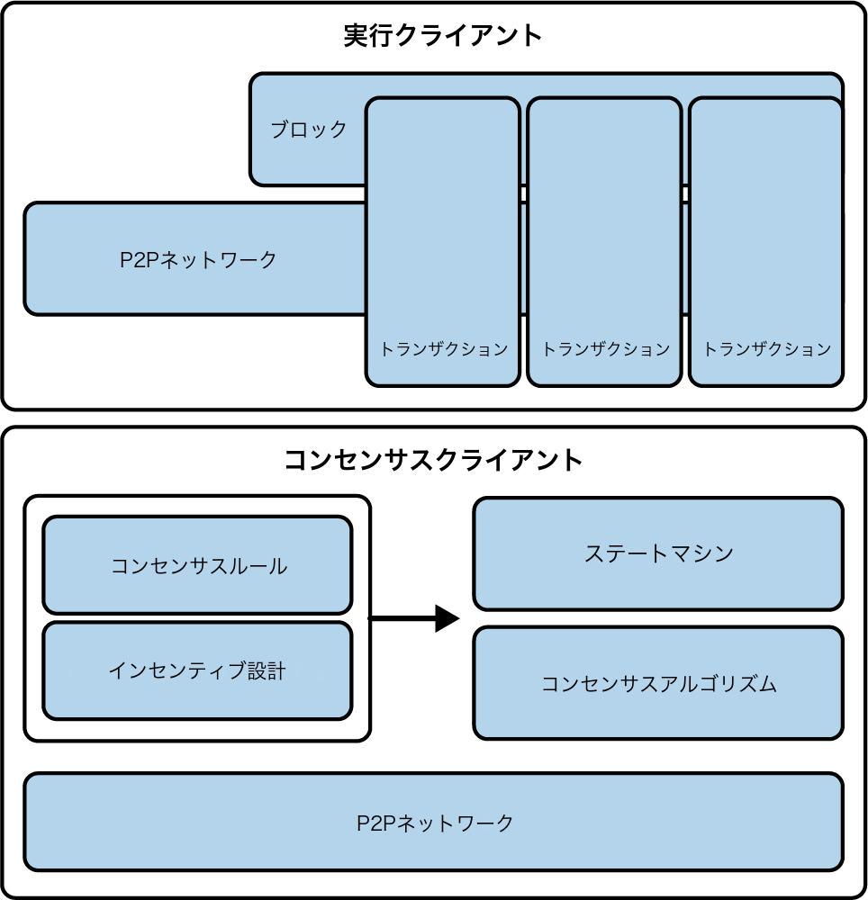

# 第1章　イーサリアムとは何か

　イーサリアムはしばしば「ワールドコンピューター」と呼ばれます。しかしそれはどういう意味でしょうか。まずコンピューターサイエンスの観点から説明し、次にイーサリアムの機能や特徴をより実践的に分析します。その上で、ビットコインをはじめとする非中央集権的な情報交換プラットフォーム（正確には*ブロックチェーン*）と比較してみましょう。

　コンピューターサイエンスの観点から見ると、イーサリアムは決定論的でありながら事実上無制限の状態マシンです。グローバルにアクセス可能なシングルトン状態と、その状態に変更を適用する仮想マシンで構成されています。

　より実践的な観点から見ると、イーサリアムは*スマートコントラクト*と呼ばれるプログラムを実行する、オープンソースでグローバルに非中央集権的なコンピューティング基盤です。ブロックチェーンを使用してシステムの状態変更を同期・保存し、*ether*と呼ばれる暗号通貨を使用して実行リソースのコストを計測・制限します。

　イーサリアムプラットフォームを使えば、開発者は経済的な機能が組み込まれた強力な分散アプリケーションを構築できます。高可用性、監査可能性、透明性、中立性を提供しつつ、検閲を削減または排除し、特定のカウンターパーティリスクを軽減します。

## イーサリアムとビットコインの比較

　多くの人は暗号通貨、特にビットコインの経験を経てイーサリアムに接します。イーサリアムは他のオープンブロックチェーンと多くの要素を共有しています。参加者を接続するピアツーピア（P2P）ネットワーク、状態更新の同期のためのビザンチン耐障害性コンセンサスアルゴリズム、デジタル署名やハッシュ値などの暗号プリミティブの使用、デジタル通貨（ether）がそれにあたります。一方で、イーサリアムの目的と構造はビットコインを含む先行するオープンブロックチェーンとは大きく異なります。

　イーサリアムの主な目的は、デジタル通貨の決済ネットワークになることではありません。デジタル通貨であるetherはイーサリアムの運用に不可欠ですが、ワールドコンピューターとしてのイーサリアムプラットフォームの利用料を支払うための*ユーティリティ通貨*として設計されています。

　非常に限定されたスクリプト言語を持つビットコインとは異なり、イーサリアムは任意かつ無制限の複雑さを持つコードを実行できる仮想マシンを備えた、汎用的でプログラム可能なブロックチェーンとして設計されています。ビットコインのScript言語が使用条件の単純な真偽評価に意図的に制約されているのに対し、イーサリアムの言語は*チューリング完全*です。つまり、イーサリアムは汎用コンピューターとして機能できます。

　2022年9月、イーサリアムはThe Mergeアップグレードによりコンセンサスモデルをproof-of-work（PoW）からproof-of-stake（PoS）に移行し、ビットコインとの差別化をさらに進めました。この変更は環境負荷の削減に対するイーサリアムの取り組みを示すだけでなく、革新的なビジョンに沿ったものであり、スケーラビリティとセキュリティの機能も強化しています。

## ブロックチェーンの構成要素

　オープンなパブリックブロックチェーンの構成要素は（通常）以下の通りです：

- 参加者を接続し、標準化された「ゴシップ」プロトコルに基づいてトランザクションと、検証済みトランザクションから成るブロックを伝播するP2Pネットワーク
- 状態遷移を表すメッセージ（トランザクションの形式）
- トランザクションの構成要件と有効な状態遷移の条件を規定するコンセンサスルールの集合
- コンセンサスルールに従ってトランザクションを処理する状態マシン
- 検証・承認されたすべての状態遷移のジャーナルとして機能する、暗号学的に保護されたブロックの連鎖
- コンセンサスルールの執行に参加者の協力を強制することで、ブロックチェーンに対する制御を非中央集権化するコンセンサスアルゴリズム
- オープンな環境で状態マシンを経済的に保護するための、ゲーム理論に基づいたインセンティブ設計（例：PoWコスト＋ブロックリワード）
- これらの構成要素の1つ以上のオープンソースソフトウェア実装（「クライアント」）

　これらの構成要素のすべて、または大部分は、通常は単一のソフトウェアクライアントに統合されています。例えばビットコインでは、リファレンス実装はビットコインコアのオープンソースプロジェクトが開発し、ビットコインクライアントとして実装しています。当初、イーサリアムもPoSへの移行前は単一のクライアントを必要としていました。ただし現在はコンセンサス用と実行用の2つの異なるクライアントを利用しています。

　リファレンス実装の代わりに、イーサリアムはリファレンス仕様に依拠しています。これは[「イエローペーパー」](https://oreil.ly/IJ7_B)に詳述された数学的記述であり、イーサリアムの開発を通じて一貫して更新されてきました。現在、イーサリアムコミュニティは[コンセンサス](https://oreil.ly/yjU6s)と[実行](https://oreil.ly/ggODg)の両クライアントについて、Pythonで記述したリファレンス仕様への移行を進めています。このリファレンス仕様に基づいて多数のクライアントが構築されています。このトピックについては第3章で詳しく掘り下げます。

　図1-1はブロックチェーンの構成要素をグラフィカルに表現したものです。

**図1-1.** ブロックチェーンの構成要素

　過去には、*ブロックチェーン*という用語を、上記の構成要素すべてを包含する技術の組み合わせを指す簡略表現として使用していました。しかし今日では、異なる特性を持つ非常に多様なブロックチェーンが存在します。対象のブロックチェーンの特徴を理解するには修飾語が必要です。*オープン、パブリック、グローバル、非中央集権、中立*、*検閲耐性*といった言葉を使い、これらの構成要素が実現する「ブロックチェーン」システムの重要な創発的特性を特定します。

　すべてのブロックチェーンが同じように作られているわけではありません。多くの特性を共有していますが、ブロックチェーンはパーミッションレスかパーミッションドか、パブリックかプライベートかで大きく分類できます：

**パーミッションレス**

　ビットコインやイーサリアムのようなパーミッションレスブロックチェーンは誰でもアクセスできる。これらの非中央集権的なネットワークでは誰でも参加でき、コンセンサスプロセスに関与し、データの読み書きを行い、透明性を通じて信頼を促進している。

**パーミッションド**

　パーミッションドブロックチェーンはアクセスを制限し、認可された参加者だけがネットワークに参加して特定のアクションを実行できる。

**パブリック**

　パブリックブロックチェーンは非中央集権的であり、すべての人に開放されている。ネットワーク活動への幅広い参加を可能にし、広範な分散とコンセンサスメカニズムによって透明性を確保している。

**プライベート**

　プライベートブロックチェーンは、特定の参加者グループ（多くの場合、組織内または信頼できるパートナー間）にアクセスを制限している。

## イーサリアムの誕生

　すべての偉大なイノベーションは現実の問題を解決するものであり、イーサリアムも例外ではありません。イーサリアムは、人々がビットコインモデルの力を認識し、暗号通貨のアプリケーションを超えようとしていた時期に着想されました。ただし開発者たちはジレンマに直面していました。ビットコインの上に構築するか、新しいブロックチェーンを始めるかという選択です。

　ビットコインの上に構築するということは、ネットワークの意図的な制約の中で生き、その回避策を模索することを意味しました。限定されたトランザクションタイプやデータタイプ、データストアのサイズは、ビットコイン上で直接実行できるアプリケーションの種類を制限していました。それ以外のものにはオフチェーンレイヤーが必要となり、パブリックブロックチェーンの利点の多くが失われてしまいます。オンチェーンで自由度と柔軟性を求めるプロジェクトにとって、新しいブロックチェーンが唯一の選択肢でした。とはいえそれは、すべてのインフラ要素のブートストラップ、徹底的なテストなど、多大な作業を意味していました。

　2013年末、若いプログラマーでビットコイン愛好家のヴィタリック・ブテリンは、ビットコインとMastercoin（初歩的なスマートコントラクトを提供するためにビットコインを拡張するオーバーレイプロトコル）の機能をさらに拡張することを考え始めました。同年10月、ブテリンはMastercoinチームに対し、Mastercoinの専用コントラクト言語を柔軟でスクリプト可能な（ただしチューリング完全ではない）コントラクトに置き換える、より一般化されたアプローチを提案しました。Mastercoinチームは感銘を受けましたが、この提案は開発ロードマップに組み込むにはあまりにも急進的な変更でした。

　2013年12月、ブテリンはイーサリアムの背後にあるアイデアを概説したホワイトペーパーを共有し始めました。チューリング完全な汎用ブロックチェーンというアイデアです。数十人がこの初期草稿を目にしてフィードバックを提供し、ブテリンの提案を進化させる手助けをしました。

　本書の原著者であるアンドレアス・M・アントノプロスとギャヴィン・ウッド博士の両名は、ホワイトペーパーの初期草稿を受け取りコメントしました。アントノプロスはこのアイデアに興味を持ち、スマートコントラクトの実行に関するコンセンサスルールを強制するために別のブロックチェーンを使用することや、チューリング完全言語の意味について、ブテリンに多くの質問をしました。アントノプロスは大きな関心を持ってイーサリアムの進捗を追い続けましたが、著書*Mastering Bitcoin*の執筆初期段階にあったため、イーサリアムへの直接参加はずっと後のことになりました。一方、ウッドはブテリンに連絡を取り、C++プログラミングのスキルで協力を申し出た最初の人物の一人でした。ウッドはイーサリアムの共同創設者、共同設計者、CTOとなりました。

　ブテリンは[「A Prehistory of the Ethereum Protocol」の投稿](https://oreil.ly/kEjpX)で次のように回想しています：

> これはイーサリアムプロトコルが完全に自分自身の創作物であった時期であった。しかし、ここから新たな参加者が加わり始めた。プロトコル側で最も傑出していたのはギャヴィン・ウッドである。

　ウッドは、イーサリアムをプログラム可能なマネーのプラットフォーム（デジタル資産を保持し、あらかじめ設定されたルールに従って転送するブロックチェーンベースのコントラクト）から、汎用コンピューティングプラットフォームへとビジョンを転換する上で大きな功績があります。この変化は強調点と用語の微妙な変化から始まり、やがて「Web3」構想への注目の高まりとともに影響が強くなっていきました。Web3はイーサリアムをWhisperとSwarmという他の2つの非中央集権的な技術とともに、一連の非中央集権的な技術の一部として捉えるものです。2013年12月から、ブテリンとウッドはそのアイデアを洗練・発展させ、イーサリアムのプロトコル層を共に構築していきました。

　イーサリアムの創設者たちは、特定の目的を持たないブロックチェーンを考えていました。*プログラム*することで幅広い種類のアプリケーションをサポートできるものです。イーサリアムのような汎用ブロックチェーンを使えば、開発者はP2Pネットワーク、ブロックチェーン、コンセンサスアルゴリズムなどの基盤メカニズムを実装せずに、自身のアプリケーションをプログラムできます。イーサリアムはこれらの詳細を抽象化し、分散アプリケーションを記述するための決定論的で安全な環境を提供します。この考え方の転換は開発を容易にしただけでなく、ブロックチェーンにできることを根本的に拡大しました。分散金融、NFT、分散自律組織（DAO）といった全く新しいセクターの基盤を築いたのです。これらは以前の単一目的のブロックチェーンでは実現できなかったものです。

　ビットコインの匿名開発者であるサトシ・ナカモトと同様に、ブテリンとウッドは単に新しい技術を発明しただけではありません。新しい発明と既存の技術を斬新な方法で組み合わせ、自らのアイデアを世界に証明するプロトタイプコードを提供しました。

　創設者たちはビジョンの構築と洗練に何年も費やしました。そして2015年7月30日、最初のイーサリアムブロックがマイニングされました。ワールドコンピューターは世界にサービスを提供し始めたのです。

> **注記**
>
> ヴィタリック・ブテリンの記事[「A Prehistory of the Ethereum Protocol」](https://oreil.ly/kEjpX)は2017年9月に公開され、イーサリアムの最初期の時代について魅力的な一人称視点の記述を提供しています。

## イーサリアムの開発段階

　イーサリアムの開発は4つの段階にわたって計画され、各段階で大きな変更が行われました。各段階には、後方互換性のない方法で機能を変更する*ハードフォーク*と呼ばれるサブリリースが含まれることがあります。

　4つの主要な開発段階には、フロンティア、ホームステッド、メトロポリス、セレニティというコードネームが付けられています。執筆時点では最後の段階であるセレニティにあります。セレニティはさらに6つのサブステージに分けられ、The Merge、The Surge、The Scourge、The Verge、The Purge、The Splurgeというコードネームが付けられています。

　それでは4つの開発段階について、その主な目的を説明しましょう：

**フロンティア（2015年7月30日）**

　ジェネシス（最初のイーサリアムブロックがマイニングされた時）にローンチされたフロンティアは、マイニングリグのセットアップやETHトークンの取引開始、最小限のネットワーク環境でのDAppテストを可能にし、マイナーと開発者のための基盤を準備しました。当初ブロックにはガスリミットが5000に設定されていましたが、2015年9月にこの制限が解除されてトランザクションが可能となりました。またこの時期に「ディフィカルティボム」が導入されました。イーサリアムの*ディフィカルティボム*は、時間の経過とともにマイニングのディフィカルティを指数関数的に増加させ、最終的にマイニングを実行不可能にするメカニズムです。これにより、元のPoWコンセンサスからエネルギー効率の高いPoSモデルへの移行が促進されました。

**ホームステッド（2016年3月14日）**

　ブロック1,150,000で開始されたホームステッドは、主要なプロトコル更新（EIP-2、EIP-7、EIP-8）によりイーサリアムをより安全で安定させました。これらのアップグレードは開発者の利便性を向上させ、さらなるプロトコル改善への道を開きましたが、ネットワークはベータフェーズのままでした。

**メトロポリス（2017年10月16日）**

　ブロック4,370,000から始まったメトロポリスは、ネットワーク機能の向上を目指し、DAppの作成とネットワーク全体のユーティリティを促進しました。このフェーズではビザンチウム、コンスタンティノープル、イスタンブールなどの重要なフォークにより、ガスコストの最適化やセキュリティの強化、レイヤー2（L2）スケーリングソリューションの導入が行われました。

　ビザンチウムフォークはマイニングリワードを削減し、暗号学的な仕組みを実装しました。コンスタンティノープルフォークはガスコストをさらに最適化し、未作成のアドレスとの相互作用を可能にしました。イスタンブールは分散型サービス拒否（DDoS）攻撃に対するネットワークの耐性を高め、スケーラビリティとプライバシーを向上させるゼロ知識暗号証明（zk-SNARKsとSTARKs）を導入しました。これらの強化は総合的にEthereum 2.0への道を整え、Ethereum 1.0の最終フェーズを表しています。

**セレニティ（2022年9月15日）**

　セレニティは一般に*Ethereum 2.0*として知られ、イーサリアムをPoWからPoSコンセンサスメカニズムに変革する大規模なアップグレードです。イーサリアムをより持続可能にし、増大するユーザーとアプリケーションに対応できるようにすることに焦点を当てています。この段階は高いエネルギー消費とネットワーク輻輳という問題に対処し、より堅牢で効率的なブロックチェーンへの道を開きます。

　セレニティのアップグレードは、ネットワークの進化の特定の側面に対処するいくつかのサブステージに分かれています。主要な4つの開発段階は順次実装されてきましたが、セレニティの5つのサブステージは同時に開発されています。この並行アプローチは従来の開発手法からの戦略的な転換です。最初の4つの段階で築かれた基盤がセレニティのサブステージの同時開発を可能にしました。各サブステージはイーサリアムチェーンの異なる側面を改善するものであり、互いに独立しているため、より柔軟でダイナミックなアップグレードプロセスが可能になっています：

**The Merge**

　The Mergeはイーサリアムのメインネットとビーコンチェーン（PoSコンセンサスを処理するサイドチェーン）を統合しました。これによりネットワークは正式にPoSに移行し、エネルギー消費を大幅に削減しました。

**The Surge**

　The Surgeはシャーディングを導入し、ネットワークをより小さく管理可能な部分に分割してイーサリアムのスケーラビリティを向上させ、1秒あたりのトランザクション数を増やします。

**The Scourge**

　The Scourgeは中央集権化と検閲耐性の問題に取り組み、イーサリアムが非中央集権的でオープンなネットワークであり続けることを目指します。

**The Verge**

　The VergeはVerkleツリーを実装し、ノードに必要なデータストアを削減してネットワークの効率性とスケーラビリティを向上させます。

**The Purge**

　The Purgeはイーサリアムに保存される履歴データを削減し、ノード運用を簡素化し、ネットワークの輻輳を低減することを目指します。

**The Splurge**

　The Splurgeは、すべての主要な変更の実装後にイーサリアムがスムーズかつ効率的に動作するよう、さまざまなマイナーアップグレードと最適化を含みます。

## イーサリアム：汎用ブロックチェーン

　元祖ブロックチェーンであるビットコインのブロックチェーンは、ビットコインの単位とその所有権の状態を追跡します。ビットコインは分散コンセンサス*状態マシン*と考えることができ、トランザクションがコインの所有権を変更するグローバルな*状態遷移*を引き起こします。状態遷移はコンセンサスルールによって制約され、数ブロックのマイニング後にすべての参加者が（最終的には）システムの共通状態に収束します。

　イーサリアムも分散状態マシンです。しかし通貨の所有権の状態だけを追跡するのではなく、汎用データストアの状態遷移を追跡します。つまり*キーバリューペア*として表現可能な任意のデータを保持できるデータストアです。キーバリューデータストアは、何らかのキーによって参照される任意の値を保持します。例えば「Book Title」というキーで参照される「Mastering Ethereum」という値です。これはほとんどの汎用コンピューターが使用するランダムアクセスメモリ（RAM）のデータストアモデルと同じ目的を果たします。

　イーサリアムはコードとデータの両方を格納するメモリを持ち、このメモリの変化をイーサリアムブロックチェーンで追跡します。汎用のストアドプログラムコンピューターと同様に、イーサリアムは自身の状態マシンにコードをロードして*実行*し、結果として生じる状態変更をブロックチェーンに保存できます。ほとんどの汎用コンピューターとの重要な違いは2つあります。イーサリアムの状態変更がコンセンサスルールに従うことと、状態がグローバルに分散されていることです。イーサリアムは「任意の状態を追跡し、状態マシンをプログラムして、コンセンサスの下で動作するワールドコンピューターを作れたらどうだろうか」という問いに答えます。

## イーサリアムの構成要素

　イーサリアムでは、ブロックチェーンシステムの構成要素（「ブロックチェーンの構成要素」で説明したもの）は、より具体的には以下の通りです：

**P2Pネットワーク**

　イーサリアムは*イーサリアムメインネット*上で動作し、TCPポート30303でアドレス指定可能であり、[*ÐΞVp2p*](https://oreil.ly/pUfGC)と呼ばれるプロトコルを実行します。

**コンセンサスルール**

　イーサリアムの元のコンセンサスプロトコルは、リファレンス仕様である「イエローペーパー」で定義されたPoWモデルのEthashでした。その後、2022年9月のThe Mergeアップグレードの際にPoSに移行しました（第15章参照）。

**トランザクション**

　イーサリアムのトランザクションは、（とりわけ）送信者、受信者、バリュー、データペイロードを含むネットワークメッセージです。

**状態マシン**

　イーサリアムの状態遷移は、*イーサリアム仮想マシン*（EVM）によって処理されます。EVMはバイトコード（機械語命令）を実行するスタックベースの仮想マシンです。*スマートコントラクト*と呼ばれるEVMプログラムは、高水準言語（例：Solidity）で記述され、EVM上で実行するためにバイトコードにコンパイルされます。

**データ構造**

　イーサリアムの状態は各ノードにローカルな*データベース*（通常はGoogleのLevelDB）として保存されます。トランザクションとシステム状態は*マークルパトリシアツリー*と呼ばれるシリアライズされたハッシュデータ構造に格納されています。

**コンセンサスアルゴリズム**

　イーサリアムはエネルギー効率とスケーラビリティの向上のため、PoWからPoSコンセンサスメカニズムに移行しました。PoSではバリデーターが暗号通貨をステークし、トランザクションの検証、新しいブロックの作成、ネットワークセキュリティの維持を行う権利を獲得します。イーサリアムのPoSは2つのアルゴリズムを融合したものです。Casper the Friendly Finality Gadget（FFG）とGHOST（Greedy Heaviest Observed Subtree）の最新メッセージ駆動型（LMD）更新版です（詳細は第15章で説明します）。

**経済的セキュリティ**

　イーサリアムはGasperと呼ばれるPoSアルゴリズムでブロックチェーンに経済的セキュリティを提供します。Gasperの仕組みについてはファイナリティとバリデーターの協調における役割を含め、第15章で詳しく説明します。

**クライアント**

　イーサリアムには、実行クライアントとコンセンサスクライアントの相互運用可能な複数の実装があり、最も著名なものとして、実行用の*go-ethereum*（Geth）とNethermind、コンセンサス用のPrysmとLighthouseがあります。

　ここで言及した技術に関する追加情報は以下の参考文献で得られます：

- [イーサリアム「イエローペーパー」](https://oreil.ly/IJ7_B)
- [コンセンサスクライアントのPython仕様](https://oreil.ly/yjU6s)
- [実行クライアントのPython仕様](https://oreil.ly/ggODg)

## イーサリアムとチューリング完全性

　イーサリアムについて読み始めるとすぐに*チューリング完全*という用語に出会うでしょう。イーサリアムはビットコインとは異なりチューリング完全であると言われます。これは正確にはどういう意味でしょうか。

　この用語はコンピューターサイエンスの父と見なされるイギリスの数学者アラン・チューリングにちなんでいます。1936年、チューリングはシーケンシャルメモリ（無限長の紙テープに似たもの）上のシンボルを読み書きして操作する状態マシンで構成されるコンピューターの数学的モデルを作成しました。この構成によりチューリングは*普遍的計算可能性*、すなわちすべての問題が解決可能かどうかという問いに数学的基盤を提供しました（答えは否定的でした）。チューリングは計算不可能な問題のクラスが存在することを証明しました。具体的には*停止問題*（任意のプログラムとその入力が与えられた場合に、そのプログラムが最終的に停止するかどうかを判定できるか）が解決不能であることを証明しました。

　チューリングはさらに、任意のチューリングマシンをシミュレートするために使用できるシステムを*チューリング完全*と定義しました。このようなシステムは*ユニバーサルチューリングマシン*（UTM）と呼ばれます。

　EVMと呼ばれる状態マシンでストアドプログラムを実行し、メモリにデータを読み書きできることが、イーサリアムをチューリング完全なシステム、すなわちUTMにしています。イーサリアムは有限メモリの制約はあるものの、任意のチューリングマシンで計算可能なあらゆるアルゴリズムを計算できます。

　イーサリアムの画期的な革新は、ストアドプログラムコンピューターの汎用コンピューティングアーキテクチャと非中央集権的なブロックチェーンを組み合わせ、分散された単一状態（シングルトン）のワールドコンピューターを作り出したことです。イーサリアムプログラムは「あらゆる場所で」実行されながら、コンセンサスルールで保護された共通の状態を生成します。

## 「機能」としてのチューリング完全性

　イーサリアムがチューリング完全であると聞くと、チューリング不完全なシステムに欠けている*機能*だと思うかもしれません。実際にはその逆です。チューリング完全性は非常に容易に達成できます。[既知の最も単純なチューリング完全状態マシン](https://oreil.ly/JhL2o)は4つの状態と6つのシンボルを持ち、その状態定義はわずか22命令です。実のところ、システムが「偶然にチューリング完全」だと判明する場合もあります（[そのようなシステムの面白い参考資料はこちら](https://oreil.ly/7pt2q)）。

　一方でチューリング完全性は非常に危険でもあります。特に前のセクションで説明した停止問題があるため、パブリックブロックチェーンのようなオープンアクセスシステムでは問題になります。例えば現代のプリンターはチューリング完全であり、プリンターをフリーズさせるファイルを印刷させることができます。イーサリアムがチューリング完全であるということは、任意の複雑さのプログラムを計算できることを意味します。ただしその柔軟性はやっかいなセキュリティとリソース管理の問題をもたらします。応答しないプリンターは電源を切って再度入れれば済みますが、パブリックブロックチェーンではそれは不可能です。

## チューリング完全性の意味するもの

　チューリングは、プログラムをコンピューター上でシミュレートしても終了するかどうかを予測できないことを証明しました。簡単に言えば、プログラムを実行せずにその経路を予測することはできません。チューリング完全なシステムは*無限ループ*に陥る可能性があります。無限ループとは（簡略化して言えば）終了しないプログラムを指す用語です。終了しないループを実行するプログラムの作成は簡単です。ただし意図しない無限ループは、開始条件とコードの複雑な相互作用により警告なく発生することがあります。

　イーサリアムではこれが課題になります。すべての参加ノード（クライアント）はすべてのトランザクションを検証し、呼び出されたスマートコントラクトを実行しなければなりません。チューリングが証明したように、スマートコントラクトが終了するかどうか、どれだけの時間実行されるかを、実際に実行せずに予測することはできません。偶然にせよ意図的にせよ、ノードが検証を試みる際に永遠に実行されるスマートコントラクトを作成できます。これは事実上DoS攻撃です。

　もちろん、検証に1ミリ秒かかるプログラムと永遠に実行されるプログラムの間には、リソースを浪費しメモリを膨張させ、CPUを過熱させる厄介なプログラムが無数に存在します。ワールドコンピューターでは、リソースを濫用するプログラムは世界のリソースを濫用することになります。リソース使用を事前に予測できないのに、イーサリアムはスマートコントラクトが使用するリソースをどのように制約するのでしょうか。

　この課題に対処するため、イーサリアムは*ガス*と呼ばれる計量メカニズムを導入しました。EVMがスマートコントラクトを実行する際、すべての命令（計算、データアクセスなど）を慎重に計上します。各命令にはガス単位で事前に決められたコストがあります。トランザクションがスマートコントラクトの実行をトリガーする際は、実行中に消費できるガス量の上限を含める必要があります。消費されるガス量がトランザクションで利用可能なガスを超えると、EVMは実行を終了します。ガスは、イーサリアムがチューリング完全な計算を可能にしつつ、プログラムが消費できるリソースを制限するメカニズムです。

　次の疑問は、イーサリアムワールドコンピューターでの計算の対価としてガスをどう入手するかです。ガスはどの取引所でも見つかりません。トランザクションの一部としてのみ購入でき、etherでしか購入できません。etherはトランザクションとともに送信し、許容可能なガスプライスとともにガスの購入に明示的に充てる必要があります。ガソリンスタンドと同様にガスの価格は固定されていません。ガスはトランザクション用に購入され、計算が実行され、未使用のガスはトランザクションの送信者に返金されます。

## 汎用ブロックチェーンからDAppへ

　イーサリアムはさまざまな用途にプログラムできる汎用ブロックチェーンを作る方法として始まりました。そのビジョンは非常に速く拡大し、DApp向けプラットフォームへと発展しました。DAppはスマートコントラクトよりも広い視点を持っています。最低限、スマートコントラクトとウェブユーザーインターフェースで構成されます。より広い意味では、オープンで非中央集権的なP2Pインフラサービスの上に構築されたウェブアプリケーションです。

　DAppは少なくとも以下で構成されます：

- ブロックチェーン上のスマートコントラクトである
- ウェブフロントエンドユーザーインターフェースである

　さらに、多くのDAppには以下のような他の非中央集権的なコンポーネントが含まれます：

- 非中央集権的な（P2P）ストレージプロトコルとプラットフォームである
- 非中央集権的な（P2P）メッセージングプロトコルとプラットフォームである

　実践的な観点から見ると、イーサリアムのweb3.js JavaScriptライブラリーはブラウザで実行されるJavaScriptアプリケーションとイーサリアムブロックチェーンを橋渡しします。当初はSwarmと呼ばれるP2PストレージネットワークとWhisperと呼ばれるP2Pメッセージングサービスを含んでおり、完全に非中央集権的なWeb3 DAppの開発を可能にするツールでした。しかしこの完全に非中央集権的なDApp設計はその後数年間はあまり普及しませんでした。ユーザーエクスペリエンスの向上とユーザーの採用促進のために妥協が必要となり、スマートコントラクトとやり取りする中央集権型のWeb2ウェブサイトが現在ではDAppの標準となっています。

## インターネットの第三の時代

　2004年、*Web 2.0*という用語が、ユーザー生成コンテンツ、レスポンシブなインターフェース、インタラクティビティへのウェブの進化を示すラベルとして注目を集めました。Web 2.0は技術仕様ではなく、ウェブアプリケーションの新たな焦点を表す用語です。

　DAppの概念は、ウェブアプリケーションのあらゆる側面にP2Pプロトコルによる非中央集権化を導入し、ウェブを次の自然な進化段階に進めることを目的としています。この進化を表す用語が*Web3*であり、ウェブの第三の「バージョン」を意味します。ギャヴィン・ウッドが最初に提案したWeb3は、ウェブアプリケーションの新しいビジョンと焦点を表しています。中央で所有・管理されるアプリケーションから、非中央集権的なプロトコル上に構築されたアプリケーションへの転換です。

## イーサリアムの開発文化

　ここまで、イーサリアムの目標と技術が、ビットコインのような先行するブロックチェーンとどのように異なるかについて話してきました。イーサリアムはまた、非常に異なる開発文化を持っています。

　ビットコインでは、開発は保守的な原則に導かれています。すべての変更は既存のシステムを壊さないよう慎重に検討されます。ほとんどの場合、変更は後方互換性がある場合にのみ実装されます。既存のクライアントはオプトインが許可されており、アップグレードしなくても引き続き動作します。この慎重なアプローチはビットコインのガバナンスモデルと整合しており、変更はBitcoin Improvement Proposal（BIP）プロセスを経ます。BIPプロセスは安定性を維持するため意図的に遅く、コンセンサス駆動のパイプラインとして設計されています。

　対照的に、イーサリアムコミュニティの開発文化は過去ではなく未来に焦点を当てています。（完全に本気ではありませんが）「素早く動いて壊せ」というマントラがあります。変更が必要な場合、それまでの仮定を無効にしたり、互換性を破壊したり、クライアントに更新を強制することになっても実装されます。イーサリアムのガバナンスはこの実践的なスタイルを反映しています。研究者、クライアントチーム、エコシステムの利害関係者が今後の変更を議論・協議する頻繁なAllCoreDevsコールを通じて公開的に調整が行われます。これは安定性の一部を犠牲にして、より速いイノベーションのペースを得るアジャイルで反復的なプロセスです。

　開発者にとってこれは、基盤となる前提が変更されたときにインフラを再構築する準備を常に持ち、柔軟性を維持する必要があるということです。イーサリアムの開発者が直面する大きな課題の一つは、イミュータブルなシステムへのコードデプロイと、まだ進化中の開発プラットフォームとの間にある本質的な矛盾です。スマートコントラクトを単に「アップグレード」することはできません。新しいコントラクトをデプロイし、ユーザー、アプリ、資金を移行して最初からやり直す準備が必要です。

　皮肉なことに、これはより自律的で中央集権的な制御の少ないシステムを構築するという目標がまだ完全には実現されていないことも意味します。自律性と非中央集権化には、今後数年間にイーサリアムで得られるよりも、もう少しプラットフォームの安定性が必要です。プラットフォームを「進化」させるにはスマートコントラクトを破棄して再スタートする準備が必要であり、スマートコントラクトに対して一定程度の制御を保持しなければなりません。

　しかし良い面もあります。イーサリアムは非常に速く前進しています。*バイクシェディング*の余地はほとんどありません。バイクシェディングとは、原子力発電所の裏の自転車置き場をどう建てるかといった些細なことに関する議論で開発を止めてしまうことを表す言葉です。バイクシェディングを始めると、気を取られている間に開発チームの残りのメンバーが計画を変更し、自転車を捨てて自律型ホバークラフトに乗り換えていたことに突然気づくかもしれません。

　最終的に、イーサリアムプラットフォームの開発は減速し、インターフェースは固定されるでしょう。しかしそれまでの間、イノベーションが指導原則です。誰もあなたのために減速してくれないので、ついていく方がよいでしょう。

## なぜイーサリアムを学ぶのか

　ブロックチェーンの学習曲線は非常に急です。プログラミング、情報セキュリティ、暗号学、経済学、分散システム、P2Pネットワークなど複数の分野を1つの領域に組み合わせているためです。イーサリアムはこの学習曲線をかなり緩やかにしてくれるので、すぐに始めることができます。しかし一見シンプルな環境の表面のすぐ下には多くのことが隠れています。学び、より深く見ていくと、常に別の複雑さと驚きのレイヤーが存在します。

　イーサリアムはブロックチェーンを学ぶための素晴らしいプラットフォームであり、他のどのブロックチェーンプラットフォームよりも速く膨大な開発者コミュニティを構築しています。他のどのプラットフォームよりもイーサリアムは*開発者のためのブロックチェーン*です。開発者による、開発者のための構築です。JavaScriptアプリケーションに精通した開発者であれば、イーサリアムに飛び込んですぐに動作するコードを書き始めることができます。イーサリアムの最初の数年間はわずか5行のコードでトークンを作成できると書かれたTシャツをよく見かけました。もちろんこれは諸刃の剣です。コードを書くのは簡単ですが、*良い*コードや*安全な*コードを書くのは非常に難しいのです。

　L2をはじめ多くのブロックチェーンプロジェクトはイーサリアムをベースにしています。イーサリアムを学ぶことでこれらのプロジェクトをより深く理解し、ブロックチェーン世界のさらなる発展を探求するツールを得ることができます。この知識は最新のブロックチェーン技術に関わりたいすべての人にとって鍵となるものです。

## まとめ

　イーサリアムはブロックチェーンの世界で画期的なプラットフォームとして際立っています。チューリング完全なシステムとして設計されたことで、ビットコインのシンプルな機能を超えた、洗練されたプログラム可能なロジックを持つ分散アプリケーションを作成できます。

　開発者や技術者にとって、イーサリアムを理解することはブロックチェーン技術とその潜在的なアプリケーションのより深い理解への扉を開きます。イーサリアムを習得すれば、インターネットの継続的な進化に参加し貢献するためのツールを得て、この分野の最先端に立つことができます。
