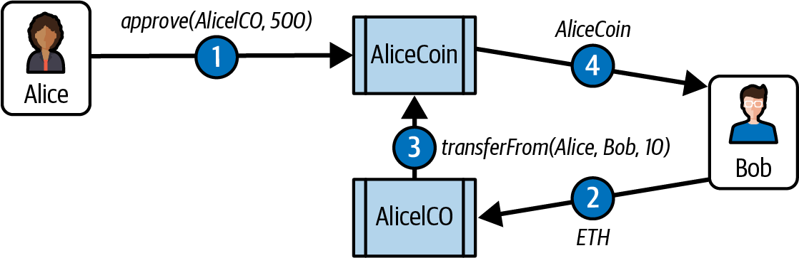

# 第10章 トークン

　*token*（トークン）という言葉は、古英語の*tācen*に由来し、記号やシンボルを意味します。一般的には、交通トークン、コインランドリーのトークン、アーケードゲームのトークンなど、本質的な価値がほとんどない私的発行の特殊用途コイン状のものを指す言葉として使われてきました。今日では、ブロックチェーン上で管理されるトークンがこの言葉の意味を再定義しつつあります。所有可能で、資産・通貨・アクセス権を表現するブロックチェーンベースの抽象概念を意味するようになっています。

　*token*という言葉と取るに足らない価値との結びつきは、物理的なトークンの用途が限定的だったことに大きく関係しています。物理的なトークンは特定の事業者・組織・場所に限定されることが多く、容易に交換できず、通常は単一の機能しか持ちません。ブロックチェーントークンでは、こうした制約が取り除かれるか、より正確に言えば、制約そのものを再定義できるようになります。多くのブロックチェーントークンはグローバルに複数の目的を果たし、流動性のある市場で互いにまたは他の通貨と交換できます。使用や所有に関する制約がなくなることで、「取るに足らない価値」という認識も過去のものとなっています。

　本章では、トークンのさまざまな用途と、トークンの作成方法について説明します。また、代替可能性や内在性といったトークンの属性についても議論します。最後に、トークンの基盤となる標準規格や技術を検証し、独自のトークンを構築する実験を行います。

## トークンの使われ方

　トークンの最も明白な用途は、デジタルの私的通貨です。しかし、これは可能な用途のひとつに過ぎません。トークンはさまざまな機能を果たすようにプログラムでき、それらはしばしば重複します。たとえば、あるトークンが投票権、アクセス権、リソースの所有権を同時に持つことがあります。以下のリストが示すように、通貨は最初の「アプリ」に過ぎません。

**通貨**

トークンは通貨の一形態として機能し、その価値は私的な取引を通じて決定される。

**リソース**

トークンは、シェアリングエコノミーやリソース共有環境で獲得または生成されたリソースを表現できる。たとえば、ネットワーク上で共有可能なリソースを表すストレージトークンやCPUトークンなどである。

**資産**

トークンは、内在的または外在的、有形または無形の資産の所有権を表現できる。たとえば、金、不動産、自動車、石油、エネルギー、MMOGのアイテムなどである。

**アクセス**

トークンはアクセス権を表現し、ディスカッションフォーラム、限定的なウェブサイト、ホテルの部屋、レンタカーなど、デジタルまたは物理的な資産へのアクセスを付与できる。

**エクイティ**

トークンは、デジタル組織（例: DAO）または法人（例: 株式会社）における株主資本を表現できる。

**投票**

トークンはデジタルまたは法的システムにおける投票権を表現できる。

**コレクティブル**

トークンはデジタルコレクティブル（例: CryptoPunks）または物理的なコレクティブル（例: 絵画）を表現できる。

**アイデンティティ**

トークンはデジタルアイデンティティ（例: アバター）または法的なアイデンティティ（例: 国民ID）を表現できる。

**アテステーション**

トークンは、何らかの権威者または分散型評判システムによる事実の証明やアテステーションを表現できる（例: 婚姻届、出生証明書、大学の学位）。

**ユーティリティ**

トークンはサービスへのアクセスや支払いに利用できる。

　多くの場合、ひとつのトークンがこれらの機能を複数兼ね備えています。物理的な同等物では常に不可分に結びついてきたため、区別が難しいこともあります。たとえば物理的な世界では、運転免許証（アテステーション）はアイデンティティ文書（アイデンティティ）でもあり、この2つを分離できません。デジタルの領域では、以前は混在していた機能を分離し、独立して発展させることが可能です（例: 匿名のアテステーション）。

## トークンと代替可能性

　[Wikipedia](https://oreil.ly/ge7zP)によると、「経済学において、代替可能性とは財や商品の個々の単位が本質的に交換可能である性質のこと」です。トークンが*代替可能*であるとは、任意の単位を別の単位に置き換えても価値や機能に違いが生じないことを意味します。

　*非代替性トークン*（NFT）は、各トークンが固有の有形または無形のアイテムを表現するため、相互に交換できないトークンです。たとえば*特定の*ファン・ゴッホの絵画の所有権を表すトークンは、ピカソの絵画を表す別のトークンと同等ではありません。同じ「アート所有権トークン」システムの一部であっても同様です。同じく、*特定の*デジタルコレクティブル（特定のCryptoKittyなど）を表すトークンは、他のどのCryptoKittyとも交換できません。各NFTにはシリアルナンバーなどの固有の識別子が関連付けられています。

　本章の後半で、代替可能トークンと非代替性トークンの両方の例を見ていきます。

> **注記**
>
> *代替可能*（fungible）は「お金と直接交換可能」という意味で使われることがよくある（たとえば、カジノのトークンは「換金」できるが、コインランドリーのトークンは通常できない）。本書ではこの意味では使用していない。

## カウンターパーティリスク

　*カウンターパーティリスク*とは、取引の*相手方*が義務を果たさないリスクのことです。取引に2つ以上の当事者が関与すると、カウンターパーティリスクはさらに増大します。たとえば貴金属の預かり証を持っていて、それを誰かに売る場合、そのトランザクションには少なくとも3つの当事者が存在します。売り手、買い手、そして貴金属の保管者です。物理的な資産を保有する保管者は、必然的にトランザクションの履行に関わる当事者となり、その資産に関連するあらゆるトランザクションにカウンターパーティリスクを追加します。所有権トークンの交換を通じて資産が間接的に取引される場合、保管者の存在による追加のカウンターパーティリスクが一般的に発生します。保管者は資産を保有しているのでしょうか。トークン（証書、権利書、権原、デジタルトークンなど）の移転に基づく所有権の移転を認識（または許可）するのでしょうか。資産を表すデジタルトークンの世界でも非デジタルの世界と同様に、トークンが表す資産を誰が保有し、その原資産にどのようなルールが適用されるかを理解することが重要です。

## トークンと内在性

　*intrinsic*（内在的）という言葉は、ラテン語の*intra*（内側から）に由来します。一部のトークンはブロックチェーンに内在するデジタルアイテムを表現します。こうしたデジタル資産はトークン自体と同様にコンセンサスルールによって管理されます。この点には重要な意味があります。内在的な資産を表すトークンには追加のカウンターパーティリスクが伴いません。CryptoKittyの鍵を保有していれば、他の誰かがそのCryptoKittyをあなたのために保管しているわけではなく、あなたが直接所有しています。ブロックチェーンのコンセンサスルールが適用され、秘密鍵の所有（すなわち管理）が仲介者なしに資産の所有と同等になります。

　逆に、多くのトークンは不動産、企業の議決権株式、商標、金塊、債券など*外在的*なものを表現するために使用されます。ブロックチェーンの「内側」にないこれらのアイテムの所有権は、トークンを管理するコンセンサスルールとは別に法律・慣習・方針によって管理されます。つまり、トークンの発行者と所有者は現実世界の非スマートコントラクトに依然として依存する可能性があります。こうした外在的資産は保管者によって保有され、外部の登記簿に記録され、またはブロックチェーン環境外の法律や方針によって管理されるため、追加のカウンターパーティリスクを伴います。

　ブロックチェーンベースのトークンの最も重要な意義のひとつは、外在的資産を内在的資産に変換してカウンターパーティリスクを除去できることです。良い例として、企業のエクイティ（外在的）からDAOまたは類似の（内在的）組織におけるエクイティトークンや投票トークンへの移行が挙げられます。ステーブルコインも、法定通貨にペッグされ国債や現金準備などの外在的資産によって裏付けられたブロックチェーンベースのトークンとして、もうひとつの例です。

## ユーティリティか、エクイティか、それとも金集めか

　ほぼすべてのイーサリアムプロジェクトが何らかのトークンを伴ってローンチされているようです。しかし、これらすべてのプロジェクトに本当にトークンが必要なのでしょうか。「すべてをトークン化しよう」というスローガンはキャッチーに聞こえますが、現実ははるかに複雑です。トークンはコミュニティを組織しインセンティブを付与する強力なツールになり得ますが、投機やハイプの代名詞にもなっています。

　理論上、トークンには2つの主要な目的があります。まず*ユーティリティトークン*です。ユーティリティトークンは、特定のエコシステム内でサービスやリソースへのアクセスを提供するために設計されています。たとえば分散型ネットワーク上のストレージ容量やDAppのプレミアム機能へのアクセスを表すトークンがあります。この場合、トークンの価値はプラットフォーム内での機能に紐づきます。次に*エクイティトークン*です。エクイティトークンは企業の株式のように機能することを意図しています。DAOにおける議決権やプロジェクトの利益配分など、所有権や支配権を表現できます。

　しかし実際には、これらのカテゴリの区別はしばしば曖昧です。多くのユーティリティトークンは依然として大部分が投機的であり、ユーザーはアクセス資格としてよりも資産として保有しています。エクイティ的なトークンはガバナンス権を付与する場合がありますが、意味のある参加を保証するメカニズムを欠いていることが多いです。トークンを経済モデルに深く統合しているプロジェクトもありますが、そうしたケースは例外的です。

　ここで疑問が生じます。トークンは本質的に悪いものなのでしょうか。まったくそうではありません。トークンはコミュニティの創造とインセンティブ付与や、DAOにおける分散型ガバナンスの推進に非常に効果的です。しかし現実には、ほとんどのトークンはユーティリティではなく利益を主な動機としてローンチされています。トークンのローンチや投資を考えているなら、厳しい問いを投げかける価値があります。そのトークンはプロトコルに本当に必要な目的を果たしているのか、それとも単なる資金調達ツールなのか。トークンなしでもプロジェクトは同じようにうまくいくのではないか。これらの問いに正直に答えることで、本物のイノベーションとマーケティング主導のハイプを区別できます。

　トークンの状況はまだ発展途上であり、トークンは本質的に善でも悪でもありません。その価値は設計と実装のあり方に依存します。課題は、意味のあるものと無意味なものを分別し、次のミームコインの誘惑に抗うことにあります。

> **注記**
>
> 本章の執筆時点（2025年1月）、新しく選出された大統領ドナルド・トランプが独自のミームコインをローンチし、わずか1日で時価総額150億ドルに達した。多くの人が暗号資産に好意的な政策を期待していたが、代わりに得られたのはミームコインであった。この出来事は、ハイプが実質に勝ることが多い、暗号資産を支配する投機的な熱狂を浮き彫りにしている。

## あひるだ

　トークンは長い間、スタートアップのお気に入りの資金調達ツールでした。イノベーション、分散化、そして時には完全な経済的自由を約束します。しかし問題があります。一般への証券の提供はほとんどの法域で規制された活動であり、トークンは容易に証券の領域に踏み込み得るのです。何年もの間、プロジェクトはトークンを「ユーティリティトークン」と称し、将来のサービスへのアクセスの先行販売に過ぎないと主張して規制を回避しようとしてきました。そのロジックは、トークンがエクイティの持分でなければ証券ではないというものです。しかし古い格言にあるように、「あひるのように歩き、あひるのように鳴くなら、それはあひるだ」のです。そして規制当局、特に米国証券取引委員会（SEC）はこのあひるたちに注目しています。

　過去数年間、SECはトークンオファリングに対してますます積極的な姿勢をとり、ユーティリティとエクイティの境界線をまたごうとするプロジェクトを摘発してきました。たとえば2020年、SECはXRPトークンをめぐってRipple Labsを提訴し、未登録証券であると主張しました。Ripple側はXRPは通貨であり証券ではないと反論しましたが、裁判所の部分的な判決はこれらのケースがいかに微妙であるかを示しました。

　イーサリアム自体も監視を免れていませんでした。2018年、元SEC当局者はイーサが「十分に分散化されている」ため証券ではないと宣言しました。しかし2024年になっても、SECはイーサリアムのPoSへの移行により再び精査の対象になる可能性を示唆しています。なぜでしょうか。ステーキング報酬が配当に類似しており、配当は証券の特徴だからです。こうした展開は、規制の状況がいかに流動的で予測不可能かを示しています。

　興味深くもあり苛立たしくもあるのは、これらのケースがいかに頻繁に意味論の問題に帰着するかということです。プロジェクトはトークンをサービスへのチケットのようなユーティリティツールだと主張します。しかし購入者の主な動機が投機であれば、SECは端的に証券と見なします。問題は、こうした判断に使用される法的枠組みがブロックチェーン技術の登場よりはるか以前に作られたものである点です。1940年代に投資契約を定義するために開発されたハウィーテストは、分散型ネットワークやプログラマブルな資産を想定していません。そのため暗号資産プロジェクトへの適用は必ずしも簡単ではありません。イノベーターは資金を調達してコミュニティを構築したいと考え、規制当局は投資家を誤解から保護したいと考えています。その結果、何十億ドルもの資金とエコシステム全体の命運をかけた法廷劇が繰り返し展開されることになります。

## イーサリアム上のトークン

　ブロックチェーントークンはイーサリアム以前にも存在していました。ある意味では、最初のブロックチェーン通貨であるビットコインもトークンの一種です。イーサリアム以前にもビットコインや他の暗号通貨上で多くのトークンプラットフォームが開発されました。しかしイーサリアム上で最初のトークン標準が導入されたことが、トークンの爆発的な増加につながりました。

　ヴィタリック・ブテリンは、イーサリアムのような汎用プログラマブルブロックチェーンの最も明白で有用なアプリケーションのひとつとしてトークンを提案しました。実際、イーサリアムの最初の1年間はブテリンや他の人々がイーサリアムのロゴとスマートコントラクトのサンプルが背面にプリントされたTシャツを着ているのをよく見かけました。このTシャツにはいくつかのバリエーションがありましたが、最も一般的なものはトークンの実装を示していました。

　イーサリアム上でのトークン作成の詳細に入る前に、トークンの動作の概要を把握しておくことが重要です。トークンはイーサとは異なります。イーサリアムプロトコルはトークンについて何も知らないからです。イーサの送信はイーサリアムプラットフォームの固有のアクションですが、トークンの送信や所有はそうではありません。イーサリアムアカウントのイーサ残高はプロトコルレベルで処理されますが、トークン残高はスマートコントラクトレベルで処理されます。イーサリアム上で新しいトークンを作成するには、新しいスマートコントラクトを作成する必要があります。デプロイされたスマートコントラクトが所有権、送金、アクセス権などすべてを処理します。スマートコントラクトは必要なアクションを自由に実装できますが、既存の標準に従うのがおそらく最も賢明です。次にそうした標準について見ていきます。

## ERC-20トークン標準

　最初の標準は2015年11月にファビアン・フォゲルシュテラーによってERCとして提案されました。GitHubのイシュー番号20が自動的に割り当てられ、「ERC-20トークン」という名前が生まれました。現在、トークンの大多数がERC-20標準に基づいています。ERC-20のリクエストフォーコメントは最終的にEIP-20となりましたが、今でもほとんどの場合は元の名前であるERC-20で参照されています。

　ERC-20は代替可能トークンの標準であり、ERC-20トークンの異なる単位は交換可能で固有の性質を持ちません。[ERC-20標準](https://oreil.ly/Psw-O)はトークンを実装するコントラクトの共通インターフェースを定義しており、互換性のあるトークンは同じ方法でアクセスおよび使用できます。このインターフェースは、標準のすべての実装に存在しなければならない必須関数と、開発者が追加できるオプションの関数および属性で構成されています。

### ERC-20の必須関数とイベント

　ERC-20に準拠するトークンコントラクトは、少なくとも以下の関数とイベントを提供する必要があります。

`totalSupply`

現在存在するトークンの総単位数を返す。ERC-20トークンは固定または可変の供給量を持つことができる。

`balanceOf`

アドレスが与えられると、そのアドレスのトークン残高を返す。

`transfer`

アドレスと数量が与えられると、transferを実行したアドレスの残高からそのアドレスへ、指定された数のトークンを送金する。

`transferFrom`

送信者、受信者、数量が与えられると、あるアカウントから別のアカウントへトークンを送金する。`approve`と組み合わせて使用する。

`approve`

受信者アドレスと数量が与えられると、承認を発行したアカウントから指定された数量まで複数回の送金を実行する権限を、そのアドレスに付与する。

`allowance`

所有者アドレスと支出者アドレスが与えられると、支出者が所有者から引き出すことを承認されている残りの数量を返す。

`transfer`

成功した送金（`transfer`または`transferFrom`の呼び出し）時に発行されるイベント。ゼロ値の送金でも発行される。

`approval`

`approve`の呼び出しが成功した時に記録されるイベント。

#### ERC-20のオプション関数

　前のセクションで列挙した必須関数に加えて、以下のオプション関数も標準で定義されています。

**Name**

トークンの人間が読める名前（例: 「US dollars」）を返す。

**Symbol**

トークンの人間が読めるシンボル（例: 「USD」）を返す。

**decimals**

トークンの数量を分割するために使用される小数点以下の桁数を返す。たとえば、小数点以下の桁数が2の場合、トークン数量1,000は実際には残高10を意味する。

#### Solidityで定義されたERC-20インターフェース

　ERC-20のインターフェース仕様をSolidityで表すと、以下のようになります。

```solidity
contract ERC20 {
   function totalSupply() public view returns (uint256 theTotalSupply);
   function balanceOf(address _owner) public view returns (uint256 balance);
   function transfer(address _to, uint256 _value) public returns (bool success);
   function transferFrom(address _from, address _to, uint256 _value) public returns
      (bool success);
   function approve(address _spender, uint256 _value) public returns (bool success);
   function allowance(address _owner, address _spender) public view returns
      (uint256 remaining);
   event Transfer(address indexed _from, address indexed _to, uint256 _value);
   event Approval(address indexed _owner, address indexed _spender, uint256 _value);
}
```

#### ERC-20のデータ構造

　ERC-20の実装を調べると、2つのデータ構造が含まれていることがわかります。ひとつは残高を追跡するもの、もうひとつはアロワンスを追跡するものです。Solidityでは*データマッピング*を使用して実装されています。

　最初のデータマッピングは、所有者ごとのトークン残高の内部テーブルを実装します。トークンコントラクトはこれにより、誰がトークンを所有しているかを追跡できます。各送金は、ある残高からの差し引きと別の残高への加算です。

```solidity
mapping(address account => uint256) _balances;
```

　2番目のデータ構造はアロワンスのデータマッピングです。次のセクションで説明するように、ERC-20トークンではトークンの所有者が支出者に権限を委任し、所有者の残高から特定の金額（アロワンス）を使用することを許可できます。ERC-20コントラクトは2次元のマッピングでアロワンスを追跡します。主キーはトークン所有者のアドレスで、支出者アドレスとアロワンスの金額にマッピングされます。

```solidity
mapping(address account => mapping(address spender => uint256)) public _allowances;
```

#### ERC-20のワークフロー: 「transfer」と「approveとtransferFrom」

　ERC-20トークン標準には2つの送金関数があります。なぜ2つあるのか疑問に思うかもしれません。

　ERC-20では2つの異なるワークフローが可能です。最初のワークフローは、`transfer`関数を使用する単純な単一トランザクションのワークフローです。このワークフローは、ウォレットが他のウォレットにトークンを送信する際に使用されます。トークントランザクションの大多数は`transfer`ワークフローで行われます。

　transferコントラクトの実行は非常に単純です。アリスがボブに10トークンを送りたい場合、アリスのウォレットはトークンコントラクトのアドレスにトランザクションを送信し、ボブのアドレスと`10`を引数として`transfer`関数を呼び出します。トークンコントラクトはアリスの残高（−10）とボブの残高（+10）を調整し、`Transfer`イベントを発行します。

　2番目のワークフローは、`approve`に続いて`transferFrom`を使用する2トランザクションのワークフローです。このワークフローにより、トークンの所有者は自身の管理権を別のアドレスに委任できます。最もよく使われるのはトークンの配布のためにコントラクトに管理権を委任するケースですが、取引所でも使用できます。たとえば企業がICOのためにトークンを販売する場合、クラウドセールコントラクトのアドレスに対して一定数のトークンの`approve`を行えます。クラウドセールコントラクトはトークンコントラクトの所有者の残高から各購入者へ`transferFrom`で送金できます（図10-1参照）。



**図10-1** ERC-20トークンの2段階の`approve`と`transferFrom`ワークフロー

> **注記**
>
> *イニシャルコインオファリング*（ICO）は、企業や組織がトークンを販売して資金を調達するクラウドファンディングの仕組みである。この用語は、公開企業が証券取引所で投資家に株式を売り出すプロセスである*新規株式公開*（IPO）に由来する。高度に規制されたIPO市場とは異なり、ICOはオープンでグローバルであり、混沌としている。

　`approve`と`transferFrom`のワークフローでは、2つのトランザクションが必要です。アリスが`AliceICO`コントラクトにAliceCoinトークンの全体の50%を購入者（ボブやチャーリーなど）に販売することを許可したいとしましょう。まず、アリスは`AliceCoin` ERC-20コントラクトをローンチし、すべてのAliceCoinを自分のアドレスに発行します。次に、アリスはトークンをイーサと交換して販売できる`AliceICO`コントラクトをローンチします。その後、アリスは`approve`と`transferFrom`のワークフローを開始します。アリスは`AliceCoin`コントラクトにトランザクションを送信し、`AliceICO`コントラクトのアドレスと`totalSupply`の50%を引数として`approve`を呼び出します。これにより`Approval`イベントがトリガーされます。これで`AliceICO`コントラクトはAliceCoinを販売できるようになります。

　`AliceICO`コントラクトがボブからイーサを受け取ると、見返りにAliceCoinをボブに送る必要があります。`AliceICO`コントラクト内にはAliceCoinとイーサの交換レートがあります。アリスが`AliceICO`コントラクト作成時に設定した交換レートにより、`AliceICO`コントラクトに送信されたイーサの量に対してボブが受け取るトークン数が決まります。`AliceICO`コントラクトがAliceCoinの`transferFrom`関数を呼び出す際、アリスのアドレスを送信者、ボブのアドレスを受信者として設定し、交換レートを使用して`value`フィールドでボブに送金されるAliceCoinトークンの数を決定します。`AliceCoin`コントラクトはアリスのアドレスからボブのアドレスへ残高を送金し、`Transfer`イベントをトリガーします。`AliceICO`コントラクトは、アリスが設定した承認上限を超えない限り、`transferFrom`を無制限に呼び出すことができます。`AliceICO`コントラクトは`allowance`関数を呼び出すことで、販売可能なAliceCoinトークンの数を追跡できます。

#### ERC-2612: 「permit」によるガスレス送金

　第9章では、ERC-20トークンの従来の`transfer`と`transferFrom`フローの詳細を検証しました。これらの方式はトークン送金の基盤として機能してきましたが、限界がないわけではありません。どちらも送信者がブロックチェーンと直接やり取りする必要があり、ガス代を賄うためにネイティブの暗号通貨を手元に持っていなければなりません。トークンがネイティブ資金を持たないまったく新しいアドレスに送信される場合、これは大きな障壁となります。ストレスの溜まる体験であり、理想的とは程遠いものです。

　ここでERC-2612が登場します。ERC-2612はERC-20トークン標準への巧みな追加機能であり、ユーザーがブロックチェーンに直接触れることなくトークンの送金を承認できるようにします。仕組みはこうです。送金を承認するためにオンチェーントランザクションを送信する代わりに、受信者のアドレス、トークン数、有効期限、nonceなどの必要なデータにウォレットで署名するだけです。これにより署名が作成され、送金を実行する必要がある人（受信者であれ他の当事者であれ）はその署名をトークンコントラクトの`permit`メソッドに提出できます。コントラクトは署名を読み取り、検証し、承認を処理します。最初のステップでガスを支払う必要はありません。効率的で安全であり、プロセスから多くの手間を省きます。

　ERC-2612が機能するにはトークン開発者がERC-20コントラクトを拡張してこの機能を含める必要があります。導入されればユーザーに2つの主要なメリットを提供します。第一にプロセス全体が簡素化されます。すべての送金を個別に承認する代わりに、ひとつの署名で許可を与えられます。第二に必要なトランザクション数が削減されるため、ガスコストが節約されます。

#### ERC-20の実装

　ERC-20と互換性のあるトークンは約30行のSolidityコードで実装可能ですが、ほとんどの実装はより複雑です。潜在的なセキュリティ脆弱性に対処するためです。EIP-20標準はConsensysとOpenZeppelinによって開発された2つの実装に言及しています。ConsensysのEIP-20トークンは2018年以降メンテナンスされていませんが、[OpenZeppelinのERC-20トークン](https://oreil.ly/7d7RD)が開発者にとってのデファクトスタンダードとなり、積極的にメンテナンスされています。この実装は資金調達上限、トークン化されたボールト、ベスティングスケジュールなど、より複雑なERC-20互換トークンを実装するOpenZeppelinライブラリの基盤となっています。

### 独自のERC-20トークンのローンチ

　独自のトークンを作成してローンチしましょう。この例ではFoundryフレームワークを使用します。この例は、[Foundryをすでにインストール](https://oreil.ly/dfDGh)して設定済みであり、基本的な操作に精通していることを前提としています。

　トークンの名前は「Mastering Ethereum Token」、シンボルはMETとします。まず、以下のコマンドでFoundryプロジェクトディレクトリを作成して初期化しましょう。

```bash
$ mkdir METoken
$ cd METoken
$ forge init
```

　以下のディレクトリ構造が作成されるはずです。

```
METoken/
├── foundry.toml
├── lib
│   └── forge-std
│       └── ...
├── README.md
├── script
│   └── Counter.s.sol
├── src
│   └── Counter.sol
└── test
    └── Counter.t.sol
```

　`Counter`はFoundryのデフォルトのサンプルコントラクトで、独自のテストとデプロイスクリプトが付属しています。トークンコントラクトのスペースを確保するため、関連ファイルをすべて削除します。

　この例では、Solidityベースのトークンの業界標準であるOpenZeppelinライブラリをインポートします。

```bash
$ forge install OpenZeppelin/openzeppelin-contracts
[...]
Installed openzeppelin-contracts v5.2.0
```

　*METoken/lib/openzeppelin-contracts/contracts*内に、すべてのOpenZeppelinコントラクトが表示されます。OpenZeppelinライブラリにはERC-20トークンよりもはるかに多くのものが含まれていますが、ここではそのごく一部のみを使用します。

　次に、トークンコントラクトを書きましょう。新しいファイル*METoken.sol*を作成し、例10-1のコードをコピーします。OpenZeppelinライブラリからすべての機能を継承するため、コントラクトは非常にシンプルです。

**例10-1 METoken.sol: ERC-20トークンを実装するSolidityコントラクト**

```solidity
pragma solidity 0.8.28;
import "@openzeppelin/contracts/token/ERC20/ERC20.sol";
contract METoken is ERC20 {
    constructor(uint256 initialSupply) ERC20("METoken", "MET") {
        _mint(msg.sender, initialSupply);
    }
}
```

　ここでは、ERC-20コントラクトのコンストラクタに名前として`"METoken"`、シンボルとして`"MET"`を渡しています。トークンの初期供給量はデプロイ時にコンストラクタのパラメータとして提供され、このトークンコントラクトのデプロイヤー（`msg.sender`）に送られます。decimalsにはデフォルト値の18を使用しています。これはERC-20トークンで広く採用されている標準です。

　Foundryを使用して`METoken`コントラクトをコンパイルできます。

```bash
$ forge build
[⠊] Compiling...
[⠒] Compiling 6 files with Solc 0.8.28
[⠢] Solc 0.8.28 finished in 36.18ms
Compiler run successful!
```

　`METoken`コントラクトをブロックチェーンにデプロイするためのデプロイスクリプトを設定しましょう。*METoken/script*フォルダに新しいファイル*METokenDeploy.s.sol*を作成し、以下のコードをコピーします。

```solidity
pragma solidity 0.8.28;
import {Script, console} from "forge-std/Script.sol";
import {METoken} from "../src/METoken.sol";
contract METokenDeployer is Script {
    METoken public _METoken;
    function run() public {
        vm.startBroadcast();
        _METoken = new METoken(50_000_000e18);
        vm.stopBroadcast();
    }
}
```

　この例では、初期供給量として5000万を渡しています。1e18を掛けていることに気づきましたか。それがトークンのdecimalsです。*X*トークンの残高を持つためには、*X* × 10 ^ decimals のトークン数量が必要であることを思い出してください。

> **注記**
>
> スクリプトの接尾辞*.s.sol*は、ファイルの目的を素早く識別するためのFoundryの命名規則である。要件ではなく、scriptフォルダ内にスクリプトファイルを配置するだけで十分であるが、開発中に役立つ非常に良い慣行である。テストの*.t.sol*接尾辞にも同様のことが当てはまる。

　イーサリアムのテストネットワークにデプロイする前に、ローカルブロックチェーンを起動してすべてをテストしましょう。Foundryツールボックスのもうひとつのツールであるローカルのイーサリアム開発ノードAnvilを使用します。使い方は簡単で、新しいターミナルを開いて`anvil`と入力するだけです。コンソールに利用可能なアカウント、秘密鍵、チェーンID、RPC URLなどの情報のリストが表示されます。RPC URLは、Foundry（または任意のイーサリアムクライアント）がローカルブロックチェーンノードと通信し、トランザクション、コントラクトのデプロイ、データの取得を可能にするエンドポイントです。AnvilのデフォルトRPCは*http://127.0.0.1:8545*です。デプロイスクリプトにローカルブロックチェーンへのデプロイを指示するには、AnvilのRPC URLをコンソールパラメータとしてフラグ`--rpc-url "http://127.0.0.1:8545"`で提供する必要があります。

　最後に必要なのはデプロイヤーアカウントの秘密鍵です。ローカルブロックチェーンなので、イーサリアムのメインネットやテストネットで使用するアドレスにはここでは資金がなく、実際の秘密鍵を不必要にさらしたくありません。代わりにAnvil起動時に生成されるテストアカウントを使用します。これらのアカウントにはローカルチェーン上に10,000 ETHがプリロードされており、開発とテストに最適です。

　以下を実行してトークンをデプロイする準備が整いました。

```bash
$ forge script script/METokenDeploy.s.sol --broadcast --rpc-url "http://127.0.0.1:8545"
--private-key <DEPLOYER_PRIVATE_KEY>
[⠊] Compiling...
No files changed, compilation skipped
Script ran successfully.
```

> **注記**
>
> `--broadcast`フラグが何のためにあるのか疑問に思うかもしれない。Foundryに実際にブロックチェーンにトランザクションをブロードキャストするよう指示するためである。このフラグがなければ、Foundryはトランザクションをシミュレートするだけである。

　コンソール出力は、デプロイスクリプトが正常に実行されたことを通知しています。Anvilを実行しているターミナルを見ると、コントラクト作成を含む多くのアクティビティが確認できます。

```
   Transaction: 0xd01e3a90e1f2ee60112658e92f4ebf04c24df67d2ec1315cfb79d145729d15ec
    Contract created: 0x5FbDB2315678afecb367f032d93F642f64180aa3
    Gas used: 941861
    Block Number: 1
    Block Hash: 0x748b6058dea932317cacf45bb63be82f253554f359b97ace224e35979a92b00a
    Block Time: "Fri, 31 Jan 2025 19:10:42 +0000"
```

　METokenは以下のアドレスに正常にデプロイされました。

```
0x5FbDB2315678afecb367f032d93F642f64180aa3
```

　また、forgeの`create`コンソールコマンドを使用してトークンをデプロイすることもできます。

```bash
$ forge create METoken --broadcast --rpc-url http://127.0.0.1:8545 --private-key
<DEPLOYER_PRIVATE_KEY> --constructor-args 50000000000000000000000000
```

　ここでは、decimalsを考慮して総供給量がコンストラクタ引数として渡されています。

#### METokenとのやり取り

　コントラクトとのやり取りにはいくつかの方法があります。Remix（第2章で使用したもの）、FoundryのChiselのようなSolidity REPL、またはethers.jsのようなJavaScriptライブラリを使用できます。Foundryスクリプトを使用してトランザクションを実行することもでき、この例ではそれを使用します。

　イーサリアムアドレスは40文字の16進数文字列であり、読みやすいとは言えません。例をわかりやすくするため、使用する2つのアドレスにニックネームを割り当てます。METコントラクトをデプロイしたアドレスをDeployer、2番目のアドレスをアリスとします。アリスにもAnvilのプリファンドアドレスのひとつを使用します。

　Foundryスクリプトを作成して、DeployerのMEToken残高を確認し、アリスにMETokenを送信しましょう。以下のコードスニペットの内容をコピーして、新しいファイル*METoken/script/METokenInteraction.s.sol*に貼り付けます。

```solidity
pragma solidity 0.8.28;
import {Script, console} from "forge-std/Script.sol";
import {METoken} from "../src/METoken.sol";
contract METokenInteraction is Script {
    METoken public _METoken = METoken(0xe7f1725E7734CE288F8367e1Bb143E90bb3F0512);
    address alice = 0x70997970C51812dc3A010C7d01b50e0d17dc79C8;
    function run() public {
        vm.startBroadcast();
        uint256 ourBalance = _METoken.balanceOf(msg.sender);
        console.log("Deployer initial balance:", ourBalance);
        uint256 aliceBalance = _METoken.balanceOf(alice);
        console.log("Alice initial balance:", aliceBalance);
        uint256 amountToTransfer = 50e18;
        bool success = _METoken.transfer(alice, amountToTransfer);
        if (success) {
            console.log("Transfer successful");
        } else {
            console.log("Transfer failed");
            revert();
        }
        ourBalance = _METoken.balanceOf(msg.sender);
        console.log("Deployer final balance:", ourBalance);
        aliceBalance = _METoken.balanceOf(alice);
        console.log("Alice final balance:", aliceBalance);
        vm.stopBroadcast();
    }
}
```

　以下のコンソールコマンドでスクリプトを実行できます。

```bash
$ forge script script/METokenInteraction.s.sol --private-key <DEPLOYER_PRIVATE_KEY>
--rpc-url "http://127.0.0.1:8545" -vv
```

　デプロイ時に使用したものと同じ秘密鍵を使用することが重要です。これにより、`msg.sender`が初期トークン供給量を保有するデプロイヤーアドレスに対応することが保証されます。

> **注記**
>
> Foundryの`-v`フラグは、`forge script`や`forge build`などのコマンド実行時の出力の詳細度を制御する。`v`の数を増やすと、より多くの情報を含むように出力の詳細度が上がる。コンソールログを表示するには少なくとも`-vv`が必要であり、最大の詳細度は`-vvvv`で提供される。

　スクリプトを実行すると、コンソールに以下が出力されます。

```bash
[⁘] Compiling...
[:] Compiling 1 files with Solc 0.8.28
[⁖] Solc 0.8.28 finished in 312.39ms
Compiler run successful!
Script ran successfully.
== Logs ==
  Deployer initial balance: 50000000000000000000000000
  Alice initial balance: 0
  Transfer successful
  Deployer final balance: 49999950000000000000000000
  Alice final balance: 50000000000000000000
```

　このスクリプトでは、まずデプロイヤーとアリスの現在のトークン残高をログに記録します。次に、デプロイヤーからアリスに50トークンを送金し、再度残高をログに記録します。トークンのdecimalsが18であるため、50トークンは50e18として表現されることに注意してください。そのためゼロが大量に並びます。

#### ERC-20トークンのコントラクトアドレスへの送信

　ここまで、ERC-20トークンのセットアップと、あるアカウントから別のアカウントへのトークン送金を行いました。これらのデモンストレーションで使用したアカウントはすべてEOA、つまり秘密鍵によって制御されるアカウントであり、コントラクトではありません。METトークンをコントラクトアドレスに送信するとどうなるでしょうか。確認してみましょう。

　まず、テスト環境に別のコントラクトをデプロイしましょう。この例では、以下の*NaiveFaucet.sol*コントラクトを使用します。

```solidity
pragma solidity 0.8.28;
contract NaiveFaucet {
    receive() external payable {}
    // コントラクトからイーサを引き出す関数
    function withdraw(uint256 amount) public {
        require(amount <= address(this).balance, "Insufficient balance in faucet");
        payable(msg.sender).transfer(amount);
    }
}
```

　ディレクトリは以下のようになります。

```
METoken/
+---- src
|   +---- NaiveFaucet.sol
|   +---- METoken.sol
```

　`NaiveFaucet`コントラクトをコンパイルしてデプロイしましょう。

```bash
$ forge create NaiveFaucet --broadcast --rpc-url http://localhost:8545
--private-key <DEPLOYER_PRIVATE_KEY>
[⁘] Compiling...
[:] Compiling 1 files with Solc 0.8.28
[⁖] Solc 0.8.28 finished in 8.69ms
Compiler run successful!
Deployer: 0xf39Fd6e51aad88F6F4ce6aB8827279cffFb92266
Deployed to: 0x9fE46736679d2D9a65F0992F2272dE9f3c7fa6e0
Transaction hash: 0x4d1947547e3cfec8db670f3c1b7ff309b41de8aacee42165578a3ddf8619f63f
```

　`NaiveFaucet`コントラクトがアドレス`0x9fE46736679​d2D9a65F0992F2272dE9f3c7fa6e0`にデプロイされました。では、以下のスクリプトを*METoken/script/METokenSend.s.sol*にコピーして、`NaiveFaucet`コントラクトにMETを送信しましょう。

```solidity
pragma solidity 0.8.28;
import {Script, console} from "forge-std/Script.sol";
import {METoken} from "../src/METoken.sol";
contract METokenSend is Script {
    METoken public _METoken = METoken(0xe7f1725E7734CE288F8367e1Bb143E90bb3F0512);
    address naiveFaucet = 0x9fE46736679d2D9a65F0992F2272dE9f3c7fa6e0;
    function run() public {
        vm.startBroadcast();
        uint256 amountToSend = 100e18;
        bool success = _METoken.transfer(naiveFaucet, amountToSend);
        if (success) {
            console.log("Transfer successful");
        } else {
            console.log("Transfer failed");
            revert();
        }
        uint256 faucetBalance = _METoken.balanceOf(naiveFaucet);
        console.log("Faucet balance:", faucetBalance);
        vm.stopBroadcast();
    }
}
```

　以下で実行できます。

```bash
$ forge script script/METokenSend.s.sol --private-key <DEPLOYER_PRIVATE_KEY>
--rpc-url "http://127.0.0.1:8545" -vv
[⁘] Compiling...
[:] Compiling 1 files with Solc 0.8.28
[⁖] Solc 0.8.28 finished in 413.41ms
Compiler run successful!
Script ran successfully.
== Logs ==
  Transfer successful
  Faucet balance: 100000000000000000000
```

　ここでも送金を開始するアドレスであるため、デプロイヤーの秘密鍵を使用する必要があります。

　`NaiveFaucet`コントラクトに100 METを送金しました。では、これらのトークンをどのように引き出すのでしょうか。

　*NaiveFaucet.sol*は非常にシンプルなコントラクトであることを思い出してください。`withdraw`という*イーサ*を引き出すための関数がひとつあるだけです。METやその他のERC-20トークンを引き出す関数はありません。`withdraw`を使用するとイーサの送信を試みますが、`NaiveFaucet`にはまだイーサの残高がないため失敗します。

　`METoken`コントラクトは`NaiveFaucet`が残高を持っていることを知っていますが、その残高を送金できるのはコントラクトのアドレスから`transfer`呼び出しを受け取った場合のみです。何らかの方法で`NaiveFaucet`コントラクトに`METoken`の`transfer`関数を呼び出させる必要があります。

　次に何をすべきか考えているなら、やめてください。この問題に解決策はありません。`NaiveFaucet`に送信されたMETは永久にスタックしたままです。`NaiveFaucet`コントラクトだけがMETを送金できますが、`NaiveFaucet`コントラクトにはERC-20トークンコントラクトの`transfer`関数を呼び出すコードがありません。

　おそらくこの問題を予見していたかもしれません。しかし予見していなかった可能性の方が高いでしょう。実際、何百人ものイーサリアムユーザーがERC-20機能を持たないコントラクトに誤ってさまざまなトークンを送金してきました。長年にわたり驚くべき数百万ドル相当の資金がこのようにして「スタック」し、永久に失われてきました。

#### 「approveとtransferFrom」ワークフローのデモンストレーション

　`NaiveFaucet`コントラクトはERC-20トークンを処理できませんでした。`transfer`関数を使用してトークンを送信したことでトークンが失われてしまいました。ここでコントラクトを書き直してERC-20トークンを処理できるようにしましょう。リクエストした誰にでもMETを配布するフォーセットに改造します。

　新しいフォーセットコントラクト*METFaucet.sol*は、例10-2のようになります。

**例10-2 METFaucet.sol: METoken用のフォーセット**

```solidity
pragma solidity 0.8.28;
import "@openzeppelin/contracts/token/ERC20/IERC20.sol";
contract METFaucet {
    IERC20 public _METoken;
    address public _METOwner;
    constructor(address _metokenAddress, address metOwner) {
        _METoken = IERC20(_metokenAddress);
        _METOwner = metOwner;
    }
    // コントラクトからMETokenを引き出す関数
    function withdraw(uint256 amount) public {
        require(amount <= 10e18, "At most 10 MET");
        require(_METoken.transferFrom(_METOwner, msg.sender, amount), "Transfer failed");
    }
}
```

　基本的な`Faucet`の例からかなり多くの変更を加えました。`METFaucet`は`METoken`の`transferFrom`関数を使用するため、2つの追加変数が必要です。ひとつは`METoken`コントラクトのアドレスを保持し、もうひとつはフォーセットからの引き出しを承認するMETの所有者のアドレスを保持します。この場合の所有者は初期供給量を受け取ったデプロイヤーです。`METFaucet`コントラクトは`METoken.transferFrom`を呼び出し、所有者からフォーセットの引き出しリクエスト元のアドレスへMETを移動するよう指示します。

　これら2つの変数を以下のように宣言します。

```solidity
IERC20 public _METoken;
address public _METOwner;
```

　フォーセットは`METoken`と`METOwner`の正しいアドレスで初期化する必要があるため、カスタムコンストラクタを宣言する必要があります。

```solidity
// METFaucetコンストラクタ - METokenコントラクトのアドレスと
// transferFromの承認を受ける所有者アドレスを提供する
constructor(address _metokenAddress, address metOwner) {
    _METoken = IERC20(_metokenAddress);
    _METOwner = metOwner;
}
```

　次の変更は`withdraw`関数です。`transfer`を呼び出す代わりに、`METFaucet`は`METoken`の`transferFrom`関数を使用し、`METoken`にフォーセットの受信者へMETを送金するよう依頼します。

```solidity
// METokenのtransferFrom関数を使用する
_METoken.transferFrom(metOwner, msg.sender, withdraw_amount);
```

　最後に、フォーセットはもうイーサを送信しないので、誰かが`METFaucet`にイーサを送信してスタックするのを防ぐべきでしょう。着信するイーサを拒否するにはコントラクトから`receive`関数を削除するだけで十分です。

　*METFaucet.sol*のコードの準備ができたので、METトークンのアドレスとそのデプロイヤーをアドレスパラメータとして提供してデプロイできます。

```bash
$ forge create METFaucet --broadcast --rpc-url http://localhost:8545 --private-key
<DEPLOYER_PRIVATE_KEY> --constructor-args
"0xe7f1725E7734CE288F8367e1Bb143E90bb3F0512""0xf39Fd6e51aad88F6F4ce6aB8827279cffFb92266"
[⁘] Compiling...
No files changed, compilation skipped
Deployer: 0xf39Fd6e51aad88F6F4ce6aB8827279cffFb92266
Deployed to: 0xCf7Ed3AccA5a467e9e704C703E8D87F634fB0Fc9
Transaction hash: 0xa8bfbde9489ee40d41328a80538d0d3e7778b7f3b896c1d51897bf85bb25cec2
```

　`METFaucet`コントラクトが`0xCf7Ed3AccA5a467e9e704C703E​8D87F634fB0Fc9`にデプロイされ、テストの準備がほぼ整いました。まず、`METFaucet`コントラクトが所有者のMETトークンを使用できるようにする*METApprove.s.sol*スクリプトを作成しましょう。

```solidity
pragma solidity 0.8.28;
import {Script, console} from "forge-std/Script.sol";
import {METoken} from "../src/METoken.sol";
contract METApprove is Script {
    METoken public _METoken = METoken(0xe7f1725E7734CE288F8367e1Bb143E90bb3F0512);
    address _METFaucet = 0xCf7Ed3AccA5a467e9e704C703E8D87F634fB0Fc9;
    function run() public {
        vm.startBroadcast();
        bool success = _METoken.approve(_METFaucet, type(uint256).max);
        if (success) {
            console.log("Approve successful");
        } else {
            console.log("Approve failed");
            revert();
        }
        vm.stopBroadcast();
    }
}
```

　以下で実行できます。

```bash
$ forge script script/METApprove.s.sol --broadcast --private-key <DEPLOYER_PRIVATE_KEY>
--rpc-url "http://127.0.0.1:8545" -vv
[⠊] Compiling...
[⠰] Compiling 2 files with Solc 0.8.28
[⠔] Solc 0.8.28 finished in 327.90ms
Compiler run successful!
Script ran successfully.
== Logs ==
  Approve successful
```

　次に、セカンダリアドレスが`METFaucet`コントラクトとやり取りして10 METトークンを引き出し、操作の前後の残高をログに記録するスクリプトを作成しましょう。例10-3のように*METFaucetWithdraw.s.sol*スクリプトを作成します。

**例10-3 METFaucetWithdraw: フォーセット引き出しスクリプト**

```solidity
pragma solidity 0.8.28;
import {Script, console} from "forge-std/Script.sol";
import {METoken} from "../src/METoken.sol";
import {METFaucet} from "../src/METFaucet.sol";
contract METFaucetWithdraw is Script {
    METoken public _METoken = METoken(0xe7f1725E7734CE288F8367e1Bb143E90bb3F0512);
    METFaucet public _METFaucet = METFaucet(0xCf7Ed3AccA5a467e9e704C703E8D87F634fB0Fc9);
    function run() public {
        vm.startBroadcast();
       uint256 balanceBefore = _METoken.balanceOf(msg.sender);
       console.log("Alice balance before:", balanceBefore);
       _METFaucet.withdraw(10e18);
       uint256 balanceAfter = _METoken.balanceOf(msg.sender);
       console.log("Alice balance after:", balanceAfter);
        vm.stopBroadcast();
    }
}
```

　アリスのアドレスからこのスクリプトを実行するには、スクリプト実行時にアリスの秘密鍵を提供します。

```bash
$ forge script script/METFaucetWithdraw.s.sol --broadcast --private-key <ALICE_PRIVATE_KEY>
--rpc-url "http://127.0.0.1:8545" -vv
[⠊] Compiling...
[⠰] Compiling 1 files with Solc 0.8.28
[⠔] Solc 0.8.28 finished in 330.97ms
Compiler run successful!
Script ran successfully.
== Logs ==
  Alice balance before: 0
  Alice balance after: 10000000000000000000
```

　結果からわかるように、`approve`と`transferFrom`のワークフローを使用して、あるコントラクトに別のトークンコントラクトで定義されたトークンの送金を承認できます。適切に使用すればERC-20トークンはEOAと他のコントラクトの両方で使用できます。ただしERC-20トークンを正しく管理する責任はユーザーインターフェースに委ねられています。ユーザーがERC-20トークンをコントラクトアドレスに誤って送金しようとし、そのコントラクトがERC-20トークンを受け取る機能を備えていない場合、トークンは失われます。

### ERC-20トークンの問題点

　ERC-20トークン標準の採用はまさに爆発的でした。何千ものトークンがローンチされ、新しい機能の実験やさまざまな「クラウドファンディング」オークションおよびICOでの資金調達に使用されました。しかしコントラクトアドレスへのトークン送金の問題で見たように、いくつかの潜在的な落とし穴があります。

　ERC-20トークンの目立ちにくい問題のひとつは、トークンとイーサ自体の間の微妙な違いが露呈することです。イーサは受信者アドレスを宛先とするトランザクションで送金されますが、トークンの送金は*特定のトークンコントラクトの状態*内で行われ、受信者のアドレスではなくトークンコントラクトが宛先となります。トークンコントラクトは残高を追跡しイベントを発行します。トークンの送金では受信者に実際にトランザクションが送られるわけではありません。受信者のアドレスがトークンコントラクト内のマッピングに追加されるだけです。イーサをアドレスに送信するトランザクションはアドレスの状態を変更しますが、トークンをアドレスに送金するトランザクションはトークンコントラクトの状態のみを変更し、受信者アドレスの状態は変更しません。ERC-20トークンをサポートするウォレットであっても、ユーザーが特定のトークンコントラクトを明示的に「ウォッチ」対象に追加しない限りトークン残高を認識しません。一部のウォレットは管理するアドレスの残高を検出するために人気のあるトークンコントラクトをウォッチしますが、既存のERC-20コントラクトのごく一部に限られます。

　実際、ユーザーがすべてのERC-20トークンコントラクトのすべての残高を追跡*したい*とは考えにくいでしょう。多くのERC-20トークンは使用可能なトークンというよりもメールスパムに近いものです。イーサのアクティビティがあるアカウントに対して、ユーザーを引き付けるために残高を自動的に作成します。特にプレセール時に作成された長いアクティビティ履歴を持つイーサリアムアドレスがあれば、どこからともなく現れた「ジャンク」トークンでいっぱいになっているでしょう。もちろんアドレスは実際にはトークンでいっぱいではなく、あなたのアドレスを含んでいるのはトークンコントラクトの方です。これらの残高が見えるのは、アドレスの閲覧に使用するブロックエクスプローラーやウォレットがこれらのトークンコントラクトをウォッチしている場合のみです。

　トークンはイーサと同じようには振る舞いません。イーサは`send`関数で送信され、コントラクト内の任意のpayable関数または任意の外部所有アカウントに受け入れられます。トークンはERC-20コントラクトにのみ存在する`transfer`、または`approve`と`transferFrom`の関数で送信され、（少なくともERC-20では）受信コントラクト内のpayable関数をトリガーしません。トークンはイーサのような暗号通貨と同じように機能することを意図していますが、その幻想を壊すいくつかの違いがあります。

　`approve`と`transferFrom`のパターンに注目しましょう。新しいユーザーにとって`approve`-`transferFrom`システムは特に誤解を招きやすいものです。多くのユーザーはトークンの送金が単一の操作であると想定しているため、2段階のプロセスに遭遇すると混乱し直感に反すると感じます。さらに悪いことに`approve`アクションは無害に見えますが、罠になり得ます。ユーザーがコントラクトを承認する際、知らないうちに無制限の権限を付与してしまい、悪意のあるアクターが後からトークンを流出させる恐れがあります。この理解のギャップがフィッシング攻撃を容易にし、システムの設計が新規参入者の期待と一致していないことを浮き彫りにしています。

　別の問題も考えてみましょう。イーサを送信したりイーサリアムのコントラクトを使用したりするにはガス代を支払うためにイーサが必要です。トークンを送信するにも*イーサが必要です*。トークンでトランザクションのガス代を支払うことはできず、トークンコントラクトがガス代を代わりに支払うこともできません。たとえば取引所でビットコインをあるトークンに交換するとしましょう。そのトークンコントラクトを追跡し残高を表示するウォレットでトークンを「受け取り」ます。ウォレット内の他の暗号通貨と同じように見えます。しかしそのトークンを送信しようとするとウォレットはイーサが必要であることを通知します。混乱するかもしれません。トークンを受け取るときにはイーサは必要なかったからです。イーサを持っていないかもしれませんし、そのトークンがイーサリアム上のERC-20トークンであることすら知らなかったかもしれません。独自のブロックチェーンを持つ暗号通貨だと思っていた可能性もあります。幻想が崩れた瞬間です。

　ERC-2612の`permit`関数やEIP-4337・EIP-7702のようなスマートウォレットが提供するガス代スポンサーシップ機能により、この問題を部分的に解決できます。ERC-2612ではオフチェーンメッセージに署名してトークンのアロワンスを承認でき、オンチェーンの承認トランザクションを省略できます。EIP-4337やその他のスマートウォレットアーキテクチャでは、第三者がERC-20トークンでの払い戻しと引き換えにガス代を肩代わりできます。課題はトークン間でのERC-2612の採用が限定的であることと、スマートウォレットがまだ広く普及していないことです。

　これらの問題のいくつかはERC-20トークンに固有のものです。それ以外はイーサリアム内の抽象化やインターフェースの境界に関連するより一般的な問題です。トークンインターフェースの変更で解決できるものもあれば、イーサリアムの基本構造（EOAとコントラクトの区別、トランザクションとメッセージの区別など）の変更が必要なものもあります。正確には「解決」できないものもあり、基礎的な違いに関わらずユーザーエクスペリエンスを一貫させるユーザーインターフェース設計が必要になるかもしれません。

　以下のセクションでは、これらの問題のいくつかに対処しようとするさまざまな提案を見ていきます。

### ERC-223: 提案されたトークンコントラクトインターフェース標準

　ERC-223の提案は、送信先アドレスがコントラクトかどうかを検出し、コントラクトへのトークンの不注意な送金の問題を解決しようとするものです。ERC-223ではトークンを受け取るように設計されたコントラクトが`tokenFallback`という名前の関数を実装することを要求します。送金先がコントラクトで、そのコントラクトがトークンをサポートしていない場合（つまり`tokenFallback`を実装していない場合）、送金は失敗します。

　送信先アドレスがコントラクトかどうかを検出するために、ERC-223のリファレンス実装は、非常に創造的な方法でインラインバイトコードの小さなセグメントを使用します。

```solidity
function isContract(address _addr) private view returns (bool is_contract) {
  uint256 length;
    assembly {
       // ターゲット アドレスに格納されたコードのサイズを取得する。アセンブリが必要
       length := extcodesize(_addr)
    }
    return (length>0);
}
```

> **注記**
>
> `extcodesize`は、指定されたアドレスに格納されているバイトコードのサイズを返す。歴史的に、EOAとスマートコントラクトの主な違いはこの点にあった。EOAにはコードがなく、コントラクトにはあった。しかし、その前提はもはや成立しない。EIP-7702により、EOAにもコードをアタッチできるようになり、境界は完全に曖昧になった。
> 重要なエッジケースもある。コントラクトのコンストラクタフェーズでは、コードはまだオンチェーンに格納されていない。EVMはコンストラクタの実行完了後にのみコントラクトのバイトコードをアドレスに書き込む。そのため、コンストラクタ内からコントラクト自身のアドレス（またはデプロイがまだ完了していない別のコントラクト）に対して`extcodesize`を呼び出すと、そのアドレスに最終的にコードが含まれるにもかかわらず`0`が返される。結果として、アドレスにコードがない場合、EOAかまだ構築中のコントラクトの可能性がある。コードがある場合は、デプロイ済みのコントラクトかカスタムコードペイロードを使用するEOAのいずれかの可能性がある。要するに、このチェックではアドレスがコントラクトかどうかを信頼性をもって判定することはもはやできない。

　ERC-223のコントラクトインターフェース仕様は以下のとおりです。

```solidity
interface ERC223Token {
  uint256 public totalSupply;
  function balanceOf(address who) public view returns (uint256);
  function name() public view returns (string _name);
  function symbol() public view returns (string _symbol);
  function decimals() public view returns (uint8 _decimals);
  function totalSupply() public view returns (uint256 _supply);
  function transfer(address to, uint256 value) public returns (bool success);
  function transfer(address to, uint256 value, bytes data) public returns (bool success);
  function transfer(address to, uint256 value, bytes data, string custom_fallback)
      public returns (bool success);
  event Transfer(address indexed from, address indexed to, uint256 value,
                 bytes indexed data);
}
```

　ERC-223は広く実装されておらず、[ERCのディスカッションスレッド](https://oreil.ly/iguyT)では、後方互換性やコントラクトインターフェースレベルでの変更の実装とユーザーインターフェースでの変更の実装のトレードオフについて議論が行われています。議論は続いています。

### ERC-777: 実現し得た未来

　ERC-777は、トークンのやり取りに*フック*という新しいアプローチをもたらします。フックはトークンの送金中にトリガーされる関数です。これらのフックはERC-20と完全に互換性があり、既存のシステムがERC-777トークンとシームレスにやり取りできることを保証します。

　送信者のフック`tokensToSend`はトークンがアカウントから送出される前に実行され、ロギングや条件チェックなどのロジックを送信者が追加できるようにします。一方、受信者のフック`tokensReceived`はトークンがアカウントに着金した時に動作します。ERC-777のフックアーキテクチャの中核にあるのがERC-1820レジストリで、送信者の`tokensToSend`と受信者の`tokensReceived`という必要なフックをどのアドレスが実装しているかを追跡します。これにより両当事者が送金を処理する準備ができている場合にのみ送金が成功し、トークンの喪失などの一般的な問題を防止します。

　フックはトランザクションも簡素化します。ERC-20では、コントラクトへのトークン送金にはしばしば面倒な2段階プロセス（`approve`してから`transferFrom`）が必要です。ERC-777はフックを通じてアトミックなトランザクションを可能にし、この手順を不要にします。効率的で直感的であり、率直に言って待ち望まれていた改善です。

　ERC-777のもうひとつの興味深い機能はオペレーターメカニズムです。承認されたアドレス（多くの場合は取引所や決済処理業者などのスマートコントラクト）が保有者に代わってトークンを送信およびバーンできるようにします。保有者はいつでもオペレーターへの承認を付与または取り消すことができ、どの第三者が自分のトークンを管理できるかを完全にコントロールできます。すべての承認または取り消しはイベントを発行し、承認変更の可視性を提供します。

　ERC-777のコントラクトインターフェース仕様は以下のとおりです。

```solidity
interface ERC777Token {
    function name() public view returns (string);
    function symbol() public view returns (string);
    function totalSupply() public view returns (uint256);
    function granularity() public view returns (uint256);
    function balanceOf(address owner) public view returns (uint256);
    function send(address to, uint256 amount, bytes userData) public;
    function authorizeOperator(address operator) public;
    function revokeOperator(address operator) public;
    function isOperatorFor(address operator, address tokenHolder)
        public constant returns (bool);
    function operatorSend(address from, address to, uint256 amount,
                          bytes userData,bytes operatorData) public;
    event Sent(address indexed operator, address indexed from,
               address indexed to, uint256 amount, bytes userData,
               bytes operatorData);
    event Minted(address indexed operator, address indexed to,
                 uint256 amount, bytes operatorData);
    event Burned(address indexed operator, address indexed from,
                 uint256 amount, bytes userData, bytes operatorData);
    event AuthorizedOperator(address indexed operator,
                             address indexed tokenHolder);
    event RevokedOperator(address indexed operator, address indexed tokenHolder);
}
```

#### ERC-777トークンの問題点

　ERC-777はトークンのやり取りをより直感的にする一方で、フックにはいくつかの重大な課題があります。中でも顕著なのはリエントランシー攻撃のリスクです。リエントランシー攻撃は、コントラクトが状態を完全に更新する前にロジックへ再入できる点を悪用するもので、深刻な結果をもたらすことがあります。ERC-777のフックはトークン送金中に送信者と受信者の両方に実行制御を渡すという性質上、こうした攻撃にとって理想的なシナリオを生み出します。そのため開発者は脆弱性を回避するためにこれらのフックを慎重に扱う必要があります。

　ERC-777トークンの統合によるリエントランシーの最も悪名高い事例は2020年4月のUniswap v1のインシデントです。分散型取引所プロトコルであるUniswapがERC-777のフックにより意図せず準備金を攻撃にさらしてしまいました。攻撃者は操作の途中でUniswapコントラクトにコールバックし、トークンとイーサの準備金の不一致を悪用して資金を流出させました。この脆弱性はUniswapとERC-777の連携方法に固有のものでしたが、フックがもたらすリスクを如実に示す出来事でした。

　もうひとつ注目すべき問題はDoS攻撃の可能性です。たとえば、あるコントラクトが複数のアカウントにERC-777トークンを配布する場合を考えましょう。受信者のひとつが`tokensReceived`フック中にトランザクションをリバートするようプログラムされた悪意のあるコントラクトであれば、配布プロセス全体が阻止されてしまいます。

　これらのリスクはERC-777の統合がERC-20の単純な置き換えではないことを浮き彫りにしています。開発者は脆弱性を軽減するためにリエントランシーロックなどのベストプラクティスを採用する必要があります。

#### 実現し得た未来

　ERC-777は、イーサリアムのトークン標準の次なる進化となり得たものでした。ユーザーエクスペリエンスとトークンの取り扱いに関するERC-20の多くの課題に対処しています。トークンの喪失を防止し、アトミックなトランザクションを可能にし、より豊かなコントラクトインタラクションを構築できることは、すべて説得力のある進歩です。

　しかしイーサリアムコミュニティは躊躇しました。DoSやリエントランシーのシナリオの可能性が暗い影を落としたのです。開発者はリスクが適切な予防措置で管理可能であるにもかかわらず、ERC-777の統合の複雑さとリスクを恐れました。課題に立ち向かう代わりに、馴染み深いが限定的なERC-20にとどまったのです。トークンをイーサリアムの哲学により近づけながら優れた機能を提供する標準を受け入れる機会を逃したと言えます。

　結局のところERC-777のフックが悪者なのではなく、不適切な実装が問題です。少しの努力と安全なコーディング慣行の遵守があれば、ERC-777はよりシームレスなイーサリアムエコシステムへの道を切り拓けるでしょう。この問題をさらに研究するにはOpenZeppelinライブラリによる[ERC-777の非推奨化に関する議論](https://oreil.ly/J4p9B)が参考になります。

## ERC-721: NFT標準

　ここまでERC-20のような代替可能トークンの標準を探求してきました。ERC-20では各単位が交換可能であり、システムが気にするのはアカウント残高のみです。ここからはまったく異なるものに踏み込みましょう。ERC-721、非代替性トークン（NFT）の標準です。2021年の熱狂の中でNFTのことを耳にしたことがあるかもしれません。CryptoPunks、Bored Ape Yacht Club、NBA Top Shotなどのデジタルコレクティブルが見出しを飾り、驚くべき金額で取引されました。OpenSeaやRaribleなどの取引プラットフォームは暗号資産の世界で誰もが知る名前になりました。

　しかしNFTの何が特別なのでしょうか。ERC-20トークンとは異なり、NFTはユニークさがすべてです。各トークンは固有のアイテムの所有権を表し、そのアイテムはデジタルコレクティブル、ゲーム内アセット、アート作品、さらには不動産や自動車のような現実世界の資産など何でもあり得ます。ERC-721の強みはその柔軟性にあります。トークンが表すものがユニークであり番号で識別できる限り、何を表現しても構いません。内部的には各NFTが`uint256`型の識別子を持つことで実現されています。あるトークンを別のトークンと区別するシリアルナンバーのようなものと考えてください。ERC-20ではアカウントと保有量のマッピングで残高を追跡しますが、ERC-721では残高に加えて各固有のトークンIDとその所有者のマッピングも行います。

```solidity
mapping (uint256 => address) private _owners;
```

　構造のこの微妙な変化がすべてを変えます。各NFTは特定の所有者に紐づけられ、その履歴、来歴、固有の属性を直接追跡できます。だからこそ、ERC-721は個別性が重要なアプリケーションに最適なのです。唯一無二のアート作品の所有権証明、ゲーム内のレアな剣、メタバースの土地区画などがその例です。

　ERC-721を真に強力で多用途にしているのはオプションのERC-721メタデータ拡張です。各トークンIDをURI（Uniform Resource Identifier）に紐づけることができます。このURIはNFTの名前、説明、画像などを記述するメタデータを指します。URIは中央集権型サーバーを指す標準的なHTTPリンクの場合もあれば、分散型ストレージのためのIPFS（Inter-Planetary File System）リンクの場合もあります。中央集権型サーバーはオフラインになったり完全に消滅したりする可能性があり、NFTをサードパーティのインフラに依存させます。一方IPFSはメタデータがアクセス可能かつ改ざん耐性を維持することを保証するため、NFTメタデータの保存に推奨される選択肢です。各トークンをメタデータURIに関連付ける機能によりNFTは豊かな説明データやマルチメディアコンテンツを持つことができ、そのユニークさと有用性がさらに高まります。

　NFTの投機的な使用、特にデジタルコレクティブルとしての使用は紛れもなく世間の注目を集めてきました。これらのトークンはハイプの象徴となり、希少性、セレブリティの推薦、コミュニティの感情によって価値が牽引されました。しかし派手な見出しの向こう側には、産業を再定義する可能性を持つ実用的なアプリケーションの世界があります。たとえばNFTはサプライチェーン管理において商品の来歴を追跡し、消費者に真正性と透明性を保証するために使用できます。不動産の権利書を表現し所有権の移転を自動化して不正を減少させることで、不動産取引を効率化できます。教育分野では改ざん不可能で世界中からアクセスできる検証可能な資格情報（学位や証明書など）の発行に活用できます。

　コレクティブルがNFTに注目を集めましたが、NFTの真の可能性はこうした実用的で変革的な用途にあります。ユニークさ、追跡可能性、プログラマビリティを組み合わせることでERC-721トークンはデジタル経済の基盤的な構成要素となる態勢にあります。風変わりなアート作品をミントする場合でも生命を救う医療記録をトークン化する場合でも、ERC-721は投機を超えたソリューションの構築を開発者に可能にします。

　ERC-721のコントラクトインターフェース仕様は以下のとおりです。

```solidity
interface ERC721 /* is ERC165 */ {
    event Transfer(address indexed _from, address indexed _to, uint256 _deedId);
    event Approval(address indexed _owner, address indexed _approved,
                   uint256 _deedId);
    event ApprovalForAll(address indexed _owner, address indexed _operator,
                         bool _approved);
    function balanceOf(address _owner) external view returns (uint256 _balance);
    function ownerOf(uint256 _deedId) external view returns (address _owner);
    function transfer(address _to, uint256 _deedId) external payable;
    function transferFrom(address _from, address _to, uint256 _deedId)
        external payable;
    function approve(address _approved, uint256 _deedId) external payable;
    function setApprovalForAll(address _operator, boolean _approved) payable;
    function supportsInterface(bytes4 interfaceID) external view returns (bool);
}
```

## ERC-1155: マルチトークン標準

　イーサリアムは代替可能トークンと非代替性トークンの基盤を築いたERC-20とERC-721から大きく進歩しました。ERC-1155（マルチトークン標準）は両方の強みを組み合わせて、効率的で多用途なトークン管理を可能にします。

　あなたがゲーム開発者だと想像してください。プレイヤーがゴールドコイン（代替可能）、ユニークな剣（非代替性）、スタックで消費できるポーション（半代替性）を収集できるシステムを作りたいとします。ERC-20やERC-721ではトークンの種類ごとに別々のスマートコントラクトが必要です。新しいコントラクトごとにガスコストが増加し、コントラクト間のパーミッションやインタラクションも管理する必要があるため複雑さが増します。ERC-1155はこの問題を解決します。単一のコントラクトをデプロイするだけで複数のトークンタイプを管理できます。各トークンタイプは固有のIDで識別され、コントラクトはあらゆるトークンタイプの組み合わせに対して送金、残高、メタデータの取得を含むすべての操作を処理できます。この効率的なアプローチにより冗長性とトランザクションコストが削減され、ERC-1155は広く採用された標準となっています。

　ERC-1155のバッチ操作は際立った機能です。単一のトランザクションで複数のトークンを送金またはクエリでき、ガスを節約しスケーラビリティを向上させます。さらにERC-1155にはトークンのロックなどの問題を防ぐ安全メカニズムが含まれています。スマートコントラクトにトークンを送金する際、受信コントラクトは`IERC1155Receiver`インターフェースを実装している必要があり、そうでなければトランザクションはリバートされます。これらのフックによりトークン送金中の高度なインタラクションが可能になります。たとえばコントラクトはトークンを受信した際にゲーム内リーダーボードの更新やイベントのトリガーなどカスタムロジックを実行できます。しかしERC-777で見たようにこれらのフックが慎重に扱われないとリエントランシー攻撃などの脆弱性を招く可能性があります。開発者はERC-1155トークンを実装する際にchecks-effects-interactionsパターンやリエントランシーロックなどの適切な保護措置を講じてコントラクトを安全に保つ必要があります。

　ERC-1155のコントラクトインターフェース仕様は以下のとおりです。

```solidity
interface IERC1155 /* is IERC165 */ {
    event TransferSingle(address indexed operator, address indexed from, address indexed to,
uint256 id, uint256 value);
    event TransferBatch(
        address indexed operator,
        address indexed from,
        address indexed to,
        uint256[] ids,
        uint256[] values
    );
    event ApprovalForAll(address indexed account, address indexed operator, bool approved);
    event URI(string value, uint256 indexed id);
    function balanceOf(address account, uint256 id) external view returns (uint256);
    function balanceOfBatch(
        address[] calldata accounts,
        uint256[] calldata ids
    ) external view returns (uint256[] memory);
    function setApprovalForAll(address operator, bool approved) external;
    function isApprovedForAll(
        address account,
        address operator
    ) external view returns (bool);
    function safeTransferFrom(
        address from,
        address to,
        uint256 id,
        uint256 value,
        bytes calldata data
    ) external;
    function safeBatchTransferFrom(
        address from,
        address to,
        uint256[] calldata ids,
        uint256[] calldata values,
        bytes calldata data
    ) external;
}
```

## トークン標準の使い方

　前のセクションでは、トークンコントラクトのいくつかの提案された標準と、広く普及している2つの標準を確認しました。これらの標準は具体的に何をするのでしょうか。これらの標準を使うべきでしょうか。どのように使うべきでしょうか。これらの標準を超える機能を追加すべきでしょうか。どの標準を使うべきでしょうか。次にこれらの疑問のいくつかを検討します。

### トークン標準とは何か、その目的は何か

　トークン標準とは、実装のための*最低限の*仕様です。つまり、たとえばERC-20に準拠するためには、ERC-20標準で規定された関数と振る舞いを最低限実装する必要があります。標準に含まれない機能を追加で実装することも自由です。

　これらの標準の主な目的はコントラクト間の*相互運用性*を促進することです。これによりすべてのウォレット、取引所、ユーザーインターフェース、その他のインフラコンポーネントが仕様に従ったあらゆるコントラクトと予測可能な方法で*インターフェース*できます。つまりERC-20標準に従ったコントラクトをデプロイすれば、ウォレットのアップグレードやあなた側の労力なしに、すべての既存のウォレットユーザーがシームレスにトークンの取引を開始できます。

　標準は*記述的*であることを意図しており*規範的*ではありません。関数をどのように実装するかはあなた次第であり、コントラクトの内部動作は標準に関係ありません。標準には特定の状況下での振る舞いを規定する機能的な要件がありますが、実装を規定するものではありません。その一例として値がゼロに設定された場合のtransfer関数の振る舞いがあります。ERC-20標準はこの場合にトランザクションをリバートすべきかどうかを規定していません。

### これらの標準を使うべきか

　これらのすべての標準を前にして、各開発者はジレンマに直面します。既存の標準を使うか、それともその制約を超えて革新するかという問題です。

　このジレンマは簡単には解決できません。標準は従わなければならない狭い「轍」を作ることで、必然的にイノベーションの能力を制限します。一方で基本的な標準は何百ものアプリケーションの経験から生まれたものであり、大多数のユースケースに適合することが多いです。

　この考慮事項の一部としてさらに大きな問題があります。相互運用性と広範な採用の価値です。既存の標準を使用すればその標準に対応して設計されたすべてのシステムの価値を得られます。標準から逸脱する場合はすべてのサポートインフラを自分で構築するか、他者にあなたの実装を新しい標準として支持してもらうコストを考慮する必要があります。独自の道を切り開き既存の標準を無視する傾向は「Not Invented Here（NIH）症候群」と呼ばれ、オープンソース文化とは対極にあるものです。一方で進歩とイノベーションは時に伝統からの逸脱に依存します。難しい選択ですので慎重に検討してください。

> **注記**
>
> [Wikipedia](https://oreil.ly/TTA96)によると、「Not Invented Here」とは、社会的、企業的、または制度的文化が採用する姿勢であり、外部起源であることやロイヤルティなどのコストを理由に、既存の製品、研究、標準、または知識の使用や購入を避けることである。

### 標準の検出: EIP-165

　これまで見てきたようにERC-20のような標準はトークンとウォレット間のやり取りを簡素化します。しかしスマートコントラクトがどのインターフェースをサポートしているかをどのように識別するのでしょうか。ここでEIP-165が登場します。コントラクトがインターフェースを宣言し検出するための標準化された方法を提供します。

　EIP-165はコントラクトが実装しているインターフェースを宣言するための方法を定義します。コントラクトは`supportsInterface`関数を使用して、指定されたインターフェースID（インターフェース内のすべての関数セレクタのXORとして計算される一意の識別子）に対して`true`または`false`の値を返します。たとえばインターフェースに`foo()`と`bar(int256)`が含まれる場合、そのIDは以下のように導出されます。

```
foo.selector ^ bar.selector
```

　このアプローチにより他のコントラクトやツールがやり取りの前に互換性を検証できます。たとえばマーケットプレイスはNFTコントラクトがERC-721インターフェースをサポートしていることを確認してからトークンをリストできます。

　EIP-165を実装するにはコントラクトがOpenZeppelinのERC-165のような基底クラスを継承し、`supportsInterface`メソッドをオーバーライドしてサポートするインターフェースを含めます。

```solidity
contract MyContract is IMyContract, ERC165 {
    function supportsInterface(bytes4 interfaceId) public view override returns (bool) {
        return interfaceId == type(IMyContract).interfaceId ||
super.supportsInterface(interfaceId);
    }
}
```

　EIP-165が実際にどのように機能するかをより深く理解するために、多用途で広く使用されているマルチトークンコントラクトの標準であるERC-1155を見てみましょう。

```solidity
abstract contract ERC1155 is Context, ERC165, IERC1155, IERC1155MetadataURI,
    IERC1155Errors {
[...]
    /**
     * @dev {IERC165-supportsInterface}を参照。
     */
    function supportsInterface(bytes4 interfaceId) public view virtual override(ERC165,
IERC165) returns (bool) {
        return
            interfaceId == type(IERC1155).interfaceId ||
            interfaceId == type(IERC1155MetadataURI).interfaceId ||
            super.supportsInterface(interfaceId);
    }
[...]
}
```

> **警告**
>
> EIP-165は、コントラクトが自身の機能を正直に報告することに依存している。悪意のある、または不適切に実装されたコントラクトは、インターフェースをサポートしていると偽って主張する可能性があり、潜在的な問題を引き起こし得る。EIP-165は開発者エクスペリエンスを向上させ摩擦を減少させるが、セキュリティの保証として扱うべきではない。

　コントラクトが他者に代わってインターフェースを実装するようなより高度なシナリオでは、開発者はERC-1820を検討できます。ERC-1820はインターフェースのサポートを追跡するためにグローバルレジストリを使用します。EIP-165よりも複雑ですが、分散型システムにとってより大きな柔軟性を提供します。

### 成熟によるセキュリティ

　標準の選択に加えて*実装*の選択という並行する課題があります。ERC-20のような標準を使うと決めたら、互換性のある設計をどのように実装するかを決定する必要があります。イーサリアムエコシステムで広く使用されている既存の「リファレンス」実装がいくつかありますし、ゼロから独自に書くこともできます。この選択もまたセキュリティに重大な影響を及ぼし得るジレンマを表しています。

　既存の実装は「実戦テスト済み」です。安全であることを証明するのは不可能ですが、その多くが数百万ドル、場合によっては数十億ドル相当のトークンを支えています。繰り返し精力的に攻撃されてきましたが、これまで重大な脆弱性は発見されていません。独自に書くのは容易ではありません。コントラクトが侵害される微妙な方法は数多くあります。十分にテストされ広く使用されている実装を使う方がはるかに安全です。この例ではOpenZeppelinのERC-20標準の実装を使用しました。この実装は最初からセキュリティに重点を置いているからです。

　既存の実装を使用する場合、それを拡張することもできます。ただしこの衝動には注意が必要です。複雑さはセキュリティの敵です。追加するコードの一行一行がコントラクトの攻撃対象面を拡大し、潜在的な脆弱性を含んでいる可能性があります。コントラクトの上に多くの価値を載せ、誰かがそれを破るまで問題に気づかないかもしれません。

> **ヒント**
>
> 標準と実装の選択は、安全なスマートコントラクト設計全体の重要な部分であるが、唯一の考慮事項ではない（第9章を参照）。

## トークンインターフェース標準の拡張

　これまで議論してきたトークン標準はトークンの作成と管理のための基本的な機能を提供します。しかしこれらは意図的に最小限に設計されており、プロジェクトが特定のニーズに合わせて拡張・適応する余地を残しています。時間の経過とともに多くのプロジェクトがこれらの標準を基にして構築し、ユーザビリティ、セキュリティ、柔軟性を向上させる機能を導入してきました。イーサリアムスマートコントラクトの主要なライブラリであるOpenZeppelinがこうした拡張のための定番のソースとなっています。ERC-20、ERC-721、ERC-1155トークンの最も注目すべき拡張のいくつかを見てみましょう。

　たとえばERC-20ではバーンメカニズムの追加があります。バーンによりトークンを流通から永久に除去でき、供給量を削減できます。これはデフレモデルや意図的な供給量制御を必要とするトークンエコノミクスに有用です。一方で一部のプロジェクトはキャップを組み込み、総供給量にハードリミットを設定して事前に定義された閾値を超えるトークンがミントされないようにしています。

　ERC-20のもうひとつの興味深い追加機能は、投票機能です。トークン保有者がトークンを通じて直接ガバナンスの意思決定に参加できるようにします。この機能を実装するプロジェクトは、分散型の意思決定プロセスを構築し、ステークホルダーがプロトコルの進化に発言権を持てるようにします。

　ERC-721にも同様に創造的な拡張が見られます。ロイヤルティ支払い機能によりクリエイターはNFTが取引されるたびに販売額の一定割合を受け取れます。URIストレージも一般的な追加機能で、メタデータを動的に保存・取得でき、進化する属性を持つNFTに特に有用です。列挙可能な拡張により開発者はアドレスが保有するすべてのトークンを効率的にリストでき、マーケットプレイスやウォレットの構築が容易になります。

　ERC-1155（マルチトークン標準）も取り残されていません。ERC-1155の拡張には、バーン可能なトークンやポーザブルなコントラクトがあり、ゲームやトークン化されたサプライチェーンなどのユースケースに柔軟性を追加します。一部の実装ではメタデータの処理も強化し、トークンの詳細がアクセスしやすく更新しやすい状態を維持します。

　これら以外にもクラウドファンディング、ブロックリスト、アローリスト、送金手数料の実装など、さまざまなニーズに対応する無数の拡張が存在します。開発者はこれらの機能をOpenZeppelinのOwnableやAccess Controlなどの他の標準ライブラリと組み合わせ、さらに多くの実戦テスト済みのリソースを活用することが多いです。

　柔軟性には責任が伴います。トークン標準の拡張にはイノベーションと相互運用性のバランスが求められます。カスタム機能の作成は魅力的に見えるかもしれませんが、不必要な複雑さとリスクを招くことが多いです。OpenZeppelinのような確立されたライブラリと拡張を活用することでセキュリティとコード品質を確保し、開発コストを大幅に削減できます。堅牢でテスト済みのソリューションがすでに存在するのに車輪を再発明する必要はありません。

## まとめ

　トークンは単なるデジタル通貨ではありません。ガバナンス権、アクセス資格、アイデンティティ、現実世界の資産を表現できます。その多用途性はERC-20、ERC-721、ERC-1155のような標準のおかげで初めて可能になるものであり、これらの標準がウォレット、取引所、DApp間のシームレスな相互運用性を保証し、より効率的で相互に接続されたブロックチェーンエコシステムを構築しています。本章ではさまざまな種類のトークンとトークン標準を見てきました。そして最初のトークンとそれに関連するアプリケーションを構築しました。
