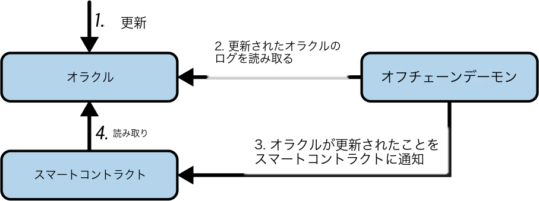
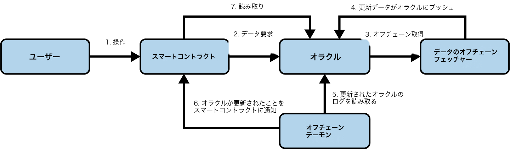
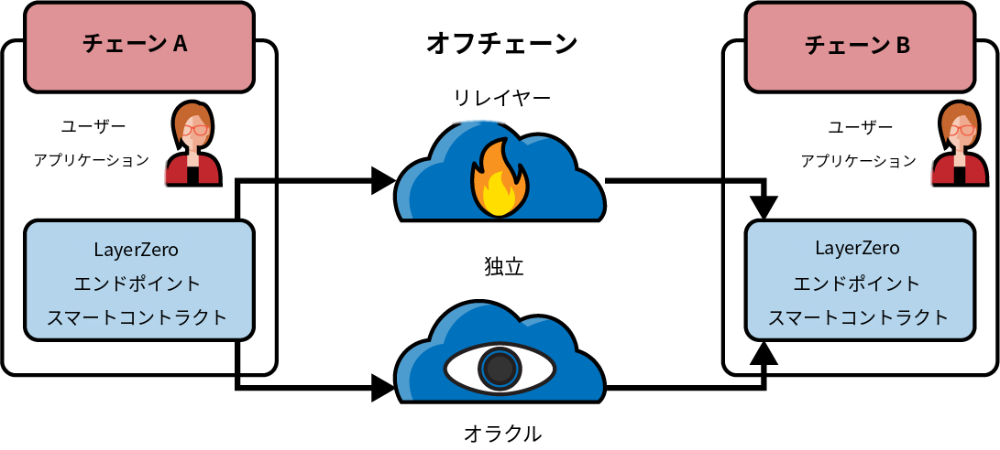
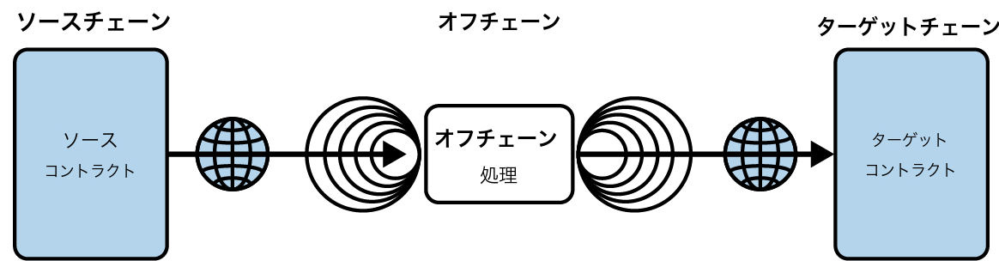

# 第11章 オラクル

　この章では、イーサリアムのスマートコントラクトに外部データソースを提供するシステムである*オラクル*について説明します。*オラクル*という用語はギリシャ神話に由来し、神々と通信して未来のビジョンを見ることができる人物を指していました。ブロックチェーンのコンテクストでは、オラクルはイーサリアム外部の質問に答えることができるシステムです。理想的には、オラクルは分散化の原則に基づいて動作するトラストレスなシステムであり、信頼を必要としません。

## オラクルが必要な理由

　イーサリアムプラットフォームの重要な構成要素はEVMです。EVMは分散ネットワーク内のあらゆるノードで、コンセンサスルールに制約されながらプログラムを実行し、イーサリアムの状態を更新します。コンセンサスを維持するために、EVMの実行は完全に決定論的でなければならず、イーサリアムの状態と署名済みトランザクションという共有コンテクストのみに基づく必要があります。これには特に重要な2つの結果があります。1つ目は、EVMとスマートコントラクトが利用できるランダム性の固有のソースが存在しないこと、2つ目は、外部データはトランザクションのデータペイロードとしてのみ導入できることです。

　この2つの結果についてさらに掘り下げてみましょう。EVMにおける真のランダム関数の禁止を理解するために、スマートコントラクトにランダム性を提供するそのような関数の実行後に、コンセンサスを達成しようとした場合の影響を考えてみてください。ノードAはコマンドを実行してスマートコントラクトのストレージに3を格納する一方、同じスマートコントラクトを実行するノードBは代わりに7を格納します。つまりノードAとノードBは、まったく同じコードをまったく同じコンテクストで実行したにもかかわらず、結果の状態について異なる結論に達します。実際には、スマートコントラクトが評価されるたびに異なる結果の状態が得られる可能性があります。そのため、世界中で独立して動作する多数のノードからなるネットワークが、結果の状態について分散型のコンセンサスに到達する方法はありません。実際にはetherの送金を含む連鎖的な影響が指数関数的に蓄積されるため、この例よりもはるかに深刻な事態になります。

　暗号学的に安全なハッシュ関数のような擬似ランダム関数（決定論的であり、EVMの一部となり得る、そして実際に一部である）は、多くのアプリケーションにとって十分ではない点に注意してください。賭けの支払いを解決するためにコイン投げをシミュレートするギャンブルゲームを考えてみましょう。このゲームは表か裏をランダム化する必要があります。ブロック提案者はゲームをプレイし、自分が勝つブロックにのみトランザクションを含めることで有利に立てます。では、この問題をどう回避するのでしょうか。すべてのノードは署名済みトランザクションの内容について合意できるため、ランダム性のソース、価格情報、天気予報などの外部情報は、ネットワークに送信されるトランザクションのデータ部分として導入できます。しかしそのようなデータは検証不可能なソースから来ているため、単純に信頼できません。つまり問題を先送りにしただけです。この章の残りの部分で詳しく説明するオラクルを使って、これらの問題の解決を試みます。

## オラクルのユースケースと例

　オラクルは理想的には、フットボールの試合結果、金の価格、真の乱数など、外部の（つまり「現実世界の」またはオフチェーンの）情報を、スマートコントラクトが使用できるようにイーサリアムプラットフォームに取り込むためのトラストレス（または少なくともほぼトラストレス）な方法を提供します。またDAppフロントエンドに直接データを安全に中継するためにも使用できます。そのためオラクルは、オフチェーンの世界とスマートコントラクトの間のギャップを埋めるメカニズムと考えることができます。オラクルは主に、トークン価格など異なるブロックチェーン間で情報を受け渡すために使用されます。

　スマートコントラクトが現実世界のイベントやデータに基づいて契約関係を強制できるようになれば、その適用範囲は劇的に広がります。しかし同時に、イーサリアムのセキュリティモデルに外部リスクをもたらす可能性もあります。人が亡くなった際に資産を分配する「スマート遺言」コントラクトを考えてみましょう。スマートコントラクトの分野で頻繁に議論されるこの事例は、信頼されたオラクルのリスクを浮き彫りにしています。そのようなコントラクトが管理する相続額が十分に高ければ、オラクルをハッキング[^1]して所有者が亡くなる前に資産の分配を開始するインセンティブは非常に高くなります。

[^1]: ここでのハッキングには、中央集権的なオラクルの人間のオペレーターを買収することも含まれ得る。

　一部のオラクルは、学業証明書や政府発行の身分証明書のような、特定の非公開データソースに固有のデータを提供する点にも注意してください。大学や政府機関のようなデータソースは完全に信頼されており、データの真実性は主観的です（真実はソースの権威への訴えによってのみ決定されます）。そのためこのようなデータはトラストレスに提供できません。独立して検証可能な客観的真実が存在しないためです。スマートコントラクトへのデータブリッジも提供するという理由から、これらのデータソースも「オラクル」の定義に含めています。オラクルが提供するデータは一般的に、パスポートや業績記録のようなアテステーション（証明）の形を取ります。アテステーションは、特にアイデンティティやレピュテーションの検証において、ブロックチェーンプラットフォームの将来の成功に大きく関わるため、ブロックチェーンプラットフォームがどのようにアテステーションを提供できるかを探ることは重要です。

　オラクルが提供し得るデータのその他の例を以下に示します:

- 量子過程や熱過程などの物理的ソースからの乱数またはエントロピー（例: 宝くじスマートコントラクトの当選者を公正に選出するため）

- 自然災害に連動するパラメトリックトリガー（例: 地震債券のリヒタースケール測定値のような大災害債券スマートコントラクトのトリガー）

- 為替レートデータ（例: 暗号通貨の法定通貨への正確なペッギングのため）

- 資本市場データ（例: トークン化された資産や証券のバスケットの価格決定）

- ベンチマーク参照データ（例: スマート金融デリバティブへの金利の組み込み）

- 静的または準静的データ（例: 証券識別子、国コード、通貨コードなど）

- 正確な時間測定に基づくイベントトリガーの時刻およびインターバルデータ

- 気象データ（例: 天気予報に基づく保険料計算）

- 予測市場の解決のための政治イベント

- 予測市場の解決およびファンタジースポーツコントラクトのためのスポーツイベント

- ジオロケーションデータ（例: サプライチェーン追跡で使用）

- 保険コントラクトのための損害検証

- 相互運用性機能のための他のブロックチェーンで発生したイベント

- etherの市場価格（例: 法定通貨ガス価格オラクルのため）

- フライト統計データ（例: 航空券のプーリングのためにグループやクラブが使用）

　以下のセクションでは、基本的なオラクルパターン、計算オラクル、分散型オラクル、Solidityでのオラクルクライアントの実装を含む、オラクルの実装方法のいくつかについて検討します。

## オラクルの設計パターン

　すべてのオラクルは、定義上いくつかの主要な機能を提供します。これらには以下の能力が含まれます:

- オフチェーンソースからデータを収集する

- 署名されたメッセージでデータをオンチェーンに転送する

- データを利用可能にする

　データがスマートコントラクトで利用可能になると、オラクルのスマートコントラクトの`retrieve`関数を呼び出すメッセージコールを通じて、他のスマートコントラクトからアクセスできます。イーサリアムノードやネットワーク対応クライアントから直接アクセスすることも可能です。

　オラクルを構築する3つの主要な方法は、即時読み取り、パブリッシュ-サブスクライブ、およびリクエスト-レスポンスに分類できます。

### 即時読み取り

　最もシンプルなタイプのオラクルから始めましょう。即時読み取りオラクルは、「ethereumbook.infoのアドレスは何ですか」や「この人は18歳以上ですか」のような、即座の判断にのみ必要なデータを提供します。図11-1に示します。

図11-1. 即時読み取りオラクル

　この種のデータを照会したい人は、「ジャストインタイム」ベースで照会する傾向があります。情報が必要な時にだけ照会し、二度と行わないかもしれません。このようなオラクルの例には、学業証明書、ダイヤルコード、機関の会員資格、空港識別子、自己主権ID（self-sovereign ID）などの組織に関するデータや組織が発行したデータを保持するものがあります。

　このタイプのオラクルは、他のスマートコントラクトがオラクルコントラクトへのリクエストコールで検索できるよう、データをコントラクトストレージに一度保存します。後から更新することも可能です。オラクルのストレージ内のデータは、トランザクションを発行する手間やガスコストを負担せずに、ブロックチェーン対応の（つまりイーサリアムクライアントに接続された）アプリケーションから直接検索することもできます。例えば、アルコールを購入する顧客の年齢を確認する必要がある店舗は、この方法でオラクルを利用できます。このタイプのオラクルは、データリクエストに応答するためにサーバーを運用・保守しなければならない組織や企業にとって魅力的です。

　オラクルが保存するデータは、効率性やプライバシーの理由から、生データそのものではない可能性が高い点に注意してください。大学は過去の学生の学業成績証明書のためにオラクルを設定するかもしれません。しかし証明書の完全な詳細（履修したコースや取得した成績のページにも及ぶ可能性がある）を保存するのは過剰です。代わりに証明書のハッシュ値で十分です。同様に、政府は市民IDをイーサリアムプラットフォーム上に置きたいと考えるかもしれませんが、含まれる詳細情報は明らかにプライベートに保つ必要があります。この場合もデータをハッシュ化し（ソルト付きのマークルツリーでより慎重に）、ルートハッシュのみをスマートコントラクトのストレージに保存するのが効率的な方法です。

### パブリッシュ-サブスクライブ

　次の構成はパブリッシュ-サブスクライブです。変更が予想される（おそらく定期的かつ頻繁に）データのブロードキャストサービスを提供するオラクルを、オンチェーンのスマートコントラクトがポーリングするか、オフチェーンのデーモンが更新を監視します。図11-2に示します。

図11-2. パブリッシュ-サブスクライブオラクル

> **注記**
>
> オフチェーンのデーモンを削除することも可能である。オラクルは更新のタイムスタンプを保存し、データが読み取られる際にスマートコントラクトに渡すことができる。この方法で、スマートコントラクトはデータの最終更新日時を知り、使用するかどうかを選択できる。

　このカテゴリはRSSフィードやWebSubなどと類似のパターンを持っています。オラクルは新しい情報で更新され、新しいデータが利用可能であることを示すフラグが立ち、「サブスクライブ済み」の人々に通知します。関心のある当事者は、最新の情報が変更されたかどうかを確認するためにオラクルをポーリングするか、オラクルコントラクトへの更新をリッスンして発生時に対応する必要があります。例としては、価格フィード、気象情報、経済・社会統計、交通データなどがあります。

　ポーリングはWebサーバーの世界では非常に非効率的ですが、ブロックチェーンプラットフォームのピアツーピアコンテクストではそうではありません。イーサリアムクライアントはコントラクトストレージの変更を含むすべての状態変化に追従する必要があるため、データ変更のポーリングは同期済みクライアントへのローカルコールにすぎません。イーサリアムのイベントログによりアプリケーションがオラクルの更新を容易に監視できるため、このパターンはある意味で「プッシュ」サービスとさえ見なせます。

### リクエスト-レスポンス

　リクエスト-レスポンスのカテゴリは最も複雑です。データ空間が大きすぎてスマートコントラクトに保存できず、ユーザーは一度にデータセット全体のごく一部しか必要としない場合に使用します。図11-3に示します。データプロバイダビジネスにも適用可能なモデルです。

図11-3. リクエスト-レスポンスオラクル

　実際にこのようなオラクルは、オンチェーンのスマートコントラクトと、リクエストを監視してデータを取得・返却するオフチェーンインフラストラクチャのシステムとして実装される可能性があります。分散型アプリケーションからのデータリクエストは通常、複数のステップを含む非同期プロセスです。このパターンでは、まずEOAが分散型アプリケーションとトランザクションを行い、オラクルスマートコントラクトに定義された関数とインタラクションします。この関数はオラクルへのリクエストを開始し、リクエストデータの詳細を記述する関連引数に加えて、コールバック関数やスケジューリングパラメーターなどの補足情報を伴います。このトランザクションが検証されると、オラクルリクエストはオラクルコントラクトが発行したEVMイベントまたは状態変更として観察できます。そこから引数を取得し、オフチェーンデータソースへの実際のクエリに使用できます。オラクルはリクエストの処理に対する支払い、コールバックのためのガス支払い、リクエストデータへのアクセス許可も要求する場合があります。最終的に結果のデータはオラクルの所有者によって署名され、特定の時点でのデータの有効性が証明されます。そしてリクエストを行った分散型アプリケーションに、直接またはオラクルコントラクトを介してトランザクションで配信されます（図11-3参照）。スケジューリングパラメーターに応じて、オラクルは定期的にデータを更新するさらなるトランザクションをブロードキャストする場合があります（例: 1日の終わりの価格情報）。

　リクエスト-レスポンスオラクルの手順は以下のように要約できます:

1. DAppからクエリを受信する。

2. クエリを解析する。

3. 支払いとデータアクセス権限が提供されていることを確認する。

4. オフチェーンソースから関連データを取得する（必要に応じて暗号化する）。

5. データを含むトランザクションに署名する。

6. トランザクションをネットワークにブロードキャストする。

7. 通知などのさらなる必要なトランザクションをスケジューリングする。

　他にもさまざまなスキームが可能です。例えばデータはEOAから直接リクエストして返却でき、オラクルスマートコントラクトが不要になります。同様にリクエストとレスポンスはIoT対応のハードウェアセンサとの間で行うこともできます。つまりオラクルは人間、ソフトウェア、またはハードウェアのいずれでもあり得ます。

　ここで説明したリクエスト-レスポンスパターンは、クライアント-サーバーアーキテクチャでよく見られます。アプリケーションが双方向の対話を行える有用なメッセージングパターンですが、特定の条件下では不適切な場合もあります。例えばオラクルから金利を要求するスマート債券は、レートが常に正確であることを保証するために、リクエスト-レスポンス[^2]パターンの下で毎日データをリクエストしなければならない場合があります。金利はめったに変わらないため、ここではパブリッシュ-サブスクライブパターンの方が適切かもしれません。特にイーサリアムの限られた帯域幅を考慮すると、なおさらです。

[^2]: この非同期性のため、リクエストを行うDApp/コントラクトは遅延レスポンスを処理できるよう設計する必要がある。同じトランザクション内で即座にデータを期待することはできない。

　パブリッシュ-サブスクライブは、パブリッシャー（このコンテクストではオラクル）がレシーバーに直接メッセージを送信するのではなく、公開されたメッセージを個別のクラスに分類するパターンです。サブスクライバーは1つ以上のクラスへの関心を表明し、関心のあるメッセージのみを取得できます。このパターンでは、オラクルは金利が変更されるたびに自身の内部ストレージに書き込みます。複数のサブスクライブ済みDAppはオラクルコントラクトから読み取るだけでよく、ネットワーク帯域幅への影響を軽減しつつストレージコストも最小化できます。

　ブロードキャストまたはマルチキャストパターンでは、オラクルはすべてのメッセージをチャネルに投稿し、サブスクライブするコントラクトはさまざまなサブスクリプションモードでチャネルをリッスンします。例えばオラクルは暗号通貨の為替レートチャネルにメッセージを公開するかもしれません。あるスマートコントラクトは移動平均計算のために時系列データとしてチャネルの全コンテンツをリクエストし、別のスマートコントラクトはスポット価格計算のために最新レートのみを必要とするかもしれません。ブロードキャストパターンは、オラクルがサブスクライブするコントラクトのアイデンティティを知る必要がない場合に適しています。

## データ認証

　DAppが照会するデータのソースが権威的かつ信頼できると仮定しても（これは重要な前提条件です）、未解決の疑問が残ります。オラクルとリクエスト-レスポンスのメカニズムが異なるエンティティによって運用される可能性がある場合、このメカニズムをどう信頼できるのでしょうか。データが転送中に改ざんされる可能性は十分にあるため、オフチェーンの方法で返却データの完全性を証明できることが重要です。データ認証への2つの一般的なアプローチは、*真正性証明*（authenticity proofs）と*信頼できる実行環境*（TEE: Trusted Execution Environment）です。

　真正性証明は、データがソースからブロックチェーンに至る途中で改変されていないことを暗号学的に保証します。これらの証明は、転送メカニズムへの依存を、データプロバイダ、セキュアなサードパーティ、分散型ノードネットワークなどの検証可能な証明者へと移行させます。暗号署名やゼロ知識アテステーションをオンチェーンで検証することで、スマートコントラクトは受信した情報が確かに適切な権限者から来ており改ざんされていないことを確認できます。多くの場合、元のデータソースが特別な署名ロジックを実装する必要はありません。

> **注記**
>
> 実用的な例としてChainlink VRFがある。Chainlinkのドキュメントには、「各リクエストに対して、Chainlink VRFは1つ以上のランダム値と、それらの値がどのように決定されたかの暗号学的証明を生成する。証明はオンチェーンで公開・検証された後に、消費アプリケーションが使用できるようになる」と記載されている。つまりChainlink VRFはランダム値の生成方法を証明でき、これがまさに真正性証明である。
>
> Chainlink VRFは、デプロイされたスマートコントラクトがChainlinkオラクルネットワークにランダム数をリクエストし、オラクルが予測できないヒントを提供することで動作する。各オラクルは秘密鍵を使用してオフチェーンでランダム数を生成し、結果と対応する暗号学的証明をオンチェーンに公開する。スマートコントラクトはオラクルの公開鍵と元のヒントを使用して、このランダム出力が操作されていないことを検証できる。証明は完全にオンチェーンで検証されるため、攻撃者は暗号学的チェックを無効にすることなく結果を改ざんすることはできない。ノードが侵害されたり応答しなくなったりした場合、その障害はオンチェーンに記録され、最終的にそのノードはさらなるランダム性の提供から除外される。

　TEEは、コードとデータを保護・証明する特殊なハードウェアエンクレーブを活用することで、これらの保証を強化します。計算がそのようなエンクレーブ内で実行されると、CPUは外部プロセスが計算に干渉したり基礎データを見たりできないようにし、完全性と機密性の両方を保持します。エンクレーブは、暗号学的ハッシュ値で識別される特定のコードがセキュアな環境内で実行されていることを示す、デジタル署名された「アテステーション」（証明）を提供できます。これによりスマートコントラクトは、外部データや計算がオンチェーンに到着する前に悪意を持って改変されていないことについて、より強力な保証を得られます。またセキュアエンクレーブはプライバシー機能も実現します。機密性の高い入力を暗号化してエンクレーブ内で処理すれば、外部に公開せずに済むためです。

　多くの最新のオラクルネットワークでは、これらの方法を組み合わせてデータ認証をさらに強化しています。一部のオラクルネットワークは、異なるソースからデータを取得・検証する独立したノードの分散型セットに依存し、正しい結果についてコンセンサスに達します。このマルチオペレータシステムにより、単一の不正行為者がデータフィードを侵害するリスクは大幅に軽減されます。ノードにはインセンティブが与えられ、多くの場合は正直であり続けるために経済的担保によって拘束されているためです。別のオラクルネットワークは高度な暗号プロトコルを組み込み、基礎的な詳細を公開せずにデータが特定のエンドポイントから取得されたことを証明し、中央集権的な検証者への依存を軽減しています。さらに一部のネットワークオペレータは、データ取得ロジックを実行するためにハードウェアエンクレーブも展開しています。これによりホスト環境が侵害されても、ブロックチェーンに送信される最終結果が改変されず独立して検証できることを保証します。

　具体的な実装にかかわらず、最大の課題はDAppに取得・渡されるすべてのデータが正確で信頼できることの保証です。真正性証明はデータがどこでどのように取得されたかを追跡・検証する堅牢な方法を提供し、TEEはオフチェーン情報の収集と中継のプロセス全体を保護するハードウェアに裏打ちされた手段を提供します。

> **警告**
>
> TEEは比較的新しいため、大部分はまだテストが不十分であり、多くの未発見の脆弱性が含まれている可能性がある。将来、新たなエクスプロイトが発見されTEEが侵害される可能性が高い。

## 計算オラクル

　ここまではデータのリクエストと配信のコンテクストでのみオラクルについて説明してきました。しかしオラクルは任意の計算を実行するためにも使用できます。この機能はイーサリアムの固有のブロックガスリミットと比較的高い計算コストを考えると特に有用です。単にクエリの結果を中継するだけでなく、計算オラクルを使って一連の入力に対して計算を実行し、オンチェーンでは計算不可能だった可能性のある結果を返すことができます。例えば計算オラクルを使って計算負荷の高い回帰計算を実行し、債券コントラクトの利回りを推定できます。

　*ZKコプロセッサ*として知られるLagrangeとBrevisは、スマートコントラクトがオンチェーンでの検証を保証しつつ、集中的な計算をオフチェーンで実行できるようにします。例えばBrevisでは、DAppが前もってゼロ知識証明を生成せずに、複雑なタスクや履歴データをリクエストできます。ネットワークは結果を「楽観的に」投稿し、正しいと仮定します。結果がオンチェーンに公開されると、誰でも異議を申し立てられるチャレンジ期間が設けられます。異議が申し立てられた場合、提案者は結果を検証するための完全なゼロ知識証明を作成しなければなりません。証明が提供されない場合や、証明により初期結果が不正確であると判明した場合、チャレンジャーは報酬を受け取り、偽の結果を提出した者はペナルティを受けます。異議が発生しなければ結果は有効として承認されるため、必要なゼロ知識証明の数を劇的に削減しコストを低減できます。

## 分散型オラクル

　中央集権的なデータまたは計算オラクルは多くのアプリケーションには十分ですが、イーサリアムネットワークにおける単一障害点になります。データの可用性を確保し、個々のデータプロバイダのネットワークとオンチェーンのデータ集約システムを構築する手段として、分散型オラクルを中心にいくつかのスキームが提案されています。

　Chainlinkは、レピュテーションコントラクト、注文マッチングコントラクト、集約コントラクトの3つの主要なスマートコントラクトと、データプロバイダのオフチェーンレジストリで構成される分散型オラクルネットワークを提案しています。レピュテーションコントラクトはデータプロバイダのパフォーマンスを追跡し、そのスコアはオフチェーンレジストリの内容を構成するために使われます。注文マッチングコントラクトはレピュテーションコントラクトを使ってオラクルからの入札を選択し、クエリパラメーターと必要なオラクルの数を含むサービスレベルアグリーメントを確定します。これにより購入者は個々のオラクルと直接トランザクションを行う必要がありません。集約コントラクトは複数のオラクルからのレスポンス（コミット-リビールスキームで送信される）を収集してクエリの最終的な集合結果を計算し、その結果をレピュテーションコントラクトにフィードバックします。

　このような分散型アプローチの主要な課題の1つは、集約関数の定式化です。Chainlinkは加重レスポンスの計算を提案しており、各オラクルのレスポンスに対して有効性スコアを報告できるようにしています。しかし無効なスコアの検出は容易ではありません。ピアが提供したレスポンスからの偏差で測定される外れ値のデータポイントが不正であるという前提に依存しているためです。レスポンスの分布内でのオラクルレスポンスの位置に基づいて有効性スコアを計算すると、平均的な回答よりも正しい回答にペナルティを科すリスクがあります。そのためChainlinkは標準的な集約コントラクトのセットを提供しつつ、カスタマイズされた集約コントラクトの指定も可能にしています。

　関連するアイデアとして*シェリングコインプロトコル*があります。ここでは複数の参加者が値を報告し、中央値が「正しい」回答として採用されます。報告者はデポジットを提供する必要があり、そのデポジットは中央値に近い値に有利になるよう再分配されるため、他の参加者と類似した値を報告するインセンティブが生まれます。回答者が調整のための自然で明白な目標と考える*シェリングポイント*と呼ばれる共通の値は、実際の値に近いと予想されます。

## クロスチェーンメッセージングプロトコル

　多くのアプリケーションは、それぞれ独自のコミュニティガバナンス、コンセンサスルール、トークン標準を持つ複数のチェーン間でのデータ転送やインタラクションを頻繁に必要とします。クロスチェーンプロトコルはブロックチェーン間の通信を促進する重要なツールとして登場し、スマートコントラクトや分散型アプリケーションがより広範なサービス、流動性、データにアクセスできるようにしています。オラクルが外部情報を単一のブロックチェーンにブリッジするのに対し、クロスチェーンプロトコルはエコシステム全体を接続することでその概念を拡張しています。

　クロスチェーンプロトコルを理解する1つの方法は、ブロックチェーンを接続する特殊な「通信レイヤー」として捉えることです。外部データの取り込みだけでなく、チェーン間の情報転送を促進するプロトコルです。

　人気のあるクロスチェーンイニシアチブの中で、LayerZeroはブロックチェーン間の軽量メッセージパッシングのフレームワークを提供しています。メッセージの「トランスポート」と「バリデーション」に焦点を当て、より効率的で柔軟な相互運用性レイヤーの提供を目指しています。LayerZeroの設計は、クロスチェーントランザクションを検証するために協力する2つの主要なオフチェーンエンティティ、オラクルとリレイヤーを中心に構成されています。図11-4に示します。

図11-4. LayerZeroクロスチェーンアーキテクチャ

　オラクルはトランザクションの証明またはブロックヘッダに対する独立したクエリを実行し、リレイヤーは証明自体を渡します。信頼を分散化するために、ユーザーが設定可能なオラクルとリレイヤーのセットを使用できます。オラクルとリレイヤーが同じデータを提供した場合、宛先チェーン上のLayerZeroのスマートコントラクトはメッセージを有効として受け入れます。これにより開発者は、単一のブリッジングプロバイダや中央集権的なエンティティに依存せずに複雑な相互運用性ソリューションを作成できます。

　もう1つの有名なプロジェクトであるWormholeは、主にSolanaとイーサリアム間の転送を可能にするために誕生しました。その後Binance Smart Chain、Hyperliquid、Avalancheなどの他のネットワークにも拡大しています。Wormholeのアプローチは、単一のチェーン上のイベントを監視し、イベントを証明するメッセージに署名するガーディアンのネットワークに基づいています。十分な数のガーディアンが署名するとアテステーションは有効と見なされ、対応するイベント（トークン転送など）が宛先チェーンで認識されます。図11-5に示します。このスキームはトークンブリッジングだけでなく、クロスチェーンガバナンス提案やNFT転送などのより複雑なタスクにも役立ちます。Wormholeは複数のガーディアンの複合的なセキュリティを活用して単一障害点のリスクを軽減しようとしていますが、ガーディアンセットの慎重な選定と維持が必要です。

図11-5. Wormholeクロスチェーンアーキテクチャ

　ChainlinkのCross-Chain Interoperability Protocol（CCIP）は、組織の既存のオラクルネットワークを基盤として、ブロックチェーン間のセキュアなメッセージングとトークン転送のための汎用フレームワークを提供しています。異なるネットワーク間のイベントを検証するために分散型オラクルに依存し、高レベルの信頼最小化に焦点を当てています。CCIPはソースチェーン上でトークンをロックまたはバーンし、宛先チェーン上でミントまたはアンロックできるため、DAppが複数のエコシステムにまたがって機能を拡張できます。Chainlinkが分散型データフィードや検証可能なランダム性のために開発した堅牢なインフラストラクチャを再利用しており、これらのサービスにすでに依存しているプロジェクトがクロスチェーン操作に拡大するための自然なパスを提供します。

> **注記**
>
> CircleのCross-Chain Transfer Protocol（CCTP）も言及に値する。CCIPと同様に動作するが、主にUSDCを異なるチェーン間でブリッジするために使用される。CCTPはChainlinkによってCCIPに統合されている。

　これらのプロトコルに加えて、それぞれわずかに異なるニッチを埋める相互運用性レイヤーやブリッジングソリューションが増え続けています。例えばPolkadotやCosmosのようなプロジェクトは、パラチェーンやハブのような設計を活用してシームレスな資産とデータの交換を促進するために、最初からクロスチェーン機能を備えて構築されました。CosmosのInter-Blockchain Communication（IBC）プロトコルはクライアント検証を使用し、接続された各チェーンが他のチェーンの「ライトクライアント」を保存します。Polkadotはリレーチェーン内のバリデータの共有セットを通じてパラチェーンを保護し、各パラチェーンからのトランザクションを統一されたコンセンサスにバンドルします。これらのアーキテクチャはスケーラビリティとセキュリティを優先していますが、特にイーサリアムライクな環境に慣れている開発者にとっては独自の学習曲線を伴います。

## まとめ

　ここまで見てきたように、クロスチェーンプロトコルとオラクルは外部情報をコントラクトの実行に取り込むことで、スマートコントラクトに不可欠な機能を提供しています。もちろんオラクルは重大なリスクも伴います。信頼されたソースが侵害される可能性がある場合、オラクルが供給するスマートコントラクトの実行も侵害されかねません。オラクルの使用を検討する際は、信頼モデルについて十分に注意する必要があります。オラクルを無条件に信頼すると、スマートコントラクトは誤った入力に対して脆弱になる可能性があります。しかしセキュリティの前提条件を慎重に検討すれば、オラクルは非常に役立ちます。

　分散型オラクルはこれらの懸念の一部を解決し、イーサリアムのスマートコントラクトにトラストレスな外部データを提供できます。慎重に選択すれば、オラクルが提供するイーサリアムと「現実世界」の間のブリッジを活用し始めることができます。

　またクロスチェーンプロトコルがイーサリアムと他のエコシステムの間のブリッジとしてどのように機能するかも見てきました。オラクルに関連する潜在性とリスクの多くを引き継ぎつつ、ユースケースと機能の範囲をさらに拡大しています。
