# 第12章 分散型アプリケーション（DApp）

　この章では、DAppとは何か、どのように機能するか、コアアーキテクチャがどのように構成されているかを説明します。基本を説明した後、実践的なハンズオン形式の例を通じて最初のDAppをゼロから構築します。スマートコントラクトのデプロイ、フロントエンドの統合、スタック全体を準本番環境に向けて整えるところまでを扱います。最後には、動作するDAppと、これらの革新的なアプリケーションを支える中核概念の確かな理解が得られます。

## DAppとは

　*DApp*は*分散型アプリケーション*（decentralized application）の略です。従来のアプリケーションとはまったく異なるパラダイムです。従来のアプリケーションは通常、図12-1に示すようなアーキテクチャを持っています:

- アプリのロジック部分のクローズドソースコード
- アプリケーションデータを保存するための中央集権的なデータベース
- ユーザーがアプリにアクセスするための単一のフロントエンド

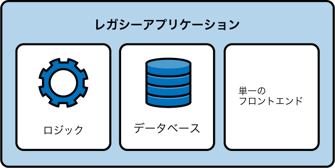

図12-1. 従来のアプリケーションの一般的なアーキテクチャ

　Instagram、TikTok、銀行アプリなど、今スマートフォンに入っているアプリケーションを思い浮かべてください。おそらく非常に似たアーキテクチャに依存しています。アプリケーションの背後にいるチームがアクセスを許可した場合にのみ利用できます。公式サイトがサービス停止中の場合にInstagramアカウントにログインできる代替ウェブサイトは存在しません。

　DAppには2つの明確な目標があります。単一障害点を持たないことと、チーム全体がいなくなっても利用者が使い続けられるプロダクトであることです。DAppのアーキテクチャは、図12-2に示すように簡略化できます:

- 複数のイーサリアムスマートコントラクトがDAppのロジック部分の基盤を形成する。多くの場合、Solidity（またはVyper）のコードもオープンソースである
- スマートコントラクトはデータも保持でき、データベースとして機能し、必要なユーザー情報をすべて収集する
- 公式フロントエンドを通じてアプリにアクセスできる。メインのフロントエンドが何らかの理由で動作しない場合、代替フロントエンド（コミュニティが作成したものを含む）で簡単に置き換えられる

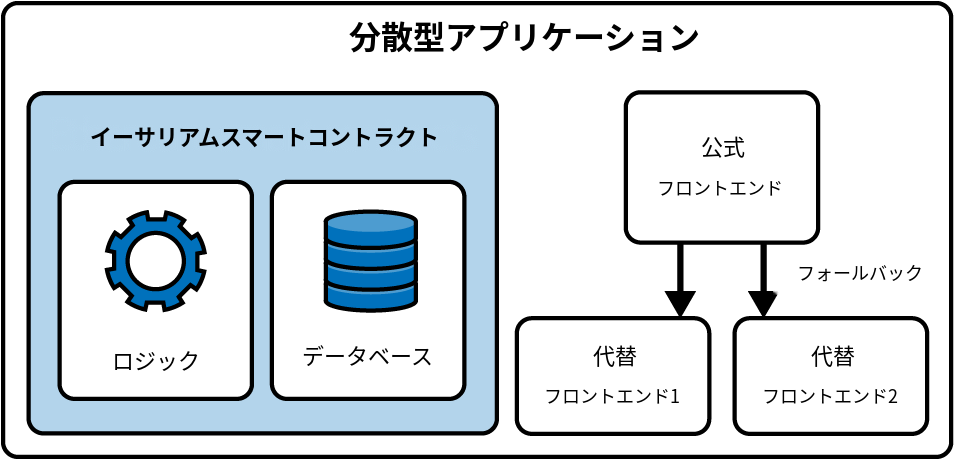

図12-2. DAppの一般的なアーキテクチャ

> **注記**
>
> DAppはある程度の中央集権化を伴うオフチェーンコンポーネントを持つこともできるが、通常これらはアプリケーションのコアロジックにとって不可欠なものではない。通常時にアプリケーションの高速化に役立つことはあるが、最悪の場合はオンチェーンデータだけで動作できるべきである。ただし、これは常に当てはまるわけではなく、中央集権的なコンポーネントにコアロジックが依存するDAppも存在する。それらは真の分散型アプリではなく、レガシーと完全な分散型アプリケーションの間のハイブリッド形態に近い。

　次のセクションでは、DAppスタックの各コンポーネントをさらに掘り下げ、それぞれがどのように機能し、互いにどう関係しているか、そしてイーサリアムプロトコルとどう関わるかを理解します。

## バックエンド（スマートコントラクト）

　DAppでは、コアビジネスロジックとデータストレージをスマートコントラクトに記述し、中央集権的なサーバーではなくイーサリアムブロックチェーン上で実行します。ブロックチェーンが分散型バックエンドとして機能し、トランザクションの実行、状態の変更、記録の保持を単一のエンティティではなくネットワークがトラストレスに強制します。

　ユーザーはDAppにアクセスするために中央集権的なチームを信頼する必要がありません。イーサリアムネットワークは常に適切に動作し、曜日や時間に関係なくすべてのトランザクションを処理してスマートコントラクトの状態を正しく更新するからです。

　さらに、このアーキテクチャは*検閲耐性*という非常に強力な特性をもたらします。従来のアプリケーションでは、政府の法律などの理由でアプリへのアクセスが禁止されている国が多くあります。例えば、2025年時点でFacebookはブラジル、中国、イラン、北朝鮮、ミャンマー、ロシア、トルクメニスタン、ウガンダで禁止されています。これらの国の人々はプロフィールを作成することもプラットフォームにログインすることもできません。

　イーサリアム上に構築されたDAppでは、この種の検閲は実現できません。特定のDAppの公式ウェブサイトを禁止することは可能ですが、あるアドレスがチェーン上のスマートコントラクトとインタラクションすることは誰にも防げません。誰でもDAppの代替フロントエンドを作成でき、それを使ってDAppと再びインタラクションできます。

### Tornado Cashの物語

　ここでTornado Cashの話に触れておきます。Tornado Cashは分散型ミキシングサービスで、誰でもどこからでも、追跡可能な、あるいは「汚染された」暗号通貨を他の暗号通貨と混合でき、資金の実際の送信者と受信者の間のリンクをすべて断ち切ることで、元のソースへの追跡を困難にします。

　2022年8月8日、米国財務省の外国資産管理局（OFAC）はTornado Cashをブロックリストに登録し、米国市民と企業による使用を事実上禁止しました。このプラットフォームは70億ドル以上の暗号通貨のマネーロンダリングで告発されました。2日後の8月10日、Tornado Cashの開発者の1人であるAlexey Pertsevが、プラットフォームを作成したという理由だけでアムステルダムで逮捕されました。公式GitHubリポジトリは削除され、開発者アカウントも停止されました。2024年12月時点で公式ウェブサイトはアクセスできないままです。

　これらを考えると、Tornado CashのDAppは運用を停止したと思うかもしれません。しかし現実はまったく異なります。これらの出来事以降、サービスの注目度（と流動性）は低下しましたが、プロトコルは完全に機能しており、さまざまなIPFSホスト型ゲートウェイを通じてアクセスできます。つまり、元の公式ウェブサイトがなくても、世界中の誰もが以前と同様にTornado Cashを使用できるのです。

## データストレージ

　データストレージとは、ユーザーのデータを保存するためのソリューションを指します。スマートコントラクトへのデータの保存と読み取りは可能ですが、コストが高くスケーラビリティにも課題があります。また、すべてをオンチェーンに保存する必要もありません。

　通常、スマートコントラクトは重要な状態情報を保存し、DAppのロジックを強制します。アカウント残高、所有権記録、計算結果などの重要な情報はスマートコントラクトに直接保存します。これにより、機密性が高く価値のあるデータは完全に透明で改ざん耐性があり、イーサリアムノードを持つ誰もがアクセスできる状態を維持できます。

　それ以外の情報は、従来のデータベースのような分散化の程度が低いデータストレージソリューションに保存できます。例えば、DApp開発者は高速なデータクエリのためにインデクサを使用したり、ユーザーデータの保存に中央集権的なデータベースを使用したりすることが多く、フロントエンドがイーサリアムチェーンとインタラクションする必要がなくなります。

> **注記**
>
> *ブロックチェーンインデクサ*は、ブロックチェーンに保存されたデータを高速かつ効率的にクエリ・分析できるツールである。トランザクションデータを取得し、機械と人間の両方が読みやすいデータに変換してデータベースにロードする。
>
> 実際には、ブロックチェーン内のデータを直接「検索」することはできない。例えば、特定のアカウントがブロック15364050でどれだけのUSDCトークンを保有していたかを知りたいとする。USDCスマートコントラクトにアクセスして調べることはできない。履歴データを保存していないからである。そのブロックから現在までに発生したすべてのトランザクションを取得・フィルタリングし、そのアカウントに関連するすべてのUSDC転送情報を抽出して、ようやく答えが得られる。これは現実的なアプローチではない。ここでインデクサが活躍する。インデクサはデータベースのような構造を維持し、履歴情報を含む必要な情報へのクエリを即座に実行して素早く回答を返す。

　重要なのは、誰もがDAppの正しい動作を検証できるように、本質的なデータとアプリケーションロジックのみをオンチェーンに保存するということです。それ以外はオフチェーンに置くことができますし、そうすべきです。

### IPFS

　*IPFS*は、P2Pネットワーク内のピア間でオブジェクトを分散して保存するコンテンツアドレッサブルストレージシステムです。*コンテンツアドレッサブル*とは、各コンテンツ（ファイル）をハッシュ化し、そのハッシュでファイルを識別する仕組みです。ハッシュを指定してリクエストすれば、任意のIPFSノードからファイルを取得できます。

　IPFSはWebアプリケーションの配信プロトコルとしてHTTPを置き換えることを目指しています。単一のサーバーにWebアプリケーションを保存する代わりに、ファイルをIPFS上に保存し、任意のIPFSノードから取得できます。詳細についてはIPFSのドキュメントをお読みください。

### マークルツリー

　よく使われるソリューションの1つは、マークルツリー構造でデータをオフチェーンに保存し、マークルルートのみをオンチェーンに保存する方法です。すべてのデータをスマートコントラクトに保存する必要がなく（ガス代が非常に高くなるため）、それでもオンチェーンで検証を実行できます。

> **注記**
>
> 編集者注: 以下のコード例は特定の技術的コンテクストで「whitelist」に言及している。この用語には問題のある含意があるが、業界とそのドキュメント全体で広く使用されている。包括性を尊重しつつも、著者はここでは技術的概念の明確さのために用語をそのまま維持した。

　最も一般的なユースケースは、NFTコレクションを作成し、特定のアドレスをホワイトリストに登録して、パブリックセール開始前に低い価格でNFTをミントできるようにする場合です。方法は2つあります。

　1つ目は、スマートコントラクト内にストレージ変数を作成し、各アドレスをブーリアン値にマッピングする方法です。ホワイトリストに登録されたアドレスにはtrueを設定します。このマップで特定のアドレスがホワイトリストに登録されているかを確認できます。ユーザーはミントトランザクション送信時に何も提供する必要がなく、コントラクトは`msg.sender`がホワイトリストマップに含まれているかを確認するだけです:

```solidity
// SPDX-License-Identifier: MIT
pragma solidity 0.8.28;

// import OpenZeppelin contracts.
import "@openzeppelin/contracts/token/ERC721/ERC721.sol";
import "@openzeppelin/contracts/access/Ownable.sol";

// A simplified NFT contract with a whitelist mint function that uses a mapping to
// store whitelisted addresses.
contract MyWhitelistNFT is ERC721, Ownable {
    // ... rest of the contract

    // mapping for whitelisted addresses
    mapping(address => bool) public isWhitelisted;

    /**
     * @notice Whitelist mint function.
     */
    function whitelistMint() payable {
        // ... rest of the function

        // check if the user is whitelisted.
        require(isWhitelisted[msg.sender], "You are not whitelisted");

        // mint the NFT.
        _safeMint(msg.sender, nextTokenId);
        nextTokenId++;
    }
}
```

　2つ目は、マークルツリーをオフチェーンで作成し、マークルルートのみをコントラクト内にオンチェーンで保存する方法です。ホワイトリストに登録された各ユーザーにマークル証明を渡し、ユーザーがそのマークル証明をコントラクトに送信すると、コントラクトがオンチェーンで証明の有効性を検証します（通常はライブラリーを使用）:

```solidity
// SPDX-License-Identifier: MIT
pragma solidity 0.8.28;

// import OpenZeppelin contracts.
import "@openzeppelin/contracts/token/ERC721/ERC721.sol";
import "@openzeppelin/contracts/access/Ownable.sol";
import "@openzeppelin/contracts/utils/cryptography/MerkleProof.sol";

// A simplified NFT contract with a whitelist mint function that uses a merkle tree to
// store whitelisted addresses.
contract MyWhitelistNFT is ERC721, Ownable {
    // ... rest of the contract

    // the merkle root of the off-chain generated Merkle Tree.
    bytes32 public merkleRoot;

    /**
     * @notice Whitelist mint function.
     * @dev User must provide a merkle proof to prove they are whitelisted.
     * @param _merkleProof The proof that msg.sender is whitelisted.
     */
    function whitelistMint(bytes32[] calldata _merkleProof) external payable {
        // ... rest of the function

        // verify that (msg.sender) is in the merkle tree using the provided proof.
        bytes32 leaf = keccak256(abi.encodePacked(msg.sender));
        bool isValidLeaf = MerkleProof.verify(_merkleProof, merkleRoot, leaf);
        require(isValidLeaf, "Invalid Merkle Proof: Not whitelisted");

        // mint the NFT.
        _safeMint(msg.sender, nextTokenId);
    }
}
```

　2つ目のオプションは、特に大規模なホワイトリストの場合、1つ目よりもはるかに安価で効率的です。

> **注記**
>
> この方法はガスコストを大幅に削減するが、ツリーと証明が監査可能でない場合、悪意あるホワイトリスト作成者による不正のリスクが生じる。理想的には、ツリーの生成に使用した元のリストをオープンソースで公開し、マークルルートの有効性を誰でも検証できるようにすべきである。

## フロントエンド（ウェブユーザーインターフェース）

　DAppのフロントエンドは、React、Angular、Vueなどの代表的なWeb2フレームワークで作成します。必要に応じて、イーサリアムチェーンとのインタラクションは`viem`や`ethers.js`のようなライブラリーで抽象化します。

　DAppフロントエンドを構築する単純なアプローチは、すべてのコンポーネントの更新にチェーンから直接データを読み取ることです。例えば、あるアカウントのトークン残高を表示する場合、ブロックチェーンにクエリして回答を取得し、新しいブロックごとにこの処理を繰り返します。

　この単純なアプローチの主な問題は、ウェブサイトが非常に遅くなり、ユーザー体験の悪いフロントエンドになることです。前述のとおり、開発者がDAppアーキテクチャに中央集権的なデータストレージコンポーネントを使用し、チェーンとのインタラクションを最小限にするのはこのためです。ユーザーエクスペリエンス全体が向上します。このため通常のフロントエンドは一部の中央集権的なコンポーネントに依存しますが、ブロックチェーン上で確認すればすべての情報をいつでも検証できます。公式フロントエンドを信頼しない場合や気に入らない場合は、特定のDApp用に独自の代替フロントエンドを作成することもできます。

　図12-3は完全な（簡略化された）DAppアーキテクチャを示しています。

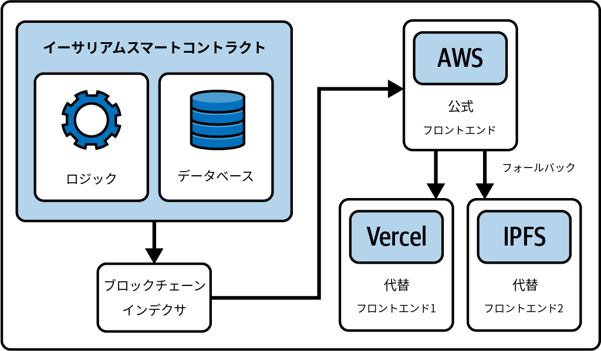

図12-3. 完全なDAppアーキテクチャ

## 基本的なDAppの例

　ここまでDAppの基本的な概念を見てきました。次は実際にDAppを自分で構築してみましょう。

　イーサリアム上でDAppをゼロから構築するチュートリアルはオンラインに数多くありますが、[Speedrun Ethereum](https://oreil.ly/Onygc)を強くお勧めします。素早く学んですぐに構築を始めるには最も効果的な方法です。イーサリアム上でのDApp構築の知識を深めるために、Speedrun Ethereumのすべてのチャレンジを完了し、[BuidlGuidlコミュニティ](https://buidlguidl.com)に参加することをお勧めします。

　このセクションでは、非常に基本的な分散型アプリケーション、いわば「Hello World」DAppを構築します。事前の経験は不要で、必要なのはコンピューターとインターネット接続だけです。

### インストール要件

　このチュートリアルに従うには、コンピューターに[node.js](http://node.js)と[yarn](https://oreil.ly/dq_hw)のインストールが必要です。公式ウェブサイトからダウンロードしてインストールしてください。開発環境を素早く作成できる便利なツール[Scaffold-ETH 2](https://scaffoldeth.io)を使用します。

### DAppの作成

　ターミナルを開いて以下のコマンドを実行しましょう:

```bash
$ npx create-eth@latest
```

　プロジェクト名を尋ねられます。このデモでは「mastering-ethereum」を選びました:

```
 +-+-+-+-+-+-+-+-+-+-+-+-+-+-+
 | Create Scaffold-ETH 2 app |
 +-+-+-+-+-+-+-+-+-+-+-+-+-+-+

? Your project name: mastering-ethereum
```

　次に、使用するSolidityフレームワークを尋ねられます。ここではHardhatを使用しますが、慣れているものを自由に選んでください:

```
? What solidity framework do you want to use?
❯ hardhat
   foundry
  none
```

　数秒後に、「Congratulations」と以下のような「Next steps」が表示されるはずです:

```
  Congratulations! Your project has been scaffolded! 🎉

  Next steps:

  cd mastering-ethereum

        Start the local development node

        yarn chain

        In a new terminal window, deploy your contracts

        yarn deploy

    In a new terminal window, start the frontend

    yarn start

 Thanks for using Scaffold-ETH 2 🙏 , Happy Building!
```

### チェーンの起動

　DAppの構築を開始する準備が整いました。プロジェクトフォルダに移動します:

```bash
$ cd mastering-ethereum
```

　`packages/hardhat/contracts`に移動すると、`YourContract.sol`というサンプルスマートコントラクトがあります。`contracts`フォルダはDAppプロジェクトに必要なすべてのスマートコントラクトを配置する場所です。

　`packages/nextjs`内にはDAppフロントエンドのためのNext.jsフレームワーク構造が既に配置されています。

　今回は非常に基本的なチュートリアルなので、スマートコントラクトをゼロから書いたりフロントエンドを変更したりはしません。通常のワークフローを素早く示すためにデフォルトのままにしておきます。

　まず、ローカル開発用のチェーンを起動する必要があります。最終的なプロダクトはイーサリアムメインネットにデプロイしたスマートコントラクトを使用しますが、DAppの構築とテストに実際のチェーンを使用すべきではありません。非常に遅く、コストも無駄になるからです。Scaffold-ETHにはローカル開発用の新しいチェーンを即座に起動する便利なコマンドが付属しています。以下を実行するだけです:

```bash
$ yarn chain
```

### コントラクトのデプロイ

　次に、前のステップで設定したローカルチェーンにコントラクトをデプロイします。ここでもScaffold-ETHには簡単なコマンドがあります。新しいターミナルを開いて以下を入力してください:

```bash
$ yarn deploy
```

　以下のような出力が表示されるはずです:

```
Generating typings for: 2 artifacts in dir: typechain-types for target: ethers-v6
Successfully generated 6 typings!
Compiled 2 Solidity files successfully (evm target: paris).
deploying "YourContract" (tx: 0x8ec9ba16869588c2826118a0043f63bc679a4e947f739e8032e911475e77dcb4)...: deployed at 0x5FbDB2315678afecb367f032d93F642f64180aa3 with 532743 gas
👋  Initial greeting: Building Unstoppable Apps!!!
📝  Updated TypeScript contract definition file on ../nextjs/contracts/deployedContracts.ts
```

　このコマンドは`YourContract`というサンプルスマートコントラクトをローカルチェーンにデプロイします。新しいDAppを構築する際には`packages/hardhat/deploy`の`00_deploy_your_contract.ts`ファイルを変更し、必要なすべてのコントラクトをデプロイできるようにします。

　先ほど`yarn chain`コマンドを実行したターミナルに戻ると新しいログが表示されているはずです。特に以下のようなログです:

```
eth_sendTransaction
  Contract deployment: <UnrecognizedContract>
  Contract address:    0x5fbdb2315678afecb367f032d93f642f64180aa3
  Transaction:         0x8ec9ba16869588c2826118a0043f63bc679a4e947f739e8032e911475e77dcb4
  From:                0xf39fd6e51aad88f6f4ce6ab8827279cfffb92266
  Value:               0 ETH
  Gas used:            532743 of 532743
  Block #1:            0xa7b8e3b6f82eccb3542279573dbf8efa2b876ff00807a8619feef191007e06d9
```

　`Contract deployment`と`Contract address`の行に注目してください。ローカルチェーン上の特定のコントラクトアドレスにコントラクトが正常にデプロイされたことを示しています。

### フロントエンドの起動

　Scaffold-ETHのサンプルには基本的な組み込みフロントエンドが付属しており、グラフィカルインターフェースですぐにコントラクトとインタラクションを開始できます。新しいターミナルウィンドウを開いて以下を入力してください:

```bash
$ yarn start
```

　以下のような出力が返されるはずです:

```
yarn start
  ▲ Next.js 14.2.21
  - Local:        http://localhost:3000

 ✓ Starting...
 ✓ Ready in 1767ms
```

　localhostのURLをコピーしてブラウザに貼り付けてください。図12-4に示すようなフロントエンドが表示されるはずです。

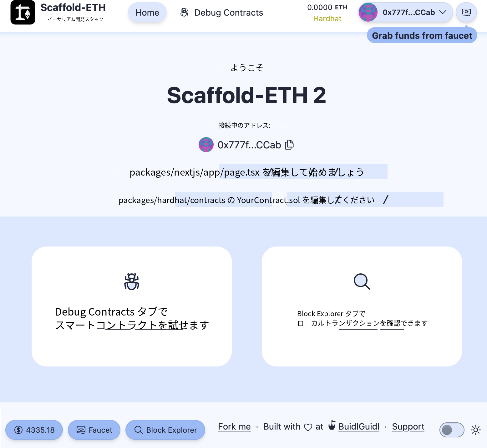

図12-4. Scaffold-ETHフロントエンド

### コントラクトとのインタラクション

　おめでとうございます。すべてのセットアップが完了しました。DAppの実験とインタラクションを始められます。開発ワークフローに不可欠な便利な機能がいくつかあります:

- バーナーウォレット
- Debug Contractsセクション

　図12-4のとおり、右上隅にはランダムな見慣れないウォレットで既にウェブサイトに接続されています。これが*バーナーウォレット*です。Webブラウザ内に秘密鍵が一時的に保存される自動生成アドレスです。ページを更新してもバーナーアドレスは変わりません。

　バーナーウォレットは開発ワークフローを大幅に便利にする機能です。毎回Web3ウォレットを開いてウェブサイトに接続する必要がありません。もちろん準備ができたらウォレットを接続することもできます。ドロップダウンメニューからDisconnectを選択し、Connect Walletをクリックしてリストから好みのウォレットを選択してください。図12-5、12-6、12-7に示します。

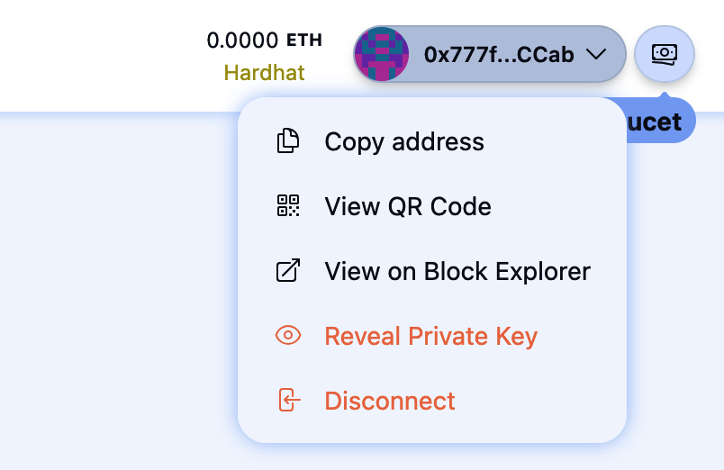

図12-5. バーナーウォレットの切断

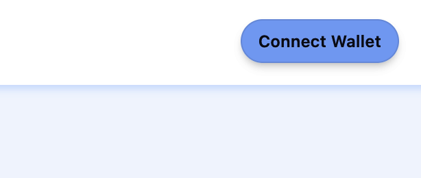

図12-6. Connect Walletボタン

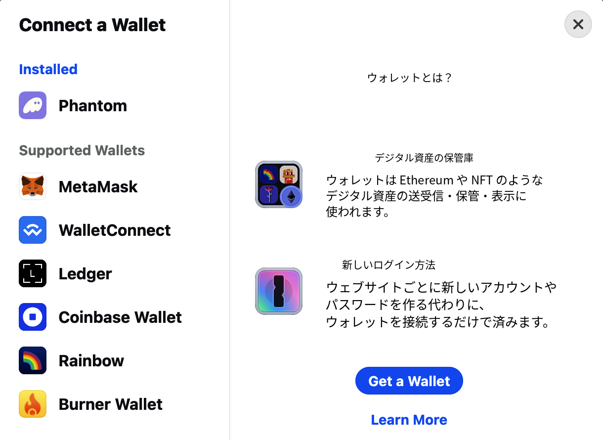

図12-7. ウォレットの選択

　2つ目の強力な機能はDebug Contractsセクションです。ページ中央のDebug Contractsリンクをクリックして開きます。デフォルトのサンプルでは図12-8のような表示になるはずです。

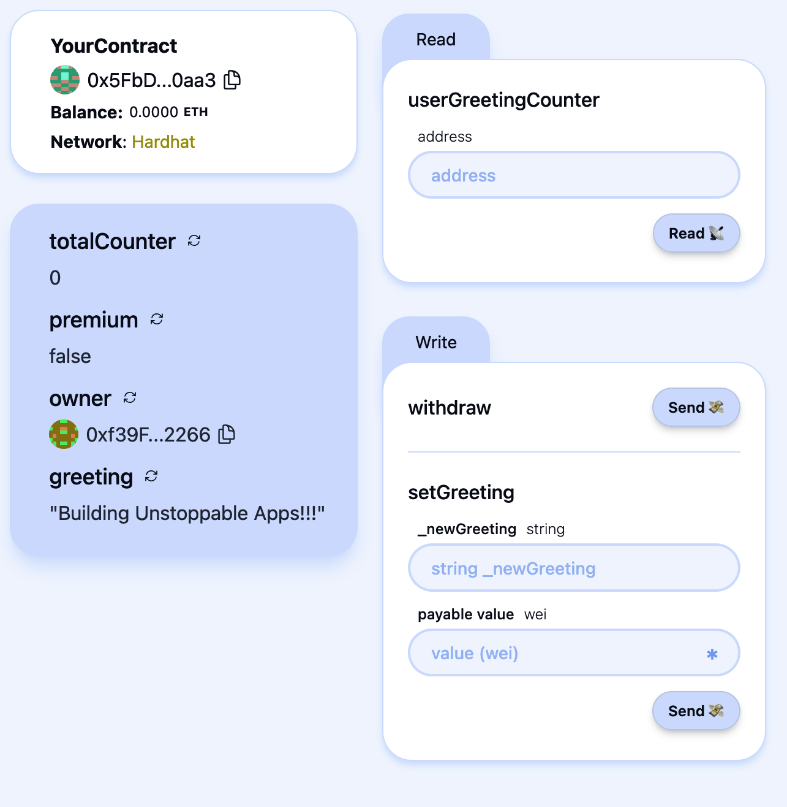

図12-8. Debug Contractsセクション

　ここではフロントエンドを構築しなくても、すべてのコントラクトと簡単にインタラクションできます。開発中にコントラクトが期待通りに動作しているか確認するのに非常に便利です。

　簡単なデモンストレーションをしましょう。まず、デプロイ済みコントラクトへトランザクションを送信できるようにバーナーウォレットに資金を供給します。図12-9に示す右端のボタンをクリックするだけです。ほぼ即座にETHを受け取り、残高が増加するのが見えます。

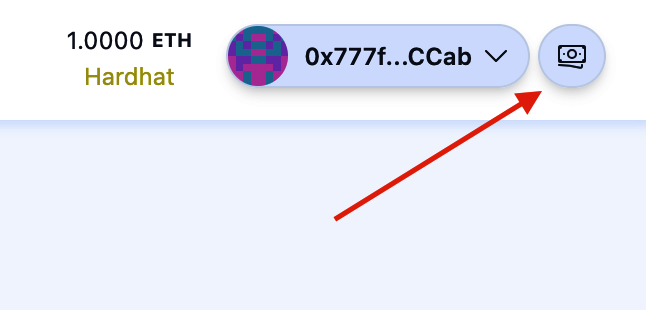

図12-9. Grab fundsボタン

　次に`setGreeting`セクションに移動し、「_newGreeting」フィールドに`hello world`、「payable value」フィールドに`0.1`と入力します。「payable value」フィールドの右にあるアスタリスクをクリックすると、ETHの値がwei（1 ETH = 10<sup>18</sup> wei）に変換されます。最後にSendをクリックしてトランザクションを送信し、コントラクトの状態がどう変化するか確認しましょう。

　図12-10はSendボタンを押す前のコントラクトの状態です。コントラクトは0 ETHを保持し、greetingは「Building Unstoppable Apps!!!」、premiumはfalse、totalCounterは0です。

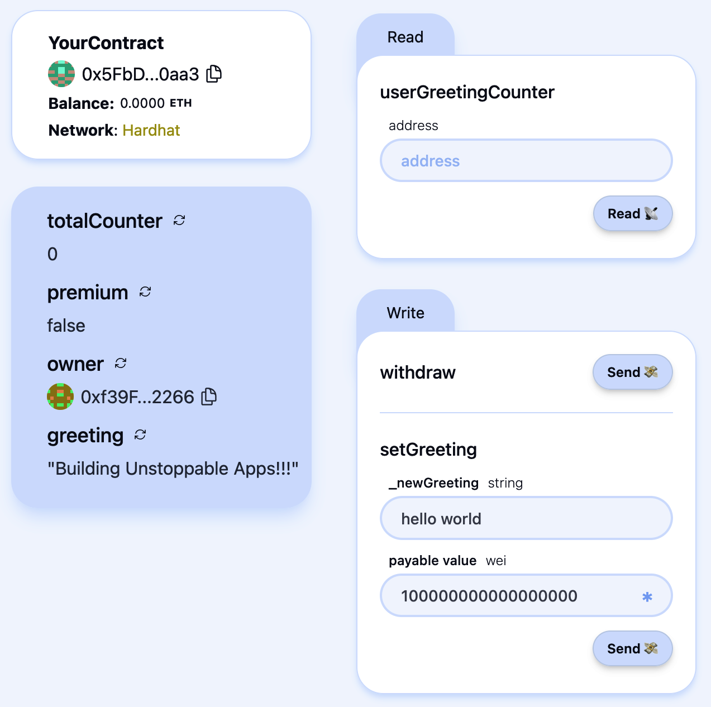

図12-10. トランザクション前のコントラクト状態

　図12-11はトランザクション送信後のコントラクトの状態です。コントラクトは0.1 ETHを保持し、greetingは「hello world」、premiumはtrue、totalCounterは1に変わっています。

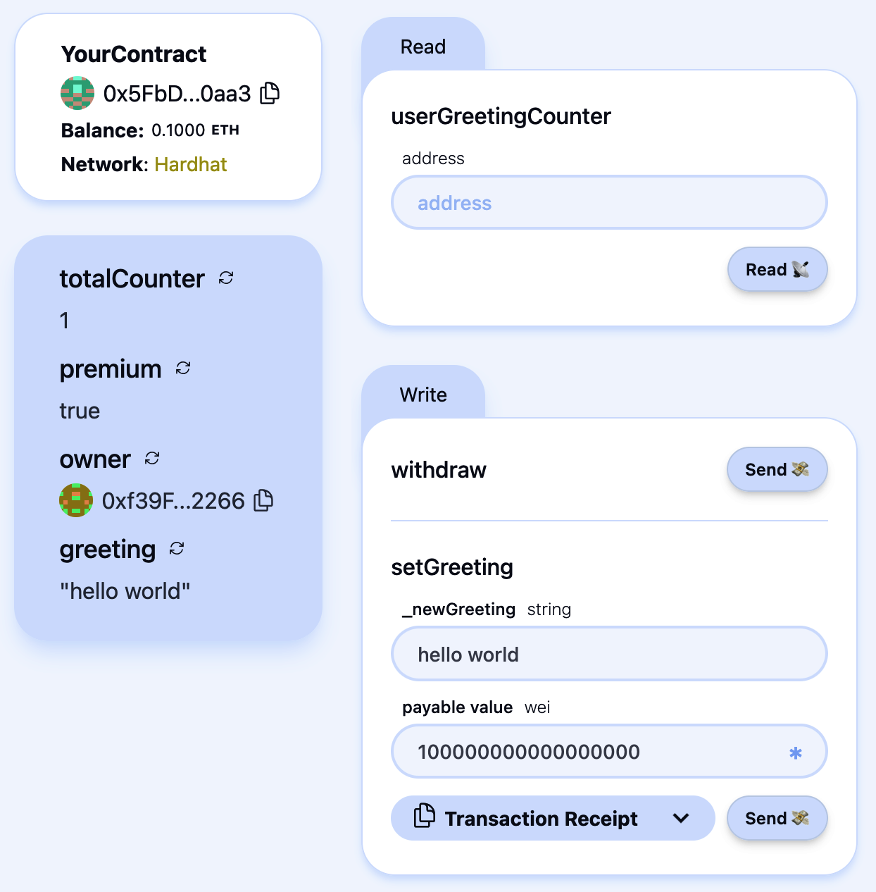

図12-11. トランザクション後のコントラクト状態

　いろいろ試して、入力やアクションに応じてコントラクトがどう動作するか確認してみてください。

### Vercelへのデプロイ

　分散型アプリケーションが完成したら、Vercelのような本番環境に公開できます。Vercelはアプリケーションをインターネットに簡単にデプロイできるフロントエンドのホスティングサービスです。購入したカスタムドメインを設定すれば、ドメイン名を入力するだけでDAppにアクセスできるようになります。

　Scaffold-ETHはここでもDAppをVercelに即座にデプロイするコマンドを提供しています。ターミナルを開いて以下を入力します:

```bash
$ yarn vercel:yolo
```

　Vercelアカウントをリンクし（持っていない場合は新規作成し）、プロジェクト名を選択するだけです。数分後にはDApp全体がVercelにデプロイされ、世界中の誰もが試せるようになります。

　Vercelプロファイルに移動すると新しく作成されたプロジェクトが表示されます。図12-12のとおり、DomainsフィールドにVercelが自動生成したウェブサイトドメインがあります。

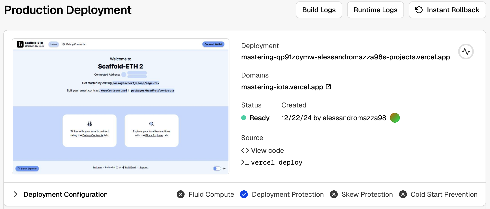

図12-12. Vercelプロジェクトページ

## DAppのさらなる分散化

　前のセクションではDAppをVercelにデプロイしました。VercelはDAppのホスティングで最も人気のあるソリューションの1つですが、分散型サービスではありません。すべてがVercel独自のサーバー上にあり、Vercelのポリシーに基づいてユーザーを検閲したり、DAppとインタラクションするすべての人のIPアドレスを追跡したりする可能性があります。

　DAppをさらに分散化するには、IPFSのようなグローバルP2Pノードネットワーク上にフロントエンドをホストできます。注目すべき新興サービスとして`eth.limo`があります。中央集権的なプラットフォームが提供する通常のウェブサイト体験と、IPFSや類似技術による堅牢性と分散化の両立を目指しています。

### 分散型ウェブサイト

　[Eth.limo](https://eth.limo/)は、より優れた分散型ウェブサイト（*DWebサイト*とも呼ばれる）を実現するための鍵となるサービスで、通常のアプリと同じ方法でアクセスできます。ENS技術に基づき、`.eth`ドメイン名でイーサリアムアドレスをユーザーフレンドリーにします。イーサリアムの共同創設者の1人であるヴィタリック・ブテリンは、ENSで自身のウォレットアドレス`0xd8dA6BF26964aF9D7eEd9e03E53415D37aA96045`を覚えやすい名前`vitalik.eth`とリンクしています。

　ENSは単にドメインとイーサリアムアドレスをリンクするだけでなく、IPFSウェブサイト（正確にはコンテンツハッシュ）にも解決できます。`bafybeif3dy…ga4zu`のようなものです。IPFSウェブサイトの主な問題は、ほとんどの主要Webブラウザがこれらを適切に解決してコンテンツを表示できないことです。ここで`eth.limo`が登場します。このサービスはENS名とIPFSコンテンツのリバースプロキシとして動作し、`*.eth.limo`（`.eth.limo`で終わるすべてのウェブサイト）へのリクエストをキャプチャして、該当するENSレコードのIPFSコンテンツハッシュを自動的に解決し、HTTPS経由で対応する静的コンテンツを返します。例えば[ヴィタリック・ブテリンの公式ブログ](https://vitalik.eth.limo)にアクセスすると、裏側では以下のことが起きています:

1. Eth.limoが`vitalik.eth` ENSドメインへのリクエストを受信する。
2. ブテリンが事前に設定した、ウェブサイトのホームページを含むIPFSコンテンツハッシュに解決する。
3. HTTPS経由で対応する静的コンテンツを返す。

　これにより、Webブラウザさえあれば世界中の誰もが設定やセットアップなしでIPFS上のコンテンツに簡単にアクセスできます。

### 制限事項

　DWebサイト全般、特に`eth.limo`は急速に進化している技術ですが、この章の執筆時点（2025年6月）ではまだいくつかの制限があります。まず、IPFSは静的ファイルのみを処理できるため、サーバーサイドの計算は実行できません。また、`eth.limo`を使用するにはENSを購入してフロントエンドのIPFSコンテンツハッシュにリンクする必要があります。さらに、常に`*.eth.limo`カスタムドメインを使用しなければなりません。末尾の`.limo`部分を削除するとWebブラウザはENS名をDApp用のIPFSフロントエンドに解決できません。これがおそらく多くのDAppが`eth.limo`を使用しない理由です。

> **ヒント**
>
> ほとんどのWebブラウザはまだENSとIPFSに対応していないが、一部のブラウザはサポートを追加し始めている。一例として[Brave](https://oreil.ly/LlJT7)がある。

　`eth.limo`自体は潜在的に中央集権的なサードパーティであり、予告なく動作を停止する可能性がある点にも注意が必要です。停止した場合、DAppはIPFSを通じて引き続きアクセスできますが、`.eth.limo`のURLはユーザーをDAppにリダイレクトしなくなります。

　完全に分散型のウェブサイトを構築するこのソリューションに興味がある場合は、[公式ウェブサイト](https://eth.limo)で詳細を確認できます。

### IPFSへのデプロイ

　Scaffold-ETH 2にはDAppをIPFSに素早くプッシュできるコマンドもあります。新しいターミナルを開いて以下を入力するだけです:

```bash
$ yarn ipfs
```

　これで完了です。以下のような出力が表示されるはずです:

```
   Creating an optimized production build ...

 ✓ Compiled successfully
 ✓ Linting and checking validity of types

 ✓ Collecting page data

 ✓ Generating static pages (8/8)
 ✓ Collecting build traces

 ✓ Finalizing page optimization

…

🚀  Upload complete! Your site is now available at: https://community.bgipfs.com/ipfs/bafybei…
```

　表示されたウェブサイトにアクセスすると、IPFSでホストされたフロントエンドでDAppが正常に動作しているはずです。「bafy…」という文字列がIPFSコンテンツハッシュです。個人のENSを持っていてこのIPFSホスト型サイトにリダイレクトしたい場合は`eth.limo`の設定が必要です。

　`yarn ipfs`コマンドの裏側で実際に起きていることは以下の通りです:

1. フロントエンドがビルドされ、IPFSにアップロードする準備が整った静的ファイルが作成される。
2. 静的ファイルがBuidlGuidl（Scaffold-ETH 2のメンテナー）のIPFSコミュニティノードを通じてIPFSにアップロードされる。
3. IPFSコンテンツのリバースプロキシとして機能するURL（`community.bgipfs.com/<ipfs-content-hash>`）が返される。

　独自のIPFSノードを実行してクラスターをピン留めする方法については、[BuidlGuidl IPFS](https://www.bgipfs.com)を参照してください。

## アプリからDAppへ

　ここまでのセクションで、分散型アプリケーションを段階的に構築してきました。開発ワークフローを効率化するためにScaffold-ETHを使用し、ローカルチェーンを起動してコントラクトをデプロイし、ローカルフロントエンドですぐにDAppのインタラクションとテストを開始しました。次にDAppのフロントエンドをVercelに公開し、本番環境へのデプロイがいかに簡単かを示しました。最後にフロントエンドをIPFSにアップロードし、ENSや`eth.limo`のようなソリューションでDAppをさらに分散化する方法を見ました。これにより特別なアプリをインストールしなくても誰でもアクセスできるようになります。

　図12-13は、完全に分散化されたアプリケーションを作成するために必要なエンジニアリングスタックの概要です。

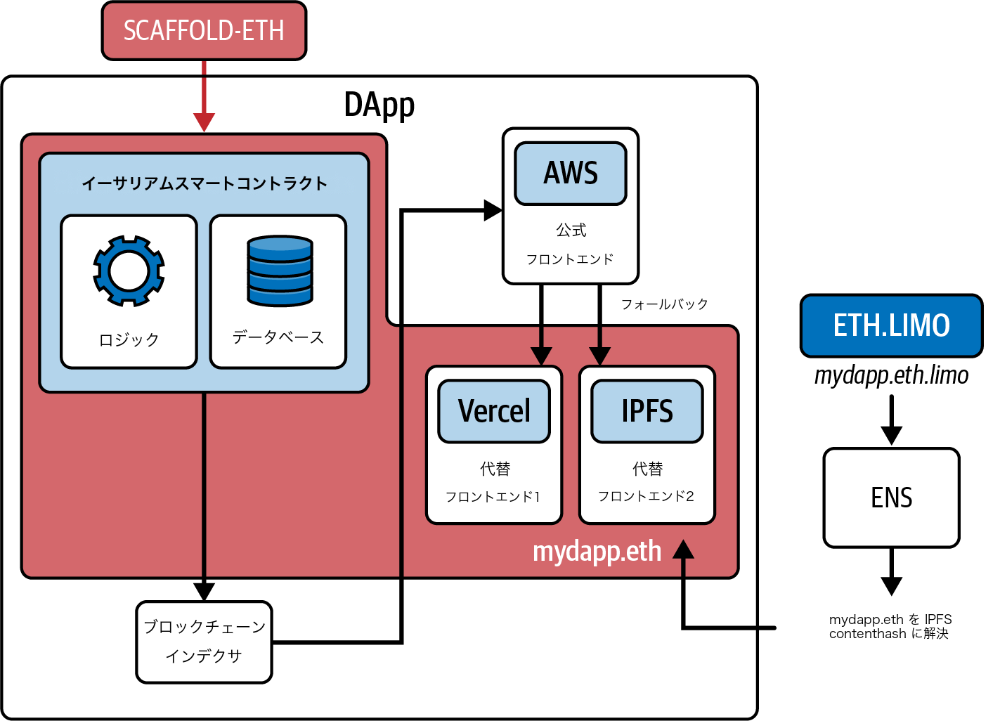

図12-13. DAppのフルエンジニアリングスタックの簡潔な概要

## まとめ

　この章では、最新のツールで開発ワークフローを効率化しながら、基本的なDAppをゼロから構築する方法を見てきました。次の章では、イーサリアム上で最も重要なDAppとDAppのカテゴリを詳しく見ていきます。これらは総称してDeFiと呼ばれています。
