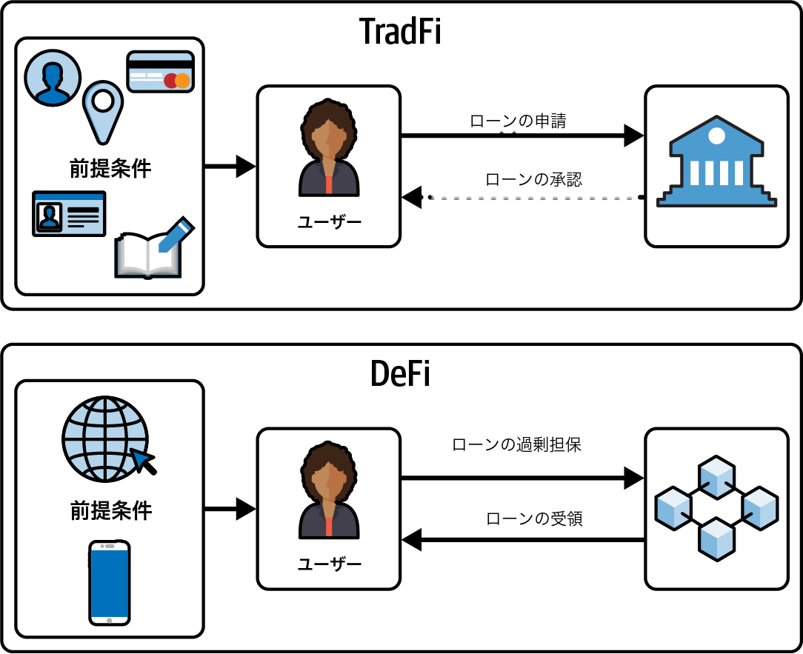
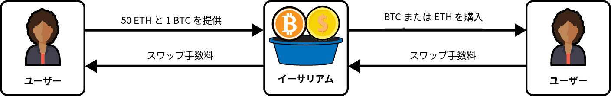
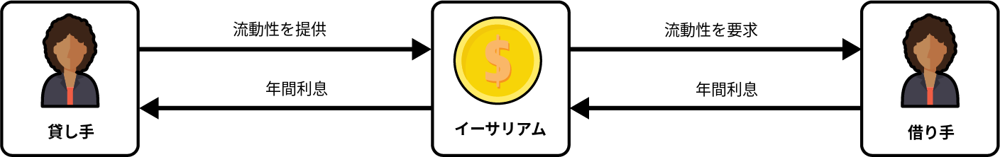
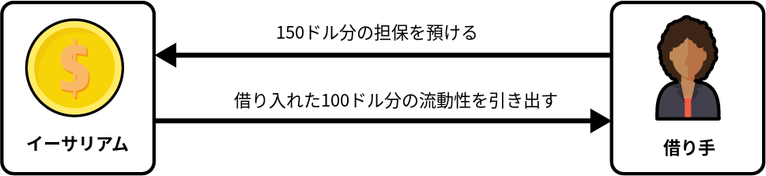
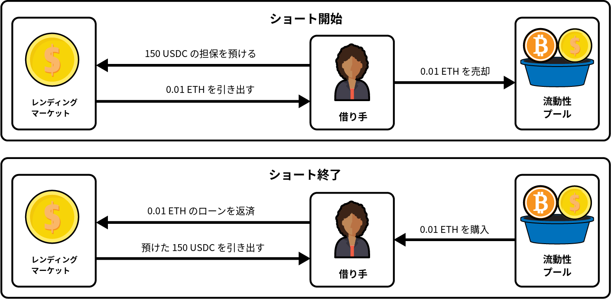
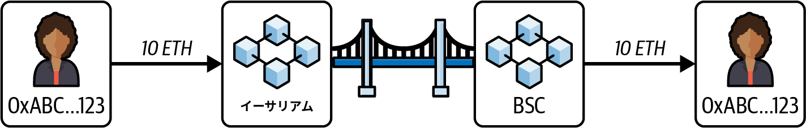
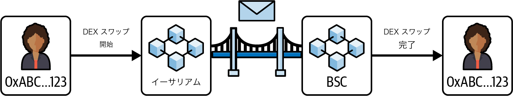

# 第13章 分散型金融（DeFi）

　イーサリアムのスマートコントラクトは、単純な暗号資産の取引を超えた可能性の世界を切り開きました。*分散型金融*（DeFi）は、ブロックチェーン上で完全に動作する包括的な金融エコシステムを構築することで、この可能性をさらに一段上へと引き上げています。貸し付け、借り入れ、取引、投資といった従来の金融サービスを、銀行やブローカーなどの中央集権的な機関なしで提供できる世界を想像してみてください。イーサリアムブロックチェーン上のスマートコントラクトがすべてを処理し、金融における自律性とイノベーションの新時代をもたらしています。

　この分散型のアプローチは金融サービスへのアクセスを民主化し、従来の金融では欠けていることが多い透明性とセキュリティをもたらします。ブロックチェーン上のすべてのトランザクションは公開的に記録され変更不可能であるため、誰でもデータの真正性と完全性を検証できます。この透明性により不正や腐敗のリスクが低減し、より信頼性の高い金融環境が構築されます。

　DeFiは世界規模で金融サービスへのアクセスを広げる機会ももたらします。従来の銀行インフラが未発達またはアクセス不可能な地域では、DeFiが実行可能な代替手段を提供します。スマートフォンとインターネット接続さえあれば、誰でもグローバル経済に参加できます。以前は手が届かなかった融資、貯蓄口座、投資機会へのアクセスを提供することで、何百万もの人々の生活を向上させる可能性があります。イーサリアムのスマートコントラクトのプログラマビリティにより、従来の金融システムでは実装が困難または不可能な複雑な金融商品やサービスを作成できます。

　現在、DeFiの主要なユーザーは、おそらく発展途上国の十分な銀行サービスを受けられない人々や銀行口座を持たない人々ではなく、暗号資産の高い投機性を活用しようとする先進国の個人です。投機の余地は常にありますが、包括的な金融商品を世界中の誰もがアクセスできるようにすることが重要です。

## DeFiと従来の金融の比較

　DeFiは、従来の金融（TradFi）システムに対するサイファーパンクの回答であり、まだ進化中ではあるものの、すでに熱心なユーザーと革新的なビルダーの独自のニッチを見つけている分野です。DeFiとTradFiの区別は複雑ですが、最も重要な違いは交換媒体とブロックチェーンの固有の特性（オープン性や透明性など）にあります。DeFiは主に暗号資産を使用し、さまざまな程度で分散化されていることが多いのに対し、TradFiは常に最大限に中央集権化された法定通貨に依存しています。

　TradFiシステムは多くの場合、参入障壁が高いです。銀行口座の開設、ローンの取得、金融市場への投資には、通常多くの書類と各種規制要件への準拠が必要です。このプロセスは、特に銀行サービスが行き届いていない地域の人々を中心に、世界の人口の大部分を排除する可能性があります。図13-1にその対比を示します。



図13-1. 従来の金融とDeFiのローン要件

　一般的なユーザーがローンを申し込むには、身分証明書、証明可能な住所、社会保障番号、銀行口座、署名済み書類、良好なクレジットスコアなど多くの前提条件が必要です。これらすべてを揃えても、リクエストが拒否される可能性があり、承認されたとしてもおそらく長い時間がかかります。

　DeFiでは、必要な前提条件は3つだけです。スマートフォン、インターネット接続、そしてローンを過剰担保するのに十分な資産です。これらが揃えば、ローンは即時、分散型、かつパーミッションレスです。

　DeFiは設計上、誰でもアクセスしやすく作られています。インターネット接続さえあれば誰でもDeFiプロトコルを利用でき、従来のシステムから排除されている何十億もの人々に金融サービスを開放します。DeFiの高いアクセス性は、TradFiにおける信用力評価や不正への対処の仕組みを適用することを困難または不可能にしており、この点を欠点と見る人もいれば改善と見る人もいます。

　DeFiのもう1つの魅力的な側面は、従来の金融システムでは不可能な新しい金融商品を生み出せることです。たとえばフラッシュローンは、ローンが同一トランザクション内で返済される限り、担保なしで資金を借りられます。DeFi固有のこの機能は、裁定取引、担保スワップ、その他の複雑な金融操作の可能性を広げ、TradFiでは再現できません。

## DeFiの基本要素

　ビットコインのような暗号資産が貨幣の概念を改善し分散化することを目指す一方で、DeFiプロジェクトはこの基盤の上に構築し、金融サービスを分散化・改善します。DeFiが提供する金融サービスを十分に理解するには、いくつかの重要な概念を知っておく必要があります。

### DeFiにおけるトークンの受容性

　イーサリアムのDeFiエコシステムでは、各トークンは個別のコントラクトとして動作します。名前や機能が似ていても、実際にはまったく異なる形態の通貨であるトークンが存在するため、初心者には混乱を招くことがあります。

　たとえばイーサリアム上のArbitrumロールアップでは、USDC.eとUSDCという2つのトークンがほぼ同一に見えますが、リスクと受容性の点で大きく異なります。どちらも1ドルにペグされた価値を維持することを目指しています。しかしUSDCはArbitrumチェーン上でネイティブに発行されているのに対し、USDC.eはUSDCのブリッジ版であり、別のチェーンからArbitrumに転送されたトークンを表しています。

　これら2つのトークンのリスクプロファイルは大きく異なります。USDC.eはUSDC固有のすべてのリスクを抱えつつ、スマートコントラクトの脆弱性の可能性など、ブリッジプロセスに関連する追加リスクも負っています。各種DeFi金融サービスでコインやトークンがどの程度広く受け入れられているかを示す受容性も両者で異なります。USDC.eのみをサポートするプロトコル、USDCのみをサポートするプロトコル、両方を受け入れるプロトコルがあります。

### 分散型取引所

　*分散型取引所*（DEX）は、中央機関や仲介者なしに他のユーザーと直接暗号資産を取引できるプラットフォームです。企業に取引の仲介を依頼する代わりに、DEXはスマートコントラクトでトランザクションを自動的に管理します。これによりユーザーは自分の資金の管理権を維持できます。

#### DEXの進化

　中央集権的な取引所で取引したことがあれば、オーダーブックモデルに馴染みがあるでしょう。このモデルでは、買い注文と売り注文がユーザーの希望価格とともにリストされます。買い注文と売り注文が一致すると取引が執行されます。オーダーブックはすべての未決注文を表示し、トレーダーは市場の深さと流動性を確認できます。

　オンチェーンでは、ブロックチェーンが従来のウェブサイトよりもはるかに遅く使用コストも高いため、このモデルは本格的に普及しませんでした。オーダーブックでの取引のレイテンシと、すべての注文に対する手数料の支払いにより、ユーザー体験は劣悪でした。2017年から2018年にかけてEtherDeltaがオンチェーンオーダーブックの実装を試み、その後いくつかの純粋なオーダーブックモデルも試されましたが、大きな牽引力を得ることはありませんでした。

　Bancorは*自動マーケットメーカー*（AMM）モデルを最初に開拓しました。オーダーブックモデルとは異なり、AMMは買い手と売り手による注文の発注に依存しません。代わりにユーザーがトークンのペアを提供する流動性プールを使用します[^1]。価格はプール内のトークンの比率に基づく数式で決定されます。このモデルにより継続的な流動性と取引が可能になります。

　Uniswapは、シンプルかつ効果的な*x × y = k*の数式でAMMモデルを大幅に改善し普及させました。この数式では2つのトークンの数量の積が一定に保たれます。*x*と*y*はプール内の2つのトークンの数量を表し、*k*は定数です。取引が行われるとトークンの数量は変化しますが、2つの数量の積は同じままであり、プールが常に流動性を提供することを保証します。このイノベーションにより分散型取引所での取引がよりアクセスしやすく効率的になりました。

[^1]: トークンは常にペアであるとは限らない。3つ以上のトークンを持つ流動性プールも存在するが、最も一般的でシンプルな構成はペアである。

　DEXでは、流動性を提供し、その貢献に対する手数料を得ることで、誰でもマーケットメーカーになれます。十分な流動性がある限り、図13-2に示すように取引は迅速に、中央機関の許可なしに行われます。[^2]

[^2]: 図13-2からは、BTCがDEXでネイティブに交換可能であるように見えるかもしれない。しかし、実際にはそうではない。DEX上のBTCは、Wrapped Bitcoin（WBTC）のようなデリバティブコントラクトで表されることが多い。WBTCはBTCの価格にペグされた資産であるが、BTCブロックチェーン上のネイティブBTCよりもはるかに多くのリスクを伴う。ネイティブ資産は通常、それぞれのネイティブチェーンでのみ利用可能である。この例では、プールで使用されるBTCはネイティブBTCではなく、ステーブルコインが法定通貨を表すのと同様のデリバティブである。



図13-2. 分散型取引所の流動性プール

#### インパーマネントロス

　DEXで流動性を提供することはリスクフリーではありません。スマートコントラクトのハッキングに加えて、*インパーマネントロス*と呼ばれる、より微妙なリスクがあります。インパーマネントロスを理解するには、まずUniswap V2プールの基本モデルを把握する必要があります。

　Uniswap V2のような多くの人気DEXは、定積数式*x × y = k*を使用します。ここで*x*と*y*は流動性プール内の2つのトークンの数量、*k*は定数です。トークンの価格は、プール内のトークンの比率によって決定されます。たとえば、プールに100 USDCと10 ETHが含まれている場合、1 ETHの価格は100 ÷ 10 = 10 USDCとなります。取引によりプールが200 USDCと10 ETHに変化した場合、1 ETHの価格は200 ÷ 10 = 20 USDCとなります。

　この数式はプールの仕組みを理解するための簡略化された方法です。流動性を提供することでユーザーはマーケットメーカーとして行動します。ユーザーがプールからETHを購入すると、流動性提供者はETHを売却してUSDCを受け取ります。ユーザーがETHを売却すると、流動性提供者はETHを購入してUSDCを渡します。その見返りとして取引手数料を得ます。ただし、このプロセスにはインパーマネントロスのリスクがあります。インパーマネントロスは、プール内のトークンの価格が預け入れ時と比較して変化した場合に発生します。ETHの価格が大幅に上昇または下落した場合、手数料を徴収していても、プールの保有資産の価値は元のトークンを単純に保有していた場合よりも低くなる可能性があります。

　このオープン性はDEXにとって重要な課題も生んでいます。誰でもブロックチェーンを作成してDEXを立ち上げられるため、現在さまざまなブロックチェーンにわたって100以上（おそらくそれ以上）のDEXが存在します。この豊富さは流動性を断片化し、暗号資産のスワップを流動性が統合されたプラットフォームよりも非効率にしています。この断片化は*スリッページ*の増大につながる可能性があります。スリッページとは、取引の期待価格と実際の執行価格の差です。流動性が不十分な場合に高いスリッページが発生し、取引が予想よりも不利な価格で執行されます。

#### 定積数式が機能する理由

　*x × y = k*の数式のエレガンスは、その数学的形状である双曲線にあります。これは単なる偶然ではなく、流動性プールの完全な枯渇を防ぐための意図的な設計上の選択です。

**線形価格設定の問題**

　DEXが代わりにシンプルな線形価格設定の数式を使用し、残りの流動性に関係なく1 ETHのスワップで常に正確に2 USDCが得られる場合を想像してみてください。これは壊滅的な脆弱性を生みます。

1. 攻撃者はすべてのUSDCをETHにスワップし、プールからETHを完全に枯渇させることができる
2. プールは0 ETHとすべてのUSDCを保持することになる
3. 残りの流動性に基づいて価格が調整されないため、攻撃者は攻撃を逆方向にも実行できる
4. 一連の取引により、プール全体が両サイドでゼロまで枯渇する可能性がある

　固定価格または線形曲線がAMMに根本的に適さない理由は、プールの完全な枯渇を許してしまう点にあります。

**双曲線による解決**

　定積数式*x × y = k*は重要な特性を持つ双曲線を生成します。この曲線はどちらの軸にも接しません。一方のトークンを大量に購入しようとすると、価格は指数関数的に上昇し、どちらのトークンもゼロまで枯渇させることは数学的に不可能です。

```
Token Y (e.g., USDC)
    │
200 ┤·
    │ ·
    │  ·
150 ┤   ·
    │    ·
    │     ·
100 ┤       ·    ← x × y = k (hyperbola)
    │         ·
    │           ··
 50 ┤              ···
    │                  ······
    │                          ·················
  0 ┼────────────────────────────────────────────→ Token X (e.g., ETH)
    0        50       100       150       200
```

　100 ETHと200 USDC（k = 20,000）のプールを考えてみましょう。

- **1 ETHをUSDCにスワップ**: 約1.98 USDC（1:2の比率に近い）を受け取る
- **50 ETHをUSDCにスワップ**: 66.67 USDCしか受け取れない（線形モデルが示す100ではない）
- **200 USDC全額を取得しようとした場合**: 無限のETHを提供する必要がある

　出力を計算する数式は以下のとおりです。

```
Δy = (y × Δx) / (x + Δx)
```

　ここで*Δx*は入力量、*Δy*は出力量です。*Δx*が無限大に近づくと、*Δy*は*y*（準備金の総額）に近づきますが、到達することはありません。

　この漸近的な振る舞いがAMMを安全にしています。プールサイズに対する取引が大きくなるほど交換レートは悪化します。これにより*スリッページ*（期待価格と実際の執行価格の差）が生じ、プールを大幅に枯渇させる取引を自然に抑止します。

　双曲線は流動性プールが自己保護的であることを保証します。トークンが希少になるほど価格が高くなり、完全な枯渇を防ぐ経済的障壁を生み出します。このエレガントな数学的特性こそが、Uniswapのシンプルな数式をトラストレスかつパーミッションレスな取引において革命的なものにした要因です。

> **注記**
>
> DeFiの現在の状況において最も重要なプロジェクトの1つであるUniswapは、ヴィタリック・ブテリンの2016年のReddit投稿に触発されました。プログラミング経験がなかったとされるヘイデン・アダムスが、Vyperプログラミング言語を使用してUniswap V1の開発に1年を費やしました。

### レンディングマーケット

　*レンディングマーケット*（*マネーマーケット*とも呼ばれる）は、スマートコントラクトでプロセス全体を自動化・保護し、暗号資産の貸し借りを促進する分散型プラットフォームです。従来の金融システムとは異なり、銀行のような仲介者なしで運営され、ローンをより透明かつ効率的に処理できます。

　レンディングマーケットでは、暗号資産で利子を得たいユーザーは資金をレンディングプールに預け入れることができます。これらの預金はプラットフォームの全体的な流動性に貢献します。貸し手はプール内の需要と供給に基づいてアルゴリズムで決定されることが多い利率で利子を得ます。借り入れの需要が高いほど利率も高くなり、より多くの貸し手がプールに資産を提供するインセンティブが生まれます。

　一方、借り手は担保を提供することでこれらの資金にアクセスできます。担保は通常、借り入れたい金額よりも高い価値が必要です。この過剰担保はデフォルトのリスクを軽減するためにレンディングにおいて重要です。ほとんどの暗号資産は非常にボラティリティが高く、ローンが過剰担保されていなければ不良債権[^3]をレンディングマーケットに残す可能性があるためです。担保はスマートコントラクトにロックされ、借り手がローンを返済できない場合に清算されて未返済額を補填します。

[^3]: 不良債権とは、借り手がローンの返済を怠り、残りの担保が未払い額を補填するのに不十分な場合に発生する。突然の市場変動や不適切な担保評価によって起こり得る。担保を売却して債務を補填する清算とは異なり、不良債権は回収不能のまま残り、レンディングプロトコルとそのユーザーに損失をもたらす。

　このシステムは貸し手を保護しレンディングプールの支払い能力を維持します。図13-3にこの簡略版を示します。貸し手が流動性を提供して借り手が支払う年間利子を徴収し、借り手は提供された流動性を引き出します。



図13-3. レンディングマーケットの基本フロー

　レンディングマーケットの利率は動的で、市場状況に応じて変動します。プラットフォームのアルゴリズムは利用可能な資金の供給とローンの需要のバランスを取るために利率を継続的に調整します。これにより貸し手と借り手の両方が公正な市場主導型の利率の恩恵を受けられる、効率的で反応性の高い金融エコシステムが構築されます。

　担保率はレンディングマーケットのもう1つの重要な側面です。担保率はローンを確保するために必要な担保の量を決定します。たとえば一般的な担保率は150%で、100ドル相当の暗号資産を借りるには図13-4に示すように少なくとも150ドル相当の担保を預け入れる必要があります。これにより価格変動による潜在的な損失を吸収するバッファが確保されます。



図13-4. レンディングマーケットの担保

　担保の価値が一定の閾値を下回るとプラットフォームのスマートコントラクトが清算プロセスを開始します。担保を売却してローンを返済し、貸し手を潜在的な損失から保護します。清算メカニズムはレンディングプールの安定性と支払い能力を維持するために不可欠です。

#### DeFiにおけるインセンティブ

　DeFiのほとんどの側面はオープンであり、効果的に機能するために適切なインセンティブに大きく依存しています。たとえばほとんどのレンディングマーケットの清算プロセスは、清算可能なローンを継続的に監視するユーザーに依存しています。そのようなローンを特定すると、ユーザーはそれを清算します。ユーザーがこのタスクを実行する動機づけとして、清算額の一部が報酬として支払われます。

　このインセンティブの概念はブロックチェーンとDeFiの基本的な部分です。これらのシステム内の多くのメカニズムは、参加者がネットワークの機能性とセキュリティを維持・改善する方向で行動するよう、ゲーム理論の原則に基づいて設計されています。インセンティブはユーザーの行動をプロトコルの全体的な目標に合わせ、自己持続的なエコシステムを構築します。

　DeFiの多くのプロトコルに共通する強みは、互いに組み合わせて使える「コンポーザビリティ」（composability）にあります。レンディングマーケット単体では、過剰担保が必要なため特に目新しく感じないかもしれません。しかし、ローン機能を他のDeFiプロトコルと組み合わせることで、多様な戦略を実現できる強力なツールになります。

　たとえばレンディングマーケットとDEXを組み合わせることで、*ショート*と呼ばれる金融商品を再現できます。ショートは資産の価格が下落すると予想する場合に使用する戦略です。基本的には資産を借りて現在の価格で売却し、後でより低い価格で買い戻して、借りた資産を返却し差額を得ることを期待します。

　DeFiでショートを実現する方法は以下のとおりです。

1. **資産Aを担保化する**: レンディングマーケットに資産Aを担保として預け入れる。

2. **資産Bのローンを取得する**: ショートしたい資産Bを借りる。

3. **DEXで資産Bを売却する**: 借りた資産Bを分散型取引所で売却する。

　これにより1倍のレバレッジで効果的に資産Bをショートできます。[^4]資産Bの価格が下落した場合、より低い価格で買い戻してローンを返済し差額を保持できます。図13-5にこれを示します。DeFiプロトコルのコンポーザビリティにより、従来の金融戦略を分散型環境で再現できます。

[^4]: ショートポジションのサイズは借り入れ額に直接関連する。



図13-5. DeFiを使用したショート戦略

　レンディングマーケットの用途は広範で、すぐには明らかでないかもしれません。お金があるのに、なぜ過剰担保のローンを組む必要があるのかと疑問に思うかもしれません。自分の資金を使えばよいのではないか、と。一部のシナリオではそのとおりです。しかしレンディングマーケットとDEXを組み合わせることで金融商品を再現でき、ショートの代わりに資産の「ロング」も可能になります。レンディングマーケットのもう1つの利点は課税対象イベントの回避です。多くの国や地域では資産の借り入れは課税対象イベントとみなされませんが、資産の売却は課税対象です。

　レンディングマーケットの潜在的な用途は広大で本書の範囲を超えています。しかしレンディングマーケットは資本効率を向上させ、他のプロトコルと組み合わせることでユーザーに大きな柔軟性を提供します。過剰担保を必要としないレンディングマーケットも存在しますが、現在のところ大きな牽引力を得ていません。

### オラクル

　イーサリアムのオラクルは第11章で詳しく説明したとおり、現実世界のデータをブロックチェーンに取り込み、スマートコントラクトが外部情報を利用できるようにするサービスです。たとえば暗号資産の価格データ、気象条件、スポーツのスコアを提供し、スマートコントラクトがこの外部データに基づいて実行できるようにします。

　オラクルはレンディングマーケットのセキュリティを含むDeFiの多くの側面に不可欠です。レンディングマーケットではトークンの価格をDEXから取得できます。ただし、DEXのみに依存すると、レンディングマーケットがフラッシュローン攻撃に対して脆弱になる可能性があります。このような攻撃では攻撃者が大量の資金を借り入れてDEX上のコインやトークンの価格を操作し、この価格変動を利益のために悪用します。[^7]

[^7]: フラッシュローン攻撃の典型的な手順：①フラッシュローンで大量の資金を無担保で借りる → ②その資金でDEX上の特定トークンを大量に売買し、価格を一時的に操作する → ③操作された価格を利用して別のDeFiプロトコル（レンディング等）から不当な利益を得る → ④利益を確保した上でフラッシュローンを返済する。これらがすべて1つのトランザクション内で実行される。

　オラクルのもう1つの重要な機能は擬似乱数をオンチェーンに取り込む能力です。イーサリアムは決定論的であるため、すべての計算は毎回同じ結果を生成する必要があり、ノードがすべてのブロックとトランザクションを一貫して検証できるようにしています。しかしこの決定論的な性質はイーサリアムのコンポーネント内に真の乱数が存在できないことを意味します。たとえばカジノプラットフォームを構築する場合、乱数の生成は不可欠です。ブロックタイムスタンプ、ハッシュ、トランザクションカウントから擬似乱数を作成する方法もありますが、ブロックプロポーザーがこれらのプロパティを事前に予測または操作してカジノを悪用できるため、このアプローチは攻撃に対して脆弱です。

　オラクルによりイーサリアムブロックチェーンは外部データを使用でき、さまざまなアプリケーションに対してより多くの可能性が開かれます。

> **ヒント**
>
> この説明からはオラクルが中央集権的な存在であり、分散型であるべきDeFiがオラクルに依存しているように見えるかもしれません。しかしDeFiの一部の側面はオラクルに依存しているものの、オラクル自体は多くの場合高度に分散化されており、単一障害点を持ちません。

### ステーブルコイン

　*ステーブルコイン*は、通常米ドル、ユーロ、または商品のバスケットなどの準備資産にペグされた安定した価値を維持するよう設計された暗号資産の一種です。セキュリティや分散化などの暗号資産の利点と従来の法定通貨の安定性を組み合わせることを目指しています。

　ステーブルコインはさまざまなメカニズムで安定性を実現します。*法定通貨担保型ステーブルコイン*は、銀行やその他の信頼できるカストディアンが保有する法定通貨の準備金で裏付けられています。たとえば各USDCまたはUSDTトークンは通常、同等額の米ドル（USD）で裏付けられています。

　*暗号資産担保型ステーブルコイン*は他の暗号資産で裏付けるという異なるアプローチを取ります。暗号資産のボラティリティの高さを考慮して、ペグを維持できるよう多くの場合過剰担保されています。よく知られた例はMakerDAOのDAI[^5]で、ユーザーはイーサリアムやその他の暗号資産を担保としてロックアップしてDAIを発行します。過剰担保は基礎となる資産のボラティリティに対するバッファを提供します。

[^5]: MakerDAOは現在Skyに、DAIは現在USDSに名称変更されている。

　さらに*アルゴリズム型ステーブルコイン*があります。担保に依存せず、アルゴリズムとスマートコントラクトでステーブルコインの供給を管理し価値を安定に保ちます。市場の需要に基づいて供給を拡大または縮小し目標価格を維持します。TerraUSD（UST）はアルゴリズム型ステーブルコインの著名な例でしたが、重大な問題に直面して崩壊しました。

　成功し十分な資本を持つアルゴリズム型ステーブルコインはまだ存在しません。これまでの試みはすべて壊滅的に失敗するか、プロダクトマーケットフィットを見つけられませんでした。

　ステーブルコインはDEXの流動性にも大きく貢献しています。安定した予測可能な資産を提供することでよりスムーズな取引と優れた市場効率を促進します。トレーダーは価格変動を心配することなくポジションの出入りが容易にでき、効率的な市場運営に貢献します。

#### 法定通貨担保型ステーブルコインの限界

　興味深い概念として、CoinbaseやBitfinexでそれぞれドルと交換できるUSDCやUSDTのようなステーブルコインは時価総額の成長に限界があります。*時価総額*とは流通しているすべてのコインの総価値であり、コインの現在の価格に総供給量を掛けて計算されます。

　この限界の理由は、特定のブロックチェーン上のステーブルコインの総価値がそのブロックチェーンの攻撃コストを超えると、悪意のある行為者が攻撃を試みる重大なインセンティブが生まれるためです。ブロックチェーンの侵害による潜在的な報酬がコストを上回る可能性があり、現実的かつ定量化可能なリスクとなります。

　幸いなことにイーサリアムのような堅牢で安全なブロックチェーンの攻撃は容易でも安価でもありません。攻撃の高いコストと複雑さが強力な抑止力となります。しかしあらゆるブロックチェーン上のステーブルコインのスケーラビリティとセキュリティを考慮する際には、この概念を常に念頭に置くことが重要です。

### リキッドステーキング

　*リキッドステーキング*は、ユーザーがproof-of-stake（PoS）ネットワークに暗号資産をステーキングしつつ、それらの資産の流動性を維持できるメカニズムです。通常トークンがステーキングされるとステーキング期間が終了するまでロックされ、アクセスや取引ができません。リキッドステーキングはステーキングされた資産を表すデリバティブトークンを発行することでこの問題を解決します。このデリバティブトークンは取引、転送、または他のDeFiプロトコルで使用でき、ユーザーはステーキング報酬を得ながら流動性を維持できます。

　たとえばリキッドステーキングプラットフォームでETHをステーキングすると、stETHのようなデリバティブトークンを受け取れます。ETHはステーキングされたまま報酬を得続けますが、stETHトークンは自由に取引したり他のDeFi活動で使用したりでき、資金へのアクセスを失わずにステーキングの恩恵を得られます。

> **注記**
>
> リキッドステーキングに類似した新しいタイプのデリバティブが登場しつつあります。*リキッドリステーキング*として知られるものです。EigenLayerのようなプロトコルでは、トークンはイーサリアムチェーンのためにステーキングされるだけでなく、リステーキングと呼ばれるプロセスで他のサービスの保護にも使用されます。この新しい展開は、イーサリアムのコンセンサスメカニズムに過負荷をかけるのではないかという懸念を生んでいます。

　Lidoが発行するstETHなどの受け取ったトークンは、ETHの価格にペグされたステーブルコインのように機能します。つまりドルにペグされたステーブルコインのような典型的なリスクだけでなく、スラッシングに関連する追加のリスクも伴います。リキッドステーキングプロトコルはユーザーが預け入れたETHでバリデーターノードを作成し、ステーキング報酬を得てデリバティブトークンの保有者に再分配します。このプロセスにはバリデーターノードが正しく運用されなかった場合にステーキングされたETHの一部が失われるスラッシングのリスクがあります。

　これらのリスクに加えてリキッドステーキングはブロックチェーン自体にシステミックリスクを生み出す可能性があります。たとえば執筆時点でLidoはステーキングされた全ETHの29%を保有しています。この割合が33%以上に増加した場合、重大な問題を引き起こす可能性があります。[^6]2022年6月、Lido DAOにおいてLidoのステーキングパワーを制限し33%のラインを超えることを防いでイーサリアムの潜在的なシステミックリスクを回避するための投票が行われました。残念ながら、この投票は可決されませんでした。

[^6]: いかなるステーカーもステーキングされたETHの33%以上を保有している場合、理論上、チェーンを攻撃してファイナリティプロセスを停止させることができる。

> **注記**
>
> 反対票の大部分がわずか数個のウォレットから来たものであったため、投票をめぐって論争もありました。

### RWA（現実世界の資産）

　DeFiの文脈において*現実世界の資産*（RWA）とは、トークン化されてブロックチェーン上に取り込まれた有形資産や従来の金融資産を指します。不動産やコモディティから株式、債券、ファインアートまであらゆるものが含まれる可能性があります。これらの資産のトークン化とは、その価値をブロックチェーンプラットフォーム上で取引、貸し付け、借り入れが可能なデジタルトークンに変換することです。

　RWAはやや議論の余地があります。多くの場合カストディアンを必要とし、ブロックチェーンのトラストレスの原則と矛盾するためです。このセクターはDeFiにおいて本格的に台頭した最後のセクターの1つであり、これまでのところRWAプロトコルで重大な問題は発生していません。暗号資産の基本理念に反するにもかかわらずRWAは多くの新しい可能性を開きます。

　RWAの重要な応用の1つは債券をオンチェーンに持ち込み、ユーザーが相対的にリスクフリーの利率にアクセスできるようにしたことです。これにより米国以外の市民が2023年から2024年に米国で利用可能であった5%の金利にアクセスできるようになりました。RWAのもう1つの価値ある用途は不動産の一部を所有するなど、トークン化された資産の分割所有です。

　このセクターはまだ初期段階にあり、その潜在能力をすべて明らかにしたわけではありません。しかしカストディアンシップに関連するリスクは現実的で懸念すべきものです。

### ブリッジとオムニチェーンプロトコル

　ブロックチェーンエコシステムが進化するにつれて、固有の特徴と利点を持つ多種多様なネットワークが発展してきました。しかしこれらのネットワークはしばしば孤立して運用されており、ネットワーク間の資産やデータのシームレスな転送が制限されています。ブリッジとオムニチェーンプロトコルはチェーン間の連携を促進することでこの問題を解決し、より相互接続されたブロックチェーンエコシステムの構築を目指しています。

> **注記**
>
> ブリッジは、ほとんどのブロックチェーンが他のチェーンの状態を認識しないため、非常に中央集権的であることが多いです。チェーンAからチェーンBに資金を転送する場合、ブリッジ操作を承認してチェーンB上の流動性をアンロックする中央機関が通常存在します。この中央集権化がブリッジがDeFiにおいて最も頻繁にハッキングされるプロトコルの1つである理由です。

　*ブリッジ*は図13-6に示すように、異なるブロックチェーン間での資産やデータの転送を促進する特化型プロトコルです。コネクターとして機能し、トークンやその他のデジタル資産をあるチェーンから別のチェーンに移動できるようにします。たとえばトークンをイーサリアムからBinance Smart Chain（BSC）に転送したい場合にブリッジを使用します。



図13-6. 2つのブロックチェーンを接続するブリッジ

　あるチェーンから別のチェーンにトークンをブリッジするモデルは数多くあります。すべてのブリッジは特定のモデルを使用します。最も一般的なものは以下のとおりです。

**ラップドトークンブリッジ（ロックとミント）**

　このモデルではブリッジがチェーンA上でトークンを受け取りスマートコントラクトにロックし、チェーンB上でラップド（または「プロプライエタリ」な）トークンをミントします。ラップドトークンはロックされたトークンを表す受領証として機能します。元のトークンを取得するにはチェーンB上でラップドトークンをバーンし、チェーンA上のトークンをアンロックします。

　たとえば「Mastering Bridge」を使用してETHをイーサリアムからBSCに転送するとします。イーサリアム上のブリッジのスマートコントラクトにETHを送るとブリッジはBSC上で「MasteringETH」のようなラップドトークンをミントします。イーサリアムに戻るにはBSC上のMasteringETHをバーンし、ブリッジが元のETHをリリースします。これらのラップドトークンはチェーンB上でネイティブトークンを取得するためにDEXでスワップする必要があることが多いです。

**ミントとバーン**

　このモデルはトークンのミントおよびバーン機能を管理するプロジェクトで一般的に使用されます。トークンをロックする代わりにブリッジはチェーンA上でトークンをバーン（供給量を減少）し、チェーンB上で同等量をミントします。プロジェクトがトークンのスマートコントラクトに対する権限を持っている必要があります。たとえばプロジェクトはイーサリアム上のETHベースのトークンをバーンし、BSC上で同じトークンをミントしてチェーン間で総供給量を維持できます。

**流動性ブリッジ**

　最も一般的なタイプである流動性ブリッジは複数のチェーン上のトークンプールに依存します。トークンをブリッジすると、ブリッジはその流動性を使用して通常は手数料と引き換えに宛先チェーン上で同等のトークンを送ります。ラップドトークンブリッジとは異なり新しいトークンはミントされません。ブリッジは両方のチェーン上にすでにトークンを保有しています。

　先ほどの例に従いイーサリアムからBSCにETHをブリッジする場合、イーサリアム上のブリッジにETHを送ります。ブリッジはBSC上の流動性プールからETHをリリースします。ブリッジがミントを管理しない場合、転送を促進するためにBSC上に十分な流動性を維持する必要があります。このモデルはシンプルさから人気がありますが、ブリッジが安全に流動性を管理できるかどうかに依存します。

　第11章でクロスチェーンメッセージングプロトコルとして議論した*オムニチェーンプロトコル*は、複数のブロックチェーンにわたるシームレスな通信と相互運用性を同時に可能にすることでクロスチェーン連携の概念を拡張します。これらのプロトコルは、異なるブロックチェーンが摩擦なく連携できる統一レイヤーを構築し、チェーン間での資産、データ、さらにはスマートコントラクト機能の転送を可能にすることを目指しています。図13-7はユーザーがイーサリアム上でスワップを開始しBSC上でスワップを完了して資金を受け取る、シンプルなオムニチェーンメッセージングプロトコルを示しています。



図13-7. オムニチェーンプロトコルの例

## （非）中央集権的な金融

　分散化を定義することは常に困難であり、多くの場合現実を記述するというよりも望ましい結果を表現する手段です。ほとんどのDeFiプロトコルは真に分散化されていません。重要な権限を持つアドレスやコア開発チームによる意思決定に依存していることが多く、分散型であるはずのシステム内に権力の集中を生み出しています。

　DeFiはまだ初期段階にあり、その未来を形作り正しい方向に導くのはアーリーアダプターの役割です。分散化は目標ですが常に現在の現実ではないことを認識することが重要です。DeFiのような新興市場は迅速な意思決定と変更の実施のためにある程度の中央集権化から恩恵を受けることもあります。この中央集権的な意思決定は急速に進化する環境で適応し成長するために必要な俊敏性を提供できます。

　DeFiが成熟し続けるにつれて、中央集権化を段階的に削減し、より分散型のモデルへと移行することが目標であるべきです。アーリーアダプターは効率性と迅速な意思決定に対する現在のニーズと分散化の究極的なビジョンのバランスを取るこの移行において非常に重要な役割を果たしています。固有のトレードオフを理解し対処することで、DeFiコミュニティはオープン性、透明性、包括性という基本原則に沿うようにシステムの進化を導けます。

## DeFiにおけるリスクと課題

　DeFiには専門家を含むユーザーにもしばしば誤解される独自のリスクと課題があります。すべてのDeFiプロトコルは特定の経済的リスクと一般的なスマートコントラクトリスクを伴います。さらに分散化の程度に応じてカストディアンリスクや中央集権化の問題が存在する場合があります。

　スマートコントラクトリスクは、より一般化しやすい性質があります。スマートコントラクトはハッキングされる可能性があり、カストディアンは悪意を持って行動したりミスを犯したりする可能性があります。経済的リスクはより複雑で各DeFiの基本要素やプロトコルに特有です。たとえばレンディングマーケットにおけるリスクは清算であり、適切なオラクルを使用しないマーケットでは不当に発生する場合があります。DEXで流動性を提供するリスクはインパーマネントロスです。ステーブルコインやリキッドステーキングの場合、主なリスクはペグの喪失です。

　DeFiプロトコルを使用する前に関連するすべてのリスクを理解することが極めて重要です。リスクに加えてDeFiは重大な課題にも直面しています。多くのプロトコルは既存プロトコルのフォークであり、真のイノベーションを提供せずに既存プロジェクトに対して「ヴァンパイア攻撃」を試みています。これは流動性とユーザーを断片化するだけでなくエコシステム全体の有効性を希釈します。

　流動性はほとんどのプロトコルにとって不可欠です。好況市場ではうまく機能するかもしれませんが低迷期には大幅に劣化することが多いです。ほとんどのDeFiプロトコルは自給自足ではなく、使用がインセンティブ化されている場合にのみ機能する傾向があります。ユーザーが製品に真に関心がないか、コストが利益を上回るためです。

　DeFiはある程度のプロダクトマーケットフィットを示していますが将来は不確実です。グローバルインフラの魅力的な一部へと進化する可能性があり、これが最も可能性の高い帰結ですが、一部のユーザーのためのニッチ市場にとどまる可能性もあります。

　DeFiにとっての重要な課題の1つは規制です。規制環境は国や規制機関によって大きく異なり、ほとんどの規制当局は完全に分散化されたシステムに反対しています。スマートコントラクトが不変でオンチェーンにデプロイされている場合、規制当局は直接介入できませんが、開発者やユーザーをターゲットにしてスマートコントラクトの使用を困難にすることは可能です。

　その好例がTornado Cashです。開発者のアレクセイ・ペルツェフはオランダで64か月の禁固刑を宣告されました。北朝鮮のハッキンググループLazarusによる不正資金の洗浄にTornado Cashが使用されたとされることを受けて米国財務省がTornado Cashをブロックリストに追加し、ペルツェフは2022年8月にマネーロンダリングの容疑で逮捕されました。Tornado Cashプロトコルは引き続き利用可能ですが流動性は大幅に減少しユーザー体験の悪化につながっています。さらにTornado Cashを使用したアドレスは中央集権的な取引所でフラグが立てられ、使用がさらに困難になっています。

　同様の状況が他のエコシステムでも発生しています。たとえばSamourai Walletの開発者も法的措置に直面しています。このパターンは規制当局がブロックチェーン自体を攻撃できないものの、そのユーザーや開発者をターゲットにできることを示しています。

> **注記**
>
> 本書の著者はSamourai WalletやTornado Cash、その他の類似事例に関する法的専門知識を十分に持ち合わせていませんが、分散型コードを書いたことを理由に個人に対して取られる法的措置を支持しません。コードは自由であるべきであり、ツールの制作者が他者による悪用のために罰せられるべきではありません。今後このような不当な結果に直面する開発者が出ないことを願います。

## まとめ

　DeFiはユーザーが自分のお金をより柔軟に活用できるようにし、フラッシュローンのような新しい機会と革新的な金融の基本要素を生み出しています。暗号資産分野における新興市場としてDeFiは急速に発展していますが、トークン交換、ステーブルコイン、デリバティブの作成を超えた適切なマーケットフィットをまだ見つけていません。
