# 第14章 イーサリアム仮想マシン(EVM)

　イーサリアムプロトコルとその運用の中心には、*イーサリアム仮想マシン*(Ethereum Virtual Machine)、つまり*EVM*があります。名前から推測できるように、それは計算処理エンジンであり、Microsoftの.NET Frameworkの仮想マシンやJavaなどの他のバイトコードでコンパイルされたプログラミング言語のインタプリタと大きく異なるものではありません。この章ではEVMの詳細を見ていきます。特に、イーサリアムのステート（状態）更新に関わる命令セット、構造、操作などを見ていきます。

## EVMとは何か？

EVMはイーサリアムの構成要素の１つで、スマートコントラクトをデプロイあるいは実行します。あるEOA（外部所有アカウント）から別のEOAへの単純な送金トランザクションは、実際のところEVMを関与させる必要はありませんが、それ以外のすべてのトランザクションに関してはEVMによって計算がなされた状態への更新を伴います。おおまかに言うと、イーサリアムブロックチェーン上で実行されるEVMは、それぞれ永続的なデータストアを伴い、多くの実行可能オブジェクトを格納した、グローバル分散コンピュータとみなせます。

EVMは*準チューリング完全*状態マシンです。どのようなスマートコントラクトに対しても、すべての実行過程は、実行のために利用可能なガスの量によって有限の計算ステップ数に制限されるため、「準」と呼んでいます。このようにして、*停止性問題*は「解決」し（すべてのプログラムは、実行した場合にいつかは停止する）、実行が（意図せず、あるいは悪意をもって）永遠に実行され、イーサリアムプラットフォームが完全に停止する状況が回避されます。停止性問題については、後のセクションで詳しく説明します。

EVMは*スタックベースアーキテクチャ*を持っており、一時的な値はすべてスタックに格納されます。EVMは主に組み込みのハッシングや楕円曲線演算を容易にするために、256ビットのワードサイズで動作し、以下に示す、アドレスを指定してアクセスが可能ないくつかのデータコンポーネントも持っています。

- 実行されるスマートコントラクトのバイトコードが読み込まれた、不変のプログラムコードROM
- すべての領域が明示的にゼロに初期化された揮発性のメモリ
- 単一のトランザクションの処理中にのみ保持する（イーサリアムのステートの一部ではない）一時ストレージ
- メモリと同様にゼロに初期化されたイーサリアムの状態の一部である永続ストレージ

　また、実行中に利用可能な環境変数とデータのセットも存在します。それらの詳細に関しては、章の後半で詳しく説明します。

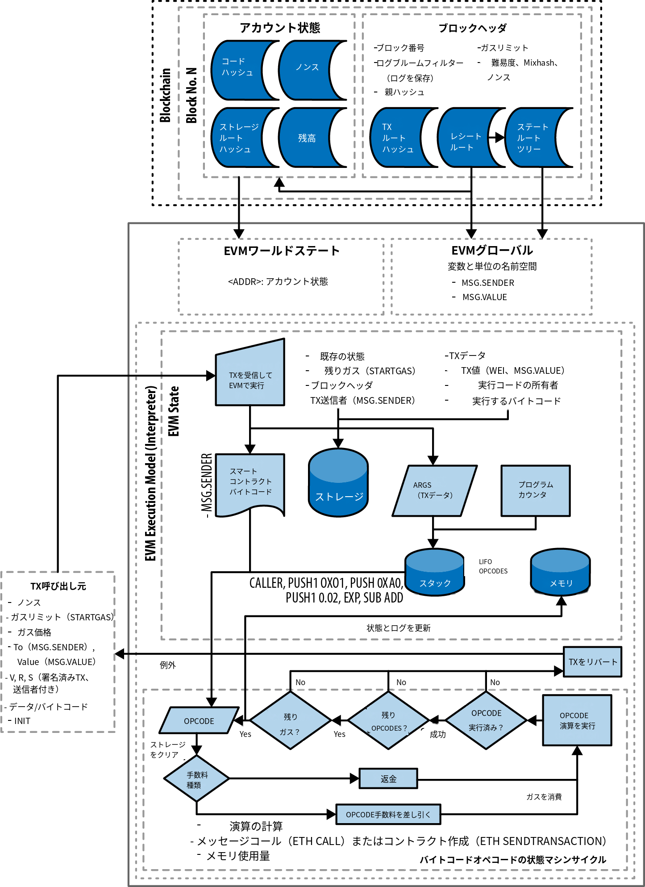


Figure 14-1. EVM architecture and execution context

図14-1. EVMアーキテクチャと実行コンテクスト

## 既存の技術との比較

*仮想マシン*という用語は、通常、VirtualBoxやQEMUなどのハイパーバイザーや、LinuxのKVMなどのオペレーティングシステムのインスタンス全体の仮想化など、現実のコンピュータの仮想化に用いられます。実際のハードウェア、システムコール、そしてその他のカーネル機能それぞれに対して、ソフトウェアとしての抽象化を定める必要があります。

　現実のコンピュータの仮想化に比べると、EVMははるかに限られた領域で動作します。EVMは単なる計算処理エンジンなので、たとえばJVM（Java Virtual Machine：Java仮想マシン）の仕様と同じように、計算処理とストレージの抽象化を規定します。全体的な観点から見ると、JVMは、基盤となるホストOSやハードウェアに依存しない実行環境を規定するように設計されており、異なるシステ
　ム間で互換性を保つことができます。JavaやScala（JVMを使用する）やC#（.NETを使用する）などの高級プログラミング言語は、それぞれの仮想マシンのバイトコード命令セットにコンパイルされます。同様に、EVMは独自のバイトコードで記述された命令セット（次の項で説明します）を実行します。バイトコードで記述された命令セットは、Solidity、Vyper、Yulなどの高級スマートコントラクトプログラミング言語をコンパイルすることで生成されます。

EVMはスケジューリング機能を持ちません。なぜなら、実行順序の決定はEVMの外部で取りまとめられているからです。イーサリアムクライアントは、検証されたブロックトランザクションを一通り見て、どのスマートコントラクトをどの順序で実行する必要があるかを決定します。この意味で、イーサリアムワールドコンピュータはJavaScriptのようにシングルスレッドです。また、EVMには、「システムインターフェイス」の処理や「ハードウェアのサポート」はどちらもありません。お互いにやり取りする物理的なマシンは存在しないのです。イーサリアムワールドコンピュータは完全に仮想的なものです。

## 他のブロックチェーンは何をしているか？

EVMは間違いなく暗号通貨分野で最も広く使用されている仮想マシンです。ほとんどの代替L1およびL2ブロックチェーンは、既存のすべてのツールやフレームワークとの互換性を維持し、イーサリアムコミュニティから直接プロジェクトや開発者を引き付けるためにEVMを使用しています。

それにもかかわらず、近年、多くの異なる仮想マシンが登場しています。Solana VM、Wasm VM、Cairo VM、Move VMはおそらく最も有名で興味深いものであり、それぞれに独自の利点と欠点があります。これらはスマートコントラクト開発に対して異なるアプローチを取っています：

**カスタム言語**

CairoやMoveのような一部のプラットフォームは、スマートコントラクトを書くために特別に設計されたプログラミング言語を作成しています。これは、イーサリアムがその仮想マシンであるEVMのためにSolidityやVyperを使用しているのと同様です。

**標準言語**

そのほかのSolanaや WebAssembly（Wasm）を使用するプラットフォームなどは、広く使用されているプログラミング言語でスマートコントラクトを書くことを可能にしています。例えば、これらのプラットフォームはスマートコントラクト開発にRustをサポートしていることが多いです。

　これらの代替仮想マシンがEVMと異なるもう一つの領域は、トランザクションの*並列化*です。EVMは並列化なしにトランザクションを順次処理することはすでに述べました。いくつかのプロジェクトはこの欠点を取り上げ、改善しようとしました。例えば、Solana VMとMove VMの両方がトランザクションを並列に実行できますが、常に可能というわけではありません。たとえば、2つのトランザクションが同じコントラクトとやり取りして同じストレージを変更する場合、それらは並列に実行できません。

　仮想マシンのパフォーマンスを向上させるこれらの取り組みは、イーサリアムの外部だけで行われているわけではないことを言わなければなりません。実際、多くのチームが並列化やEVMバイトコードからネイティブマシンコードへの*事前コンパイル(ahead-of-time)*（AOT）や*実行時コンパイル(just-in-time)*（JIT）などのクールな機能を追加することで、EVMの現在の制限を打破しようと取り組んでいます。

## The EVM Instruction Set (Bytecode Operations)

## EVM命令セット（バイトコード演算）

The EVM instruction set offers most of the operations you might expect, including:

EVM命令セットでは、次のような多くの操作が用意されています。

- Arithmetic and bitwise logic operations
- Execution context inquiries
- Stack, memory, and storage access
- Control flow operations
- Logging, calling, and other operators

- 算術演算とビット単位の論理演算
- 実行コンテクストに関する問い合わせ
- スタック、メモリ、ストレージへのアクセス
- 制御フローに関する操作
- ロギング、関数コール、その他の演算子

　一般的なバイトコード操作に加えて、EVMはアカウント情報（アドレスや残高）やブロック情報（ブロック番号や現在のガス価格）にアクセスする操作も用意されています。
　利用可能なオペコードとその動作に着目してEVMを詳細に調べてみましょう。想定どおりかもしれませんが、オペランドはすべてスタックから取得され、その結果（適用可能な場合は）がしばしば、スタックの先頭に書き戻されます。

　使用可能なオペコードは、次のカテゴリーに分類できます。

### 算術演算

算術演算命令には以下が含まれます：

```
ADD        // スタックの上から2つの要素を足し合わせる
MUL        // スタックの上から2つの要素を掛け合わせる
SUB        // スタックの上から2つの要素を引き算する
DIV        // 整数除算
SDIV       // 符号付き整数除算
MOD        // モジュロ（剰余）演算
SMOD       // 符号付きモジュロ演算
ADDMOD     // 任意の数のモジュロ加算
MULMOD     // 任意の数を法とする乗法
EXP        // 指数演算
SIGNEXTEND // 2の補数符号付き整数の長さを拡張
SHA3       // メモリブロックの Keccak-256ハッシュを計算
```

　すべての算術演算は、特に明記されていない限り、2^256を法として実行され、0^0（ゼロの0乗）は1であるとみなされることに注意してください。

### スタック操作

スタック、メモリ、ストレージ管理命令には以下が含まれます：

```
POP     // スタックの一番上の項目を削除する
MLOAD   // メモリからワードをロードする
MSTORE  // ワードをメモリに保存する
MSTORE8 // メモリに 1バイトを保存する
SLOAD   // ストレージからワードをロードする
SSTORE  // ワードをストレージに保存する
TLOAD   //一時ストレージからワードをロードする
TSTORE  //一時ストレージにワードを保存する
MSIZE   // アクティブなメモリのサイズをバイト数で取得する
PUSH0   //スタックに値0を配置する
PUSHx   // xバイトの要素をスタックに置く
        // xは1～32（フルワード）を含む任意の整数
DUPx    // スタックの x番目の要素を複製する
        // xは1～16を含む任意の整数
SWAPx   // スタックの最初の要素と（x+1）番目の要素を交換する
        // xは1から16までの任意の整数
```

### 処理フロー操作

制御フロー命令には以下が含まれます：

```
STOP       // 実行を停止する
JUMP       // プログラムカウンタを任意の値に設定する
JUMPI      // プログラムカウンタを条件付きで変更する
PC         // プログラムカウンタの値を取得する（インクリメント前の値）
           // この命令に対応）
JUMPDEST   // 有効なジャンプ先としてマークする
```

### システムに関連する操作

プログラムを実行するシステムのオペコードには以下が含まれます：

```
LOGx          // x個のトピックを持つログレコードを追加（xは0から4までの任意の整数）
CREATE        // 関連付けられたコードで新しいアカウントを作成する
CALL          // 別のアカウントへのメッセージコール、つまり別のアカウントのコードの実行
CALLCODE      // 別のアカウントのコードでこのアカウントにメッセージコールを行う
RETURN        // 実行を停止して出力データを返す
DELEGATECALL  // 代替アカウントのコードを使用してこのアカウントにメッセージコールを行うが、
              // 送信者とバリューの現在の値を保持する
STATICCALL    // 静的なメッセージコールをこのアカウントへ行うが、どのアカウントの状態も変更できない。
REVERT        // 実行を停止し、状態変更を元に戻し、データと残りのガスを返す
INVALID       // 指定された無効な命令
SELFDESTRUCT  // 実行を停止し、コントラクト作成時のトランザクション中に実行された場合は、
              // 削除するアカウントとして登録する。使用は強く非推奨であり、
              // オペコードは非推奨と見なされている
```

### 論理演算

比較とビット論理のオペコードには以下が含まれます：

```
LT         // より小さいかどうかの比較
GT         // より大きいかどうかの比較
SLT        // 符号付きの小なり比較
SGT        // 符号付きの大なり比較
EQ         // 等価比較
ISZERO     // 単純NOT演算子
AND        // ビット単位の AND演算
OR         // ビット単位の OR演算
XOR        // ビット単位の XOR演算
NOT        // ビット単位の NOT演算
BYTE       // 256ビットワードから 1バイトを取得
```

### 環境に対する操作

実行環境情報を扱うオペコードには以下が含まれます：

```
GAS            // 利用可能なガスの量を取得する
               //（この命令に関する支払いが終わったあとのガス）
ADDRESS        // 現在実行中のアカウントのアドレスを取得する
BALANCE        // 指定されたアカウントの残高を取得する
ORIGIN         // この EVMの実行の 起点となった EOAのアドレスを取得する
CALLER         // この実行の直接の呼び出し元のアドレスを取得する
CALLLVALUE     // この実行の呼び出し側がデポジットしたイーサ値を取得する
CALLDATALOAD   // この実行の呼び出し元が送信した入力データを取得する
CALLDATASIZE   // 入力データのサイズを取得する
CALLDATACOPY   // 入力データをメモリにコピーする
CODESIZE       // 現在の環境で実行されているコードのサイズを取得する
CODECOPY       // 現在の環境で実行されているコードをメモリにコピーする
GASPRICE       // トランザクションの作成元が指定したガス価格を取得する
EXTCODESIZE    // アカウントコードのサイズを取得する
EXTCODECOPY    // アカウントのコードをメモリにコピーする
RETURNDATASIZE // 現在の環境で、前の呼び出し元の出力データのサイズを取得する
RETURNDATACOPY // 直前の呼び出しからのデータ出力をメモリにコピーする
```

### ブロックに関連する操作

現在のブロックの情報にアクセスするオペコードには以下が含まれます：

```
BLOCKHASH  //Get the hash of one of the 256 most recently completed
           //blocks
COINBASE   //Get the block's beneficiary address for the block reward
TIMESTAMP  //Get the block's timestamp
NUMBER     //Get the block's number
PREVRANDAO //Get the previous block's RANDAO mix. This opcode replaces the
           //DIFFICULTY one since The Merge hard fork.
GASLIMIT   //Get the block's gas limit
```

```
BLOCKHASH      // 最近生成が完了した256のブロックの内の 1つのハッシュを取得する
COINBASE       // ブロック報酬を受け取るアドレスを取得する
TIMESTAMP      // ブロックのタイムスタンプを取得する
NUMBER         // ブロックの番号を取得する
PREVRANDAO     // 前のブロックのRANDAOミックスを取得。このオペコードは
               // The Mergeハードフォーク以降、DIFFICULTYに代わるもの
GASLIMIT       // ブロックのガス上限を取得する
```

## イーサリアムのステート（状態）

EVMの役割は、イーサリアムのステート（状態）を更新することです。ステートの更新は、スマートコントラクトのコードの実行の結果として、プロトコルによる定義どおりに有効な状態遷移を計算することで行われます。これは、イーサリアムはトランザクションベースのステートマシン（transaction-based state machine）であるという説明にもつながります。つまり、外部アクター（アカウント所有者とバリデータ）がトランザクションを作成し、受け付け、順序づけることで状態遷移を開始しているということです。以下では、イーサリアムの状態を構成するものについて見てきます。

　最上位レベルでは、イーサリアムの*ワールドステート*があります。ワールドステートは、イーサリアムアドレス（160ビット値）からアカウントへのマッピングです。下位レベルでは、各イーサリアムアドレスは、イーサ残高（アカウントが所有するwei数として保存）、ノンス（EOAの場合はこのアカウントから正常に送信されたトランザクションの数、コントラクトアカウントの場合はコントラクトアカウントによって作成されたコントラクトの数を表す）、アカウントのストレージ（スマートコントラクトのみが使用する永続的なデータストア）、およびアカウントのプログラムコード（これもスマートコントラクトアカウントの場合のみ）で構成されるアカウントを表します。従来、EOAは常にコードを持たず、空のストレージを持っていました。しかし、[EIP-7702](https://eips.ethereum.org/EIPS/eip-7702)（2025年5月のPectraアップグレードで有効化）は、EOAがスマートコントラクトにコード実行を委任できるようにすることで、この前提を変更します。EOAが委任にオプトインすると、そのコードフィールドは`0xef0100 || address`の形式の23バイトの*委任指定*に設定されます。ここで`address`はターゲットコントラクトの20バイトアドレスです。`0xef`は[EIP-3541](https://eips.ethereum.org/EIPS/eip-3541)により禁止されたオペコードであり、この指定がデプロイ可能なコントラクトコードと混同されないことを保証します。EVMが委任されたEOAへの呼び出しに遭遇すると、ターゲットアドレスからコードをロードしてEOAのコンテクストで実行します。このことは委任されたEOAに対する`EXTCODESIZE`は23（委任指定のサイズ）を返し、委任されたコード内で実行される`CODESIZE`はターゲットコントラクトのコードのサイズを返すことを意味します。EOAは委任されたコードを実行する際にストレージも使用できますが、委任コントラクト間を移行する際の衝突を防ぐために、プロトコルは[ERC-7201](https://eips.ethereum.org/EIPS/eip-7201)の名前空間付きストレージレイアウトの使用を推奨しています。重要なのは、委任されたEOAは引き続きトランザクションを送信できることです。トランザクションに署名して送信できるEOAの機能はそのままですが、さらにスマートコントラクト機能を持つようになります。委任はゼロアドレス（`0x0000000000000000000000000000000000000000`）を委任先に指定することでクリアできます。

　トランザクションによってスマートコントラクトのコードが実行されると、現在作成されているブロックおよび処理中の特定のトランザクションに関して必要なすべての情報を含むEVMがインスタンス化されます。特に、EVMのプログラムコードROMには、コントラクトアカウントのコードが呼び出されて読み出され、プログラムカウンタはゼロに設定され、ストレージ情報がコントラクトアカウントのストレージから読み出され、メモリはすべてゼロに設定され、すべてのブロックおよび環境変数が設定されます。ここで重要な変数は、この実行のために設定されたガス供給量です。ガス供給量は、トランザクションの開始時にトランザクション送信者が支払ったガスの量に設定されています（詳細は「実行中のガス会計」を参照）。コード実行が進むにつれて、ガス供給量は実行された操作のガス費用に応じて減少します。いずれかの時点でガス供給量がゼロ未満になると、*ガス切れ*（Out of Gas: OOG）例外が発生します。コントラクトコードの実行は直ちに停止し、トランザクションは放棄されます。イーサリアムの状態への変更は適用されません。ただし、送信者のノンスがインクリメントされ、停止点までのコード実行に使用されたリソースに対しする対価としてブロックの受益者に支払うためにイーサ残高が減少します。この時点で、EVMはイーサリアムワールドステートのサンドボックス化されたコピー上で実行されていると考えることができ、何らかの理由で実行が完了できない場合、このサンドボックスは完全に破棄されます。ただし、実行が正常に完了した場合、呼び出されたコントラクトのストレージデータへの変更、作成された新しいコントラクト、開始されたイーサ残高の転送を含め、実世界の状態はサンドボックス版に一致するように更新されます。

　コード実行は再帰的なプロセスです。コントラクトは他のコントラクトを呼び出すことができ、各呼び出しは新しい呼び出し対象の周りにもう一つのEVMがインスタンス化されます。各インスタンスは、上のレベルのEVMのサンドボックスからサンドボックスワールドステートが初期化されます。インスタンス化（コンテクスト）の際には、指定されたガス供給量のガスが指定与えられます（もちろん、上のレベルで残っているガス量を超えない）。このため、実行を完了するのに十分なガスが与えられなかった場合は例外で停止する可能性があります。この場合も、サンドボックス状態は破棄され、実行は上のレベルのEVMに戻ります。

## イーサリアムステートレス

　執筆時点（2025年6月）では、すべてのイーサリアムノードは、含まれるすべてのトランザクションを再実行してすべての新しいブロックの正確性を確認できるようにするために、最新の状態（前述のワールドステート）を計算して維持する必要がありますが、部分的にそれを取り除く計画があります。

　そのアイデアは、サーチャーやビルダーなどの限定されたアクターのセットが、新しいブロックを作成して公開するために引き続き状態にアクセスする必要がある一方で、他のすべてのノードは状態なしでそれらのブロックを暗号的に検証できるようにすることです。これは*ステートレスネス*と呼ばれます。

　ステートレスネスは、コアプロトコルにいくつかの変更が必要なため、イーサリアムロードマップ上ではまだまだはるか先の話です。

**ブロック提案者とビルダーの分離（ePBS）**

トランザクションを収集してブロックを作成する作業と、P2Pネットワークに提案する作業を分離します。前者は、サーチャーやビルダーと呼ばれる高度に専門化されたエンティティによって行われ、超最適化されたブロックを作成できます。後者はイーサリアムバリデータノードによって行われます。ePBSはプロトコルにまだ組み込まれていませんが、メインネットではすでに実現されています。実際、イーサリアムブロックの大半は、非常に小さな大手ビルダーのセットによって構築されています。

**Verkleツリー**

イーサリアムが状態を保存するために現在使用しているデータ構造であるマークルパトリシアツリーの置き換えです。これにより、状態の正当性を検証するために必要な暗号証明のサイズが大幅に削減され、変更前のマークルパトリシアツリーよりも検証が高速になります。

> **注記**
>
> 他のハッシュベースのバイナリツリーが、バークルツリーの代替としてテストされています。核心的なアイデアは、迅速かつ容易に検証できる小さな証明を作成できる状態用のデータ構造を持つことです。

　これら2つのアップグレードを組み合わせることで、ブロックを作成する強力なハードウェアを備えた大規模組織のみが完全な状態を保存・アクセスする必要があるというシナリオが実現します。新しいブロックと共に、*暗号証人*が作成されます。これは、ブロックに含まれるトランザクションに基づいて新しい状態が正しく計算されたことを証明する最小限のデータセットです。

　他のすべてのノード（バリデータノードを含む）は、全体の状態のハッシュである*ステートルート*のみを保存します。新しいブロックを受信すると、そのブロックに関連付けられた証人を使用してその正確性を検証します。

　これにより、完全な状態を保存する必要も、すべてのトランザクション（EVM内で）を再実行する必要もなくなり、イーサリアムノードの実行が非常に軽量になります。さらに、引き続き第三者を信頼する必要がなくすべてが正しいことを検証できます。スマートフォンでもノードを実行できるようになるでしょう…

　研究は急速に進んでいますが、メインネットでステートレスネスを実現するまでにはおそらくまだ数年かかるでしょう。

## マークルパトリシアツリー

Right now, the Ethereum state is stored using a very peculiar data structure called a *modified Merkle-Patricia trie*. We briefly mentioned the Merkle-Patricia tree (we'll call it MPT) in the previous section, but it's very important to understand how it works and why as well as how it's used by Ethereum as the way to store the state (and not only that…) because the same reasoning applies to Verkle tries. Before diving into MPTs, you need to know about Merkle trees because they represent the foundation on which MPTs are built.

　現在、Ethereumの状態は*修正マークルパトリシアツリー*と呼ばれる非常に特殊なデータ構造を使用して保存されています。前のセクションでマークルパトリシアツリー（以下、MPT）について簡単に触れましたが、その仕組みと理由、そしてEthereumが状態を保存する方法としてどのように使用されているか（そしてそれだけではありません）を理解することは非常に重要です。なぜなら、同じ考え方がバークルツリーにも当てはまるからです。MPTについて詳しく説明する前に、マークルツリーについて知っておく必要があります。なぜなら、マークルツリーはMPTの基盤となるからです

### マークルツリー

　マークルツリーは、1988年にラルフ・マークルがよりより良いデジタル署名を構築しようとして発明した非常に古いデータ構造です。データベース全体を送信せずに、データがデータベースに存在し、改ざんされていないことを検証する必要がある場合に非常に効率的です。

　データのコレクションからMerkleツリーを作成するのは簡単です。データをいくつかのチャンクに分割し、それらのチャンクを一緒にハッシュし、最終的に1つのチャンクだけになるまでこの最後のステップを再帰的に繰り返します。そのチャンクは*Merkleルート*です。これは、ツリーを作成するために使用されたすべてのデータの一種のデジタル指紋です。

　バイナリMerkleツリー（Merkleツリーの最も単純な形式）をゼロから作成して、もう少し慣れ親しみましょう。8つのデータチャンクから始めます。これらは英語の異なる単語と考えてみましょう。特定のハッシュ関数を使用して各チャンクをハッシュします。第4章ですでに述べたように、イーサリアムはKeccak-256ハッシュ関数を使用します。図14-2でhash_1、hash_2などとして表されるMerkleツリーの葉を取得します。次に、各リーフのペアを連結して再びハッシュし、hash_12、hash_34などを作成します。連結とハッシュのこのプロセスをさらに2回繰り返し、単一の最終結果であるMerkleルート：hash_12345678を取得します。

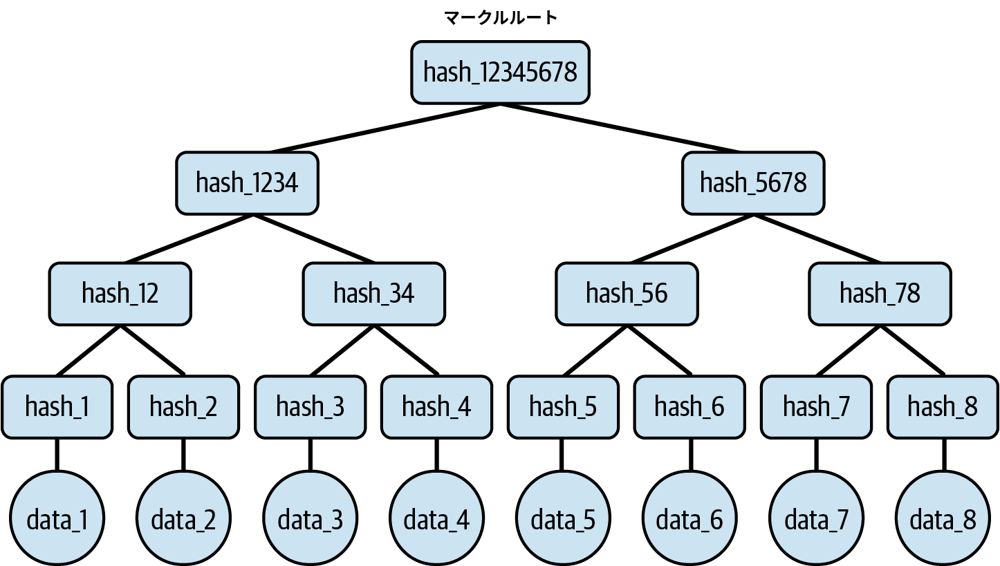

図14-2. バイナリMerkleツリー

　データを保存するためになぜMerkleツリーが必要なのか疑問に思うかもしれません。各チャンクを従来のデータベースに保存するよりも複雑ではないでしょうか？

　答えはイエスです。キーバリューやSQLデータベースにすべてのチャンクを保存するよりもはるかに複雑です。この種のデータ構造を使用する唯一の理由は、チャンクのいずれかがデータのコレクションに存在し、操作されていないこと暗号証明を安価に提供するのに非常に効率的だからです。実際、特定のチャンクを持っていることの証明を提供するように求められた時に、通常のデータベースを使用してデータを保存している場合、私たちが嘘をついていないことを確認できるようにデータセット全体を公開する必要があります。

　前の例を使用して、具体的に見てみましょう。data_1がデータセットに含まれていることを証明したいとします。単純なアプローチは、data_1からdata_8までの全データセット（合計8項目）を提供することです。Merkleツリーを使用すると、hash_2、hash_34、hash_5678のみを提供すればよいです。その後、誰でも自分でMerkleルートを計算し、最初に計算した（公開されている）Merkleルートと比較できます。一致すれば、図14-3に示すように、data_1が初期データセットの一部であることを完全に確信できます。

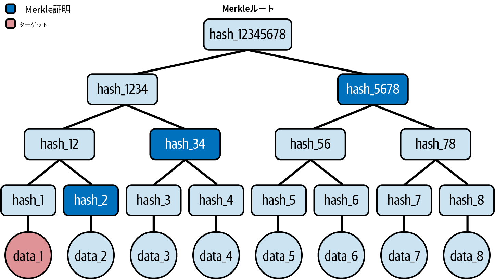

図14-3. data_1がツリーに含まれていることを検証するMerkle証明

> **Tips**
>
> Merkleツリーを再構築するには、次の手順に従います：
>
> 1. data_1をハッシュしてhash_1を取得します。
> 2. hash_1を提供されたhash_2と連結してハッシュし、hash_12を取得します。
> 3. hash_12を提供されたhash_34と連結してハッシュし、hash_1234を取得します。
> 4. hash_1234を提供されたhash_5678と連結してハッシュし、最終的なMerkleルートを取得します。

Merkleツリーなしの単純なアプローチでは8つのデータが必要なのに対し、3つのデータのみを使用していることに注意してください。これは単なる単純な例です。大量のデータの場合は節約効果はより大きくなります。

　数学的に言えば、Merkleツリーは図14-4に示すように単純なアプローチが線形なO(n)に対して、O(log(n))の計算量を提供します。

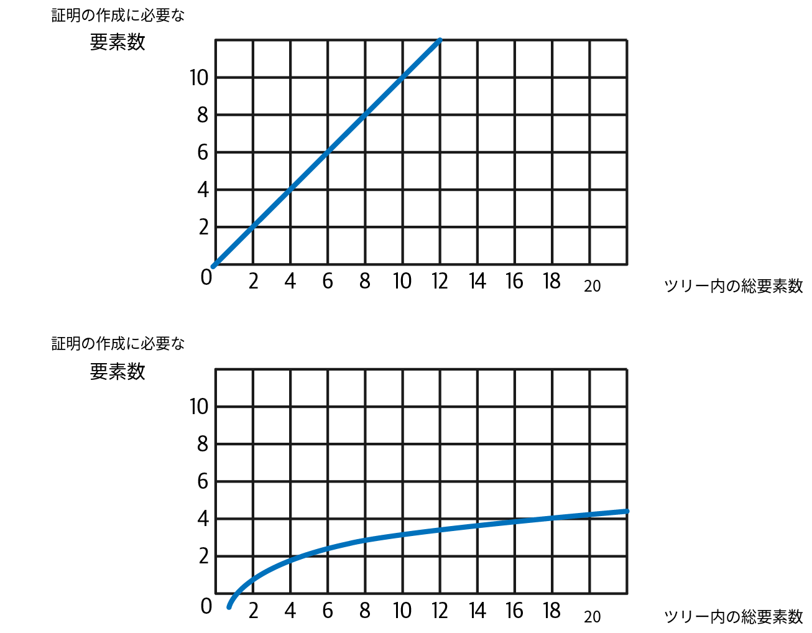

図14-4. O(n)（上）対O(log(n))（下）

　イーサリアムの世界では、これはアドレスの残高、トランザクションの結果、または特定のスマートコントラクトのバイトコードに関する証明を、より安価で簡単に提供できることを意味します。

### BitcoinにおけるMerkleツリー


Bitcoinはブロックチェーン技術におけるMerkleツリー活用の先駆者です。実際、すべてのBitcoinブロックにはそのブロックに含まれるすべてのトランザクションのMerkleルートが含まれているため、ブロックヘッダーを変更せずに（PoWも損なわずに）トランザクションを変更することは不可能です。

### イーサリアムにおけるMerkle-Patriciaトライ

　イーサリアムは同じ概念を取り入れ、独自のニーズに合わせていくつかの変更を加えました。Merkleツリーは、Bitcoinトランザクションのような不変の永続的なデータには適しています。しかし、イーサリアムの状態は常に変化するためデータを頻繁に変更できるようにしながら、有用な特性を維持するためにMerkleツリーを調整する必要があります。

　ここでMerkle-Patriciaトライが登場します。名前は、Merkleツリー、Patricia（Practical Algorithm to Retrieve Information Coded in Alphanumeric）、および*retrieval*（検索）に由来する*trie*という単語の組み合わせから来ており、最適化の目的を思い出せる名前になっています。

　基本的に、Merkle-Patriciaトライは各ノードに16の子を持つ修正されたMerkleツリーです。キー自体がツリー内の正しい位置に到達するパスにエンコードされているため、多くのキー・バリュー項目（キーはアドレスであり、バリューは残高、ノンス、コード（存在する場合）などの各アドレスのアカウント情報）を持つイーサリアムの状態データに適しています。

Let's say we have the following key-value item we want to store:

　次のキーバリュー項目を保存したいとします。

```
car → Schumacher
```

Carは（0x）6 3 6 1 7 2として16進エンコードされます。そのため、まず初めにMerkleルートから6番目の子を選択します。次に、３番目の子供を選択します。このプロセスをそのキーに関連付けられた値（この例ではSchumacher）を読み取ることができる最終値に到達するまで繰り返します。この例を図14-5に示します。

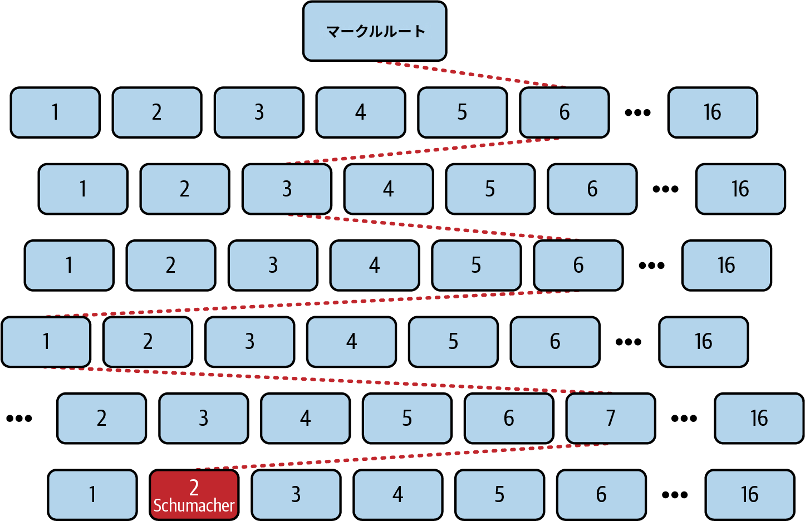

図14-5. キーバリュー項目car --> SchumacherのMerkle-Patriciaトライへのエンコード

特に、イーサリアムは4つのMerkle-Patriciaトライを使用します：

**ステートトライ**

全体の状態を保存する

**トランザクショントライ**

ブロックに含まれるすべてのトランザクションを保存する

**レシートトライ**

ブロックに含まれるすべてのトランザクションの結果を保存する

**ストレージトライ**

スマートコントラクトのデータを保存する

　すべてのイーサリアムブロックヘッダーには、ステート、トランザクション、レシートトライのMerkleルートが含まれ、すべてのアカウント（ステートトライに含まれる）は独自のストレージトライMerkleルートを保存します。

## EVMコンポーネントの詳細

　このセクションでは、EVMの各コンポーネントがどのように機能するかを詳しく見ていきます。最後に実際の例を使って動作を確認します。

### スタック

　スタックは、操作を実行するために*後入れ先出し*（LIFO）の順序に従う非常に単純なデータ構造であり、すべてのアイテムは32バイトのオブジェクトです。同時に最大1,024個のアイテムを扱えます。

EVMは、さまざまな種類のオペコードを通じてスタックにアイテムをプッシュおよびポップでき、図14-6に示すようにアイテムの順序を操作できます。

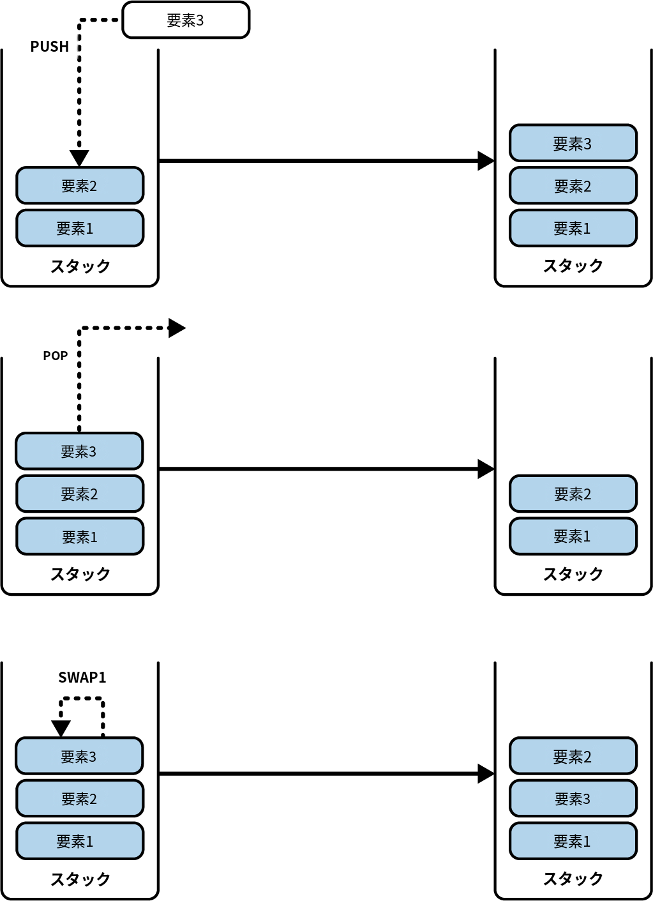

図14-6. EVMスタックはLIFO操作順序に従う

### メモリ

EVMメモリはバイト単位でアドレス指定可能なデータ構造で、基本的に非常に長いバイト配列です。実際、メモリ内のすべてのバイトは32バイト（256ビット）のキーを使用してアクセスでき、最大2^256バイトを含むことができます。揮発性であり、実行終了後に削除され、常に0に初期化されます。

　メモリから単一バイトを読み書きすることは可能ですが、ほとんどの操作では、図14-7に示すように、より大きなデータチャンク（通常は32バイトチャンク）の読み書きが必要です。

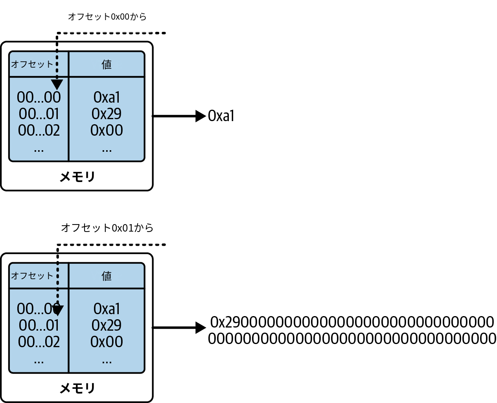

図14-7. EVMメモリは揮発性の、バイト単位でアドレス指定可能なデータ構造

> **注記**
> **注記**
>
> 技術的には、EVMから単一のバイトを読み取ることはできません。読み取れるのは32バイトのワード全体のみです。単一バイトの読み取りと同じ結果を得るには、EVMはそのバイトを含むワード全体をロードし、選択したバイトのみを返すために「カット」する必要があります。

### ストレージ

EVMストレージは、キー（多くの場合*スロット*と呼ばれる）と値がそれぞれ32バイトの長さのキーバリューデータ構造です。これはすべてのスマートコントラクトの永続的な記憶領域であり、保存されたすべての値は異なるトランザクション間やブロックにわたって無期限に保持されます。各スマートコントラクトは自身のストレージにのみアクセスと変更が可能で、値を含まないスロットにアクセスしようとすると、エラーをスローせずに常に値0を返します。図14-8は、2つのコントラクトのストレージの基本的な表現を示しています。

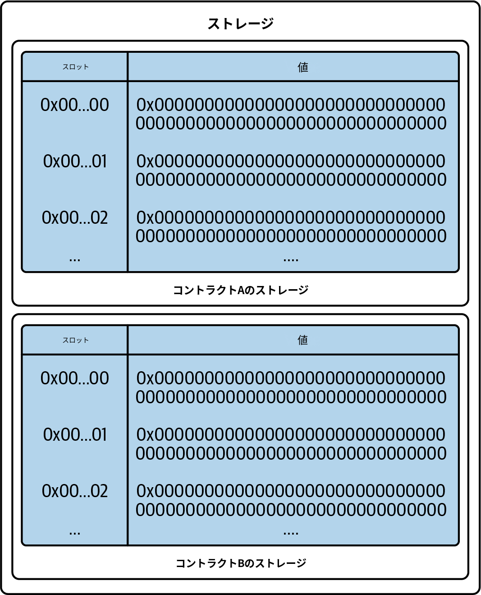

図14-8. EVMストレージはキーバリューデータ構造を持つ永続的な記憶領域

[EIP-1153](https://oreil.ly/fRvKl)で追加された*一時ストレージ*もあり、通常のストレージと同じように動作しますが、唯一の違いはトランザクションの実行後に完全に破棄されることです。このため、通常のストレージよりもはるかに安価に使用できます。

### コールデータ

　コールデータは不変のデータ構造であり、次の*コールフレーム*（サンドボックスEVM環境）への入力として送信されるバイト列を格納します。たとえば、コントラクト作成トランザクションでは、コールデータにはデプロイされるコントラクトのバイトコードが含まれます。単純なETH転送の場合などでは空になります。

## 具体的な例ですべてをまとめる

　コントラクトAに対するトランザクションを実行しているとします。EVMバイトコードは次のとおりです：`60425F525F3560AB145F515500`

初期コールデータは次のとおりです：

```
00000000000000000000000000000000000000000000000000000000000000ab
```

EVMバイトコードを人間が読める形式で表現しましょう：

```
[00]            PUSH1            42
[02]            PUSH0
[03]            MSTORE
[04]            PUSH0
[05]            CALLDATALOAD
[06]            PUSH1            AB
[08]            EQ
[09]            PUSH0
[0a]            MLOAD
[0b]            SSTORE
[0c]            STOP
```

> **注記**
> **注記**
>
> 各EVMオペコードは一意の1バイト値（0x00から0xFFの範囲）で識別されます。たとえば、0x60はPUSH1オペコード、0x5FはPUSH0などです。すべてのオペコードとその16進表現の一覧については、[EVM codes](https://www.evm.codes)を参照してください。

EVMがこれらのオペコードをどのように実行し、スタック、メモリ、ストレージがどのように操作されるかを見てみましょう。図14-9はEVMの初期状態を示しています。

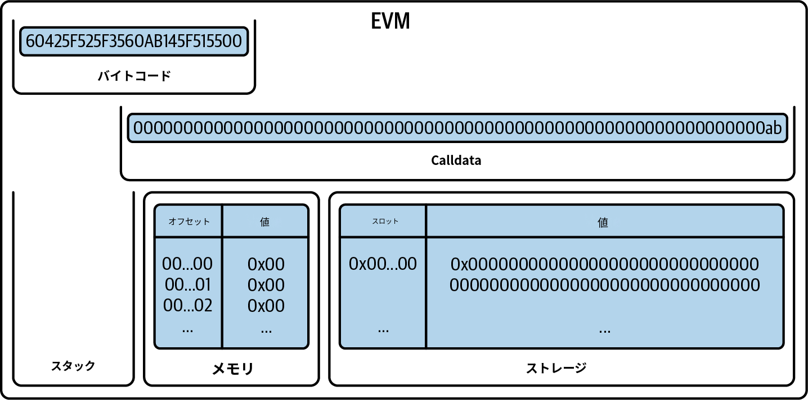

図14-9. EVMの初期状態

　最初のオペコードは0x42をスタックにプッシュします（図14-10）。なお、プッシュオペコードは自身の次のバイトをプッシュするデータとして取得します。

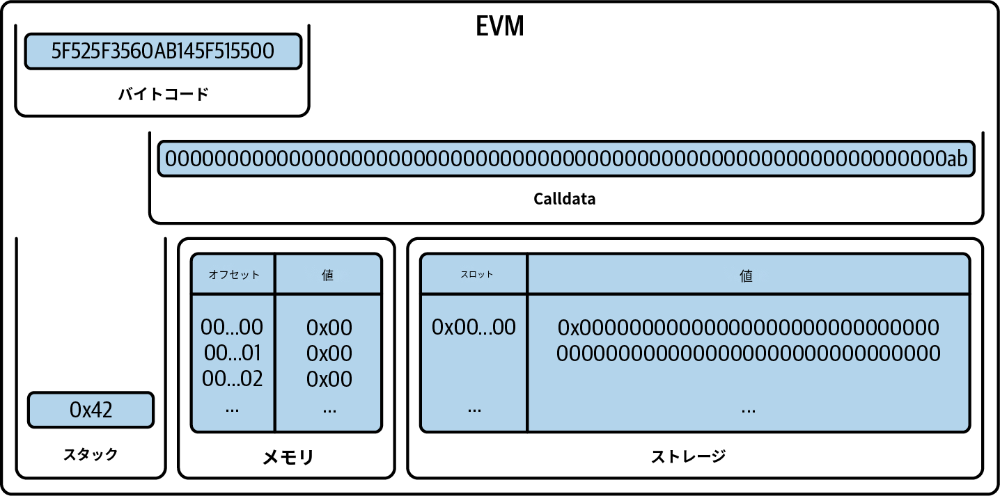

図14-10. PUSH1 0x42後のEVM

　次に、PUSH0は0x00をスタックにプッシュします（図14-11）。

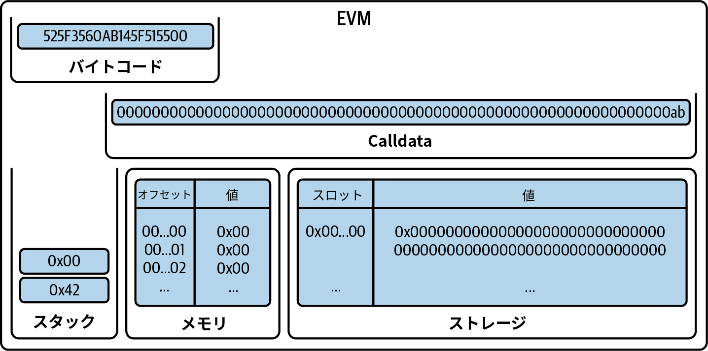

図14-11. PUSH0後のEVM

MSTOREはスタックから2つのアイテムをポップし、1つ目をオフセット（バイト単位）、2つ目をそのオフセットからメモリに書き込む値として解釈します。バイト0x42の前にメモリ上に多くの先頭のゼロ埋め（31バイト分）があることに注意してください。これはスタック内のすべての値が32バイトであるためです。ほとんどの場合、書き込み時に先頭のゼロ埋めは無視できますが（図14-12ではアイテム0x42が確認できます）、実際には32バイトの値であることを忘れないでください。

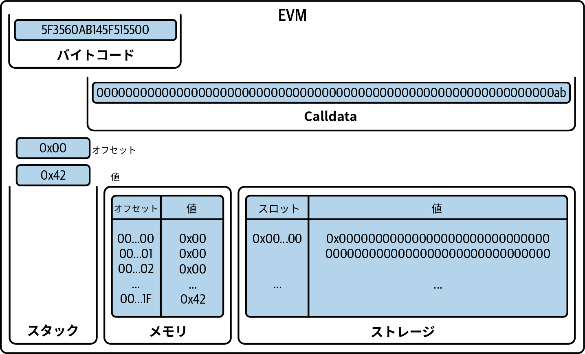

図14-12. MSTORE後のEVM

　次に、再びPUSH0が0x00をスタックにプッシュします（図14-13）。

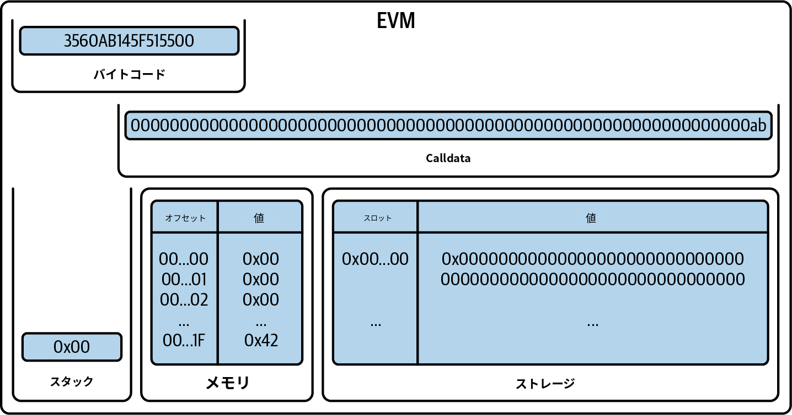

図14-13. PUSH0後のEVM

CALLDATALOADはスタックから1つの要素を取り出し、オフセットとして解釈し、そのオフセットから始まるコールデータの32バイト値を返してスタックにプッシュします。ここでは、図14-14に示すように0xabを返しています（先頭のゼロ埋めは重要でないため省略します）。

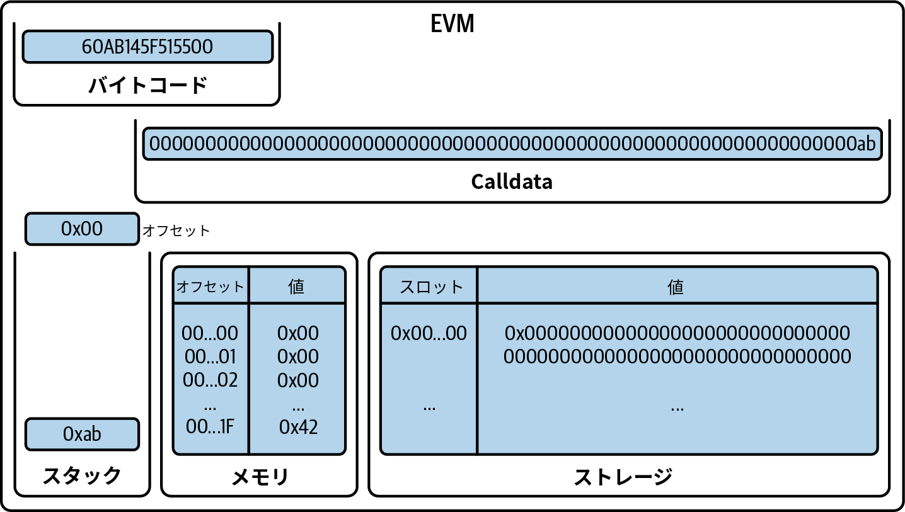

図14-14. CALLDATALOAD後のEVM

PUSH1は0xabをスタックにプッシュします（図14-15）。

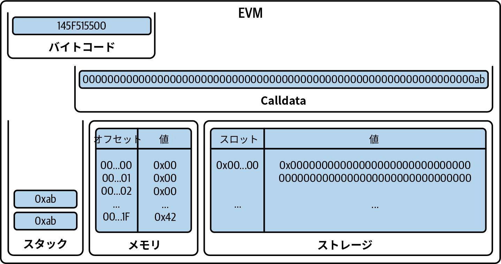

図14-15. PUSH1 0xab後のEVM

EQはスタックから2つのアイテムをポップして比較し、等しい場合は1を、そうでない場合は0を返します。この例では、図14-16に示すように、2つの値が等しいため0x01を返します。

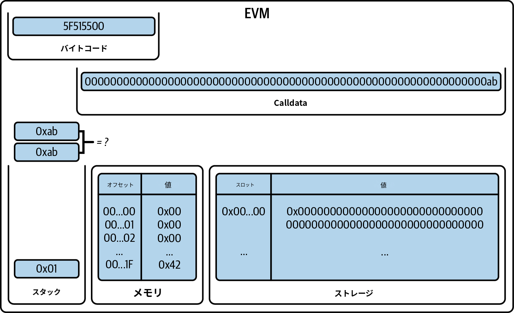

図14-16. EQ後のEVM

　再び、PUSH0が0x00をスタックにプッシュします（図14-17）。

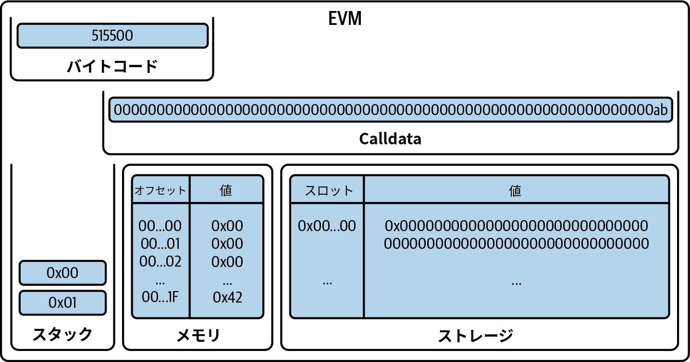

図14-17. PUSH0後のEVM

MLOADはスタックから1つの要素を取り出し、オフセットとして解釈し、そのオフセットから始まるメモリの32バイトを読み取って結果をスタックにプッシュします（図14-18）。

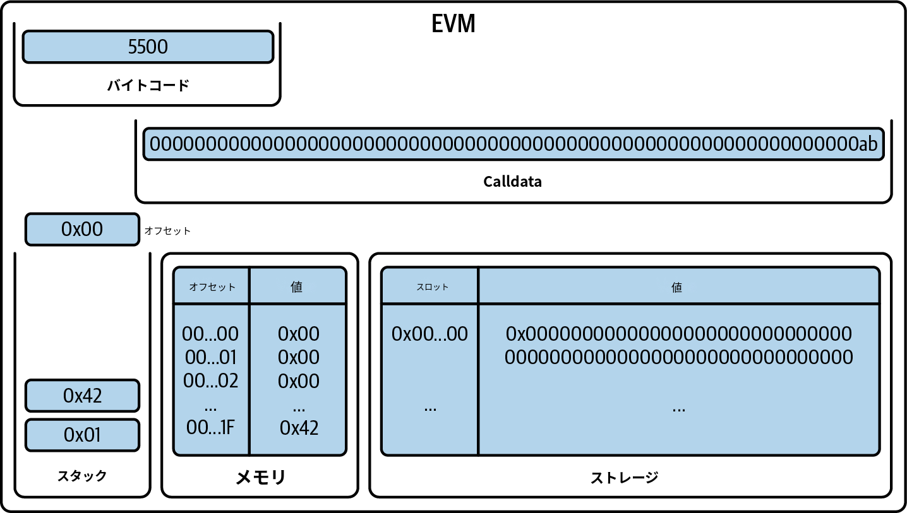

図14-18. MLOAD後のEVM

　次に、SSTOREがスタックから2つのアイテムを取り出し、1つ目をスロット番号、2つ目をコントラクトストレージの該当スロットに保存する値として解釈します（図14-19）。

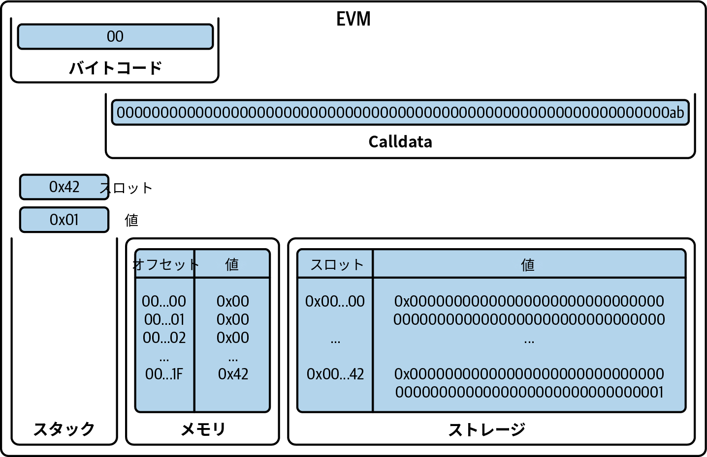

図14-19. SSTORE後のEVM

　最後に、STOPオペコードが実行を停止し、図14-20に示すようにEVMは正常に終了します。

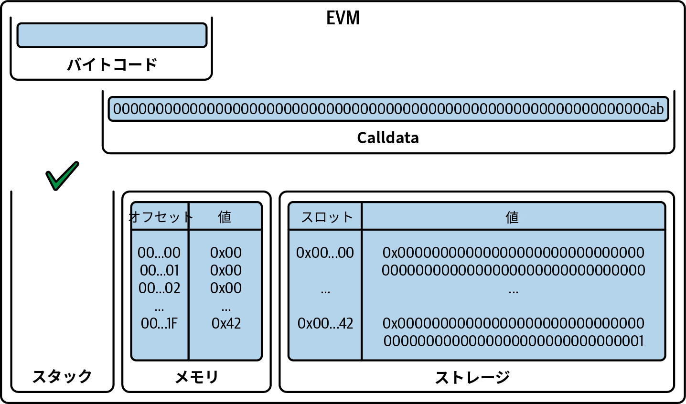

図14-20. STOP後のEVM

> **ヒント**
> **ヒント**
>
> 前の例ではオペコードPUSH0を使用しました。すべてのEVM互換ブロックチェーンがこのオペコードをサポートしているわけではないため、クロスチェーンコントラクトをデプロイする際には注意してください。[EVM Diff](https://www.evmdiff.com)は、EVM互換チェーン間のこうした微妙な違いを確認できる便利なウェブサイトです。

## SolidityのEVMバイトコードへのコンパイル

　第7章ではSolidityについてすでに解説しました。ここでは、SolidityがEVMで実行可能なEVMバイトコードにどのようにコンパイルされるかを見ていきます。

SolidityソースファイルをEVMバイトコードにコンパイルするには、いくつかの方法があります。第2章ではオンラインのRemixコンパイラを使用しました。本章では、コマンドラインで`solc`実行ファイルを使用します。コンピュータにSolidityをインストールするには、[こちらの手順](https://oreil.ly/JW--z)に従ってください。

オプションの一覧を表示するには、次のコマンドを実行します：

```bash
$ solc --help
```

`--opcodes`コマンドラインオプションを使用すると、簡単にSolidityソースファイルから生のオペコードストリームを生成することができます。このオペコードストリームではいくつかの情報が取り除かれます（`--asm`オプションは完全な情報を生成します）が、ここでの説明に関しては十分です。たとえば、Solidityファイル`Example.sol`をコンパイルし、出力されるオペコードを`BytecodeDir`という名前のディレクトリに送信するには、次のコマンドを実行します：

```bash
$ solc -o BytecodeDir --opcodes Example.sol
```

`--asm`を使用して、より人間が読みやすい出力を生成することもできます：

```bash
$ solc -o BytecodeDir --asm Example.sol
```

　次のコマンドは、サンプルプログラムのバイトコードバイナリを生成します。

```bash
$ solc -o BytecodeDir --bin Example.sol
```

Solidityソースファイルに含まれる具体的なコントラクトごとに、出力されるオペコードは異なります。私たちの簡単なSolidityファイル`Example.sol`には、Exampleという名前のコントラクトが1つだけあります。

```solidity
// SPDX-License-Identifier: GPL-3.0
pragma solidity 0.8.27;

contract Example {
  address contractOwner;

  function test() public {
    contractOwner = msg.sender;
  }
}
```

　ご覧のとおり、このコントラクトは、コントラクトを実行した最後のアカウントのアドレスを永続的な状態変数として保持することだけを行います。

`BytecodeDir`ディレクトリを見るとオペコードのファイル`Example.opcode`があります。このファイルはExampleコントラクトのEVMオペコードの命令セットを含んでいます。テキストエディタで`Example.opcode`ファイルを開くと、次のように表示されます：

```
PUSH1 0x80 PUSH1 0x40 MSTORE CALLVALUE DUP1 ISZERO PUSH1 0xE JUMPI PUSH0 PUSH0 REVERT JUMPDEST POP PUSH1 0xA9 DUP1 PUSH1 0x1A PUSH0 CODECOPY PUSH0 RETURN INVALID PUSH1 0x80 PUSH1 0x40 MSTORE CALLVALUE DUP1 ISZERO PUSH1 0xE JUMPI PUSH0 PUSH0 REVERT JUMPDEST POP PUSH1 0x4 CALLDATASIZE LT PUSH1 0x26 JUMPI PUSH0 CALLDATALOAD PUSH1 0xE0 SHR DUP1 PUSH4 0xF8A8FD6D EQ PUSH1 0x2A JUMPI JUMPDEST PUSH0 PUSH0 REVERT JUMPDEST PUSH1 0x30 PUSH1 0x32 JUMP JUMPDEST STOP JUMPDEST CALLER PUSH0 PUSH0 PUSH2 0x100 EXP DUP2 SLOAD DUP2 PUSH20 0xFFFFFFFFFFFFFFFFFFFFFFFFFFFFFFFFFFFFFFFF MUL NOT AND SWAP1 DUP4 PUSH200xFFFFFFFFFFFFFFFFFFFFFFFFFFFFFFFFFFFFFFFF AND MUL OR SWAP1 SSTORE POP JUMP INVALID LOG2 PUSH5 0x6970667358 0x22 SLT KECCAK256 JUMPI 0xBB RETURNDATACOPY SWAP14 CALLVALUE 0xB3 0xB1 SMOD BLOBHASH STATICCALL MCOPY PUSH10 0x856E7132D8FEED4D83B6 0xB2 0xBE PUSH30 0x8B43532C818BFD64736F6C634300081B0033000000000000000000000000
```

`--asm`オプションを使用してこのファイルをコンパイルすると、`BytecodeDir`ディレクトリに`Example.evm`という名前のファイルが生成されます。このファイルには、EVMバイトコード命令のやや高レベルな記述と、わかりやすい注釈が含まれています：

```
/* "Example.sol":61:171  contract Example {... */
  mstore(0x40, 0x80)
  callvalue
  dup1
  iszero
  tag_1
  jumpi
  revert(0x00, 0x00)
tag_1:
  pop
  dataSize(sub_0)
  dup1
  dataOffset(sub_0)
  0x00
  codecopy
  0x00
  return
stop

sub_0: assembly {
        /* "Example.sol":61:171  contract Example {... */
      mstore(0x40, 0x80)
      callvalue
      dup1
      iszero
      tag_1
      jumpi
      revert(0x00, 0x00)
    tag_1:
      pop
      jumpi(tag_2, lt(calldatasize, 0x04))
      shr(0xe0, calldataload(0x00))
      dup1
      0xf8a8fd6d
      eq
      tag_3
      jumpi
    tag_2:
      revert(0x00, 0x00)
        /* "Example.sol":109:169  function test() public {... */
    tag_3:
      tag_4
      tag_5
      jump    // in
    tag_4:
      stop
    tag_5:
        /* "Example.sol":154:164  msg.sender */
      caller
        /* "Example.sol":138:151  contractOwner */
      0x00
      0x00
        /* "Example.sol":138:164  contractOwner = msg.sender */
      0x0100
      exp
      dup2
      sload
      dup2
      0xffffffffffffffffffffffffffffffffffffffff
      mul
      not
      and
      swap1
      dup4
      0xffffffffffffffffffffffffffffffffffffffff
      and
      mul
      or
      swap1
      sstore
      pop
        /* "Example.sol":109:169  function test() public {... */
      jump    // out
    auxdata: 0xa264697066735822122057bb3e9e34b3b10749fa5e69856e7132d8feed4d83b6b2be7d8b43532c818bfd64736f6c634300081b0033
}
```

`--bin`オプションは、機械可読な16進バイトコードを生成します：

```
6080604052348015600e575f5ffd5b5060a980601a5f395ff3fe6080604052348015600e575f5ffd5b50600436106026575f3560e01c8063f8a8fd6d14602a575b5f5ffd5b60306032565b005b335f5f6101000a81548173ffffffffffffffffffffffffffffffffffffffff021916908373ffffffffffffffffffffffffffffffffffffffff16021790555056fea264697066735822122057bb3e9e34b3b10749fa5e69856e7132d8feed4d83b6b2be7d8b43532c818bfd64736f6c634300081b0033
```

「EVM命令セット（バイトコード演算）」に記載されているオペコードの一覧を使用して詳細を調べることができます。しかし、作業量がかなり多くなってしまうので、最初の4つの命令を調べるところから始めてみましょう：

```
PUSH1 0x80 PUSH1 0x40 MSTORE CALLVALUE
```

ここでは`PUSH1`の後に生のバイトの`0x80`が続いています。このEVM命令は、プログラムコード内のオペコードに続く1バイトを（リテラル値として）取り出し、スタックにプッシュします。次のように、32バイトまでのサイズの値をスタックにプッシュすることができます：

```
PUSH32 0x436f6e67726174756c6174696f6e732120536f6f6e20746f206d617374657221
```

`Example.opcode`の2つ目の`PUSH1`は、`0x40`をスタックの先頭にプッシュします（すでに存在する`0x80`を1つ下のスロットに押し込みます）。

　次は`MSTORE`で、これはEVMのメモリに値を保存するメモリへの記録演算です。`MSTORE`は2つの引数を取ります。ほとんどのEVM上の演算と同様に、引数をスタックから取得します。各引数について、スタックは「ポップ」されます。すなわち、スタックの一番上の値が取り出され、スタック内の他のすべての値の位置が1つ上にシフトされます。`MSTORE`の最初の引数は、保存する値を格納するメモリのアドレスです。このプログラムではスタックの先頭に`0x40`があるため、`0x40`はスタックから削除されてメモリアドレスとして使用されます。2番目の引数は保存される値で、ここでは`0x80`です。`MSTORE`演算が実行された後、スタックは再び空になりますが、メモリ上の`0x40`に`0x80`（10進数で128）の値があります。

　次のオペコードは`CALLVALUE`です。`CALLVALUE`は、実行を開始したメッセージコールと一緒に送信されたイーサの量（weiで表される）をスタックの一番上にプッシュする環境オペコードです。

　コードが影響を与える低いレベルの状態変化を完全に理解できるまで、このようにコードを一歩一歩解析し続けることもできますが、おそらく、現段階ではあまり理解の助けにはならないでしょう。この章の後半で、もう一度こういったコードの観察に戻ることにします。

## コントラクトのデプロイを行うコード

　イーサリアムプラットフォームでは、コントラクトを作成しデプロイする際に使用されるコードとコントラクト自体のコードの間には重要で小さな違いが存在します。新しいコントラクトを作成するには、特別なトランザクションが必要です。このトランザクションは`to`フィールドを空（null）に設定し、その`data`フィールドをコントラクトの生成コード（initiation code）に設定します。そのようなコントラクト作成トランザクションが処理されるときは、新しいコントラクトアカウントのコードとしてトランザクションの`data`フィールドのコードがそのまま登録されるわけではありません。その代わりに、プログラムコードROMにロードされたトランザクションの`data`フィールドのコードを使用してEVMがインスタンス化され、そのデプロイコードの実行結果が新しいコントラクトアカウントのコードとして登録されます。これは、デプロイ時にイーサリアムのワールドステートを利用して新しいコントラクトをプログラム的に初期化したり、コントラクトのストレージに値を設定したり、イーサを送信したり、新しいコントラクトをさらに作成したりできるようにするためです。

　コマンドラインで`solc`を使用するなど、コントラクトをオフラインでコンパイルする場合には、*デプロイメントバイトコード*（deployment bytecode）または*ランタイムバイトコード*（runtime bytecode）を取得できます。

　デプロイメントバイトコードは、新しいコントラクトの初期化のあらゆる場面で利用されます。デプロイメントバイトコードは、トランザクションが新しいコントラクトを呼び出す時に最終的に実行される実際のバイトコード（つまり、ランタイムバイトコード）を含む上、コントラクトのコンストラクタに基づいてすべてを初期化するコードも含みます。

　その一方で、ランタイムバイトコードは、新しいコントラクトが呼び出される時に最終的に実行されるバイトコードそのものです。それ以上のものではありません。ランタイムバイトコードは、デプロイ中にコントラクトを初期化するのに必要なバイトコードを含まないのです。

　例として、前の章で作成した簡単な`Faucet.sol`コントラクトを見ていきましょう。

```solidity
// SPDX-License-Identifier: GPL-3.0
pragma solidity 0.8.27;

contract Faucet {
  // 要求があれば誰にでもイーサを提供
  function withdraw(uint256 _withdrawAmount, address payable _to) public {
    // 引き出し額を制限
    require(_withdrawAmount <= 1000000000000);
    // 要求したアドレスにその金額を送信
    _to.transfer(_withdrawAmount);
  }

  // イーサを受け取る関数。msg.dataは空でなければならない
  receive() external payable {}

  // msg.dataが空でない場合に呼び出されるフォールバック関数
  fallback() external payable {}
}
```

　デプロイメントバイトコードを取得するには、`solc --bin Faucet.sol`を実行します。ランタイムバイトコードのみが必要な場合は、`solc --bin-runtime Faucet.sol`を実行します。これらのコマンドの出力を比較すると、ランタイムバイトコードがデプロイメントバイトコードのサブセットであることがわかります。つまり、ランタイムバイトコードはデプロイメントバイトコード内に完全に含まれています。

### オンチェーンでコントラクトをデプロイするCREATE対CREATE2

オンチェーンで新しいコントラクトをデプロイできるオペコードは`CREATE`と`CREATE2`の2つだけです。両者の主な違いは、新しく作成されるコントラクトのアドレスの決定方法にあります。`CREATE`では、アドレスは次のように計算されます：

```
address = keccak256[rlp(sender_address ++ sender_nonce)][12:]
```

　送信者アドレスとそのノンスをRLPエンコードしたものをKeccak-256でハッシュ化し、その右端20バイトとなります。

`CREATE2`は、生成されるアドレスが送信者の状態（つまりノンス）に依存しないコントラクトを開発者が作成できるように、2019年のConstantinopleハードフォークで追加されました。`CREATE`オペコードとまったく同じように動作しますが、アドレスは次のように計算されます：

```
address = keccak256(0xff ++ sender_address ++ salt ++ keccak256(init_code))[12:]
```

ここで：

- `init_code`は新しいコントラクトのデプロイメントバイトコードです。
- `salt`は32バイトの値（スタックから取得）です。

## バイトコードの逆アセンブル

　高級言語としてのSolidityがEVM上でどのように動作するかを理解する上で、EVMのバイトコードを逆アセンブルすることは良い方法です。使用できる逆アセンブラはいくつかあります。

- [**Ethersplay**](https://oreil.ly/xW6fH)は、逆アセンブラであるBinary Ninja用のEVMプラグインです。なお、プラグインを使用するにはBinary Ninjaの完全版を購入する必要があります。
- [**Heimdall**](https://oreil.ly/klTJ3)は、バイトコード分析と未検証コントラクトからの情報抽出を専門とする高度なEVMスマートコントラクトツールキットです。

　このセクションでは、Heimdallを使用して図14-21を作成します。`Faucet.sol`のランタイムバイトコードを取得した後、Heimdallに入力してEVM命令の中身を確認します。

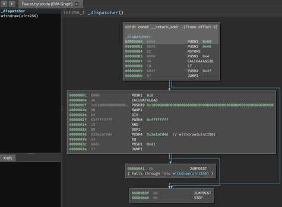

図14-21. Faucetランタイムバイトコードの逆アセンブル

### Heimdallのインストール

まず、コンピュータにRustがインストールされていることを確認してください。インストールされていない場合は、次のコマンドを実行します：

```bash
$ curl https://sh.rustup.rs -sSf | sh
```

次に、以下の2つのコマンドを順番に実行します：

```bash
$ curl -L http://get.heimdall.rs | bash
$ bifrost
```

これでHeimdallが正しくインストールされているはずです。次のコマンドで確認できます：

```bash
$ heimdall --version
```

次のような表示が出れば成功です：

```bash
$ heimdall --version
heimdall 0.8.4
```

> **注記**
> **注記**
>
> Heimdallのインストール方法に関する最新情報については、[GitHubリポジトリ](https://oreil.ly/klTJ3)にある公式ドキュメントを参照してください。

### Heimdallによるバイトコードの逆アセンブル

Heimdallを正しくインストールしたので、図14-21で見たのと同じグラフを生成してみましょう。`Faucet.sol`コントラクトのランタイムバイトコードを使って、次のコマンドを実行します：

```bash
$ heimdall cfg <ここにランタイムバイトコードを挿入>
```

実際のコマンドは次のようになります：

```bash
$ heimdall cfg 608060405260043610610…
```

実行すると`output`という新しいフォルダが作成されます。その中に移動し、さらに`local`フォルダに移動すると、`cfg.dot`ファイルがあるはずです：

```bash
$ cd output
$ cd local
$ ls # ファイルが表示されるはずです
```

`.dot`ファイルなので、正しく表示するには専用のプログラムが必要です。ここでは、`.dot`ファイルの内容を貼り付けるとグラフを生成してくれるウェブサイトを使用します。

まず、`.dot`ファイルの内容をコピーします：

```bash
$ cat cfg.dot
```

　このコマンドでファイルの全内容が画面に出力されます。それをコピーして、[*制御フローグラフ*（CFG）オンラインジェネレータ](https://oreil.ly/swOsK)を開き、図14-22に示すようにウェブページの左側に貼り付けます。

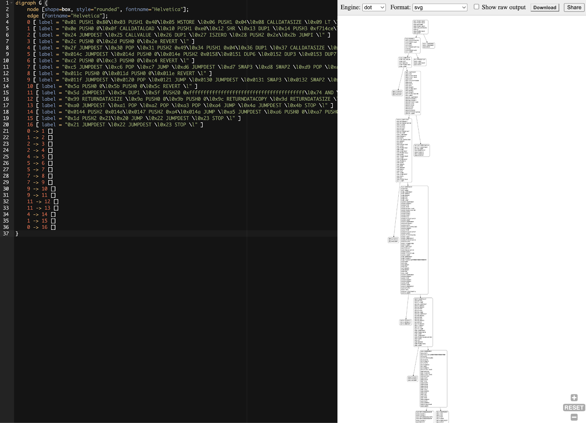

図14-22. Faucet.solコントラクトの制御フローグラフ（CFG）

図14-23は`Faucet.sol`コントラクトの初期バイトコードを示しています。ご覧のとおり、前の`Example.sol`コントラクトと同じパターン`PUSH1 0x80 PUSH1 0x40 MSTORE`で始まります。

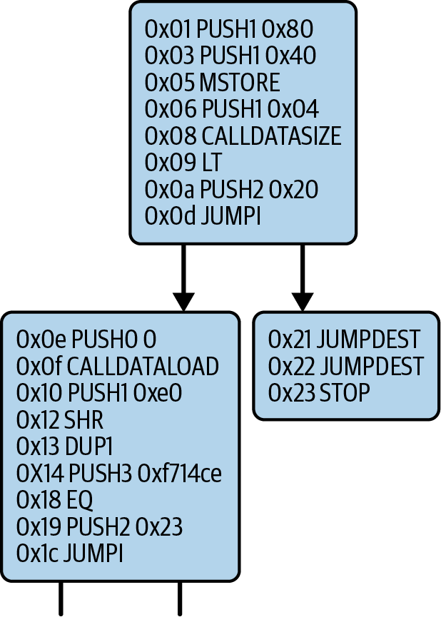

図14-23. CFGグラフの最初の部分の拡大

ABI準拠のスマートコントラクト（すべてのコントラクトが準拠していると想定してよいです）にトランザクションを送信すると、トランザクションは最初にそのスマートコントラクトの*ディスパッチャ*（dispatcher）と対話します。ディスパッチャは、トランザクションの`data`フィールドを読み込み、関係する部分を適切な関数に送信します。逆アセンブルした`Faucet.sol`ランタイムバイトコードの冒頭部分に、ディスパッチャの例があります。おなじみの`MSTORE`命令のあとに、次の命令セットが表示されます：

```
PUSH1 0x04
CALLDATASIZE
LT
PUSH2 0x0020
JUMPI
```

これまで見てきたように、`PUSH1 0x04`は`0x04`をスタックの先頭に置きます。スタックの先頭以外は空です。`CALLDATASIZE`は、トランザクションとともに送信されたデータのバイト数を取得し（送信されたデータをコールデータ〔calldata〕と呼びます）、その数値をスタックにプッシュします。これらの操作が実行されると、スタックは次のようになります：

```
スタック
<トランザクションからのコールデータの長さ>
0x4
```

　次の命令は`LT`で「Less Than」の省略形です。`LT`命令は、スタックの一番上のアイテムがスタックの次のアイテムよりも小さいかどうかを調べます。このケースでは、`CALLDATASIZE`の結果が4バイトより小さいかどうかを調べています。

トランザクションのコールデータが少なくとも4バイトであることをEVMが確認するのは、*関数識別子*の動作が関係しています。各関数は、そのKeccak-256ハッシュの最初の4バイトで識別されます。関数の名前と、関数が引数として取るものをKeccak-256ハッシュにかけることで関数の識別子を推測できます。今回の場合：

```
keccak256("withdraw(uint256,address)") = 0x00f714ce...
```

　したがって、関数`withdraw(uint256,address)`の関数識別子は、ハッシュ関数を通した結果の最初の4バイトの`0x00f714ce`です。関数識別子の長さは常に4バイトで、コントラクトに送信されるトランザクションのデータフィールド全体が4バイト未満の場合、フォールバック関数（fallback function）が定義されていない限り、トランザクションがやり取り可能な関数は存在しないことになります。今回は`Faucet.sol`にフォールバック関数を実装したので、コールデータの長さが4バイト未満の場合、EVMはこの関数にジャンプします。

`LT`はスタックの上から2つの値を取り出し、トランザクションの`data`フィールドが4バイト未満の場合は1をプッシュします。それ以外の場合は0をプッシュします。この例では、コントラクトに送信されたトランザクションの`data`フィールドが4バイト未満であると仮定します。

`PUSH2 0x0020`命令は、スタックにバイト値`0x0020`をプッシュします。この命令の後、スタックは次のようになります：

```
スタック
0x0020
0x1
```

次の命令は`JUMPI`で、これは「jump if」を略したものです。次のように動作します：

```
jumpi(label, cond) // "cond"が真ならば"label"の位置にジャンプする
```

　このケースでは`label`は`0x0020`で、スマートコントラクトのフォールバック関数が存在する場所です。`cond`の引数は1で、これは先ほどの`LT`命令の結果です。この一連の流れを説明すると、トランザクションデータが4バイト未満の場合、コントラクトはフォールバック関数にジャンプするということです。

`0x20`では、2つの`JUMPDEST`命令の後、`STOP`命令だけが続きます。フォールバック関数を宣言しましたが、中身は空のままだからです。図14-24に示すように、フォールバック関数を実装していなかった場合、コントラクトは代わりに例外を投げます。

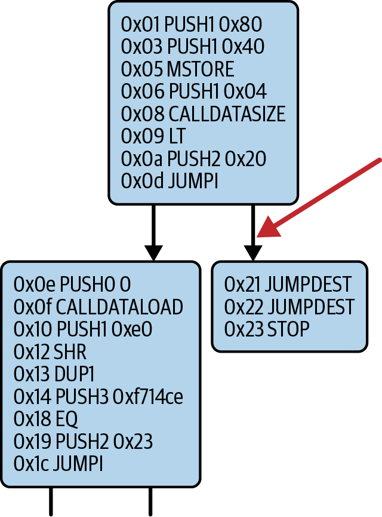

図14-24. フォールバック関数につながるJUMPI命令

> **注記**
> **注記**
>
> Heimdallはバイトコードをオフセット0x01から始まるものとして表現しますが、EVMは実際にはオフセット0x00から解釈します。前の例では、JUMPI命令は条件が真の場合にオフセット0x20にジャンプするようEVMに指示していますが、グラフ上ではオフセット0x20が0x21として表示されています。目安として、EVMの各オフセットに1を加えればグラフ上の位置を見つけることができます。

ディスパッチャの中央ブロックを調べてみましょう。4バイトより長いコールデータを受け取った場合、`JUMPI`命令はフォールバック関数へのジャンプを実行しません。その代わりに、コードの実行は次の命令に進みます：

```
PUSH0 0x0
CALLDATALOAD
PUSH1 0xe0
SHR
DUP1
PUSH3 0xf714ce
EQ
PUSH2 0X23
JUMPI
```

`PUSH0`は0をスタックにプッシュし、スタックは再び空の状態になります。`CALLDATALOAD`は、スマートコントラクトに送信されたコールデータ内のインデックスを引数として受け取り、そのインデックスから32バイトを読み込みます：

```
calldataload(p) // バイト位置pから始まる32バイトのコールデータを読み出す
```

`PUSH0`コマンドから渡されたインデックスが0だったため、`CALLDATALOAD`はバイト0から始まるコールデータの32バイトを読み取り、（元の`0x0`をポップした後）スタックのトップにプッシュします。`PUSH1 0xe0`命令の後、スタックは次のようになります：

```
スタック
0xe0
<バイト0から始まるコールデータの32バイト>
```

`SHR`はスタック上の32バイト値の要素に対して`0xe0`ビット（224ビット、28バイト）の論理右シフトを実行します。コールデータを28バイト右にシフトすることで、コールデータの最初の4バイトを分離します。実際、右にシフトすると、右端からはみ出したビットは破棄され、左端には0が補填されます。コールデータの最初の4バイトは、トリガーしたい関数の関数識別子を表すことを忘れないでください。

### 論理ビットシフトの例

例を使ってよりよく理解できます。スタックが次のようになっているとしましょう：

```
スタック
0x1234567890 // 5バイトの要素
```

最初の2バイト（つまり`0x1234`）のみを取得したいとします。EVMオペコードのみを使用してこれを達成するには、次のようにできます：

```
PUSH1 0x18 // これは16進数で24を表し、24ビット = 3バイト
SHR
```

実際、スタックのアイテムを3バイト右にシフトすると（各バイトは2桁の16進数で表されることを忘れないでください）、次のアイテムが得られます：

```
0x0000001234 | 4567890
```

`4567890`の部分は破棄され、残るのは次のとおりです：

```
スタック
0x1234
```

　先頭のゼロ埋めは重要でないため省略します。

---

新しいスタックは次のとおりです：

```
スタック
<データで送信された関数識別子>
```

次の命令は`DUP1`で、スタックの最初のアイテムである関数識別子を複製します。スタックは次のようになります：

```
スタック
<データで送信された関数識別子>
<データで送信された関数識別子>
```

次に`PUSH3`命令があり、データ`0xf714ce`が続きます。このオペコードは単にデータをスタックにプッシュします。このオペコードの後、スタックは次のようになります：

```
スタック
0xf714ce
<データで送信された関数識別子>
<データで送信された関数識別子>
```

　さて、`0xf714ce`は見覚えがありますか？`withdraw(uint256,address)`関数の関数識別子が何であったか覚えていますか？`0x00f714ce`です…先頭のゼロ埋めを省略すれば同じ数値であることがわかります。

　次の命令`EQ`はスタックの上位2つのアイテムを取り出し、それらを比較します。これがディスパッチャの主な働きです。トランザクションの`msg.data`フィールドで送信された関数識別子が`withdraw(uint256,address)`のものと一致するかどうかを比較します。両者が等しい場合、`EQ`は1をスタックにプッシュし、最終的にwithdraw関数にジャンプするために使用されます。そうでなければ、`EQ`は0をスタックにプッシュします。

コントラクトに実際に送られたトランザクションが`withdraw(uint256,address)`の関数識別子で始まっている場合、スタックは次のようになります：

```
スタック
1
<データで送信された関数識別子>（0x00f714ceであることが判明）
```

次に、`PUSH2 0x23`があります。これは、コントラクト内で`withdraw(uint256,address)`関数が存在しているアドレスです。この命令の実行後、スタックは次のようになります：

```
スタック
0x23
1
<msg.dataで送信された関数識別子>
```

　次に`JUMPI`命令が実行され、スタック上の上位2つの要素が引数として再び受け入れられます。この場合、`JUMPI(0x23, 1)`によりEVMに`withdraw(uint256,address)`関数の位置へジャンプするように命令し、関数のコードの実行へと進めることができます。

## チューリング完全性とガス

　すでに触れたように、簡単に言えば、任意のプログラムを実行できるならば、システムやプログラミング言語は*チューリング完全*です。しかし、この能力には非常に重要な注意が伴います。つまり、プログラムの中には実行に永遠の時間がかかるものがあるということです。重要なことは、プログラムを見るだけでは永遠に実行されるかどうかはわからないということです。実際にプログラムを実行して、終了を待って確認しなければなりません。当然、永遠に実行されるならば、確認するために永遠に待たなければいけません。これは*停止性問題*と呼ばれ、対処されなければイーサリアムにとって大きな問題になります。

　停止性問題のため、イーサリアムワールドコンピュータは、決して停止しないプログラムを実行するよう要求される可能性があります。偶然そうなるかもしれませんし、悪意によるものかもしれません。イーサリアムがスケジューラなしのシングルスレッドマシンのように動作することはすでに説明しました。したがって、無限ループに陥った場合、イーサリアムは利用できなくなってしまいます。

　しかし、ガスを用いることで解決策があります。あらかじめ指定された最大量の計算が実行されたあとも実行が終了していなければ、プログラムの実行はEVMによって停止されます。これにより、EVMは準チューリング完全マシンになります。つまり、入力されたプログラムを実行できますが、プログラムが特定の計算量内で終了する場合のみです。この制限はイーサリアムでは固定されていません。ガスを支払うことで最大値（*ブロックガス上限*と呼ばれる）まで増やすことができ、時間の経過とともにその最大値を増やすことに全員が同意できます。それでも、常に制限が設けられており、実行中に大量にガスを消費するトランザクションは停止されます。

　以下のセクションでは、ガスに焦点を当て、その仕組みを詳しく見ていきます。

### ガスとは何か？

　ガスはイーサリアムにおける基本単位で、イーサリアムのブロックチェーンでアクションを実行するために必要な計算リソースとストレージリソースを測定するためのものです。ビットコインではトランザクション手数料はキロバイト単位のトランザクションサイズのみを考慮しますが、イーサリアムではトランザクションとスマートコントラクトコードの実行によって処理されるすべての計算ステップを考慮する必要があります。

　トランザクションまたはコントラクトによって実行される各操作は、一定量のガスを必要とします。イーサリアムのイエローペーパーからいくつかの例を挙げておきます。

- 2つの数値を加算すると3ガスがかかる
- Keccak-256ハッシュの計算には、30ガス+ハッシュされる256ビットのデータごとに6ガスが必要
- トランザクションの送信には21,000ガスがかかる

　ガスはイーサリアムの極めて重要な構成要素であり、イーサの（変動する）価格とバリデータが行う作業への報酬との間の緩衝として、そしてDoS攻撃に対する防御策として二重の役割を担っています。偶発的または悪意のある無限ループやネットワーク内のその他の計算上の浪費を防ぐために、各トランザクションの開始者は、支払う予定の計算量に上限を設定する必要があります。こうすることでガスシステムは攻撃者が「スパム」トランザクションを送信することを阻止しています。これが有効なのは、攻撃者は消費する計算資源、帯域幅、およびストレージ資源に比例してガスを支払う必要があるためです。

### 実行中のガス会計

　トランザクションの完了にEVMが必要な場合、最初にトランザクションのガス上限で指定された量のガス供給が行われます。実行されるすべてのオペコードにはガスの費用が定義されているため、EVMのガス供給はEVMがプログラムを実行していくにつれて減少していきます。各操作の前に、EVMは操作の実行に十分なガスがあることを確認します。十分なガスがない場合、実行は停止され、トランザクションは元に戻されます。

ガスを使い切ることなくEVMが実行の終了に正常に到達した場合、使用されたガス費用はトランザクション手数料としてバリデータに支払われ、トランザクションで指定されたガス価格に基づいてイーサに変換されます：

```
バリデータ報酬 = ガス費用 × ガス価格
```

ガス供給に残っているガスは送信者に払い戻され、トランザクションで指定されたガス価格に基づいて再びイーサに変換されます：

```
残りガス = ガス上限 – ガス費用
返金イーサ = 残りガス × ガス価格
```

　実行中にトランザクションが「ガス切れ」になった場合、操作は直ちに終了し、OOG例外が発生します。トランザクションは元に戻され、状態へのすべての変更がロールバックされます。トランザクションは失敗しましたが、バリデータはその時点までの計算作業をすでに実行しており、それに対する補償を受ける必要があるため、送信者にはトランザクション手数料が請求されます。

#### ガス会計の考慮事項

　イーサリアムブロックチェーンを攻撃から守るために、EVMで実行できるさまざまな操作の相対的なガス費用は慎重に選ばれています。より計算量のかかる操作の実行にはより多くのガス費用がかかります。たとえば、`SHA3`関数の実行（30ガス）は、`ADD`命令の実行（3ガス）の10倍の費用がかかります。さらに重要なことに、`EXP`などの一部の操作では、オペランドのサイズに基づいて追加の支払いが必要です。また、EVMメモリを使用したり、コントラクトのオンチェーンストレージにデータを格納したりするためのガス費用もあります。

　現実世界のコストとガス費用を一致させることの重要性は、攻撃者がコストの不一致を発見して悪用した2016年に実証されました。その攻撃では、非常に計算コストの高いトランザクションが生成され、イーサリアムメインネットをほぼ停止させました。この不一致は、相対的なガス費用を調整したハードフォーク（コードネーム「Tangerine Whistle」）によって解決されました。

#### イーサリアムの将来におけるガス会計

　ガスの計量は、イーサリアムがネットワーク内のトランザクション負荷全体を処理するうえで極めて重要であり、今後もそうあり続けます。ガス費用が特定の種類の動作に対する重要なインセンティブであることを理解することが非常に重要です。将来、各オペコードが消費するガス量が変更される可能性があります。

　たとえば、EIP-4844 blobトランザクションを導入したCancunアップグレードの前は、すべてのL2がトランザクションのコールデータの一部としてイーサリアム上にデータを記録していました。そのデータはイーサリアムのすべてのノードに永久に保存されます。L2がblobトランザクションを通じてイーサリアム上にデータを記録するより良い方法を持つようになった今、将来的にはロールアップがblobトランザクションを使用することを奨励し、すべてのデータを永久に保存するノードの負担を軽減するために、コールデータが現在よりもさらに高価になる可能性があります。

#### ガス費用対ガス価格

*ガス費用*はEVM上の計算と利用されたストレージの計測単位であり、ガス自体はイーサを尺度とする*価格*を持っています。トランザクションを実行する際、送信者はガスの各単位について支払うガス価格を（イーサで）指定し、市場がイーサの価格と計算操作のコスト（ガスで測定）の関係を決定できるようにします：

```
トランザクション手数料 = 使用された総ガス × 支払われたガス価格（イーサで）
```

　新しいブロックを構築するとき、イーサリアムネットワーク上のバリデータは他より高いガス価格を提示しているものを選択することで、未処理トランザクションの中から処理すべきものを選ぶことができます。したがって、より高いガス価格を提供することは、バリデータにトランザクションを含めるよう促すことになり、より早く承認を得ることができます。

　実際には、トランザクションの送信者は、使用予定のガス量以上のガス上限を設定します。もしガス上限が消費されたガスよりも高く設定されている場合は、送信者は消費総量を超えた分を返金として受け取ることができます。これは、バリデータには実際に実行した分のみが補償されるからです。

　ガス費用とガス価格を明確に区別することは重要です。要点をまとめておきます。

- *ガス費用*は、特定の操作を実行するために必要なガスの単位数です。
- *ガス価格*は、トランザクションをイーサリアムネットワークに送信する際に、ガスの単位ごとに支払う意思のあるイーサの量です。

> **ヒント**
>
> ガスには価格がありますが、「所有」することも「消費」することもできません。ガスは、どれだけの計算作業が行われているかの総数として、EVM内にのみ存在します。送信者にはイーサでトランザクション手数料が請求され、EVM会計のためにガスに変換され、その後バリデータに支払われるトランザクション手数料としてイーサに戻されます。

#### 負のガス費用

　イーサリアムは、コントラクト実行中に使用されたガスの一部を払い戻すことで、使用済みストレージ変数の削除を奨励しています。EVMで負のガス費用を持つ操作は1つだけです：ストレージアドレスを非ゼロ値からゼロに変更すること（`SSTORE[x] = 0`）は返金に値します。返金されるガスの量は固定されておらず、この操作の前後のストレージスロットの値に依存します。返金メカニズムの悪用を避けるため、トランザクションの最大返金額は総ガス費用の5分の1（切り捨て）に設定されています。

　過去には、負のガス費用を持つ別の操作がありました：`SELFDESTRUCT`。コントラクトの削除（`SELFDESTRUCT`を通じて）は24,000ガスを返金しました。現在、`SELFDESTRUCT`オペコードは非推奨であり、もう使用しないことが推奨されています。

> **ヒント**
>
> ガス返金はトランザクションの最後に適用されます。したがって、トランザクションを最後まで実行するのに十分なガスがない場合、失敗し、返金は行われません。

### ブロックガス上限

　ブロックガス上限は、ブロック内のすべてのトランザクションによって消費されるガスの最大量であり、ブロックに収まるトランザクションの数を制限します。

　たとえば、ガス上限が30,000、30,000、40,000、50,000、50,000に設定された5つのトランザクションがあるとします。ブロックガス上限が180,000の場合、それらのトランザクションのうちの4つはブロックに収まることができ、5番目のトランザクションは将来のブロックを待たなければなりません。前述のように、バリデータはどのトランザクションをブロックに含めるかを決定します。異なるバリデータは、異なる組み合わせを選択する可能性が高くなります。というのも、バリデータはトランザクションをネットワークから異なる順番で受け取るのが一般的だからです。

　バリデータが、現在のブロックガス上限よりも多くのガスを必要とするトランザクションを含めようとすると、ブロックはネットワークによって拒否されます。ほとんどのイーサリアムクライアントは、「トランザクションがブロックガス上限を超えています」という警告を出すことで、そのようなトランザクションの発行を停止します。[Etherscan](https://etherscan.io)によると、執筆時点（2025年6月）のイーサリアムメインネットのブロックガス上限は3,600万ガスであり、約1,428の基本的な（つまり、ETH転送）トランザクション（それぞれ21,000ガスを消費）がブロックに収まることを意味します。

#### 誰がブロックガス上限を選択するか？

2021年8月5日のEIP-1559の導入前は、マイナー（当時イーサリアムはPoWベースのコンセンサスアルゴリズムを使用していました）には、ブロックガス上限に投票できる組み込みメカニズムがあり、後続のブロックで容量を増減できました。ブロックのマイナーは、どちらの方向にも1/1024（0.0976%）の係数でブロックガス上限を調整するために投票できました。この結果、マイナーのハッシュパワーに従って、ネットワークのニーズに基づいて調整可能なブロックサイズになりました。

　現在、バリデータは*ガスターゲット*（つまり、ブロックが平均的に消費すべきガス量）に投票し、ガス上限はターゲットの2倍として定義されます。各バリデータが従う必要がある1/1024の調整係数は以前と同じに維持されます。

#### なぜブロックガス上限は上昇しないのか？

　バリデータがガスターゲットに投票でき、それが直接ガス上限に変換されるなら、なぜブロックガス上限は3,000万にほぼ固定されたままで10億には上昇しないのかと疑問に思うかもしれません。より大きなブロックガス上限は、より多くのトランザクションがブロックに収まることを意味するため、エンドユーザーにとってトランザクションはより安くなります。

　答えは、ガス上限を上げることにはネットワークの分散化に関連するいくつかの欠点があるということです。実際、より大きなブロックはより多くのトランザクションを含むことができますが、それはブロックを時間内に検証することがより困難になることも意味し、一般的なハードウェアで構成されたイーサリアムノードの淘汰につながり、完全なブロックを検証できるのは強力なサーバだけになる可能性があります。それだけでなく、より大きなブロックは状態をより大きく成長させることも意味します。最終的な結果は以前と同じです：大きなサーバだけがノードを完全に実行できるようになります。

　歴史的に、図14-25に示すように、ブロックガス上限はプロトコルのアップグレード中に一度に引き上げられてきました。その値は通常、すべてのクライアントがトランザクションの負荷を処理し、ブロックを時間内に処理できることが確実なコア開発者が提案するレベルに設定されています。

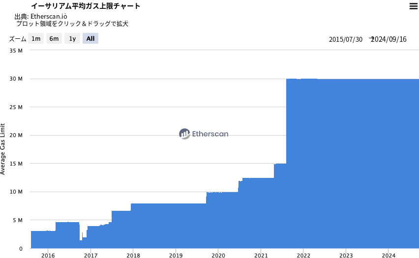

図14-25. イーサリアム平均ガス上限チャート

#### なぜブロックガス上限を引き上げないのか？

　ブロックガス上限は3年以上にわたって3,000万に「固定」されているように見えますが、PBS（「イーサリアムステートレス」を参照）では、洗練されたハードウェアを持つアクターがブロックを構築し（ビルダー）、それをプロポーザー（バリデータ）に送信してP2Pネットワークで公開するため、実際に使用されるガスをほぼ一定に保ちながらブロックガス上限を無制限に引き上げるインセンティブがあります。

　事実として、EIP-1559に従って、ブロックガスターゲットが実際に使用されるガスよりもはるかに高い場合、ベースフィーは減少し続け、ガス手数料のほぼすべてがバーンされずにバリデータに渡るようになります（ベースフィーはバーンされ、それらのETHが供給から削除されます）。

したがって、バリデータにとっての利点は2つあります：

- ETH供給を減らしてバーンする代わりに、ガス手数料を自分たちのために保持できる。
- 必要に応じて、多くのMEV活動を取り込む大きなブロックを作成でき、さらに多くの手数料を得られる。

　これについて興味がある場合は、[James Prestwichの記事](https://oreil.ly/EImcE)で詳しく読んでください。

## 具体的な実装

すべてのイーサリアムノードには、本章で説明したEVMの具体的な実装があります。最も有名で広く使用されているものを以下に示します：

**Go-ethereum EVM**

Gethは最も広く採用されている最古の実行クライアントです。Goで書かれたEVMの完全な実装を含んでいます。

**Execution-spec EVM**

Ethereum FoundationはGitHub上でイーサリアム実行クライアントに関連する仕様を含むPythonリポジトリを管理しています。Pythonで書かれた完全なEVM実装を持っています。

**Revm**

Revmは、その優れたカスタマイズ性と適応性により、通常のイーサリアムクライアント以外で最も使用されているEVM実装の1つです。

**Evmone**

Evmoneはおそらく最速のEVM実装です。C++で書かれ、Ethereum FoundationのIpsilonチームによって管理されています。

**Besu EVM**

BesuはConsensysによって管理されている実行クライアントです。Javaで書かれたEVMの完全な実装を持っています。

**Nethermind EVM**

Nethermind EVMはC#で書かれた実行クライアントで、EVMの完全な実装を維持しています。

## 最大のEVMアップグレード：EVMオブジェクトフォーマット

*EVMオブジェクトフォーマット*（EOF）は、2015年の誕生以来、EVMへの最大のアップグレードです。過去にもEVMへの変更はありましたが、それらは主にガスの計量や新しいオペコードの導入に焦点を当てたものであり、EVMはGavin Woodが最初に設計したものとほぼ同一のままです。

EVMは依然として優れています。今日イーサリアム（およびその他すべてのEVM互換ブロックチェーン）で行われているすべての活動は、EVMのおかげで実現しています。だからと言って完璧というわけではありません。近年、スマートコントラクト開発者はEVMのさまざまな側面に対処し、その制約を克服するためのテクニックを学ぶ必要がありました。

EOFは、デプロイ時に一度だけ検証を行う、EVM用の拡張可能でバージョン管理されたコンテナフォーマットです。このセクションでは、EVMの主要な制限と、EOFがそれらをどのように克服しようとしているかを見ていきます。

> **注記**
>
> 本書の最終改訂時点（2025年6月）では、EOFアップグレードはイーサリアムコミュニティ内での合意が不十分なため、無期限に延期されています。実装に関する明確なタイムラインは現在なく、最終的に採用されない可能性もあります。それでもなお、EOFがEVMとイーサリアムエコシステム全体にどのような影響を与えうるかを理解するうえで、このセクションには価値があると考えています。

## EVMの将来

EOFはさておき、EVMの将来は不確実であり、開発者やさまざまなプロジェクトによってEVMがどのように使用されるかに依存します。ただし、EVMが拡張できる興味深い領域がいくつかあります。たとえば、各ブロックの正しい実行を証明するゼロ知識証明を提供する*zk-EVM*などです。また、[*EVMMAX*](https://oreil.ly/ioqSx)と[*SIMD*](https://oreil.ly/7q0Dq)はEVMにより多くの演算能力をもたらし、暗号処理をはるかに高速に行えるようにします。これは、プライバシープロトコルやL2などの暗号技術に依存するアプリケーションに特に有益です。

## 結論

　本章では、EVMを探索し、さまざまなスマートコントラクトの実行をトレースし、EVMがバイトコードをどのように実行するかを見ました。また、EVMの会計メカニズムであるガスが、停止性問題をどのように解決し、イーサリアムをDoS攻撃からどのように保護するかについても確認しました。さらに、EOFを分析し、レガシーEVMのさまざまな課題をどのように修正しようとしているかを見ました。

　次の第15章では、イーサリアムが分散コンセンサスを達成するために使用するメカニズムを探ります。
