# 第14章 イーサリアム仮想マシン(EVM)

イーサリアムプロトコルとその運用の中心には、*イーサリアム仮想マシン*(Ethereum Virtual Machine)、つまり*EVM*があります。名前から推測できるように、それは計算処理エンジンであり、Microsoftの.NET Frameworkの仮想マシンやJavaなどの他のバイトコードでコンパイルされたプログラミング言語のインタプリタと大きく異なるものではありません。この章ではEVMの詳細を見ていきます。特に、イーサリアムのステート（状態）更新に関わる命令セット、構造、操作などを見ていきます。

## EVMとは何か？

EVMはイーサリアムの構成要素の１つで、スマートコントラクトをデプロイあるいは実行します。あるEOA（外部所有アカウント）から別のEOAへの単純な送金トランザクションは、実際のところEVMを関与させる必要はありませんが、それ以外のすべてのトランザクションに関してはEVMによって計算がなされた状態への更新を伴います。おおまかに言うと、イーサリアムブロックチェーン上で実行されるEVMは、それぞれ永続的なデータストアを伴い、多くの実行可能オブジェクトを格納した、グローバル分散コンピュータとみなせます。

EVMは*準チューリング完全*状態マシンです。どのようなスマートコントラクトに対しても、すべての実行過程は、実行のために利用可能なガスの量によって有限の計算ステップ数に制限されるため、「準」と呼んでいます。このようにして、*停止性問題*は「解決」し（すべてのプログラムは、実行した場合にいつかは停止する）、実行が（意図せず、あるいは悪意をもって）永遠に実行され、イーサリアムプラットフォームが完全に停止する状況が回避されます。停止性問題については、後のセクションで詳しく説明します。

EVMは*スタックベースアーキテクチャ*を持っており、一時的な値はすべてスタックに格納されます。EVMは主に組み込みのハッシングや楕円曲線演算を容易にするために、256ビットのワードサイズで動作し、以下に示す、アドレスを指定してアクセスが可能ないくつかのデータコンポーネントも持っています。

- 実行されるスマートコントラクトのバイトコードが読み込まれた、不変のプログラムコードROM
- すべての領域が明示的にゼロに初期化された揮発性のメモリ
- 単一のトランザクションの処理中にのみ保持する（イーサリアムのstateの一部ではない）一時ストレージ
- メモリと同様にゼロに初期化されたイーサリアムの状態の一部である永続ストレージ

There is also a set of environment variables and data that is available during execution. We will go through these in more detail later in this chapter.

また、実行中に利用可能な環境変数とデータのセットも存在します。それらの詳細に関しては、章の後半で詳しく説明します。

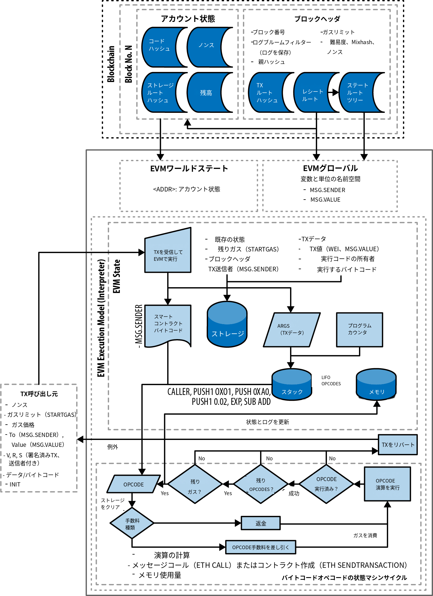


Figure 14-1. EVM architecture and execution context

図14-1. EVMアーキテクチャと実行コンテクスト

## 既存の技術との比較

*仮想マシン*という用語は、通常、VirtualBoxやQEMUなどのハイパーバイザーや、LinuxのKVMなどのオペレーティングシステムのインスタンス全体の仮想化など、現実のコンピュータの仮想化に用いられます。実際のハードウェア、システムコール、そしてその他のカーネル機能それぞれに対して、ソフトウェアとしての抽象化を定める必要があります。

現実のコンピュータの仮想化に比べると、EVMははるかに限られた領域で動作します。EVMは単なる計算処理エンジンなので、たとえばJVM（Java Virtual Machine：Java仮想マシン）の仕様と同じように、計算処理とストレージの抽象化を規定します。全体的な観点から見ると、JVMは、基盤となるホストOSやハードウェアに依存しない実行環境を規定するように設計されており、異なるシステ
ム間で互換性を保つことができます。JavaやScala（JVMを使用する）やC#（.NETを使用する）などの高級プログラミング言語は、それぞれの仮想マシンのバイトコード命令セットにコンパイルされます。同様に、EVMは独自のバイトコードで記述された命令セット（次の項で説明します）を実行します。バイトコードで記述された命令セットは、Solidity、Vyper、Yulなどの高級スマートコントラクトプログラミング言語をコンパイルすることで生成されます。

EVMはスケジューリング機能を持ちません。なぜなら、実行順序の決定はEVMの外部で取りまとめられているからです。イーサリアムクライアントは、検証されたブロックトランザクションを一通り見て、どのスマートコントラクトをどの順序で実行する必要があるかを決定します。この意味で、イーサリアムワールドコンピュータはJavaScriptのようにシングルスレッドです。また、EVMには、「システムインターフェイス」の処理や「ハードウェアのサポート」はどちらもありません。お互いにやり取りする物理的なマシンは存在しないのです。イーサリアムワールドコンピュータは完全に仮想的なものです。

## 他のブロックチェーンは何をしているか？

EVMは間違いなく暗号通貨分野で最も広く使用されている仮想マシンです。ほとんどの代替L1およびL2ブロックチェーンは、既存のすべてのツールやフレームワークとの互換性を維持し、イーサリアムコミュニティから直接プロジェクトや開発者を引き付けるためにEVMを使用しています。

それにもかかわらず、近年、多くの異なる仮想マシンが登場しています。Solana VM、Wasm VM、Cairo VM、Move VMはおそらく最も有名で興味深いものであり、それぞれに独自の利点と欠点があります。これらはスマートコントラクト開発に対して異なるアプローチを取っています：

**カスタム言語**

CairoやMoveのような一部のプラットフォームは、スマートコントラクトを書くために特別に設計されたプログラミング言語を作成しています。これは、イーサリアムがその仮想マシンであるEVMのためにSolidityやVyperを使用しているのと同様です。

**標準言語**

そのほかのSolanaや WebAssembly（Wasm）を使用するプラットフォームなどは、広く使用されているプログラミング言語でスマートコントラクトを書くことを可能にしています。例えば、これらのプラットフォームはスマートコントラクト開発にRustをサポートしていることが多いです。

これらの代替仮想マシンがEVMと異なるもう一つの領域は、トランザクションの*並列化*です。EVMは並列化なしにトランザクションを順次処理することはすでに述べました。いくつかのプロジェクトはこの欠点を取り上げ、改善しようとしました。例えば、Solana VMとMove VMの両方がトランザクションを並列に実行できますが、常に可能というわけではありません。たとえば、2つのトランザクションが同じコントラクトとやり取りして同じストレージを変更する場合、それらは並列に実行できません。

仮想マシンのパフォーマンスを向上させるこれらの取り組みは、イーサリアムの外部だけで行われているわけではないことを言わなければなりません。実際、多くのチームが並列化やEVMバイトコードからネイティブマシンコードへの*事前コンパイル(ahead-of-time)*（AOT）や*実行時コンパイル(just-in-time)*（JIT）などのクールな機能を追加することで、EVMの現在の制限を打破しようと取り組んでいます。

## The EVM Instruction Set (Bytecode Operations)

## EVM命令セット（バイトコード演算）

The EVM instruction set offers most of the operations you might expect, including:

EVM命令セットでは、次のような多くの操作が用意されています。

- Arithmetic and bitwise logic operations
- Execution context inquiries
- Stack, memory, and storage access
- Control flow operations
- Logging, calling, and other operators

- 算術演算とビット単位の論理演算
- 実行コンテクストに関する問い合わせ
- スタック、メモリ、ストレージへのアクセス
- 制御フローに関する操作
- ロギング、関数コール、その他の演算子

一般的なバイトコード操作に加えて、EVMはアカウント情報（アドレスや残高）やブロック情報（ブロック番号や現在のガス価格）にアクセスする操作も用意されています。
利用可能なオペコードとその動作に着目してEVMを詳細に調べてみましょう。想定どおりかもしれませんが、オペランドはすべてスタックから取得され、その結果（適用可能な場合は）がしばしば、スタックの先頭に書き戻されます。

使用可能なオペコードは、次のカテゴリーに分類できます。

### 算術演算

算術演算命令には以下が含まれます：

```
ADD        // スタックの上から2つの要素を足し合わせる
MUL        // スタックの上から2つの要素を掛け合わせる
SUB        // スタックの上から2つの要素を引き算する
DIV        // 整数除算
SDIV       // 符号付き整数除算
MOD        // モジュロ（剰余）演算
SMOD       // 符号付きモジュロ演算
ADDMOD     // 任意の数のモジュロ加算
MULMOD     // 任意の数を法とする乗法
EXP        // 指数演算
SIGNEXTEND // 2の補数符号付き整数の長さを拡張
SHA3       // メモリブロックの Keccak-256ハッシュを計算
```

すべての算術演算は、特に明記されていない限り、2^256を法として実行され、0^0（ゼロの0乗）は1であるとみなされることに注意してください。

### スタック操作

スタック、メモリ、ストレージ管理命令には以下が含まれます：

```
POP     // スタックの一番上の項目を削除する
MLOAD   // メモリからワードをロードする
MSTORE  // ワードをメモリに保存する
MSTORE8 // メモリに 1バイトを保存する
SLOAD   // ストレージからワードをロードする
SSTORE  // ワードをストレージに保存する
TLOAD   //一時ストレージからワードをロードする
TSTORE  //一時ストレージにワードを保存する
MSIZE   // アクティブなメモリのサイズをバイト数で取得する
PUSH0   //スタックに値0を配置する
PUSHx   // xバイトの要素をスタックに置く
        // xは1～32（フルワード）を含む任意の整数
DUPx    // スタックの x番目の要素を複製する
        // xは1～16を含む任意の整数
SWAPx   // スタックの最初の要素と（x+1）番目の要素を交換する
        // xは1から16までの任意の整数
```

### 処理フロー操作

制御フロー命令には以下が含まれます：

```
STOP       // 実行を停止する
JUMP       // プログラムカウンタを任意の値に設定する
JUMPI      // プログラムカウンタを条件付きで変更する
PC         // プログラムカウンタの値を取得する（インクリメント前の値）
           // この命令に対応）
JUMPDEST   // 有効なジャンプ先としてマークする
```

### システムに関連する操作

プログラムを実行するシステムのオペコードには以下が含まれます：

```
LOGx          // x個のトピックを持つログレコードを追加（xは0から4までの任意の整数）
CREATE        // 関連付けられたコードで新しいアカウントを作成する
CALL          // 別のアカウントへのメッセージコール、つまり別のアカウントのコードの実行
CALLCODE      // 別のアカウントのコードでこのアカウントにメッセージコールを行う
RETURN        // 実行を停止して出力データを返す
DELEGATECALL  // 代替アカウントのコードを使用してこのアカウントにメッセージコールを行うが、
              // 送信者とバリューの現在の値を保持する
STATICCALL    // 静的なメッセージコールをこのアカウントへ行うが、どのアカウントの状態も変更できない。
REVERT        // 実行を停止し、状態変更を元に戻し、データと残りのガスを返す
INVALID       // 指定された無効な命令
SELFDESTRUCT  // 実行を停止し、コントラクト作成時のトランザクション中に実行された場合は、
              // 削除するアカウントとして登録する。使用は強く非推奨であり、
              // オペコードは非推奨と見なされている
```

### 論理演算

比較とビット論理のオペコードには以下が含まれます：

```
LT         // より小さいかどうかの比較
GT         // より大きいかどうかの比較
SLT        // 符号付きの小なり比較
SGT        // 符号付きの大なり比較
EQ         // 等価比較
ISZERO     // 単純NOT演算子
AND        // ビット単位の AND演算
OR         // ビット単位の OR演算
XOR        // ビット単位の XOR演算
NOT        // ビット単位の NOT演算
BYTE       // 256ビットワードから 1バイトを取得
```

### 環境に対する操作

実行環境情報を扱うオペコードには以下が含まれます：

```
GAS            // 利用可能なガスの量を取得する
               //（この命令に関する支払いが終わったあとのガス）
ADDRESS        // 現在実行中のアカウントのアドレスを取得する
BALANCE        // 指定されたアカウントの残高を取得する
ORIGIN         // この EVMの実行の 起点となった EOAのアドレスを取得する
CALLER         // この実行の直接の呼び出し元のアドレスを取得する
CALLLVALUE     // この実行の呼び出し側がデポジットしたイーサ値を取得する
CALLDATALOAD   // この実行の呼び出し元が送信した入力データを取得する
CALLDATASIZE   // 入力データのサイズを取得する
CALLDATACOPY   // 入力データをメモリにコピーする
CODESIZE       // 現在の環境で実行されているコードのサイズを取得する
CODECOPY       // 現在の環境で実行されているコードをメモリにコピーする
GASPRICE       // トランザクションの作成元が指定したガス価格を取得する
EXTCODESIZE    // アカウントコードのサイズを取得する
EXTCODECOPY    // アカウントのコードをメモリにコピーする
RETURNDATASIZE // 現在の環境で、前の呼び出し元の出力データのサイズを取得する
RETURNDATACOPY // 直前の呼び出しからのデータ出力をメモリにコピーする
```

### ブロックに関連する操作

現在のブロックの情報にアクセスするオペコードには以下が含まれます：

```
BLOCKHASH  //Get the hash of one of the 256 most recently completed
           //blocks
COINBASE   //Get the block's beneficiary address for the block reward
TIMESTAMP  //Get the block's timestamp
NUMBER     //Get the block's number
PREVRANDAO //Get the previous block's RANDAO mix. This opcode replaces the
           //DIFFICULTY one since The Merge hard fork.
GASLIMIT   //Get the block's gas limit
```

```
BLOCKHASH      // 最近生成が完了した256のブロックの内の 1つのハッシュを取得する
COINBASE       // ブロック報酬を受け取るアドレスを取得する
TIMESTAMP      // ブロックのタイムスタンプを取得する
NUMBER         // ブロックの番号を取得する
PREVRANDAO     // 前のブロックのRANDAOミックスを取得。このオペコードは
               // The Mergeハードフォーク以降、DIFFICULTYに代わるもの
GASLIMIT       // ブロックのガスリミットを取得する
```

## イーサリアムのステート（状態）

EVMの役割は、イーサリアムのステート（状態）を更新することです。ステートの更新は、スマートコントラクトのコードの実行の結果として、プロトコルによる定義どおりに有効な状態遷移を計算することで行われます。これは、イーサリアムはトランザクションベースのステートマシン（transaction-based state machine）であるという説明にもつながります。つまり、外部アクター（アカウント所有者とバリデーター）がトランザクションを作成し、受け付け、順序づけることで状態遷移を開始しているということです。以下では、イーサリアムの状態を構成するものについて見てきます。

最上位レベルでは、イーサリアムの*ワールドステート*があります。ワールドステートは、イーサリアムアドレス（160ビット値）からアカウントへのマッピングです。下位レベルでは、各イーサリアムアドレスは、イーサ残高（アカウントが所有するwei数として保存）、ノンス（EOAの場合はこのアカウントから正常に送信されたトランザクションの数、コントラクトアカウントの場合はコントラクトアカウントによって作成されたコントラクトの数を表す）、アカウントのストレージ（スマートコントラクトのみが使用する永続的なデータストア）、およびアカウントのプログラムコード（これもスマートコントラクトアカウントの場合のみ）で構成されるアカウントを表します。従来、EOAは常にコードを持たず、空のストレージを持っていました。しかし、[EIP-7702](https://eips.ethereum.org/EIPS/eip-7702)（2025年5月のPectraアップグレードで有効化）は、EOAがスマートコントラクトにコード実行を委任できるようにすることで、この前提を変更します。EOAが委任にオプトインすると、そのコードフィールドは`0xef0100 || address`の形式の23バイトの*委任指定*に設定されます。ここで`address`はターゲットコントラクトの20バイトアドレスです。`0xef`は[EIP-3541](https://eips.ethereum.org/EIPS/eip-3541)により禁止されたオペコードであり、この指定がデプロイ可能なコントラクトコードと混同されないことを保証します。EVMが委任されたEOAへの呼び出しに遭遇すると、ターゲットアドレスからコードをロードしてEOAのコンテクストで実行します。このことは委任されたEOAに対する`EXTCODESIZE`は23（委任指定のサイズ）を返し、委任されたコード内で実行される`CODESIZE`はターゲットコントラクトのコードのサイズを返すことを意味します。EOAは委任されたコードを実行する際にストレージも使用できますが、委任コントラクト間を移行する際の衝突を防ぐために、プロトコルは[ERC-7201](https://eips.ethereum.org/EIPS/eip-7201)の名前空間付きストレージレイアウトの使用を推奨しています。重要なのは、委任されたEOAは引き続きトランザクションを送信できることです。トランザクションに署名して送信できるEOAの機能はそのままですが、さらにスマートコントラクト機能を持つようになります。委任はゼロアドレス（`0x0000000000000000000000000000000000000000`）を委任先に指定することでクリアできます。

トランザクションによってスマートコントラクトのコードが実行されると、現在作成されているブロックおよび処理中の特定のトランザクションに関して必要なすべての情報を含むEVMがインスタンス化されます。特に、EVMのプログラムコードROMには、コントラクトアカウントのコードが呼び出されて読み出され、プログラムカウンタはゼロに設定され、ストレージ情報がコントラクトアカウントのストレージから読み出され、メモリはすべてゼロに設定され、すべてのブロックおよび環境変数が設定されます。ここで重要な変数は、この実行のために設定されたガス供給量です。ガス供給量は、トランザクションの開始時にトランザクション送信者が支払ったガスの量に設定されています（詳細は「実行中のガス会計」を参照）。コード実行が進むにつれて、ガス供給量は実行された操作のガスコストに応じて減少します。いずれかの時点でガス供給量がゼロ未満になると、*ガス切れ*（Out of Gas: OOG）例外が発生します。コントラクトコードの実行は直ちに停止し、トランザクションは放棄されます。イーサリアムの状態への変更は適用されません。ただし、送信者のノンスがインクリメントされ、停止点までのコード実行に使用されたリソースに対しする対価としてブロックの受益者に支払うためにイーサ残高が減少します。この時点で、EVMはイーサリアムワールドステートのサンドボックス化されたコピー上で実行されていると考えることができ、何らかの理由で実行が完了できない場合、このサンドボックスは完全に破棄されます。ただし、実行が正常に完了した場合、呼び出されたコントラクトのストレージデータへの変更、作成された新しいコントラクト、開始されたイーサ残高の転送を含め、実世界の状態はサンドボックス版に一致するように更新されます。

コード実行は再帰的なプロセスです。コントラクトは他のコントラクトを呼び出すことができ、各呼び出しは新しい呼び出し対象の周りにもう一つのEVMがインスタンス化されます。各インスタンスは、上のレベルのEVMのサンドボックスからサンドボックスワールドステートが初期化されます。インスタンス化（コンテクスト）の際には、指定されたガス供給量のガスが指定与えられます（もちろん、上のレベルで残っているガス量を超えない）。このため、実行を完了するのに十分なガスが与えられなかった場合は例外で停止する可能性があります。この場合も、サンドボックス状態は破棄され、実行は上のレベルのEVMに戻ります。

## イーサリアムステートレス

執筆時点（2025年6月）では、すべてのイーサリアムノードは、含まれるすべてのトランザクションを再実行してすべての新しいブロックの正確性を確認できるようにするために、最新の状態（前述のワールドステート）を計算して維持する必要がありますが、部分的にそれを取り除く計画があります。

そのアイデアは、サーチャーやビルダーなどの限定されたアクターのセットが、新しいブロックを作成して公開するために引き続き状態にアクセスする必要がある一方で、他のすべてのノードは状態なしでそれらのブロックを暗号的に検証できるようにすることです。これは*ステートレスネス*と呼ばれます。

ステートレスネスは、コアプロトコルにいくつかの変更が必要なため、イーサリアムロードマップ上ではまだまだはるか先の話です。

**ブロック提案者とビルダーの分離（ePBS）**

トランザクションを収集してブロックを作成する作業と、P2Pネットワークに提案する作業を分離します。前者は、サーチャーやビルダーと呼ばれる高度に専門化されたエンティティによって行われ、超最適化されたブロックを作成できます。後者はイーサリアムバリデーターノードによって行われます。ePBSはプロトコルにまだ組み込まれていませんが、メインネットではすでに実現されています。実際、イーサリアムブロックの大半は、非常に小さな大手ビルダーのセットによって構築されています。

**Verkleツリー**

イーサリアムが状態を保存するために現在使用しているデータ構造であるマークルパトリシアツリーの置き換えです。これにより、状態の正当性を検証するために必要な暗号証明のサイズが大幅に削減され、変更前のマークルパトリシアツリーよりも検証が高速になります。

> **注記**
>
> 他のハッシュベースのバイナリツリーが、バークルツリーの代替としてテストされています。核心的なアイデアは、迅速かつ容易に検証できる小さな証明を作成できる状態用のデータ構造を持つことです。

これら2つのアップグレードを組み合わせることで、ブロックを作成する強力なハードウェアを備えた大規模組織のみが完全な状態を保存・アクセスする必要があるというシナリオが実現します。新しいブロックと共に、*暗号証人*が作成されます。これは、ブロックに含まれるトランザクションに基づいて新しい状態が正しく計算されたことを証明する最小限のデータセットです。

他のすべてのノード（バリデーターノードを含む）は、全体の状態のハッシュである*ステートルート*のみを保存します。新しいブロックを受信すると、そのブロックに関連付けられた証人を使用してその正確性を検証します。

これにより、完全な状態を保存する必要も、すべてのトランザクション（EVM内で）を再実行する必要もなくなり、イーサリアムノードの実行が非常に軽量になります。さらに、引き続き第三者を信頼する必要がなくすべてが正しいことを検証できます。スマートフォンでもノードを実行できるようになるでしょう…

研究は急速に進んでいますが、メインネットでステートレスネスを実現するまでにはおそらくまだ数年かかるでしょう。

## マークルパトリシアツリー

Right now, the Ethereum state is stored using a very peculiar data structure called a *modified Merkle-Patricia trie*. We briefly mentioned the Merkle-Patricia tree (we'll call it MPT) in the previous section, but it's very important to understand how it works and why as well as how it's used by Ethereum as the way to store the state (and not only that…) because the same reasoning applies to Verkle tries. Before diving into MPTs, you need to know about Merkle trees because they represent the foundation on which MPTs are built.

現在、Ethereumの状態は*修正マークルパトリシアツリー*と呼ばれる非常に特殊なデータ構造を使用して保存されています。前のセクションでマークルパトリシアツリー（以下、MPT）について簡単に触れましたが、その仕組みと理由、そしてEthereumが状態を保存する方法としてどのように使用されているか（そしてそれだけではありません）を理解することは非常に重要です。なぜなら、同じ考え方がバークルツリーにも当てはまるからです。MPTについて詳しく説明する前に、マークルツリーについて知っておく必要があります。なぜなら、マークルツリーはMPTの基盤となるからです

### マークルツリー

マークルツリーは、1988年にラルフ・マークルがよりより良いデジタル署名を構築しようとして発明した非常に古いデータ構造です。データベース全体を送信せずに、データがデータベースに存在し、改ざんされていないことを検証する必要がある場合に非常に効率的です。

データのコレクションからMerkleツリーを作成するのは簡単です。データをいくつかのチャンクに分割し、それらのチャンクを一緒にハッシュし、最終的に1つのチャンクだけになるまでこの最後のステップを再帰的に繰り返します。そのチャンクは*Merkleルート*です。これは、ツリーを作成するために使用されたすべてのデータの一種のデジタル指紋です。

バイナリMerkleツリー（Merkleツリーの最も単純な形式）をゼロから作成して、もう少し慣れ親しみましょう。8つのデータチャンクから始めます。これらは英語の異なる単語と考えてみましょう。特定のハッシュ関数を使用して各チャンクをハッシュします。第4章ですでに述べたように、イーサリアムはKeccak-256ハッシュ関数を使用します。図14-2でhash_1、hash_2などとして表されるMerkleツリーの葉を取得します。次に、各リーフのペアを連結して再びハッシュし、hash_12、hash_34などを作成します。連結とハッシュのこのプロセスをさらに2回繰り返し、単一の最終結果であるMerkleルート：hash_12345678を取得します。

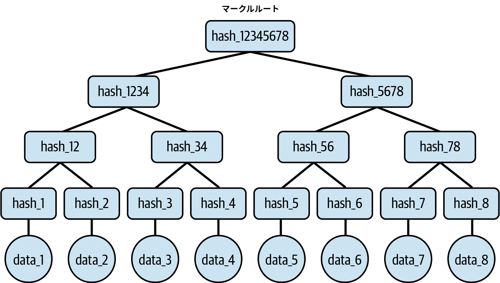

図14-2. バイナリMerkleツリー

データを保存するためになぜMerkleツリーが必要なのか疑問に思うかもしれません。各チャンクを従来のデータベースに保存するよりも複雑ではないでしょうか？

答えはイエスです。キーバリューやSQLデータベースにすべてのチャンクを保存するよりもはるかに複雑です。この種のデータ構造を使用する唯一の理由は、チャンクのいずれかがデータのコレクションに存在し、操作されていないこと暗号証明を安価に提供するのに非常に効率的だからです。実際、特定のチャンクを持っていることの証明を提供するように求められた時に、通常のデータベースを使用してデータを保存している場合、私たちが嘘をついていないことを確認できるようにデータセット全体を公開する必要があります。

前の例を使用して、具体的に見てみましょう。data_1がデータセットに含まれていることを証明したいとします。単純なアプローチは、data_1からdata_8までの全データセット（合計8項目）を提供することです。Merkleツリーを使用すると、hash_2、hash_34、hash_5678のみを提供すればよいです。その後、誰でも自分でMerkleルートを計算し、最初に計算した（公開されている）Merkleルートと比較できます。一致すれば、図14-3に示すように、data_1が初期データセットの一部であることを完全に確信できます。

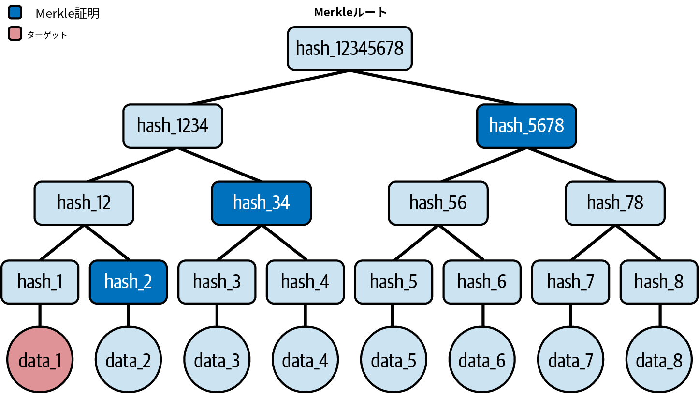

図14-3. data_1がツリーに含まれていることを検証するMerkle証明

> **Tips**
>
> Merkleツリーを再構築するには、次の手順に従います：
>
> 1. data_1をハッシュしてhash_1を取得します。
> 2. hash_1を提供されたhash_2と連結してハッシュし、hash_12を取得します。
> 3. hash_12を提供されたhash_34と連結してハッシュし、hash_1234を取得します。
> 4. hash_1234を提供されたhash_5678と連結してハッシュし、最終的なMerkleルートを取得します。

Merkleツリーなしの単純なアプローチでは8つのデータ必要なのに対して、3つのデータのみを使用していることに注意してください。これは単なる単純な例です。大量のデータの場合は節約効果はより大きくなります。

Speaking in mathematical terms, Merkle trees offer O(log(n)) complexity versus linear O(n) of the naive approach, as shown in Figure 14-4.

数学的に言えば、Merkleツリーは、図14-4に示すように、単純なアプローチの線形O(n)に対してO(log(n))の複雑さを提供します。

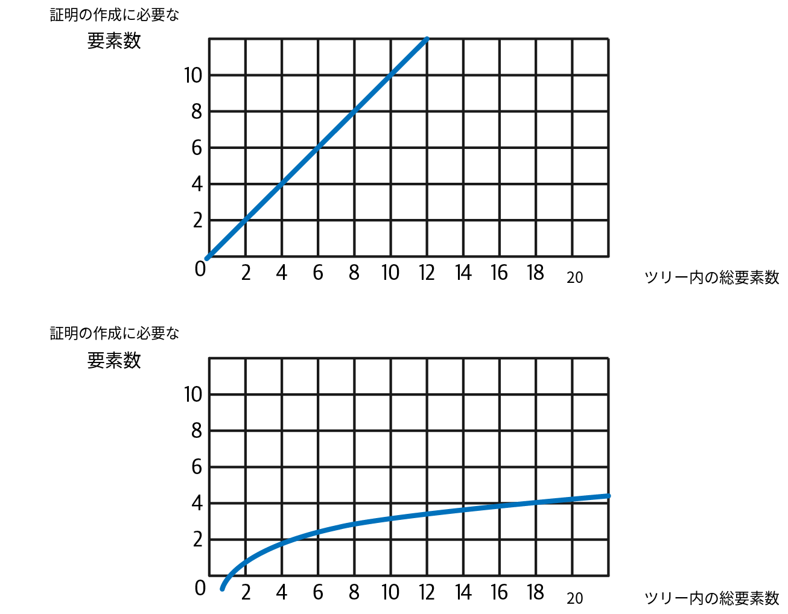


Figure 14-4. O(n) linear complexity (on the top) versus O(log(n)) complexity (on the bottom)

図14-4. O(n)線形複雑さ（上）対O(log(n))複雑さ（下）

In the Ethereum world, this means that it's cheaper and easier to provide proofs regarding the balance of an address, the result of a transaction, or the bytecode of a specific smart contract.

イーサリアムの世界では、これはアドレスの残高、トランザクションの結果、または特定のスマートコントラクトのバイトコードに関する証明を提供することがより安価で簡単であることを意味します。

### Merkle trees in Bitcoin

### BitcoinにおけるMerkleツリー

Bitcoin pioneered the use of Merkle trees in blockchain technology. In fact, every Bitcoin block contains the Merkle root of all transactions included in the same block so that none of them can be modified without modifying the entire block header (compromising the PoW, too).

Bitcoinはブロックチェーン技術におけるMerkleツリーの使用を先駆けました。実際、すべてのBitcoinブロックには同じブロックに含まれるすべてのトランザクションのMerkleルートが含まれているため、ブロックヘッダー全体を変更せずに（PoWも損なわずに）それらのいずれも変更できません。

### Merkle-Patricia trie in Ethereum

### イーサリアムにおけるMerkle-Patriciaトライ

Ethereum took the same concept and applied it to itself, with some modifications for its specific needs. Merkle trees are perfectly suited for permanent data that never changes, such as Bitcoin transactions. The Ethereum state changes constantly, though, so we need to tweak Merkle trees to still maintain their useful properties while letting us change the data underneath frequently.

イーサリアムは同じ概念を取り入れ、独自のニーズに合わせていくつかの変更を加えて適用しました。Merkleツリーは、Bitcoinトランザクションのような決して変わらない永続的なデータに完全に適しています。しかし、イーサリアムの状態は常に変化するため、データを頻繁に変更できるようにしながら、有用な特性を維持するためにMerkleツリーを調整する必要があります。

This is where the Merkle-Patricia trie enters the scene. The name comes from the union between Merkle trees, Patricia (Practical Algorithm to Retrieve Information Coded in Alphanumeric), and the word *trie* that originates from *retrieval*, reminding us what they are optimized for.

ここでMerkle-Patriciaトライが登場します。名前は、Merkleツリー、Patricia（Practical Algorithm to Retrieve Information Coded in Alphanumeric）、および*retrieval*（検索）に由来する*trie*という単語の組み合わせから来ており、何のために最適化されているかを思い出させてくれます。

Essentially, Merkle-Patricia tries are modified Merkle trees with 16 children for each node. They are well suited for data like the Ethereum state where you have lots of key-value items (where keys are the addresses and values the account information for each address, such as the balance, the nonce, and the code, if any) because the key itself is encoded in the path you have to follow to reach the correct position in the tree.

基本的に、Merkle-Patriciaトライは各ノードに16の子を持つ修正されたMerkleツリーです。キー自体がツリー内の正しい位置に到達するためにたどるパスにエンコードされているため、多くのキーバリュー項目（キーはアドレスであり、値は残高、ノンス、コード（存在する場合）などの各アドレスのアカウント情報）を持つイーサリアムの状態のようなデータに適しています。

Let's say we have the following key-value item we want to store:

保存したい次のキーバリュー項目があるとしましょう：

```
car → Schumacher
```

```
car → Schumacher
```

Car is hex encoded as (0x) 6 3 6 1 7 2, so you would need to take the sixth child starting from the Merkle root, then again down to the third child, repeating this process until you get to the final value where you can read the value associated with that key—Schumacher in this example—as shown in Figure 14-5.

Carは（0x）6 3 6 1 7 2として16進エンコードされるため、Merkleルートから6番目の子を取り、次に3番目の子に下り、そのキーに関連付けられた値（この例ではSchumacher）を読み取ることができる最終値に到達するまでこのプロセスを繰り返す必要があります。図14-5に示されています。

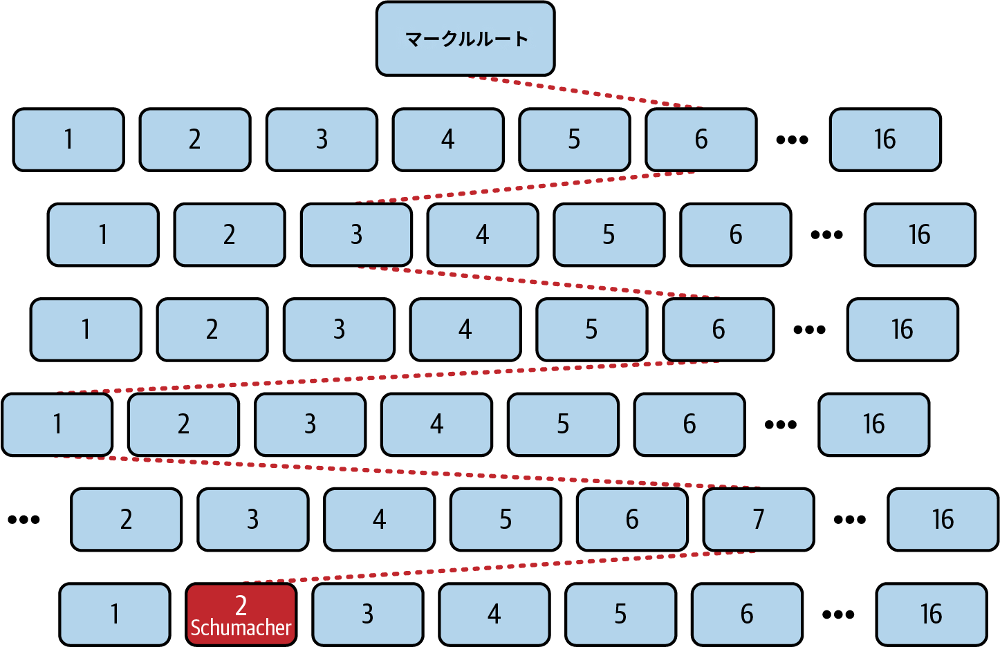


Figure 14-5. Encoding of the key-value item car --> Schumacher into a Merkle-Patricia trie

図14-5. キーバリュー項目car --> SchumacherのMerkle-Patriciaトライへのエンコード

In particular, Ethereum uses four Merkle-Patricia tries:

特に、イーサリアムは4つのMerkle-Patriciaトライを使用します：

**State trie**

**ステートトライ**

To store the entire state

全体の状態を保存する

**Transaction trie**

**トランザクショントライ**

To store all transactions included into a block

ブロックに含まれるすべてのトランザクションを保存する

**Receipt trie**

**レシートトライ**

To store the results of all the transactions included into a block

ブロックに含まれるすべてのトランザクションの結果を保存する

**Storage trie**

**ストレージトライ**

To store smart contract data

スマートコントラクトデータを保存する

Every Ethereum block header contains the state, transaction, and receipt trie Merkle root, while every account (contained in the state trie) stores its own storage trie Merkle root.

すべてのイーサリアムブロックヘッダーには、ステート、トランザクション、レシートトライのMerkleルートが含まれ、すべてのアカウント（ステートトライに含まれる）は独自のストレージトライMerkleルートを保存します。

## A Deep Dive into the Components of the EVM

## EVMコンポーネントの詳細

In this section, we'll take a closer look at how each component of the EVM works. Finally, we'll examine a real-world example to see everything in action.

このセクションでは、EVMの各コンポーネントがどのように機能するかを詳しく見ていきます。最後に、すべてを実際に見るために実世界の例を検証します。

### Stack

### スタック

The stack is a very simple data structure that follows a *last in, first out* (LIFO) order to perform operations, where every item is a 32-byte object. It can host up to 1,024 items at the same time.

スタックは、操作を実行するために*後入れ先出し*（LIFO）の順序に従う非常に単純なデータ構造であり、すべての項目は32バイトのオブジェクトです。同時に最大1,024項目をホストできます。

The EVM can push and pop items into and from the stack through different kinds of opcodes, and it can manipulate the order of its elements, as you can see in Figure 14-6.

EVMは、さまざまな種類のオペコードを通じてスタックに項目をプッシュおよびポップでき、図14-6に示すように要素の順序を操作できます。

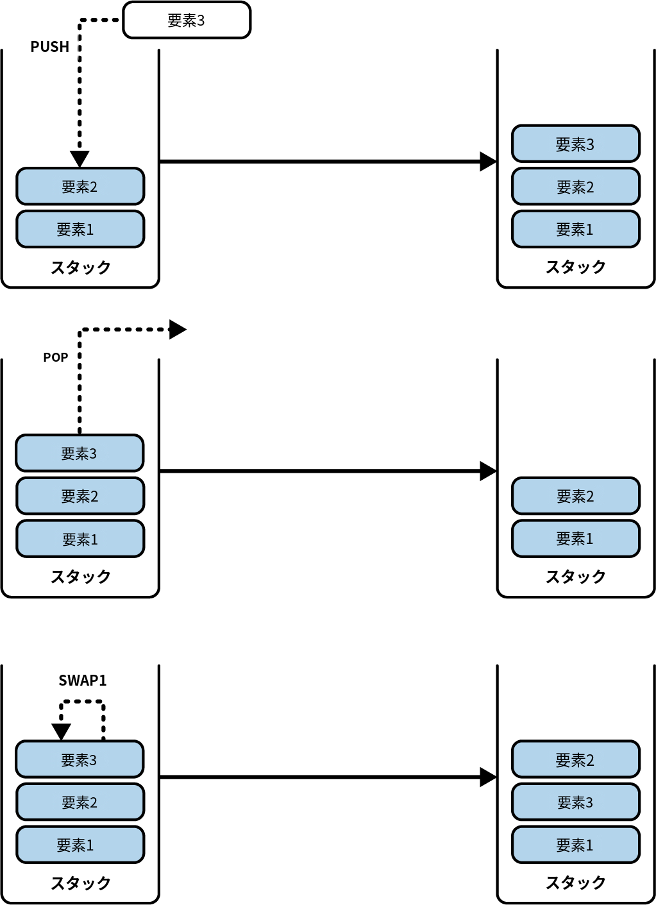


Figure 14-6. The EVM stack follows a LIFO order of operations

図14-6. EVMスタックはLIFO操作順序に従う

### Memory

### メモリ

The EVM memory is a byte-addressable data structure: essentially a very long array of bytes. In fact, every byte in the memory is accessible using a 32-byte (256-bit) key, which means it can contain up to 2256 bytes. It's volatile—that is, it's deleted after the execution ends—and it's always initialized to 0.

EVMメモリはバイトアドレス可能なデータ構造です。基本的に非常に長いバイト配列です。実際、メモリ内のすべてのバイトは32バイト（256ビット）のキーを使用してアクセスでき、最大2^256バイトを含むことができます。揮発性です。つまり、実行終了後に削除され、常に0に初期化されます。

Even though it's possible to read and write single bytes to and from the memory, most operations require reading or writing bigger chunks of data, usually 32-byte chunks, as shown in Figure 14-7.

メモリから単一バイトを読み書きすることは可能ですが、ほとんどの操作では、図14-7に示すように、より大きなデータチャンク（通常は32バイトチャンク）の読み書きが必要です。

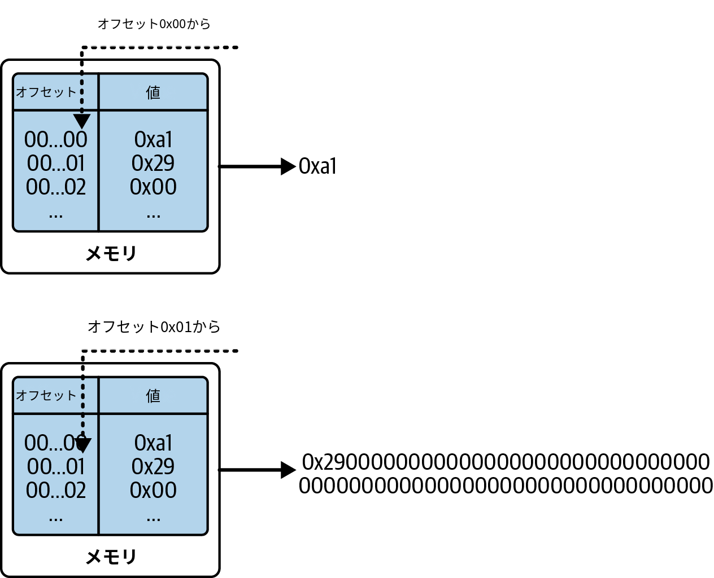


Figure 14-7. EVM memory is a volatile, byte-addressable data structure

図14-7. EVMメモリは揮発性のバイトアドレス可能なデータ構造

> **Note**
>
> Technically, you cannot read a single byte from the EVM. You can only read an entire 32-byte word. To achieve the same result as reading a single byte, the EVM needs to load the entire word that contains that byte and then "cut" it in order to return only the selected byte.

> **注記**
>
> 技術的には、EVMから単一のバイトを読み取ることはできません。32バイトのワード全体のみを読み取ることができます。単一バイトを読み取るのと同じ結果を達成するには、EVMはそのバイトを含むワード全体をロードし、選択されたバイトのみを返すために「カット」する必要があります。

### Storage

### ストレージ

The EVM storage is a key-value data structure where keys (most often called *slots*) and values are each 32 bytes long. This is the persistent memory of every smart contract: all values saved on it are kept indefinitely across different transactions and blocks. Each smart contract can only access and modify its own storage, and if you try to access a slot that doesn't contain any values, it will always return the value 0 without throwing any errors. Figure 14-8 shows a very basic representation of two contracts' storage.

EVMストレージは、キー（多くの場合*スロット*と呼ばれる）と値がそれぞれ32バイトの長さのキーバリューデータ構造です。これはすべてのスマートコントラクトの永続メモリです。保存されたすべての値は、異なるトランザクションやブロックにわたって無期限に保持されます。各スマートコントラクトは自身のストレージにのみアクセスして変更でき、値を含まないスロットにアクセスしようとすると、エラーをスローせずに常に値0を返します。図14-8は、2つのコントラクトのストレージの非常に基本的な表現を示しています。

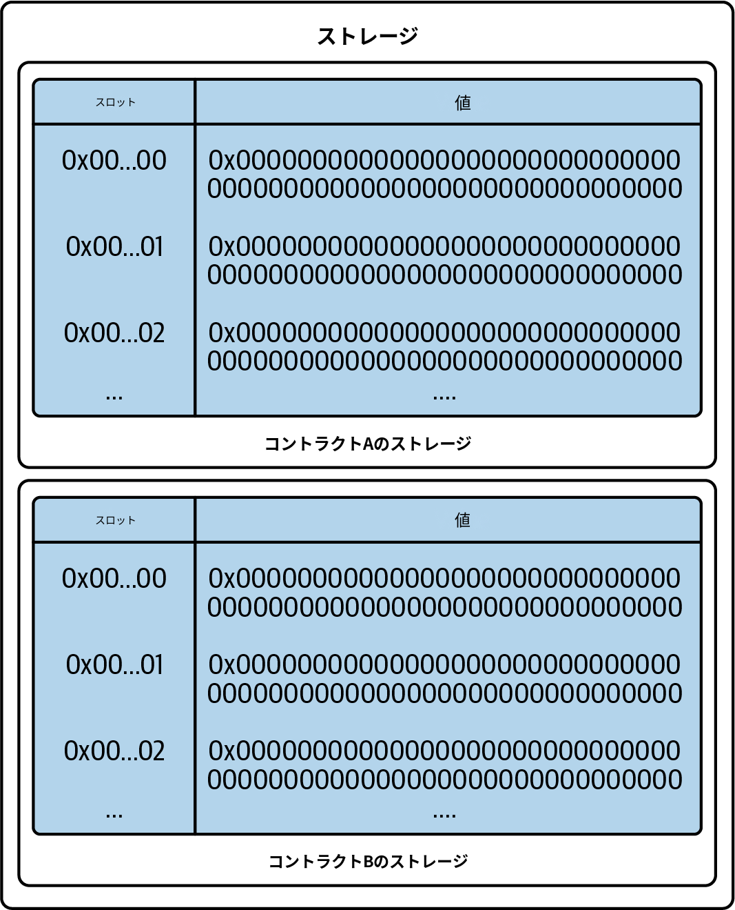


Figure 14-8. The EVM storage is a permanent memory with a key-value data structure

図14-8. EVMストレージはキーバリューデータ構造を持つ永続メモリ

There is also the *transient storage*, added with [EIP-1153](https://oreil.ly/fRvKl), which behaves in the same way as the normal storage, with the only difference being that it's completely discarded after the execution of the transaction. For this reason, it's much cheaper to use than normal storage.

[EIP-1153](https://oreil.ly/fRvKl)で追加された*一時ストレージ*もあり、通常のストレージと同じように動作しますが、唯一の違いはトランザクションの実行後に完全に破棄されることです。このため、通常のストレージよりもはるかに安価に使用できます。

### Calldata

### コールデータ

Calldata is an immutable data structure that always contains the bytes sent as input to the next *call frame* (i.e., a sandbox EVM environment). For example, in a contract-creation transaction, the calldata contains the bytecode of the contract that is going to be deployed. It can also be empty, such as in simple ETH transfers.

コールデータは、次の*コールフレーム*（サンドボックスEVM環境）への入力として送信されるバイトを常に含む不変のデータ構造です。たとえば、コントラクト作成トランザクションでは、コールデータにはデプロイされるコントラクトのバイトコードが含まれます。単純なETH転送などでは空にすることもできます。

## Let's Put Everything Together with a Concrete Example

## 具体的な例ですべてをまとめる

You are executing a transaction that works on contract A, and you have the following EVM bytecode: `60425F525F3560AB145F515500`.

コントラクトAで動作するトランザクションを実行しており、次のEVMバイトコードがあります：`60425F525F3560AB145F515500`。

You also have an initial calldata:

初期コールデータもあります：

```
00000000000000000000000000000000000000000000000000000000000000ab
```

```
00000000000000000000000000000000000000000000000000000000000000ab
```

Let's represent the EVM bytecode in a human-readable format:

EVMバイトコードを人間が読める形式で表現しましょう：

```
[00]            PUSH1            42
[02]            PUSH0
[03]            MSTORE
[04]            PUSH0
[05]            CALLDATALOAD
[06]            PUSH1            AB
[08]            EQ
[09]            PUSH0
[0a]            MLOAD
[0b]            SSTORE
[0c]            STOP
```

```
[00]            PUSH1            42
[02]            PUSH0
[03]            MSTORE
[04]            PUSH0
[05]            CALLDATALOAD
[06]            PUSH1            AB
[08]            EQ
[09]            PUSH0
[0a]            MLOAD
[0b]            SSTORE
[0c]            STOP
```

> **Note**
>
> Each EVM opcode is identified by a unique 1-byte value (ranging from 0x00 to 0xFF). For example, 0x60 is the PUSH1 opcode, 0x5F the PUSH0, and so on. For a comprehensive list of all opcodes and their hexadecimal representations, refer to [EVM codes](https://www.evm.codes).

> **注記**
>
> 各EVMオペコードは一意の1バイト値（0x00から0xFFの範囲）で識別されます。たとえば、0x60はPUSH1オペコード、0x5FはPUSH0などです。すべてのオペコードとその16進表現の包括的なリストについては、[EVM codes](https://www.evm.codes)を参照してください。

Let's see how the EVM executes these opcodes and how the stack, the memory, and the storage are manipulated. Figure 14-9 shows the initial state of the EVM.

EVMがこれらのオペコードをどのように実行し、スタック、メモリ、ストレージがどのように操作されるかを見てみましょう。図14-9はEVMの初期状態を示しています。

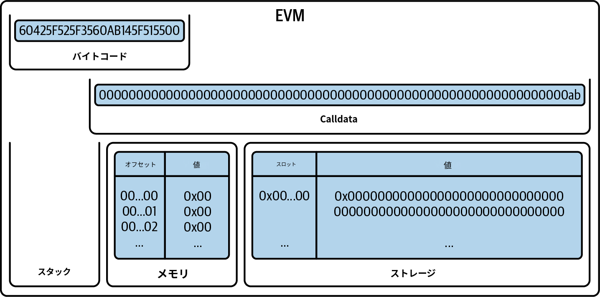


Figure 14-9. Initial EVM state

図14-9. EVMの初期状態

The first opcode pushes 0x42 onto the stack (Figure 14-10). Note that all push opcodes take their data (to be pushed) from the next available bytes in the bytecode itself.

最初のオペコードは0x42をスタックにプッシュします（図14-10）。すべてのプッシュオペコードは、バイトコード自体の次の利用可能なバイトからデータ（プッシュされる）を取得することに注意してください。

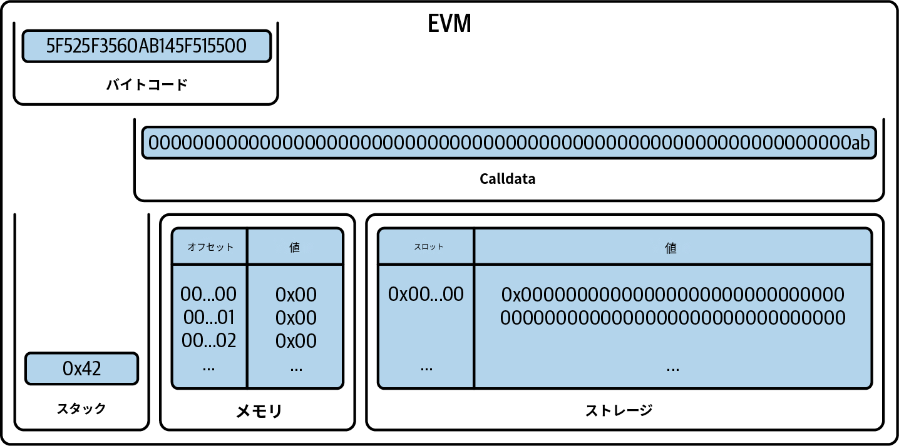


Figure 14-10. EVM after PUSH1 0x42

図14-10. PUSH1 0x42後のEVM

Next, PUSH0 pushes 0x00 onto the stack (Figure 14-11).

次に、PUSH0は0x00をスタックにプッシュします（図14-11）。

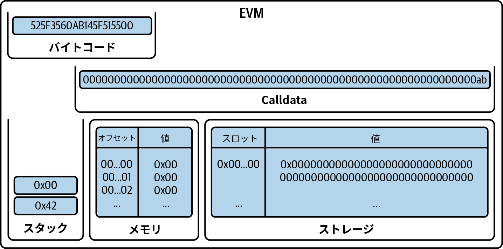


Figure 14-11. EVM after PUSH0

図14-11. PUSH0後のEVM

MSTORE pops two items from the stack, interpreting the first one as the offset (in bytes) and the second one as the value to write in the memory, starting at that offset. Note that there are lots of leading zeros in the memory (31 bytes, equal to zero) before the byte 0x42. This is correct because every value in the stack is a 32-byte value. Most of the time, we can ignore leading zeros while writing (in Figure 14-12, you can see the item 0x42), but you should always remember that they are 32-byte values.

MSTOREはスタックから2つの項目をポップし、最初のものをオフセット（バイト単位）として、2番目のものをそのオフセットから始まるメモリに書き込む値として解釈します。バイト0x42の前にメモリに多くの先行ゼロ（31バイト、ゼロに等しい）があることに注意してください。これは正しいです。なぜなら、スタック内のすべての値は32バイトの値だからです。ほとんどの場合、書き込み時に先行ゼロを無視できます（図14-12では項目0x42を見ることができます）が、それらが32バイトの値であることを常に覚えておく必要があります。

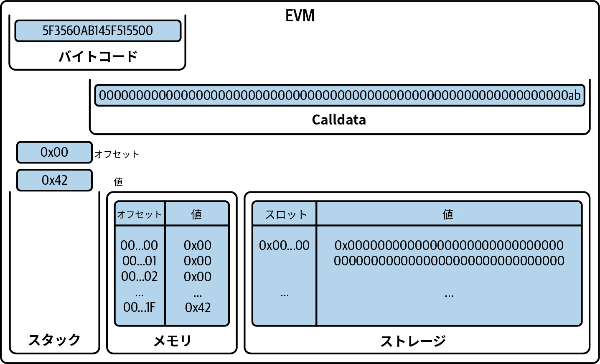


Figure 14-12. EVM after MSTORE

図14-12. MSTORE後のEVM

Then, we again have a PUSH0 that pushes 0x00 onto the stack (Figure 14-13).

次に、再びPUSH0があり、0x00をスタックにプッシュします（図14-13）。

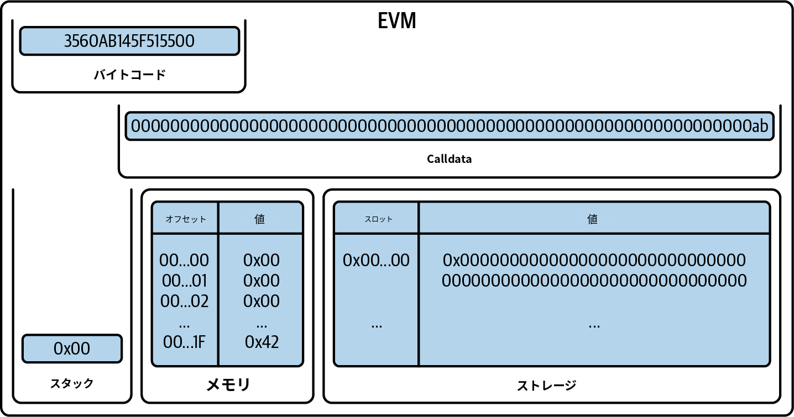


Figure 14-13. EVM after PUSH0

図14-13. PUSH0後のEVM

CALLDATALOAD takes one element from the stack, interpreted as an offset, and returns the 32-byte value in the calldata starting at that offset, then pushes it onto the stack. Here, it's returning 0xab (note that we can ignore all the leading zeros as they are not significant), as shown in Figure 14-14.

CALLDATALOADはスタックから1つの要素を取り、オフセットとして解釈し、そのオフセットから始まるコールデータの32バイト値を返し、スタックにプッシュします。ここでは、図14-14に示すように、0xabを返しています（先行ゼロは重要でないため無視できます）。

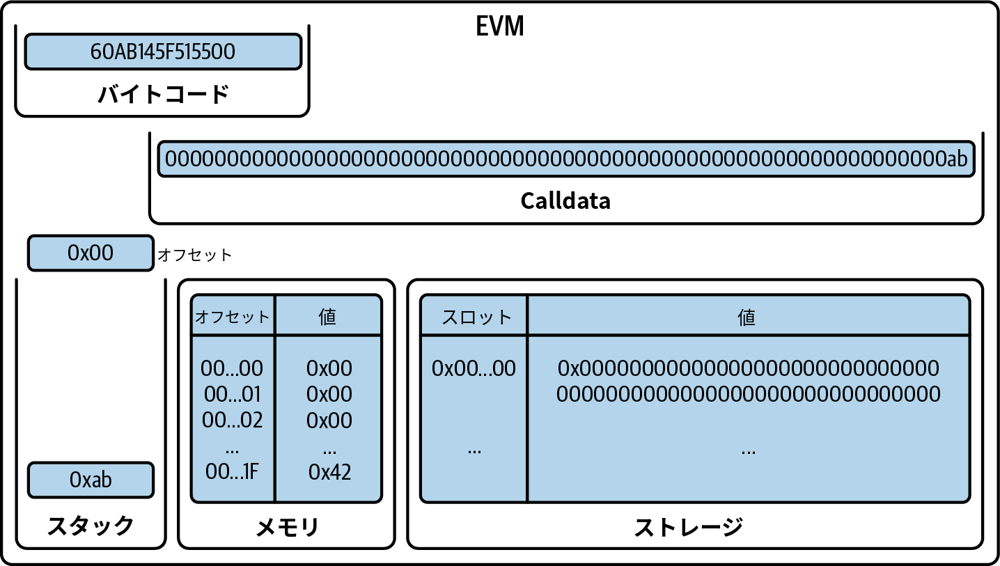


Figure 14-14. EVM after CALLDATALOAD

図14-14. CALLDATALOAD後のEVM

PUSH1 pushes 0xab onto the stack (Figure 14-15).

PUSH1は0xabをスタックにプッシュします（図14-15）。

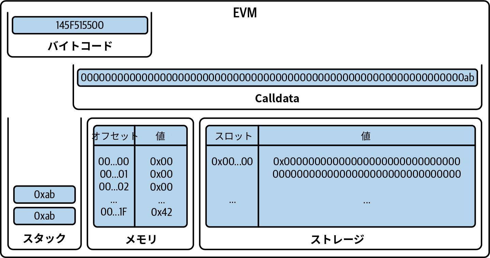


Figure 14-15. EVM after PUSH1 0xab

図14-15. PUSH1 0xab後のEVM

EQ pops two items from the stack, compares them, and returns 1 if they are equal, 0 otherwise. In this example, it returns 0x01 since the two values are equal, as shown in Figure 14-16.

EQはスタックから2つの項目をポップし、それらを比較し、等しい場合は1を、そうでない場合は0を返します。この例では、図14-16に示すように、2つの値が等しいため0x01を返します。

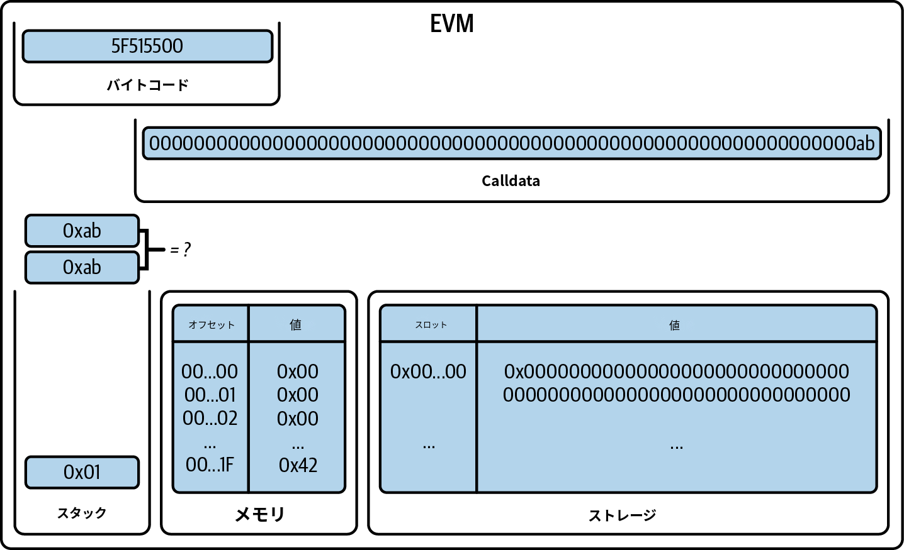


Figure 14-16. EVM after EQ

図14-16. EQ後のEVM

Again, a PUSH0 pushes 0x00 onto the stack (Figure 14-17).

再び、PUSH0は0x00をスタックにプッシュします（図14-17）。

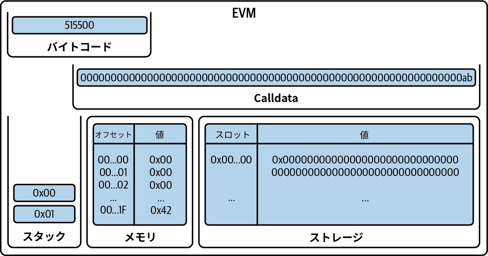


Figure 14-17. EVM after PUSH0

図14-17. PUSH0後のEVM

MLOAD takes one element from the stack, interpreting it as the offset, and reads 32 bytes in the memory, starting at that offset, then pushes the result onto the stack (Figure 14-18).

MLOADはスタックから1つの要素を取り、オフセットとして解釈し、そのオフセットから始まるメモリの32バイトを読み取り、結果をスタックにプッシュします（図14-18）。

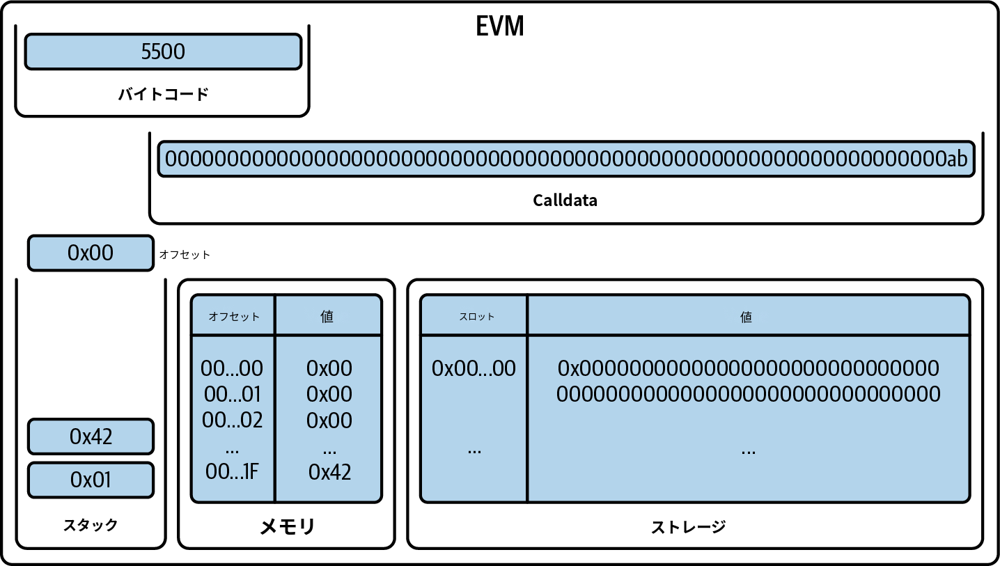


Figure 14-18. EVM after MLOAD

図14-18. MLOAD後のEVM

Now, the SSTORE pops two items from the stack, interpreting the first one as the slot and the second one as the value to be saved in the contract's storage at that slot number, as shown in Figure 14-19.

次に、SSTOREはスタックから2つの項目をポップし、最初のものをスロットとして、2番目のものをそのスロット番号のコントラクトのストレージに保存する値として解釈します。図14-19に示されています。

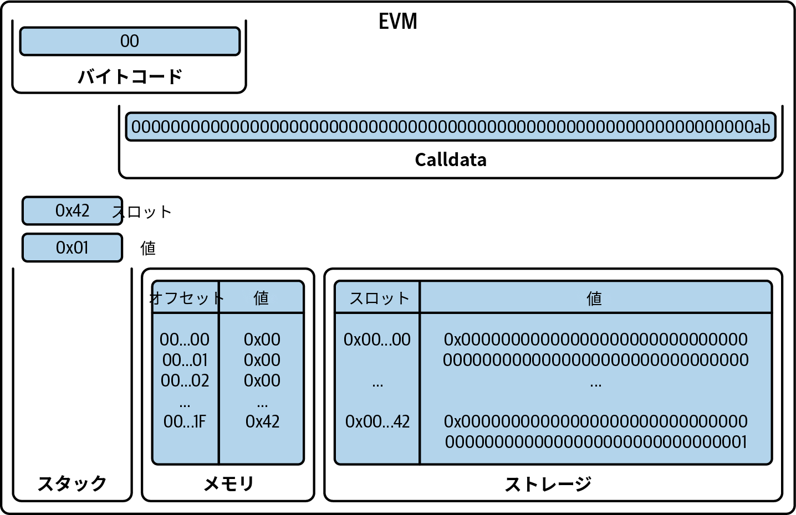


Figure 14-19. EVM after SSTORE

図14-19. SSTORE後のEVM

Finally, we have the STOP opcode that halts the execution, and the EVM returns successfully, as you can see in Figure 14-20.

最後に、実行を停止するSTOPオペコードがあり、図14-20に示すように、EVMは正常に戻ります。

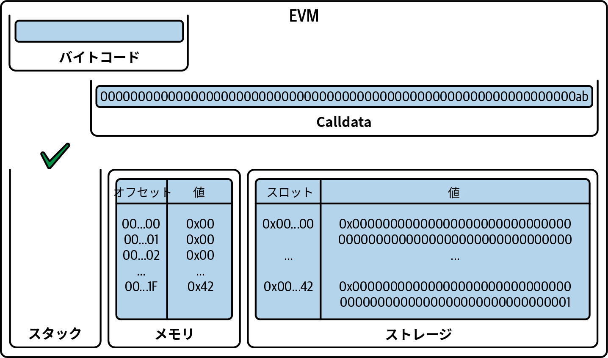


Figure 14-20. EVM after STOP

図14-20. STOP後のEVM

> **Tip**
>
> In the previous example, we used the opcode PUSH0. It's important to say that not all EVM-compatible blockchains have integrated this opcode, so be aware of that when deploying a cross-chain contract. [EVM Diff](https://www.evmdiff.com) is a very cool website that shows all these subtle differences for EVM-compatible chains.

> **ヒント**
>
> 前の例では、オペコードPUSH0を使用しました。すべてのEVM互換ブロックチェーンがこのオペコードを統合しているわけではないことを言っておくことが重要です。クロスチェーンコントラクトをデプロイする際にはこれに注意してください。[EVM Diff](https://www.evmdiff.com)は、EVM互換チェーンのこれらのすべての微妙な違いを示す非常にクールなウェブサイトです。

## Compiling Solidity to EVM Bytecode

## SolidityからEVMバイトコードへのコンパイル

We've already explored Solidity in Chapter 7. Now, we're going to see how it's compiled down into EVM bytecode that can be interpreted by the EVM.

第7章でSolidityについてすでに調査しました。ここでは、EVMが解釈できるEVMバイトコードにどのようにコンパイルされるかを見ていきます。

Compiling a Solidity source file to EVM bytecode can be accomplished via several methods. In Chapter 2, we used the online Remix compiler. In this chapter, we will use the `solc` executable at the command line. To install Solidity on your computer, [follow the steps](https://oreil.ly/JW--z).

SolidityソースファイルをEVMバイトコードにコンパイルするには、いくつかの方法があります。第2章では、オンラインのRemixコンパイラを使用しました。本章では、コマンドラインで`solc`実行可能ファイルを使用します。コンピュータにSolidityをインストールするには、[手順に従ってください](https://oreil.ly/JW--z)。

For a list of options, run the following command:

オプションのリストについては、次のコマンドを実行してください：

```bash
$ solc --help
```

```bash
$ solc --help
```

Generating the raw opcode stream of a Solidity source file is easily achieved with the `--opcodes` command-line option. This opcode stream leaves out some information (the `--asm` option produces the full information), but it is sufficient for this discussion. For example, compiling an example Solidity file, `Example.sol`, and sending the opcode output into a directory named `BytecodeDir` is accomplished with the following command:

Solidityソースファイルの生のオペコードストリームの生成は、`--opcodes`コマンドラインオプションで簡単に達成できます。このオペコードストリームは一部の情報を省略します（`--asm`オプションは完全な情報を生成します）が、この議論には十分です。たとえば、Solidityファイル`Example.sol`をコンパイルし、オペコード出力を`BytecodeDir`という名前のディレクトリに送信するには、次のコマンドを使用します：

```bash
$ solc -o BytecodeDir --opcodes Example.sol
```

```bash
$ solc -o BytecodeDir --opcodes Example.sol
```

You can also use `--asm` to produce a more human-readable output:

`--asm`を使用して、より人間が読みやすい出力を生成することもできます：

```bash
$ solc -o BytecodeDir --asm Example.sol
```

```bash
$ solc -o BytecodeDir --asm Example.sol
```

The following command will produce the bytecode binary for our example program:

次のコマンドは、サンプルプログラムのバイトコードバイナリを生成します：

```bash
$ solc -o BytecodeDir --bin Example.sol
```

```bash
$ solc -o BytecodeDir --bin Example.sol
```

The output opcode files generated will depend on the specific contracts contained within the Solidity source file. Our simple Solidity file `Example.sol` has only one contract, named Example:

生成される出力オペコードファイルは、Solidityソースファイルに含まれる特定のコントラクトに依存します。単純なSolidityファイル`Example.sol`には、Exampleという名前のコントラクトが1つだけあります：

```solidity
// SPDX-License-Identifier: GPL-3.0
pragma solidity 0.8.27;

contract Example {
  address contractOwner;

  function test() public {
    contractOwner = msg.sender;
  }
}
```

```solidity
// SPDX-License-Identifier: GPL-3.0
pragma solidity 0.8.27;

contract Example {
  address contractOwner;

  function test() public {
    contractOwner = msg.sender;
  }
}
```

As you can see, all this contract does is hold one persistent state variable, which is set as the address of the last account to run this contract.

ご覧のとおり、このコントラクトは1つの永続的な状態変数を保持するだけであり、このコントラクトを最後に実行したアカウントのアドレスとして設定されます。

If you look in the `BytecodeDir` directory, you will see the opcode file `Example.opcode`, which contains the EVM opcode instructions of the example contract. Opening the `Example.opcode` file in a text editor will show the following:

`BytecodeDir`ディレクトリを見ると、サンプルコントラクトのEVMオペコード命令を含むオペコードファイル`Example.opcode`が表示されます。テキストエディタで`Example.opcode`ファイルを開くと、次の内容が表示されます：

```
PUSH1 0x80 PUSH1 0x40 MSTORE CALLVALUE DUP1 ISZERO PUSH1 0xE JUMPI PUSH0 PUSH0 REVERT JUMPDEST POP PUSH1 0xA9 DUP1 PUSH1 0x1A PUSH0 CODECOPY PUSH0 RETURN INVALID PUSH1 0x80 PUSH1 0x40 MSTORE CALLVALUE DUP1 ISZERO PUSH1 0xE JUMPI PUSH0 PUSH0 REVERT JUMPDEST POP PUSH1 0x4 CALLDATASIZE LT PUSH1 0x26 JUMPI PUSH0 CALLDATALOAD PUSH1 0xE0 SHR DUP1 PUSH4 0xF8A8FD6D EQ PUSH1 0x2A JUMPI JUMPDEST PUSH0 PUSH0 REVERT JUMPDEST PUSH1 0x30 PUSH1 0x32 JUMP JUMPDEST STOP JUMPDEST CALLER PUSH0 PUSH0 PUSH2 0x100 EXP DUP2 SLOAD DUP2 PUSH20 0xFFFFFFFFFFFFFFFFFFFFFFFFFFFFFFFFFFFFFFFF MUL NOT AND SWAP1 DUP4 PUSH200xFFFFFFFFFFFFFFFFFFFFFFFFFFFFFFFFFFFFFFFF AND MUL OR SWAP1 SSTORE POP JUMP INVALID LOG2 PUSH5 0x6970667358 0x22 SLT KECCAK256 JUMPI 0xBB RETURNDATACOPY SWAP14 CALLVALUE 0xB3 0xB1 SMOD BLOBHASH STATICCALL MCOPY PUSH10 0x856E7132D8FEED4D83B6 0xB2 0xBE PUSH30 0x8B43532C818BFD64736F6C634300081B0033000000000000000000000000
```

```
PUSH1 0x80 PUSH1 0x40 MSTORE CALLVALUE DUP1 ISZERO PUSH1 0xE JUMPI PUSH0 PUSH0 REVERT JUMPDEST POP PUSH1 0xA9 DUP1 PUSH1 0x1A PUSH0 CODECOPY PUSH0 RETURN INVALID PUSH1 0x80 PUSH1 0x40 MSTORE CALLVALUE DUP1 ISZERO PUSH1 0xE JUMPI PUSH0 PUSH0 REVERT JUMPDEST POP PUSH1 0x4 CALLDATASIZE LT PUSH1 0x26 JUMPI PUSH0 CALLDATALOAD PUSH1 0xE0 SHR DUP1 PUSH4 0xF8A8FD6D EQ PUSH1 0x2A JUMPI JUMPDEST PUSH0 PUSH0 REVERT JUMPDEST PUSH1 0x30 PUSH1 0x32 JUMP JUMPDEST STOP JUMPDEST CALLER PUSH0 PUSH0 PUSH2 0x100 EXP DUP2 SLOAD DUP2 PUSH20 0xFFFFFFFFFFFFFFFFFFFFFFFFFFFFFFFFFFFFFFFF MUL NOT AND SWAP1 DUP4 PUSH200xFFFFFFFFFFFFFFFFFFFFFFFFFFFFFFFFFFFFFFFF AND MUL OR SWAP1 SSTORE POP JUMP INVALID LOG2 PUSH5 0x6970667358 0x22 SLT KECCAK256 JUMPI 0xBB RETURNDATACOPY SWAP14 CALLVALUE 0xB3 0xB1 SMOD BLOBHASH STATICCALL MCOPY PUSH10 0x856E7132D8FEED4D83B6 0xB2 0xBE PUSH30 0x8B43532C818BFD64736F6C634300081B0033000000000000000000000000
```

Compiling the example with the `--asm` option produces a file named `Example.evm` in our `BytecodeDir` directory. This contains a slightly higher-level description of the EVM bytecode instructions, together with some helpful annotations:

`--asm`オプションでサンプルをコンパイルすると、`BytecodeDir`ディレクトリに`Example.evm`という名前のファイルが生成されます。これには、EVMバイトコード命令のやや高レベルの説明と、いくつかの有用な注釈が含まれています：

```
/* "Example.sol":61:171  contract Example {... */
  mstore(0x40, 0x80)
  callvalue
  dup1
  iszero
  tag_1
  jumpi
  revert(0x00, 0x00)
tag_1:
  pop
  dataSize(sub_0)
  dup1
  dataOffset(sub_0)
  0x00
  codecopy
  0x00
  return
stop

sub_0: assembly {
        /* "Example.sol":61:171  contract Example {... */
      mstore(0x40, 0x80)
      callvalue
      dup1
      iszero
      tag_1
      jumpi
      revert(0x00, 0x00)
    tag_1:
      pop
      jumpi(tag_2, lt(calldatasize, 0x04))
      shr(0xe0, calldataload(0x00))
      dup1
      0xf8a8fd6d
      eq
      tag_3
      jumpi
    tag_2:
      revert(0x00, 0x00)
        /* "Example.sol":109:169  function test() public {... */
    tag_3:
      tag_4
      tag_5
      jump    // in
    tag_4:
      stop
    tag_5:
        /* "Example.sol":154:164  msg.sender */
      caller
        /* "Example.sol":138:151  contractOwner */
      0x00
      0x00
        /* "Example.sol":138:164  contractOwner = msg.sender */
      0x0100
      exp
      dup2
      sload
      dup2
      0xffffffffffffffffffffffffffffffffffffffff
      mul
      not
      and
      swap1
      dup4
      0xffffffffffffffffffffffffffffffffffffffff
      and
      mul
      or
      swap1
      sstore
      pop
        /* "Example.sol":109:169  function test() public {... */
      jump    // out
    auxdata: 0xa264697066735822122057bb3e9e34b3b10749fa5e69856e7132d8feed4d83b6b2be7d8b43532c818bfd64736f6c634300081b0033
}
```

```
/* "Example.sol":61:171  contract Example {... */
  mstore(0x40, 0x80)
  callvalue
  dup1
  iszero
  tag_1
  jumpi
  revert(0x00, 0x00)
tag_1:
  pop
  dataSize(sub_0)
  dup1
  dataOffset(sub_0)
  0x00
  codecopy
  0x00
  return
stop

sub_0: assembly {
        /* "Example.sol":61:171  contract Example {... */
      mstore(0x40, 0x80)
      callvalue
      dup1
      iszero
      tag_1
      jumpi
      revert(0x00, 0x00)
    tag_1:
      pop
      jumpi(tag_2, lt(calldatasize, 0x04))
      shr(0xe0, calldataload(0x00))
      dup1
      0xf8a8fd6d
      eq
      tag_3
      jumpi
    tag_2:
      revert(0x00, 0x00)
        /* "Example.sol":109:169  function test() public {... */
    tag_3:
      tag_4
      tag_5
      jump    // in
    tag_4:
      stop
    tag_5:
        /* "Example.sol":154:164  msg.sender */
      caller
        /* "Example.sol":138:151  contractOwner */
      0x00
      0x00
        /* "Example.sol":138:164  contractOwner = msg.sender */
      0x0100
      exp
      dup2
      sload
      dup2
      0xffffffffffffffffffffffffffffffffffffffff
      mul
      not
      and
      swap1
      dup4
      0xffffffffffffffffffffffffffffffffffffffff
      and
      mul
      or
      swap1
      sstore
      pop
        /* "Example.sol":109:169  function test() public {... */
      jump    // out
    auxdata: 0xa264697066735822122057bb3e9e34b3b10749fa5e69856e7132d8feed4d83b6b2be7d8b43532c818bfd64736f6c634300081b0033
}
```

The `--bin` option produces the machine-readable hexadecimal bytecode:

`--bin`オプションは、機械可読な16進バイトコードを生成します：

```
6080604052348015600e575f5ffd5b5060a980601a5f395ff3fe6080604052348015600e575f5ffd5b50600436106026575f3560e01c8063f8a8fd6d14602a575b5f5ffd5b60306032565b005b335f5f6101000a81548173ffffffffffffffffffffffffffffffffffffffff021916908373ffffffffffffffffffffffffffffffffffffffff16021790555056fea264697066735822122057bb3e9e34b3b10749fa5e69856e7132d8feed4d83b6b2be7d8b43532c818bfd64736f6c634300081b0033
```

```
6080604052348015600e575f5ffd5b5060a980601a5f395ff3fe6080604052348015600e575f5ffd5b50600436106026575f3560e01c8063f8a8fd6d14602a575b5f5ffd5b60306032565b005b335f5f6101000a81548173ffffffffffffffffffffffffffffffffffffffff021916908373ffffffffffffffffffffffffffffffffffffffff16021790555056fea264697066735822122057bb3e9e34b3b10749fa5e69856e7132d8feed4d83b6b2be7d8b43532c818bfd64736f6c634300081b0033
```

You can investigate what's going on here in detail using the opcode list given in "The EVM Instruction Set (Bytecode Operations)". However, that's quite a task, so let's start by just examining the first four instructions:

「EVM命令セット（バイトコード操作）」で与えられたオペコードリストを使用して、ここで何が起こっているかを詳細に調査できます。ただし、それはかなりの作業なので、最初の4つの命令を調べることから始めましょう：

```
PUSH1 0x80 PUSH1 0x40 MSTORE CALLVALUE
```

```
PUSH1 0x80 PUSH1 0x40 MSTORE CALLVALUE
```

Here, we have `PUSH1` followed by a raw byte of value `0x80`. This EVM instruction takes the single byte following the opcode in the program code (as a literal value) and pushes it onto the stack. It is possible to push values of size up to 32 bytes onto the stack, as in:

ここでは、`PUSH1`の後に値`0x80`の生バイトが続きます。このEVM命令は、プログラムコード内のオペコードに続く単一バイト（リテラル値として）を取り、スタックにプッシュします。次のように、最大32バイトのサイズの値をスタックにプッシュすることが可能です：

```
PUSH32 0x436f6e67726174756c6174696f6e732120536f6f6e20746f206d617374657221
```

```
PUSH32 0x436f6e67726174756c6174696f6e732120536f6f6e20746f206d617374657221
```

The second `PUSH1` opcode from `example.opcode` stores `0x40` onto the top of the stack (pushing the `0x80` already present there down one slot).

`example.opcode`からの2番目の`PUSH1`オペコードは、`0x40`をスタックのトップに保存します（すでに存在する`0x80`を1スロット下に押し下げます）。

Next is `MSTORE`, which is a memory store operation that saves a value to the EVM's memory. It takes two arguments and, like most EVM operations, obtains them from the stack. For each argument, the stack is "popped"—that is, the top value on the stack is taken off, and all the other values on the stack are shifted up one position. The first argument for `MSTORE` is the address of the word in memory where the value to be saved will be put. For this program, we have `0x40` at the top of the stack, so that is removed from the stack and used as the memory address. The second argument is the value to be saved, which is `0x80` here. After the `MSTORE` operation is executed, our stack is empty again, but we have the value `0x80` (128 in decimal) at the memory location `0x40`.

次は`MSTORE`で、EVMのメモリに値を保存するメモリストア操作です。2つの引数を取り、ほとんどのEVM操作と同様に、スタックから取得します。各引数について、スタックは「ポップ」されます。つまり、スタックのトップ値が取り除かれ、スタック上の他のすべての値が1つ上の位置にシフトされます。`MSTORE`の最初の引数は、保存される値が配置されるメモリ内のワードのアドレスです。このプログラムでは、スタックのトップに`0x40`があるため、スタックから削除されてメモリアドレスとして使用されます。2番目の引数は保存される値で、ここでは`0x80`です。`MSTORE`操作が実行された後、スタックは再び空になりますが、メモリ位置`0x40`に値`0x80`（10進数で128）があります。

The next opcode is `CALLVALUE`, which is an environmental opcode that pushes onto the top of the stack the amount of ether (measured in wei) sent with the message call that initiated this execution.

次のオペコードは`CALLVALUE`で、この実行を開始したメッセージ呼び出しで送信されたイーサの量（weiで測定）をスタックのトップにプッシュする環境オペコードです。

We could continue to step through this program in this way until we had a full understanding of the low-level state changes that this code effects, but it wouldn't help us at this stage. We'll come back to it later in the chapter.

このコードが影響を与える低レベルの状態変化を完全に理解するまで、このようにこのプログラムをステップスルーし続けることができますが、この段階では役に立ちません。本章の後半で戻ってきます。

## Contract Deployment Code

## コントラクトデプロイメントコード

There is an important but subtle difference between the code used when creating and deploying a new contract on the Ethereum platform and the code of the contract itself. To create a new contract, a special transaction is needed that has an empty `to` field (null) and its `data` field set to the contract's *initiation code*. When such a contract-creation transaction is processed, the code for the new contract account is not the code in the `data` field of the transaction. Instead, an EVM is instantiated with the code in the `data` field of the transaction loaded into its program code ROM, and then the output of the execution of that deployment code is taken as the code for the new contract account. This is so that new contracts can be programmatically initialized using the Ethereum world state at the time of deployment, setting values in the contract's storage and even sending ether or creating further new contracts.

イーサリアムプラットフォームで新しいコントラクトを作成およびデプロイする際に使用されるコードと、コントラクト自体のコードの間には、重要だが微妙な違いがあります。新しいコントラクトを作成するには、`to`フィールドが空（null）で、`data`フィールドがコントラクトの*初期化コード*に設定された特別なトランザクションが必要です。このようなコントラクト作成トランザクションが処理されると、新しいコントラクトアカウントのコードはトランザクションの`data`フィールドのコードではありません。代わりに、トランザクションの`data`フィールドのコードがプログラムコードROMにロードされたEVMがインスタンス化され、そのデプロイメントコードの実行出力が新しいコントラクトアカウントのコードとして取得されます。これにより、新しいコントラクトがデプロイ時のイーサリアムワールドステートを使用してプログラムで初期化され、コントラクトのストレージに値を設定したり、イーサを送信したり、さらに新しいコントラクトを作成したりできます。

When compiling a contract offline—for example, using `solc` on the command line—you can get either the *deployment bytecode* or the *runtime bytecode*. The deployment bytecode is used for every aspect of the initialization of a new contract account, including the bytecode that will actually end up being executed when transactions call this new contract (i.e., the runtime bytecode) and the code to initialize everything based on the contract's constructor. The runtime bytecode, on the other hand, is exactly the bytecode that ends up being executed when the new contract is called and nothing more; it does not include the bytecode needed to initialize the contract during deployment.

コントラクトをオフラインでコンパイルする場合（たとえば、コマンドラインで`solc`を使用する場合）、*デプロイメントバイトコード*または*ランタイムバイトコード*のいずれかを取得できます。デプロイメントバイトコードは、トランザクションがこの新しいコントラクトを呼び出すときに実際に実行されるバイトコード（ランタイムバイトコード）と、コントラクトのコンストラクタに基づいてすべてを初期化するコードを含む、新しいコントラクトアカウントの初期化のあらゆる側面に使用されます。一方、ランタイムバイトコードは、新しいコントラクトが呼び出されたときに実行されるバイトコードそのものであり、それ以上のものではありません。デプロイ中にコントラクトを初期化するために必要なバイトコードは含まれません。

Let's take the simple `Faucet.sol` contract we created in previous chapters as an example:

前の章で作成した単純な`Faucet.sol`コントラクトを例に取りましょう：

```solidity
// SPDX-License-Identifier: GPL-3.0
pragma solidity 0.8.27;

contract Faucet {
  // Give out ether to anyone who asks
  function withdraw(uint256 _withdrawAmount, address payable _to) public {
    // Limit withdrawal amount
    require(_withdrawAmount <= 1000000000000);
    // Send the amount to the address that requested it
    _to.transfer(_withdrawAmount);
  }

  // Function to receive Ether. msg.data must be empty
  receive() external payable {}

  // Fallback function is called when msg.data is not empty
  fallback() external payable {}
}
```

```solidity
// SPDX-License-Identifier: GPL-3.0
pragma solidity 0.8.27;

contract Faucet {
  // 要求があれば誰にでもイーサを提供
  function withdraw(uint256 _withdrawAmount, address payable _to) public {
    // 引き出し額を制限
    require(_withdrawAmount <= 1000000000000);
    // 要求したアドレスにその金額を送信
    _to.transfer(_withdrawAmount);
  }

  // イーサを受け取る関数。msg.dataは空でなければならない
  receive() external payable {}

  // msg.dataが空でない場合に呼び出されるフォールバック関数
  fallback() external payable {}
}
```

To get the deployment bytecode, we would run `solc --bin Faucet.sol`. If we instead wanted just the runtime bytecode, we would run `solc --bin-runtime Faucet.sol`. If you compare the output of these commands, you will see that the runtime bytecode is a subset of the deployment bytecode. In other words, the runtime bytecode is entirely contained within the deployment bytecode.

デプロイメントバイトコードを取得するには、`solc --bin Faucet.sol`を実行します。代わりにランタイムバイトコードのみが必要な場合は、`solc --bin-runtime Faucet.sol`を実行します。これらのコマンドの出力を比較すると、ランタイムバイトコードがデプロイメントバイトコードのサブセットであることがわかります。つまり、ランタイムバイトコードはデプロイメントバイトコード内に完全に含まれています。

### CREATE Versus CREATE2 to Deploy Contracts on Chain

### オンチェーンでコントラクトをデプロイするCREATE対CREATE2

`CREATE` and `CREATE2` are the only two opcodes that let you deploy a new contract on chain. The main difference between them is related to the resulting address of the newly created contract. With `CREATE` the destination address is calculated as follows:

`CREATE`と`CREATE2`は、オンチェーンで新しいコントラクトをデプロイできる唯一の2つのオペコードです。それらの主な違いは、新しく作成されたコントラクトの結果アドレスに関連しています。`CREATE`では、宛先アドレスは次のように計算されます：

```
address = keccak256[rlp(sender_address ++ sender_nonce)][12:]
```

```
address = keccak256[rlp(sender_address ++ sender_nonce)][12:]
```

It's the rightmost 20 bytes of the Keccak-256 hash of the RLP encoding of the sender address followed by its nonce.

送信者アドレスとそのノンスのRLPエンコーディングのKeccak-256ハッシュの右端20バイトです。

`CREATE2` was added during the Constantinople hard fork in 2019 to let developers create new contracts where the resulting address isn't dependent on the state (i.e., the nonce) of the sender. In fact, it behaves in the exact same way as the `CREATE` opcode, but the destination address is calculated like this:

`CREATE2`は、結果のアドレスが送信者の状態（つまり、ノンス）に依存しない新しいコントラクトを開発者が作成できるように、2019年のConstantinopleハードフォーク中に追加されました。実際、`CREATE`オペコードとまったく同じように動作しますが、宛先アドレスは次のように計算されます：

```
address = keccak256(0xff ++ sender_address ++ salt ++ keccak256(init_code))[12:]
```

```
address = keccak256(0xff ++ sender_address ++ salt ++ keccak256(init_code))[12:]
```

where:

ここで：

- `init_code` is the deployment bytecode of the new contract.
- `salt` is a 32-byte value (taken from the stack)

- `init_code`は新しいコントラクトのデプロイメントバイトコードです。
- `salt`は32バイトの値（スタックから取得）です。

## Disassembling the Bytecode

## バイトコードの逆アセンブル

Disassembling EVM bytecode is a great way to understand how high-level Solidity acts in the EVM. There are a few disassemblers you can use to do this:

EVMバイトコードの逆アセンブルは、高水準SolidityがEVMでどのように動作するかを理解するための優れた方法です。これを行うために使用できる逆アセンブラがいくつかあります：

- [**Ethersplay**](https://oreil.ly/xW6fH) is an EVM plug-in for Binary Ninja, a disassembler. By the way, to use plug-ins, you need to buy the complete app of Binary Ninja.
- [**Heimdall**](https://oreil.ly/klTJ3) is an advanced EVM smart contract toolkit specializing in bytecode analysis and extracting information from unverified contracts.

- [**Ethersplay**](https://oreil.ly/xW6fH)は、逆アセンブラであるBinary Ninja用のEVMプラグインです。ちなみに、プラグインを使用するには、Binary Ninjaの完全なアプリを購入する必要があります。
- [**Heimdall**](https://oreil.ly/klTJ3)は、バイトコード分析と未検証コントラクトからの情報抽出を専門とする高度なEVMスマートコントラクトツールキットです。

In this section, we will be using Heimdall to produce Figure 14-21. After getting the runtime bytecode of `Faucet.sol`, we can feed it to Heimdall to see what the EVM instructions look like.

このセクションでは、図14-21を作成するためにHeimdallを使用します。`Faucet.sol`のランタイムバイトコードを取得した後、Heimdallに渡してEVM命令がどのように見えるかを確認できます。

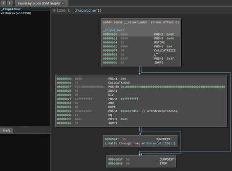


Figure 14-21. Disassembling the Faucet runtime bytecode

図14-21. Faucetランタイムバイトコードの逆アセンブル

### Installing Heimdall

### Heimdallのインストール

First, you need to ensure that Rust is installed on your computer. If it's not, run the following command:

まず、コンピュータにRustがインストールされていることを確認する必要があります。インストールされていない場合は、次のコマンドを実行してください：

```bash
$ curl https://sh.rustup.rs -sSf | sh
```

```bash
$ curl https://sh.rustup.rs -sSf | sh
```

Then, run these two commands, one after the other:

次に、次の2つのコマンドを順番に実行します：

```bash
$ curl -L http://get.heimdall.rs | bash
$ bifrost
```

```bash
$ curl -L http://get.heimdall.rs | bash
$ bifrost
```

Now, you should have Heimdall correctly installed. You can verify that by running:

これで、Heimdallが正しくインストールされているはずです。次を実行して確認できます：

```bash
$ heimdall --version
```

```bash
$ heimdall --version
```

You should see something like this:

次のような表示が出るはずです：

```bash
$ heimdall --version
heimdall 0.8.4
```

```bash
$ heimdall --version
heimdall 0.8.4
```

> **Note**
>
> For the latest information on how to install Heimdall, please refer to the official documentation you can find on the [GitHub repository](https://oreil.ly/klTJ3).

> **注記**
>
> Heimdallのインストール方法に関する最新情報については、[GitHubリポジトリ](https://oreil.ly/klTJ3)にある公式ドキュメントを参照してください。

### Disassembling the bytecode with Heimdall

### Heimdallによるバイトコードの逆アセンブル

Now that we have correctly installed Heimdall, we are ready to generate the same graph you saw in Figure 14-21. Starting with the runtime bytecode of our `Faucet.sol` contract, you can run the following command:

Heimdallを正しくインストールしたので、図14-21で見たのと同じグラフを生成する準備ができました。`Faucet.sol`コントラクトのランタイムバイトコードから始めて、次のコマンドを実行できます：

```bash
$ heimdall cfg <insert the runtime bytecode here>
```

```bash
$ heimdall cfg <ここにランタイムバイトコードを挿入>
```

Here is an example of what this command should look like:

このコマンドがどのように見えるかの例を次に示します：

```bash
$ heimdall cfg 608060405260043610610…
```

```bash
$ heimdall cfg 608060405260043610610…
```

Now, you should see a new folder called `output`. Enter it and again enter the generated folder called `local`. Here, you should find the file `cfg.dot`:

`output`という名前の新しいフォルダが表示されるはずです。それに入り、`local`という名前の生成されたフォルダに再度入ります。ここに`cfg.dot`ファイルがあるはずです：

```bash
$ cd output
$ cd local
$ ls # now you should see the file
```

```bash
$ cd output
$ cd local
$ ls # ファイルが表示されるはずです
```

Since it's a `.dot` file, we need a special program to open it correctly. In this example, we're going to use a website that lets us paste the contents of the `.dot` file and then generates the graph for us.

`.dot`ファイルなので、正しく開くには特別なプログラムが必要です。この例では、`.dot`ファイルの内容を貼り付けてグラフを生成してくれるウェブサイトを使用します。

First, you need to copy the contents of the `.dot` file:

まず、`.dot`ファイルの内容をコピーする必要があります：

```bash
$ cat cfg.dot
```

```bash
$ cat cfg.dot
```

This command prints to screen the entire contents of the file; copy it, open a [*control flow graph* (CFG) online generator](https://oreil.ly/swOsK), and paste it on the left side of the web page, as shown in Figure 14-22.

このコマンドはファイルの全内容を画面に出力します。コピーして、[*制御フローグラフ*（CFG）オンラインジェネレータ](https://oreil.ly/swOsK)を開き、図14-22に示すようにウェブページの左側に貼り付けます。

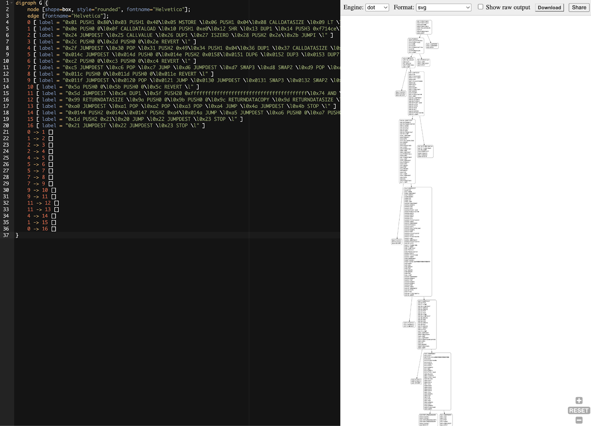


Figure 14-22. The control flow graph (CFG) of the Faucet.sol contract

図14-22. Faucet.solコントラクトの制御フローグラフ（CFG）

Figure 14-23 shows the initial bytecode of the `Faucet.sol` contract. As you can see, it starts with the same pattern as the previous `Example.sol` contract: `PUSH1 0x80 PUSH1 0x40 MSTORE`.

図14-23は`Faucet.sol`コントラクトの初期バイトコードを示しています。ご覧のとおり、前の`Example.sol`コントラクトと同じパターン`PUSH1 0x80 PUSH1 0x40 MSTORE`で始まります。

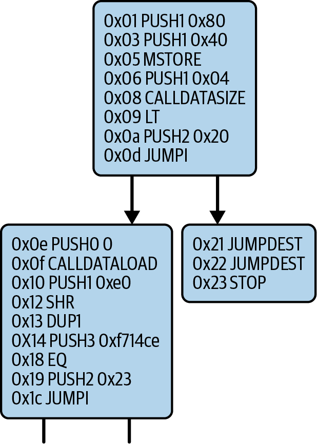


Figure 14-23. A zoom-in into the first part of the CFG graph

図14-23. CFGグラフの最初の部分の拡大

When you send a transaction to an ABI-compatible smart contract (which you can assume all contracts are), the transaction first interacts with that smart contract's *dispatcher*. The dispatcher reads in the `data` field of the transaction and sends the relevant part to the appropriate function. We can see an example of a dispatcher at the beginning of our disassembled `Faucet.sol` runtime bytecode. After the familiar `MSTORE` instruction, we see the following instructions:

ABI互換のスマートコントラクト（すべてのコントラクトがそうであると想定できます）にトランザクションを送信すると、トランザクションは最初にそのスマートコントラクトの*ディスパッチャ*とやり取りします。ディスパッチャはトランザクションの`data`フィールドを読み取り、関連する部分を適切な関数に送信します。逆アセンブルされた`Faucet.sol`ランタイムバイトコードの先頭にディスパッチャの例を見ることができます。お馴染みの`MSTORE`命令の後、次の命令が見えます：

```
PUSH1 0x04
CALLDATASIZE
LT
PUSH2 0x0020
JUMPI
```

```
PUSH1 0x04
CALLDATASIZE
LT
PUSH2 0x0020
JUMPI
```

As we have seen, `PUSH1 0x04` places `0x04` onto the top of the stack, which is otherwise empty. `CALLDATASIZE` gets the size in bytes of the data sent with the transaction (known as the calldata) and pushes that number onto the stack. After these operations have been executed, the stack looks like this:

見てきたように、`PUSH1 0x04`はスタックのトップに`0x04`を配置します（それ以外は空です）。`CALLDATASIZE`はトランザクションで送信されたデータ（コールデータとして知られる）のバイトサイズを取得し、その数値をスタックにプッシュします。これらの操作が実行された後、スタックは次のようになります：

```
Stack
<length of calldata from tx>
0x4
```

```
スタック
<トランザクションからのコールデータの長さ>
0x4
```

This next instruction is `LT`, short for "less than." The `LT` instruction checks whether the top item on the stack is less than the next item on the stack. In our case, it checks to see if the result of `CALLDATASIZE` is less than 4 bytes.

次の命令は`LT`で、「less than」（小なり）の略です。`LT`命令は、スタックのトップの項目がスタックの次の項目より小さいかどうかをチェックします。この場合、`CALLDATASIZE`の結果が4バイト未満かどうかをチェックします。

Why does the EVM check to see that the calldata of the transaction is at least 4 bytes? Because of how *function identifiers* work. Each Solidity function is identified by the first 4 bytes of its Keccak-256 hash. By placing the function's name and all the arguments it takes into a `keccak256` hash function, we can deduce its function identifier. In our case, we have:

なぜEVMはトランザクションのコールデータが少なくとも4バイトであることをチェックするのでしょうか？*関数識別子*の仕組みのためです。各Solidity関数は、そのKeccak-256ハッシュの最初の4バイトで識別されます。関数名とそれが取るすべての引数を`keccak256`ハッシュ関数に入れることで、その関数識別子を導き出すことができます。この場合：

```
keccak256("withdraw(uint256,address)") = 0x00f714ce...
```

```
keccak256("withdraw(uint256,address)") = 0x00f714ce...
```

Thus, the function identifier for the `withdraw(uint256,address)` function is `0x00f714ce`, since these are the first 4 bytes of the resulting hash. A function identifier is always 4 bytes long, so if the entire data field of the transaction sent to the contract is less than 4 bytes, then there's no function with which the transaction could possibly be communicating, unless a fallback function is defined. Because we implemented such a fallback function in `Faucet.sol`, the EVM jumps to this function when the calldata's length is less than 4 bytes.

したがって、`withdraw(uint256,address)`関数の関数識別子は`0x00f714ce`です。これらは結果のハッシュの最初の4バイトだからです。関数識別子は常に4バイトの長さなので、コントラクトに送信されたトランザクションのデータフィールド全体が4バイト未満の場合、フォールバック関数が定義されていない限り、トランザクションが通信できる関数はありません。`Faucet.sol`にそのようなフォールバック関数を実装したため、コールデータの長さが4バイト未満の場合、EVMはこの関数にジャンプします。

`LT` pops the top two values off the stack and, if the transaction's data field is less than 4 bytes, pushes 1 onto it. Otherwise, it pushes 0. In our example, let's assume the data field of the transaction sent to our contract was less than 4 bytes.

`LT`はスタックから上位2つの値をポップし、トランザクションのデータフィールドが4バイト未満の場合、1をプッシュします。そうでなければ0をプッシュします。この例では、コントラクトに送信されたトランザクションのデータフィールドが4バイト未満であると仮定しましょう。

The `PUSH2 0x0020` instruction pushes the bytes `0x0020` onto the stack. After this instruction, the stack looks like this:

`PUSH2 0x0020`命令はバイト`0x0020`をスタックにプッシュします。この命令の後、スタックは次のようになります：

```
Stack
0x0020
0x1
```

```
スタック
0x0020
0x1
```

The next instruction is `JUMPI`, which stands for "jump if." It works like so:

次の命令は`JUMPI`で、「jump if」（条件付きジャンプ）を意味します。次のように動作します：

```
jumpi(label, cond) // Jump to "label" if "cond" is true
```

```
jumpi(label, cond) // "cond"が真の場合、"label"にジャンプ
```

In our case, `label` is `0x0020`, which is where our fallback function lives in our smart contract. The `cond` argument is 1, which was the result of the `LT` instruction earlier. To put this entire sequence into words, the contract jumps to the fallback function if the transaction data is less than 4 bytes.

この場合、`label`は`0x0020`で、スマートコントラクト内のフォールバック関数がある場所です。`cond`引数は1で、これは先の`LT`命令の結果です。このシーケンス全体を言葉で表すと、トランザクションデータが4バイト未満の場合、コントラクトはフォールバック関数にジャンプします。

At `0x20`, after two `JUMPDEST` instructions, only a `STOP` instruction follows because, although we declared a fallback function, we kept it empty. As you can see in Figure 14-24, had we not implemented a fallback function, the contract would throw an exception instead.

`0x20`では、2つの`JUMPDEST`命令の後、`STOP`命令のみが続きます。フォールバック関数を宣言しましたが、空のままにしたためです。図14-24に示すように、フォールバック関数を実装していなかった場合、コントラクトは代わりに例外をスローしていたでしょう。

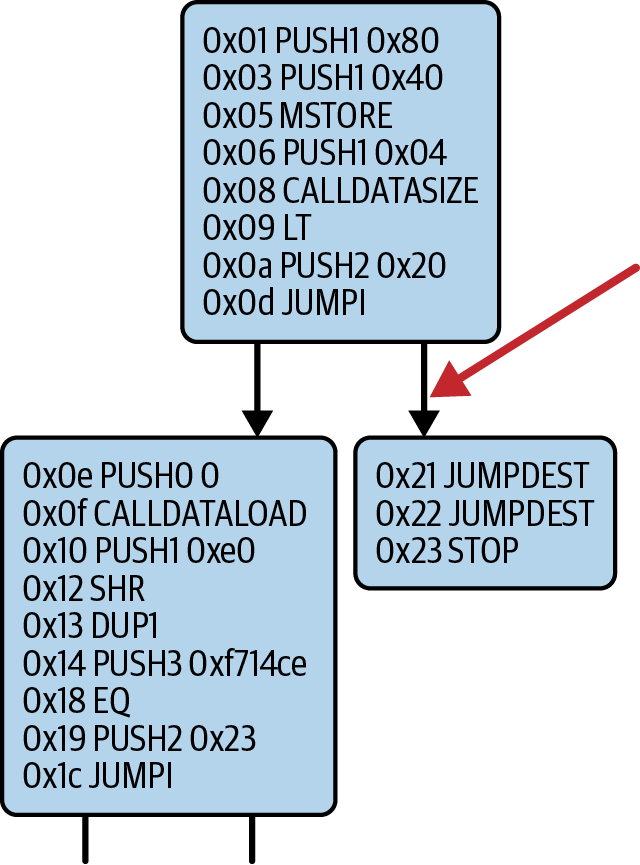


Figure 14-24. JUMPI instruction leading to fallback function

図14-24. フォールバック関数につながるJUMPI命令

> **Note**
>
> Heimdall represents the bytecode starting with offset equal to 0x01, even though the EVM actually interprets it as starting with offset 0x00. In the previous example, the JUMPI instruction tells the EVM to go to offset 0x20 if the condition is true, but in the graph, offset 0x20 is here represented as 0x21. As a rule of thumb, you just need to add one to every offset of the EVM to find it on the graph.

> **注記**
>
> Heimdallは、EVMが実際にはオフセット0x00から始まると解釈するにもかかわらず、オフセット0x01から始まるバイトコードを表します。前の例では、JUMPI命令は条件が真の場合にEVMにオフセット0x20に行くように指示しますが、グラフではオフセット0x20は0x21として表されています。経験則として、グラフ上で見つけるにはEVMのすべてのオフセットに1を加えるだけです。

Let's examine the central block of the dispatcher. Assuming we received calldata that was greater than 4 bytes in length, the `JUMPI` instruction would not jump to the fallback function. Instead, code execution would proceed to the following instructions:

ディスパッチャの中央ブロックを調べましょう。4バイトより長いコールデータを受け取ったと仮定すると、`JUMPI`命令はフォールバック関数にジャンプしません。代わりに、コード実行は次の命令に進みます：

```
PUSH0 0x0
CALLDATALOAD
PUSH1 0xe0
SHR
DUP1
PUSH3 0xf714ce
EQ
PUSH2 0X23
JUMPI
```

```
PUSH0 0x0
CALLDATALOAD
PUSH1 0xe0
SHR
DUP1
PUSH3 0xf714ce
EQ
PUSH2 0X23
JUMPI
```

`PUSH0` pushes 0 onto the stack, which is now otherwise empty again. `CALLDATALOAD` accepts as an argument an index within the calldata sent to the smart contract and reads 32 bytes from that index, like so:

`PUSH0`は0をスタックにプッシュします。スタックは再び空になっています。`CALLDATALOAD`は、スマートコントラクトに送信されたコールデータ内のインデックスを引数として受け入れ、そのインデックスから32バイトを読み取ります：

```
calldataload(p) //load 32 bytes of calldata starting from byte position p
```

```
calldataload(p) //バイト位置pから始まるコールデータの32バイトをロード
```

Since 0 was the index passed to it from the `PUSH0` command, `CALLDATALOAD` reads 32 bytes of calldata starting at byte 0 and then pushes it to the top of the stack (after popping the original `0x0`). After the `PUSH1 0xe0` instruction, the stack is then:

`PUSH0`コマンドから渡されたインデックスが0だったため、`CALLDATALOAD`はバイト0から始まるコールデータの32バイトを読み取り、（元の`0x0`をポップした後）スタックのトップにプッシュします。`PUSH1 0xe0`命令の後、スタックは次のようになります：

```
Stack
0xe0
<32 bytes of calldata starting at byte 0>
```

```
スタック
0xe0
<バイト0から始まるコールデータの32バイト>
```

`SHR` performs a logical right shift of `0xe0` bits (224 bits, 28 bytes) to the 32-byte value element on the stack. By shifting the calldata to the right by 28 bytes, it isolates the first 4 bytes of the calldata. In fact, when shifting to the right, all the bits move before the first one are discarded, while the new bits are set to 0. Remember that the first 4 bytes of the calldata represent the function identifier of the function we want to trigger.

`SHR`はスタック上の32バイト値要素に対して`0xe0`ビット（224ビット、28バイト）の論理右シフトを実行します。コールデータを28バイト右にシフトすることで、コールデータの最初の4バイトを分離します。実際、右にシフトすると、最初のビットより前に移動するすべてのビットは破棄され、新しいビットは0に設定されます。コールデータの最初の4バイトは、トリガーしたい関数の関数識別子を表すことを覚えておいてください。

### Logical Bit Shift Example

### 論理ビットシフトの例

You can better understand this with an example. Let's say the stack is:

例を使ってよりよく理解できます。スタックが次のようになっているとしましょう：

```
Stack
0x1234567890 // a 5 bytes element
```

```
スタック
0x1234567890 // 5バイトの要素
```

We want to get only the first two bytes (i.e., `0x1234`). To achieve this using only EVM opcodes, we can do:

最初の2バイト（つまり`0x1234`）のみを取得したいとします。EVMオペコードのみを使用してこれを達成するには、次のようにできます：

```
PUSH1 0x18 // this represents the number 24 in hex, 24 bits = 3 bytes
SHR
```

```
PUSH1 0x18 // これは16進数で24を表し、24ビット = 3バイト
SHR
```

In fact, by shifting the stack of items 3 bytes to the right (remember that each byte is represented here as 2 hex digits), we obtain the following item:

実際、スタックの項目を3バイト右にシフトすると（各バイトは2桁の16進数として表されることを覚えておいてください）、次の項目が得られます：

```
0x0000001234 | 4567890
```

```
0x0000001234 | 4567890
```

The `4567890` part is discarded, and all that remains is:

`4567890`の部分は破棄され、残るのは次のとおりです：

```
Stack
0x1234
```

```
スタック
0x1234
```

All the leading zeros can be ignored as they are not significant.

先行ゼロは重要でないため無視できます。

---

---

The new stack is:

新しいスタックは次のとおりです：

```
Stack
<function identifier sent in data>
```

```
スタック
<データで送信された関数識別子>
```

The next instruction is `DUP1`, which duplicates the first item in the stack. The stack is now:

次の命令は`DUP1`で、スタックの最初の項目を複製します。スタックは次のようになります：

```
Stack
<function identifier sent in data>
<function identifier sent in data>
```

```
スタック
<データで送信された関数識別子>
<データで送信された関数識別子>
```

Now there is a `PUSH3` instruction, followed by the push data `0xf714ce`. This opcode simply pushes the (push) data onto the stack. After this opcode, the stack looks like this:

次に`PUSH3`命令があり、プッシュデータ`0xf714ce`が続きます。このオペコードは単に（プッシュ）データをスタックにプッシュします。このオペコードの後、スタックは次のようになります：

```
Stack
0xf714ce
<function identifier sent in data>
<function identifier sent in data>
```

```
スタック
0xf714ce
<データで送信された関数識別子>
<データで送信された関数識別子>
```

Now, does the `0xf714ce` look familiar to you? Do you remember what the function identifier of our `withdraw(uint256,address)` function is? It's `0x00f714ce`… Note that they are the same number as leading zeros can be ignored.

さて、`0xf714ce`は見覚えがありますか？`withdraw(uint256,address)`関数の関数識別子が何であったか覚えていますか？`0x00f714ce`です…先行ゼロは無視できるため、同じ数値であることに注意してください。

The next instruction, `EQ`, pops off the top two items of the stack and compares them. This is where the dispatcher does its main job: it compares whether the function identifier sent in the `msg.data` field of the transaction matches that of `withdraw(uint256,address)`. If they're equal, `EQ` pushes 1 onto the stack, which will ultimately be used to jump to the withdraw function. Otherwise, `EQ` pushes 0 onto the stack.

次の命令`EQ`は、スタックの上位2項目をポップして比較します。ここでディスパッチャがその主な仕事を行います：トランザクションの`msg.data`フィールドで送信された関数識別子が`withdraw(uint256,address)`のものと一致するかどうかを比較します。等しい場合、`EQ`はスタックに1をプッシュし、最終的にwithdraw関数にジャンプするために使用されます。そうでなければ、`EQ`はスタックに0をプッシュします。

Assuming the transaction sent to our contract indeed began with the function identifier for `withdraw(uint256,address)`, our stack has become:

コントラクトに送信されたトランザクションが実際に`withdraw(uint256,address)`の関数識別子で始まったと仮定すると、スタックは次のようになります：

```
Stack
1
<function identifier sent in data> (now known to be 0x00f714ce)
```

```
スタック
1
<データで送信された関数識別子>（0x00f714ceであることが判明）
```

Next, we have `PUSH2 0x23`, which is the address at which the `withdraw(uint256,address)` function lives in the contract. After this instruction, the stack looks like this:

次に、`PUSH2 0x23`があります。これはコントラクト内で`withdraw(uint256,address)`関数が存在するアドレスです。この命令の後、スタックは次のようになります：

```
Stack
0x23
1
<function identifier sent in msg.data>
```

```
スタック
0x23
1
<msg.dataで送信された関数識別子>
```

The `JUMPI` instruction is next, and it once again accepts the top two elements on the stack as arguments. In this case, we have `JUMPI(0x23, 1)`, which tells the EVM to execute the jump to the location of the `withdraw(uint256,address)` function, and the execution of that function's code can proceed.

次に`JUMPI`命令があり、再びスタックの上位2つの要素を引数として受け入れます。この場合、`JUMPI(0x23, 1)`があり、EVMに`withdraw(uint256,address)`関数の場所へのジャンプを実行するように指示し、その関数のコードの実行が進むことができます。

## Turing Completeness and Gas

## チューリング完全性とガス

As we have already touched on, in simple terms a system or programming language is *Turing complete* if it can run any program. This capability, however, comes with a very important caveat: some programs take forever to run. An important aspect of this is that we can't tell just by looking at a program whether it will take forever or not to execute. We have to actually go through with the execution of the program and wait for it to finish to find out. Of course, if it is going to take forever to execute, we will have to wait forever to find out. This is called the *halting problem* and would be a huge problem for Ethereum if it were not addressed.

すでに触れたように、簡単に言えば、システムまたはプログラミング言語が任意のプログラムを実行できる場合、それは*チューリング完全*です。ただし、この機能には非常に重要な注意点があります。一部のプログラムは永遠に実行されます。これの重要な側面は、プログラムを見ただけでは実行に永遠にかかるかどうかを判断できないことです。実際にプログラムの実行を行い、終了するのを待って確認する必要があります。もちろん、実行に永遠にかかる場合、確認するために永遠に待つ必要があります。これは*停止問題*と呼ばれ、対処されなければイーサリアムにとって大きな問題となります。

Because of the halting problem, the Ethereum world computer is at risk of being asked to execute a program that never stops. This could be by accident or malice. We have described how Ethereum acts like a single-threaded machine, without any scheduler, and so if it became stuck in an infinite loop, that would mean that Ethereum would become unusable.

停止問題のため、イーサリアムワールドコンピュータは、決して停止しないプログラムを実行するように要求されるリスクがあります。これは偶然または悪意によるものかもしれません。イーサリアムがスケジューラなしのシングルスレッドマシンのように動作することを説明しました。したがって、無限ループに陥った場合、イーサリアムは使用できなくなります。

With gas, there is a solution, though: if after a prespecified maximum amount of computation has been performed, the execution hasn't ended, the execution of the program is halted by the EVM. This makes the EVM a quasi-Turing-complete machine: it can run any program you feed into it but only if the program terminates within a particular amount of computation. That limit isn't fixed in Ethereum—you can pay to increase it up to a maximum (called the *block gas limit*), and everyone can agree to increase that maximum over time. Nevertheless, at any one time, there is a limit in place, and transactions that consume too much gas while executing are halted.

ただし、ガスを使用すると解決策があります。事前に指定された最大計算量が実行された後も実行が終了しない場合、プログラムの実行はEVMによって停止されます。これにより、EVMは準チューリング完全マシンになります。つまり、入力されたプログラムを実行できますが、プログラムが特定の計算量内で終了する場合のみです。その制限はイーサリアムで固定されていません。最大値（*ブロックガスリミット*と呼ばれる）まで増やすために支払うことができ、時間の経過とともにその最大値を増やすことに全員が同意できます。それでも、常に制限が設けられており、実行中に多くのガスを消費するトランザクションは停止されます。

In the following sections, we will look at gas and examine how it works in detail.

以下のセクションでは、ガスについて詳しく見ていき、その仕組みを詳しく調べます。

### What Is Gas?

### ガスとは何か？

Gas is Ethereum's unit for measuring the computational and storage resources required to perform actions on the Ethereum blockchain. In contrast to Bitcoin, whose transaction fees take into account only the size of a transaction in kilobytes, Ethereum must account for every computational step performed by transactions and smart contract code execution.

ガスは、イーサリアムブロックチェーン上でアクションを実行するために必要な計算およびストレージリソースを測定するためのイーサリアムの単位です。トランザクション手数料がキロバイト単位のトランザクションサイズのみを考慮するBitcoinとは対照的に、イーサリアムはトランザクションとスマートコントラクトコード実行によって実行されるすべての計算ステップを考慮する必要があります。

Each operation performed by a transaction or contract costs a fixed amount of gas. Some examples from the Ethereum "Yellow Paper" include:

トランザクションまたはコントラクトによって実行される各操作には、固定量のガスがかかります。イーサリアム「イエローペーパー」からのいくつかの例：

- Adding two numbers costs 3 gas
- Calculating a Keccak-256 hash costs 30 gas + 6 gas for each 256 bits of data being hashed
- Sending a transaction costs 21,000 gas

- 2つの数値の加算には3ガスかかる
- Keccak-256ハッシュの計算には30ガス + ハッシュされるデータの256ビットごとに6ガスかかる
- トランザクションの送信には21,000ガスかかる

Gas is a crucial component of Ethereum and serves a dual role: as a buffer between the (volatile) price of ether and the reward to validators for the work they do and as a defense against DoS attacks. To prevent accidental or malicious infinite loops or other computational wastage in the network, the initiator of each transaction is required to set a limit to the amount of computation they are willing to pay for. The gas system thereby disincentivizes attackers from sending "spam" transactions since they must pay proportionately for the computational, bandwidth, and storage resources that they consume.

ガスはイーサリアムの重要なコンポーネントであり、二重の役割を果たします。イーサの（変動する）価格とバリデーターが行う作業への報酬との間のバッファとして、そしてDoS攻撃に対する防御としてです。ネットワーク内の偶発的または悪意のある無限ループやその他の計算の無駄を防ぐために、各トランザクションの開始者は、支払う意思のある計算量の制限を設定する必要があります。ガスシステムにより、攻撃者は消費する計算、帯域幅、ストレージリソースに比例して支払う必要があるため、「スパム」トランザクションを送信することを抑制します。

### Gas Accounting During Execution

### 実行中のガス会計

When an EVM is needed to complete a transaction, in the first instance it is given a gas supply equal to the amount specified by the gas limit in the transaction. Every opcode that is executed has a cost in gas, and so the EVM's gas supply is reduced as the EVM steps through the program. Before each operation, the EVM checks that there is enough gas to pay for the operation's execution. If there isn't enough gas, execution is halted and the transaction is reverted.

EVMがトランザクションを完了するために必要な場合、最初にトランザクションのガスリミットで指定された量に等しいガス供給が与えられます。実行されるすべてのオペコードにはガスのコストがあり、EVMがプログラムをステップスルーするにつれてEVMのガス供給は減少します。各操作の前に、EVMは操作の実行に支払うのに十分なガスがあることを確認します。十分なガスがない場合、実行は停止し、トランザクションは元に戻されます。

If the EVM reaches the end of execution successfully without running out of gas, the gas cost used is paid to the validator as a transaction fee, converted to ether based on the gas price specified in the transaction:

EVMがガスを使い果たすことなく実行の終わりに正常に到達した場合、使用されたガスコストはトランザクション手数料としてバリデーターに支払われ、トランザクションで指定されたガス価格に基づいてイーサに変換されます：

```
validator fee = gas cost × gas price
```

```
バリデーター報酬 = ガスコスト × ガス価格
```

The gas remaining in the gas supply is refunded to the sender, again converted to ether based on the gas price specified in the transaction:

ガス供給に残っているガスは送信者に返金され、再びトランザクションで指定されたガス価格に基づいてイーサに変換されます：

```
remaining gas = gas limit – gas cost
refunded ether = remaining gas × gas price
```

```
残りガス = ガスリミット – ガスコスト
返金イーサ = 残りガス × ガス価格
```

If the transaction "runs out of gas" during execution, the operation is immediately terminated, raising an OOG exception. The transaction is reverted, and all changes to the state are rolled back. Although the transaction was unsuccessful, the sender will be charged a transaction fee because validators have already performed the computational work up to that point and must be compensated for doing so.

実行中にトランザクションが「ガス切れ」になった場合、操作は直ちに終了し、OOG例外が発生します。トランザクションは元に戻され、状態へのすべての変更がロールバックされます。トランザクションは失敗しましたが、バリデータはその時点までの計算作業をすでに実行しており、それに対する補償を受ける必要があるため、送信者にはトランザクション手数料が請求されます。

#### Gas accounting considerations

#### ガス会計の考慮事項

The relative gas costs of the various operations that can be performed by the EVM have been carefully chosen to best protect the Ethereum blockchain from attack. More computationally intensive operations cost more gas. For example, executing the `SHA3` function is 10 times more expensive (30 gas) than the `ADD` operation (3 gas). More important, some operations, such as `EXP`, require an additional payment based on the size of the operand. There is also a gas cost to using EVM memory and for storing data in a contract's on-chain storage.

EVMで実行できるさまざまな操作の相対的なガスコストは、イーサリアムブロックチェーンを攻撃から最もよく保護するように慎重に選択されています。より計算集約的な操作はより多くのガスを消費します。たとえば、`SHA3`関数の実行は`ADD`操作（3ガス）の10倍高価（30ガス）です。さらに重要なことに、`EXP`などの一部の操作では、オペランドのサイズに基づいて追加の支払いが必要です。EVMメモリの使用やコントラクトのオンチェーンストレージへのデータ保存にもガスコストがかかります。

The importance of matching gas cost to the real-world cost of resources was demonstrated in 2016 when an attacker found and exploited a mismatch in costs. The attack generated transactions that were very computationally expensive and made the Ethereum mainnet almost grind to a halt. This mismatch was resolved by a hard fork (codenamed "Tangerine Whistle") that tweaked the relative gas costs.

ガスコストをリソースの実世界コストに一致させることの重要性は、2016年に攻撃者がコストの不一致を発見して悪用したときに示されました。攻撃は非常に計算コストの高いトランザクションを生成し、イーサリアムメインネットをほぼ停止させました。この不一致は、相対的なガスコストを調整したハードフォーク（コードネーム「Tangerine Whistle」）によって解決されました。

#### Gas accounting in the future of Ethereum

#### イーサリアムの将来におけるガス会計

Gas metering was and remains an extremely important part of how Ethereum handles the entire load of transactions in the network. It's very important to understand that gas costs are a key incentive for certain kinds of behaviors. In the future, there may be some changes in how much gas different opcodes consume.

ガスメータリングは、イーサリアムがネットワーク内のトランザクションの全体的な負荷を処理する方法の非常に重要な部分であり、今後もそうあり続けます。ガスコストが特定の種類の動作に対する重要なインセンティブであることを理解することが非常に重要です。将来、異なるオペコードが消費するガス量に変更がある可能性があります。

For example, before the Cancun upgrade that introduced EIP-4844 blob transactions, all L2s were posting their data on Ethereum as part of the calldata of a transaction. That data is forever stored on all of Ethereum's nodes. Now that L2s have a better way to post their data on Ethereum through blob transactions, it's possible that in the future, calldata will become even more expensive than it is now to encourage rollups to use blob transactions and to lessen the burden for nodes of storing all that data forever.

たとえば、EIP-4844 blobトランザクションを導入したCancunアップグレードの前は、すべてのL2がトランザクションのコールデータの一部としてイーサリアム上にデータを投稿していました。そのデータはイーサリアムのすべてのノードに永久に保存されます。L2がblobトランザクションを通じてイーサリアム上にデータを投稿するより良い方法を持つようになった今、将来的にはロールアップがblobトランザクションを使用することを奨励し、すべてのデータを永久に保存するノードの負担を軽減するために、コールデータが現在よりもさらに高価になる可能性があります。

#### Gas cost versus gas price

#### ガスコスト対ガス価格

While the *gas cost* is a measure of computation and storage used by a transaction in the EVM, the gas itself also has a *price* measured in ether. When performing a transaction, the sender specifies the gas price they are willing to pay (in ether) for each unit of gas, allowing the market to decide the relationship between the price of ether and the cost of computing operations (as measured in gas):

*ガスコスト*はEVM内のトランザクションで使用される計算とストレージの測定値ですが、ガス自体にもイーサで測定される*価格*があります。トランザクションを実行する際、送信者はガスの各単位に対して支払う意思のあるガス価格（イーサで）を指定し、市場がイーサの価格と計算操作のコスト（ガスで測定）の関係を決定できるようにします：

```
transaction fee = total gas used × gas price paid (in ether)
```

```
トランザクション手数料 = 使用された総ガス × 支払われたガス価格（イーサで）
```

When constructing a new block, validators on the Ethereum network can choose among pending transactions by selecting those that offer to pay a higher gas price. Offering a higher gas price will therefore incentivize validators to include your transaction and get it confirmed faster.

新しいブロックを構築する際、イーサリアムネットワーク上のバリデータは、より高いガス価格を支払うことを提案するものを選択して、保留中のトランザクションの中から選択できます。したがって、より高いガス価格を提供することで、バリデータがトランザクションを含め、より速く確認するインセンティブになります。

In practice, the sender of a transaction will set a gas limit that is higher than or equal to the amount of gas expected to be used. If the gas limit is set higher than the amount of gas consumed, the sender will receive a refund of the excess amount since validators are compensated only for the work they actually perform.

実際には、トランザクションの送信者は、使用される予想ガス量以上のガスリミットを設定します。ガスリミットが消費されたガス量よりも高く設定されている場合、バリデータは実際に実行した作業に対してのみ補償されるため、送信者は超過分の返金を受け取ります。

It is important to be clear about the distinction between the gas cost and the gas price. To recap:

ガスコストとガス価格の区別について明確にすることが重要です。要約すると：

- *Gas cost* is the number of units of gas required to perform a particular operation.
- *Gas price* is the amount of ether you are willing to pay per unit of gas when you send your transaction to the Ethereum network.

- *ガスコスト*は、特定の操作を実行するために必要なガスの単位数です。
- *ガス価格*は、トランザクションをイーサリアムネットワークに送信するときに、ガスの単位ごとに支払う意思のあるイーサの量です。

> **Tip**
>
> Although gas has a price, it cannot be "owned" or "spent." Gas exists only inside the EVM, as a count of how much computational work is being performed. The sender is charged a transaction fee in ether, which is converted to gas for EVM accounting and then back to ether as a transaction fee paid to the validators.

> **ヒント**
>
> ガスには価格がありますが、「所有」または「消費」することはできません。ガスはEVM内にのみ存在し、実行されている計算作業の量のカウントとして存在します。送信者にはイーサでトランザクション手数料が請求され、これはEVM会計のためにガスに変換され、その後バリデータに支払われるトランザクション手数料としてイーサに戻されます。

#### Negative gas costs

#### 負のガスコスト

Ethereum encourages the deletion of used storage variables by refunding some of the gas used during contract execution. There is only operation in the EVM with negative gas costs: changing a storage address from a nonzero value to zero (`SSTORE[x] = 0`) is worth a refund. The amount of refunded gas isn't fixed and depends on the values of the storage slot before and after this operation. To avoid exploitation of the refund mechanism, the maximum refund for a transaction is set to one fifth of the total amount of gas cost (rounded down).

イーサリアムは、コントラクト実行中に使用されたガスの一部を返金することで、使用済みストレージ変数の削除を奨励しています。EVMで負のガスコストを持つ操作は1つだけです：ストレージアドレスを非ゼロ値からゼロに変更すること（`SSTORE[x] = 0`）は返金に値します。返金されるガスの量は固定されておらず、この操作の前後のストレージスロットの値に依存します。返金メカニズムの悪用を避けるため、トランザクションの最大返金額は総ガスコストの5分の1（切り捨て）に設定されています。

In the past, there was another operation with a negative gas cost: `SELFDESTRUCT`. Deleting a contract (through `SELFDESTRUCT`) was worth a refund of 24,000 gas. Right now, the `SELFDESTRUCT` opcode is deprecated, and not using it anymore is recommended.

過去には、負のガスコストを持つ別の操作がありました：`SELFDESTRUCT`。コントラクトの削除（`SELFDESTRUCT`を通じて）は24,000ガスの返金に値しました。現在、`SELFDESTRUCT`オペコードは非推奨であり、もう使用しないことが推奨されています。

> **Tip**
>
> Gas refunds are applied at the end of the transaction. So if a transaction doesn't have sufficient gas to reach the end of the execution, it fails, and no refunds are given.

> **ヒント**
>
> ガス返金はトランザクションの最後に適用されます。したがって、トランザクションに実行の最後まで到達するのに十分なガスがない場合、失敗し、返金は行われません。

### Block Gas Limit

### ブロックガスリミット

The block gas limit is the maximum amount of gas that may be consumed by all the transactions in a block. It constrains how many transactions can fit into a block.

ブロックガスリミットは、ブロック内のすべてのトランザクションで消費される可能性のあるガスの最大量です。ブロックに収まるトランザクションの数を制限します。

For example, let's say we have five transactions whose gas limits have been set to 30,000, 30,000, 40,000, 50,000, and 50,000. If the block gas limit is 180,000, then any four of those transactions can fit in a block, while the fifth will have to wait for a future block. As previously discussed, validators decide which transactions to include into a block. Different validators are likely to select different combinations, mainly because they receive transactions from the network in a different order.

たとえば、ガスリミットが30,000、30,000、40,000、50,000、50,000に設定された5つのトランザクションがあるとしましょう。ブロックガスリミットが180,000の場合、これらのトランザクションのうち4つがブロックに収まり、5番目は将来のブロックを待つ必要があります。前に説明したように、バリデータはどのトランザクションをブロックに含めるかを決定します。異なるバリデータは異なる組み合わせを選択する可能性が高く、主にネットワークから異なる順序でトランザクションを受信するためです。

If a validator tries to include a transaction that requires more gas than the current block gas limit, the block will be rejected by the network. Most Ethereum clients will stop you from issuing such a transaction by giving a warning along the lines of "transaction exceeds block gas limit." According to [Etherscan](https://etherscan.io), the block gas limit on the Ethereum mainnet is 36 million gas at the time of writing (June 2025), meaning that around 1,428 basic—that is, ETH transfer—transactions (each consuming 21,000 gas) could fit into a block.

バリデータが現在のブロックガスリミットより多くのガスを必要とするトランザクションを含めようとすると、ブロックはネットワークによって拒否されます。ほとんどのイーサリアムクライアントは、「トランザクションがブロックガスリミットを超えています」という警告を出して、そのようなトランザクションの発行を止めます。[Etherscan](https://etherscan.io)によると、執筆時点（2025年6月）のイーサリアムメインネットのブロックガスリミットは3,600万ガスであり、約1,428の基本的な（つまり、ETH転送）トランザクション（それぞれ21,000ガスを消費）がブロックに収まることを意味します。

#### Who chooses the block gas limit?

#### 誰がブロックガスリミットを選択するか？

Before the introduction of EIP-1559 on August 5, 2021, miners (Ethereum was using a PoW-based consensus algorithm at that time) had a built-in mechanism where they could vote on the block gas limit, so capacity could be increased or decreased in subsequent blocks. The miner of a block could vote to adjust the block gas limit by a factor of 1/1024 (0.0976%) in either direction. The result of this was an adjustable block size based on the needs of the network, following miners' hashpower.

2021年8月5日のEIP-1559の導入前は、マイナー（当時イーサリアムはPoWベースのコンセンサスアルゴリズムを使用していました）には、ブロックガスリミットに投票できる組み込みメカニズムがあり、後続のブロックで容量を増減できました。ブロックのマイナーは、どちらの方向にも1/1024（0.0976%）の係数でブロックガスリミットを調整するために投票できました。この結果、マイナーのハッシュパワーに従って、ネットワークのニーズに基づいて調整可能なブロックサイズになりました。

Now, validators vote on the *gas target*—that is, how much gas a block should consume on average—and the gas limit is defined to be twice the target. The 1/1024 adjusting factor that each validator must comply with is maintained the same as before.

現在、バリデータは*ガスターゲット*（つまり、ブロックが平均的に消費すべきガス量）に投票し、ガスリミットはターゲットの2倍として定義されます。各バリデータが従う必要がある1/1024の調整係数は以前と同じに維持されます。

#### Why doesn't the block gas limit rise?

#### なぜブロックガスリミットは上昇しないのか？

You may be wondering, if validators can vote on the gas target, which directly translates to the gas limit, why doesn't the block gas limit rise to one billion instead of being almost fixed at 30 million? A bigger block gas limit would mean that more transactions could fit into a block, so transactions would become cheaper for end users.

バリデータがガスターゲットに投票でき、それが直接ガスリミットに変換されるなら、なぜブロックガスリミットは3,000万にほぼ固定されている代わりに10億に上昇しないのかと疑問に思うかもしれません。より大きなブロックガスリミットは、より多くのトランザクションがブロックに収まることを意味するため、エンドユーザーにとってトランザクションはより安くなります。

The answer is that raising the gas limit has some cons related to the decentralization of the network. In fact, while bigger blocks can include more transactions, that also means that blocks become harder to verify on time, and that could lead to the death of Ethereum nodes made with common hardware, leaving only powerful servers to validate full blocks. Not only that, but bigger blocks also mean a bigger state growth. The final outcome is the same as before: big servers would be the only ones able to fully run a node.

答えは、ガスリミットを上げることにはネットワークの分散化に関連するいくつかの欠点があるということです。実際、より大きなブロックはより多くのトランザクションを含むことができますが、それはブロックを時間内に検証することがより困難になることも意味し、一般的なハードウェアで作られたイーサリアムノードの死につながり、完全なブロックを検証できるのは強力なサーバーだけになる可能性があります。それだけでなく、より大きなブロックはより大きな状態成長も意味します。最終的な結果は以前と同じです：大きなサーバーだけがノードを完全に実行できるようになります。

Historically, the block gas limit has been raised all at once during upgrades of the protocol, as you can see in Figure 14-25. And its value is generally set to a level suggested by core developers where we are sure all clients are able to handle the load of transactions and process blocks on time.

歴史的に、図14-25に示すように、ブロックガスリミットはプロトコルのアップグレード中に一度に引き上げられてきました。その値は通常、すべてのクライアントがトランザクションの負荷を処理し、ブロックを時間内に処理できることが確実なコア開発者が提案するレベルに設定されています。

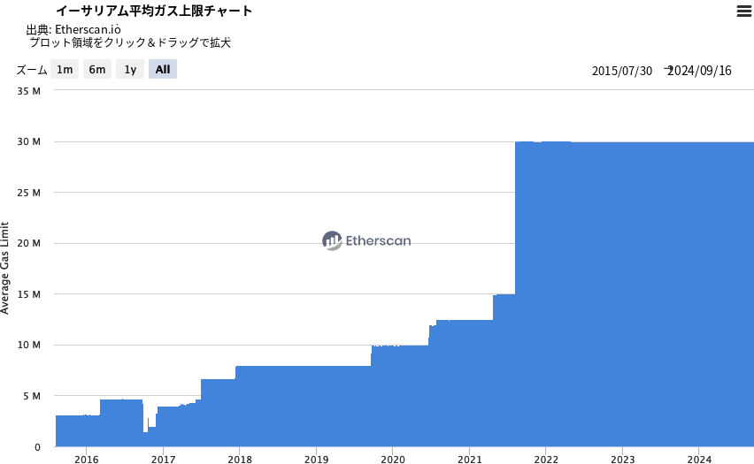


Figure 14-25. Ethereum average gas limit chart

図14-25. イーサリアム平均ガスリミットチャート

#### Why Not Raise the Block Gas Limit?

#### なぜブロックガスリミットを引き上げないのか？

Even though the block gas limit looks like it has been "fixed" at 30 million for more than three years, with PBS (see "Ethereum Stateless"), where actors with sophisticated hardware build the blocks—builders—and send them to proposers—validators—to publish them on the P2P network, there is an incentive to raise the block gas limit indefinitely while maintaining the actual gas used almost as a constant.

ブロックガスリミットは3年以上にわたって3,000万に「固定」されているように見えますが、PBS（「イーサリアムステートレス」を参照）では、洗練されたハードウェアを持つアクターがブロックを構築し（ビルダー）、それをプロポーザー（バリデータ）に送信してP2Pネットワークで公開するため、実際に使用されるガスをほぼ一定に保ちながらブロックガスリミットを無制限に引き上げるインセンティブがあります。

In fact, following EIP-1559, if the block gas target is much higher than the actual gas used, the base fee keeps decreasing, to the point where almost all of the gas fee goes to the validators instead of being burned (the base fee is burned, removing those ETH from the supply).

実際、EIP-1559に従って、ブロックガスターゲットが実際に使用されるガスよりもはるかに高い場合、ベースフィーは減少し続け、ガス手数料のほぼすべてがバーンされる代わりにバリデータに行く点まで達します（ベースフィーはバーンされ、それらのETHが供給から削除されます）。

So the advantages for validators are twofold:

したがって、バリデータにとっての利点は2つあります：

- They can keep the gas fees for themselves, instead of burning them and reducing the ETH supply.
- When necessary, they can create larger blocks that capture a lot of MEV activity, resulting in even more fees for them.

- ETH供給を減らしてバーンする代わりに、ガス手数料を自分たちのために保持できる。
- 必要に応じて、多くのMEV活動をキャプチャする大きなブロックを作成でき、さらに多くの手数料を得られる。

If you are curious about this, read more in [James Prestwich's article](https://oreil.ly/EImcE).

これについて興味がある場合は、[James Prestwichの記事](https://oreil.ly/EImcE)で詳しく読んでください。

## Concrete Implementations

## 具体的な実装

Every Ethereum node has a concrete implementation of the EVM described in this chapter. Here is a list of the most famous and used ones:

すべてのイーサリアムノードには、本章で説明したEVMの具体的な実装があります。最も有名で使用されているもののリストを以下に示します：

**Go-ethereum EVM**

**Go-ethereum EVM**

Geth is the most adopted and oldest execution client. It contains a full implementation of the EVM written in Go.

Gethは最も採用されている最も古い実行クライアントです。Goで書かれたEVMの完全な実装を含んでいます。

**Execution-spec EVM**

**Execution-spec EVM**

The Ethereum Foundation maintains a Python repository on GitHub containing the specification related to the Ethereum execution client. It has a full EVM implementation written in Python.

Ethereum FoundationはGitHub上でイーサリアム実行クライアントに関連する仕様を含むPythonリポジトリを管理しています。Pythonで書かれた完全なEVM実装を持っています。

**Revm**

**Revm**

Revm is one of the most used EVM implementations outside of normal Ethereum clients, thanks to its great customizability and adaptability.

Revmは、その優れたカスタマイズ性と適応性のおかげで、通常のイーサリアムクライアント以外で最も使用されているEVM実装の1つです。

**Evmone**

**Evmone**

Evmone is probably the fastest EVM implementation. It is written in C++ and maintained by the Ipsilon team at the Ethereum Foundation.

Evmoneはおそらく最速のEVM実装です。C++で書かれ、Ethereum FoundationのIpsilonチームによって管理されています。

**Besu EVM**

**Besu EVM**

Besu is an execution client maintained by Consensys. It has a full implementation of the EVM written in Java.

BesuはConsensysによって管理されている実行クライアントです。Javaで書かれたEVMの完全な実装を持っています。

**Nethermind EVM**

**Nethermind EVM**

Nethermind EVM is an execution client written in C# that maintains a full implementation of the EVM.

Nethermind EVMはC#で書かれた実行クライアントで、EVMの完全な実装を維持しています。

## The Biggest EVM Upgrade: EVM Object Format

## 最大のEVMアップグレード：EVMオブジェクトフォーマット

*EVM Object Format* (EOF) is the biggest upgrade to the EVM since its birth in 2015. In fact, even though there have been modifications to the EVM in the past, which were mainly focused on the gas-metering aspect or on the introduction of new opcodes, the EVM is almost identical to how it was first created by Gavin Wood.

*EVMオブジェクトフォーマット*（EOF）は、2015年の誕生以来、EVMへの最大のアップグレードです。実際、過去にEVMへの変更がありましたが、それらは主にガスメータリングの側面や新しいオペコードの導入に焦点を当てており、EVMはGavin Woodによって最初に作成されたものとほぼ同一です。

The EVM is still great. All activities happening today on Ethereum (and all other EVM-compatible blockchains) are only possible thanks to it. It's not perfect either, and during recent years, smart contract developers have had to deal with different aspects of it and learn some tricks to overcome its constraints.

EVMは依然として素晴らしいです。今日イーサリアム（およびその他すべてのEVM互換ブロックチェーン）で起こっているすべての活動は、それのおかげでのみ可能です。完璧でもなく、近年、スマートコントラクト開発者はその異なる側面に対処し、その制約を克服するためのいくつかのトリックを学ぶ必要がありました。

EOF is an extensible and versioned container format for the EVM with a once-off validation at deploy time. In this section, we'll explore all the major limitations of the EVM and how EOF intends to overcome them.

EOFは、デプロイ時の一度限りの検証を伴うEVM用の拡張可能でバージョン管理されたコンテナフォーマットです。このセクションでは、EVMのすべての主要な制限と、EOFがそれらをどのように克服しようとしているかを探ります。

> **Note**
>
> As of the final revision of this book (June 2025), the EOF upgrade has been postponed indefinitely due to insufficient consensus within the Ethereum community. There is currently no clear timeline for its implementation, and it may ultimately never be adopted. Nevertheless, we believe this section remains valuable for understanding how EOF could affect the EVM and the broader Ethereum ecosystem.

> **注記**
>
> 本書の最終改訂時点（2025年6月）では、EOFアップグレードはイーサリアムコミュニティ内での合意が不十分なため、無期限に延期されています。その実装に関する明確なタイムラインは現在なく、最終的に採用されない可能性もあります。それにもかかわらず、EOFがEVMとより広いイーサリアムエコシステムにどのような影響を与える可能性があるかを理解するために、このセクションは価値があると考えています。

## The Future of the EVM

## EVMの将来

The future of the EVM, besides EOF, is uncertain and will depend on how the EVM will be used by developers and different projects. There are some interesting areas where the EVM could expand, though, such as the *zk-EVM* that would provide zero-knowledge proofs attached to each block to prove its correct execution. Also, [*EVMMAX*](https://oreil.ly/ioqSx) and [*SIMD*](https://oreil.ly/7q0Dq) would bring more power to the EVM, making it much faster to do lots of cryptographic processing, which would be particularly beneficial for cryptographic-dependent applications such as privacy protocols or L2s.

EOF以外のEVMの将来は不確実であり、開発者やさまざまなプロジェクトによってEVMがどのように使用されるかに依存します。ただし、EVMが拡張できる興味深い領域がいくつかあります。例えば、各ブロックに添付されたゼロ知識証明を提供してその正しい実行を証明する*zk-EVM*などです。また、[*EVMMAX*](https://oreil.ly/ioqSx)と[*SIMD*](https://oreil.ly/7q0Dq)はEVMにより多くのパワーをもたらし、多くの暗号処理をはるかに高速に行えるようにします。これは、プライバシープロトコルやL2などの暗号に依存するアプリケーションに特に有益です。

## Conclusion

## 結論

In this chapter, we explored the EVM, tracing the execution of various smart contracts and looking at how the EVM executes bytecode. We also looked at gas, the EVM's accounting mechanism, and saw how it solves the halting problem and protects Ethereum from DoS attacks. Furthermore, we analyzed EOF, looking at how it tries to fix different flows of legacy EVM.

本章では、EVMを探索し、さまざまなスマートコントラクトの実行をトレースし、EVMがバイトコードをどのように実行するかを見ました。また、EVMの会計メカニズムであるガスについても見て、それが停止問題をどのように解決し、イーサリアムをDoS攻撃からどのように保護するかを見ました。さらに、EOFを分析し、レガシーEVMのさまざまなフローをどのように修正しようとしているかを見ました。

Next, in Chapter 15, we will explore the mechanism used by Ethereum to achieve decentralized consensus.

次の第15章では、イーサリアムが分散コンセンサスを達成するために使用するメカニズムを探ります。
