# 第15章　コンセンサス

　本書を通じて、*コンセンサスルール*について説明してきました。コンセンサスルールとは、分散化されながらも決定論的にシステムを運用するために、全員が同意しなければならないルールのことです。コンピュータサイエンスにおいて、*コンセンサス*という用語はブロックチェーンよりも前から存在し、分散システムにおける状態の同期という、より広範な問題に関連しています。分散システムの異なる参加者全員が、最終的にシステム全体で単一の状態に同意することを、*コンセンサスの達成*と呼びます。

　分散化された記録管理と検証の中核的な機能に関しては、状態の更新から得られる情報が正確であることを保証するために、信頼だけに頼ることは問題になり得ます。この一般的な課題は、分散型ネットワークにおいて特に顕著です。何が真実かを判断する中央のエンティティが存在しないためです。中央の意思決定エンティティが存在しないことは、ブロックチェーンプラットフォームの主要な魅力の一つです。検閲に抵抗する能力と、情報へのアクセスに許可を必要としないことがその理由です。しかし、これらの利点にはコストが伴います。信頼できる仲裁者がいない場合、いかなる不一致、欺瞞、または相違も、他の手段を使って解決する必要があります。コンセンサスアルゴリズムは、セキュリティと分散化を両立させるために使用されるメカニズムです。

　ブロックチェーンにおいて、コンセンサスはシステムの重要な特性です。端的に言えば、お金がかかっているのです。したがって、ブロックチェーンの文脈でのコンセンサスとは、分散化を維持しながら共通の状態に到達できることを意味します。言い換えれば、コンセンサスは支配者なき厳格なルールのシステムを生み出すことを目的としています。特定の個人、組織、またはグループが「管理者」となるのではなく、権力と制御は、ルールに従い正直に行動することが自己利益にかなう広範な参加者ネットワーク全体に分散されます。

　敵対的な条件下で、中央集権的な制御なしに、分散ネットワーク全体でコンセンサスに到達する能力は、すべてのオープンなパブリックブロックチェーンの核心的な原則です。この課題に対処し、分散化という貴重な特性を維持するために、コミュニティはさまざまなコンセンサスモデルを実験し続けています。本章では、これらのコンセンサスモデルと、イーサリアムのようなスマートコントラクトブロックチェーンへの予想される影響について探ります。

> **注記**
>
> コンセンサスアルゴリズムはブロックチェーンの仕組みの重要な部分ですが、スマートコントラクトの抽象化よりもはるかに下位の基盤層で動作します。言い換えれば、コンセンサスの詳細のほとんどは、スマートコントラクトの開発者からは隠されています。インターネットを使うためにルーティングの仕組みを知る必要がないのと同様に、イーサリアムを使うためにコンセンサスの仕組みを知る必要はありません。

## コンセンサスの原則

　ブロックチェーン技術、特にイーサリアムにおいて、コンセンサスの原則を理解することは、ネットワークがどのように整合性を維持し効果的に運用されるかを理解する助けになります。すべてがどのように機能するかをより明確に把握するために、核心的なアイデアを順に見ていきましょう。

### セーフティ

　コンセンサスメカニズムの文脈において、*セーフティ*とは、ネットワークがエラーなくブロックチェーンの現在の状態について一貫して合意することを保証するものです。二重支払いやトランザクションの衝突といった問題を回避し、ネットワーク全体の一貫性を維持することを意味します。安全なシステムでは、すべてのノードがチェーンの履歴について同一のビューを持ち、操作を一度に1つずつアトミックに実行する中央集権的な実装のように効果的に振る舞います。

### ファイナリティ

　*ファイナリティ*は、イーサリアムのコンセンサスメカニズムにおける最も重要なセーフティ機能の一つです。トランザクションが完了し不可逆になったとみなされる時点を示し、一度トランザクションがブロックチェーンに追加されると、変更や削除ができないことを保証します。トランザクションの不可逆性は、システムに高いレベルの信頼をもたらし、トランザクションが永久に記録されるという確実性をユーザーに提供します。

　基本的に、ファイナリティはセーフティの概念を実際の行動に移すものであり、単なるコンセプトから実用的なものへと変換します。ネットワークの異なる部分がそれぞれのローカルなビューを持っていたとしても、チェーンの履歴を固定し変更不可能にする、取り消し不能な合意のポイントが存在することを保証します。

### ライブネス

　セーフティがネットワーク上で悪いことが起きないことを保証する一方、*ライブネス*は良いことが最終的に必ず起きることを保証します。言い換えれば、イーサリアムネットワークは何が起ころうとも、トランザクションの処理と新しいブロックの追加を継続します。

　別の観点から見ると、ライブネスは可用性の観点でも理解できます。実用的には、ネットワーク内で正直に行動しているノードに有効なトランザクションを送信するたびに、ブロックチェーンの延長に貢献する次のブロックにそのトランザクションが含まれることが期待できることを意味します。トランザクションの包含と処理への期待は、ユーザーの信頼とイーサリアムプラットフォーム全体の有効性を達成するために必要です。

### ブロックツリーとフォーク

　あらゆる状況下でセーフティとライブネスの両方を満たすコンセンサスプロトコルを設計することは不可能であり、どちらか一方を優先する必要があります。イーサリアムのコンセンサスプロトコルは、良好なネットワーク条件下ではセーフティとライブネスの両方を提供しますが、状況が混乱した際にはライブネスを優先します。フォークの概念を通じてライブネスを実現しています。

　ブロックチェーンでは、すべてのブロック（特別なジェネシスブロックを除く）は親ブロックの上に構築され、親ブロックを指し示します。こうして、ブロックのチェーン、すなわちブロックチェーンが形成されます。フォーク型コンセンサスプロトコルを実装するチェーンでは、この直線的な条件は実際にはしばしば当てはまりません。現実の条件では、図15-1に示すように、ブロックチェーンというよりもブロックツリーのようなものが生じることがあり、コンセンサスプロトコルの目標は、ネットワーク上のすべてのノードが同一の直線的なブロックの順序に同意することです。

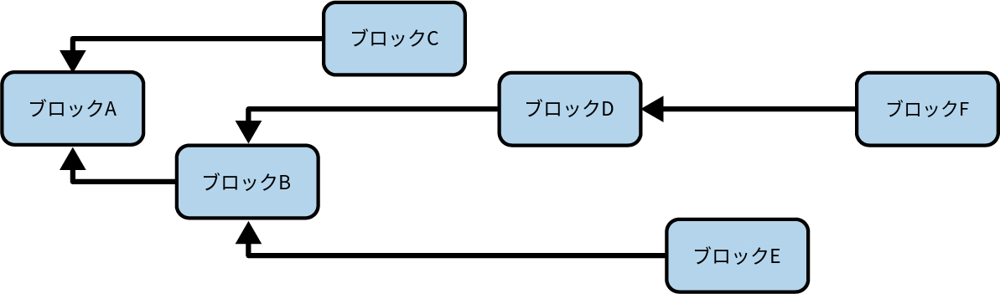

図15-1　ブロックツリー構造

　ブロックツリーのさまざまな枝は*フォーク*と呼ばれます。フォークは、ネットワークおよび処理の遅延、クライアントの障害、または悪意あるクライアントの行動の結果として自然に発生します。

　異なるフォークを追従しているノードに問い合わせると、システムの状態について異なる回答が返ってきます。ここにフォーク型コンセンサスプロトコルの回復力があります。不利な条件下で完全に停止するのではなく、フォークするのです。最終的には、ネットワーク上のすべての正しいノードが同一の直線的な履歴のビューに同意し、したがってシステム状態の共通のビューを持つようにしたいのです。この合意をもたらすのがプロトコルの*フォーク選択ルール*の役割です。ブロックツリーといくつかの判断基準が与えられた場合、フォーク選択ルールは、利用可能なすべてのブランチの中から、最終的にカノニカルチェーンに到達する可能性が最も高いものを選択するように設計されています。フォークプロトコルの欠点は、カノニカルチェーンに含まれないブランチを追従しているノードが、正しいブランチに移行するために、最近処理したトランザクションを取り消して現実のビューを巻き戻す必要があることです。これは*リオーグ*または*リバージョン*と呼ばれ、混乱を引き起こすため、プロトコルはこれをできるだけ最小限に抑えることを目指します。

　これで、イーサリアムのコンセンサスプロトコルにおけるファイナリティの力を理解できます。フォークはライブネスへの強力な手段ですが、ネットワークを利用可能にするためには、この柔軟性をある程度のセーフティの保証でバランスを取る必要があります。

## proof of workによるコンセンサス

　オリジナルのブロックチェーンであるビットコインの創始者は、*proof of work*（PoW）に基づくコンセンサスアルゴリズムを発明しました。間違いなく、PoWはビットコインを支える最も重要な発明です。PoWの一般的な呼称は*マイニング*であり、コンセンサスの主な目的について誤解を生んでいます。現実世界のマイニングの目的が貴金属やその他の資源を採掘することであるため、マイニングの目的は新しい通貨を作ることだと思われがちです。しかし、マイニング（およびすべての他のコンセンサスモデル）の真の目的は、システムに対する制御をできるだけ多くの参加者に分散化し、分散させた状態でブロックチェーンを安全にすることです。新たに発行された通貨の報酬は、システムのセキュリティに貢献する者へのインセンティブであり、目的のための手段です。その意味で、報酬は手段であり、分散化されたセキュリティが目的です。

　PoWコンセンサスには、対応する「罰則」も存在し、マイニングに参加するために必要なエネルギーのコストがそれにあたります。この大量のエネルギー消費は欠陥ではなく、意図的なセキュリティとインセンティブ設計の鍵です。参加者がルールに従わず報酬を得られなかった場合、マイニングのためにすでに費やした電気代を失うリスクがあります。このように、PoWコンセンサスはリスクと報酬の慎重なバランスであり、参加者が自己利益のために正直に行動するよう動機づけます。

　イーサリアムは、ビットコインの例に倣い、PoWブロックチェーンとして開始されました。同じ基本的なインセンティブシステムを使用し、同じ基本的な目標を持っていました。すなわち、制御を分散化しながらブロックチェーンを安全にすることです。イーサリアムのPoWアルゴリズムはビットコインのものとはわずかに異なり、*Ethash*と呼ばれていました。

### Ethash：イーサリアムのPoWアルゴリズム

　イーサリアムがPoSに移行する前は、Ethashと呼ばれるPoWアルゴリズムに依存していました。EthashはDagger-Hashimotoアルゴリズムの進化版を使用しており、ヴィタリック・ブテリンのDaggerアルゴリズムとサデウス・ドライヤのHashimotoアルゴリズムの組み合わせです。Ethashは、*DAG*（有向非巡回グラフ）として知られる大規模なデータセットの生成と分析に依存しています。DAGの初期サイズは約1 GBで、ゆっくりと線形的に成長を続け、1エポック（30,000ブロック、またはおよそ125時間）ごとに更新されていました。

　DAGの目的は、EthashのPoWアルゴリズムを大規模で頻繁にアクセスされるデータ構造の維持に依存させることでした。これにより、EthashをASIC耐性のあるものにすることが意図されていました。つまり、高速なGPUよりも桁違いに速い特定用途向け集積回路（ASIC）マイニング機器の製造をより困難にするということです。イーサリアムの創設者たちは、PoWマイニングにおける中央集権化を避けたいと考えていました。専門的なシリコン製造工場と大きな予算にアクセスできる者がマイニングインフラを支配し、コンセンサスアルゴリズムのセキュリティを損なうことを防ぐためです。

　コンシューマーレベルのGPUを使用してイーサリアムネットワーク上でPoWを実行することで、世界中のより多くの人々がマイニングプロセスに参加できることを意味しました。より多くの独立したマイナーがいるということは、マイニングパワーがより分散化されることを意味し、ビットコインのように少数の大規模な産業用マイニング事業者の手にマイニングパワーが集中する状況を回避できました。GPUをマイニングに使用することの欠点は、2017年に世界的なGPU不足を引き起こし、価格が急騰してゲーマーからの怒りを招いたことです。小売業者では、顧客1人あたり1〜2台のGPUに購入制限が設けられました。

　2017年まで、イーサリアムネットワーク上のASICマイナーの脅威はほとんど存在しませんでした。イーサリアム向けのASICを使用するには、高度にカスタマイズされたハードウェアの設計、製造、および流通が必要でした。製造にはかなりの時間と資金の投資が必要でした。イーサリアムの開発者たちがPoSコンセンサスアルゴリズムへの移行計画を長年にわたって表明しており、現在それが実現されたことが、ASIC供給業者がイーサリアムネットワークをターゲットにすることを長い間思いとどまらせていたと考えられます。

## proof of stakeによるコンセンサス

　歴史的に見ると、PoWは最初に提案されたコンセンサスアルゴリズムではありませんでした。PoWの前に、多くの研究者が金銭的または評判的なステークに基づくアイデアを探求していました。さらにそれ以前には、初期のコンセンサスモデルの一部はパーミッション型でした。バリデータはオープンな競争ではなく、権限やアイデンティティによって選ばれていたのです。*PBFT*（実用的ビザンチン障害耐性）は、例えば、固定またはキュレーションされたバリデータの集合を必要とするモデルであり、今日でも多くの従来の分散システムの基盤となっています。

　PoWベースのコンセンサスの主要なブレークスルーの一つは、参加をパーミッションレスにしたことです。利用可能な計算能力があれば、参加の承認を必要とせずに、誰でも貢献し報酬を得ることができました。これは分散化にとって大きな勝利でした。ある意味で、PoWはより閉鎖的なモデルに対するパーミッションレスな代替手段として発明されたのです。

　ビットコインの成功に続いて、多くのブロックチェーンがPoWを採用しました。しかし、コンセンサスに関する研究の爆発的な増加により、PoSへの関心が再燃し、大きな進歩につながりました。当初から、イーサリアムの創設者たちは最終的にPoSに移行することを望んでいました。実際、イーサリアムの元のPoWチェーンには、いわゆる*ディフィカルティボム*という組み込みのハンディキャップが含まれていました。時間の経過とともにマイニングを徐々に困難にし、最終的な移行へとシステムを押し進めるように設計されたものです。イーサリアムのPoSは、パーミッションレスでありながら、初期の権限ベースのシステムにいくつかの概念的なルーツを持っています。ここでは、アイデンティティと参加はステークを預けることで得られます。しかし、ETHを持つ人なら誰でもそうすることができるため、ナカモトの設計のオープンアクセスの精神を保持しています。

　一般的に、PoSアルゴリズムは以下のように機能します。ブロックチェーンはバリデータの集合を追跡し、ブロックチェーンの基本暗号通貨（イーサリアムの場合はether）を保有する者は誰でも、etherをデポジットとしてロックアップする特別な種類のトランザクションを送信することでバリデータになることができます。バリデータは交代で次の有効なブロックを提案し投票し、各バリデータの投票の重みはデポジット（すなわちステーク）のサイズに依存します。バリデータがプロトコルに正しく参加すると、ステークに比例した小さな報酬を得ます。不正確な、または遅延したアテステーションを公開するなどのミスを犯すと、報酬とほぼ同じ規模の小さなペナルティを受ける可能性があります。しかし、*スラッシング*と呼ばれるはるかに深刻な結果があり、バリデータが証明可能な悪意ある行為を行った場合にのみ発生します。例えば、矛盾するアテステーションを公開したり、ブロックについて二枚舌を使ったりする場合です。したがって、PoSは報酬と罰則のシステムを通じて、バリデータが正直に行動しコンセンサスルールに従うことを強制します。PoSとPoWの主な違いは、PoSにおける罰則がブロックチェーンに内在する（例えば、ステークされたetherの喪失）のに対し、PoWにおける罰則は外在的である（例えば、電気代に費やした資金の喪失）ことです。

　イーサリアムが2015年に立ち上げられて以来、PoSコンセンサスプロトコルへの移行が意図されていました。その方向への最初の具体的なステップは、2020年12月1日のビーコンチェーンの立ち上げで実現しました。当初、ビーコンチェーンは空のブロックチェーンであり、特定のデポジットコントラクトに32 ETHを預けることで誰でもバリデータになることができ、バリデータとそれぞれの残高に関する内部コンセンサスのみを処理していました。当時、イーサリアムブロックチェーンはまだEthashをコンセンサスプロトコルとして使用していました。

　2022年9月15日、マージハードフォークが発生し、独自のバリデータのセットを持つビーコンチェーンが、PoSベースのコンセンサスプロトコルをイーサリアムのメインブロックチェーンに拡張し、Ethashの使用を事実上終了させました。しかし、バリデータが資本を引き出してバリデータセットを離れることができないなど、いくつかの制限が残っていました。これらの問題は、2023年4月12日のShapellaアップデートにより完全に解決され、イーサリアムのPoWからPoSコンセンサスプロトコルへの移行が完了しました。

　イーサリアムが使用するPoSコンセンサスプロトコルは*Gasper*と呼ばれています。以下のセクションでは、基本的な用語から始めて、フォーク選択ルール（LMD-GHOST）とファイナリティガジェット（Casper FFG）へと進み、Gasperの仕組みを探ります。最後に、議論した理論的な概念を明確にするための例を示します。

## PoSの用語

　このセクションでは、イーサリアムのPoSコンセンサスのコンポーネントと用語に焦点を当てます。

### ノードとバリデータ

　*ノード*はイーサリアムネットワークの基盤を形成します。ノードは互いに通信し、コンセンサスへの準拠を検証する責任を負います。*バリデータ*は新しいブロックの提案と投票を担当し、ノードに接続されていますが、名前が示すにもかかわらず、実際にはブロック自体を検証するわけではありません。代わりに、ブロックとトランザクションがプロトコルルールに従っているかどうかをチェックするのはノードソフトウェアです。1つのノードが複数のバリデータをホストでき、バリデータの職務は実行クライアントとコンセンサスクライアントの両方を実行することで遂行されます。次のセクションでは、これらの職務が具体的に何であるかを見ていきます。

　PoSの注目すべき特性の一つは、アクティブなバリデータのセットが既知であるということです。参加者の過半数投票に達したかどうかを特定できるため、ファイナリティを達成する上で鍵となります。

### ブロックとアテステーション

　厳格な時間管理は、イーサリアムのPoSの重要な特性です。PoSにおける2つの主要な時間間隔は、正確に12秒の*スロット*と、32スロットにわたる*エポック*です。

　すべてのスロットで、正確に1人のバリデータがブロックを提案するために選ばれます。すべてのエポックの間に、すべてのバリデータは*アテステーション*の形で、自分のネットワークビューを正確に1回共有します。アテステーションには、LMD-GHOSTプロトコルで使用されるチェーンのヘッドへの投票と、Casper FFGプロトコルで使用されるチェックポイントへの投票が含まれています。FFGは「Friendly Finality Gadget」の略です。アテステーションの共有は帯域幅を多く消費するため、ワークロードを分散して管理可能に保つために、すべてのブロックではなくエポック全体に分散されています。

　プロトコルは、バリデータに対する報酬とペナルティのシステムを通じて、ブロックとアテステーションの生成と正確性にインセンティブを与えますが、空のスロットやアテステーションも許容します。これらは、有機的な理由（例えば、ノードがオフラインになった場合）と利益追求の理由の両方で発生する可能性があります。後述の「タイミングゲーム」のセクションで詳しく説明します。

## LMD-GHOST

　LMD-GHOSTはイーサリアムコンセンサスプロトコルの主要部分であり、フォーク選択ルールアルゴリズムです。ノードがローカルなブロックチェーンのビューにおいて有効とみなすべき最新のブロックを選択します。このブロックは*チェーンのヘッド*とも呼ばれます。

　LMD-GHOSTの仕組みを完全に理解するには、イーサリアムのPoSプロトコルの基本概念をいくつか知っておく必要があります。従来のPoWベースのコンセンサスプロトコルでは、新しいブロックを作成してチェーンに追加する責任のあるエンティティ（すなわちマイナー）は、特別な要件に従う必要がありません。PoWを満たすブロックを公開すれば、ネットワーク全体に受け入れられます。イーサリアムのPoSベースのコンセンサスプロトコルでは、バリデータはバリデータセットに参加するだけで、担保として多額のETH（現在、少なくとも32 ETH）をステークする必要があります。

　前述のとおり、バリデータには2つの主要な職務があります。

**ブロック提案**

各スロットで、1人のバリデータが擬似ランダムに選ばれ、チェーンの次のブロックを作成して提案する。

**アテステーションの作成**

各スロットで、バリデータの一部が選ばれ、チェーンの最良のヘッドだと考えるブロックに投票する。この投票はアテステーションの形で全バリデータに共有される。

　バリデータがアテステーション内で特定のブロックに投票すると、実際にはそのブロックにスコアを割り当てています。このスコアは、アテステーションを公開した時点でバリデータがステークしているETHの量に正確に等しいです。しかし、それだけではありません。この投票はそのブロックだけでなく、図15-2に示すように、選択されたブロックと同じフォーク上に存在するすべての祖先ブロックへの投票でもあります。

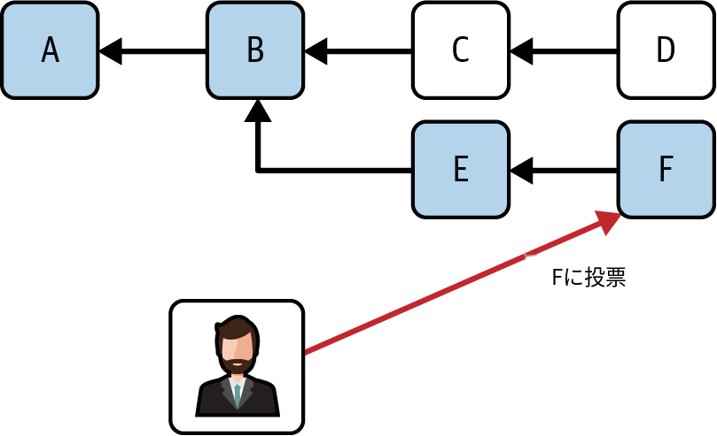

図15-2　祖先への投票の伝播

　ブロックへの投票はすべての祖先に遡って伝播されると言えます。この概念をさらに明確にするために、すべてのブランチにスコアを割り当てることができます。図15-3に示すように、*ブランチ*はブロックとその親を接続するリンクです。

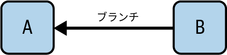

図15-3　ブランチの定義

　ブランチのスコアは、そのブランチの根となるブロック（図15-3のブロックB）のスコアに、すべての直接の子孫ブランチのスコアを加えたものと定義されます。

　図15-4は、各ブロックのスコアが1に等しいブロックのチェーンを示しています。EからDへのブランチのスコアは、子孫ブロックがないため、ブロックEのスコアに正確に等しくなります。ブランチD→Cのスコアを計算するには、ブロックDのスコアにすべての子孫ブランチのスコアを加える必要があります。この場合、子孫ブランチは1つだけで、ブランチE→Dです。したがって、1（ブロックDのスコア）+ 1（ブランチE→Dのスコア）= 2です。次にブランチC→Bがあり、そのスコアは1（ブロックCのスコア）+ 2（ブランチD→Cのスコア）= 3です。ここで、ブロックC'との小さなフォークがあります。ブランチC'→Bにスコアを割り当てる必要があります。ブロックC'には直接の子孫がないため、スコアは1（ブロックC'のスコア）です。最後に、ブランチB→Aがあります。スコアを計算するには、1（ブロックBのスコア）+ 1（ブランチC'→Bのスコア）+ 3（ブランチC→Bのスコア）= 5を合計する必要があります。

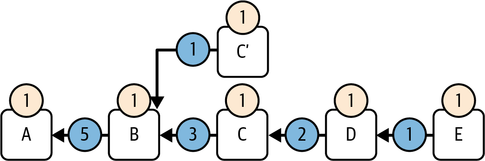

図15-4　ブランチスコア計算例

　図15-5は、各ブロックが異なるスコアを持つ、いくつかのフォークがある、より複雑なシナリオを含んでいます。確認して、各ブランチのスコアがどのように計算されるか理解できることを確かめてください。

図15-5　複雑なブランチスコアリング

　最後の例の後、ブロックのスコアは単一のブロックだけでなく、すべての以前のブランチに遡って伝播されるため、すべての祖先にも影響を与えることが明らかになったはずです。バリデータがアテステーションの形でブロックをチェーンのヘッドとして投票する場合、そのブロックのすべての祖先も有効で正しいチェーンの一部であるとみなしている、というのがその考え方です。

　ここで、LMD-GHOSTが実際にどのように機能し、チェーンのヘッドとみなされるブロックをどのように選択するかの詳細に踏み込むことができます。まず名前を分析しましょう。LMD-GHOSTは2つの頭字語で構成されています。*Latest Message Driven*（最新メッセージ駆動）と*Greediest Heaviest Observed Subtree*（最も貪欲で最も重い観測されたサブツリー）です。

### Latest Message Driven

　各ブロックとブランチにスコアを割り当てるには、各バリデータの最新のアテステーションのみを考慮する必要があります。つまり、バリデータVから2つのアテステーションを受け取った場合、2回カウントする必要はありません。どちらが最新であるかを確認し、もう一方を破棄する必要があります。

　図15-6は、ブロックBでアテステーションを公開し、ブロックBがチェーンのヘッドであると共有するバリデータを示しています。その後、ブロックFの時点で、そのバリデータが再び選ばれ、新しいヘッドとしてブロックFを支持する新しいアテステーションを投稿します。バリデータがブロックFで新しいアテステーションを投稿すると、他のバリデータは古いもの（ブロックBの時点で公開されたもの）を破棄し、最新のもののみを考慮する必要があります。

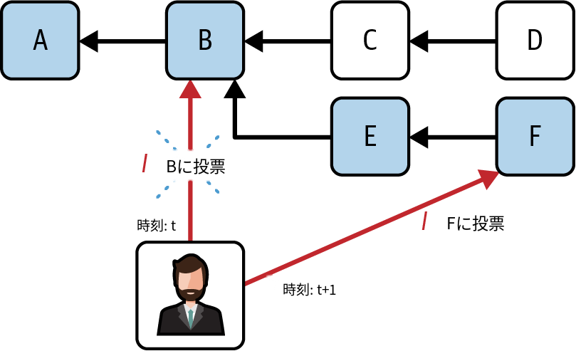

図15-6　Latest Message Drivenの例

### Greediest Heaviest Observed Subtree

　GHOSTはフォーク選択ルールの主要な側面です。ヘッドブロックは、最も多くの投票を集めたフォークに属する、さらなる子孫を持たないブロックです。

　LMD-GHOSTが実際のシナリオでどのように機能するかをより良く理解するために、実際に見てみましょう。図15-7は、以前使用したのと同じシナリオを表しています。

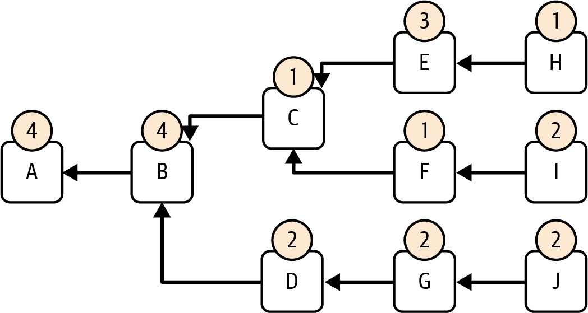

図15-7　LMD-GHOSTのシナリオ

　LMD-GHOSTは常に、確定されたチェーンの一部とみなされる初期ブロックから開始されます。当初はジェネシスブロックですが、完全なPoSベースのイーサリアムコンセンサスプロトコルでは、最後に正当化されたチェックポイントブロックで更新され続けます。これは「Casper FFG：ファイナリティガジェット」で探求する用語です。正当化されたチェックポイントが何かをまだ知らなくても大丈夫です。常に開始ブロックが存在することだけ知っておいてください。

　この例では、ブロックAが初期ブロックです。自分がアテステーションを投じる必要があるバリデータ、または次のブロックを提案するために選ばれたバリデータだと仮定しましょう。チェーンのヘッドがどのブロックであるかを知るためにLMD-GHOSTを実行し、それに応じてアテステーションを公開するか、正しい前のヘッドブロックの上に次のブロックを構築する必要があります。プロトコルのLMDルールに従い、各バリデータの最新のアテステーションのみを考慮して、これまでの他のバリデータのアテステーションをすでに収集しています。したがって、すべてのブロックのスコアがあり、各バリデータがそれぞれに投じたスコアの合計で構成されています。

　この時点でLMD-GHOSTは2つのステップで機能します。

1. 各ブロックのスコアを以前に説明したのと同じ方法で、すべての以前のブランチに遡って伝播させ、すべてのブランチにスコアを割り当てます。図15-8は、すべてのブランチの最終スコアを示しています。

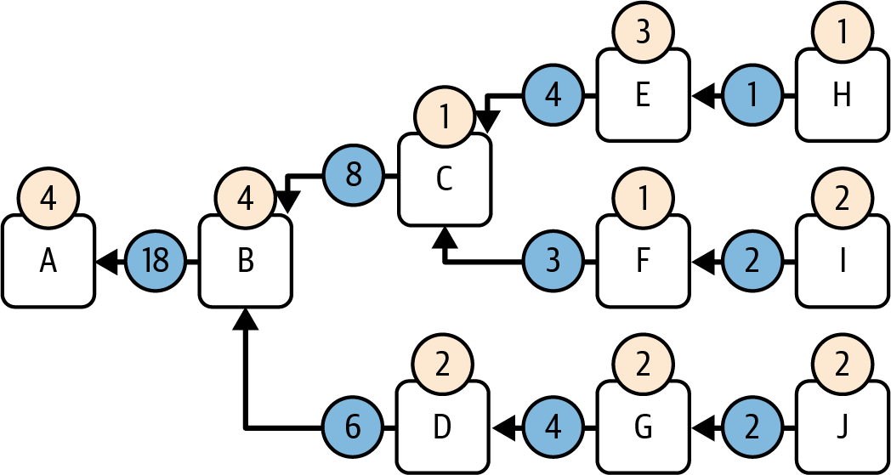

図15-8　計算されたブランチスコア

2. 次に、初期ブロックから始めて、プロトコルのGHOST部分が貪欲に最高スコアのブランチを選択し、子孫のないブロックに到達するまで進みます。それがLMD-GHOSTフォーク選択ルールによって返されるヘッドブロックです。

　この例でステップバイステップで実行してみましょう。LMD-GHOSTは初期ブロックAから開始し、図15-9に示すように、選択可能な代替ブランチがないため、ブランチB→Aを辿ってすぐにブロックBに進みます。

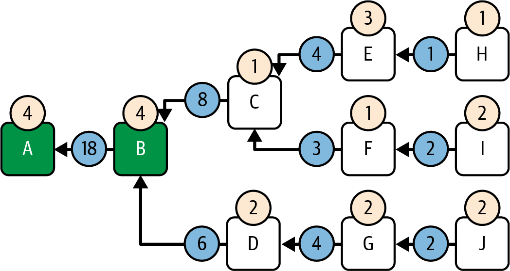

図15-9　LMD-GHOSTステップ1

　ここで、2つのブランチから選択できます。

- スコア8のブランチC→B
- スコア6のブランチD→B

　図15-10に示すように、GHOSTは最高スコアのブランチC→Bを貪欲に選択します。ブロックDがブロックCよりも高いスコアを持っていても関係ありません。LMD-GHOSTは単一のブロックのスコアではなく、そのブロックが属するフォーク全体のスコアを考慮するためです。

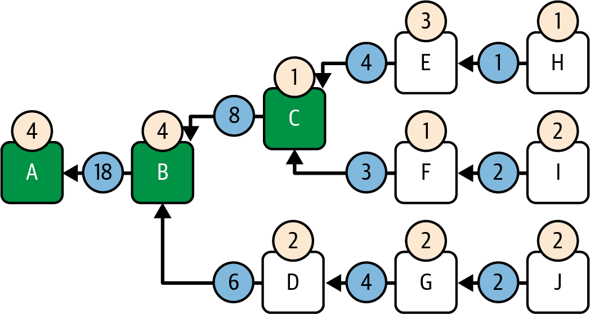

図15-10　LMD-GHOSTステップ2

　ここで、2つの異なるブランチから選択できます。

- スコア4のブランチE→C
- スコア3のブランチF→C

　図15-11に示すように、GHOSTはブランチE→Cを選択します。

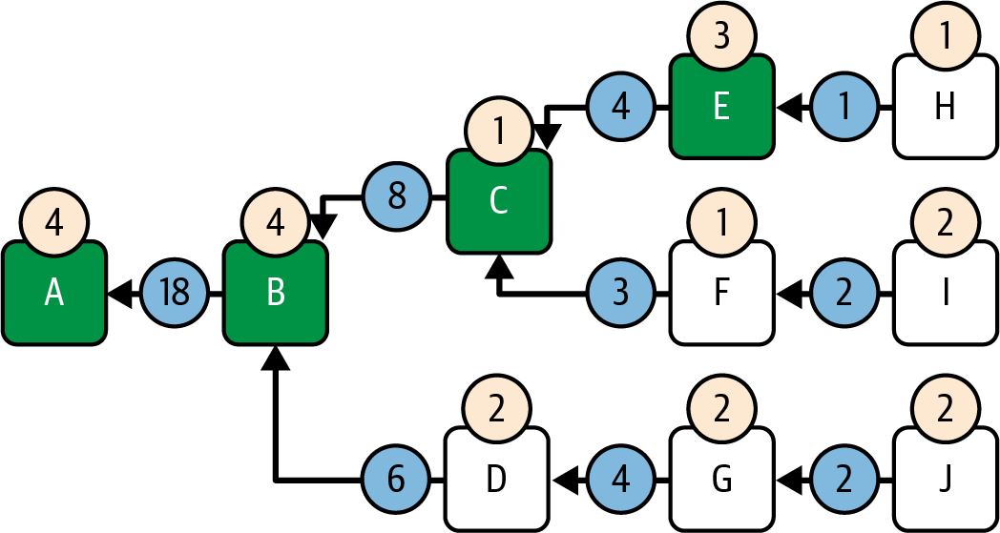

図15-11　LMD-GHOSTステップ3

　この時点で、選択できるブランチは1つだけで、ブランチH→Eなので、図15-12に示すように、GHOSTはそれを選択します。

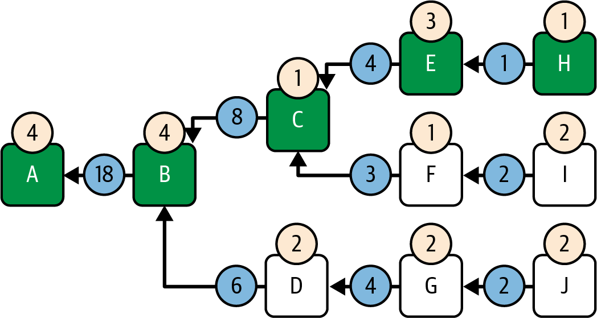

図15-12　LMD-GHOSTステップ4

　ブロックHには子孫がありません。LMD-GHOSTは停止し、チェーンの新しいヘッドブロックとして返します。

### インセンティブ

　LMD-GHOSTは、ルールに厳密に従うバリデータに対するさまざまな明示的なインセンティブと、悪意を持って行動する者への罰則を提供します。このセクションでは、悪意ある行為者がルールを破ることを防ぎ、善意ある行為者に報いる方法を探ります。

　バリデータは2つの異なる職務を遂行する必要があります。

- ブロックの提案
- アテステーションの作成

　これらのそれぞれについて、LMD-GHOSTは全員がルールに従って行動することを確実にするためのいくつかの方法を含んでいます。

#### ブロックの提案

　バリデータがチェーンに新しいブロックを提案するために選ばれた場合、有効なブロックを1つだけ作成しなければなりません。そうすることで、図15-13に示すように、バリデータは作成したブロックに含まれるすべてのトランザクションの優先手数料の合計に加えて、新たに発行されたETHを獲得します。

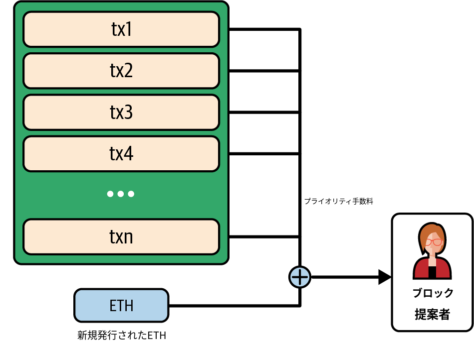

図15-13　ブロック提案の報酬

　バリデータが複数のブロックを作成して不正を試みた場合、プロトコルはステークの一部をスラッシングすることで明示的に罰します。実際、バリデータセットの一員になるためには、担保として一定量のETH（少なくとも32 ETH）をステークする必要があります。図15-14に示すように、このステークは、プロトコルがステークからETHをスラッシング（つまり除去）することで罰することができるようにするためにも必要です。

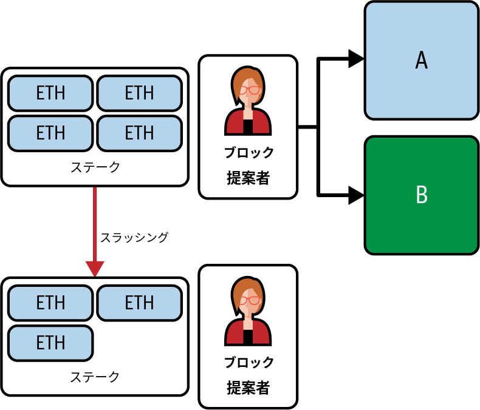

図15-14　ブロック提案のスラッシング

> **注記**
>
> ここで注目すべきは、明示的な罰則がイーサリアムのPoSコンセンサスプロトコルとビットコインのPoWとの大きな違いであるということです。ビットコインのマイナーは、自身のブロックが最も重いチェーンの一部になった場合に報酬を得ます。同一のブロック番号に対して複数のブロックを作成しても、明示的な罰則はありません。
>
> なぜでしょうか。PoWベースのシステムでは、有効なブロックを作成するためにある程度の作業（PoW自体）が必要です。マイナーが複数のブロックを作成した場合、最終的に最も重いチェーンに含まれるのは1つのブロックだけであるため、単に時間とお金を無駄にしているだけで、報酬を得られるのは1つだけです。
>
> イーサリアムのPoSプロトコルでは、有効なブロックを作成するためにPoWを実行する必要がありません。つまり、複数のブロックを作成することはバリデータにとってほぼ無料です。そのため、この方法で不正を試みる者に対する明示的な罰則が必要なのです。

#### アテステーションの作成

　バリデータがアテステーションの形でネットワークのビューを共有するために選ばれた場合、有効なアテステーションを1つだけ公開しなければなりません。そうすることで、図15-15に示すように、小さな手数料（ブロック提案者が得るものよりもはるかに少ない）を獲得します。

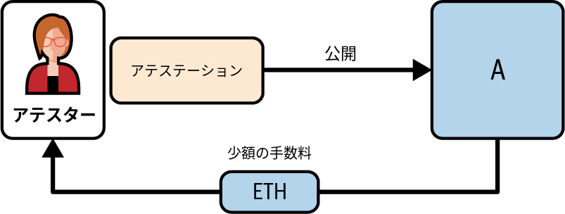

図15-15　アテステーションの報酬

　バリデータが複数のアテステーションや矛盾するアテステーションを作成して不正を試みた場合、図15-16に示すように、プロトコルはステークの一部をスラッシングすることで明示的に罰します。

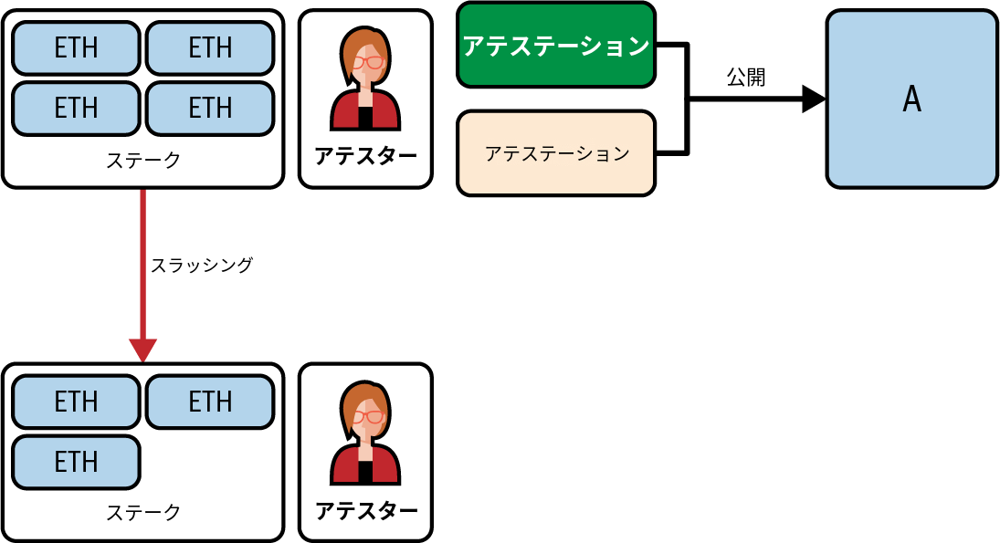

図15-16　アテステーションのスラッシング

　バリデータが長期間にわたって悪意ある行動を続けた場合、プロトコルはバリデータセットから強制的に退去させる権限を持っています。

## Casper FFG：ファイナリティガジェット

　Casper FFGは一種のメタコンセンサスプロトコルです。基盤となるコンセンサスプロトコルの上にオーバーレイとして実行され、ファイナリティを追加することができます。

　イーサリアムのPoSコンセンサスでは、基盤となるプロトコルはLMD-GHOSTであり、ファイナリティを提供しません。ファイナリティは、ブロックがチェーンで確認されると不可逆になることを保証します。確認されたブロックは永遠にチェーンの一部となります。つまり本質的に、Casper FFGはファイナリティガジェットとして機能し、LMD-GHOSTにファイナリティを追加するために使用されます。

　Casper FFGは、PoSプロトコルでは参加者が誰であるかが既知であるという事実を活用します。ステークされたetherを管理するバリデータです。これにより、正直なバリデータの過半数の投票、より正確には、ステークの過半数を管理するバリデータの投票を見たかどうかを判断するために、投票の集計を使用できます。以下の説明では、すべてのバリデータの投票は管理するステークの値で重み付けされますが、簡潔にするために、毎回これを明記することはしません。

　Casper FFGは、すべての古典的なビザンチン障害耐性（BFT）プロトコルと同様に、バリデータの3分の1未満が障害を起こしているか、敵対的である限り、ファイナリティを保証できます。正直なバリデータの過半数がブロックを確定と宣言すると、すべての正直なバリデータが同意し、そのブロックは不可逆になります。正直なバリデータが全体の3分の2以上を構成することを要求することで、コンセンサスが正直な多数派のビューを正確に反映することが保証されます。注目すべきことに、Casper FFGは従来のBFTプロトコルとは異なり、バリデータの3分の1以上が侵害された場合でも経済的ファイナリティ（詳細は「説明責任のあるセーフティともっともらしいライブネス」を参照）を提供します。

### エポックとチェックポイント

　Casper FFGは、図15-17に示すように、大規模なバリデータセットを効率的に管理するために、投票を32スロットに分散し、エポック内のバリデータの3分の2以上の投票を要求することでコンセンサスを確保します。エポックは32のスロットに分割され、各スロットには通常ブロックが含まれます。エポックの最初のスロットが*チェックポイント*です。

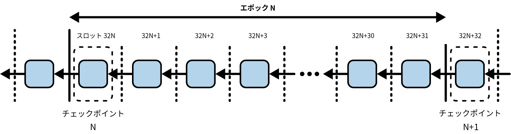

図15-17　エポックとチェックポイント

　バリデータは統一された投票の焦点を維持するために、エポックごとに1回、最初のスロットであるチェックポイントに投票します。このプロセスは効率のためにCasper FFGとLMD-GHOSTの両方の投票を組み込んでおり、Casper FFGの文脈ではエポック全体ではなくチェックポイントの確定を目指しています。ファイナリティはチェックポイントとその前のコンテンツに及ぶことを明確にしています。

### ジャスティフィケーションとファイナライゼーション

　Casper FFGは、従来のBFTプロトコルと同様に、2つの段階でネットワークの合意を確保します。まず、バリデータは提案されたチェックポイントに関する自身のビューをネットワークにブロードキャストし、収集します。大多数が同意すれば、チェックポイントは*正当化*され、暫定的な合意が示されます。次のラウンドで、バリデータが正当化されたチェックポイントに対する広範な支持を確認すると、*確定*が達成されます。つまり、全員が同意し不可逆であることが確認されます。このプロセスは、ネットワークの一貫性とセキュリティを確保するための協力的な取り組みを示しており、チェックポイントが特定の時間枠内で正当化され、その後確定されることを目指し、コンセンサスメカニズムの信頼性を向上させます。

#### ソースとターゲット、リンクと競合

　Casper FFGでは、投票はソースとターゲットのチェックポイントで構成され、ブロックチェーンの異なる時点での状態に対するバリデータのコミットメントを表します。これらの投票はリンクされたペアとして投じられ、バリデータの現在のコンセンサスポイントと提案されたコンセンサスポイントを示します。ソース投票は、チェックポイントに対する広範な支持のバリデータによる承認を反映し、ターゲット投票は、他のバリデータからの同様の支持を条件とする、新しいチェックポイントへの条件付きコミットメントを表します。この二重投票システムは、ブロックの確定に向けた構造化された進行を促進し、ネットワークの整合性と継続性を確保します。

#### スーパーマジョリティリンク

　Casper FFGにおいて、ソースとターゲットのチェックポイント間の*スーパーマジョリティリンク*（*s→t*）は、バリデータの3分の2以上が、ステーク量の重み付けで同じリンクを承認し、その投票がブロックチェーンに含まれた時に確立されます。このメカニズムは、広範なバリデータの合意を通じてチェックポイントのシーケンスを検証することで、コンセンサスとセキュリティを確保します。

#### ジャスティフィケーション

　Casper FFGでは、ノードがバリデータの過半数があるチェックポイントから別のチェックポイントへの遷移に同意していることを確認すると、古いチェックポイントを正当化します。図15-18に示すように、ノードがバリデータセットのかなりの部分からのコンセンサスの証拠を見たことを意味し、代替パスに対する圧倒的なコンセンサスが示されない限り、以前の状態に戻らないというコミットメントを行います。

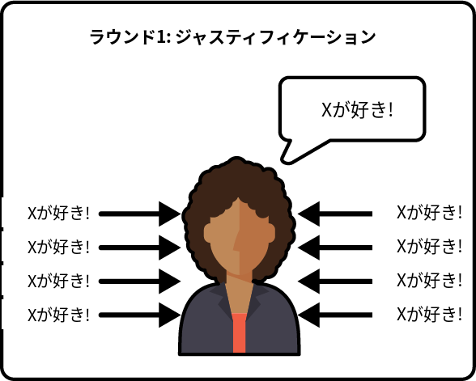

図15-18　ジャスティフィケーションプロセス[^1]

[^1]: ノードはスーパーマジョリティリンクCN → CN + 1を確認したため、CN + 1を正当化されたとマークする。CN + 1はチェックポイントツリーにおけるCNの直接の子であるため、CNも確定されたとマークする。確定されたチェックポイントはクロスハッチングされ、Fとマークされている。

#### ファイナライゼーション

　図15-19に示すように、ノードが正当化されたチェックポイントからその直接の子へのコンセンサス（スーパーマジョリティリンク）を確認すると、親チェックポイントを確定します。これは、バリデータの強力な過半数の支持に裏付けられた、この時点から戻らないというネットワーク全体のコミットメントを示します。ファイナライゼーションは、バリデータにとって重大な結果なしにはリバーサルを防ぎ、そのチェックポイント以降のブロックチェーンの履歴を不変にすることで、ネットワークの安定性とセキュリティを確保します。

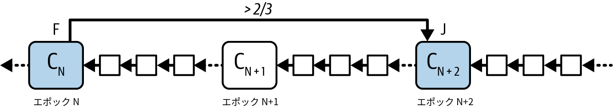

図15-19　ファイナライゼーションプロセス

### スラッシング

　Casper FFGは、ネットワークコンセンサスを確保する目的で、プロトコルルールの違反に対してバリデータにペナルティを課すスラッシングメカニズムを実装しています。この強制措置は、矛盾するチェックポイントの確定など、ブロックチェーンの整合性を損なう可能性のある行動を抑止します。これらの違反の検出、特にサラウンド投票（「フォーク選択ルール」を参照）のような複雑なシナリオの検出は、その技術的な課題のため、外部の専門サービスに依存する場合があります。スラッシングの結果は、不正行為の深刻さとネットワーク全体の健全性に比例し、ペナルティは特定の時間枠内での集団的な行動に基づいてスケーリングされ、バリデータの行動における公平性と説明責任を確保します。

### フォーク選択ルール

　Casper FFGは従来のLMD-GHOSTフォーク選択ルールを変更し、ノードが最も高い正当化されたチェックポイントを持つチェーンを優先することを義務付けます。このチェックポイントが事実上LMD-GHOSTプロトコルの開始ブロックとなります。LMD-GHOSTプロトコルのアプローチの進化であるこの適応は、バリデータのスーパーマジョリティによって合意されたチェックポイントにコミットすることで、ネットワークがファイナリティを達成することを保証します。チェックポイントが正当化されると、ネットワークはそれを超えて巻き戻すことができなくなり、ブロックチェーンのセキュリティと安定性を強化します。このルールはまた、ネットワークのライブネスを維持するように設計されており、Casperの基本的な目標と一致しています。

### Casperの戒律

　Casper FFGでは、チェックポイントがネットワークのコンセンサスとセキュリティを確保するための中心的な役割を果たしています。チェックポイントはブロックチェーンの進行とともに増加するエポック番号でマークされます。バリデータは厳格な投票ルールに従わなければなりません。同一のチェックポイントに対して異なる結果に投票することはできません。つまり、図15-20に示すように、二重投票は禁止されています。この投票ルールがなければ、リオーグの可能性がはるかに高くなり、チェーンは非常に不安定になります。

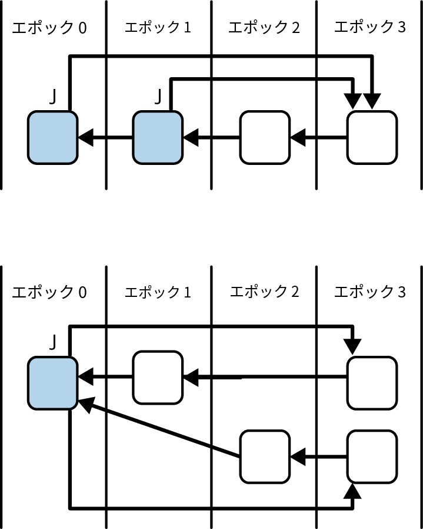

図15-20　二重投票禁止ルール

　バリデータはまた、以前のコミットメントと矛盾すると解釈される可能性のある投票の作成を避けなければなりません（サラウンド投票の禁止）。図15-21に示すように、これらの原則に違反するとスラッシングが適用され、コンセンサスメカニズムの整合性と説明責任を維持するために設計されたペナルティです。

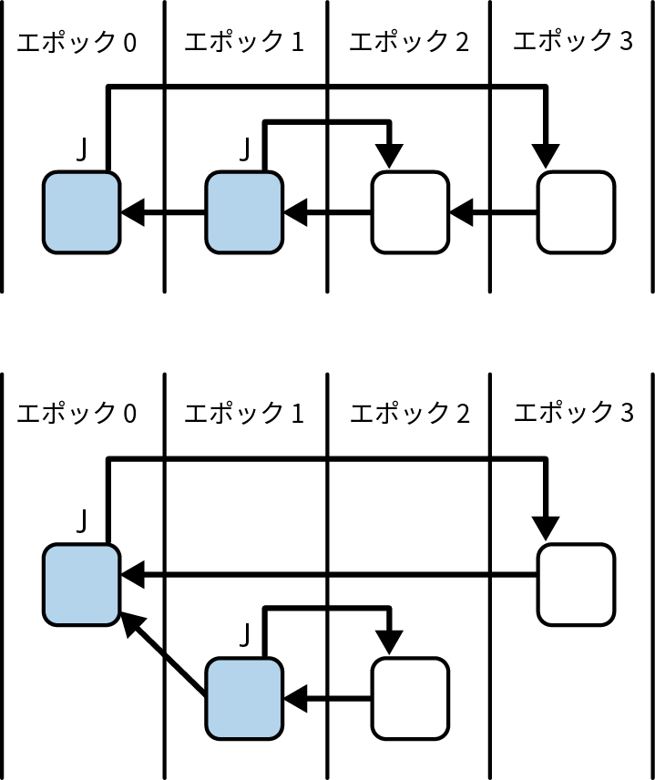

図15-21　サラウンド投票禁止ルール

### 説明責任のあるセーフティともっともらしいライブネス

　Casper FFGコンセンサスプロトコルは、古典的なコンセンサスにおけるセーフティとライブネスの概念に類似しているが異なる、2つの保証を行います。*説明責任のあるセーフティ*と*もっともらしいライブネス*です。

#### 説明責任のあるセーフティと経済的ファイナリティ

　Casper FFGの説明責任のあるセーフティの証明は、バリデータの3分の1以上がプロトコルルールに違反しない限り、矛盾するチェックポイントが確定されることはないことを示しています。このシステムは、敵対的なバリデータが3分の1未満で確定されたチェックポイントが不可逆であることを保証し、ネットワークセキュリティと不正行為に対する経済的ペナルティの両方を強制します。

　Casper FFGにおける経済的ファイナリティは、潜在的な攻撃者にコストを課し、プロトコルルールだけでなく経済的な抑止力を通じてもセキュリティを強制します。矛盾するチェックポイントを確定してネットワークを弱体化しようとするバリデータは、ステークのかなりの部分を失う厳しいペナルティに直面します。このアプローチは、経済的な結果の層を追加することで従来のコンセンサスメカニズムとは異なり、ブロックの確定が悪意ある行為者にとって大きなコストを伴うことを保証し、攻撃に対するブロックチェーンの整合性と回復力を強化します。

#### もっともらしいライブネス

　Casper FFGは、ネットワークがアクティブなまま維持され、正直なバリデータがペナルティを受けることなく常にコンセンサスに到達できることを保証し、もっともらしいライブネスの概念を体現しています。バリデータのスーパーマジョリティが正直であれば、プロトコルは新しいチェックポイントの正当化と確定を継続でき、スラッシングへの恐れから進行が停止するデッドロックシナリオを回避します。この原則は、ネットワークの回復力と継続的な運用を保証し、困難な条件下でもコンセンサスを維持するCasperの適応性を示しています。

## 実践的な例：チェックポイントのライフサイクル

　イーサリアムのCasper FFGメカニズムにおけるチェックポイントのライフサイクルを一緒にたどりましょう。

　イーサリアムのバリデータコミュニティは非常に大きく、潜在的に数十万人が参加しています。これらの投票をすべて一度に処理することは現実的ではありません。では、どのように管理するのでしょうか。

　投票はエポックと呼ばれる期間に分散され、各エポックは32のスロットに分割され、各スロットは12秒間続きます。こうして、各バリデータはエポックごとに正確に1回投票し、バリデータセットの約32分の1が各スロットで投票します。図15-22は、バリデータのプールを示しています。

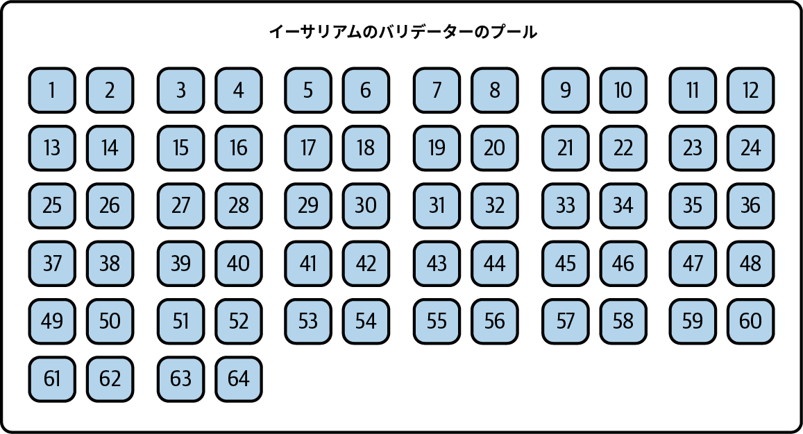

図15-22　バリデータプール

　この例では、バリデータの数は実際のイーサリアムネットワークよりもはるかに限られていますが、64のノードがあり、32のグループに分割されています。図15-23に示すように、各グループがエポック内の1つのスロットに投票します。

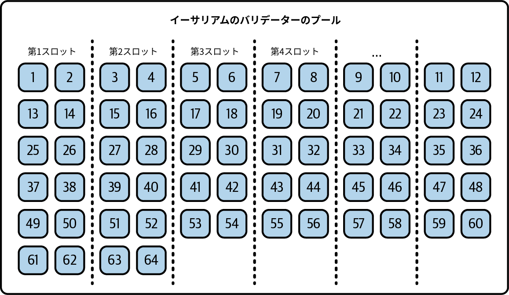

図15-23　グループに分割されたバリデータ

　では、何に投票するのでしょうか。チェックポイント、具体的にはエポックの最初のスロットに投票します。[^2]このチェックポイントは、異なる時点で投票するバリデータの共通の目標として機能します。

[^2]: チェックポイントは常にエポックの最初のスロットであるが、チェックポイント自身のブロックが欠落している場合、そのブロックハッシュはより以前のブロックのものになる可能性がある。

> **注記**
>
> ここで重要な点を明確にしておきます。エポックの確定について語ることが多いですが、技術的にはチェックポイント、つまりこれらの最初のスロットを確定しているのです。チェックポイントが確定されると、そのスロットまで（そのスロットを含めて）のすべてが確定され、安全で変更不可能になります。

　エポック（この場合はエポックN）の表現を図15-24に示します。チェックポイントNはスロット32Nです。そのチェックポイントが確定されると、スロット32N-1とそれ以前のすべてのスロットが確定されたとみなされます。

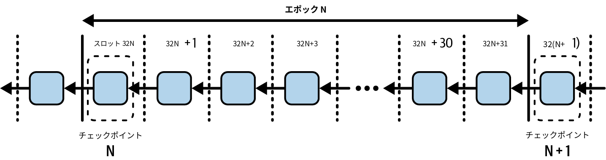

図15-24　エポックの表現

　このセキュリティを達成するプロセスは厳格であり、従来のBFTコンセンサスメカニズムに似ています。次のセクションでは、その仕組みを説明します。

### 第1ラウンド：ジャスティフィケーション

　バリデータはそれぞれ、現在のエポックのチェックポイントに関する自身のビューをネットワークにブロードキャストします。次に、ネットワークのスーパーマジョリティが自分の見方に同意しているかどうかを確認します。同意している場合、このチェックポイントは「正当化」されます。この段階で、バリデータはネットワークの大多数がこのチェックポイントの確定を支持していると信じていますが、全員が同意しているかどうかはまだ完全には確信していません。

　重要な問題は、バリデータがネットワーク上の悪意ある行為者がネットワークの状態について虚偽の情報を提供していないかどうかをまだ確信できないことです。ある者にはあることを言い、別の者には別のことを言う可能性があります。これは見落とされがちな非常に重要なポイントです。すべての参加者が常に正直であれば、ジャスティフィケーションはファイナライゼーションを意味し、2ラウンドのプロセス全体を回避できるでしょう。

　バリデータがチェックポイントを正当化する際、図15-25に示すように、その特定のチェックポイントに対してネットワークの3分の2からの承認を受けています。しかし、この最初のラウンドの承認はバリデータ自身にとってのローカルなものにすぎません。特に敵対的な条件下では、十分なバリデータがコンセンサスに達していない可能性があります。Algorand、Dfinity、Cosmosで使用されているような従来のPBFTスタイルのコンセンサスメカニズムは、この段階で停止し、ライブネスを失います。一方、イーサリアムは継続します。チェックポイントを正当化できない場合でも問題ありません。単に次のチェックポイントの正当化を試みるだけです。これが機能するのは、イーサリアムがライブネスのためにLMD-GHOSTに依存しているからであり、Casper FFGは単なるオーバーレイ、つまり「あれば良い」ものだからです。したがって、ファイナリティが一時的に停止しても、重大な問題にはなりません。

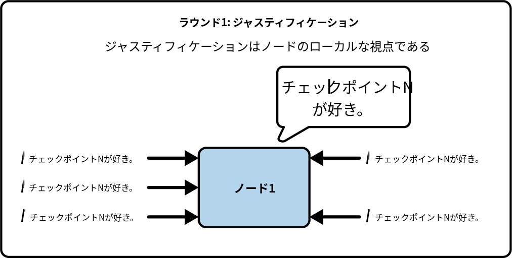

図15-25　ジャスティフィケーションラウンド

### 第2ラウンド：ファイナライゼーション

　バリデータは、スーパーマジョリティからこのチェックポイントも支持しているという報告を受けたことを発表します。ネットワークの残りの部分がこのスーパーマジョリティが確かに存在することを確認しているかどうかを再度チェックします。確認された場合、図15-26に示すように、バリデータはチェックポイントを「確定」できます。ファイナライゼーションは強力なステップです。正直なバリデータがこのチェックポイントを巻き戻すことは二度とないことを意味します。ローカルなビューではまだ確定としてマークしていないかもしれませんが、少なくとも正当化としてマークしており、罰則のある行為なしには取り消すことができません。

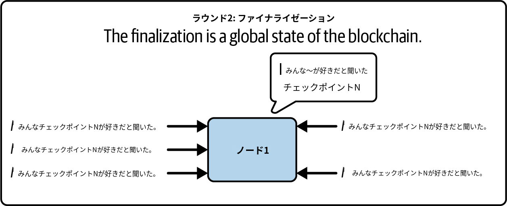

図15-26　ファイナライゼーションラウンド

　実際には、各ラウンドは理想的には1エポックにわたり、チェックポイントを正当化するのに1エポック、確定するのにもう1エポックかかります。合計で約12.8分です。しかし、Casper FFGのパイプライン設計のおかげで、1エポックごと、つまり6.4分ごとにチェックポイントを確定することができます。

> **注記**
>
> 外部の視点からは、投票がエポックの進行とともに徐々に蓄積されるため、重大なチェーンのリオーグがないと仮定すれば、12.8分が経過する前にチェックポイントが確定される可能性の兆候を見ることができる場合もあります。しかし、ジャスティフィケーションとファイナライゼーションの公式なプロトコル内のアクションは、エポックの終わりにのみ発生します。

　チェックポイントのジャスティフィケーションとファイナライゼーションの過程では、多くのことがうまくいかない可能性があります。2つの重要なケースと、このフレンドリーなファイナリティガジェットがそれらをどのように処理するかを分析しましょう。

### 矛盾するジャスティフィケーション

　チェックポイントに「正当化」と「確定」の両方のステータスが必要な理由を考えることは有益です。3分の2のスーパーマジョリティが賛成票を投じた時点で、チェックポイントを直接確定するだけでは十分ではないのでしょうか。

　その区別は次のとおりです。ジャスティフィケーションはローカルな合意に関するものであり、ファイナリティはグローバルなコンセンサスに関するものです。

　チェックポイントを正当化するとは、バリデータとしての自分が、バリデータの3分の2からそのチェックポイントを承認する確認を受けたことを意味します。しかし、この承認は自分のローカルな視点のみを表します。他のバリデータが異なる情報を持っている可能性があり、確信は持てません。この不確実性にもかかわらず、正直なバリデータとして、自分のローカルなデータに基づいて正当化したチェックポイントを決して取り消さないことにコミットします。

　一方、チェックポイントの確定はこれをさらに一歩進めます。バリデータの3分の2から、自身もまたピアの3分の2からチェックポイントの有効性を確認する報告を受けたことの保証を受けた時に発生します。これは、自分のローカルなビューだけでなく、ネットワークのスーパーマジョリティがこのチェックポイントを承認しコミットしていることを意味します。この広範なコンセンサスがチェックポイントをグローバルに取り消されることから保護します。したがって、確定されたチェックポイントはローカルに認識されるだけでなく、グローバルに保護されています。

　コンセンサスプロセスをより良く理解するために、極端なシナリオを探りましょう。図15-27に示すように、4人のバリデータA、B、C、Dがいると仮定します。全員が正直ですが、運用するネットワークは無期限の遅延が発生する可能性があります。この例のために、各ブロックの高さにチェックポイントがあると想像してください。

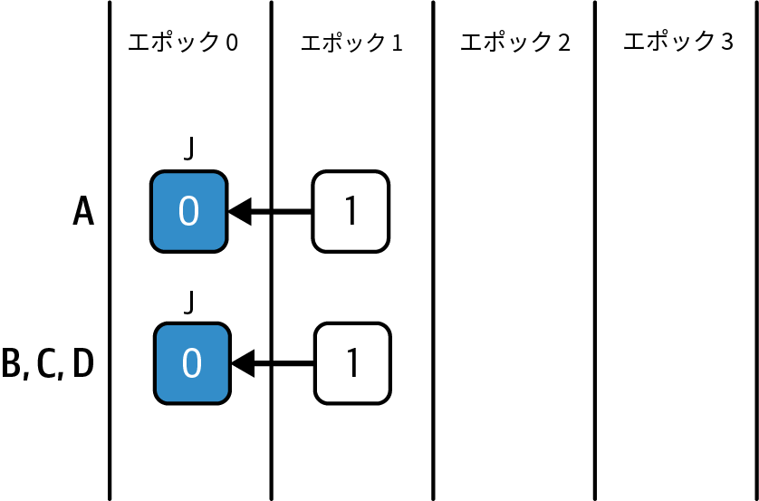

図15-27　4人のバリデータのシナリオ

　シナリオのすべてのバリデータはブロック0を持っているため、チェックポイント0を正当化できます。したがって、ソースである0はすべての4人のバリデータにとってローカルに正当化されており、1がターゲットです（「ソースとターゲット、リンクと競合」を参照）。

　ここで、Aのネットワーク接続がひどく遅延しており、ブロックの提案者としても選ばれたと想像しましょう。Aはエポック2でブロックを提案します。このブロックにはチェックポイント1を正当化するための4つの投票すべてが含まれていますが、ネットワーク接続がひどく遅延しているため、他のバリデータはそれを見ることがありません。

　Aはソース0とターゲット1の間にスーパーマジョリティリンク（「スーパーマジョリティリンク」を参照）を持っているため、チェックポイント0を確定し、チェックポイント1を正当化します。一方、B、C、Dは現在のエポックで投票を見ていないため、チェックポイント0のみが正当化されたままです。図15-28に示すように、B、C、Dはこのエポックで空のチェックポイント（チェックポイントX）にも投票します。

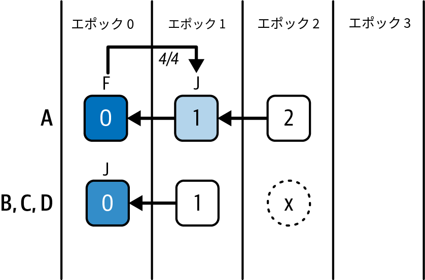

図15-28　ネットワーク遅延シナリオステップ1

　エポック3では、B、C、Dの中から1人のバリデータがブロックを提案するために選ばれます。

　このブロックには、ソースがチェックポイント0、ターゲットがチェックポイントXの3つの投票が含まれています。したがって、0とXの間にスーパーマジョリティリンクがあり、バリデータB、C、Dはチェックポイント0を確定、チェックポイントXを正当化できます（図15-29を参照）。一方、Aは自身のローカルビューでは1が正当化されており取り消せないため、このブロックを無効とみなします。バリデータAのチェーンが継続するための唯一の解決策は、メモリを削除してネットワークの残りの部分と再同期することです。

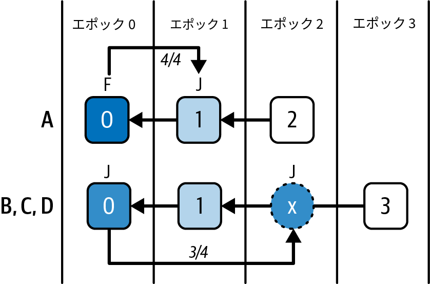

図15-29　ネットワーク遅延シナリオステップ2

> **注記**
>
> この例では、バリデータB、C、DがAの提案したブロックを見ていないことを覚えておくことが重要です。チェックポイント1を正当化するはずだったブロック2を確認していないため、ブロック1に同意できず、チェックポイント1を正当化できません。その結果、代わりに空のチェックポイントに投票します。

　この例は、単純なネットワーク遅延でさえ、ノードがジャスティフィケーションとファイナライゼーションについて異なるビューを持つ原因になり得ることを示しています。しかし、これだけではジャスティフィケーションとファイナライゼーションの2つの別々のフェーズが必要な理由の説明にはなりません。2つのフェーズの背後にある理由は非常にシンプルです。ジャスティフィケーションのステップがなければ、Aはチェックポイント1を確定していたでしょうが、図15-30に示すように、残りのバリデータからは無効とみなされていたでしょう。

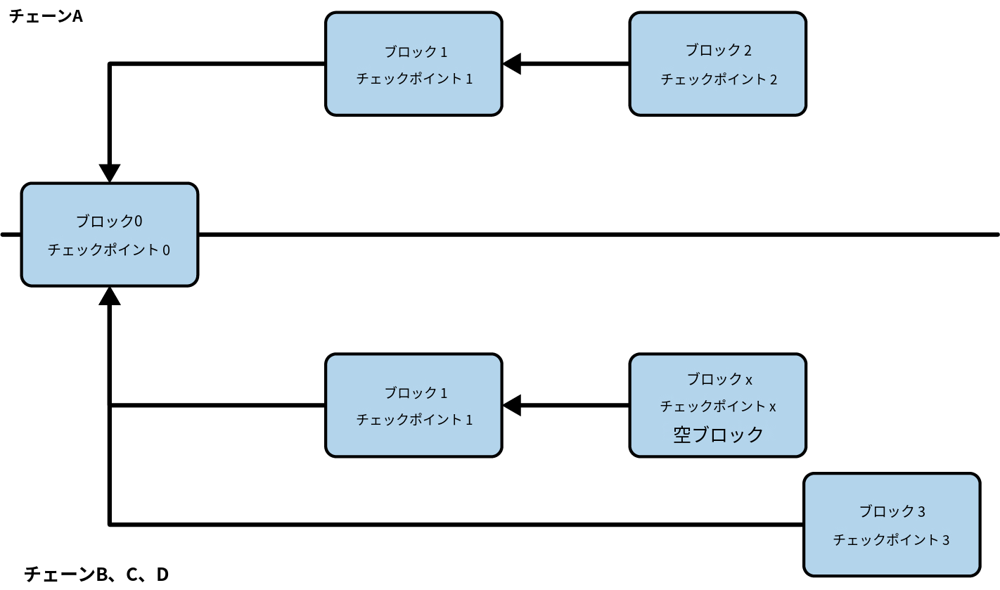

図15-30　ジャスティフィケーションステップなしの場合

　前の例では、Aはメモリを削除してネットワークの残りの部分と再同期する必要がありました。ジャスティフィケーションは前述のとおりローカルなステップに似ており、取り消すことができるからです。しかし、Aがチェックポイント1を直接確定していた場合、これは不可能だったでしょう。2つのフェーズがなければ、Aは確定されたブロックが取り消され、B、C、Dはスラッシングされることなくブロック1を孤立させることができたでしょう。セーフティを保証する唯一の方法は、ジャスティフィケーションとファイナライゼーションの2段階コミットです。

## Gasper：実際の例

　ここまで、Casper FFGとLMD-GHOSTがそれぞれ単独でどのように機能するかを見てきました。次に、これらがGasperに統合され、イーサリアムのPoSコンセンサスプロトコル内でどのように使用されるかを見ていきましょう。

　Gasperの仕組みを完全に理解する最良の方法は、Gasperを使用してブロックの履歴に対するコンセンサスを得るブロックチェーンの実例を追うことです。この例ではイーサリアムのメインネットは使用しません。代わりに、図15-31に示すように、コンセンサスプロトコルの各フェーズで何が起こっているかをより良く説明するために、3人のバリデータを持つモックアップネットワークを作成します。

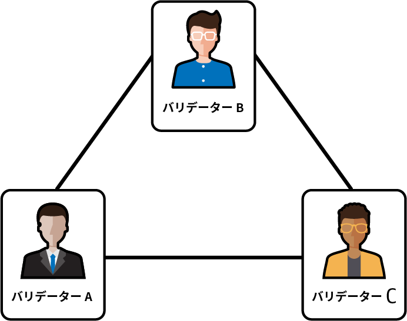

図15-31　Gasperモックネットワーク

　3人のバリデータは同量のETHをステークしているため、投票力（つまり、投票する各ブロックのスコアへの貢献度）は同じです。また、イーサリアムのメインネットのようにエポックごとに1回ではなく、すべてのバリデータがブロックごとにアテステーションを公開します。

　目標は、ブロックが公開されてから、まず正当化され、次に確定されるまでのライフを見ることです。

　簡略化されたネットワークでは、図15-32に示すように、各エポックは3つのスロットで構成されています。

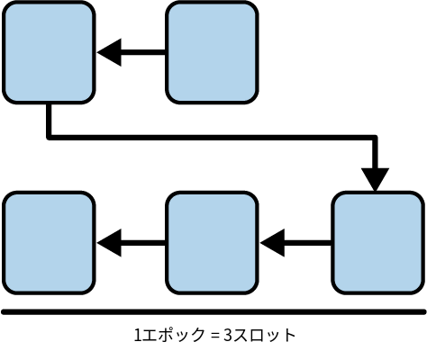

図15-32　簡略化されたエポック構造

　例をエポック番号1から始めましょう。これは実際の最初のエポックではありません。簡便のために「エポック1」と呼んでいるだけです。バリデータAが最初のブロックを提案するために選ばれます。図15-33に示すように、提案するブロックをブロック1と呼ぶことができます。

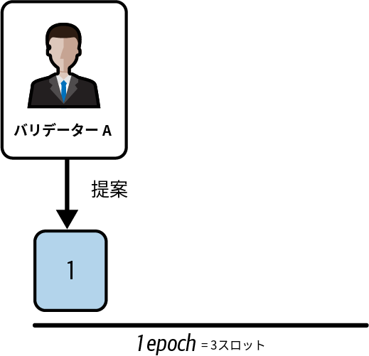

図15-33　ブロック1の提案

　バリデータAがブロック1を公開すると、すぐにそのブロックはネットワーク内で伝播を開始します。公開直後に、バリデータBとCがブロック1を受信し、自身のネットワークビューに保存します。

　次に、すべてのバリデータがチェーンの最後のヘッドブロックだと考えるものに投票してアテステーションを作成します。そのために、ローカルビューでLMD-GHOSTを実行する必要があります。結果はブロック1です。これらのアテステーションは公開され、すべてのバリデータと共有されます。

　次に、図15-34に示すように、バリデータBが次のスロット（スロット2）でブロックを提案するために選ばれます。そのために、バリデータはネットワークのローカルビューでLMD-GHOSTを実行して、構築すべき最後のヘッドブロックを取得する必要があります。

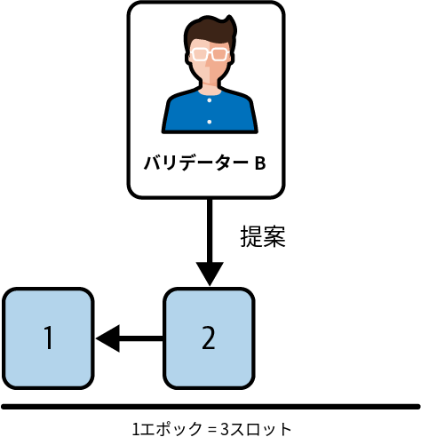

図15-34　ブロック2の提案

　以下はバリデータBのネットワークビューです。

- バリデータAのアテステーション：ヘッドブロック：ブロック1
- バリデータBのアテステーション：ヘッドブロック：ブロック1
- バリデータCのアテステーション：ヘッドブロック：ブロック1

　したがって、バリデータBのLMD-GHOSTの結果はブロック1です。ブロック1の上にブロック2を公開できます。ブロック2の中に、バリデータBは以前のブロックに含まれていなかった、これまでに確認したすべてのアテステーションも保存します。つまり、ブロック1への投票を含む3つのアテステーションを保存します。

　ブロック2がネットワーク内で伝播し、公開直後にバリデータAとCが受信します。LMD-GHOSTはP2Pを通じて共有された投票とブロックに含まれた投票の両方を使用しますが、Casper FFGはブロックに含まれた投票のみを考慮することを覚えておいてください。したがって、バリデータがすでにP2Pネットワークを通じて共有している場合、LMD-GHOSTの投票をブロックに含めてもLMD-GHOSTの結果には影響しませんが、バリデータが投票を知る唯一の方法であるため、Casper FFGにとっては基本的に重要です。

　再び、すべてのバリデータがチェーンの最後のヘッドブロックだと考えるものに投票してアテステーションを作成します。全員がローカルビューにブロック2を持っているため、全員がチェーンのヘッドとしてブロック2に投票します。次に、すべてのバリデータが確認できるようにこれらのアテステーションを公開します。

　次に、バリデータCがスロット3で次のブロックを提案するために選ばれます。ローカルビューでLMD-GHOSTを実行してヘッドブロックを取得します。以下はバリデータCのネットワークビューです。

- バリデータAのアテステーション：ヘッドブロック：ブロック2
- バリデータBのアテステーション：ヘッドブロック：ブロック2
- バリデータCのアテステーション：ヘッドブロック：ブロック2

　結果はブロック2なので、図15-35に示すように、バリデータCはブロック2の上にブロック3を公開します。

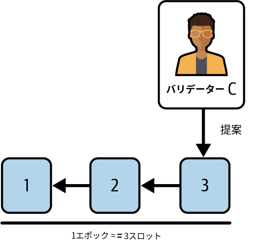

図15-35　ブロック3の提案

　ブロック3の中に、バリデータCは以前のブロックに含まれていなかった、ブロック2への投票を含む3つのアテステーションを保存します。

　ブロック3がネットワーク内で伝播し、公開直後にバリデータAとBが受信します。バリデータはブロック3に投票するアテステーションを作成します。

　次に、バリデータAに戻ります。図15-36に示すように、次のブロック（スロット4）を提案する必要があり、これは新しいエポック（エポック2）の最初のブロックでもあります。

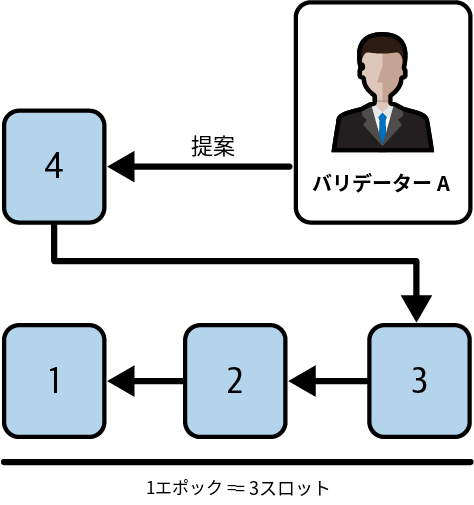

図15-36　ブロック4の提案 - 新しいエポック

　バリデータAはローカルビューでLMD-GHOSTを実行してチェーンのヘッドを取得します。以下はバリデータAのネットワークビューです。

- バリデータAのアテステーション：ヘッドブロック：ブロック3
- バリデータBのアテステーション：ヘッドブロック：ブロック3
- バリデータCのアテステーション：ヘッドブロック：ブロック3

　結果はブロック3なので、バリデータAはブロック3の上にブロック4を公開します。

　ブロック4の中に、バリデータAは以前のブロックに含まれていなかった、ブロック3への投票を含む3つのアテステーションを保存します。

　ブロック4がネットワーク内で伝播し、公開直後にバリデータBとCが受信します。バリデータはチェーンのヘッドとして投票する新しいアテステーションを作成する必要があります。しかし今回は、何かが変わります。

　新しいエポックに入ったため、バリデータはアテステーションのCasper FFG部分を更新する必要があります。実際、これまで無視していましたが、アテステーションにはチェーンの最後のヘッドブロックへの投票（コンセンサスプロトコルのLMD-GHOST部分）だけでなく、Casper FFGチェックポイントへの投票も含まれています。特に、すべてのアテステーションにはソースとターゲットの投票が含まれます。ソース投票はバリデータが知っている最後に正当化されたチェックポイントであり、ターゲット投票はバリデータが次に正当化されるべきだと考えるブロックを表します。

　バリデータA、B、Cが作成するアテステーションは以下のとおりです。

**アテステーション**

- ヘッドブロック：ブロック4
- ソースブロック：ブロック1
- ターゲットブロック：ブロック4

　ターゲットブロックはエポックの最初のブロックであるため、選択は簡単です（ターゲットブロックがエポックの最初のブロックではないエッジケースもありますが、簡便のため無視します）。ソースブロックは、バリデータが持っているアテステーションを調べ、バリデータの3分の2以上からターゲットブロックとして投票されたブロックがあるかどうかを確認して計算されます。以前のアテステーションにソースとターゲットブロックを含めていませんでしたが、すべてブロック1をターゲットブロックとして含んでいたとしましょう。したがって、ブロック1からブロック4へのスーパーマジョリティリンクがあるため、ブロック1を正当化しました。図15-37を参照してください。

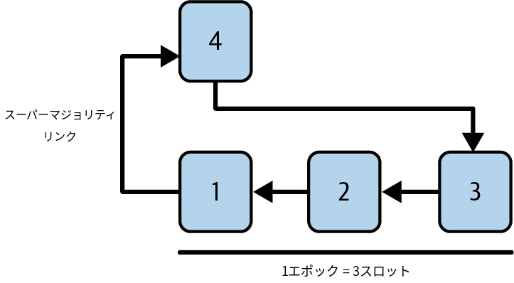

図15-37　ブロック1が正当化

　これらのアテステーションは公開され、すべてのバリデータと共有され、次のスロット（通常は直後のスロット）に含まれます。ブロック5と6をスキップして、図15-38に示す次のエポック（エポック3）の最初のブロックであるブロック7に直接進みましょう。

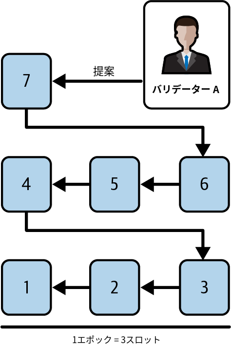

図15-38　ブロック7の提案 - エポック3

　再び、バリデータAがブロックを提案するために選ばれます。ローカルビューでLMD-GHOSTを実行します。以下はバリデータAのネットワークビューです。

- バリデータAのアテステーション：ヘッドブロック：ブロック6、ソースブロック：1、ターゲットブロック：4
- バリデータBのアテステーション：ヘッドブロック：ブロック6、ソースブロック：1、ターゲットブロック：4
- バリデータCのアテステーション：ヘッドブロック：ブロック6、ソースブロック：1、ターゲットブロック：4

　結果はブロック6なので、ブロック6の上にブロック7を公開します。

　ブロック7がネットワーク内で伝播し、公開直後にバリデータBとCが受信します。バリデータはチェーンのヘッドとして投票する新しいアテステーションを作成する必要があります。ここでも、再び何かが変わります。

　次のエポック（エポック3）に入ったため、アテステーションのCasper FFG部分が再び変わります。バリデータA、B、Cが作成するアテステーションは以下のとおりです。

**アテステーション**

- ヘッドブロック：ブロック7
- ソースブロック：ブロック4
- ターゲットブロック：ブロック7

　ご覧のとおり、ターゲットブロックはブロック7になり、ソースブロックはブロック4です。バリデータA、B、Cが前のアテステーションでターゲットブロックとしてブロック4に投票したためです。ブロック4からブロック7への新しいスーパーマジョリティリンクがあるため、図15-39に示すように、ブロック4を正当化しました。

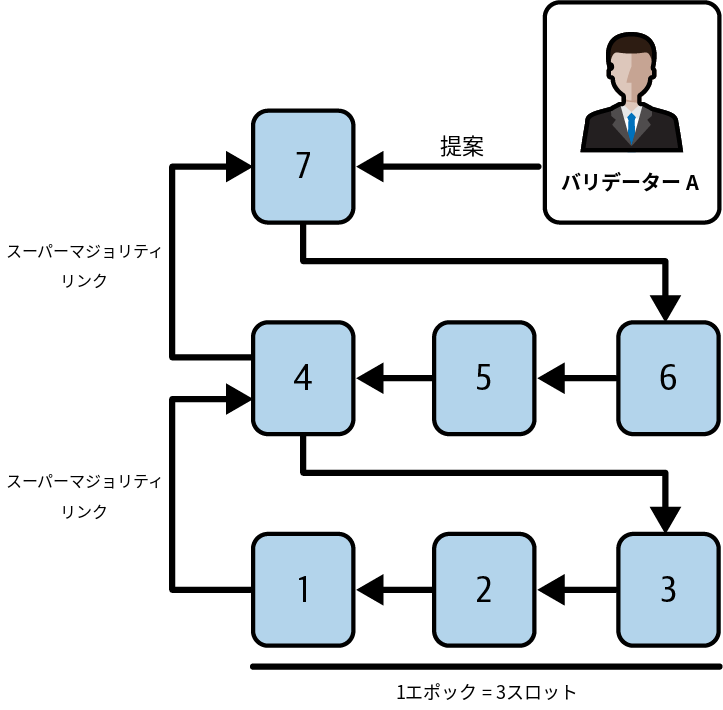

図15-39　ブロック4が正当化、ブロック1が確定

　ブロック1も確定されました。正当化されたチェックポイントであり、その直接の子であるブロック4も正当化されているためです。バリデータがブロックを確定されたとみなすとき、バリデータの3分の2以上から、全員がそのブロックが正当化されていることを確認したという確認を見たことを意味します。実際、バリデータAを例にとると（バリデータBとCにも当てはまります）、BとCがソースブロックとしてブロック1に投票したアテステーションを確認しています。ソースブロックとしてブロック1に投票するということは、BとCが以前にターゲットブロックとしてブロック1に3分の2以上の投票があることを確認していたことを意味します。したがって、ブロック1を取り消すためには、バリデータの少なくとも3分の1が二重投票によりスラッシングされなければならないことを確信できます。

## 論争と競争

　この時点で、なぜこれほど多くの異なるコンセンサスアルゴリズムが必要なのか疑問に思うかもしれません。どれがより良く機能するのでしょうか。この質問への答えは、過去10年間の分散システムにおける最もエキサイティングな研究分野の中心にあります。すべては何を「より良い」と考えるかに帰着します。コンピュータサイエンスの文脈では、仮定、目標、そして避けられないトレードオフの問題です。

　分散コンセンサスの問題のすべての側面を最適化できるアルゴリズムはおそらく存在しないでしょう。あるコンセンサスアルゴリズムが他のものよりも「優れている」と誰かが提案した場合、何がより優れているのかを明確にする質問を始めるべきです。不変性でしょうか。ファイナリティでしょうか。分散化でしょうか。コストでしょうか。少なくともまだ明確な答えはありません。さらに、コンセンサスアルゴリズムの設計は数十億ドル規模の産業の中心にあり、大きな論争と激しい議論を生んでいます。最終的には「正しい」答えがないかもしれませんし、異なるアプリケーションに対して異なる答えがあるかもしれません。

　ブロックチェーン業界全体が、敵対的な条件下で、巨額の金銭的価値を賭けて、これらの問いが検証される壮大な実験です。最終的に、歴史がこの論争に答えを出すでしょう。

　コンセンサスプロトコルにおける論争は数多く、ネットワークの調整によって解決することは困難です。インセンティブの整合は重要ですが、常に可能というわけではありません。イーサリアムのコンセンサスアルゴリズムの2つの現在の問題を検証しましょう。

### タイミングゲーム

　イーサリアムのプロトコルでは、時間はスロットと呼ばれる12秒の単位で構成されています。各スロットは、開始時（*t* = 0）にバリデータにブロックの提案の役割を割り当てます。次に、アテスターの委員会がこのブロックの検証を担当し、スロット開始から4秒後（*t* = 4）のアテステーション期限までに検証を行うことを目指します。

　*タイミングゲーム*は、図15-40に示すように、バリデータがMEV報酬を最大化するために、ブロックの提案をできるだけ遅らせる戦略です。この慣行は、より多くの価値を獲得するために提案を遅らせつつ、カノニカルチェーンに残るためにアテスティング委員会の十分な部分から支持されることを確保するという、微妙なバランスを必要とします。

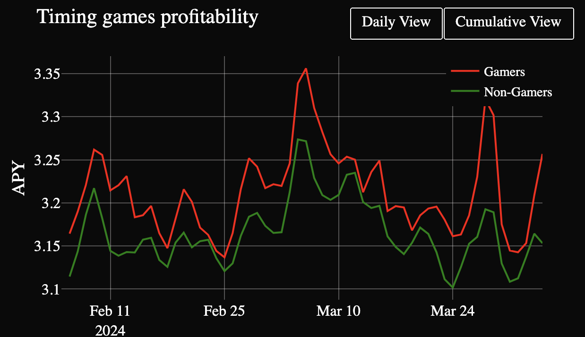

図15-40　タイミングゲーム戦略

　イーサリアムにおけるタイミングゲームは、あるバリデータのMEVからの利益が他のバリデータの不利になる可能性がある、競争的な環境を作り出します。この競争は、ミスしたスロットの数の増加と潜在的なブロックリオーグを増やすことで、コンセンサスを混乱させる可能性があります。さらに、アテスターが検証を延期する動機にもなり、プロセスに複雑さの層を追加します。

　「コンセンサスの原則」では、イーサリアムのコンセンサスプロセスにおけるライブネスの重要性を指摘しました。しかし、タイミングゲームはネットワークの信頼性を損なうことで、この重要な機能に対する脅威となります。

　タイミングゲームとは何でしょうか。最大限の利益を得るために、完璧なタイミングを待つようなものです。ネットワークを維持している一部の人々がまさにこれを行おうとしています。最大の報酬を得るために行動の適切なタイミングを待っているのです。しかし、この待ちのゲームはリスクを伴う可能性があります。インターネットが遅い場合や経験が少ない場合、役割を果たすチャンスを逃す可能性があります。そして、あまりに多くのチャンスを逃すと、ネットワークの信頼性が低下する可能性があります。

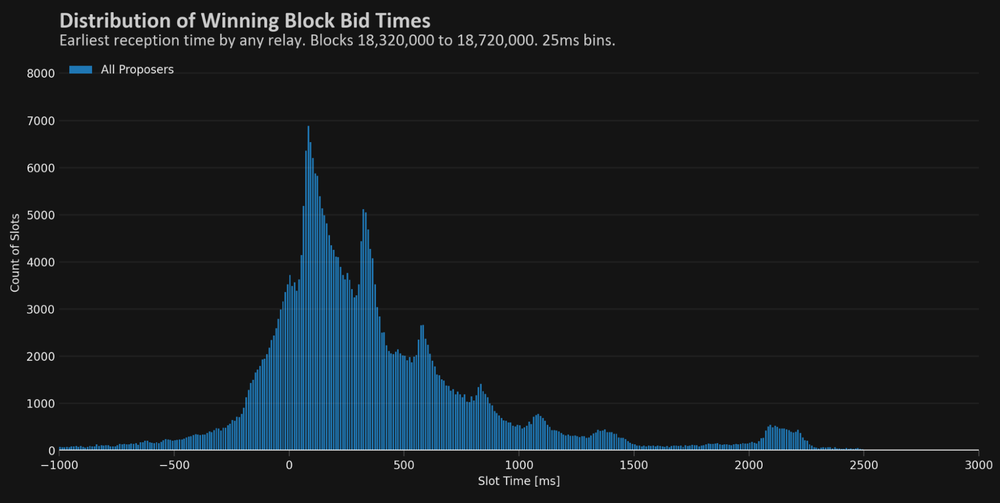

図15-41　タイミングゲームのリスク可視化

　現時点では、大きな問題ではありません。図15-41に示すように、バリデータとして活動しているエントリーのほとんどは、これらのタイミングゲームにあまり関与していないか、まったくプレイしていません。

> **注記**
>
> 2024年にこの章を書いて以来、状況は少し変わりました。現在、[Dencunハードフォーク](https://oreil.ly/TXJYS)で「proposer boost」と呼ばれるソリューションが追加されており、遅延したブロック提案者にペナルティを課しています。proposer boostは、ブロックが提案されたスロットでブロック提案者のアテステーションに重みを追加します。

### スーパーマジョリティの中央集権化

　イーサリアムにおけるスーパーマジョリティクライアントリスクの概念は、ネットワークの健全性とセキュリティのバランスに関するものです。イーサリアムは単一障害点を防ぐために複数のクライアントを使用することを決定しました。これらのクライアントを含むすべてのソフトウェアにはバグが存在する可能性があるためです。本当の問題は、コンセンサスバグが発生した場合です。例えば、etherを無限に生成するような深刻な事態につながる可能性があります。1つのクライアントだけがすべてを運用し、そのようなバグに見舞われた場合、修復は悪夢のようなものになります。攻撃者が不可逆的な損害を引き起こすのに十分な時間、ネットワークがバグがアクティブな状態で稼働し続ける可能性があります。

　図15-42に示すように、多数派クライアントにバグがあった場合に何が起こり得るかの簡単な例を分析しましょう。図15-42のすべてのブロックはブロックチェーンのブロックではなくチェックポイントであることに注意してください。

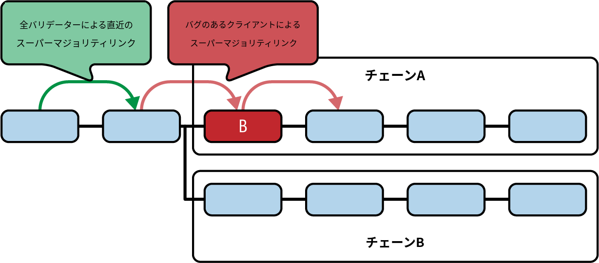

図15-42　多数派クライアントのバグシナリオ

　正常に動作しているクライアントは、無効なブロック（「B」とラベル付けされた）を含むエポックを無視します。ブロックBを指す矢印は無効なエポックを正当化するために機能し、ブロックBから出る矢印はそのエポックを確定します。

　バグが解決され、無効なエポックを確定したバリデータが正しいチェーンBに戻りたい場合、図15-43に示すように、必要な予備的なアクションはエポックXのジャスティフィケーションです。

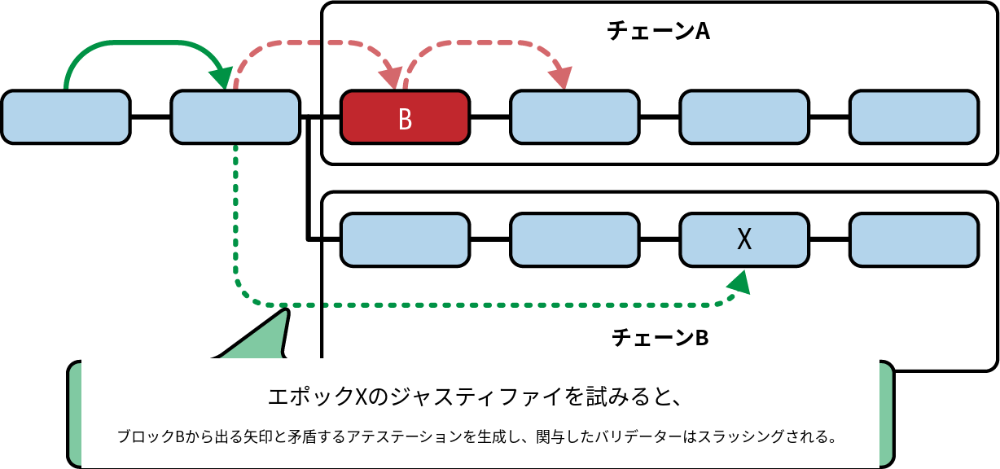

図15-43　バグからの回復にはジャスティフィケーションが必要

　破線の矢印で示されるスーパーマジョリティリンクを必要とするエポックXのジャスティフィケーションに参加するには、バリデータはブロックBから出る矢印（無効なエポックの確定を表す）をバイパスする必要があります。両方のリンクに投票すると、これらのバリデータにはペナルティが課される可能性があります。

　マルチクライアントアプローチはセーフティネットを提供します。ネットワークの半分未満が使用しているクライアントにバグが発生した場合、他のクライアントを実行しているネットワークの残りの部分はバグのあるブロックを単に無視します。これにより、ネットワークは軌道に乗り続け、混乱は最小限に抑えられます。しかし、多数派クライアント（特にバリデータの3分の2以上が使用しているもの）がバグを導入した場合、チェーンが不正に確定され、潜在的な分裂につながる可能性があります。

　イーサリアムはクライアントの多様化を奨励しています。全員が同じクライアントを使用し、それが故障した場合、ネットワーク全体が危険にさらされるからです。多数派に逆らうクライアントを実行することに対するペナルティは、すべてを一つのかごに入れることを抑止するためにあります。こうすることで、クライアントにバグがあった場合でも、損害は限定的で、影響を受けるユーザーは少なくなります。少数派クライアントが問題を引き起こした場合、多数派がパスを修正してチェーンの確定を継続できるため、それほど大きな問題にはなりません。

　異なるクライアント間で選択をより広く分散させればさせるほど、イーサリアムはより安全になります。技術的な障害を避けることだけでなく、単一障害点に対するイーサリアムの将来を守ることに関わっています。この多様性は、ネットワーク全体の危機に対する最良の防御であり、何が起ころうとも、イーサリアムが堅牢で回復力を維持することを保証します。

　この章を最初に書いた時点では、Gethの使用率は63%であり、前述のとおり問題でした。現在の状況はより健全ですが、将来さらに改善する必要があります。図15-44に示すように、現時点では実行クライアントの41%がGethを使用し、38%がNethermindを使用しています。

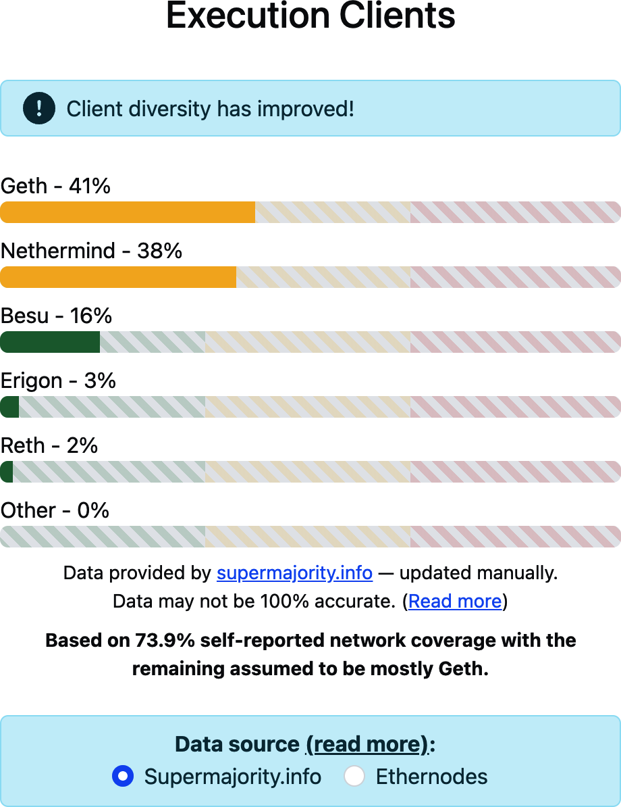

図15-44　現在の実行クライアント分布

　この問題は実行クライアントだけでなくコンセンサスクライアントにも影響しますが、コンセンサス側の問題は迅速に対処され、図15-45に示すように、状況は現在比較的健全で安定しています。

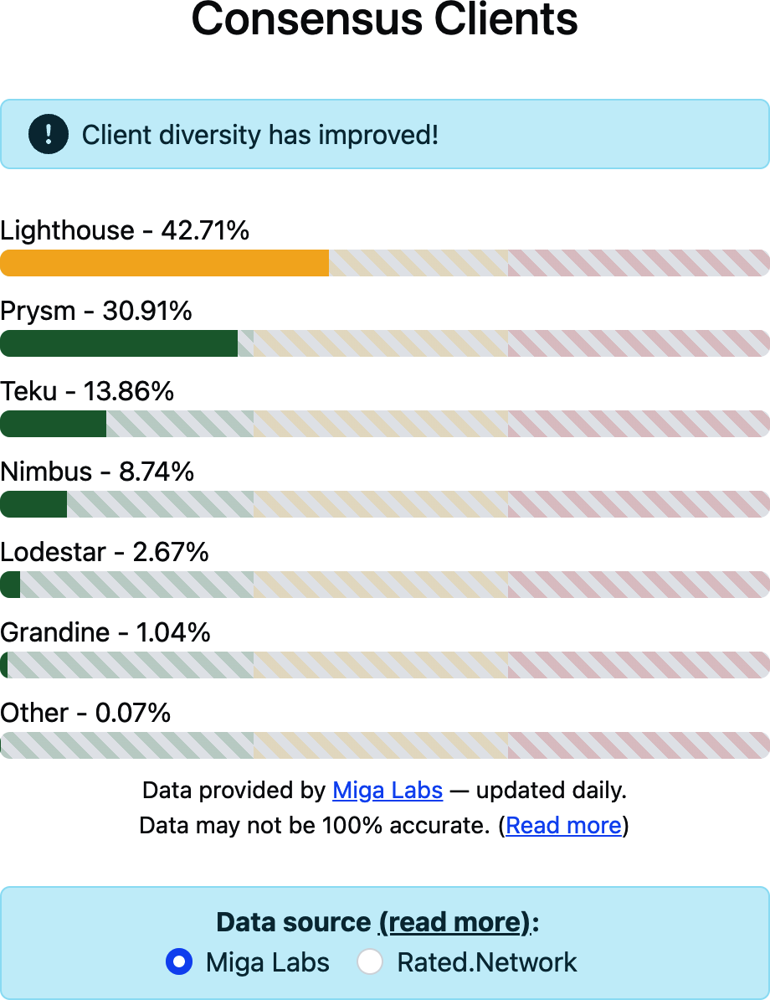

図15-45　現在のコンセンサスクライアント分布

## 結論

　コンセンサスアルゴリズムは、イーサリアムにおいて最も複雑な（そして繊細な）ものの一つです。機能性と効率性を向上させるための継続的な提案とともに、革新と改善の終わりなき旅を表しています。single-slot finalityやバリデータの最大有効残高の増加などの機能は、システムを精緻化し最適化するための継続的な取り組みを示しています。

　コンセンサスの核心的な原則を理解することは、これらの進歩とイーサリアムネットワークの堅牢性およびスケーラビリティへの影響を評価するための確固たる基盤を提供します。イーサリアムが進化するにつれて、このパイオニア的なブロックチェーン技術の能力を前進させるコンセンサスメカニズムも進化していきます。

　さらなる読み物として、以下を推奨します。

- [Gasper論文](https://oreil.ly/1BoMt)
- ベン・エジントン著[Upgrading Ethereum](https://oreil.ly/Jzh-9)
- [「Decentralization Is Good or Not? Defending Consensus in Ethereum 2.0」](https://oreil.ly/VNC1Q)
