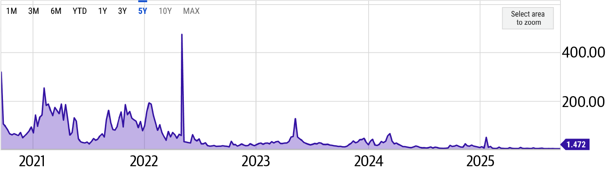
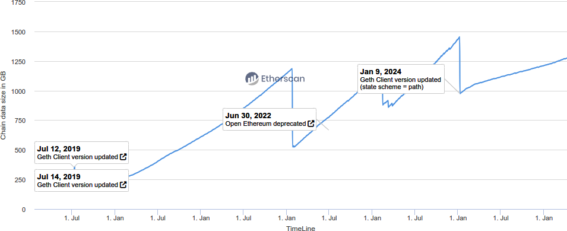
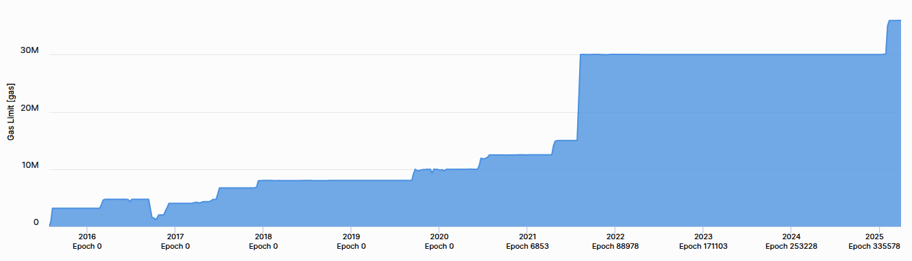
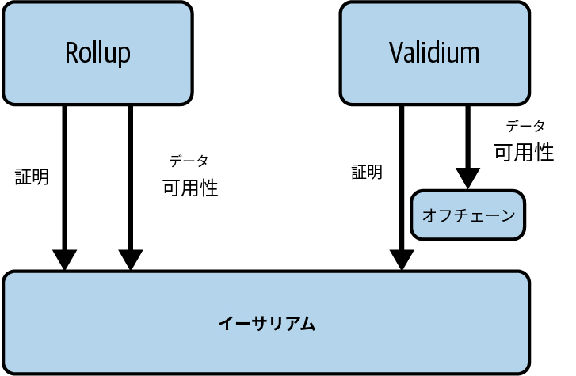
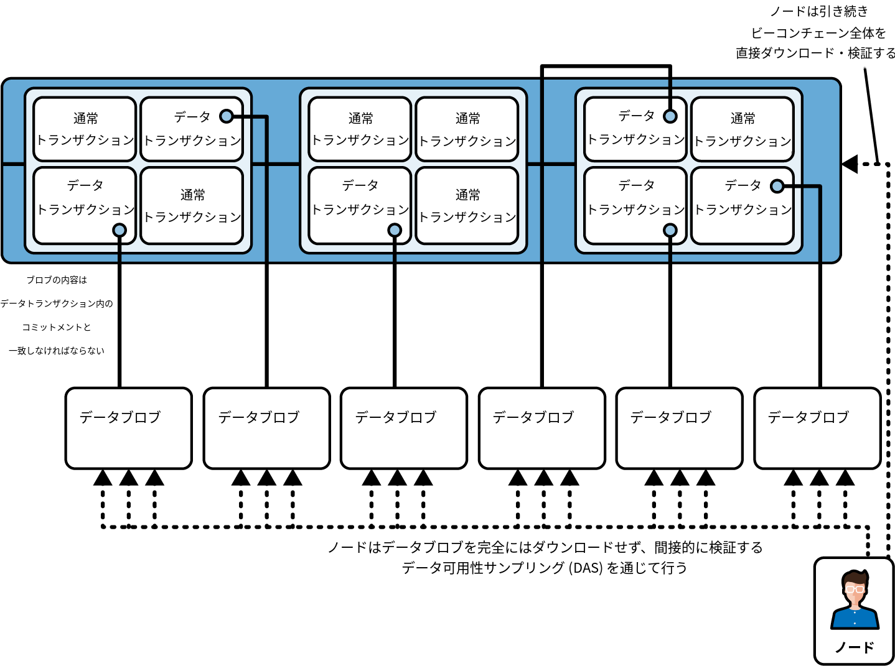
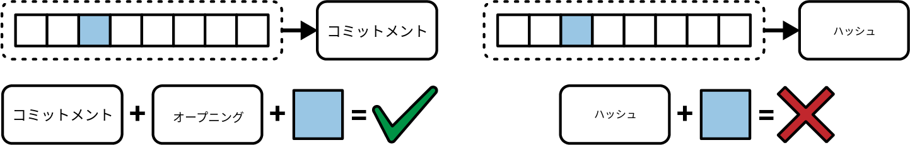
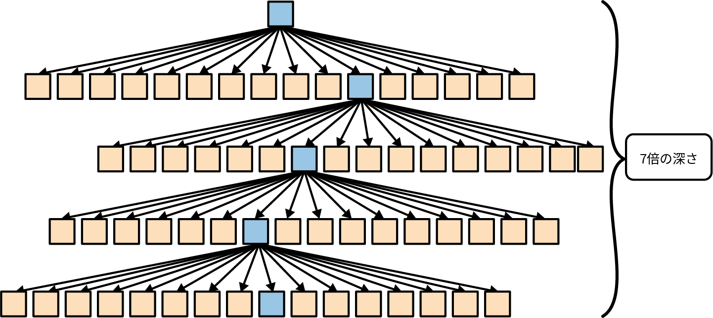
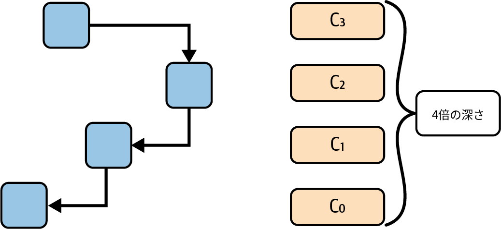
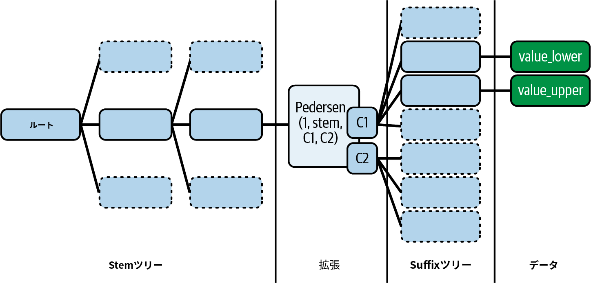

# 第16章 イーサリアムのスケーリング

　イーサリアムは最も強力かつ広く利用されているブロックチェーンプラットフォームの1つですが、これまで何度も見てきたように、成功には成長痛が伴います。イーサリアムは非常に人気が高まったため、ベースレイヤーが需要に追いつけなくなっています。ガス代はしばしば高騰してトランザクションが高額になりすぎ、処理すべきデータの増大によりシステムの負担が増しています。イーサリアムの開発者たちはEIP-1559（第6章で説明）、The Merge（コンセンサスプロトコルをPoWからPoSに変更した2022年のハードフォーク）、EIP-4844（プロトダンクシャーディング、本章で後述）などのアップグレードを展開してきましたが、L1の根本的な制約は大規模な普及を阻むボトルネックであり続けています。これらの改善は役立ちますが、L2ロールアップのような追加のスケーリングソリューションの必要性を排除するものではありません。

> **注記**
>
> L2ロールアップは、トランザクションをオフチェーンで処理し、その要約（証明やデータバッチなど）をイーサリアムのLayer 1に投稿するスケーリングソリューションです。イーサリアムのセキュリティに依存しながら、混雑と手数料を削減します。主に2つのタイプがあります。オプティミスティックロールアップ（有効と仮定し、問題があれば異議を申し立てる）とゼロ知識ロールアップ（暗号技術で正当性を証明する）です。イーサリアムは本質的に決済レイヤーとなり、証明の検証、データ可用性の確保、L2トランザクションに対する最終的なセキュリティ保証の提供に主な役割がシフトしています。ロールアップについては、本章の後半で詳しく解説します。

## イーサリアムLayer 1の問題

　イーサリアムのスケーリング課題を十分に理解するためには、4つの主要な問題に分解する必要があります。スケーラビリティトリレンマ、ガスコストとネットワーク混雑、ステートの増大とストレージ、ブロック伝播とMEVです。これらの問題はイーサリアムに固有のものではなく、他のチェーンも形を変えて同じ問題に直面していますが、イーサリアムの人気がこれらを増幅させています。それぞれ詳しく見ていきましょう。

### スケーラビリティトリレンマ

　イーサリアムは、あらゆるパーミッションレスブロックチェーンと同様に、3つの基本的な目標を持っています。*分散化*、*セキュリティ*、*スケーラビリティ*です。しかし問題は、1つを改善すると他の1つが犠牲になることが多いということです。ヴィタリック・ブテリンはこれを*スケーラビリティトリレンマ*と呼んでいます。

　それぞれを分解して説明します。

**分散化**

　分散化は、イーサリアムを検閲耐性があり、トラストレスなものにしている要素です。誰でもノードを運用し、トランザクションを検証し、中央機関の許可なくネットワークに参加できます。

**セキュリティ**

　セキュリティは、イーサリアムが攻撃に対して回復力を保つことを保証します。トランザクションは不可逆でなければならず、スマートコントラクトは不変でなければならず、悪意ある行為者がシステムを容易に操作できてはなりません。

**スケーラビリティ**

　スケーラビリティは、ネットワークが1秒あたり数千、さらには数百万のトランザクション（TPS）を処理できるようにし、グローバルな普及を実現するものです。

　課題は、イーサリアムのような従来のブロックチェーンが、スケーラビリティを犠牲にして完全な分散化とセキュリティを実現するよう設計されていることです。すべてのトランザクションがすべてのノードによって処理されるため、正確性は保証されますが、ボトルネックも生じます。

　なぜスループットを上げるだけではだめなのでしょうか。ブロックを大きくして（より多くのトランザクションを格納できるように）処理速度を上げようとすると、ハードウェア要件が厳しくなりすぎて、フルノードを運用できる人が少なくなります。これにより、少数の強力なエンティティだけがネットワークを制御する中央集権化が進む可能性があります。これはまさに私たちが避けようとしていることです。

　Solanaのような他のブロックチェーンは、異なるアプローチを取っています。速度とスケーラビリティに最適化しましたが、分散化を犠牲にしており、ノードの運用にはより高性能なハードウェアが必要です。イーサリアムは分散化を妥協しないことを選択しており、スケーリングの課題はさらに困難になっています。

　The Mergeで導入されたPoSは、エネルギー集約型のPoWシステムに取って代わりました。イーサリアムのエネルギー消費を劇的に削減しただけでなく、大規模なマイニング設備を持つ余裕のある大手プレイヤーの優位性も縮小しました。ステーキングには新たな中央集権化リスクが伴いますが、よりアクセスしやすく効率的なネットワークへの一歩です。ただし、PoSは大規模なステーキングプールによる中央集権化リスクなどの新たな課題ももたらしています。リキッドステーキングソリューションは、ステーキングされたETHのアクセシビリティを維持するのに役立ちますが、少数のプラットフォームに制御が集中するという側面もあります。適切なバランスを見つけることは現在も進行中の課題です。

### ガスコストとネットワーク混雑

　イーサリアムユーザーにとって最もフラストレーションの溜まる体験の1つは、ネットワーク需要に応じて大きく変動するトランザクションコストに伴う高いガス代です。なぜこのようなことが起こり、ピーク時に手数料がなぜこれほど高くなるのでしょうか。

　イーサリアムのトランザクションには*ガス*が必要です。ガスは、送金やスマートコントラクトとのやり取りなどの操作を実行するために必要な計算量を測定する単位です。操作が複雑になるほど、より多くのガスが必要になります。各ブロックには含められるガスの量に制限があるため、ブロックスペースの競争が生じます。需要が高いとき、ユーザーは互いに入札し合い、手数料が上昇します。

　これが劇的な形で表れた事例があります。

**CryptoKittiesブーム（2017年）**

　イーサリアムの限界が初めて本格的に試されたケースです。ユーザーがデジタル猫を繁殖させたり取引したりするシンプルなゲームが、ネットワークを著しく詰まらせ、トランザクション時間は大幅に遅延し、ガス代は急騰しました。

**DeFiサマー（2020年）**

　UniswapやCompoundのようなDeFiアプリの爆発的な普及が、イーサリアムに大量のアクティビティをもたらしました。トレーダーたちはメンプールで優先的に処理してもらうため、時には数百ドルのガス代を支払ってトランザクションを急ぎました。

**NFTブーム（2021年）**

　NFTのドロップはガスウォーズとなり、人々は新しいデジタルコレクティブルを他の誰よりも先にミントするためだけに数千ドルを支払いました。法外なガス代を費やしたにもかかわらず、失敗するトランザクションもありました。

　イーサリアムのLayer 1は、このレベルの需要を効率的に処理するようには設計されていませんでした。しかし、2021年に導入されたEIP-1559は、可変ブロックサイズと新しいガス価格メカニズムを導入し、ネットワーク活動が活発な時期のガス代の急騰を緩和しました。L2ソリューションの人気上昇により、イーサリアムは計算負担のかなりの部分をオフロードでき、ガス代がさらに削減されています。さらに最近では、EIP-4844（プロトダンクシャーディング）が展開され、特にL2ロールアップの手数料が大幅に低下し、ユーザーにとってイーサリアムのトランザクションがより手頃になりました。これらの改善にもかかわらず、イーサリアムのトランザクションコストは他のほとんどのブロックチェーンよりも依然として高い状態です（図16-1参照）。

図16-1 ブロックチェーン間のガスコスト比較

### ステートの増大とストレージの問題

　イーサリアムはトランザクションだけに使われているわけではありません。イーサリアムは*グローバルステートマシン*であり、アカウント残高、スマートコントラクトデータ、DeFiポジション、NFT、その他のオンチェーンアクティビティを継続的に追跡しています。従来のデータベースは古い記録をアーカイブまたは削除できますが、イーサリアムは透明性と検証可能性を確保するために完全な履歴を保持するよう設計されています。問題は、イーサリアムが成長するにつれてより多くのデータを保存する必要があり、そのストレージ負担が増し続けていることです。

　現在、イーサリアムのステート、つまりすべてのアクティブなアカウント、コントラクト残高、ストレージスロットの集合のサイズは、驚くべき速度で増大しています。新しいスマートコントラクトが追加されるたびにステートが増え、すべてのトランザクションがステートを変更します。ネットワークの整合性を検証するうえで重要な役割を果たすフルノードは、このデータを保存し、常に更新し続けなければなりません。ステートが増大するにつれ、高価なハードウェアなしにフルノードを運用することがますます困難になり、分散化に関する懸念が生じています。

　アーカイバルノードはさらに大きな課題に直面しています。アーカイバルノードは現在のステートだけでなく、過去のすべてのトランザクションやコントラクト実行を含むイーサリアムの完全な履歴記録も保存します。このデータの量はテラバイト規模に達し、大容量のストレージと帯域幅が必要です。アーカイバルノードを運用できる人の数は減少しており、誰がイーサリアムの長期的な履歴を保存するのかという疑問が生じています。

　イーサリアムのPoSシステムにおいてブロックの提案と証明を担当するバリデーターも、ステート増大の影響を受けています。トランザクションを効率的に検証するには、最新のブロックチェーンステートへの迅速なアクセスが必要です。しかし、ステートが拡大するにつれ、情報へのアクセスと処理は遅くなり、コストも増大します。この傾向が抑制されないまま続けば、ハイエンドなハードウェアを持つ人だけがバリデーションに参加できる環境が生まれ、イーサリアムは中央集権化に向かうリスクがあります。

　イーサリアムの開発者たちは、ステートの肥大化を抑制するために履歴有効期限やステートレントなどのソリューションを検討してきました。これらについては本章の後半「L1のスケーリング」で詳しく説明します。

　クライアント多様性も役立ちます。Gethは歴史的にイーサリアムの主要クライアントでしたが（図16-2参照）、Nethermind、Erigon、Besuなどの代替クライアントがストレージ効率を改善する最適化を導入しています。たとえばErigonは、履歴データの効率的な処理に特化しており、フルノードの負担を軽減しています。

図16-2 イーサリアムクライアントの分布

### ブロック伝播とMEV

　イーサリアムがより高いトランザクションスループットを処理できたとしても、もう1つの根本的なボトルネックがあります。それは、新しいブロックがネットワーク全体に伝播するのにかかる時間です。バリデーターが新しいブロックを生成すると、そのブロックは世界中の数千のノードにブロードキャストされなければなりません。ブロックが大きいほど伝播に時間がかかります。そして伝播に時間がかかるほど、ネットワークの不一致、つまり一時的なフォーク（ネットワークの異なる部分が一時的に分岐する現象）が発生する可能性が高まります。

　PoSはこれらのリスクを軽減するのに役立っていますが、ブロック伝播の遅延は依然としてパフォーマンスに影響を与えています。クライアントチームは処理を高速化するためのネットワーク最適化に取り組んでいますが、イーサリアムのスケーリングを進めるにあたり引き続き改善が必要な課題です。

　水面下に潜むもう1つの問題があります。MEVです。イーサリアムはPoSに移行しましたが、「miner extractable value」という名称が定着しています。今日ではより正確に*最大抽出可能価値（maximal extractable value）*と呼ばれ、バリデーターやサーチャーがブロック内のトランザクションを戦略的に並べ替えたり、含めたり、除外したりすることで得られる利益を意味します。

　MEVが発生するのは、トランザクションが送信された順序で処理されるとは限らないためです。バリデーターは自身の利益動機に基づいてトランザクションに優先順位をつけることができます。これにより、高度な技術を持つ行為者が一般ユーザーに不利な方法で価値を抽出する機会が生まれます。高頻度取引ボットはメンプール（ブロックに含まれるのを待っているトランザクションの待機場所）をスキャンし、利益を得る機会を探しています。たとえば、誰かがUniswapのような分散型取引所で大口取引を送信した場合、ボットはその前に割り込んで資産を先に購入し、より高い価格で売り戻すことができます。これは*サンドイッチ攻撃*として知られ、フロントランニングの一形態であり、MEVの中でも最も悪名高い手法の1つです。

　数年前から運用されている緩和策として、Flashbotsが開発したMEV-Boostプロトコルがあり、MEVをより民主的かつ透明にしています。しかし、長期的な解決策はより根本的な再設計、すなわちネイティブな*提案者-構築者分離*（PBS）の実装です。これらのソリューションについては、次のセクションでさらに詳しく解説します。

> **注記**
>
> MEVは、ほとんどのL2チェーンでは集中型のトランザクションシーケンサーに依存しているため、ほぼ存在しません。単一の集中型シーケンサーは通常、受信した順序でトランザクションを処理するため、トランザクションの並べ替えやフロントランニングの機会がなくなります。この集中型アプローチはMEVを大幅に削減しますが、分散化と検閲耐性に関する潜在的なトレードオフが生じます。今後のL2開発では、分散型シーケンシングメカニズムの導入により、これらのトレードオフのバランスを取ることを目指しています。

## ソリューション

　イーサリアムのスケーリング課題を克服するために何が行われているのでしょうか。単一の簡単な解決策はありませんが、開発者たちはネットワークをより高速に、より安価に、そして大規模な普及により適したものにするためのさまざまな改善に積極的に取り組んでいます。主要な戦略を詳しく見ていきましょう。

### L1のスケーリング

　イーサリアムのベースレイヤーであるLayer 1のスケーリングは、初日から直面している最も困難な課題の1つです。現実には、すべてを解決する単一の修正はなく、スケーリングは切り替えるだけのバイナリスイッチではありません。代わりに長期的なプロセスであり、分散化やセキュリティを犠牲にすることなくイーサリアムを段階的に効率化する最適化の組み合わせです。L2ロールアップがトランザクションの大部分を処理するための最善の手段ですが、イーサリアムのベースレイヤーを改善することも依然として重要です。L1でスループットと効率を向上させることができれば、ロールアップはさらに強力になり、ガス代は下がり、中央集権化に頼ることなくイーサリアムは競争力を維持できます。イーサリアムのベースレイヤーを改善する主要な方法を見ていきましょう。

#### ガスリミットの引き上げ

　イーサリアムのブロックは、格納できるトランザクションの数ではなく、各ブロックに収まるガスの量によって制約されています。これが*ガスリミット*です。予算のようなものと考えることができます。すべてのトランザクションはその複雑さに応じてガスを消費し、ブロック内の利用可能なガスはEIP-1559のメカニズムによって定義されます。ガスリミットを引き上げることで、各ブロックにより多くのトランザクションを格納でき、イーサリアムのスループットを実質的に向上させることができます。

　しかし、ガスリミットを単純に引き上げればよいというものではありません。ブロックが大きくなるとネットワーク全体への伝播に時間がかかり、イーサリアムはチェーンスプリットの影響を受けやすくなります。また、フルノードのハードウェア要件も増加し、中央集権化に近づいてしまいます。そのため、ガスリミットの引き上げは、スループットの改善とネットワークの健全性のバランスを取りながら、段階的かつ慎重に行われます（図16-3参照）。

図16-3 ガスリミットの歴史的な変化

#### イーサリアムにおける並列実行の将来

　イーサリアムは共有ステートモデルのためにトランザクションを逐次的に処理しています。これによりセキュリティと一貫性は確保されますが、トランザクションを並列に実行できないため、スケーラビリティが制限されます。対照的に、SolanaやAptosのような新しいブロックチェーンは並列実行を採用していますが、より中央集権的なアーキテクチャに依存しており、バリデーターには高性能なハードウェアが必要です。

　イーサリアムにおける課題は、トランザクションが同じステートと頻繁にやり取りすることです。たとえば、2つのDeFi取引が同じ流動性プールを変更するケースです。堅牢な依存関係管理システムなしにトランザクションの順序を変更すると、スマートコントラクトのロジックが壊れる可能性があります。もう1つの複雑さは、フルノードがすべてのトランザクションを検証しなければならず、並列実行を導入するにはスレッド間の慎重な同期が必要になることです。

　イーサリアムの研究者たちは、分散化を維持しながら部分的な並列実行を導入するためのソリューションを積極的に検討しています。1つのアプローチは*ステートレス実行*で、フルノードストレージへの依存を減らし、トランザクション処理をより効率的にします。もう1つは*オプティミスティック 並行性*で、トランザクションは独立していると仮定し、競合が発生した場合にのみロールバックする方式です。これらの概念については、本章の後半で詳しく説明します。

　並列EVMのいくつかの実験的実装が、Monad、Polygon PoS、Shardeumなど、EVM互換チェーンで登場しています。たとえばMonadは、10,000TPSを超えるオプティミスティック並列実行モデルを実装しています。Polygon PoSは、Block-STMアプローチにより1.6倍のガススループット向上を達成し、トランザクションの部分的な並列化を可能にしています。これらの進歩は貴重な洞察を提供しますが、イーサリアムは分散化を保ちながら並列化を実装しなければならず、このバランスが依然として重要な課題です。最近の研究では、イーサリアムのトランザクションの約64.85%が並列化可能であることが示されており、パフォーマンス向上の大きな可能性が示唆されています。しかし、2025年3月時点で、並列実行をイーサリアムのメインネットに統合する具体的な計画はありません。ブロック末尾の仮想トランザクションを通じたEVMの並列化に関する議論は進行中ですが、イーサリアムの実行モデルの複雑さが実装を困難にしています。イーサリアムのスケーラビリティに向けたロードマップには、トランザクション依存関係の解決、代替実行モデル、EVMの効率の段階的改善に関する継続的な研究が含まれています。

#### ステートの増大と有効期限

　イーサリアムのステート（すべてのアカウント残高、スマートコントラクトストレージ、その他のオンチェーンデータの集合）は増大し続けています。新しいコントラクトが追加されるたびにデータが増え、一度イーサリアムのステートに書き込まれたデータは永遠にそこにとどまります。分散化と検証可能性にとっては素晴らしいことですが、スケーラビリティにとっては問題です。フルノードはこのすべてのデータを保存し処理しなければならず、ステートが大きくなるにつれてノード運用コストは増加します。

　現在、イーサリアムのステートサイズはフルノードで約1.2TBですが、完全な履歴ステートとトランザクションデータを保存するアーカイバルノードは21TB以上のストレージが必要です。この膨大なデータフットプリントにより、個人がアーカイバルノードを運用することはますます困難になり、この役割は資金力のある少数のエンティティに集中しつつあります。なお、ErigonとRethの実行クライアントは、ストレージの使用量が少なく最適化されており、アーカイブノードでも約2TBで済むことを付記しておきます。

　ステート有効期限と履歴有効期限は混同されがちですが、異なる問題に対処しています。*ステート有効期限*は、スマートコントラクトが消費するストレージに対して定期的にレントを支払うことを要求し、イーサリアムのアクティブに維持されるステートのサイズを削減することを目的としています。コントラクトが支払いを行わない場合、誰かが明示的に復活のための支払いを行うまでアクセスできなくなります。これによりステートの増大が大幅に抑制され、フルノードの運用が容易になります。

　一方、*履歴有効期限*は、過去のトランザクションデータの膨大なサイズに対処します。すべてのノードにすべての履歴トランザクションの保存を強制する代わりに、イーサリアムは古いデータをプルーニングし、外部ストレージソリューションにオフロードすることが可能になります。ライブステートには影響しませんが、履歴クエリはサードパーティのデータプロバイダーにより依存するようになります。両方のアプローチにはトレードオフがあり、効率性とアクセシビリティの最適なバランスを見極めるための研究が進行中です。

　このトピックをさらに深く探求するには、履歴有効期限を扱うEIP-4444を参照することをお勧めします。ステート有効期限については、まだ研究段階であり明確な戦略はありませんが、イーサリアムのロードマップで詳しい情報を見つけることができます。

#### 提案者-構築者分離

　MEVは、PoSへの移行後もイーサリアムにおいて根強い問題です。バリデーターや専門のサーチャーが、一般ユーザーを犠牲にしてトランザクションの並べ替え、フロントランニング、その他の戦略を用いて利益を抽出しています。これは経済的な問題だけでなく、ネットワークの健全性にも影響を与え、混雑を増加させ、ガス代を予測困難にしています。

　PBSは、MEVを緩和するための最も有望なソリューションの1つです。現在、バリデーターはブロックの提案と構築の両方を行っており、トランザクションの順序を完全に制御しています。PBSはこれらの役割を分離することで変革をもたらします。バリデーターは引き続きブロックを提案しますが、実際のブロック構築は競争入札を通じて専門のビルダーに委託されます。これにより、バリデーターがMEV抽出に関与する直接的なインセンティブが取り除かれ、トランザクションの組み込みがより透明になります。

　PBSは、バリデーターがブロック構築を最高入札者に委託できるMEV-Boostの形ですでにテストされています。ただし、MEV-BoostとPBSはMEVを排除するわけではなく、より透明で公平なものにするだけであることを理解することが重要です。裁定取引、フロントランニング、サンドイッチ攻撃を駆動する根本的なインセンティブがなくならないため、MEVは引き続き存在します。PBSが保証するのは、少数のインサイダーが不透明なMEV戦略から利益を得るのではなく、MEVの獲得プロセスがよりオープンで公平かつ競争的になることです。長期的には、オーダーフローオークション、暗号化メンプール、その他のMEV緩和技術がPBSと並行して統合され、MEVの悪影響をさらに低減する必要があります。

### ロールアップ

　イーサリアムは、スケーラビリティ、トランザクションスループット（TPSで測定）、高い手数料に関する課題に持続的に直面してきました。これらの問題に対処するために、ロールアップの概念が登場しました。

　*ロールアップ*は、専用のL2上で「オフチェーン」でトランザクションを実行し、集約（「ロールアップ」）されたデータまたは証明をL1ブロックチェーンに戻して投稿するメカニズムです。計算とステート更新の重い処理がL1から離れた場所で行われるため、ブロックチェーンは通常のスループットボトルネックを回避し、トランザクション速度が向上して手数料が低下します。実質的に、ロールアップ自体の実行環境が署名チェック、コントラクト実行、ステート遷移をより効率的に処理し、L1は権威ある「決済レイヤー」として機能し続けます。

　ロールアップは、L1のセキュリティをできる限り維持することを目指しています。セキュリティの目標は、データ可用性の確保、正しいステート遷移の検証、検閲耐性の提供です。データ可用性は、紛争が発生した場合に参加者が独立してチェーンのステートを検証したり、L1に投稿された（またはL1によって保証された）データに基づいて安全に資金を引き出したりできるよう、すべてのトランザクションとステート情報にアクセスできることを要求します。ステート遷移の整合性は、L2での変更がネットワークルールに従って有効であることを保証し、通常は有効性証明（ゼロ知識証明など）または不正証明を通じて実現されます。最後に、検閲耐性は、単一のエンティティまたは少数の参加者グループがユーザーのトランザクションを無期限にブロックまたは保留できないことを保証します。

> **注記**
>
> データ可用性と有効性は、安全なロールアップ実装の不可欠な要素であり、悪意ある行為者がトランザクションを偽造したり、資金を盗んだり、残高を不正に膨らませたりすることを防ぎます。データの有効性は通常、2つの主要なアプローチのいずれかに依存します。最初のアプローチはゼロ知識証明を使用するもので、L2トランザクションの各バッチに正しい実行を証明する暗号学的証明が付属します。この証明がL1に提出されると、スマートコントラクトが新しいステートルートを受け入れる前にその正当性を検証します。2番目のアプローチは、オプティミスティックな仮定のもとで不正証明を使用します。L2オペレーターが新しいステートをL1に投稿し、誰でも不正行為の証拠を提示して提出に異議を申し立てることができます。不正証明が認められた場合、無効なバッチは取り消され、悪意ある行為者にはペナルティが科せられます。
>
> 有効性に加えて、データ可用性は、L2オペレーターが消失したり不正な行動を取ったりした場合でも、ユーザーが常にチェーンを再構築できることを保証します。これを実現するための方法はさまざまです。一部のシステムでは、すべてのトランザクションデータをL1に直接保存します。多くの場合イーサリアムのcalldataとして、または最近ではよりblobとして保存し、ブロックチェーンのログに透明に記録します。他の設計では、オフチェーンのデータ可用性レイヤー、特殊なネットワーク、またはデータの維持と提供に暗号経済的インセンティブを提供する外部ストレージソリューションに依存します。ハイブリッドアプローチでは、両方の方法を組み合わせることもあります。重要な情報はオンチェーンに配置し、それほど重要でないデータはオフチェーンに保存します。

　ロールアップは、L1にデプロイされた専用のスマートコントラクトに依存しており、すべてのL2アカウントの正規ステートを維持しています。このコントラクトは、現在のL2ステートを表すルート（一般的にマークルルート）を保存し、指定されたアクター（シーケンサー、アグリゲーター、またはオペレーターと呼ばれることもある）から送信された新しいトランザクションのバッチを受け入れ、それらのバッチの有効性を検証します。ロールアップのタイプに応じて、ゼロ知識証明のチェックや不正証明の処理を行い、ステート更新が正当であることを確認します。違反が検出された場合（たとえば、不正証明が成功した場合）、コントラクトは無効なバッチを取り消すことができます。

　ロールアップの要件（ボンドのステーキングなど）を満たす人は誰でも、L2トランザクションのステート更新をスマートコントラクトに送信できます。ただし、常にそうとは限りません。実際、現時点では、トランザクション量とTotal Value Lockedが最も多いロールアップのほとんどがシーケンサーレベルで中央集権化されています。一部のロールアップは分散化を達成していますが、大多数にとってはまだ最終目標の段階です。各ステート更新には、前のステートルート（連続性を示すため）、新しく提案されたステートルート（送信されたトランザクションの結果を反映）、および圧縮されたトランザクションデータまたはそのデータへの参照が含まれます。ロールアップのルールが満たされた場合（そしてオプティミスティックロールアップの場合、有効な異議申し立てがない場合）、コントラクトは保存されたステートルートを新しいものに更新し、正規のL2ステートとします。

　異なるロールアップは、不正または無効なステート更新に対して異なる方法で対処します。オプティミスティックロールアップは、新しいステート更新がデフォルトで正しいと仮定しますが、誰でも不正証明を提出できるチャレンジウィンドウ（多くの場合数日間）を設けています。証明が検証されると、無効なステート更新はロールバックされ、悪意ある提出者のステークはスラッシュされます。一方、ZKロールアップは、新しいステートルートごとにゼロ知識証明の添付を要求します。この証明がオンチェーンで検証されるため、チェーンは更新が有効かどうかを即座に判断できます。証明が正しければ、長い異議申し立て期間は不要です。

#### ロールアップのステージ

　初期段階では、ほとんどのロールアップは部分的な中央集権的制御を保持しています。これは*トレーニングホイール*と呼ばれることが多く、バグや重要な更新が発生した場合にオペレーターが迅速に介入できるようにするものです。新しいシステムにとっては実用的ですが、真の分散化にはこのトレーニングホイールを段階的に取り除く必要があります。

　この移行を示すために、ヴィタリック・ブテリンの最初のマイルストーンに基づくフレームワークが提案されており、ロールアップを3つの成熟度ステージに分類しています。各ステージは、中央集権的な手に残されている権限の量と、ロールアップがイーサリアムのベースレイヤーセキュリティをどの程度継承しているかを示しています。

　*ステージ0*では、ロールアップはロールアップを自称していますが、依然としてオペレーターによって大きく制御されています。ステートルートをL1に投稿し、L1上でデータ可用性を提供することで、問題が発生した場合にL2ステートの再構築を可能にしています。しかし、この時点では、システムの「証明メカニズム」（不正証明または有効性証明）がオンチェーンのスマートコントラクトによって完全に強制されていない場合があります。エラーが発生した場合の主なフォールバックはオペレーターの介入です。基本的に、ステージ0はロールアップの基本要素（オンチェーンデータ、ステートルート、ユーザー向けノードソフトウェア）が整っていることを保証しますが、ガバナンスは中央集権的なままです。

> **注記**
>
> この3段階フレームワークの要件は変更される可能性があります。たとえば、本稿執筆時点（2025年2月）では、Arbitrumはステージ1のロールアップですが、新しい要件では、ネットワークを期限内にアップグレードしなければステージ0のロールアップに戻る可能性があります。

　*ステージ1*のロールアップは、適切な証明システム（オプティミスティックロールアップの場合は不正証明、ZKロールアップの場合は有効性証明）を備えている必要があり、これらの証明を提出できる外部アクターが少なくとも5人いなければなりません。ユーザーはオペレーターの協力なしにシステムから資金を引き出したり「退出」したりできなければならず、検閲から保護されます。もう1つの基準は、ユーザーがシステムアップグレードの提案に同意しない場合に最低7日間の退出ウィンドウを設けることですが、「セキュリティカウンシル」は重大なバグが発生した場合により迅速に介入できます。このカウンシルは、8人以上の署名者のうち少なくとも50%の承認を必要とするマルチシグで構成されなければならず[^1]、その半数はロールアップの主要組織の外部の者でなければなりません。このカウンシルはバグの修正や悪意あるトランザクションの取り消しを行えますが、依然として単一障害点となる可能性があります。

[^1]: これは最近変更され、要件が少し変わりました。本章ではこの変更を詳しく分析しません。詳しくはルカ・ドンノのMedium記事を参照してください。

　*ステージ2*は、ロールアップが真に分散化されており、パーミッションレスな証明と堅牢なユーザー保護に依存していることを意味します[^2]。不正証明または有効性証明システムは誰にでも開かれていなければならず、許可リストは不可です。ガバナンス提案やアップグレードが導入された場合、ユーザーには退出までに少なくとも30日間の猶予が与えられ、変更を強制されないことが保証されます。セキュリティカウンシルの役割は、矛盾する証明の提出などのオンチェーンの健全性関連エラーに厳密に限定され、広範なガバナンスや裁量権は持ちません。したがって、この最終ステージでは人間の介入は狭い範囲に限定され、ロールアップはほぼスマートコントラクトとコミュニティのコンセンサスによって統治され、最小限の信頼というイーサリアムの精神に近づいています。

[^2]: ステージ2はより良いUXやより多くの採用を示すものではなく、より多くの分散化を示すだけである。

　このフレームワークの開発と更新に関わったすべての方々、そしてロールアップのステージに関する情報の分析と公開に携わったすべての方々に感謝を申し上げます。皆さまの活動は非常に高く評価されており、また必要不可欠なものです。

#### オプティミスティックロールアップ

　オプティミスティックロールアップは不正証明に依存しています。オペレーターはステートルートが有効であるという前提でL1に投稿します。ただし、オブザーバーは不正であると思われるバッチに異議を申し立てる権利を保持しています。異議が正しいと証明された場合、無効なバッチは取り消され、オペレーターにペナルティが科せられます。有効性が即座に確認されないため、ユーザーは資金の引き出しやファイナリティの達成前に、チャレンジウィンドウ（場合によっては1週間以上）を待つ必要があります。この設計により引き出し時間は長くなりますが、EVMとの容易な互換性と低い証明の複雑さを実現しています。オペレーターはゼロ知識回路を構築する必要がないため、システム運用の一部の側面が簡素化されます。とはいえ、引き出しの遅延はユーザー体験に影響を与える可能性があり、オペレーターのボンドがロックされた総額よりも小さい場合には経済的攻撃の可能性も存在します。オプティミスティックロールアップの例としては、Arbitrum、Optimism、Base、および「Optimistic Ethereum」モデルに触発された他のプロジェクトがあります。

#### ゼロ知識ロールアップ

　ZKロールアップは有効性証明に基づいて動作します。プロバイダーがL2上でトランザクションをバンドルする際、ステート遷移の正当性を証明する暗号学的証明（多くの場合SNARKまたはSTARK）を生成します。これらの証明はオンチェーンで検証され、長い異議申し立て期間が不要なため、ほぼ即時のファイナリティを提供します。正当性の確認に待機期間が不要なため、ユーザーは高速な引き出しの恩恵を受けます。高いセキュリティは証明の直接検証から生まれ、ウォッチャーや大規模なオペレーターのステークへの依存を軽減します。オンチェーンでの証明の検証は、各トランザクションを個別に処理するよりも通常は効率的です。しかし、汎用EVMの計算に対するゼロ知識証明の実装は計算コストが高く、専用ハードウェアが必要になる可能性があります。

##### ゼロ知識証明のリスク

　最先端の暗号技術にはリスクが伴うというのが現実です。Zcashを例に取りましょう。Zcashは「Succinct Non-Interactive Zero Knowledge for a von Neumann Architecture」という論文で提示された実装の一部を使用しました。この論文は、Zcashの最初のローンチで使用されたzk-SNARK構造を記述したものです。

　2018年、この論文の公開と数十回のピアレビューから数年後、当時Zcashに雇用されていた暗号学者アリエル・ガビゾンが、偽造脆弱性（本質的には二重支払い攻撃）を可能にする微妙な暗号学的欠陥を発見しました。この脆弱性はZcash Saplingアップグレードで修正され、誰にも悪用されなかったようですが、非常に公開され引用されている論文の中で、誰も気づかないまま何年も潜んでいたのです。

　本章では、ゼロ知識証明を高セキュリティで信頼できるものとして言及しています。これは一般的に正しいのですが、一度も疑問を持たれなければ危険な仮定となります。

　特定のゼロ知識システムは、初期パラメータを生成するための*トラステッドセットアップ*[^3]（SNARKでは一般的）も必要とし、独自のセキュリティ上の考慮事項があります。主要なZKロールアッププロジェクトには、ZKsync、Starknet、Scroll、Aztecがあります。Aztecは「ZK-ZKロールアップ」というラベルでプライバシー機能も組み込んでいます。

[^3]: 第4章で説明した通り。

　ZKロールアップはもともとトークン送金やスワップなどの単純なタスクに適していましたが、より複雑な機能には苦戦していました。これは*zk-EVM*の登場によって変わりました。zk-EVMは、EVM全体をオフチェーンで再現することを目的とした開発です。チューリング完全な計算（EVMバイトコードの実行を含む）に対する証明を生成することで、zk-EVMはZKロールアップの範囲を拡大し、幅広いDAppsがスケーラビリティとゼロ知識レベルのセキュリティの両方の恩恵を受けられるようにしています。

　zk-EVM機能を実現するために、プロジェクトはさまざまな方法を採用しています。1つの方法はトランスパイラを使用するもので、Solidity（または他のEVM高水準言語）をCairo（StarkWareが使用）のような回路に適した言語に変換します。もう1つのアプローチは、標準的なEVMバイトコードをオプコードごとに直接解釈し、各命令を反映する回路を構築するものです。ハイブリッドまたはマルチタイプのソリューションは、EVMの一部（データ構造やハッシュアルゴリズムなど）を証明に適したものに調整しつつ、イーサリアムとのほぼ完全な互換性を維持しようとしています。zk-EVMについては本章ではこれ以上詳しく展開しません。第17章で詳述します。

### その他のスケーリングソリューション

　オプティミスティックロールアップとZKロールアップは唯一のスケーリングソリューションではありません。現時点では主に採用されている2つですが、将来的には変わる可能性があります。古くて今後関連性が低いものについては簡潔に、今後有望なソリューションについてはより詳しく分析します。

#### Validium

　*Validium*はトランザクションデータをイーサリアム上に保存しません。代わりに、L2チェーンのステートを検証する証明をイーサリアムに投稿します（図16-4参照）。本質的に、validiumは代替的なデータ可用性ソリューション（Celestia、Avail、EigenLayerなど）を使用するロールアップです。

図16-4 Validiumアーキテクチャ

　L2として、validiumはイーサリアム上にデータを保存する際の高いガス代を支払いません。このアプローチはロールアップよりもコスト効率が高く、ユーザーのガス代は大幅に低くなります。しかし、validiumはデータ可用性委員会や代替的なデータ可用性ソリューションなどを使用してイーサリアム外にトランザクションデータを保存するため、他のロールアップよりもセキュリティが低いと一般的に考えられています。

#### サイドチェーン

　*サイドチェーン*は、別のブロックチェーン（メインチェーンと呼ばれる）と並行して動作するブロックチェーンネットワークです。通常、サイドチェーンは双方向ブリッジを介してメインチェーンと接続し、資産および場合によってはコントラクトのステート、マークル証明、特定のトランザクションの結果などの任意のデータを2つのネットワーク間で転送できます。

　ほとんどのサイドチェーンは、メインチェーンとは別のコンセンサスメカニズムとバリデーターセットを持っています。これにより、サイドチェーンは他のブロックチェーンに依存せずにトランザクションの決済とファイナリティを実現できます。しかし同時に、サイドチェーンにブリッジされた資金のセキュリティは、バリデーター間の悪意ある行動を抑止する強力な暗号経済的インセンティブの存在に依存することも意味します。

#### Basedロールアップ

　*Basedロールアップ*は、L1ブロックチェーンのネイティブシーケンシング機能に依存しています。この設計により、L1の分散化、ライブネス、セキュリティ特性を活用したシームレスな統合が可能になります。

　basedロールアップは、従来のロールアップと比較してよりシンプルなシーケンシングアプローチを使用しています。ほとんどのロールアップは独自のシーケンサーを実装していますが、basedロールアップは基盤となるLayer 1のシーケンサーを利用します。基本的な違いは、オプティミスティックロールアップのように外部のシーケンサーを持つのではなく、L1のバリデーターがロールアップのシーケンサーを務めることです。

　コンセンサス、データ可用性、決済レイヤーはすべてイーサリアムそのものです。ロールアップ自体に組み込まれている唯一のコンポーネントは実行レイヤーであり、トランザクションの実行とステータスの更新を担当します。この設計により、L1ブロックプロポーザーはL2ブロックビルダーやサーチャーと直接連携して、次のロールアップブロックをL1ブロックに組み込むことができます。basedシーケンシングは既存のイーサリアムの検証アプローチのみに依存するため、外部のコンセンサスには依存しません。

> **注記**
>
> basedロールアップはおそらく最も有望なソリューションであり、利用においてオプティミスティックロールアップを超える可能性があります。ファイナリティがイーサリアム自体と同じであるため、チャレンジウィンドウなしでbasedロールアップ間のアトミックトランザクションが可能になるからです。たとえば、DeFiの流動性をbasedロールアップ間で集約できるようになります。以前は、これはZKロールアップでのみ可能でした。

#### ブースターロールアップ

　*ブースターロールアップ*は、トランザクションがL1上で直接実行されたかのように処理し、L1ステートへの完全なアクセスを付与するロールアップです。同時に、独自の別個のストレージを維持します。このように、実行とストレージの両方がL2レベルでスケールし、L1フレームワークは共有ベースとして機能します。別の見方をすると、各L2がL1を反映し、トランザクション実行とストレージをシャーディングすることで、L1にデプロイされたすべてのアプリに新しいブロックスペースを効果的に追加しています。

　イーサリアムの将来が高いスケーラビリティ需要を処理するために何百、何千ものロールアップの使用を求めるなら、各ロールアップが独自のルールセットとコントラクトを持つ独立したチェーンとして機能することは理想的ではないかもしれません。開発者は各ロールアップにコードを複製することになってしまいます。

　ブースターロールアップは代わりに、L1上で稼働しているあらゆるDAppに直接追加のブロックスペースを提供します。ブースターロールアップの展開は、コンピューターにCPUコアやハードドライブ容量を追加するようなものと考えることができます。アプリケーションがマルチスレッド（ブロックチェーンの文脈ではマルチロールアップ）の活用方法を知っている場合、拡張された容量を自動的に利用できます。開発者は、その追加環境を最適に活用する方法を検討するだけで済みます。

#### ネイティブロールアップ

　ネイティブロールアップの提案は、ロールアップのステート遷移の検証器として機能するよう設計された`EXECUTE`プリコンパイルを導入するものです。これにより、不正証明ゲーム、SNARK回路、セキュリティカウンシルなどの複雑なインフラストラクチャが不要になり、EVM等価なロールアップの開発が大幅に簡素化されます。`EXECUTE`を使えば、わずか数行のSolidityコードで最小限のネイティブかつbasedなロールアップをデプロイできます。

　この新しいプリコンパイルは「EVM in EVM」のアイデアに密接に類似しているため、社会的コンセンサスによって統治されるイーサリアムの通常のハードフォークプロセスを通じてアップグレードされます。この整合性により、EVMへの更新がプリコンパイルにも適用されることが保証されるため、ロールアップはセキュリティカウンシルやマルチシグなどのガバナンス構造を必要とせずにイーサリアムの検証ルールを継承し、最終的にエンドユーザーにとってより安全なものとなります。

　`EXECUTE`プリコンパイルはEVMのステート遷移を検証し、ロールアップがアプリケーションレイヤーでイーサリアムのネイティブインフラストラクチャを活用できるようにします。`pre_state_root`、`post_state_root`、`trace`、`gas_used`などの入力を使用してEVMのステート遷移をチェックし、ガス価格設定にはEIP-1559のようなメカニズムを採用しています。正当性を強制するために、バリデーターは各ロールアップがスケールと複雑さのバランスをどのように取るかに応じて、再実行またはSNARK証明に依存する場合があります。この設計は、basedロールアップアプローチ（シーケンシングと証明システムの両方がイーサリアム上で直接動作する）と組み合わせることで、「トラストレスロールアップ」の作成を簡素化します。

### ダンクシャーディング

　*ダンクシャーディング*は、以前の設計に比べて大幅な簡素化を提供する、イーサリアムの最新のシャーディングアプローチです。

> **注記**
>
> シャーディングについて初めて言及するので、概念を簡単に紹介しておきます。これはさらに深く研究できるトピックであることを念頭に置いてください。本書の範囲外ですが、興味深いトピックです。
>
> シャーディングの基本的な概念は、ネットワークを異なる部分に分割し、各シャードがトランザクションのサブセットを処理することで、パフォーマンスとコストを改善することです。
>
> シャーディングは、他のチェーンでさまざまな形ですでに実装されています。イーサリアムでは、数年前に概念化された最初の純粋なシャーディングのアイデアには実際には到達しません。もはや必要ないからです。ロードマップはL2中心の方法でL1をスケーリングする方向に進んでいます。

　イーサリアムの最近のシャーディング提案（ダンクシャーディングとプロトダンクシャーディングの両方）と他のほとんどのシャーディングソリューションとの重要な違いは、イーサリアムのロールアップ中心戦略にあります。トランザクション容量を直接拡大するのではなく、イーサリアムのシャーディングは、コアプロトコルが解釈しない大きなデータの「blob」のためのスペースをより多く提供することに焦点を当てています（blobについては、後のセクションでさらに詳しく解説します）。これらのデータblobを検証するための重要な要件は、データが依然としてアクセス可能であること、つまりネットワークから取得できることを確認することです。L2ロールアッププロトコルは、これらのデータblobを使用して高スループットトランザクションを実現します（図16-5参照）。

図16-5 ダンクシャーディングのアーキテクチャ

　ロールアップは実行されたトランザクションをデータblobに保存し、検証のための暗号学的「コミットメント」[^4]を生成します。このコミットメントを作成するために、データを多項式関数を使用してエンコードします。この多項式は特定のポイントで評価できます。

[^4]: 多項式コミットメントは、多項式（*f(x) = 2x − 1*のような数学的表現）の短くて安全な「要約」であり、多項式全体を公開せずに特定の値を証明できるものである。秘密の公式を書き留め、鍵のかかった金庫に入れることを想像してほしい。後で誰かが「*x = 10*にした場合の結果は何ですか」と尋ねることができる。金庫を開けたり完全な公式を見せたりすることなく、正しい答えが特定の数であることの証明を素早く簡単に提供できる。多項式コミットメントはまさにこれを数学的に行う。より大きな数学的データセット内の特定のポイント（*x = 10*など）の正確さを、すべての詳細を公開せずに安全かつ効率的に証明できる。多項式コミットメントのより詳細な説明は第4章にある。

　たとえば、*f(x) = 2x − 1*のような単純な多項式関数を考えてみましょう。*x = 1, 2, 3*でこの関数を評価すると、値1, 3, 5が得られます。証明者は独立して同じ多項式を元データに適用し、これらのポイントでの値を確認します。基礎となるデータがわずかでも変更されると、多項式、したがって評価値が一致しなくなり、参加者に不整合を警告します。

　ロールアップがblob内にデータを投稿する際、オンチェーンで公開されるコミットメントも提供します。このコミットメントは、データに多項式を当てはめ、KZGセレモニー（第4章で説明）で生成された乱数によって決定される特定のポイントでその多項式を評価することで作成されます。証明者は独立して同じポイントで多項式を評価します。評価がコミットメントの値と一致すれば、データは正確であることが確認されます。実際には、これらのコミットメントとその証明は暗号学的手法で保護されているため、より複雑です。

　ダンクシャーディングの主な進歩は、統合手数料市場の導入です。これはガス手数料市場とblob手数料市場の組み合わせを意図しています。複数のシャードがそれぞれ独自のブロックとプロポーザーを持つのではなく、ダンクシャーディングでは各スロットのすべてのトランザクションとデータを選択する単一のプロポーザーを指定します。

　このアプローチがバリデーターに高いハードウェア要件を課すことを防ぐために、PBSが使用されます。PBSでは、専門の「ブロックビルダー」がスロットのコンテンツを組み立てる権利を得るために入札で競争し、プロポーザーは最高入札額の有効なヘッダーを選択するだけです。フルブロックを処理する必要があるのはブロックビルダーのみであり、このステップも専用のオラクルプロトコルによってさらに分散化できます。一方、バリデーターとユーザーはDASに依存してブロックを検証できます。ブロックの大部分はデータに過ぎないことを忘れないでください。

> **注記**
>
> *ダンクシャーディング*と*プロトダンクシャーディング*という用語には、このシャーディングの形成に貢献したイーサリアムファウンデーションの2人の主要人物の名前が含まれています。ダンクはダンクラート・ファイストを、プロトはプロトラムダ、別名ディーデリック・ローラッカーを指しています。両者とも研究者であり、ファイストはイーサリアムファウンデーションで、ローラッカーは執筆時点でOP Labsで勤務しています。

### プロトダンクシャーディング

　*プロトダンクシャーディング*（EIP-4844とも呼ばれる）は、完全なダンクシャーディングに必要な基礎的なロジックとインフラストラクチャ（トランザクションフォーマットや検証ルールなど）のほとんどを実装することを提案していますが、実際のDASは含まれていません[^5]。プロトダンクシャーディングでは、バリデーターとユーザーが依然としてすべてのデータblobの完全な可用性を直接検証します。

[^5]: データ可用性サンプリングは、ブロックのすべてのデータをダウンロードすることなくデータ可用性を検証するメカニズムである。

　プロトダンクシャーディングで導入された主要なイノベーションは、*blob搬送トランザクション*と呼ばれる新しいトランザクションタイプです。これらのトランザクション（すでに第6章で分析済み）は通常のトランザクションと同様に機能しますが、blobと呼ばれる追加のデータコンポーネントを含んでいます。blobは比較的大きく（約125KB）、同等のcalldataよりも大幅に安価にすることができます[^6]。ただし、blobデータはEVMから直接アクセスできません。EVMはblobへの暗号学的コミットメントにのみアクセスできます。これらのblob内のデータは、一定期間（執筆時点で4,096エポック、約18日間に設定）が経過すると自動的に削除されます。

[^6]: EVMにおける外部呼び出し時に渡される関数引数の保存に使用される生データ。

　バリデーターとクライアントは各blobの完全な内容をダウンロードしなければならないため、プロトダンクシャーディングではデータ帯域幅が1スロットあたり約1MBに制限されています。この制限にもかかわらず、blobデータが標準的なイーサリアムトランザクションのガスコストと直接競合しないため、プロトダンクシャーディングは依然として大きなスケーラビリティの恩恵を提供します。

　ここまで読むと、いくつかの疑問が浮かぶかもしれません。

**18日後にblobデータを削除しても問題ないのはなぜですか。古いblobにはどうやってアクセスするのですか**

　ロールアップはトランザクションデータへの暗号学的コミットメントをオンチェーンに公開し、同時に基礎となるトランザクションデータをデータblobを通じて利用可能にします。この仕組みにより、独立した証明者がコミットメントの正確性を検証したり、必要に応じて不正確なデータに異議を申し立てたりできます。ネットワークレベルでは、コンセンサスクライアントがこれらのデータblobを一時的に保存し、データがイーサリアムネットワーク全体に伝播され利用可能になったことを証明します。ノードが時間の経過とともに過度に大きくリソース集約的になることを防ぐため、このデータは18日後に自動的にプルーニングされます。コンセンサスクライアントによる証明は、この期間中に証明者がデータを検証または異議申し立てするための十分な時間とアクセスがあったことを保証します。プルーニング後も、実際のデータはロールアップオペレーター、ユーザー、またはその他のサードパーティによってオフチェーンに保存し続けることができます。

　履歴データを長期的に保存し、容易にアクセスできるようにするための実用的な方法がいくつかあります。たとえば、アプリケーション固有のプロトコル（個々のロールアップなど）は、自身のアプリケーションに関連する履歴データを独自のノードに保持することを要求できます。履歴データの損失はイーサリアム自体にはリスクをもたらさず、個々のアプリケーションにのみ影響するため、各アプリケーションが独立してデータストレージを管理することは理にかなっています。その他の潜在的なソリューションには、BitTorrentのような分散型システム（たとえば、blobデータの日次スナップショットを定期的に生成・配布する用途）や、イーサリアムのPortal Network（履歴データストレージをサポートするよう拡張可能）の活用があります。さらに、ブロックエクスプローラー、APIプロバイダー、The Graphのようなサードパーティインデキシングプラットフォームなどのサービスも包括的なアーカイブを維持する可能性があります。最後に、データ分析を行う個々の研究者、愛好家、学術機関も、データへの直接アクセスの利便性とパフォーマンスの恩恵を受けながら、完全な履歴記録をローカルに保持できます。

**blob用に1スロットあたり1MBの帯域幅を確保するのではなく、通常のトランザクションのcalldataコストを削減した方がよいのではないですか**

　ここでの問題は、イーサリアムネットワークの平均負荷と最悪ケース（ピーク時）の負荷の違いに関連しています。現在、イーサリアムのブロックは平均約90KBですが、理論上の最大ブロックサイズ（ブロック内の3,600万ガスすべてがcalldataのみに使用された場合[^7]に達成される）は約2MBです。イーサリアムはこの最大サイズに近いブロックを大きな問題なく処理したことがあります。しかし、単純にcalldataのガスコストを10分の1に引き下げて平均ブロックサイズが管理可能なままであっても、潜在的な最悪ケースのブロックサイズは約20MBに急増し、イーサリアムネットワークを圧倒することになります。

[^7]: calldataとは、直接実行されるのではなく、主に記録保持と検証の目的でオンチェーンに投稿されるデータを含むトランザクションの部分を指す。

　イーサリアムの現在のガス価格モデルでは、平均負荷シナリオと最悪ケースのシナリオを個別に管理することが困難です。この2つの比率は、ユーザーがcalldataとその他のリソース間でガス支出をどのように配分するかに依存するためです。その結果、イーサリアムは最悪ケースのシナリオに基づいてガス価格を設定しなければならず、ネットワークが快適にサポートできる水準よりも人為的に平均負荷を制限しています。多次元手数料市場を導入し、ガス価格が異なるリソースタイプを明示的に区別することで、平均ネットワーク使用量をその実際の容量により適切に整合させ、1ブロックあたりにより多くのデータを安全に収容できるようになります。プロトダンクシャーディングとEIP-4488は、イーサリアムのガス価格モデルを改善することで、この問題に対処するために特別に設計された2つの提案です。

> **警告**
>
> EIP-4488をEIP-4844と混同してはいけません（これらのEIPの紛らわしい番号には感謝です）。EIP-4488は、平均ケースと最悪ケースの負荷不一致という同じ問題を解決しようとする、より初期のシンプルな試みです。現在は停滞しているため、おそらく実装されることはないでしょう。一方、EIP-4844はすでに稼働しています。

　もう1つの隠れた動機は、最終目標としてノードがすべてのデータblobをダウンロードしなくてもよくなることです。これはblobでは可能ですが、calldataでは実現できません。

> **ヒント**
>
> さらに多くの疑問があるかもしれません。回答については、本章末尾の参考文献の完全なリストを参照してください。

### ステートレスイーサリアム

　控えめなハードウェアでイーサリアムノードを運用できることは、真の分散化を実現するうえで極めて重要です。ノードの運用により、ユーザーはサードパーティに頼ることなく暗号学的チェックを通じてブロックチェーン情報を独立して検証できるためです。ノードの運用はまた、仲介者なしにイーサリアムのP2Pネットワークに直接トランザクションを送信することも可能にします。これらの利点が高価な機器を持つユーザーだけに限定されるなら、真の分散化は達成できません。したがって、イーサリアムのノードは最小限の処理能力とメモリ要件を持ち、理想的にはスマートフォン、マイクロコンピューター、または家庭用コンピューターで目立たずに動作できるものでなければなりません。

　現在、イーサリアムノードの運用への広範なアクセスを阻む主要な障害は、高いディスクスペース要件です。この主な原因は、新しいブロックとトランザクションを正しく処理するために重要な、イーサリアムの広範なステートデータを保存する必要性にあります。

　より安価なハードドライブで古いデータを保存できますが、受信ブロックを効率的に管理するには通常遅すぎます。ストレージを単に安価にしたり効率的にしたりすることは一時的な緩和にしかなりません。イーサリアムのステートデータの増大は事実上無制限であり、ストレージのニーズは継続的に増加し、技術的な改善が常に追いつくことを強いるためです。より持続可能なアプローチは、ローカルストレージからのデータ取得に依存しないブロックとトランザクションの検証のための新しいクライアント手法を開発することです。

　*ステートレス性*という用語はやや誤解を招く可能性があります。実際にはステートの概念を完全に排除するものではなく、イーサリアムノードがステートデータを管理する方法を変更するものだからです。ステートレス性には主に2つのタイプがあります。弱いステートレス性と強いステートレス性です。*弱いステートレス性*は、限定された数の専門ノードにステートデータの保存責任を移すことで、ほとんどのノードがステートデータを保存せずに動作できるようにします。対照的に、*強いステートレス性*は、すべてのノードから完全なステートデータの保存要件を完全に取り除きます。

> **ヒント**
>
> 以下のサブセクションでは、弱いステートレス性と強いステートレス性について説明します。ここで述べたように、「ステートレスイーサリアム」を実現する方法はこれらだけではないことも述べておく価値があります。ステートレス性は基本的にイーサリアムノードがステートデータを管理する方法を変更することを意味します。もう1つの方法は、Heliosのようなライトクライアントを使用することです。Heliosは、信頼できない集中型RPCエンドポイントを、安全で操作不可能なローカルRPCにユーザーのために変換します。モバイルデバイスで実行できるほど軽量で、ストレージもほとんど必要としません。

#### 弱いステートレス性

　*弱いステートレス性*は、第14章で簡単に触れましたが、イーサリアムノードがステート更新を検証する方法の変更を伴いますが、ネットワーク全体でのステートストレージの必要性を完全に排除するものではありません。代わりに、ブロックプロポーザーまたはビルダーと呼ばれる専門ノードに完全なステートデータの保存責任を置きます。ネットワーク上の他のすべてのノードは、完全なステートデータをローカルに維持する必要なくブロックを検証できるようになります。弱いステートレス性では、新しいブロックの作成（提案）にはイーサリアムのステートデータへの完全なアクセスが必要ですが、ブロックの検証はステートデータを一切保存せずに行えます。

　弱いステートレス性の実装は、イーサリアムのクライアントが*ヴァークルツリー*（次のセクションで詳述）と呼ばれる新しいデータ構造を採用することに依存しています。ヴァークルツリーはイーサリアムの現在のステートストレージ構造に取って代わり、ノードがローカルデータベースを参照せずにブロックを検証するために交換する、小さく固定サイズのウィットネス[^8]の作成を可能にします。さらに、PBSも必要です。PBSにより、より強力なハードウェアを持つ専門ノードであるブロックビルダーが完全なステートデータの維持という集約的なタスクを処理でき、通常のノードはステートレスに動作できます。

[^8]: ブロックの検証とは、ブロック内のトランザクションを再実行し、イーサリアムのステートを更新し、計算されたステートルートがブロックプロポーザーによって提供されたものと一致することを確認することである。イーサリアムのクライアントは現在、ブロックを検証するためにローカルに保存されたステートトライ全体を必要としている。ウィットネスには、ブロックのトランザクションを実行するために必要なステートデータの一部のみが含まれる。しかし、従来のマークルツリーを使用すると、ウィットネスが大きくなりすぎ、イーサリアムの12秒のスロット時間内にノードがダウンロードして処理することが困難になる。この制限は高速インターネット接続を持つノードに有利であり、中央集権化につながる。ヴァークルツリーはウィットネスのサイズを大幅に削減することでこの問題を解決し、ステートのローカルストレージを必要とせずにステートレス検証を可能にする。

#### ヴァークルツリー

　*ヴァークルツリー*という用語は、「ベクトルコミットメント（vector commitment）」と「マークルツリー（Merkle tree）」（第14章で説明）を組み合わせたものです。ヴァークルツリーは、イーサリアムのステート全体をローカルに保存せずにブロックを検証するステートレスイーサリアムクライアントを実現するために不可欠です。これらのクライアントは、有効性を確認する暗号学的証明が付随するウィットネス[^9]に依存しています。ウィットネスのサイズが小さいことは極めて重要です。なぜなら、ウィットネスはイーサリアムの12秒のスロット内でノードによって効率的に配布・処理されなければならないからです。現在のマークルベースのステートデータ構造は過度に大きなウィットネスを生成し、ステートレス検証には不適切です。ヴァークルツリーは、ウィットネスのサイズを大幅に削減することでこの問題に対処します。

[^9]: ウィットネスは、ブロックのトランザクションを実行するために必要なステートデータのコンパクトな集合である。

　名前が示すように、ヴァークルツリーは*ベクトルコミットメント*（具体的にはKZG多項式コミットメント）を使用しています。ベクトルコミットメントは、データセット全体を公開せずに、大きなデータセット内の特定の位置にあるデータ値を効率的に証明できる暗号学的コミットメントです。図16-6に示すように、マークルツリーで現在使用されているハッシュよりもはるかに優れたスケーラビリティと高速な計算を実現します。マークルツリーではマークルルート（ハッシュ）のみを持ちますが、ヴァークルツリーではベクトルコミットメントも持ちます。

図16-6 マークルツリー対ヴァークルツリー

　ハッシュのみでは、特定の値のベクトル内の特定の位置に特定の要素が存在することを証明できません。ベクトル全体を渡す必要があります。しかし、ベクトルコミットメントとオープニング（値のベクトル全体の小さな部分）があれば、特定の要素がその特定の位置に存在することを証明できます。

　マークルツリーにより、イーサリアムノードはブロックチェーン全体をダウンロードせずに小さなデータの一部を検証できます。しかし、マークルツリーが非常に大きくなると、証明（データを検証するために必要な情報）のサイズも大幅に増加します。図16-7に示すように、これらの大きな証明はネットワークを遅くし、イーサリアムがスケールし続ける中で効率の維持を困難にします。

図16-7 マークルツリーの証明サイズ

　特定のリーフXがこのマークルツリーに存在することを証明するには、パスに沿った各ノードのすべての兄弟ノードを渡すことが必須です。このデータがなければハッシュが意味をなさないためです。

　ヴァークルツリーは、これらの証明のサイズを大幅に削減することでこの問題に対処しています。データの量が増えるにつれて証明が大きくなる代わりに、ヴァークルツリーはベクトルコミットメントと呼ばれる暗号学的手法を使用します。ベクトルコミットメントにより、非常に短くコンパクトな証明で大量のデータを証明できます。図16-8に示すように、イーサリアムのブロックチェーンが大きくなっても、証明は小さく効率的なまま維持されます。

図16-8 ヴァークルツリーの証明サイズ

　前述のベクトルコミットメントを活用することで、不要なデータを省略し、ヴァークルツリーの証明サイズを大幅に削減できます。

　マークルツリーの証明サイズは以下の通りです（証明サイズは図16-5と図16-6に基づいて計算されています）。

- リーフデータに15の兄弟ノード（深さの各レベルで送信される不要なデータ、各兄弟ノード32バイト）を加え、7レベルの深さを掛ける = 1,000リーフで3.58MB

　ヴァークルツリーの証明サイズはこれよりはるかに小さくなります。

- リーフデータにコミットメント（32バイト）と値（32バイト）とインデックス（1バイト）を加え、4レベルの深さを掛け、さらに小さな定数サイズのデータを加える = 1,000リーフで150KB

　この説明の後に浮かぶかもしれない小さな疑問が1つあります。マークルツリーでは7レベルの深さを計算し、ヴァークルツリーでは4レベルしか計算しなかったのはなぜでしょうか。答えは非常にシンプルです。マークルツリーのノードは15の兄弟ノードしか持ちませんが、ヴァークルツリーのノードは255の兄弟ノードを持ちます。各レベルの幅がはるかに大きいため、同じ深さでもヴァークルツリーにはるかに多くのデータを格納できます。

　ヴァークルツリーはデータを（キー、値）ペアに整理します。各キーは32バイトで、31バイトの「ステム」と1バイトの「サフィックス」で構成されています（図16-9参照）。このキースキームは、近接するストレージ位置が同じステムと異なるサフィックスを持つように設計されており、「隣接する」ストレージ位置へのアクセスをより安価にしています。

図16-9 ヴァークルツリーのキー構造

　これらのキーは、3種類のノードに構造化されています。

- 拡張（またはリーフ）ノード：1つのステムに最大256の異なるサフィックスを表す
- 内部ノード：他の拡張ノードを含む可能性のある最大256の子ノードを含む
- 空ノード

　完全なヴァークルツリーを構築するには、リーフノードから始めて多項式コミットメントを段階的に上方向に（ボトムアップで）計算し、トップレベルまたはルートコミットメントに到達します。このルートコミットメントはツリー全体のデータを簡潔に表現し、ノードがこの単一のルートコミットメントを参照するだけでブロックチェーンデータを迅速に検証できるようにします。ノードがユーザーのアカウント残高やトランザクションの有効性などの特定のブロックチェーンデータを検証する必要がある場合、この既知のルートコミットメントとともに、通常わずか数百バイトの非常に小さな暗号学的証明を取得します。

#### 強いステートレス性

　*強いステートレス性*は、ノードがステートデータを一切保存する必要性を排除します。このモデルでは、トランザクションにブロックプロデューサーによって集約できる小さなウィットネスが含まれます。ブロックプロデューサーは、頻繁にアクセスされるアカウントのウィットネスを生成するために必要な最小限のステートのみを保存します。ステート管理の責任の大部分はユーザー自身に移されます。ユーザーはこれらのウィットネスを提供し、アクセスリストを通じてトランザクションがどのアカウントやストレージキーとやり取りするかを正確に指定しなければなりません。このアプローチにより、ノードは極めて軽量に動作できますが、スマートコントラクトとのやり取りの複雑さと難しさが増すというトレードオフが生じます。

　強いステートレス性は研究で検討されてきましたが、現在イーサリアムの直近のロードマップには計画されていません。弱いステートレス性が、当面のネットワークのスケーリング目標を満たすのに十分と思われるため、イーサリアムは弱いステートレス性を追求する可能性が高いです。

## まとめ

　イーサリアムのスケーリングへのアプローチは、単に処理を高速化することだけではありません。信頼性を支える分散化とセキュリティを犠牲にすることなく、システム全体をアップグレードすることです。場当たり的な修正ではなく、イーサリアムはロールアップとダンクシャーディングを活用し、ステートレス性を目指しながらLayer 1の改善を継続することで、レイヤードシステムを構築しています。このシステムでは、L2ネットワークが実行作業の大部分を処理しますが、セキュリティと最終的な決済についてはイーサリアムのベースレイヤーに依存し続けます。コアとなる価値観を維持しながら、長期的な成長とイノベーションの基盤を築く、思慮深いモジュラーな道筋です。

　さらに詳しくは、以下の参考文献を参照してください。

- ダンクシャーディングの提案
- プロトダンクシャーディングの提案
- EIP-4844
- ダンクシャーディング（誰にでもわかりやすい解説）
- EIP-4488
- ステートレス性のためのヴァークルツリー
- ヴァークル証明
- ヴァークルツリーのEIP
- ヴァークルツリーの構造
- BLS12-318曲線をよりよく理解するためのペアリングベース暗号のレポート
- BLS12-318の「簡単な」解説
