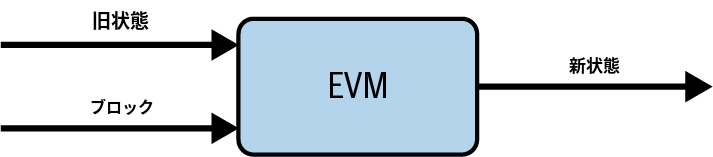
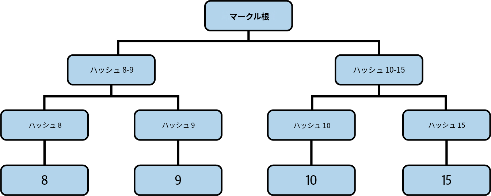
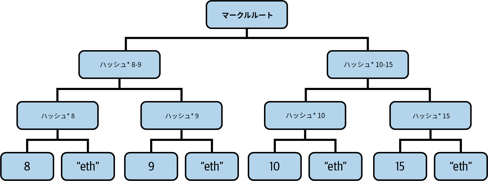
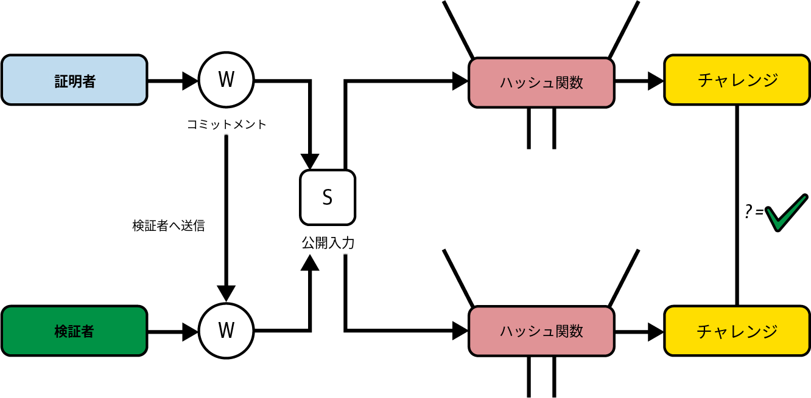
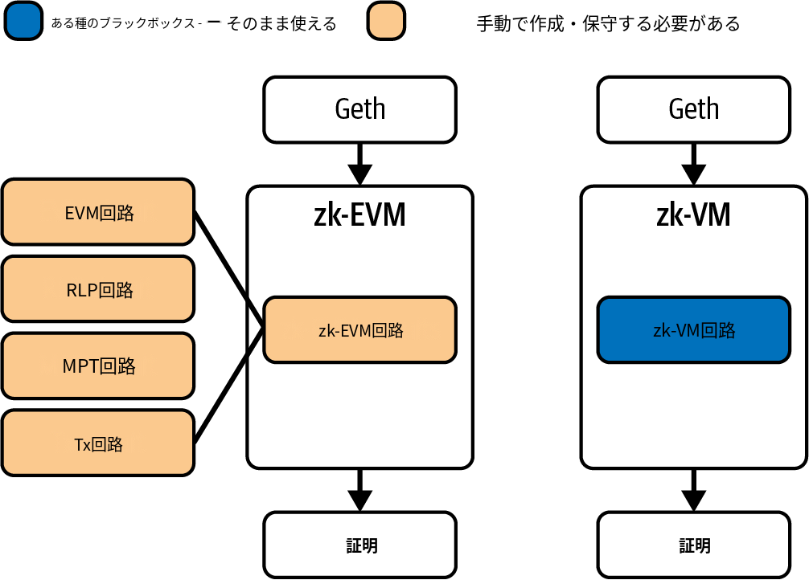

# 第17章 ゼロ知識証明

　この章では、*ゼロ知識暗号*の魅力的な世界を探求し、イーサリアムのロードマップにどのように適用されるかを見ていきます。ゼロ知識技術を活用すれば、ブロックスペースに対する大量導入の需要に対応した真のスケーリングが可能になります。ゼロ知識技術は非常に複雑なテーマであり、詳細に説明しきれない多くの数学的規則に依存しています。この章の目的は、ゼロ知識暗号がイーサリアムにとってなぜ独自の機会を提供し、スケーリングロードマップにうまく適合するのかを理解することです。この章を読み終える頃には、ゼロ知識暗号の概要、有用な特性、イーサリアムがプロトコルの改善にどのように活用しようとしているかを理解しているでしょう。

## 歴史

　*ゼロ知識証明*は、1985年にシャフィ・ゴールドワッサー、シルビオ・ミカリ、チャールズ・ラコフの3人が発表した論文["The Knowledge Complexity of Interactive Proof-Systems"](https://oreil.ly/a6KH6)で初めて提唱されました。この論文では、あるステートメントが真であるという事実以外の情報を一切明かさずに、そのステートメントの真実性を証明する方法としてゼロ知識証明を記述しています。

　ゼロ知識証明は1980年代に発見されましたが、実用的なユースケースは非常に限られていました。状況が一変したのは2011年のことです。[BIT+11](https://oreil.ly/C6HvM)論文の登場により、任意の計算に対するゼロ知識証明を作成するための理論的フレームワークとして*SNARK*（*succinct noninteractive arguments of knowledge*）が導入されました。2年後の2013年には、[Pinocchio PGHR13](https://oreil.ly/4uU6x)論文が汎用SNARKの最初の実用的な実装を提供し、現実世界のアプリケーションで使用可能になりました。汎用プログラムが正しく実行されたことを、再実行せずに、実際の計算の詳細を明かさずに証明できるようになったのは、このときが初めてです。

　革命が始まりました。その瞬間から、ゼロ知識証明の分野は驚異的なスピードで進化しました。2016年には、[Groth16アルゴリズム](https://oreil.ly/rxlOL)が証明サイズと検証時間を削減し、zk-SNARKの効率を大幅に改善しました。その卓越した簡潔性から、新しいシステムが利用可能であるにもかかわらず、Groth16は現在でも広く使われています。例えば、分散型ミキサーアプリケーションであるTornado Cashは、オンチェーンでのゼロ知識証明の実装にGroth16を使用しています。

　2017年には、[Bulletproofs](https://oreil.ly/ZUeIe)が*トラステッドセットアップ*の必要性を排除するという画期的な進歩をもたらしました（トラステッドセットアップの実際の意味については、後のセクションで詳しく解説します）。ただし、証明サイズが大きくなるというトレードオフがありました。2018年には[*zk-STARK*](https://oreil.ly/TCnTT)が登場し、トラステッドセットアップの要件を排除しただけでなく、ポスト量子セキュリティも提供しました。ポスト量子セキュリティとは、暗号基盤が量子コンピュータからの攻撃に対して耐性を持つことを意味します。Bulletproofsは現在、暗号通貨プロジェクトMoneroでトランザクション金額の秘匿化に使われており、zk-STARKはイーサリアム L2であるStarknetの暗号基盤となっています。

　2019年には、[PLONK](https://oreil.ly/3453_)と[Sonic](https://oreil.ly/f6_Sq)がユニバーサルかつ更新可能なトラステッドセットアップを導入し、大きな貢献を果たしました。SNARKをより幅広いアプリケーションで実用化しました。これらのイノベーションは、現在のゼロ知識システムにも引き続き影響を与えています。

　ゼロ知識証明は現在も活発に開発が続いています。最近の進歩では、証明時間や再帰効率、zk-EVMやモダンなzk-VMといった実用的なアプリケーションが改善されています。新しい構築法や最適化が定期的に登場し続けており、ゼロ知識技術の可能性の限界を押し広げています。

　こうした進歩は主に、暗号通貨分野がもたらした資金のおかげで実現しました。イーサリアムファンデーションも、複数の助成金を提供し、このテーマを研究する専門チームを擁することで貢献してきました（そして現在も貢献し続けています）。

## 定義と性質

　ここからは、ゼロ知識証明とは何か、どのような性質を満たす必要があるかを、より具体的に定義しましょう。すでに述べたように、ゼロ知識証明とは、一方の当事者（通常*証明者*、Pと呼ばれる）が、もう一方の当事者（通常*検証者*、Vと呼ばれる）に対して、あるステートメントが真であるという事実以外の情報を一切明かさずに、そのステートメントが真であることを証明するプロトコルです。

　いくつかの重要な定義を形式化しましょう。

**ステートメント**

証明される主張である。ステートメントは公開されており、誰でも検証可能で、秘密情報を含まない。

**ウィットネス**

ステートメントが真であることを証明する秘密情報である。ウィットネスは証明者のみが知っている。

**証明**

ウィットネスを明かすことなく、ステートメントが真であることを検証者に納得させる暗号オブジェクトである。

　すべてのゼロ知識証明システムは、以下の3つの性質に従わなければなりません。

**完全性**

証明者Pが真のステートメントを保持している場合、プロトコルの規則に従って有効なゼロ知識証明を計算できなければならない。すべての規則に正しく従っているにもかかわらず有効な証明を生成できないケースがあってはならない。

**健全性**

悪意のある証明者が偽のステートメントに対して有効な証明を偽造することは実行不可能でなければならない。ゼロ知識証明が検証者に受理された場合、証明者がその証明を作成できた唯一の方法は、真のステートメントから始めてすべてのプロトコル規則に適切に従ったことである。

**ゼロ知識性**

名前が示す通り、検証者はプロトコルに従う過程で、ステートメントの有効性以外の情報を知ることができてはならない。

## イーサリアムにおけるゼロ知識証明の活用

　この非常に新しい暗号技術がイーサリアムの将来の開発とロードマップにとってなぜ重要なのか、疑問に思うかもしれません。答えはシンプルです。

　イーサリアムにおけるゼロ知識証明システムの真の力は、最終的なステートメントに到達するために必要なすべての計算を実行しなくても、そのステートメントの妥当性を検証できる点にあります。まず証明者がある計算を実行してステートメントを算出し、ゼロ知識証明を添付します。次に検証者はゼロ知識プロトコルを使用するだけで、証明者と同じ計算を行わずに、そのステートメントをトラストレスに真として受け入れることができます。

　注意深い読者は、これがイーサリアムのどこに適用されるか、すでに気づいているかもしれません。ブロックの実行とステートの更新、つまり*EVMステート遷移関数*です。新しいブロックごとに、そのブロックに含まれるすべてのトランザクションを処理して現在のステートを更新します。図17-1はこの様子をよく表しています。



図17-1 EVMステート遷移関数

　EVMは、ブロックチェーンの現在のステートとトランザクションが詰まった新しいブロックを入力として受け取り、チェーンの新しいステートを返すブラックボックスと考えることができます。現在、イーサリアムのフルノードは新しいブロックを受信すると、トラストレスにステートを更新するために、そのブロックに含まれるすべてのトランザクションを再実行しています。

　このアプローチの主な問題は、ブロックの実行が非常に負荷の高い処理であり、ボトルネックになりうることです。フルノードが正常に動作しチェーンの先端に追従するために必要なハードウェア要件と、ネットワークで達成したい分散化のレベルとのバランスを取る必要があります。フルノードの要件を引き上げてスケーリングしようとするほど、資金的に余裕のないアクターがフルノードを維持できなくなり、分散化が損なわれます。逆に、誰でもノードを運用できるようにハードウェア要件を低く抑えると、ブロックチェーンが処理できる最大スループットが制限されます。イーサリアムは常にこのトレードオフの分散化側を選択し、ソロステーカーやフルノード運用者が参加できるようにハードウェア要件を十分に低く保ってきました。

　ここでゼロ知識証明システムが活躍します。フルノードがトランザクションを一切実行せずに、つまりEVMステート遷移関数の重い計算を行わずに、トラストレスにステートを更新できるとしたらどうでしょうか。このアイデアは以下のように要約できます。

1. 一部のアクターが、新しいブロックに含まれるすべてのトランザクションを実行し、チェーンの更新されたステートを生成するEVM計算を行う。
2. これらのアクターがステートの妥当性を証明するゼロ知識証明を作成し、新しいステートとともにすべてのフルノードに共有する。
3. 他のすべてのフルノードは、チェーンの新しいステートとゼロ知識証明を受信した際、証明の妥当性を検証するだけでよい。証明が有効であれば、受け取った新しいステートで自身のチェーンのステートをトラストレスに更新できる。

　この方法では、すべてのトランザクションを実行するノード（おそらく潤沢な資金を持つ企業が維持する）は依然として必要ですが、それ以外のノードは証明を検証するだけでよいため、運用コストを抑えられます。トランザクションを実行するノードのハードウェア要件を非常に高く引き上げて、はるかに大きなスループットを処理しつつも、ゼロ知識証明の「魔法」のおかげで高い分散化レベルを維持できます。

　これまでの説明では、ゼロ知識証明の生成と検証は高速で簡単であると仮定してきました。しかし実際には、ゼロ知識証明の検証が平均的なイーサリアムブロックに含まれるすべてのトランザクションの再実行よりも高速である場合にのみ、前述のステップは意味をなします。現時点ではこの条件を達成するのは非常に困難です。しかしこれは最適化の問題であり、「できるかどうか」ではなく「いつできるか」の問題にすぎません。イーサリアムブロックのゼロ知識証明をリアルタイムで生成・検証できる時点に間もなく到達するでしょう。この分野の動向に興味がある方は、Ethproofsというウェブサイトをフォローすることをお勧めします。

## L2もZKの恩恵を受ける

　ゼロ知識証明技術の恩恵を受けるのはイーサリアムメインネットだけではありません。第16章ですでに読んだかもしれませんが、*ZKロールアップ*と呼ばれるロールアップのカテゴリが存在します。名前が示す通り、ZKロールアップはEVM実行を証明するためにゼロ知識証明システムを使用しています。チェーンのステート更新を、新しいステートが正しく計算されたことを保証するゼロ知識証明とともにポストできるようにしています。

　前述のように、現在の平均的なイーサリアムブロックのリアルタイム証明が達成できないのに、ZKロールアップはどのようにゼロ知識技術を使用できるのでしょうか。答えは、リアルタイム証明は行っていないということです。L2の各ブロックに対してリアルタイムに証明する必要はありません。通常は1時間ほどの間隔で集約されたゼロ知識証明をポストし、前回の証明から最新のものまでの間に行われたすべてのステート更新が正しく実行されたことを証明します。

　ゼロ知識証明の間隔はロールアップ自体のファイナリティまでの時間にのみ影響します。証明が1時間ごとにポストされる場合、トランザクションが（L1上で）本当にファイナライズされたと見なせるまで平均して30分待つ必要があります。

## 小さな例

　ゼロ知識証明システムの動作をより身近に理解するために、シンプルで小さな例から始めましょう。*分割問題*です。これは「与えられた正の整数の多重集合Sを、S1とS2の2つの部分集合に分割して、両者の合計が等しくなるようにできるか」を判定するよく知られた問題です。

> **注記**
>
> 分割問題は決定問題であるのに対し、イーサリアムは計算トレースの検証にゼロ知識証明を使用する。イーサリアムにおけるゼロ知識証明の主要なユースケースは実行トレースの検証であるが、分割問題を通じて学ぶことはゼロ知識証明システムの仕組みに対する直感を養う優れた方法である。


　S = [1, 1, 5, 7]の場合、S1 = [1, 1, 5]とS2 = [7]に分割すれば問題を満たせます。しかし常に正しい解が見つかるとは限りません。例えばS = [1, 1, 5, 8]の場合、同じ合計になる2つの部分集合に分割することは不可能です。

　分割問題はNP完全です。つまり、多項式時間で解くアルゴリズム（解が存在する場合にそれを提示するか、解が存在しないことを短時間で証明するアルゴリズム）は知られていません。

### 証明してみよう

　分割問題の構造は、これまで見てきたゼロ知識証明システムの性質にぴったり当てはまります。解を見つけるのが困難なため、解を探す計算能力をスーパーコンピュータを備えた証明者に委任し、ゼロ知識技術を使って有効な解を見つけたことを証明するのは興味深いアプローチです。他の全員が同じ重い計算を行う必要がなく、実際の解を明かすこともありません。

　分割問題をゼロ知識証明システムに適した形にするため、少し調整を加えます。正の整数のリスト`s`があるとします。別のリスト`a`が*充足割り当て*であるとは、以下の条件を満たす場合を指します。

1. `len(s) == len(a)`
2. `a`のすべての要素が1または-1である
3. `s`と`a`の内積が0である

　この構成は分割問題と完全に同等であることに注意してください。前の例の初期リストS = [1, 1, 5, 7]を取ると、充足割り当て`a`は次のようになります。

```
a = [1, 1, 1, –1]
```

　3つの条件がすべて真であることを手動で確認できます。

1. `len(s) = 4 == len(a) = 4`
2. `a`のすべての要素が1または-1である
3. 内積: 1 × 1 + 1 × 1 + 1 × 5 + (–1) × 7 = 1 + 1 + 5 – 7 = 0

　*内積*は、等しい長さの2つのリストについて、最初のリストの各要素と2番目のリストの対応する要素を掛け合わせ、すべての結果を合計して計算します。より技術的に言えば、等しい長さ`n`のリスト`s = [s0, s1, s2, sn]`と`a = [a0, a1, a2, an]`がある場合、内積は次のように計算します。

<math xmlns="http://www.w3.org/1998/Math/MathML">
  <mi mathcolor="#000000">s</mi>
  <mo mathcolor="#000000">⋅</mo>
  <mi mathcolor="#000000">a</mi>
  <mo mathcolor="#000000">=</mo>
  <mrow>
    <munderover>
      <mo stretchy="false">∑</mo>
      <mrow>
        <mi mathcolor="#000000">i</mi>
        <mo mathcolor="#000000">=</mo>
        <mn mathcolor="#000000">0</mn>
      </mrow>
      <mrow>
        <mi mathcolor="#000000">n</mi>
      </mrow>
    </munderover>
    <mrow>
      <mfenced separators="">
        <mrow>
          <msub>
            <mrow>
              <mi mathcolor="#000000">s</mi>
            </mrow>
            <mrow>
              <mi mathcolor="#000000">i</mi>
            </mrow>
          </msub>
          <mo mathcolor="#000000">×</mo>
          <msub>
            <mrow>
              <mi mathcolor="#000000">a</mi>
            </mrow>
            <mrow>
              <mi mathcolor="#000000">i</mi>
            </mrow>
          </msub>
        </mrow>
      </mfenced>
    </mrow>
  </mrow>
  <mo mathcolor="#000000">=</mo>
  <msub>
    <mrow>
      <mi mathcolor="#000000">a</mi>
    </mrow>
    <mrow>
      <mn mathcolor="#000000">0</mn>
    </mrow>
  </msub>
  <msub>
    <mrow>
      <mi mathcolor="#000000">s</mi>
    </mrow>
    <mrow>
      <mn mathcolor="#000000">0</mn>
    </mrow>
  </msub>
  <mo mathcolor="#000000">+</mo>
  <msub>
    <mrow>
      <mi mathcolor="#000000">a</mi>
    </mrow>
    <mrow>
      <mn mathcolor="#000000">1</mn>
    </mrow>
  </msub>
  <msub>
    <mrow>
      <mi mathcolor="#000000">s</mi>
    </mrow>
    <mrow>
      <mn mathcolor="#000000">1</mn>
    </mrow>
  </msub>
  <mo mathcolor="#000000">+</mo>
  <msub>
    <mrow>
      <mi mathcolor="#000000">a</mi>
    </mrow>
    <mrow>
      <mn mathcolor="#000000">2</mn>
    </mrow>
  </msub>
  <msub>
    <mrow>
      <mi mathcolor="#000000">s</mi>
    </mrow>
    <mrow>
      <mn mathcolor="#000000">2</mn>
    </mrow>
  </msub>
  <mo mathcolor="#000000">+</mo>
  <mo mathcolor="#000000">.</mo>
  <mo mathcolor="#000000">.</mo>
  <mo mathcolor="#000000">.</mo>
  <mo mathcolor="#000000">+</mo>
  <msub>
    <mrow>
      <mi mathcolor="#000000">a</mi>
    </mrow>
    <mrow>
      <mi mathcolor="#000000">n</mi>
    </mrow>
  </msub>
  <msub>
    <mrow>
      <mi mathcolor="#000000">s</mi>
    </mrow>
    <mrow>
      <mi mathcolor="#000000">n</mi>
    </mrow>
  </msub>
</math>

　もちろん`a`を検証者にそのまま提供して有効な解であることを確認させることもできますが、それでは解を明かさないというゼロ知識の前提に違反してしまいます。

　*部分和リスト*を作成して、別のリスト`w`を生成しましょう。`w[i]`は`s`と`a`の`i`までの部分内積に等しくなります。ゼロ知識証明システムの文脈では、`w`は*ウィットネス*とも呼ばれます。先の例に従って、`w`を計算できます。

```
w = [1, 2, 7, 0]
```

　`a`が有効な充足割り当てであれば、`w`は常に0で終わることに注意してください。

　証明システムをうまく機能させるために、これまで構築してきた証明`p`に小さな変更を加えましょう。具体的には、リスト`w`の最後の要素を最初の位置に移動します。先ほどの`w`は次のようになります。

```
w = [0, 1, 2, 7]
```

　このリスト`w`には非常に便利な性質があります。

```
|s[i]| = |w[i + 1] – w[i]|
```

　このステートメントの妥当性を自分で確認できます。

```
|s[0]| = |w[0 + 1] – w[0]| = |w[1] – w[0]| = |1 – 0| = |1| = 1
|s[1]| = |w[1 + 1] – w[1]| = |w[2] – w[1]| = |2 – 1| = |1| = 1
|s[2]| = |w[2 + 1] – w[2]| = |w[3] – w[2]| = |7 – 2| = |5| = 5
|s[3]| = |w[3 + 1] – w[3]| = |w[4] – w[3]| = |w[0] – w[3]| = |0 – 7| = |–7| = 7
```

　`s[3]`を計算するには`w[4]`にアクセスする必要がありますが、`w`は4つの要素しかないため（インデックスはゼロから始まる）、`w[4]`は存在しません。しかし解決策は簡単です。`w`が巡回的であるかのように最初の要素に戻ればよいのです。

　検証者は`w`の連続する2つの要素を要求し、前述の関係式が成り立つかを確認できます。検証者は`s`にアクセスできることを覚えておいてください。`s`は公開されており、この問題の入力を表しています。しかし検証者は解を表す充足割り当て`a`にはアクセスできません。等式が成り立てば、証明者がこの問題の充足割り当て`a`を知っていることを意味します。

### 問題点

　ここまで構築してきたのは、非常に素朴な証明システムです。実際には、3つの大きな問題があります。

1. 前述のように、検証者が`w`の連続する2つの要素を要求し等式が成り立てば、証明者がこの問題の解を知っていることが検証されたと述べた。しかしこれは正確ではない。1回のクエリだけでは完全に確信を持てない。十分に高い確率で確信を得るまで、`w`の連続する要素に対して複数回のクエリを行う必要がある。
2. 検証者が証明者の解の保有を確認できることは確かだが、この証明システムは証明者の誠実性に依存している。証明者が悪意を持ち嘘をつくとどうなるか。検証者が`w`の連続する2つの要素を要求した際、証明者は等式を満たすランダムな2つの数を提供する可能性がある。
3. さらに、この証明システムはゼロ知識ではない。`w`の連続する要素を要求することで、検証者は充足割り当て`a`について多くの情報を得てしまう。検証者は`w`の構築方法を知っているため、`w`について知れば知るほど解`a`についても知ることになる。

　これらの問題に対処し、より良い証明システムの構築を試みましょう。

### ゼロ知識性の実現

　システムにゼロ知識性を追加しましょう。これまで構築してきたプロトコルの主な問題は、`w`の実際の値を検証者に送信しているため、検証者が`a`について多くの情報を理解できてしまうことです。実際に確認するため、証明者と検証者の間で2つの簡単なインタラクションステップを行いましょう。

　検証者は`w[1]`と`w[2]`を要求し、`|w[2] – w[1]| = |s[1]|`を確認します。証明者は`w[1] = 1`と`w[2] = 2`を提供し、検証者は等式が成り立つことを確認できます。

<math xmlns="http://www.w3.org/1998/Math/MathML">
  <mfenced open="|" close="" separators="|">
    <mrow>
      <mi mathcolor="#000000">s</mi>
      <mo stretchy="false" mathcolor="#000000">[</mo>
      <mn mathcolor="#000000">1</mn>
      <mo stretchy="false" mathcolor="#000000">]</mo>
    </mrow>
    <mrow>
      <mo mathcolor="#000000">=</mo>
    </mrow>
    <mrow>
      <mi mathcolor="#000000">w</mi>
      <mo stretchy="false" mathcolor="#000000">[</mo>
      <mn mathcolor="#000000">2</mn>
      <mo stretchy="false" mathcolor="#000000">]</mo>
      <mo mathcolor="#000000">−</mo>
      <mi mathcolor="#000000">w</mi>
      <mo stretchy="false" mathcolor="#000000">[</mo>
      <mn mathcolor="#000000">1</mn>
      <mo stretchy="false" mathcolor="#000000">]</mo>
    </mrow>
    <mrow>
      <mo mathcolor="#000000">=</mo>
    </mrow>
    <mrow>
      <mn mathcolor="#000000">2</mn>
      <mo mathcolor="#000000">−</mo>
      <mn mathcolor="#000000">1</mn>
    </mrow>
    <mrow>
      <mo mathcolor="#000000">=</mo>
    </mrow>
    <mrow>
      <mn mathcolor="#000000">1</mn>
    </mrow>
    <mrow>
      <mo mathcolor="#000000">=</mo>
      <mn mathcolor="#000000">1</mn>
    </mrow>
  </mfenced>
</math>

　次に、検証者はもう1つのクエリを要求します。`w[2]`と`w[3]`です。証明者は`w[2] = 2`と`w[3] = 7`を提供し、検証者は等式を確認します。

<math xmlns="http://www.w3.org/1998/Math/MathML">
  <mfenced open="|" close="" separators="|">
    <mrow>
      <mi mathcolor="#000000">s</mi>
      <mo stretchy="false" mathcolor="#000000">[</mo>
      <mn mathcolor="#000000">2</mn>
      <mo stretchy="false" mathcolor="#000000">]</mo>
    </mrow>
    <mrow>
      <mo mathcolor="#000000">=</mo>
    </mrow>
    <mrow>
      <mi mathcolor="#000000">w</mi>
      <mo stretchy="false" mathcolor="#000000">[</mo>
      <mn mathcolor="#000000">3</mn>
      <mo stretchy="false" mathcolor="#000000">]</mo>
      <mo mathcolor="#000000">−</mo>
      <mi mathcolor="#000000">w</mi>
      <mo stretchy="false" mathcolor="#000000">[</mo>
      <mn mathcolor="#000000">2</mn>
      <mo stretchy="false" mathcolor="#000000">]</mo>
    </mrow>
    <mrow>
      <mo mathcolor="#000000">=</mo>
    </mrow>
    <mrow>
      <mn mathcolor="#000000">7</mn>
      <mo mathcolor="#000000">−</mo>
      <mn mathcolor="#000000">2</mn>
    </mrow>
    <mrow>
      <mo mathcolor="#000000">=</mo>
    </mrow>
    <mrow>
      <mn mathcolor="#000000">5</mn>
    </mrow>
    <mrow>
      <mo mathcolor="#000000">=</mo>
      <mn mathcolor="#000000">5</mn>
    </mrow>
  </mfenced>
</math>

　この2回のインタラクションで、検証者はwの3つの要素を知ることになります。

<math xmlns="http://www.w3.org/1998/Math/MathML">
  <mtable>
    <mtr>
      <mtd/>
      <mtd>
        <mi mathcolor="#000000">w</mi>
        <mo stretchy="false" mathcolor="#000000">[</mo>
        <mn mathcolor="#000000">1</mn>
        <mo stretchy="false" mathcolor="#000000">]</mo>
        <mo mathcolor="#000000">=</mo>
        <mn mathcolor="#000000">1</mn>
      </mtd>
    </mtr>
    <mtr>
      <mtd/>
      <mtd>
        <mi mathcolor="#000000">w</mi>
        <mo stretchy="false" mathcolor="#000000">[</mo>
        <mn mathcolor="#000000">2</mn>
        <mo stretchy="false" mathcolor="#000000">]</mo>
        <mo mathcolor="#000000">=</mo>
        <mn mathcolor="#000000">2</mn>
      </mtd>
    </mtr>
    <mtr>
      <mtd/>
      <mtd>
        <mi mathcolor="#000000">w</mi>
        <mo stretchy="false" mathcolor="#000000">[</mo>
        <mn mathcolor="#000000">3</mn>
        <mo stretchy="false" mathcolor="#000000">]</mo>
        <mo mathcolor="#000000">=</mo>
        <mn mathcolor="#000000">7</mn>
      </mtd>
    </mtr>
  </mtable>
</math>

　検証者はすでに`s = [1, 1, 5, 7]`を知っており、`w`がどのように計算されたかも知っているため、解`a`の最初の部分が`[1, 1, 1]`であることを導出できます。`w[3] = 7`、`w[2] = 2`、`w[1] = 1`を得る唯一の方法がこれだからです。

　`w`の実際の値をマスクしつつ、新しい`w`と入力リスト`s`の間の関係式を満たし続ける方法を見つける必要があります。これを実現するには、特定の方法でランダム性を追加する必要があります。

　まずコインを投げます。表が出れば`a`をそのままにし、裏が出ればすべての要素の符号を変更して、すべての1を-1に、すべての-1を1にします。この変更は充足割り当て`a`の3つの主要な性質を壊さないことに注意してください。

　次に、新しいランダムな整数値`r`を取得します。`w`を以前と同じ方法で計算しますが、すべての要素に`r`を加えます。この変更も、`s`と`w`の間の重要な関係式を壊しません。

　検証者が新しいクエリを要求するたびに、コインを投げて異なるランダム値`r`を計算する必要があります。こうすることで検証者は等式の妥当性を検証できますが、すべての`w`の値がランダムに見えるため、`a`について何も理解できません。

　小さなデモンストレーションを行いましょう。証明者（この例では私たち）は`s`と`a`の両方を持っていることを思い出してください。

<math xmlns="http://www.w3.org/1998/Math/MathML">
  <mtable>
    <mtr>
      <mtd/>
      <mtd>
        <mi mathcolor="#000000">s</mi>
        <mo mathcolor="#000000">=</mo>
        <mo stretchy="false" mathcolor="#000000">[</mo>
        <mn mathcolor="#000000">1</mn>
        <mo mathcolor="#000000">,</mo>
        <mn mathcolor="#000000">1</mn>
        <mo mathcolor="#000000">,</mo>
        <mn mathcolor="#000000">5</mn>
        <mo mathcolor="#000000">,</mo>
        <mn mathcolor="#000000">7</mn>
        <mo stretchy="false" mathcolor="#000000">]</mo>
      </mtd>
    </mtr>
    <mtr>
      <mtd/>
      <mtd>
        <mi mathcolor="#000000">a</mi>
        <mo mathcolor="#000000">=</mo>
        <mo stretchy="false" mathcolor="#000000">[</mo>
        <mn mathcolor="#000000">1</mn>
        <mo mathcolor="#000000">,</mo>
        <mn mathcolor="#000000">1</mn>
        <mo mathcolor="#000000">,</mo>
        <mn mathcolor="#000000">1</mn>
        <mo mathcolor="#000000">,</mo>
        <mo mathcolor="#000000">−</mo>
        <mn mathcolor="#000000">1</mn>
        <mo stretchy="false" mathcolor="#000000">]</mo>
      </mtd>
    </mtr>
  </mtable>
</math>

　ここで検証者が`w[1]`と`w[2]`を要求し、`|w[2] – w[1]| = |s[1]|`を確認しようとします。

　まず、`a`のすべての値を変更するかどうかを決めるためにコインを投げる必要があります。裏が出たので、すべての符号を反転させ、`a`は次のようになります。

<math xmlns="http://www.w3.org/1998/Math/MathML">
  <mi mathcolor="#000000">a</mi>
  <mo mathcolor="#000000">′</mo>
  <mo mathcolor="#000000">=</mo>
  <mo stretchy="false" mathcolor="#000000">[</mo>
  <mo mathcolor="#000000">−</mo>
  <mn mathcolor="#000000">1</mn>
  <mo mathcolor="#000000">,</mo>
  <mo mathcolor="#000000">−</mo>
  <mn mathcolor="#000000">1</mn>
  <mo mathcolor="#000000">,</mo>
  <mo mathcolor="#000000">−</mo>
  <mn mathcolor="#000000">1</mn>
  <mo mathcolor="#000000">,</mo>
  <mn mathcolor="#000000">1</mn>
  <mo stretchy="false" mathcolor="#000000">]</mo>
</math>

　次に、ランダム値`r = 4`を計算します。`w`を計算し、各要素に`r`を加えます。

<math xmlns="http://www.w3.org/1998/Math/MathML">
  <mtable>
    <mtr>
      <mtd/>
      <mtd>
        <mi mathcolor="#000000">w</mi>
        <mo mathcolor="#000000">=</mo>
        <mo stretchy="false" mathcolor="#000000">[</mo>
        <mn mathcolor="#000000">0</mn>
        <mo mathcolor="#000000">,</mo>
        <mo mathcolor="#000000">−</mo>
        <mn mathcolor="#000000">1</mn>
        <mo mathcolor="#000000">,</mo>
        <mo mathcolor="#000000">−</mo>
        <mn mathcolor="#000000">2</mn>
        <mo mathcolor="#000000">,</mo>
        <mo mathcolor="#000000">−</mo>
        <mn mathcolor="#000000">7</mn>
        <mo stretchy="false" mathcolor="#000000">]</mo>
      </mtd>
    </mtr>
    <mtr>
      <mtd/>
      <mtd>
        <mi mathcolor="#000000">w</mi>
        <mo mathcolor="#000000">′</mo>
        <mo mathcolor="#000000">=</mo>
        <mo stretchy="false" mathcolor="#000000">[</mo>
        <mn mathcolor="#000000">4</mn>
        <mo mathcolor="#000000">,</mo>
        <mn mathcolor="#000000">3</mn>
        <mo mathcolor="#000000">,</mo>
        <mn mathcolor="#000000">2</mn>
        <mo mathcolor="#000000">,</mo>
        <mo mathcolor="#000000">−</mo>
        <mn mathcolor="#000000">3</mn>
        <mo stretchy="false" mathcolor="#000000">]</mo>
      </mtd>
    </mtr>
  </mtable>
</math>

　そして、<math xmlns="http://www.w3.org/1998/Math/MathML">
  <msup>
    <mrow>
      <mi mathcolor="#000000">w</mi>
    </mrow>
    <mrow>
      <mo mathcolor="#000000">′</mo>
    </mrow>
  </msup>
  <mo stretchy="false" mathcolor="#000000">[</mo>
  <mn mathcolor="#000000">1</mn>
  <mo stretchy="false" mathcolor="#000000">]</mo>
  <mo mathcolor="#000000">=</mo>
  <mn mathcolor="#000000">3</mn>
</math>と<math xmlns="http://www.w3.org/1998/Math/MathML">
  <msup>
    <mrow>
      <mi mathcolor="#000000">w</mi>
    </mrow>
    <mrow>
      <mo mathcolor="#000000">′</mo>
    </mrow>
  </msup>
  <mo stretchy="false" mathcolor="#000000">[</mo>
  <mn mathcolor="#000000">2</mn>
  <mo stretchy="false" mathcolor="#000000">]</mo>
  <mo mathcolor="#000000">=</mo>
  <mn mathcolor="#000000">2</mn>
</math>を提供します。

　検証者は依然として等式の妥当性を確認できます。

<math xmlns="http://www.w3.org/1998/Math/MathML">
  <mfenced open="|" close="|" separators="|">
    <mrow>
      <mi mathcolor="#000000">s</mi>
      <mo stretchy="false" mathcolor="#000000">[</mo>
      <mn mathcolor="#000000">1</mn>
      <mo stretchy="false" mathcolor="#000000">]</mo>
    </mrow>
    <mrow>
      <mo mathcolor="#000000">=</mo>
    </mrow>
  </mfenced>
  <msup>
    <mrow>
      <mi mathcolor="#000000">w</mi>
    </mrow>
    <mrow>
      <mo mathcolor="#000000">′</mo>
    </mrow>
  </msup>
  <mo stretchy="false" mathcolor="#000000">[</mo>
  <mn mathcolor="#000000">2</mn>
  <mo stretchy="false" mathcolor="#000000">]</mo>
  <mo mathcolor="#000000">−</mo>
  <msup>
    <mrow>
      <mi mathcolor="#000000">w</mi>
    </mrow>
    <mrow>
      <mo mathcolor="#000000">′</mo>
    </mrow>
  </msup>
  <mfenced open="" close="" separators="|">
    <mrow>
      <mo stretchy="false" mathcolor="#000000">[</mo>
      <mn mathcolor="#000000">1</mn>
      <mo stretchy="false" mathcolor="#000000">]</mo>
    </mrow>
    <mrow>
      <mo mathcolor="#000000">=</mo>
    </mrow>
    <mrow>
      <mn mathcolor="#000000">2</mn>
      <mo mathcolor="#000000">−</mo>
      <mn mathcolor="#000000">3</mn>
    </mrow>
    <mrow>
      <mo mathcolor="#000000">=</mo>
    </mrow>
    <mrow>
      <mo mathcolor="#000000">−</mo>
      <mn mathcolor="#000000">1</mn>
    </mrow>
    <mrow>
      <mo mathcolor="#000000">=</mo>
      <mn mathcolor="#000000">1</mn>
    </mrow>
  </mfenced>
</math>

　ここで検証者はもう1つのクエリを実行し、`w[2]`と`w[3]`を要求します。再び`a`のすべての値を変更するかどうかを決めるためにコインを投げます。今回は表なので符号は変更しません。

　次に、ランダム値`r = 1`を計算します。`w`を計算し、各要素に`r`を加えます。

<math xmlns="http://www.w3.org/1998/Math/MathML">
  <mi mathcolor="#000000">a</mi>
  <mo mathcolor="#000000">=</mo>
  <mo stretchy="false" mathcolor="#000000">[</mo>
  <mn mathcolor="#000000">1</mn>
  <mo mathcolor="#000000">,</mo>
  <mn mathcolor="#000000">1</mn>
  <mo mathcolor="#000000">,</mo>
  <mn mathcolor="#000000">1</mn>
  <mo mathcolor="#000000">,</mo>
  <mo mathcolor="#000000">−</mo>
  <mn mathcolor="#000000">1</mn>
  <mo stretchy="false" mathcolor="#000000">]</mo>
</math>

　そして、<math xmlns="http://www.w3.org/1998/Math/MathML">
  <msup>
    <mrow>
      <mi mathcolor="#000000">w</mi>
    </mrow>
    <mrow>
      <mo mathcolor="#000000">″</mo>
    </mrow>
  </msup>
  <mo stretchy="false" mathcolor="#000000">[</mo>
  <mn mathcolor="#000000">2</mn>
  <mo stretchy="false" mathcolor="#000000">]</mo>
  <mo mathcolor="#000000">=</mo>
  <mn mathcolor="#000000">3</mn>
</math>と<math xmlns="http://www.w3.org/1998/Math/MathML">
  <msup>
    <mrow>
      <mi mathcolor="#000000">w</mi>
    </mrow>
    <mrow>
      <mo mathcolor="#000000">″</mo>
    </mrow>
  </msup>
  <mo stretchy="false" mathcolor="#000000">[</mo>
  <mn mathcolor="#000000">3</mn>
  <mo stretchy="false" mathcolor="#000000">]</mo>
  <mo mathcolor="#000000">=</mo>
  <mn mathcolor="#000000">8</mn>
</math>を提供します。

　検証者は依然として等式の妥当性を確認できます。

<math xmlns="http://www.w3.org/1998/Math/MathML">
  <mfenced open="|" close="|" separators="|">
    <mrow>
      <mi mathcolor="#000000">s</mi>
      <mo stretchy="false" mathcolor="#000000">[</mo>
      <mn mathcolor="#000000">2</mn>
      <mo stretchy="false" mathcolor="#000000">]</mo>
    </mrow>
    <mrow>
      <mo mathcolor="#000000">=</mo>
    </mrow>
  </mfenced>
  <msup>
    <mrow>
      <mi mathcolor="#000000">w</mi>
    </mrow>
    <mrow>
      <mo mathcolor="#000000">″</mo>
    </mrow>
  </msup>
  <mo stretchy="false" mathcolor="#000000">[</mo>
  <mn mathcolor="#000000">3</mn>
  <mo stretchy="false" mathcolor="#000000">]</mo>
  <mo mathcolor="#000000">−</mo>
  <msup>
    <mrow>
      <mi mathcolor="#000000">w</mi>
    </mrow>
    <mrow>
      <mo mathcolor="#000000">″</mo>
    </mrow>
  </msup>
  <mfenced open="" close="" separators="|">
    <mrow>
      <mo stretchy="false" mathcolor="#000000">[</mo>
      <mn mathcolor="#000000">2</mn>
      <mo stretchy="false" mathcolor="#000000">]</mo>
    </mrow>
    <mrow>
      <mo mathcolor="#000000">=</mo>
    </mrow>
    <mrow>
      <mn mathcolor="#000000">8</mn>
      <mo mathcolor="#000000">−</mo>
      <mn mathcolor="#000000">3</mn>
    </mrow>
    <mrow>
      <mo mathcolor="#000000">=</mo>
    </mrow>
    <mrow>
      <mn mathcolor="#000000">5</mn>
    </mrow>
    <mrow>
      <mo mathcolor="#000000">=</mo>
      <mn mathcolor="#000000">5</mn>
    </mrow>
  </mfenced>
</math>

　しかし今回、検証者は充足割り当て`a`についてあまり理解できません。検証者が持っている情報は以下の通りです。

<math xmlns="http://www.w3.org/1998/Math/MathML">
  <mtable>
    <mtr>
      <mtd/>
      <mtd>
        <msup>
          <mrow>
            <mi mathcolor="#000000">w</mi>
          </mrow>
          <mrow>
            <mo mathcolor="#000000">′</mo>
          </mrow>
        </msup>
        <mo stretchy="false" mathcolor="#000000">[</mo>
        <mn mathcolor="#000000">1</mn>
        <mo stretchy="false" mathcolor="#000000">]</mo>
        <mo mathcolor="#000000">=</mo>
        <mn mathcolor="#000000">3</mn>
      </mtd>
    </mtr>
    <mtr>
      <mtd/>
      <mtd>
        <msup>
          <mrow>
            <mi mathcolor="#000000">w</mi>
          </mrow>
          <mrow>
            <mo mathcolor="#000000">′</mo>
          </mrow>
        </msup>
        <mo stretchy="false" mathcolor="#000000">[</mo>
        <mn mathcolor="#000000">2</mn>
        <mo stretchy="false" mathcolor="#000000">]</mo>
        <mo mathcolor="#000000">=</mo>
        <mn mathcolor="#000000">2</mn>
      </mtd>
    </mtr>
    <mtr>
      <mtd/>
      <mtd>
        <msup>
          <mrow>
            <mi mathcolor="#000000">w</mi>
          </mrow>
          <mrow>
            <mo mathcolor="#000000">″</mo>
          </mrow>
        </msup>
        <mo stretchy="false" mathcolor="#000000">[</mo>
        <mn mathcolor="#000000">2</mn>
        <mo stretchy="false" mathcolor="#000000">]</mo>
        <mo mathcolor="#000000">=</mo>
        <mn mathcolor="#000000">3</mn>
      </mtd>
    </mtr>
    <mtr>
      <mtd/>
      <mtd>
        <msup>
          <mrow>
            <mi mathcolor="#000000">w</mi>
          </mrow>
          <mrow>
            <mo mathcolor="#000000">″</mo>
          </mrow>
        </msup>
        <mo stretchy="false" mathcolor="#000000">[</mo>
        <mn mathcolor="#000000">3</mn>
        <mo stretchy="false" mathcolor="#000000">]</mo>
        <mo mathcolor="#000000">=</mo>
        <mn mathcolor="#000000">8</mn>
      </mtd>
    </mtr>
  </mtable>
</math>

　異なるクエリの`w`値は検証者にとってランダムに見え、割り当て`a`を復元することはできません。

　証明システムにゼロ知識性を追加することができました。次は、悪意のある証明者の問題に対処しましょう。

### 証明者のコミットメント

　対処すべき問題は、証明者が計算されたウィットネス`w`の実際の値ではなく、でっち上げた数値を検証者に提供して嘘をつける点です。これは非常に深刻な問題です。偽のステートメントに対して有効な証明を提供できてしまうため、証明者が実際には充足割り当て`a`を持っていなくても、検証者を騙して持っていると信じ込ませる可能性があります。

　証明者が発覚せずに嘘をつけないようにする方法を見つける必要があります。本質的に、証明者は`w`のすべての値を検証者に提供する前に*コミットメント*を行う必要があります。

　ここでマークルツリーが再び役立ちます。マークルツリーは第14章で紹介したので、仕組みの詳細にはここでは立ち入りません。

　新しい例で、新しい構成を実際に見てみましょう。証明者（私たち）は以下を持っています。

<math xmlns="http://www.w3.org/1998/Math/MathML">
  <mtable>
    <mtr>
      <mtd>
        <mi mathcolor="#000000">s</mi>
      </mtd>
      <mtd>
        <mo mathcolor="#000000">=</mo>
        <mo stretchy="false" mathcolor="#000000">[</mo>
        <mn mathcolor="#000000">1</mn>
        <mo mathcolor="#000000">,</mo>
        <mn mathcolor="#000000">1</mn>
        <mo mathcolor="#000000">,</mo>
        <mn mathcolor="#000000">5</mn>
        <mo mathcolor="#000000">,</mo>
        <mn mathcolor="#000000">7</mn>
        <mo stretchy="false" mathcolor="#000000">]</mo>
      </mtd>
    </mtr>
    <mtr>
      <mtd>
        <mi mathcolor="#000000">a</mi>
      </mtd>
      <mtd>
        <mo mathcolor="#000000">=</mo>
        <mo stretchy="false" mathcolor="#000000">[</mo>
        <mn mathcolor="#000000">1</mn>
        <mo mathcolor="#000000">,</mo>
        <mn mathcolor="#000000">1</mn>
        <mo mathcolor="#000000">,</mo>
        <mn mathcolor="#000000">1</mn>
        <mo mathcolor="#000000">,</mo>
        <mo mathcolor="#000000">−</mo>
        <mn mathcolor="#000000">1</mn>
        <mo stretchy="false" mathcolor="#000000">]</mo>
      </mtd>
    </mtr>
  </mtable>
</math>

　コインを投げると表なので、割り当て`a`のすべての符号を変更する必要はありません。次に、`a`と`s`の内積として`w`を計算します（最初と最後の要素を入れ替えます）。

<math xmlns="http://www.w3.org/1998/Math/MathML">
  <mi mathcolor="#000000">w</mi>
  <mo mathcolor="#000000">=</mo>
  <mo stretchy="false" mathcolor="#000000">[</mo>
  <mn mathcolor="#000000">0</mn>
  <mo mathcolor="#000000">,</mo>
  <mn mathcolor="#000000">1</mn>
  <mo mathcolor="#000000">,</mo>
  <mn mathcolor="#000000">2</mn>
  <mo mathcolor="#000000">,</mo>
  <mn mathcolor="#000000">7</mn>
  <mo stretchy="false" mathcolor="#000000">]</mo>
</math>

　ランダム値`r = 8`を計算し、`w`の各要素に加えます。

<math xmlns="http://www.w3.org/1998/Math/MathML">
  <mi mathcolor="#000000">w</mi>
  <mo mathcolor="#000000">′</mo>
  <mo mathcolor="#000000">=</mo>
  <mo stretchy="false" mathcolor="#000000">[</mo>
  <mn mathcolor="#000000">8</mn>
  <mo mathcolor="#000000">,</mo>
  <mn mathcolor="#000000">9</mn>
  <mo mathcolor="#000000">,</mo>
  <mn mathcolor="#000000">10</mn>
  <mo mathcolor="#000000">,</mo>
  <mn mathcolor="#000000">15</mn>
  <mo stretchy="false" mathcolor="#000000">]</mo>
</math>

　ここで`w′`のすべての値にコミットし、そのコミットメントを検証者に送信します。これにより`w′`の偽の値を提供して不正を行った場合、簡単に発見できます。図17-2は`w′`のすべての値をリーフとして使用して構築されたマークルツリーを示しています。



図17-2 `w′`の値を使用して構築されたマークルツリー

　マークルルートは、検証者に送信される最終的なコミットメントです。

　この時点で、検証者は最初のクエリを要求し始めます。<math xmlns="http://www.w3.org/1998/Math/MathML">
  <msup>
    <mrow>
      <mi mathcolor="#000000">w</mi>
    </mrow>
    <mrow>
      <mo mathcolor="#000000">′</mo>
    </mrow>
  </msup>
  <mo stretchy="false" mathcolor="#000000">[</mo>
  <mn mathcolor="#000000">1</mn>
  <mo stretchy="false" mathcolor="#000000">]</mo>
</math>と<math xmlns="http://www.w3.org/1998/Math/MathML">
  <msup>
    <mrow>
      <mi mathcolor="#000000">w</mi>
    </mrow>
    <mrow>
      <mo mathcolor="#000000">′</mo>
    </mrow>
  </msup>
  <mo stretchy="false" mathcolor="#000000">[</mo>
  <mn mathcolor="#000000">2</mn>
  <mo stretchy="false" mathcolor="#000000">]</mo>
</math>です。<math xmlns="http://www.w3.org/1998/Math/MathML">
  <msup>
    <mrow>
      <mi mathcolor="#000000">w</mi>
    </mrow>
    <mrow>
      <mo mathcolor="#000000">′</mo>
    </mrow>
  </msup>
  <mo stretchy="false" mathcolor="#000000">[</mo>
  <mn mathcolor="#000000">1</mn>
  <mo stretchy="false" mathcolor="#000000">]</mo>
  <mo mathcolor="#000000">=</mo>
  <mn mathcolor="#000000">9</mn>
</math>と<math xmlns="http://www.w3.org/1998/Math/MathML">
  <msup>
    <mrow>
      <mi mathcolor="#000000">w</mi>
    </mrow>
    <mrow>
      <mo mathcolor="#000000">′</mo>
    </mrow>
  </msup>
  <mo stretchy="false" mathcolor="#000000">[</mo>
  <mn mathcolor="#000000">2</mn>
  <mo stretchy="false" mathcolor="#000000">]</mo>
  <mo mathcolor="#000000">=</mo>
  <mn mathcolor="#000000">10</mn>
</math>を検証者に提供し、検証者は以下を確認できます。

<math xmlns="http://www.w3.org/1998/Math/MathML">
  <mfenced open="|" close="|" separators="|">
    <mrow>
      <mi mathcolor="#000000">s</mi>
      <mo stretchy="false" mathcolor="#000000">[</mo>
      <mn mathcolor="#000000">1</mn>
      <mo stretchy="false" mathcolor="#000000">]</mo>
    </mrow>
    <mrow>
      <mo mathcolor="#000000">=</mo>
    </mrow>
  </mfenced>
  <msup>
    <mrow>
      <mi mathcolor="#000000">w</mi>
    </mrow>
    <mrow>
      <mo mathcolor="#000000">′</mo>
    </mrow>
  </msup>
  <mo stretchy="false" mathcolor="#000000">[</mo>
  <mn mathcolor="#000000">2</mn>
  <mo stretchy="false" mathcolor="#000000">]</mo>
  <mo mathcolor="#000000">−</mo>
  <msup>
    <mrow>
      <mi mathcolor="#000000">w</mi>
    </mrow>
    <mrow>
      <mo mathcolor="#000000">′</mo>
    </mrow>
  </msup>
  <mfenced open="" close="" separators="|">
    <mrow>
      <mo stretchy="false" mathcolor="#000000">[</mo>
      <mn mathcolor="#000000">1</mn>
      <mo stretchy="false" mathcolor="#000000">]</mo>
    </mrow>
    <mrow>
      <mo mathcolor="#000000">=</mo>
    </mrow>
    <mrow>
      <mn mathcolor="#000000">10</mn>
      <mo mathcolor="#000000">−</mo>
      <mn mathcolor="#000000">9</mn>
    </mrow>
    <mrow>
      <mo mathcolor="#000000">=</mo>
    </mrow>
    <mrow>
      <mn mathcolor="#000000">1</mn>
    </mrow>
    <mrow>
      <mo mathcolor="#000000">=</mo>
      <mn mathcolor="#000000">1</mn>
    </mrow>
  </mfenced>
</math>

　ここで検証者は証明者が不正をしていないことを確認する必要があります。そのため検証者は証明者に*検証パス*も要求します。検証パスには、マークルルートが送信されたコミットメントと一致するかを確認するために、マークルツリーを再構築するのに必要なすべてのデータが含まれています。一致すれば不正がなかったことが確実になり、一致しなければ不正があったことが即座にわかります。

　具体的に、このクエリの検証パスには以下が含まれます。

- Hash 8
- Hash 15

　こうすることで検証者はマークルルートまでマークルツリーを再構築し、コミットメントを検証できます。Hash 8とHash 15を検証者に送信し、検証者がコミットメントの妥当性を確認すれば、このクエリは終了です。

　しかし新たな問題に気づいたかもしれません。検証パスの要件により、`w′`に関する追加データ（Hash 8とHash 15）を送信することになりました。ハッシュ関数を逆算すること（つまりハッシュから実際の値8と15を取得すること）は計算上実行不可能であるはずですが、悪意のある検証者がブルートフォース攻撃を試み、意図していなかったマークルツリーの一部を明らかにする可能性があります。幸い、この問題を解決するシンプルで優れた調整があります。

### コミットメントへのランダム性の追加

　このアイデアは、証明システムにゼロ知識性を追加するために以前行ったことと似ています。今回は検証パスで`w`（または`w′`）に関する情報を明かさないよう、コミットメントにランダム性を追加する必要があります。

　マークルツリーを作成する際、ツリーのリーフに`w′`の各要素の正確な値のハッシュだけを使用するのではなく、検証者に提供しないランダムな文字列を追加します。図17-3はこの新しい方法で構築されたマークルツリーを示しています。



図17-3 ゼロ知識性のためにランダム性を追加したマークルツリー

　この例ではウィットネス`w′`の各項目をマスクするために文字列「eth」を使用しました。この秘密の文字列がなければ実際の値をデコードすることは不可能です。検証パスでHash* 8とHash* 15を検証者に送信しても、検証者はハッシュの背後にある具体的な`w′`の値を知ることができません。ブルートフォース攻撃を試みても、`w′`の項目を隠すために使用した秘密の文字列を知らないためです。

### 結論？ それとも…

　ゼロ知識証明システムの構築に成功しました。分割問題に対する（非常に素朴で基本的な）ゼロ知識証明システムを作成できたのです。

　「素晴らしい証明システムだが、証明者と検証者の間にまだ多くのインタラクションが必要だ。プロトコルを成功させるには双方が同時にオンラインでなければならない。この対話型ゼロ知識証明システムを非対話型に変換する方法はないだろうか」と思われるかもしれません。

　まさにその通りです。この証明システムが正しく機能するには証明者と検証者のインタラクションが必要であり、ほとんどのユースケースにとって不便です。幸い（本当に幸運が多いですね）、助けとなる科学論文があります。

## Fiat-Shamirヒューリスティック

　1986年、著名な暗号学者であるアモス・フィアットとアディ・シャミアが論文["How to Prove Yourself: Practical Solutions to Identification and Signature Problems"](https://oreil.ly/TGfa-)を発表しました。この論文で、現在も広く使われている変換プロトコルを発明しました。それが*Fiat-Shamirヒューリスティック*（または変換）と呼ばれるものです。

> **注記**
>
> アディ・シャミアは暗号学の真のレジェンドである。RSAアルゴリズムのSであり、最初かつ最も広く使用されている公開鍵暗号方式の1つである。アモス・フィアットはイスラエルのワイツマン科学研究所におけるシャミアの同僚であった。


　Fiat-Shamirヒューリスティックは、検証者のランダムなチャレンジを暗号学的ハッシュ関数に置き換えることで、対話型ゼロ知識証明システムを非対話型に変換できるプロトコルです。

　これまで構築してきたシステムで検証者が何をしているかを考えると、本質的には証明者にいくつかのランダムな数値（クエリ）を与え、証明者がそれを使って対応する証明を生成しているだけであることに気づくでしょう。

　以前、「検証者が`w[1]`と`w[2]`を要求する」と述べたことを思い出してください。これは、検証者が証明者に数値1と2を与えて、`w[1]`と`w[2]`の証明を作成させることと言い換えられます。

　証明者がウィットネス`w`を作成して`w′`に変換する部分を省くと、元の対話型プロトコルは以下のように要約できます。

1. 証明者が`w′`へのコミットメントを生成し、検証者に送信する。
2. 検証者がランダムなチャレンジ（クエリ）を送信する。
3. 証明者がチャレンジに対するレスポンス（証明）を送信する。
4. 検証者が証明の妥当性を検証する。
　このプロセスは検証者が行う異なるクエリごとに繰り返されます。これがうまく機能するのは、証明者が検証者のクエリを事前に知らないからです。クエリは証明者にとってランダムです。したがって証明者自身がランダムだが予測可能な方法ですべてのクエリを生成できれば、プロセス全体を非対話型プロトコルに変換できます。

　1986年の論文でフィアットとシャミアは、検証者のランダムなチャレンジをシミュレートする「ランダムオラクル」としてハッシュ関数を使用することを提案しました。プロトコルの2ラウンドのみの簡単な例を見てみましょう。

　第1ラウンドでは以下のようになります。

1. 証明者がコミットメントを生成する。
2. 証明者がコミットメントと問題の公開入力を連結してハッシュする。結果が最初のチャレンジとなる。

    ```
    challenge = hash(commitment || public inputs)
    ```

3. 証明者がチャレンジに対するレスポンス（証明）を計算する。

　第2ラウンドでは以下のようになります。

1. 証明者が新しいコミットメントを生成する。
2. 証明者が新しいコミットメントと、プロトコルでこれまで計算されたすべて（古いコミットメント、証明、公開入力）を連結してハッシュする。結果が新しいチャレンジとなる。

    ```
    new challenge = hash(commitment || proof || new_commitment || public inputs)
    ```

3. 証明者が新しいチャレンジに対するレスポンス（新しい証明）を計算する。

　この時点で、証明者はプロトコルのトランスクリプト全体を検証者に送信できます。検証者は以下を行う必要があります。

1. すべてのチャレンジがハッシュ関数と有効な入力を使用して正しく計算されたことを確認する。これは証明者がでっち上げのチャレンジで不正を試みなかったことを保証するためである。
2. 対話型プロトコルと同じ方法で、すべての証明の妥当性を検証する。これは証明者が実際に元の問題の解を知っていることを保証するためである。

　図17-4は、検証者がゼロ知識証明の妥当性を検証する前に、チャレンジが正しく計算されたことを確認するプロセスを示しています。



図17-4 Fiat-Shamirヒューリスティックによるプロトコルの非対話型化

　以上です。Fiat-Shamirヒューリスティックのおかげで非対話型ゼロ知識証明システムが実現しました。おまけとして優れた特徴があります。証明者が誰でも検証可能な有効な証明を生成できるようになったことです。証明者が不正を試みているかを検出するには、証明を検証する正直な当事者が1人いるだけで十分です。

### 結論？

　このセクションでは、分割問題に対する非対話型ゼロ知識証明システムを構築しました。最新のゼロ知識アーキテクチャははるかに複雑であり、本書ではそのすべてを説明できません（ただし章末にさらに読み進めるための優れた論文をいくつか紹介しています）。それでも、ここまで議論してきたことがすべての新しいゼロ知識技術の基盤となっています。これを理解していれば、ゼロ知識のラビットホールに飛び込んで背後にある細かい詳細を探求し始められるでしょう。

　次のセクションでは、ゼロ知識証明システムを構築するための最も広く使用されている2つの実際のフレームワーク、SNARKとSTARKについて見ていきます。

## SNARKとSTARKの比較

　前のセクションでは分割問題に対するゼロ知識証明システムを作成できました。良いスタートです。では、まったく異なる計算に対してゼロ知識証明システムを作成したい場合、分割問題用に構築したのと同じアーキテクチャを再利用できるでしょうか。

　答えは「できない」です。コミットメント`w`とその性質（例えば`|s[i]| = |w[i+1] – w[i]|`）は分割問題に特化しすぎており、他の問題には適用できません。しかしこれは大きな欠点ではありません。このゼロ知識証明システムの構築から学んだことを活用して、より一般的なアプローチを開発できます。

　ここでSNARKが登場します。「歴史」セクションですでに述べた通り、SNARKは2011年のBIT+11論文で任意の計算に対するゼロ知識証明を構築するための汎用フレームワークとして導入されました。わずか2年後にはPinocchio論文が現実世界のアプリケーションで使用可能な最初の実装を作成しました。

　SNARKシステムは、非対話型で機能するために*トラステッドセットアップ*と呼ばれる暗号学的な秘密に依存しています。トラステッドセットアップは、暗号プロトコルのすべての参加者が共有する共通の知識基盤と捉えることができます。具体的には、いくつかの秘密を生成し、それを使ってSNARKプロトコルの正しい実行に必要な値（証明鍵と検証鍵）を計算する初期化フェーズです。

　通常、トラステッドセットアップは*マルチパーティ計算*を使用して取得します。多くのアクターがそれぞれ異なる秘密（*トキシックウェイスト*とも呼ばれる）を生成し、証明鍵と検証鍵を計算した後、初期の秘密を削除します。その後これらの鍵を合算して、SNARKプロトコルで使用される2つの最終的な鍵を得ます。この方法の主な利点は、1つのエンティティがトキシックウェイストを削除するだけで、誰も不正ができずトラステッドセットアップが改ざん防止された方法で生成されたと確信できることです。第4章のKZGコミットメントの議論でこの内容を取り上げました。

　SNARKプロトコルは完全に機能しますが、トラステッドセットアップの1-of-N信頼仮定と、最終的な公開鍵を生成する堅牢な初期セレモニーの作成が困難である点は、常に多くの議論を生んできました。こうした課題が、トラステッドセットアップなしで動作するトラストレスなゼロ知識証明システムを研究する動機を複数の研究者や企業に与えました。さらにSNARKシステムは耐量子性のない楕円曲線暗号に依存しており、この点も重要な課題として指摘されています。

　2018年、エリ・ベンサッソン、イド・ベントフ、イノン・ホレシュ、マイケル・リアブゼフの論文["Scalable, Transparent, and Post-Quantum Secure Computational Integrity"](https://oreil.ly/TCnTT)が、汎用ゼロ知識証明システムを構築するための新しいトラストレスなフレームワークであるzk-STARKを導入しました。

　STARKは「*scalable transparent argument of knowledge*」の略です。特に*transparent*はトラステッドセットアップを必要としないという画期的な特性を指します。また楕円曲線暗号の代わりに衝突耐性ハッシュ関数に依存しているため、耐量子性も備えています。

　これらの利点から、現在ほとんどの人がSTARKを最もモダンなゼロ知識証明システムと見なしています。しかしSNARKは時代遅れの技術ではありません。特定のコンテクスト、主に証明サイズにおいて利点があり、ブロックチェーンのような帯域幅が制約される環境では基本的に重要です。さらに両方の長所を取り入れようとする複数の混合アプローチも開発されています。

## zk-EVMとzk-VM

　ゼロ知識証明システムの仕組みについて技術的に深掘りしたので、ここでイーサリアムに戻り近年の技術の進化を見ていきましょう。

　ゼロ知識証明システムを使ってイーサリアムを改善する方法、つまりブロックのEVM実行を証明してフルノードがブロック内のすべてのトランザクションを再実行せずにステートをトラストレスに更新できるようにする方法については、すでに説明しました。ゼロ知識証明を検証するだけで、有効であれば新しいステートが正しく計算されたことがわかります。また特定の計算（分割問題）に対するゼロ知識証明システムの基本的な作成例を見てから、SNARKおよびSTARKフレームワークを紹介しました。これらのフレームワークにより、アーキテクチャを一般化して任意の計算に適用できるようになります。

　そこですぐに疑問が湧くかもしれません。SNARKまたはSTARKのゼロ知識証明システムを使ってEVMブロック実行を正しく証明できるでしょうか。はい、確実にできますが、いくつかの選択が必要です。

　分割問題の例では、最初の命題（整数の集合を2つの部分集合に分割して合計が等しくなるか）を、後に構築したシステムで証明しやすい形に少し変換する必要がありました。つまり充足割り当て`a`と、それが有効であるために満たすべき3つの制約を追加しました。この変換は問題を数学的に取り扱えるようにするために必要です。SNARKおよびSTARKフレームワークにも同様に適用されます。

　SNARKまたはSTARKフレームワークを使って任意の計算をゼロ知識で証明できることは確かですが、まずフレームワークが正しく処理・実行できる形式（通常*回路*と呼ばれる）に計算を変換する必要があります。これは非常に困難なタスクです。特にEVMステート遷移関数のような複雑な計算をゼロ知識回路に変換するとエラーが起きやすく、問題がある場合のデバッグも困難です。回路が正しくないかバグがある場合、生成されるゼロ知識証明は実際の計算を反映しないため信頼できません。偽のステートメントに対して有効なゼロ知識証明を生成する（つまり正しいEVMステートが「state2」であるべきなのに「state1」であると主張する）ことすら可能になりかねません。

　ゼロ知識証明生成システムを含むEVM実装は*zk-EVM*と呼ばれます。具体的なzk-EVMはZKsyncリポジトリで見ることができます。

　当初、ZKロールアップを構築しようとするプロジェクトはいずれも、EVMステート遷移関数の正しいゼロ知識回路を作成するという困難な作業に取り組む必要がありました。執筆時点（2025年6月）でオプティミスティックロールアップの方がZKロールアップよりもはるかに多いのはそのためです。しかしzk-VMの登場により状況は急速に変化しています。

　*zk-VM*は、ZKロールアップの構築、そしてより一般的にはEVMステート遷移関数のゼロ知識証明システムの構築に対する視点を劇的に変えます。アイデアはシンプルです。SNARKまたはSTARKフレームワークを適用するために異なる計算ごとにカスタム回路を作成するのではなく、あらゆる種類の計算に使えるユニバーサル回路を作成できるとしたらどうでしょうか。任意の計算を処理できる一種の汎用ゼロ知識コンピュータのようなものです。この抽象化レイヤーは非常に強力です。「1つの回路がすべてを支配する」のです。

　この方法により証明したい計算にのみ集中すればよく、zk-VMが証明生成の困難な作業をすべて処理します。現在最も有名なzk-VMは[SP1](https://oreil.ly/kgVYY)と[RISC Zero](https://oreil.ly/z6v2l)です。

　図17-5は、zk-EVMとzk-VMの両方のフレームワークの核心的な要素を捉えた簡潔な視覚化を提供しています。



図17-5 zk-EVMとzk-VMフレームワークの比較

## まとめ

　この最終章ではゼロ知識技術の基本を探求しました。1985年の発明から、ゼロ知識技術を現実世界のアプリケーション、特にブロックチェーンの世界に真にもたらしたBIT+11論文とPinocchio論文の画期的なイノベーションまでを辿りました。小さな分割問題を例に用いて、ゼロ知識証明システムが内部でどのように機能するかの直感を養いました。その後、SNARKやSTARKフレームワークのようなより一般化されたアプローチを検討しました。これらのフレームワークにより、任意の計算に対してゼロ知識証明システムを構築する標準的な方法論を適用できます。最後にzk-VMを紹介しました。zk-VMは単一の回路で任意の計算を処理できるため、開発者が特定の計算に結びついたカスタム回路を作成する必要がなくなり、この分野を急速に革新しています。

　イーサリアムの未来はL2レベルでもL1上でも、ゼロ知識技術と間違いなく交差するでしょう。最終的に優位に立つ具体的なソリューションはまだ不明です。おそらくバグや障害に対するより大きな耐性を確保するため、さまざまなアプローチの組み合わせになるでしょう。時が経てばわかるはずです…

　このテーマについてさらに読むには、以下を参照してください。

- [A simple example](https://oreil.ly/jVNdu)
- ["You Could Have Invented SNARKs"](https://oreil.ly/jiaOa) by イーサン・ブックマン
- ["Why and How zk-SNARK Works: Definitive Explanation"](https://oreil.ly/EUUzt) by マクシム・ペトクス
- [The RareSkills Book of Zero Knowledge](https://oreil.ly/tpHrl)
