# 第2章　イーサリアムの基礎

　この章ではイーサリアムの探索を始めます。ウォレットの使い方、トランザクションの作成方法、基本的なスマートコントラクトの実行方法について説明します。

## etherの通貨単位

　イーサリアムの通貨単位は*ether*と呼ばれ、ETHや記号Ξ（装飾的な大文字の*E*に似たギリシャ文字*Xi*に由来）、またはあまり一般的ではありませんが♦でも表記します。例えば1 ether、1 ETH、Ξ1、♦1のように表記します。

> **ヒント**
>
> ΞにはUnicode文字U+039Eを、♦にはU+2666を使用する。

　etherはより小さな単位に細分化でき、最小単位は*wei*と呼ばれます。1 etherは100京wei（1 × 10^18^、つまり1,000,000,000,000,000,000）です。通貨を「Ethereum」と呼ぶ人もいますが、これはよくある初心者の間違いです。Ethereumはシステムであり、etherが通貨です。

　etherの値はイーサリアム内部で常にwei建ての符号なし整数値として表現します。1 etherのトランザクションを行う場合、トランザクションは値として1,000,000,000,000,000,000 weiをエンコードします。

　etherのさまざまな単位には、国際単位系（SI）に基づく科学的な名称と、コンピュータ科学や暗号学の偉大な先人たちに敬意を表す通称の両方があります。表2-1にさまざまな単位とその通称（一般名）およびSI名を示します。値の内部表現に合わせて、この表ではすべての単位をwei（最初の行）で表示し、etherは7番目の行で10^18^ weiとして示しています。

**表2-1. etherの単位と単位名**

| 値（wei） | 指数 | 通称 | SI名 |
|---|---|---|---|
| 1 | 1 | Wei（ウェイ） | Wei |
| 1,000 | 10^3^ | Babbage（バベッジ） | Kilowei or femtoether |
| 1,000,000 | 10^6^ | Lovelace（ラブレス） | Megawei or picoether |
| 1,000,000,000 | 10^9^ | Shannon（シャノン） | Gigawei or nanoether |
| 1,000,000,000,000 | 10^12^ | Szabo（サボ） | Microether or micro |
| 1,000,000,000,000,000 | 10^15^ | Finney（フィニー） | Milliether or milli |
| *1,000,000,000,000,000,000* | *10^18^* | *Ether（イーサ）* | *Ether* |
| 1,000,000,000,000,000,000,000 | 10^21^ | Grand（グランド） | Kiloether |
| 1,000,000,000,000,000,000,000,000 | 10^24^ | | Megaether |

## イーサリアムウォレットの選択

　*ウォレット*という用語はさまざまな意味を持つようになりましたが、定義はすべて関連しており、日常的にはほぼ同じものを指しています。本書では、イーサリアムアカウントの管理を支援するソフトウェアアプリケーションを*ウォレット*と呼びます。簡単に言えば、イーサリアムウォレットはイーサリアムシステムへの入口です。秘密鍵を保持し、ユーザーに代わってトランザクションを作成・ブロードキャストできます。イーサリアムウォレットは機能やデザインが異なる選択肢が数多くあり、どれを選ぶか迷うことがあります。初心者向けのものもあれば上級者向けのものもあります。イーサリアムプラットフォーム自体がまだ発展途上にあるため、「最良の」ウォレットとは、プラットフォームのアップグレードに柔軟に対応し続けるものであることが多いです。

　しかし心配は無用です。ウォレットを選んで使い心地が気に入らなくても、最初は気に入っていたが後で別のものを試したくなっても、簡単にウォレットを変更できます。古いウォレットから新しいウォレットに資金を送るトランザクションを作成するか、秘密鍵をエクスポートして新しいウォレットにインポートするだけです。

　ウォレットアプリケーションは秘密鍵にアクセスする必要があるため、信頼できるソースからのみダウンロードして使用することが重要です。幸い、一般的にウォレットアプリケーションは人気が高いほど信頼性も高い傾向にあります。とはいえ「すべての卵を一つのかごに入れない」というベストプラクティスに従い、イーサリアムアカウントを複数のウォレットとシードフレーズに分散させることをお勧めします。

　以下は初心者に適したウォレットの例です。ここで紹介するウォレットは品質やセキュリティを保証するものではなく、デモやテストの出発点として挙げています。以下のウォレットはすべてブラウザ拡張ウォレットとモバイルウォレットの両方に対応しています：

**MetaMask**

MetaMaskは使いやすく便利で、さまざまなイーサリアムノードやテストブロックチェーンに接続できるため、テストに適しています。

**Rabby Wallet**

Rabbyはシンプルさと使いやすさを重視して設計されており、新規ユーザーにとって良い選択肢です。セキュリティ機能も多く組み込まれています。

**Phantom**

Phantomは、他の非EVMチェーンに加えて、EVM系ではイーサリアムにのみ接続できるウォレットです。※現在はPolygon、Baseなど複数のEVMチェーンにも対応しています。

## 管理と責任

　イーサリアムのようなオープンブロックチェーンが重要なのは、*非中央集権*的なシステムとして運営されるからです。非中央集権性はさまざまなことを意味しますが、その決定的な側面の一つは、イーサリアムの各ユーザーが自身の*秘密鍵*を管理でき、また管理すべきであるという点です。秘密鍵は資金やスマートコントラクトへのアクセスを制御します。資金とスマートコントラクトへのアクセスの組み合わせを*アカウント*や*ウォレット*と呼ぶことがあります。これらの用語は機能的にかなり複雑になるため、後で詳しく説明します。しかし基本原則としては、一つの秘密鍵が一つの「アカウント」に対応するという単純なものです。一部のユーザーはオンラインの中央集権型取引所などのサードパーティカストディアンに秘密鍵の管理を委ねています。本書では秘密鍵を自分で管理する方法を説明します。

　管理には大きな責任が伴います。秘密鍵を失えば、資金やコントラクトへのアクセスも失います。アクセスの回復を助けてくれる人はいません。資金は永久にロックされます。この責任を果たすためのヒントをいくつか紹介します：

- 即興的なセキュリティ対策は避け、実績のある標準的なアプローチを使用すること

- アカウントが重要であるほど（例えば管理する資金が総資産に占める割合が高いほど）、より高いセキュリティ対策を講じること

- 最高レベルのセキュリティの一つはハードウェアウォレットデバイスから得られるが、すべてのアカウントにこのレベルが必要なわけではない

- 秘密鍵を平文で保存してはならない（特にデジタル形式で）。幸い、現在のほとんどのユーザーインターフェースでは、複数の警告を表示せずに生の秘密鍵を見られるようにはなっていない

- 鍵をニーモニックワードシーケンスとしてバックアップするよう求められた場合は、ペンと紙を使って物理的なバックアップを作成する。この作業を「後で」にしてはならない。忘れてしまうからである。バックアップはシステムに保存されたすべてのデータを失った場合や、パスワードを忘れたり紛失した場合に秘密鍵を再構築するために使用できる。ただし攻撃者が秘密鍵を入手するためにも使用できるため、デジタルで保存せず、少なくとも1部の物理的なコピーを安全に保管すること

- 大額（特に新しいアドレスへの）の送金の前に、まず少額のテストトランザクション（例えば1ドル未満の価値）を行い、受領の確認を待つこと

- 新しいアカウントを作成する際は、まず新しいアドレスに少額のテストトランザクションのみを送信する。テストトランザクションを受け取ったら、そのアカウントから再び送り返してみる。アカウント作成がうまくいかない理由はたくさんあり、問題があった場合は少額の損失で済む方がよい。テストが成功すれば問題ない（テストネットを使用すればいかなる損失も避けられる）

- パブリックブロックエクスプローラーは、トランザクションがネットワークに受け入れられたかどうかを独立して確認する簡単な方法である。この情報はすでにブロックチェーン上で公開されているが、ブロックエクスプローラーを使えばアクセスが非常に容易になる。ただしアドレスをブロックエクスプローラーに公開すると追跡される可能性があるため、プライバシーへの影響に注意すること

- パブリックブロックエクスプローラーは通常信頼性があるが、常にそうとは限らない。盲目的に信頼してはならない

- 本書に表示されているアドレスにお金を送らないこと。秘密鍵は本書に記載されており、誰でもすぐにそのお金を取ることができる

　基本的な鍵管理とセキュリティのベストプラクティスについて説明したので、MetaMaskを使って作業を始めましょう。

## MetaMaskを使い始める

　Google Chromeブラウザを開き、[拡張機能](https://oreil.ly/0rOvX)に移動します。「MetaMask」を検索し、キツネのロゴをクリックします。図2-1のような画面が表示されるはずです。

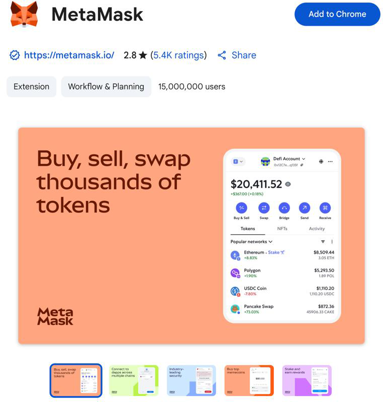

**図2-1.** MetaMask Chrome拡張機能の詳細ページ

　本物のMetaMask拡張機能をダウンロードしていることを確認することが重要です。悪意のある拡張機能がGoogleのフィルターをすり抜けることがあるからです。本物の拡張機能には以下の特徴があります：

- アドレスバーにID `nkbihfbeogaeaoehlefnkodbefgpgknn` が表示される

- [*https://metamask.io*](https://metamask.io) が提供元として表示される

- 5,400件以上のレビューがある

- 1,500万人以上のユーザーがいる

※これらの数字は原書執筆時点のものです。現在の数字はChrome Web Storeで確認してください。

　正しい拡張機能であることを確認したら、「Chromeに追加」をクリックしてインストールします。

### ウォレットの作成

　MetaMaskをインストールすると、ブラウザのツールバーに新しいアイコン（キツネの顔）が表示されます。クリックして開始します。利用規約への同意を求められ、その後パスワードを入力して新しいイーサリアムウォレットを作成します（図2-2を参照）。

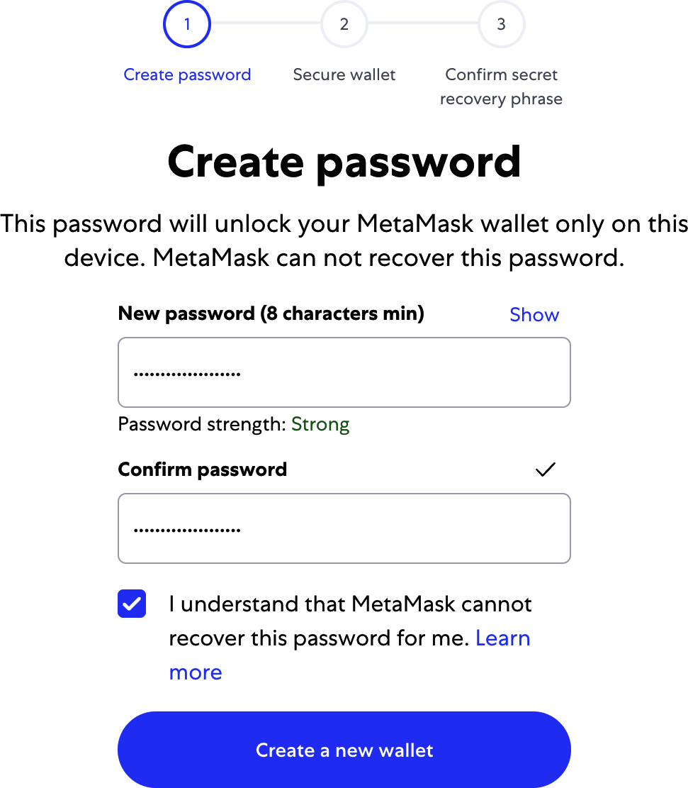

**図2-2.** MetaMask Chrome拡張機能のパスワードページ

> **ヒント**
>
> パスワードはMetaMaskへのアクセスを保護し、ブラウザを共有する第三者がMetaMaskを操作できないようにするためのものである。このパスワードはローカルデバイス上でのみ有効である。秘密鍵やシードフレーズを入手した攻撃者は、パスワードがなくてもアドレスの資金に直接アクセスできてしまう点に注意が必要である。

　パスワードを設定すると、MetaMaskはウォレットを生成し、12個の英単語からなる*ニーモニックバックアップ*を表示します（図2-3を参照）。MetaMaskやコンピューターに問題が起きた場合、互換性のある任意のウォレットでこの単語列を使って資金へのアクセスを回復できます。回復にパスワードは不要で、12個の単語だけで十分です。

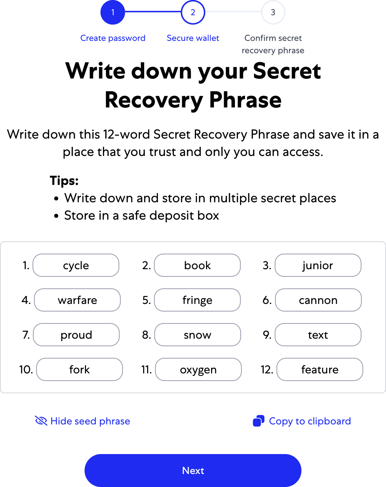

**図2-3.** MetaMaskが作成したウォレットのニーモニックバックアップ

> **ヒント**
>
> ニーモニック（12単語）を紙に2部バックアップする。2つの紙のバックアップを、耐火金庫、施錠された引き出し、貸金庫など、2つの異なる安全な場所に保管する。紙のバックアップは、イーサリアムウォレットに保管している資金と同等の価値がある現金のように扱うこと。これらの単語にアクセスできる人は誰でも、資金にアクセスして盗むことができる。シードフレーズを安全に保つ方法については、第5章で詳しく説明する。

　ニーモニックを安全に保管したことを確認すると、図2-4のようにイーサリアムアカウントの詳細が表示されます。

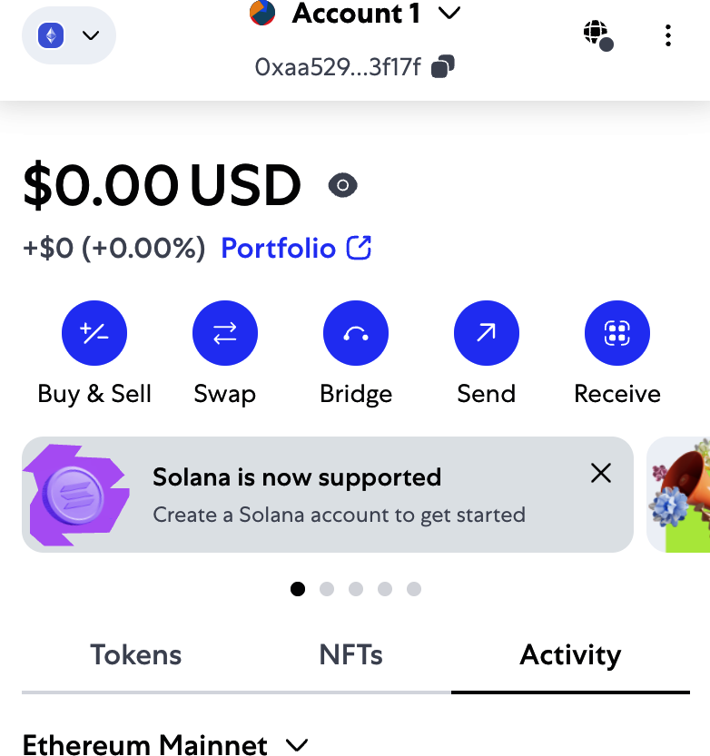

**図2-4.** MetaMaskのイーサリアムアカウント

> **注記**
>
> 本書に表示されているアドレスにアセットを送らないこと。シードフレーズは教育目的で公開されており、これらのアドレスに送られたすべてのアセットはおそらく失われる。

　アカウントページには、アカウント名（デフォルトでは「Account 1」）、イーサリアムアドレス（この例では`0xaa529…f17f`）、およびアカウントを視覚的に区別するためのカラフルなアイコンが表示されます。アカウントページの上部には、現在使用しているイーサリアムネットワーク（この例では「Main Network」）が表示されます。

　おめでとうございます。最初のイーサリアムウォレットのセットアップが完了しました。

### ネットワークの切り替え

　MetaMaskのアカウントページに表示されているように、複数のイーサリアムネットワークから選択できます。デフォルトではMetaMaskはメインネットへの接続を試みます。その他の選択肢はパブリックテストネット、任意のイーサリアムノード、またはローカルコンピューター（localhost）上でプライベートブロックチェーンを実行するノードです：

**メインイーサリアムネットワーク**

メインのパブリックイーサリアムブロックチェーン。本物のETH、本物の価値を扱い、実際の結果が生じる。

**Sepoliaテストネット**

2021年10月にイーサリアムのコア開発者がproof-of-authority（PoA）ネットワークとして立ち上げ、その後PoSコンセンサスに移行したテストネット。イーサリアムのメインネット環境を反映している。

**Holeskyテストネット**

Holeskyテストネットは、ステーキング、インフラ、プロトコル開発のためのイーサリアムの高度なテスト環境である。※Holeskyテストネットは2025年9月に廃止されました。後継はHoodiテストネットです。

**Localhost 8545**

ブラウザと同じコンピューター上で実行されているノードに接続する。このノードはパブリックブロックチェーン（メインまたはテストネット）やプライベートテストネットの一部である場合がある。

**カスタムRPC**

Geth互換のリモートプロシージャコール（RPC）インターフェースを持つ任意のノードにMetaMaskを接続できる。このノードはパブリックでもプライベートでも任意のブロックチェーンの一部である場合がある。

> **注記**
>
> MetaMaskウォレットは接続するすべてのネットワークで同じ秘密鍵とイーサリアムアドレスを使用する。ただし各イーサリアムネットワーク上のイーサリアムアドレスの残高は異なる。例えばSepoliaテストネットでetherを送信するために鍵を使用しても、他のネットワーク上の残高には影響しない。

### テスト用etherの入手

　手始めにウォレットへ入金しましょう。ただし最初はメインネットではなくテストネットを使います。本物のetherには実際のお金がかかるうえ、取り扱いに慣れておく必要があるためです。

　図2-5のように、左上のイーサリアムアイコンをクリックしてMetaMaskをSepoliaテストネットに切り替えます。「テストネットを表示」オプションを切り替えて、Sepoliaをクリックします。

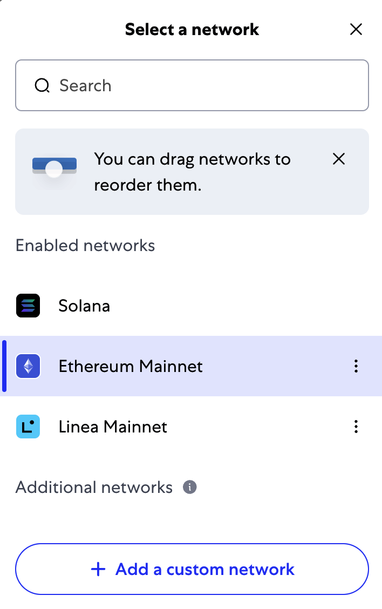

**図2-5.** MetaMaskのネットワーク

　「購入」をクリックし、[このリスト](https://oreil.ly/VE0t0)のフォーセットの一つに移動します。使用するフォーセットを決めたら（どれもほぼ同等です）、図2-6のようにテストネット上でetherをリクエストします。

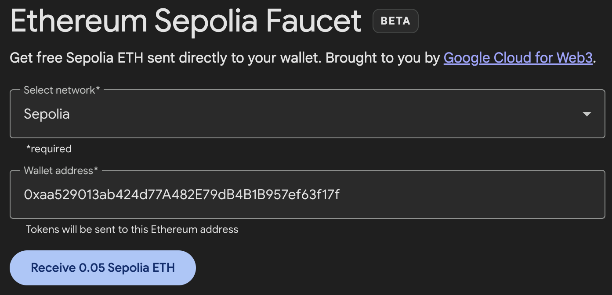

**図2-6.** MetaMask Sepoliaテストフォーセット

　テストネットetherのリクエストのトランザクションIDは以下のようになります：

    0x471273d9417e98e7f1adaae61e53a353b2d2313de2e71fc4b6184bf5a63fa0ae

　数秒後、新しいトランザクションがSepoliaネットワークで処理され、MetaMaskウォレットに0.05 ETHの残高が表示されます（フォーセットが送信するetherの量によって異なります）。次にブラウザ拡張機能で最初のトランザクションをクリックし、図2-7のように「ブロックエクスプローラーで表示」をクリックします。*ブロックエクスプローラー*に移動します。ブロックエクスプローラーはブロック、アドレス、トランザクションを可視化して探索できるウェブサイトです。

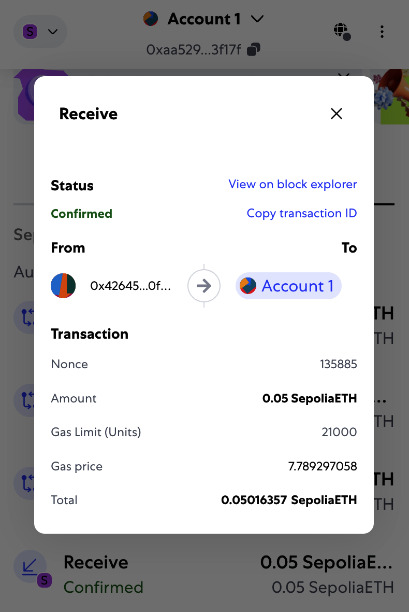

**図2-7.** MetaMaskから確認したトランザクション

　MetaMaskは人気のあるイーサリアムブロックエクスプローラーの一つである[Etherscanブロックエクスプローラー](https://etherscan.io)を使用します。Sepoliaテストフォーセットからの支払いを含むトランザクションを図2-8に示します。

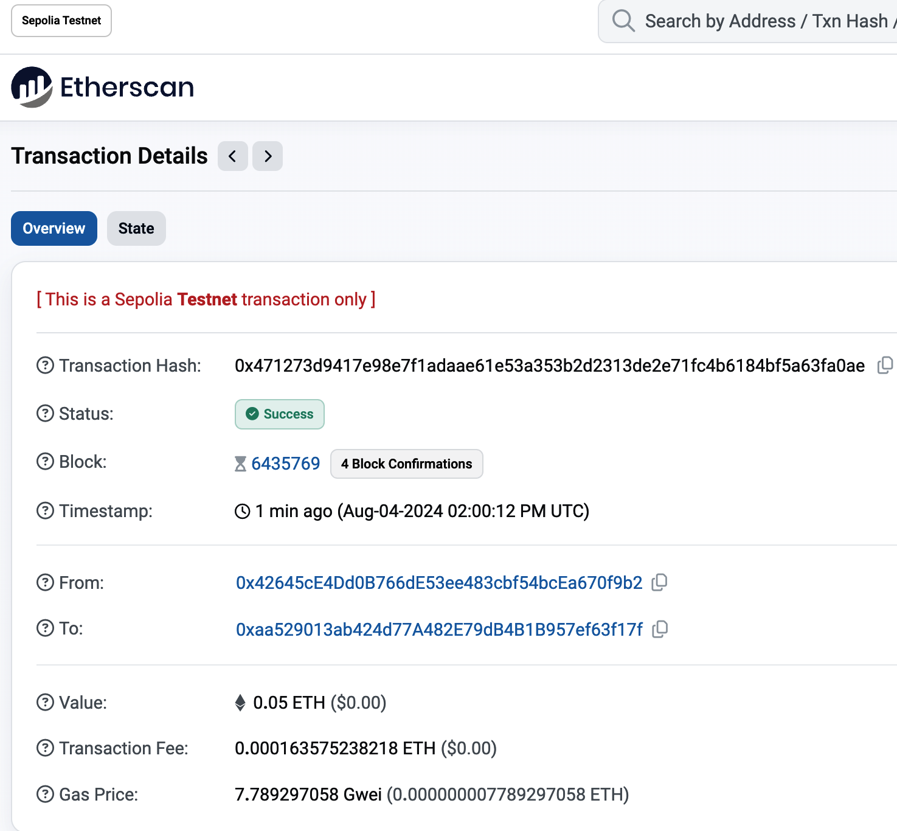

**図2-8.** Etherscan Sepoliaブロックエクスプローラー

　トランザクションはSepoliaブロックチェーンに記録されており、トランザクションIDを検索するだけでいつでも誰でも閲覧できます。[*sepolia.etherscan.io*ウェブサイト](http://sepolia.etherscan.io)にトランザクションハッシュを入力して自分で確認してみてください：

    0x471273d9417e98e7f1adaae61e53a353b2d2313de2e71fc4b6184bf5a63fa0ae

### MetaMaskからetherを送信する

　Sepoliaテストフォーセットから最初のテスト用etherを受け取ったら、フォーセットに返送したり他のアドレスに送信したりしてetherの送信を試すことができます。この例では図2-9のようにテストネットのetherをヴィタリック・ブテリンに送信してみます。

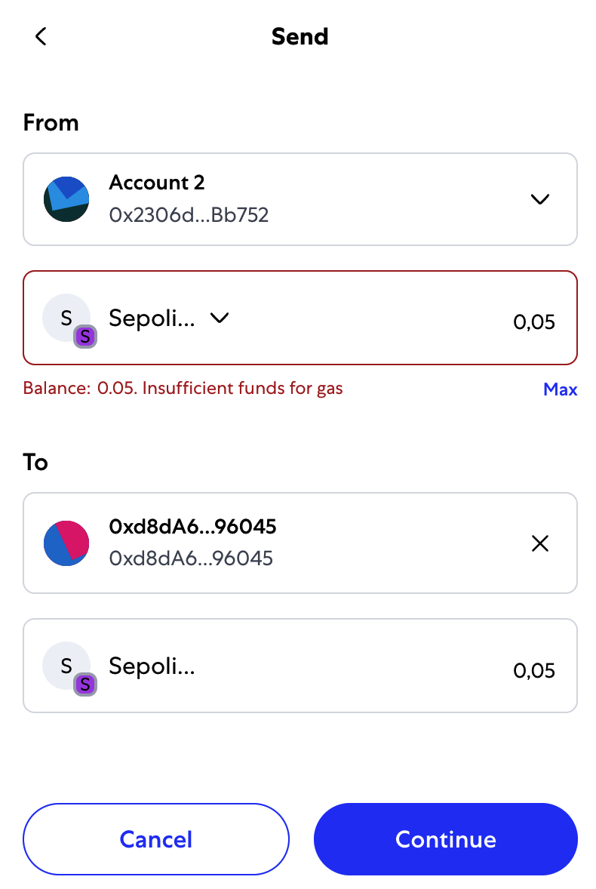

**図2-9.** 0.05 etherをアドレスに送信する

　トランザクションを完了できないことに気づいたかもしれません。MetaMaskが残高不足だと表示しています。0.05 ETHを持っていて0.05 ETHを送りたいのに、なぜ残高不足なのでしょうか。

　その答えはガスのコストにあります。すべてのイーサリアムトランザクションには手数料の支払いが必要で、ネットワークがトランザクションを検証するために徴収します。イーサリアムの手数料は*ガス*と呼ばれる仮想的な通貨単位で課金されます。ガスにはetherを使用し、トランザクションの一部として支払います。

> **注記**
>
> テストネットでも手数料が必要である。手数料がなければテストネットはメインネットとは異なる挙動をし、適切なテストプラットフォームにならない。手数料はメインネットと同様にテストネットもDoS攻撃や不適切に構築されたコントラクト（例：無限ループ）から保護する。

　トランザクションを送信する際、MetaMaskは最近成功したトランザクションの平均ガス価格を計算します。例えば3 gwei（gigaweiの略）です。weiはether通貨の最小の細分化単位であり、「etherの通貨単位」で説明した通りです。ガスリミットは基本的なトランザクションを送信するコストに設定されます。これは21,000ガス単位で、トランザクションの送信に使用できるガスの最小量です。したがって使用するETHの最大量は3 × 21,000 gwei = 63,000 gwei = 0.000063 ETHとなります（平均ガス価格は変動する可能性があります）。後の章では、トランザクションに優先順位を付けるためにガスリミットを増減させる方法を説明します。

　つまり、0.05 ETHのトランザクションを行うには0.050063 ETHが必要ということです。「拒否」をクリックしてこのトランザクションをキャンセルしましょう。今度は0.01 ETHを送信してみましょう。

### アドレスのトランザクション履歴の確認

　ここまでで、MetaMaskを使ってテスト用etherを送受信するエキスパートになりました。ウォレットで支払いの受領と送信を行いました。これらすべてのトランザクションは[*sepolia.etherscan.io*ブロックエクスプローラー](http://sepolia.etherscan.io)で確認できます。ウォレットアドレスをコピーしてブロックエクスプローラーの検索ボックスに貼り付けるか、MetaMaskにページを開いてもらうことができます。MetaMaskのアカウントアイコンの横に3つの点を示すボタンがあります。クリックするとアカウント関連のオプションメニューが表示されます（図2-10を参照）。

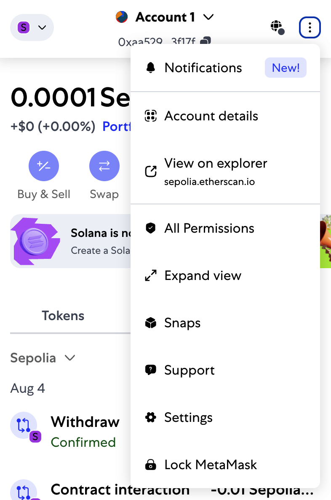

**図2-10.** MetaMaskアカウントコンテクストメニュー

> **ヒント**
>
> MetaMaskのデフォルト設定はあまりプライバシー重視ではない。「設定」→「セキュリティとプライバシー」にある設定を慎重に確認することをお勧めする。MetaMaskの仕組みに慣れたら、イーサリアムメインネットの接続先を、デフォルト設定のものから自分の要件に合ったプライバシー設定を持つRPCを使うものへ変更することも推奨する。最もプライベートな方法は、接続可能な独自のRPCを持つ独自のノードを運用することである。第3章でその方法を説明する。

　「Etherscanでアカウントを表示」を選択すると、図2-11のようにブロックエクスプローラーでアカウントのトランザクション履歴を表示するウェブページが開きます。

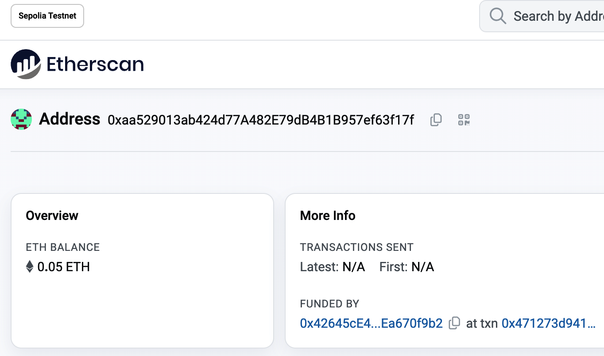

**図2-11.** Etherscanでのアドレストランザクション履歴

　ここではイーサリアムアドレスの全トランザクション履歴を確認できます。Sepoliaブロックチェーンに記録された、自分のアドレスが送信者または受信者であるすべてのトランザクションが表示されます。いくつかのトランザクションをクリックして詳細を確認してみてください。

> **警告**
>
> *アドレスポイズニング*と呼ばれる既知の攻撃があり、ブロックエクスプローラー上で偽装されたアドレスのトランザクションを表示させることができる。ブロックエクスプローラーは簡易的な確認に使用するべきであるが、表示される情報が正確でない場合もある。

　任意のアドレスのトランザクション履歴を調べることができます。Sepoliaテストフォーセットのアドレスのトランザクション履歴を見てみましょう（ヒント：自分のアドレスへの最も古い支払いに記載されている「送信者」アドレスです）。フォーセットから自分や他のアドレスに送られたすべてのテスト用etherを確認できます。表示されるすべてのトランザクションはさらに多くのアドレスやトランザクションにつながります。やがて相互接続されたデータの迷宮の中で迷子になるでしょう。パブリックブロックチェーンには膨大な量の情報が含まれており、今後の例で見るようにすべてプログラムで探索できます。

## ワールドコンピューターの紹介

　ウォレットを作成し、etherの送受信を行いました。ここまではイーサリアムを暗号通貨として扱ってきました。しかしイーサリアムはそれ以上のものです。実際、暗号通貨の機能は非中央集権的なワールドコンピューターとしてのイーサリアムの機能に従属するものです。etherは*スマートコントラクト*と呼ばれるコンピュータープログラムの実行に対価を支払うために使用されます。スマートコントラクトは*EVM*と呼ばれるエミュレートされたコンピューター上で実行されます。

　EVMはグローバルシングルトンです。つまり、あらゆる場所で動作するグローバルな単一インスタンスコンピューターであるかのように動作します。イーサリアムネットワーク上の各ノードはEVMのローカルコピーを実行してコントラクトの実行を検証し、イーサリアムブロックチェーンはトランザクションとスマートコントラクトを処理する際のワールドコンピューターの変化する*状態*を記録します。これについては第14章でさらに詳しく説明します。

## 外部所有アカウントとコントラクト

　MetaMaskウォレットで作成したアカウントの種類は*外部所有アカウント*（EOA）と呼ばれます。EOAは秘密鍵を持つアカウントであり、秘密鍵を持つことで資金やコントラクトへのアクセスを制御できます。

　もう一つの種類のアカウントがあることを推測しているかもしれません。それは*コントラクトアカウント*です。コントラクトアカウントはスマートコントラクトコードを持っていますが、単純なEOAにはそれがありません。さらにコントラクトアカウントは秘密鍵を持ちません。代わりにスマートコントラクトコードのロジックによって所有（および制御）されます。スマートコントラクトコードはコントラクトアカウントの作成時にイーサリアムブロックチェーン上に記録され、EVMが実行するソフトウェアプログラムです。

　コントラクトにはEOAと同様にアドレスがあります。コントラクトもEOAと同様にetherを送受信できます。しかしトランザクションの宛先がコントラクトアドレスの場合、そのコントラクトはEVM上で*実行*され、トランザクションとそのデータが入力として使用されます。etherに加えて、トランザクションにはコントラクト内のどの関数を実行するか、その関数にどのパラメーターを渡すかを示す*データ*を含めることができます。このようにしてトランザクションはコントラクト内の関数を*呼び出す*ことができます。

　コントラクトアカウントは秘密鍵を持たないため、トランザクションを*開始*できない点に注意してください。トランザクションを開始できるのはEOAのみですが、コントラクトは他のコントラクトを呼び出すことでトランザクションに*反応*し、複雑な実行パスを構築できます。

　次のいくつかのセクションで最初のコントラクトを作成します。その後MetaMaskウォレットとSepoliaテストネット上のテスト用etherを使って、コントラクトの作成、資金の提供、使用方法を学びます。

## シンプルなコントラクト：テスト用etherフォーセット

　イーサリアムにはいくつかの高水準言語があり、いずれもコントラクトの作成とEVMバイトコードの生成に使用できます。最も著名で興味深い言語については第7章で説明します。スマートコントラクトプログラミングで圧倒的に主流の高水準言語はSolidityです。Solidityはギャヴィン・ウッドが作成し、イーサリアム（およびそれ以外）で最も広く使用されている言語になりました。Solidityを使って最初のコントラクトを作成します。

　最初の例（例2-1）として、フォーセットを制御するコントラクトを作成します。Sepoliaテストネットでテスト用etherを取得するためにすでにフォーセットを使用しました。*フォーセット*は比較的シンプルなもので、要求するアドレスにetherを配布し、補充できます。

##### 例2-1. *Faucet.sol*：フォーセットを実装するSolidityコントラクト

```solidity
pragma solidity 0.8.26;
// SPDX-License-Identifier: GPL-3.0

// 最初のコントラクトはフォーセット！
contract Faucet {

    // 要求する人にetherを配布する
    function withdraw(uint256 _withdrawAmount, address payable _to) public {

        // 引き出し額を制限する
        require(_withdrawAmount <= 1000000000000);

        // リクエストしたアドレスに金額を送信する
        _to.transfer(_withdrawAmount);
    }

    // Etherを受け取る関数。msg.dataは空でなければならない
    receive() external payable {}

    // msg.dataが空でない場合に呼び出されるフォールバック関数
    fallback() external payable {}
}
```

　これは非常にシンプルなコントラクトで、これ以上シンプルにすることはほとんどできません。また、多くの悪い慣行やセキュリティの脆弱性を示す*欠陥のある*コントラクトでもあります。後のセクションで欠陥を検証しながら学んでいきます。しかし今のところはこのコントラクトが何をし、どのように動作するかを一行ずつ見ていきましょう。Solidityの多くの要素がJavaScript、Java、C++などの既存のプログラミング言語に似ていることにすぐ気づくでしょう。

　最初の行は`pragma`文です：

    pragma solidity 0.8.26;

　Solidityソースファイルの先頭にこの行を含めることで、コードがSolidityコンパイラのバージョン0.8.26でコンパイルされることを保証し、互換性を確保して異なるコンパイラバージョンの使用から生じる問題を回避します。

　次に、スマートコントラクトがGPL-3.0ライセンスの下でライセンスされていることを示すコメントがあります：

    // SPDX-License-Identifier: GPL-3.0

　これは法的およびコンプライアンス上の理由から重要です。コードの使用と配布に関するユーザーや開発者の権利と義務を明示するからです。

　コメントは人間が読むためのものであり、実行可能なEVMバイトコードには含まれません。通常は説明しようとしているコードの前の行か同じ行に配置します。コメントは2つのスラッシュ `//` で始まります。最初のスラッシュからその行の終わりまでのすべてが空行と同じように扱われ、無視されます。

　これもコメントです：

    // 最初のコントラクトはフォーセット！

　次の行は実際のコントラクトの開始です：

    contract Faucet {

　この行は`contract`オブジェクトを宣言します。他のオブジェクト指向言語の`class`宣言に似ています。コントラクトの定義は、他の多くのプログラミング言語と同様に*スコープ*を定義する中括弧（`{}`）の間のすべての行を含みます。

　次に、`Faucet`コントラクトの最初の関数を宣言します：

    function withdraw(uint256 _withdrawAmount, address payable _to) public {

　この関数は`withdraw`という名前で、`_withdrawAmount`という名前の符号なし整数（`uint256`）と`_to`という名前の`address payable`を引数に取ります。public関数として宣言されており、他のコントラクトから呼び出せます。関数の定義は中括弧の間に続きます。`withdraw`関数の最初の部分は引き出しに制限を設けています：

    require(_withdrawAmount <= 1000000000000);

　Solidityの組み込み関数`require`を使って前提条件をテストしています。`_withdrawAmount`がether（表2-1を参照）の基本単位であるweiの1,000,000,000,000以下、つまり0.000001 ether以下であることを確認しています。`withdraw`関数がこの金額を超える`withdraw_amount`で呼び出された場合、`require`関数はコントラクトの実行を停止し、*例外*で失敗させます。なおSolidityでは文の末尾にセミコロンが必要です。

　コントラクトのこの部分がフォーセットの主要なロジックです。引き出しに制限を設けることで、コントラクトからの資金の流れを制御しています。非常にシンプルな制御ですが、プログラマブルブロックチェーンの力を垣間見ることができます。お金を制御する非中央集権的なソフトウェアです。

　これがコントラクトの最初の設計上の欠陥です。セキュリティ上の欠陥ではありませんが、`require`文には常にエラーメッセージを追加する方が良いでしょう。こうすれば`require`文によってユーザーのトランザクションが失敗した場合に理由が明確になります。

　修正された`require`文は以下の通りです：

    require(_withdrawAmount <= 1000000000000, "The requested amount is too much, try a smaller amount!");

　次に実際の引き出しが来ます：

    _to.transfer(_withdrawAmount);

　ここでいくつか興味深いことが起きています。`transfer`関数は現在のコントラクトから別の指定されたアドレス（この場合は`_to`アドレス）にetherを転送する組み込み関数です。`transfer`関数は唯一の引数として金額を取ります。数行前に宣言した`withdraw`関数のパラメーターである`_withdrawAmount`の値を渡します。

　`_to`アドレスがpayableとして定義されているため、これが可能です。組み込み関数`transfer`と`send`はpayableアドレスに対してのみ呼び出せます。これがコードの2番目の欠陥です。`transfer`はEOAが`withdraw`関数を呼び出す場合には問題ありませんが、別のコントラクトがこの関数をトリガーする場合には問題になります。`transfer`関数は最大2,300ガスしか利用できず、複数のコントラクト呼び出しではこの制限を超える可能性が高いため、トランザクションが失敗することがあります。この問題を修正するには`transfer`や`send`の代わりに組み込みの`call`関数を使用します。ただし`call`関数はセキュリティ上の欠陥を避けるために適切に扱う必要があります。今のところは組み込みの`transfer`関数のままにしておきます。

　次の行は閉じ中括弧で、`withdraw`関数の定義の終了を示しています。

　次に、さらに2つの関数を宣言します：

    receive() external payable {}
    fallback() external payable {}

　これらは`fallback`関数と`receive`関数です。コントラクトをトリガーしたトランザクションがコントラクト内の宣言された関数のいずれも指定しなかった場合、関数をまったく指定しなかった場合、またはデータを含まなかった場合に呼び出されます。コントラクトはこれらの関数を持つことができ、通常はetherを受け取るために使います。*msg.data*が空の場合は`receive`関数がトリガーされ、*msg.data*が空でない場合は`fallback`関数がトリガーされます。

　`fallback`関数のすぐ下にある最後の閉じ中括弧は、`Faucet`コントラクトの定義を閉じるものです。以上です。

## Faucetコントラクトのコンパイル

　最初のサンプルコントラクトができたので、Solidityコンパイラを使ってSolidityコードをEVMバイトコードに変換する必要があります。これにより、そのコードをブロックチェーン上でEVMに実行させられるようになります。

　Solidityコンパイラはスタンドアロンの実行ファイルとして、さまざまなフレームワークの一部として、またIDEにバンドルされて提供されています。ここでは簡単にするために、最も人気のあるIDEの一つであるRemixを使用します。

　Chromeブラウザ（先ほどインストールしたMetaMaskウォレットを使用）で[Remix IDE](https://remix.ethereum.org)に移動します。

　Remixを最初に読み込むと*Storage.sol*というサンプルコントラクトが開きます。これは不要なので、図2-12のようにタブの隅にある`x`をクリックして閉じます。

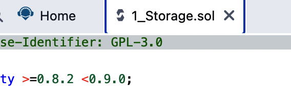

**図2-12.** デフォルトのサンプルタブを閉じる

　次に、図2-13のように新しいファイルを作成します。新しいファイルの名前を*Faucet.sol*にします。

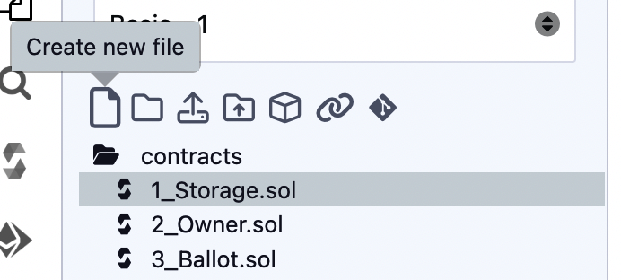

**図2-13.** 新しいコントラクトを作成する

　新しいタブが開いたら、図2-14のようにサンプルの*Faucet.sol*のコードをコピーして貼り付けます。

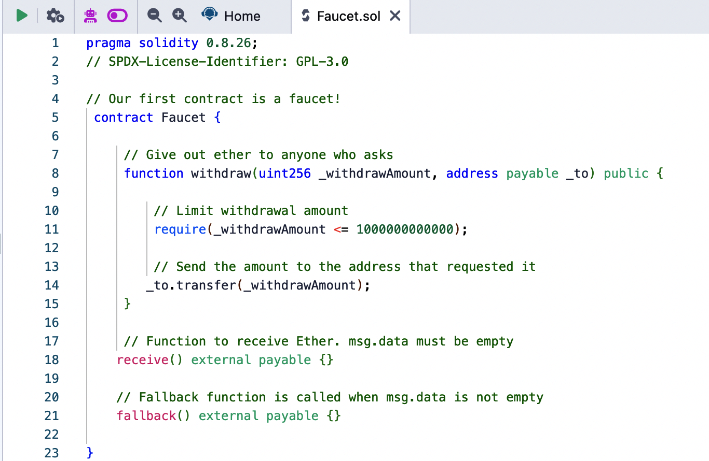

**図2-14.** Faucetのサンプルコードを新しいコントラクトにコピーする

　*Faucet.sol*コントラクトをRemix IDEに読み込んだら、Remixのコンパイルセクションに移動し「Compile *Faucet.sol*」をクリックします。すべて順調であれば緑色のボックスが表示されます（図2-15を参照）。

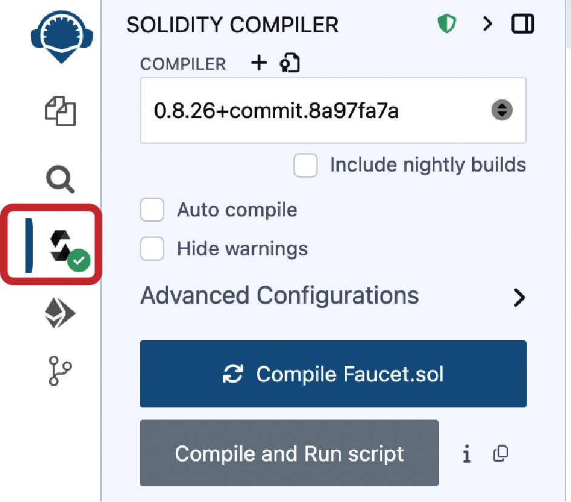

**図2-15.** Remixが*Faucet.sol*コントラクトのコンパイルに成功した

　何か問題が発生した場合、最も可能性の高い原因はRemix IDEが0.8.26とは異なるバージョンのSolidityコンパイラを使用していることです。その場合`pragma`ディレクティブにより*Faucet.sol*のコンパイルが妨げられます。コンパイラタブに移動してバージョンを0.8.26に設定し、再試行してください。

　SolidityコンパイラがFaucet.solをEVMバイトコードにコンパイルしました。参考までにバイトコードは以下の通りです：

    6080604052348015600e575f80fd5b506101af8061001c5f395ff3fe608060405260043610610020575f3560
    e01c8062f714ce1461002957610027565b3661002757005b005b348015610034575f80fd5b5061004f600480
    360381019061004a919061013b565b610051565b005b64e8d4a51000821115610062575f80fd5b8073ffffff
    ffffffffffffffffffffffffffffffffff166108fc8390811502906040515f60405180830381858888f19350
    5050501580156100a5573d5f803e3d5ffd5b505050565b5f80fd5b5f819050919050565b6100c0816100ae56
    5b81146100ca575f80fd5b50565b5f813590506100db816100b7565b92915050565b5f73ffffffffffffffff
    ffffffffffffffffffffffff82169050919050565b5f61010a826100e1565b9050919050565b61011a816101
    00565b8114610124575f80fd5b50565b5f8135905061013581610111565b92915050565b5f80604083850312
    15610151576101506100aa565b5b5f61015e858286016100cd565b925050602061016f85828601610127565b
    915050925092905056fea26469706673582212207de2f4d88c747c9332dceef5dcd739f3380ec8a8c2167a29
    2ba64ee24fa32a8a64736f6c634300081a0033

　EVMバイトコードを直接プログラミングする代わりに、Solidityのような高水準言語を使えてよかったと思いませんか。私たちもそう思います。

## ブロックチェーン上へのコントラクトの作成

　コントラクトができ、バイトコードにコンパイルしました。次にイーサリアムブロックチェーンにコントラクトを「登録」する必要があります。コントラクトのテストにはSepoliaテストネットを使用するので、そこに提出します。

　ブロックチェーンへのコントラクトの登録は、`to`フィールドが空（null）の特別なトランザクションを作成して行います。この空の宛先は、既存のアドレスにトランザクションを送信するのではなく新しいコントラクトをデプロイしたいことをイーサリアムブロックチェーンに知らせます。トランザクションの`data`フィールドにはコンパイル済みのコントラクトバイトコードが含まれます。幸いRemix IDEがこれらすべてを処理し、トランザクションをMetaMaskに送信してくれます。

　まず「Run」タブに切り替え、「Environment」ドロップダウン選択ボックスで「Injected Web3」を選択します。Remix IDEがMetaMaskウォレットに接続され、MetaMaskを通じてSepoliaテストネットに接続されます。接続すると「Environment」の下にSepoliaが表示されます。また「Account」選択ボックスにはウォレットのアドレスが表示されます（図2-16を参照）。

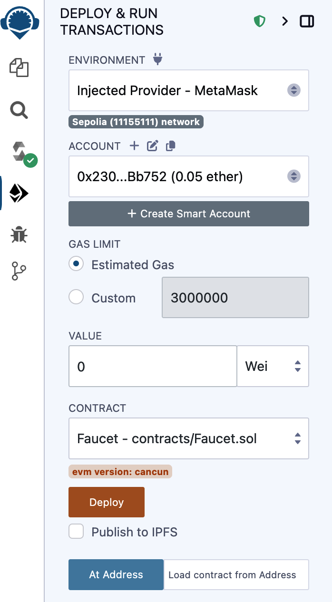

**図2-16.** Injected Web3環境を選択したRemix IDEのRunタブ

　先ほど確認したRun設定のすぐ下に、作成準備が整った`Faucet`コントラクトがあります。図2-16に表示されているDeployボタンをクリックします。

　Remixが特別な「作成」トランザクションを構築し、MetaMaskが図2-17のように承認を求めます。コントラクト作成トランザクションにはetherが含まれていませんが、データのバイト（コンパイル済みコントラクト）が含まれておりガスとしていくらかのgweiを消費します。「送信」をクリックして承認します。

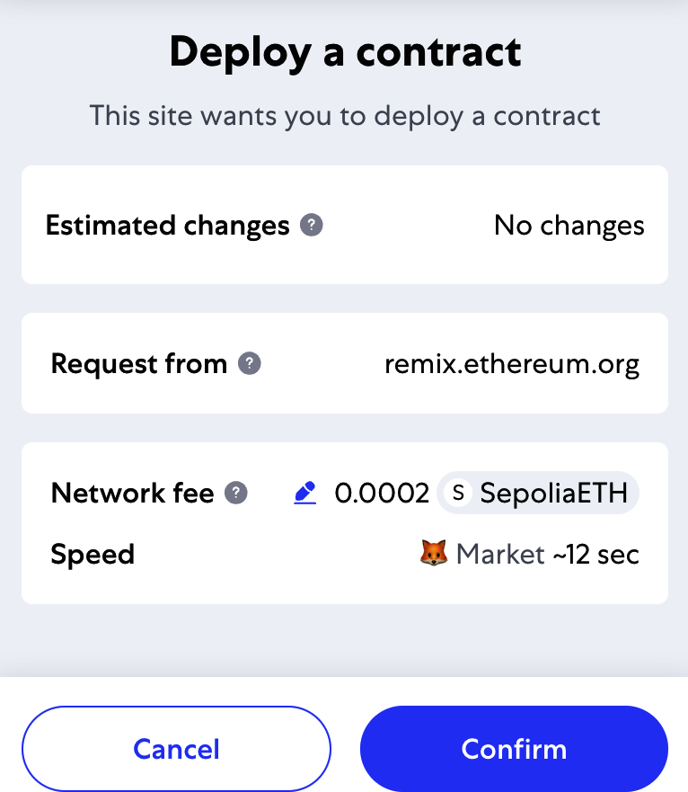

**図2-17.** コントラクト作成トランザクションを表示するMetaMask

　ここで少し待つ必要があります。Sepoliaでコントラクトが処理されるまで約15〜30秒かかります。Remixはあまり動きがないように見えますが、しばらく待ってください。

　コントラクトが作成されると図2-18のようにRunタブの下部に表示されます。

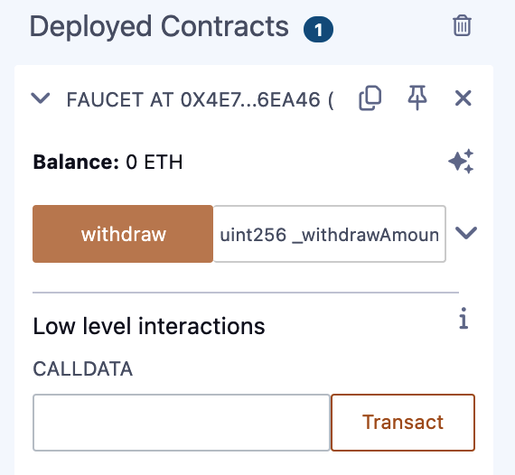

**図2-18.** Faucetコントラクトが稼働している

　`Faucet`コントラクトには独自のアドレスがあることに注目してください。Remixでは「Faucet at 0x4E7…6EA46」と表示されています（あなたのアドレス、つまりランダムな文字と数字は異なります）。

## コントラクトとのやり取り

　ここまで学んだことを振り返りましょう。イーサリアムのコントラクトはEVM内部で実行されるお金を制御するプログラムです。バイトコードをブロックチェーンに記録する特別なトランザクションで作成します。ブロックチェーン上に作成されるとウォレットと同様にイーサリアムアドレスを持ちます。コントラクトアドレスにトランザクションを送信するたびに、そのトランザクションを入力としてコントラクトがEVM上で実行されます。コントラクトアドレスに送信するトランザクションにはetherまたはデータ、あるいはその両方を含めることができます。etherが含まれている場合はコントラクトの残高に「入金」されます。データが含まれている場合はコントラクト内の名前付き関数を指定してその関数を呼び出し、引数を渡せます。

### ブロックエクスプローラーでコントラクトアドレスを確認する

　コントラクトがブロックチェーンに記録され、イーサリアムアドレスを持つことを確認できました。[*sepolia.etherscan.io*ブロックエクスプローラー](http://sepolia.etherscan.io)でコントラクトがどのように見えるか確認してみましょう。Remix IDEでコントラクト名の横にあるアイコンをクリックしてコントラクトのアドレスをコピーします（図2-19を参照）。

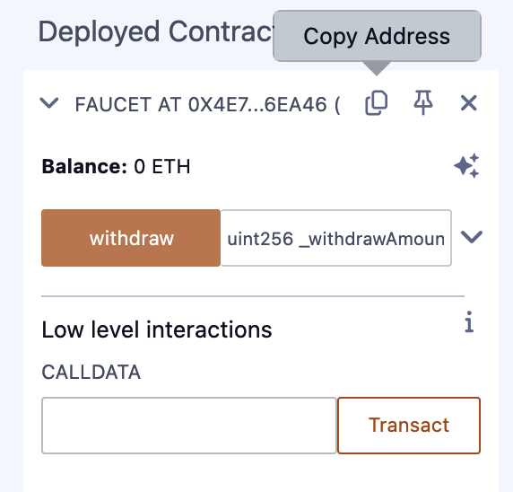

**図2-19.** Remixからコントラクトアドレスをコピーする

　Remixは開いたままにしておいてください。後で戻ってきます。次にブラウザで[*sepolia.etherscan.io*](http://sepolia.etherscan.io)に移動し、検索ボックスにアドレスを貼り付けます。図2-20のようにコントラクトのイーサリアムアドレスの履歴が表示されるはずです。

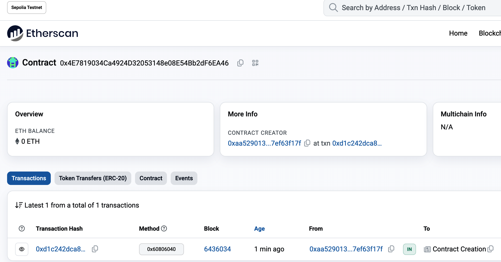

**図2-20.** EtherscanブロックエクスプローラーでFaucetコントラクトアドレスを表示する

### コントラクトへの資金提供

　現時点ではコントラクトの履歴にはコントラクト作成トランザクションの1件のみがあります。ご覧の通りコントラクトにはether（残高ゼロ）もありません。作成トランザクションでetherを送信しなかったからです（送信することもできました）。

　フォーセットには資金が必要です。最初のプロジェクトとしてMetaMaskを使ってコントラクトにetherを送信します。クリップボードにまだコントラクトのアドレスがあるはずです（なければRemixから再度コピーしてください）。MetaMaskを開き、他のイーサリアムアドレスに送信するのとまったく同じように0.01 etherをコントラクトに送信します（図2-21を参照）。

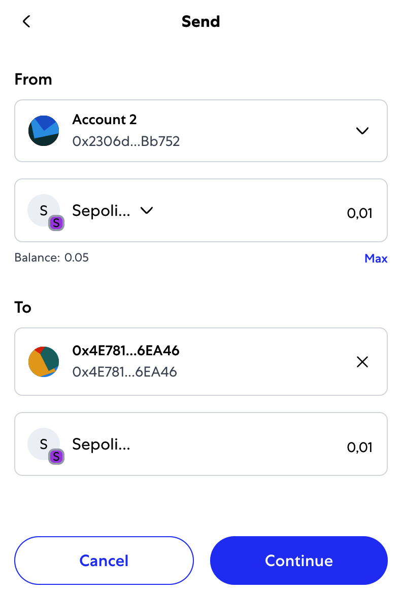

**図2-21.** コントラクトアドレスに0.01 etherを送信する

　1分後にEtherscanブロックエクスプローラーを再読み込みすると、コントラクトアドレスへの別のトランザクションと0.01 etherに更新された残高が表示されます。

　*Faucet.sol*コードの`receive`関数を思い出してください。以下のようでした：

    receive() external payable {}

　コントラクトアドレスにトランザクションを送信し、呼び出す関数を指定するデータがない場合にこの`receive`関数が呼び出されます。トランザクションによってコントラクトがEVM上で実行され、残高が更新されました。フォーセットに資金を提供したのです。

### コントラクトからの引き出し

　次にフォーセットから資金を引き出しましょう。引き出しには`withdraw`関数を呼び出し、`_withdrawAmount`と`_to`の引数を渡すトランザクションを構築する必要があります。今のところシンプルにするためにRemixがトランザクションを構築し、MetaMaskが承認のために提示してくれます。

　Remixのタブに戻り、「Run」タブのコントラクトを確認します。「withdraw」というラベルの付いた赤いボックスと、「uint256 \_withdrawAmount, address \_to」というラベルの付いたフィールド入力が表示されるはずです（図2-22を参照）。


**図2-22.** Remix上の*Faucet.sol*のwithdraw関数

　これはコントラクトへのRemixインターフェースです。コントラクトに定義された関数を呼び出すトランザクションを構築できます。`_withdrawAmount`と`_to`アドレスを入力し、withdrawボタンをクリックしてトランザクションを生成します。

　まず`_withdrawAmount`を決めましょう。コントラクトで許可されている最大量である0.000001 etherを引き出してみます。イーサリアムのすべての通貨値は内部的にweiで表記されており、`withdraw`関数も`_withdrawAmount`をwei建てで期待していることを忘れないでください。引き出したい金額は0.000001 etherで、これは1,000,000,000,000 wei（1の後に12個のゼロ）です。

　`_to`アドレスにはMetaMaskのAccount 1を使用します。

> **ヒント**
>
> JavaScriptの制限により10^17^ほどの大きな数値はRemixで処理できない。代わりに引用符で囲み、RemixがBigNumberとして文字列を受け取り操作できるようにする。引用符で囲まないとRemix IDEは処理に失敗し「Error encoding arguments: Error: Assertion failed.」と表示される。

　`_withdrawAmount`ボックスに`"1000000000000"`（引用符付き）と入力し、MetaMaskからAccount 1のアドレスをコピーして貼り付けてtransactボタンをクリックします（withdrawボタンとして表示される場合もあります。図2-23は関数の展開ビューです。ビューが展開されていない場合はボタンが「withdraw」と表示されます）。

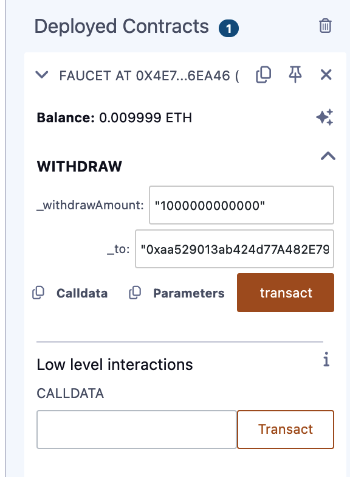

**図2-23.** Remixでtransactをクリックして引き出しトランザクションを作成する

　MetaMaskがトランザクションウィンドウをポップアップして承認を求めます。「送信」をクリックして引き出し呼び出しをコントラクトに送信します（図2-24を参照）。

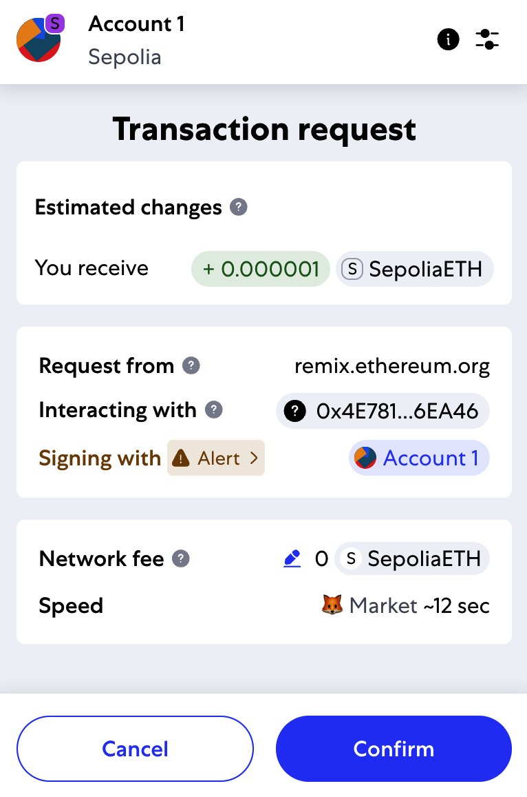

**図2-24.** withdraw関数を呼び出すMetaMaskトランザクション

　1分ほど待ってからEtherscanブロックエクスプローラーを再読み込みすると、`Faucet`コントラクトアドレスの履歴にトランザクションが反映されていることを確認できます（図2-25を参照）。

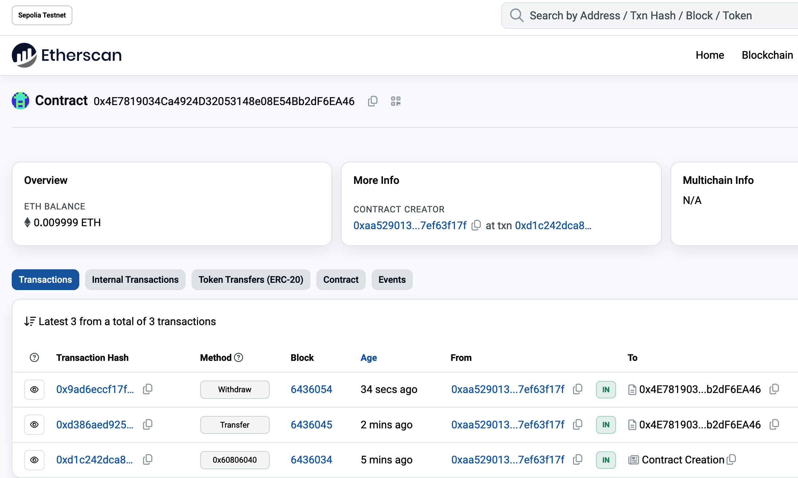

**図2-25.** withdraw関数の呼び出しを示すEtherscan

　コントラクトアドレスを宛先とし値が0 etherの新しいトランザクションが確認できます。コントラクトの残高が変化し、要求通り0.000001 etherが送られたため0.009999 etherになりました。

　しかしコントラクトアドレスの履歴に「OUT」トランザクションが見当たりません。送信された引き出しはどこにあるのでしょうか。コントラクトのアドレス履歴ページに「Internal Transactions」という新しいタブが表示されています。0.000001 etherの送金はコントラクトコードから発生したため、インターナルトランザクション（*メッセージ*とも呼ばれる）です。そのタブをクリックして確認しましょう（図2-26を参照）。

　この「インターナルトランザクション」は、コントラクトの以下のコード行（*Faucet.sol*の`withdraw`関数内）によって送信されました：

    _to.transfer(_withdrawAmount);

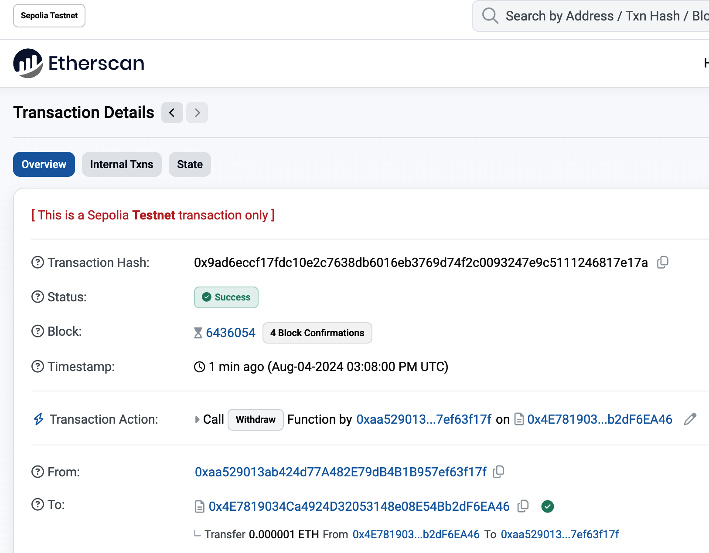

**図2-26.** コントラクトからetherを転送するインターナルトランザクションを表示するEtherscan

　要約すると、まずMetaMaskウォレットから、`withdraw`関数を`_withdrawAmount`引数0.000001 etherとアドレスを指定して呼び出すデータを含むトランザクションを送信しました。このトランザクションによりコントラクトがEVM内で実行されました。EVMは`withdraw`関数を実行し、最初に`require`で引き出し額が0.000001 ether以下であることを検証した後、`transfer`でetherを送信しました。この`transfer`の実行により、コントラクト残高からウォレットアドレスへ0.000001 etherを送るインターナルトランザクションが生成されました。これがEtherscanの「Internal Transactions」タブに表示されているものです。

## まとめ

　この章ではMetaMaskを使ってウォレットをセットアップし、Sepoliaテストネット上のフォーセットで資金を調達しました。ウォレットのイーサリアムアドレスにetherを受け取り、別のアドレスにetherを送信しました。

　次にSolidityで`Faucet`コントラクトを作成しました。Remix IDEでコントラクトをEVMバイトコードにコンパイルし、Remixでトランザクションを作成してSepoliaブロックチェーン上に`Faucet`コントラクトを作成しました。作成されたFaucetコントラクトにはイーサリアムアドレスがあり、etherを送信しました。最後に`withdraw`関数を呼び出すトランザクションを構築し、0.000001 etherの引き出しに成功しました。コントラクトはリクエストを確認し、インターナルトランザクションで0.000001 etherを送信しました。

　大したことないように見えるかもしれませんが、非中央集権的なワールドコンピューター上でお金を制御するソフトウェアとやり取りすることに成功したのです。

　第7章でさらに多くのSolidityスマートコントラクトプログラミングを行い、第9章でベストプラクティスとセキュリティに関する考慮事項を学びます。
