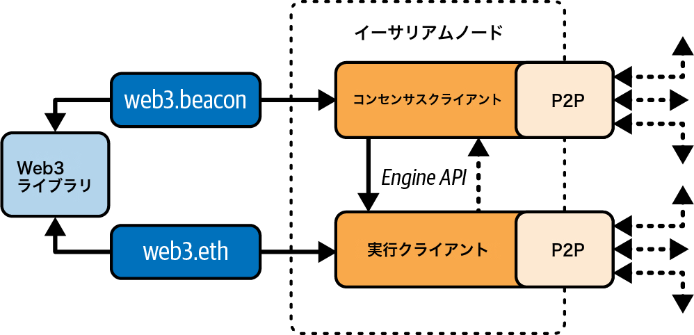

# 第3章　イーサリアムノード

　イーサリアムノードとは、イーサリアムの仕様を実装し、P2Pネットワークを通じて他のイーサリアムノードと通信するソフトウェアアプリケーションです。

　当初、ノードはイーサリアムエコシステムに参加するために必要なすべての要件を満たす単一のクライアントを実行するだけで十分でした。しかし2022年9月15日にThe Merge（※訳注：イーサリアムがPoWからPoSへ移行した重要なアップグレード）ハードフォークが行われ、コンセンサスプロトコルがPoWベースの方式から新しいPoSベースのプロトコルに変更されました。この新しいプロトコルはGasperと呼ばれ、CasperFFGとLMD-GHOSTを組み合わせたPoSコンセンサスプロトコルです。この変更によりコンセンサスと実行の責務が分離され、新しいタイプのイーサリアムクライアントであるコンセンサスクライアントが誕生しました。

　そのため本書執筆時点では、図3-1に示すようにイーサリアムノードは最新の仕様に準拠するために2つのソフトウェアを同時に実行する必要があります。それぞれの定義は以下のとおりです。

**コンセンサスクライアント**

　すべてのノードがブロックチェーンの単一の履歴に合意できるようにするコンセンサスプロトコルを担当する新しいソフトウェアです。

**実行クライアント**

　ネットワーク上で発生するすべてのブロックとトランザクションを受信し、EVM内で実行して正しさを検証することに特化したソフトウェアです。



　異なるイーサリアムクライアント（実行クライアントとコンセンサスクライアントの両方）は、リファレンス仕様と標準化された通信プロトコルに準拠していれば相互運用が可能です。各クライアントは異なるチームが異なるプログラミング言語で実装していますが、すべて同じプロトコルを「話し」、同じルールに従います。そのため、どのクライアントでも同じイーサリアムネットワークを操作し、やり取りできます。

　イーサリアムはオープンソースプロジェクトであり、すべての主要クライアントのソースコードはオープンソースライセンス（LGPL v3.0など）の下で提供されています。自由にダウンロードでき、いかなる目的にも利用できます。しかしオープンソースとは単に無料で使えるという意味だけではありません。イーサリアムはボランティアのオープンコミュニティによって開発されており、誰でも変更を加えることができます。多くの人の目に触れることで、より信頼性の高いコードが実現します。

　イーサリアムは当初、本書の原著者の1人であるギャヴィン・ウッドが執筆したイエローペーパーによって定義されていました。イーサリアムに大きな変更が加えられるたびにこの仕様は更新されてきましたが、現在は実行クライアント用とコンセンサスクライアント用の2つのリファレンス実装に向けた明確な方向性があります。これらのリファレンス実装はPythonで書かれており、可読性とシンプルさを重視しています。

> **注記**
>
> これらの仕様はフルノードの実装を意図したものではありません。実行可能な擬似コード仕様として機能するものです。

　このように形式仕様で定義されている点は、たとえばビットコインとは対照的です。ビットコインは形式的な方法で定義されておらず、ビットコインの「仕様」はリファレンス実装であるビットコインコアです。一方イーサリアムの実行仕様は、英語による説明と数学的（形式的）な定義を組み合わせた論文に記述されています。この形式仕様はさまざまなEIP（Ethereum Improvement Proposals）やPythonで書かれた新しいコンセンサス仕様とともに、イーサリアムノードの標準的な動作を定義しています。

　イーサリアムには明確な形式仕様があるので、独立して開発されながらも相互運用可能なイーサリアムクライアントの実装が多数存在します。イーサリアムは他のどのブロックチェーンよりも多様な実装がネットワーク上で動作しており、これは一般的に良いことだと考えられています。たとえば特定のクライアントの実装戦略を悪用するネットワーク攻撃に対する優れた防御手段となります。あるクライアントの実装が悪用されても、そのクライアントの開発者はパッチ対応に追われますが、他のクライアントはほぼ影響を受けずにネットワークを稼働させ続けるからです。

## イーサリアムネットワーク

　イーサリアムの「イエローペーパー」で定義された形式仕様に概ね準拠するイーサリアムベースのネットワークは多数存在しますが、相互運用できるとは限りません。

　Ethereum Classic、BNB Chain、PolygonなどのEVM互換チェーンは実行仕様の大部分を共有していますが、コンセンサスやパラメーターにおいて異なる点も多くあります。プロトコルレベルではほぼ互換性があるものの、各ネットワークをサポートするためにクライアントソフトウェアのメンテナーが小さな変更を加える必要があることもよくあります。そのためイーサリアムクライアントソフトウェアのすべてのバージョンが、すべてのイーサリアムベースのブロックチェーンで動作するわけではありません。

　2025年6月時点で、4つの言語で書かれたイーサリアム実行プロトコルの5つの主要な実装と、5つの言語で書かれたイーサリアムコンセンサスプロトコルの5つの実装があります。

　実行クライアントは以下のとおりです。

- Geth（Goで実装）
- Nethermind（C#で実装）
- Besu（Javaで実装）
- Erigon（Goで実装）
- Reth（Rustで実装）

　コンセンサスクライアントは以下のとおりです。

- Lighthouse（Rustで実装）
- Lodestar（TypeScriptで実装）
- Nimbus（Nimで実装）
- Prysm（Goで実装）
- Teku（Javaで実装）

　本セクションでは、以下の2つの実行クライアントについて見ていきます。

**Geth**

　イーサリアムファンデーションが保守する、最も古く最も広く使われている実行クライアントです。

**Reth**

　Parity/OpenEthereumの開発終了後にParadigmが開発した、新しいRustベースの実行クライアントです。

　そして、以下の2つのコンセンサスクライアントについて見ていきます。

**Prysm**

　初期に最も使用されたコンセンサスクライアントであり、現在はOffchain Labsが保守しています。

**Lighthouse**

　最も使用されているコンセンサスクライアントであり、Sigma Primeが保守しています。

　各クライアントを使用してノードをセットアップする方法を紹介します。具体的には、Geth-PrysmとReth-Lighthouseの組み合わせを使用し、コマンドラインオプションやAPIについても探っていきます。

> **注記**
>
> これらのペアはあくまで例にすぎません。イーサリアムノードを実行するには、好みの実行クライアントとコンセンサスクライアントを自由に組み合わせることができます。

## フルノードを実行すべきか

　ブロックチェーンの健全性、レジリエンス、検閲耐性は、独立して運用され地理的に分散した多数のフルノードに依存しています。フルノードとはブロックチェーン全体をダウンロードし、データを無期限に保持するノードです。各フルノードは新しいノードがブロックデータを取得して運用を開始する手助けをするとともに、オペレーターはすべてのトランザクションとコントラクトを権威ある独立した方法で自ら検証できます。

> **注記**
>
> 正確に言えば、これらのノードには以下の区別があります。
>
> **アーカイブノード**
> すべてのデータを無期限に保持するイーサリアムノード
>
> **フルノード**
> 過去のステートとレシートを破棄するイーサリアムノード。通常、ノードを起動する際のデフォルトオプションである

　ただしフルノードの運用にはハードウェアリソースと帯域幅のコストが発生します。フルノードは少なくとも2 TBのデータをダウンロードし（2025年6月時点、クライアントの設定による）、ローカルのハードディスクに保存しなければなりません。このデータ量は新しいトランザクションやブロックが追加されるたびに急速に増加します。このトピックについては後のセクション「フルノードのハードウェア要件」で詳しく説明します。

　ライブのメインネットでフルノードを実行することはイーサリアム開発に必須ではありません。テストネットノード（小規模なパブリックテストブロックチェーンの1つに接続するノード）、Anvilのようなローカルのプライベートブロックチェーン、InfuraやAlchemyのようなサービスプロバイダが提供するホスティッドノードAPIを使えば、必要なことのほぼすべてを実行できます。

　リモートクライアントを実行するという選択肢もあります。リモートクライアントはブロックチェーンのローカルコピーを保存せず、ブロックやトランザクションの検証も行いません。ウォレットの機能を提供し、トランザクションの作成とブロードキャストが可能です。以下のような既存のネットワークへの接続に使用できます：

- 自分自身のフルノード
- パブリックブロックチェーン
- パブリックまたは許可型（パーミッションド）テストネット（proof-of-authority＝PoA、特定の承認済み参加者のみが検証を行うネットワーク）
- プライベートなローカルブロックチェーン実際にはMetaMask、Rabby Wallet、Coinbase Walletなどのリモートクライアントを、さまざまなノードオプションを切り替える便利な手段として使うことが多いでしょう。

　リモートクライアントとウォレットという用語は互換的に使われますが、いくつかの違いがあります。通常リモートクライアントはウォレットのトランザクション機能に加えてAPI（web3.js APIなど）を提供します。

　イーサリアムにおけるリモートクライアントの概念を、軽量クライアント（ビットコインにおけるSimplified Payment Verification〔SPV〕クライアントに相当するもの）と混同しないでください。軽量クライアントはブロックヘッダーを検証し、マークル証明（ハッシュツリーを利用してデータの存在を効率的に証明する手法）を使ってブロックチェーンへのトランザクションの包含を検証してその影響を判定します。これによりフルノードに近いセキュリティレベルを提供します。

　一方イーサリアムのリモートクライアントはブロックヘッダーやトランザクションを検証しません。フルノードに完全に依存してブロックチェーンにアクセスするため、セキュリティとプライバシーの保証が大幅に低下します。自分自身でフルノードを運用すれば、これらの問題を軽減できます。

### フルノードの利点と欠点

　フルノードを実行すると接続先のネットワークの運用に貢献できますが、軽微から中程度のコストが発生します。利点と欠点を見てみましょう。

**利点**

- イーサリアムベースのネットワークのレジリエンスと検閲耐性をサポートする
- すべてのトランザクションを権威をもって検証する
- 仲介者なしにパブリックブロックチェーン上の任意のコントラクトとやり取りできる
- 仲介者なしにパブリックブロックチェーンにコントラクトを直接デプロイできる
- ブロックチェーンの状態（アカウント、コントラクトなど）をオフラインで照会（読み取り専用）できる
- 第三者に読み取っている情報を知らせることなくブロックチェーンを照会できる

**欠点**

- 大量かつ増加し続けるハードウェアと帯域幅のリソースが必要である
- 最初の起動時に完全な同期に数日かかる場合がある
- 同期を維持するためにメンテナンス、アップグレード、オンラインの維持が必要である

### パブリックテストネットの利点と欠点

　フルノードを実行するかどうかにかかわらず、パブリックテストネットのノードを実行したくなることが多いでしょう。利点と欠点を見てみましょう。

**利点**

- テストネットノードの同期と保存に必要なデータ量は少なく、ネットワークにもよるが約100〜300 GB程度（2025年6月時点）。
- テストネットノードは数時間で完全に同期できる。
- コントラクトのデプロイやトランザクションの実行にはテスト用etherが必要だが、テスト用etherは価値がなく、いくつかの「フォーセット」から無料で取得できる。
- テストネットは多くのユーザーやコントラクトが存在し、「ライブ」で動作するパブリックブロックチェーンである。

**欠点**

- テストネットでは「本物の」お金は使えず、テスト用etherで動作する。経済的な利害関係がないため、実際の攻撃者に対するセキュリティをテストできない。
- パブリックブロックチェーンの一部の側面はテストネットでは現実的にテストできない。たとえばトランザクション手数料はトランザクションの送信に必要だが、テストネットではガスが無料のため（テストネットのETHには実際の経済的価値がないため）考慮事項にならない。またテストネットはパブリックメインネットで時折発生するようなネットワーク混雑を経験しない。
- 特定の目的のために設計されたテストネットもあり、イーサリアムメインネットとわずかに異なることがある。

### ローカルブロックチェーンシミュレーションの利点と欠点

　多くのテスト目的において、最良の選択肢はシングルインスタンスのプライベートブロックチェーンを起動することです。Anvilは最も人気のあるローカルブロックチェーンシミュレーションの1つであり、他の参加者なしに実行してやり取りできます。

**利点**

- 同期が不要で、ディスク上のデータもほぼゼロ。最初のブロックを自分自身で生成する。
- テスト用etherを入手する必要がない。テストに使用できるブロック報酬を自分自身に「付与」する。
- 他のユーザーがいない。自分だけである。
- 他のコントラクトがない。起動後にデプロイするもののみ。

**欠点**

- 他のユーザーがいないため、ローカルチェーンはパブリックブロックチェーンと同じようには動作しない。トランザクションスペースの競争やトランザクションの順序付けもない。
- 自分以外のブロックプロデューサーがいないため、ブロック生成がより予測可能で、パブリックブロックチェーンで発生する一部のシナリオをテストできない。AnvilやHardhatなどのツールではブロック生成モードを設定してメインネットに近い挙動を再現できるが、イーサリアムメインネット上にいるのとは同じではない。
- 他のコントラクトがないため、テストしたいものをすべてデプロイする必要がある（依存関係やコントラクトライブラリを含む）。ただしAnvilのようなツールではイーサリアムメインネットのチェーンを任意のブロックでフォークし、メインネットに近い状態でスマートコントラクトを実験できる。

## イーサリアムノードの実行

　時間とリソースがあるならば、仕組みを学ぶためだけでもフルノードの実行を試みるべきです。本セクションではイーサリアムクライアントであるGeth-PrysmおよびReth-Lighthouseのダウンロード、コンパイル、実行方法について説明します。OSのコマンドラインインターフェース（CLI）の使用にある程度精通している必要があります。フルノード、テストネットノード、ローカルのプライベートブロックチェーンのいずれのクライアントとして実行する場合でも、これらのクライアントをインストールする価値はあります。

### フルノードのハードウェア要件

　始める前に、イーサリアムフルノードを実行するのに十分なリソースを持つコンピュータがあることを確認してください。イーサリアムブロックチェーンの完全なコピーを保存するには少なくとも2 TBのディスクスペースが必要です。イーサリアムテストネットのフルノードも実行したい場合は、追加で少なくとも100〜400 GBが必要になります。2 TBのブロックチェーンデータのダウンロードには長い時間がかかるため、高速なインターネット接続で作業することを推奨します。

　イーサリアムブロックチェーンの同期はI/O（入出力）集約型の処理です。ソリッドステートドライブ（SSD）の使用が最適です。ハードディスクドライブ（HDD）を使用する場合はキャッシュとして少なくとも8 GBのRAMが必要です。それでもシステムが遅すぎて完全な同期に追いつけない可能性があります。

　イーサリアムベースのブロックチェーンの完全なコピーを同期するための最小要件の概要は以下のとおりです。

- 2コア以上のCPU
- 少なくとも2 TBの空きストレージ
- SSD使用時は最低8 GBのRAM、HDD使用時は8 GB以上（SSDを強く推奨）
- 7 Mbps以上のダウンロード速度

　妥当な時間で同期し、本書で説明するすべての開発ツール、ライブラリ、クライアント、ブロックチェーンを保存したい場合はより高性能なコンピュータが必要です。推奨スペックは以下のとおりです。

- 4コア以上の高速CPU。コア数よりもクロック速度が重要
- 16 GB以上のRAM
- 少なくとも2 TBの空き容量がある高速NVMe SSD
- 24 Mbps以上のダウンロードインターネットサービス

　ブロックチェーンのサイズがどのくらいのペースで増加し、いつ追加のディスクスペースが必要になるかを予測するのは困難です。同期を開始する前にブロックチェーンの最新サイズを確認することを推奨します。

> **注記**
>
> ここに記載されているディスクサイズの要件は、古いステートデータを「プルーニング」するデフォルト設定でノードを実行することを前提としています。すべてのステートをディスク上に保持する完全な「アーカイブ」ノードを実行する場合、クライアントによっては2 TB以上（最大12〜15 TB）のディスクスペースが必要になることがあります。ノードを実行する前に、公式クライアントのウェブサイトで最新のハードウェア要件を必ず確認してください。

### クライアントのビルドと実行のソフトウェア要件

　本セクションではGeth-PrysmとReth-Lighthouseのクライアントソフトウェアについて説明します。Unix系のコマンドライン環境を使用していることを前提としています。以下の例ではBashシェル（コマンドライン実行環境）を実行するmacOSでのコマンドと出力を示しています。ほとんどのLinuxディストリビューションでも同じ手順が変更なしで動作します。WindowsユーザーはWindows Subsystem for Linux（WSL2）を使用できます。

> **ヒント**
>
> この章の多くの例ではターミナルアプリケーションからアクセスできるOSのCLI（シェルとも呼ばれる）を使用します。シェルはプロンプトを表示し、コマンドを入力するとテキストで応答し、次のコマンドのための新しいプロンプトを表示します。プロンプトはシステムによって異なりますが、以下の例では$記号で示しています。$記号の後に表示されているコマンド（太字で示されています）を入力し、Enterキーを押して実行してください（$記号自体は入力しません）。各コマンドの下の行はOSの応答です。次の$プレフィックスが表示されたら、新しいコマンドです。

　始める前にいくつかのソフトウェアのインストールが必要になる場合があります。現在使用しているコンピュータでソフトウェア開発をしたことがなければ、基本的なツールのインストールが必要でしょう。以降の例ではソースコード管理システムであるgit、Goプログラミング言語と標準ライブラリであるgolang、システムプログラミング言語であるRustのインストールが必要です。

　この例で使用する4つのクライアントのドキュメントページは以下のとおりです。

- [Geth](https://oreil.ly/zYviP)
- [Prysm](https://oreil.ly/9-2FC)
- [Reth](https://oreil.ly/KDmMt)
- [Lighthouse](https://oreil.ly/RRpAs)

　各クライアントのアーキテクチャの詳細やインストール中のトラブルシューティングには、これらのウェブサイトを参照してください。

### 準備フェーズ

　ホームディレクトリから始めて、コンピュータ上に*ethereum-node1*というフォルダを作成し、その中に*execution*と*consensus*の2つのサブフォルダを作成します。

```bash
$ mkdir ethereum-node1
$ cd ethereum-node1
$ mkdir execution
$ mkdir consensus
```

　これで以下のようなフォルダ構造になっているはずです。

```bash
ethereum-node1
├── consensus
└── execution
```

　前のステップを*ethereum-node2*という新しいフォルダで繰り返します。

```bash
$ cd .. # このコマンドはホームディレクトリに戻るために使用する
$ mkdir ethereum-node2
$ cd ethereum-node2
$ mkdir execution
$ mkdir consensus
```

　最終的に、2つのルートフォルダ（*ethereum-node1*と*ethereum-node2*）があり、それぞれのルートフォルダ内に*execution*と*consensus*の2つのサブフォルダが存在するはずです。

　また、[Go](https://golang.org/)と[Rust](https://www.rust-lang.org/)のインストールも必要です。インストール方法については各公式ウェブサイトのガイドを参照してください。

### Geth-Prysm

　新しく作成した*ethereum-node1*フォルダに移動します。

```bash
$ cd ethereum-node1
```

#### Geth

　まずソースコードからビルドしてGethをインストールします。GethはGo言語による実行仕様の実装であり、イーサリアムファンデーションが活発に開発しているためイーサリアムクライアントの「公式」実装と見なされています。通常すべてのイーサリアムベースのブロックチェーンには独自のGeth実装があります。Gethを使用する場合は以下のレポジトリリンクのいずれかから、自分のブロックチェーンに適したバージョンを取得してください。

- [イーサリアム](https://oreil.ly/qzK-O)
- [BNB Chain](https://oreil.ly/tGtL3)
- [Polygon PoS](https://oreil.ly/ZWhh3)

> **注記**
>
> これらの手順をスキップして、プラットフォームに合ったプリコンパイル済みバイナリをインストールすることもできます。プリコンパイル済みのリリースはインストールがはるかに簡単で、ここに記載されているレポジトリの「releases」セクションから入手できます。ただしソフトウェアを自分でダウンロードしてコンパイルすれば、より多くのことを学べるでしょう。

**レポジトリのクローン**。最初のステップはGitレポジトリをクローンしてソースコードのコピーを取得することです。executionサブフォルダ内で以下のようにgitコマンドを使用してレポジトリのローカルクローンを作成します。

```bash
$ cd execution
$ git clone https://github.com/ethereum/go-ethereum.git
```

　レポジトリがローカルシステムにコピーされる際に進捗レポートが表示されるはずです。

```bash
Cloning into 'go-ethereum'...
remote: Enumerating objects: 130745, done.
remote: Counting objects: 100% (11/11), done.
remote: Compressing objects: 100% (11/11), done.
remote: Total 130745 (delta 1), reused 6 (delta 0), pack-reused 130734
Receiving objects: 100% (130745/130745), 204.15 MiB | 6.13 MiB/s, done.
Resolving deltas: 100% (80729/80729), done.
```

　Gethのローカルコピーが取得できたので、プラットフォーム用の実行可能ファイルをコンパイルできます。

**ソースコードからのGethのビルド**。Gethをビルドするにはソースコードがダウンロードされたディレクトリに移動し、最新リリースを選択した後にmakeコマンドを使用します。現時点ではv1.14.3ですが、最新版は公式リポジトリで随時確認できます。

```bash
$ cd go-ethereum
$ git checkout v1.14.3
$ make geth
```

　すべてがうまくいけば、Gethの実行可能ファイルが完成するまでGoコンパイラが各コンポーネントをビルドしている様子が表示されます。

```bash
go run build/ci.go install ./cmd/geth
go: downloading golang.org/x/crypto v0.22.0
go: downloading golang.org/x/net v0.24.0
[...]
github.com/ethereum/go-ethereum/cmd/utils
github.com/ethereum/go-ethereum/beacon/blsync
github.com/ethereum/go-ethereum/cmd/geth
Done building.
Run "./build/bin/geth" to launch geth.
```

　実際に起動せずにGethが動作するか確認してみましょう。

```bash
$ ./build/bin/geth version

GethVersion: 1.14.3-stable
Git Commit: ab48ba42f4f34873d65fd1737fabac5c680baff6
Architecture: arm64
Go Version: go1.22.2
Operating System: darwin
[...]
```

　`geth version`コマンドの出力はわずかに異なるかもしれませんが、上記のようなバージョンレポートが表示されるはずです。

　まだGethを実行しないでください。チェーンの先端まで同期するために、コンセンサスクライアントをインストールする必要があります。

#### Prysm

　次はコンセンサスクライアントの番です。Prysmはコンセンサス仕様のGo言語実装であり、Offchain Labsが活発に開発しています。当初The Merge後のコンセンサスクライアントとしては圧倒的に最も多く使用されていました。現在はクライアントの多様性を高めるコミュニティの取り組みにより、市場シェアは大幅に減少して37%となっています。

**バイナリのインストール**。PrysmはGethと同様にソースコードからビルドすることもできますが、少し複雑です。推奨されるインストール方法は以下のとおりです。まず*consensus*フォルダに移動します。

```bash
$ cd ../.. # このコマンドはethereum-node1フォルダに戻るために使用する
$ cd consensus
```

　次に、以下のコマンドを実行します。

```bash
$ curl https://raw.githubusercontent.com/prysmaticlabs/prysm/master/prysm.sh --output prysm.sh && chmod +x prysm.sh
```

**JWT（JSON Web Token）シークレットの生成**。イーサリアムノードを構成する実行クライアントとコンセンサスクライアントは2つの別々のソフトウェアですが、常に相互にやり取りする必要があります。そのため両方のクライアントが接続の認証に使用する一種のパスワードがあります。ここではそのパスワードを生成します。

```bash
$ ./prysm.sh beacon-chain generate-auth-secret
```

　*jwt.hex*ファイルが生成されるはずです。そのファイルを親フォルダに移動しましょう。

```bash
$ mv jwt.hex ../jwt.hex
```

#### ノードの実行

　実行クライアントとコンセンサスクライアントの両方をインストールし、JWTシークレットを正しく生成できたので、クライアントを起動してイーサリアムフルノードを稼働させましょう。

**実行クライアントの実行**。まず実行クライアントであるGethを実行します。*execution*フォルダに戻り、以下のコマンドを実行します。

```bash
$ cd .. # このコマンドはethereum-node1フォルダに戻るために使用する
$ cd execution
$ ./go-ethereum/build/bin/geth --mainnet \
	--http \
	--http.api eth,net,engine,admin,web3 \
	--authrpc.jwtsecret=../jwt.hex
```

　以下のような表示が出れば、正常に動作しています。

```bash
INFO [06-08|17:56:38.738] Starting Geth on Ethereum mainnet...
INFO [06-08|17:56:38.738] Bumping default cache on mainnet         provided=1024 updated=4096
INFO [06-08|17:56:38.740] Maximum peer count                       ETH=50 total=50
INFO [06-08|17:56:38.745] Set global gas cap                       cap=50,000,000
INFO [06-08|17:56:38.752] Initializing the KZG library             backend=gokzg
INFO [06-08|17:56:38.771] Allocated trie memory caches             clean=614.00MiB dirty=1024.00MiB
INFO [06-08|17:56:38.772] Using pebble as the backing database…
```

**コンセンサスクライアントの実行**。次にコンセンサスクライアントであるPrysmを実行します。実行クライアントが動作しているターミナルタブは閉じないでください。新しいターミナルウィンドウまたはタブを開き、*consensus*フォルダに移動します。

```bash
$ cd ethereum-node1
$ cd consensus
$ ./prysm.sh beacon-chain \
	--execution-endpoint=http://localhost:8551 \
	--mainnet \
	--jwt-secret=../jwt.hex \
	--checkpoint-sync-url=https://beaconstate.info \
	--genesis-beacon-api-url=https://beaconstate.info
```

　Prysmの利用規約への同意を求められることがあります。その場合は**accept**と入力すれば完了です。

```bash
Prysm Terms of Use
By downloading, accessing or using the Prysm implementation ("Prysm"), you (referenced
herein as "you" or the "user") certify that you have read and agreed to the terms and
conditions below.
TERMS AND CONDITIONS: https://github.com/prysmaticlabs/prysm/blob/develop/TERMS_OF_SERVICE.md
Type "accept" to accept this terms and conditions [accept/decline]: (default: decline):
```

　以上で完了です。実行クライアントとコンセンサスクライアントの両方がターミナルに大量のデータをログ出力し始めるはずです。

実行クライアント：

```bash
INFO [06-08|18:08:49.039] Forkchoice requested sync to new head    number=20,048,206 hash=8df21a..4afb49 finalized=unknown
INFO [06-08|18:08:52.507] Syncing beacon headers                   downloaded=322,560 left=19,725,577 eta=42m4.183s
INFO [06-08|18:08:57.515] Looking for peers                        peercount=1 tried=42 static=0
INFO [06-08|18:09:00.508] Syncing beacon headers                   downloaded=370,688 left=19,677,449 eta=43m35.827s
INFO [06-08|18:09:01.637] Forkchoice requested sync to new head    number=20,048,207 hash=d99dab..0293c9 finalized=unknown
```

コンセンサスクライアント：

```bash
[2024-06-08 18:09:24]  INFO blockchain: Called new payload with optimistic block payloadBlockHash=0xd44520a09a7a slot=9253245
[2024-06-08 18:09:24]  INFO blockchain: Called fork choice updated with optimistic block finalizedPayloadBlockHash=0x38916be8a559 headPayloadBlockHash=0xd44520a09a7a headSlot=9253245
[2024-06-08 18:09:24]  INFO blockchain: Synced new block block=0xec930e7c... epoch=289163finalizedEpoch=289161 finalizedRoot=0xb8065a78... slot=9253245
[2024-06-08 18:09:24]  INFO blockchain: Finished applying state transition attestations=123 payloadHash=0xd44520a09a7a slot=9253245 syncBitsCount=510 txCount=212
[2024-06-08 18:09:24]  INFO p2p: Peer summary activePeers=64 inbound=0 outbound=63
[2024-06-08 18:09:28]  INFO sync: Subscribed to topic=/eth2/6a95a1a9/beacon_attestation_35/ssz_snappy[2024-06-08 18:09:36]  INFO blockchain: Called new payload with optimistic block payloadBlockHash=0xff879102f29e slot=9253246
```

　これでチェーンの先端に向けて同期中のイーサリアムフルノードが稼働しています。同期にはかなりの時間がかかる場合があります（ハードウェアとインターネット接続速度に応じて数時間から数日）。

> **注記**
>
> この例で使用した具体的なコマンドやCLIフラグについて詳しく知りたい場合は、[Geth](https://oreil.ly/zYviP)と[Prysm](https://oreil.ly/4sn6-)の公式ドキュメントが最適な情報源です。

### Reth-Lighthouse

　同じことをRethとLighthouseという2つの異なるクライアントで行ってみましょう。Rethを実行クライアント、Lighthouseをコンセンサスクライアントとして使用します。

#### Reth

　まずRethをインストールします。*ethereum-node2*フォルダに移動し、executionフォルダに入ります。

**レポジトリのクローン**。最初のステップはGitレポジトリをクローンしてソースコードのコピーを取得することです。ホームディレクトリに戻り、以下のコマンドを入力します。

```bash
$ cd ethereum-node2
$ cd execution
$ git clone https://github.com/paradigmxyz/reth
```

　Rethのローカルコピーが取得できたので、プラットフォーム用の実行可能ファイルをコンパイルできます。

**ソースコードからのRethのビルド**。Rethをビルドするには以下のコマンドを実行します。

```bash
$ cd reth
$ cargo install --locked --path bin/reth --bin reth
```

　インストールの完了までに10分以上かかることがあります。完了したら以下を実行してRethが正しくインストールされたか確認できます。

```bash
$ reth --version
```

　以下のような表示がされるはずです（バージョンは変わることがあります）。

```bash
reth Version: 0.2.0-beta.6-dev
Commit SHA: ac29b4b73
Build Timestamp: 2024-04-22T17:29:01.000000000Z
Build Features: jemallocBuild Profile: maxperf+
```

#### Lighthouse

　次にコンセンサスクライアントであるLighthouseをインストールします。*ethereum-node2*フォルダに戻り、*consensus*フォルダに入ります。

```bash
$ cd .. # このコマンドはethereum-node2フォルダに戻るために使用する
$ cd consensus
```

　まずいくつかの依存関係をインストールする必要があります。macOSの場合は、以下を実行します。

```bash
$ brew install cmake
```

　別のOSを使用している場合は[Lighthouseの公式ドキュメント](https://oreil.ly/vEghS)を参照してください。

**レポジトリのクローン**。最初のステップはGitレポジトリをクローンしてソースコードのコピーを取得することです。

```bash
$ git clone https://github.com/sigp/lighthouse.git
```

　Lighthouseのローカルコピーが取得できたので、プラットフォーム用の実行可能ファイルをコンパイルできます。

**ソースコードからのLighthouseのビルド**。Lighthouseをビルドするには以下のコマンドを実行します。

```bash
$ cd lighthouse
$ git checkout stable
$ make
```

　完了までに10分以上かかる場合があります。

#### ノードの実行

　ここでもまず実行クライアントであるRethを実行します。

**実行クライアントの実行**。*execution*フォルダに戻り、以下のコマンドを実行します。

```bash
$ cd ../.. # このコマンドはethereum-node2フォルダに戻るために使用する
$ cp ../ethereum-node1/jwt.hex ./jwt.hex # 以前生成したjwt.hexファイルを再利用する
$ cd execution
$ reth node --full --http --http.api all --authrpc.jwtsecret=../jwt.hex
```

　以下のような表示が出れば、正常に動作しています。

```bash
2024-06-08T16:58:43.498297Z  INFO Starting reth version="0.2.0-beta.6-dev (ac29b4b73)"
2024-06-08T16:58:43.498434Z  INFO Opening database path="/Users/alessandromazza/Library/Application Support/reth/mainnet/db"
2024-06-08T16:58:43.514141Z  INFO Configuration loaded path="/Users/alessandromazza/Library/Application Support/reth/mainnet/reth.toml"
2024-06-08T16:58:43.514778Z  INFO Database opened
2024-06-08T16:58:43.514917Z  INFO Pre-merge hard forks (block based):…
```

**コンセンサスクライアントの実行**。次にコンセンサスクライアントであるLighthouseを実行します。実行クライアントが動作しているターミナルタブは閉じないでください。新しいターミナルウィンドウまたはタブを開き、*consensus*フォルダに移動します。

```bash
$ cd ethereum-node2
$ cd consensus
$ lighthouse bn \
    --network mainnet \
	--checkpoint-sync-url https://mainnet.checkpoint.sigp.io \
	--execution-endpoint http://localhost:8551 \
	--execution-jwt ../jwt.hex \
	--http
```

　以上で完了です。実行クライアントとコンセンサスクライアントの両方がターミナルに大量のデータをログ出力し始めるはずです。

実行クライアント：

```bash
2024-06-08T17:03:03.355648Z  INFO Received headers total=10000 from_block=18458372 to_block=18448373
2024-06-08T17:03:04.792262Z  INFO Received headers total=10000 from_block=18448372 to_block=18438373
2024-06-08T17:03:04.800043Z  INFO Received headers total=10000 from_block=18438372 to_block=18428373
2024-06-08T17:03:04.913377Z  INFO Received headers total=10000 from_block=18428372 to_block=18418373
```

コンセンサスクライアント：

```bash
Jun 08 17:03:24.929 INFO New block received                      root: 0xa49c057026cea3190df38548d49963e271ebdc4d6f93d2301adc4034d6563113, slot: 9253515
Jun 08 17:03:29.001 WARN Head is optimistic                      execution_block_hash: 0x5a14bfcb9e74c5b3a5121f99ef461ae066262200c269b5d11475274eb78aa7a5, info: chain not fully verified, block and attestation production disabled untilexecution engine syncs, service: slot_notifier
Jun 08 17:03:29.001 INFO Synced                                  slot: 9253515, block: 0xa49c…3113, epoch: 289172, finalized_epoch: 289170, finalized_root: 0xca35…2b06, exec_hash: 0x5a14…a7a5 (unverified), peers: 31, service: slot_notifier
```

　これでチェーンの先端に向けて同期中のイーサリアムフルノードが稼働しています。同期にはかなりの時間がかかる場合があります（ハードウェアとインターネット接続速度に応じて数時間から数日）。

> **注記**
>
> この例で使用した具体的なコマンドやCLIフラグについて詳しく知りたい場合は、[Reth](https://reth.rs)と[Lighthouse](https://oreil.ly/vEghS)の公式ドキュメントが最適な情報源です。

　次のセクションでは、イーサリアムブロックチェーンの初回同期の課題について説明します。

> **ヒント**
>
> これらの手順は複雑すぎてわかりにくいと感じましたか？それでもなお、信頼できる第三者に頼ることなく、自分のイーサリアムフルノードを立ち上げてネットワークに貢献したいと思いますか？
>
> 最適なソリューションがあります。BuidlGuidl Clientというプロジェクトで、1行のコマンドでイーサリアムノードを実行できるようにしたものです。[ご自身でご確認ください](https://oreil.ly/9FKZd)。
>
> もう1つの選択肢は[Dappnode](https://dappnode.com)を使用することです。2つのソリューションから選択できます。
>
> - イーサリアムフルノードが組み込まれたプラグアンドプレイデバイスを購入する。
>
> - Dappnode Coreソフトウェアをインストールして、イーサリアムフルノードを非常に簡単に起動できるようにする。

## イーサリアムベースのブロックチェーンの初回同期

　通常イーサリアムブロックチェーンを同期する際、クライアントはジェネシスブロックから始めてすべてのブロックとトランザクションをダウンロードして検証します。この方法でブロックチェーンを完全に同期できますが、非常に長い時間がかかり大量のリソースが必要です（大量のRAMが必要になり、高速なストレージがなければ完了までさらに時間がかかります）。

　イーサリアムベースのブロックチェーンの多くは2016年末にDoS攻撃の被害を受けました。影響を受けたブロックチェーンはフル同期を行うと同期が遅くなる傾向があります。たとえばイーサリアムでは新しいクライアントはブロック2,283,397まで急速に進みます。このブロックは2016年9月18日にマイニングされ、DoS攻撃の始まりを示しています。このブロックからブロック2,700,031（2016年11月26日）まで、トランザクションの検証が極端に遅くなり、メモリ集約型かつI/O集約型になります。2016年当時のハードウェアではブロックあたりの検証時間が1分を超えました。

　イーサリアムはハードフォークを通じて一連のアップグレードを実施し、DoS攻撃で悪用された根本的な脆弱性に対処しました。これらのアップグレードによりスパムトランザクションで作成された約2,000万の空アカウントのクリーンアップも行われました。

　完全な検証で同期する場合、クライアントの処理速度は低下し、DoS攻撃の影響を受けたブロックの検証には数日、場合によってはそれ以上かかることがあります。幸いほとんどのイーサリアムクライアントには、ブロックチェーンの先端への同期が完了するまでトランザクションの完全な検証をスキップし、チェーンの新しい先端から完全な検証を再開する「高速」同期オプションがあります。実行クライアントでは高速同期を有効にするオプションは通常snap syncです。コンセンサスクライアントではcheckpoint syncです。

　このチュートリアルでは実行クライアントではsnap sync、コンセンサスクライアントではcheckpoint syncを使用し、デフォルトで高速同期を行ってきました。ただしRethは例外で、2025年6月時点ではまだsnap syncをサポートしていません。

## JSON-RPCインターフェース

　イーサリアムクライアントはJSONでエンコードされたAPIとRPC（Remote Procedure Call、遠隔手続き呼び出し）コマンドのセットを提供します。これをJSON-RPC APIと呼びます。JSON-RPC APIはイーサリアムクライアントをゲートウェイとしてイーサリアムネットワークとブロックチェーンにアクセスするプログラムを書くためのインターフェースです。

　通常RPCインターフェースはポート8545上のHTTPサービスとして提供されます。セキュリティ上の理由からデフォルトではlocalhost（自分のコンピュータのIPアドレスである127.0.0.1）からの接続のみを受け付けるよう制限されています。

　JSON-RPC APIにアクセスするには、各RPCコマンドに対応する「スタブ」関数呼び出しを提供する専用ライブラリ（好みのプログラミング言語で書かれたもの）を使うか、手動でHTTPリクエストを構築してJSONエンコードされたリクエストを送受信します。curlのような汎用のコマンドラインHTTPクライアントでRPCインターフェースを呼び出すこともできます。試してみましょう。まず実行クライアントが設定され実行中であることを確認します。次に新しいターミナルウィンドウに切り替えて以下のコマンドを入力します。

```bash
$ curl -X POST -H "Content-Type: application/json" --data \
	'{"jsonrpc":"2.0","method":"web3_clientVersion","params":[],"id":1}' \
	http://localhost:8545

{"jsonrpc":"2.0","id":1,"result":"Geth/1.14.3-stable/darwin-arm64/go1.22.2"}
```

　この例ではcurlを使って`http://localhost:8545`へのHTTP接続を行っています。すでに実行クライアントを起動しており、ポート8545上でJSON-RPC APIをHTTPサービスとして提供しています。curlにHTTP POSTメソッドを使うよう指示し、コンテンツタイプを**application/json**として指定しています。最後にHTTPリクエストのデータコンポーネントとしてJSONエンコードされたリクエストを渡しています。コマンドラインの大部分はcurlがHTTP接続を正しく行うための設定です。興味深い部分は実際に発行するJSON-RPCコマンドです。

```bash
{"jsonrpc":"2.0","method":"web3_clientVersion","params":[],"id":1}
```

　JSON-RPCリクエストは[JSON-RPC 2.0仕様](https://oreil.ly/m0HLL)に従ってフォーマットされます。各リクエストには4つの要素が含まれます。

**jsonrpc**

　JSON-RPCプロトコルのバージョン。正確に「2.0」でなければならない。

**method**

　呼び出すメソッドの名前。

**params**

　メソッドの呼び出し時に使用されるパラメーター値を保持する構造化された値。このメンバーは省略可能である。

**id**

　クライアントが設定する識別子であり、含まれる場合は文字列、数値、またはNULL値でなければならない。含まれる場合サーバーはレスポンスオブジェクトで同じ値を返さなければならない。このメンバーは2つのオブジェクト間のコンテクストを関連付けるために使用する。

> **ヒント**
>
> idパラメーターは主に単一のJSON-RPC呼び出しで複数のリクエストを行う場合に使います。この方法はバッチングと呼ばれます。バッチングはリクエストごとに新しいHTTPおよびTCP接続を行うオーバーヘッドを避けるために使います。イーサリアムの文脈ではたとえば1つのHTTP接続で数千のトランザクションを取得したい場合にバッチングを使います。バッチングでは各リクエストに異なるidを設定し、JSON-RPCサーバーからのレスポンスのidと照合します。最も簡単な実装方法はカウンターを管理して各リクエストごとに値をインクリメントすることです。

　受信するレスポンスは以下のとおりです。

```bash
{"jsonrpc":"2.0","id":1,"result":"Geth/1.14.3-stable/darwin-arm64/go1.22.2"}
```

　これは、JSON-RPC APIがGethクライアントバージョン1.14.3-stableによって提供されていることを示しています。

　もう少し面白いことを試してみましょう。次の例では、JSON-RPC APIに現在のガス価格をweiで問い合わせます。

```bash
$ curl -X POST -H "Content-Type: application/json" --data \
	'{"jsonrpc":"2.0","method":"eth_gasPrice","params":[],"id":4213}' \
	http://localhost:8545

{"jsonrpc":"2.0","id":4213,"result":"0x1B1717FC7"}
```


　レスポンスの0x1B1717FC7は現在のガス価格が7.27 gwei（gigaweiまたは10億wei）であることを示しています。16進数を10進数に変換したい場合は、コマンドライン上でBashのテクニックを使えます。

```bash
$ echo $((0x1B1717FC7))7271972807
```

　完全なJSON-RPC APIは[イーサリアム wiki](https://oreil.ly/lO2Z0)で調べることができます。

> **ヒント**
>
> このセクションではイーサリアムのJSON-RPCインターフェースを示すために生のcurlリクエストを使いました。実際にはより優れたプログラマティックな方法でアクセスしたいと思うでしょう。ここでライブラリの出番です。最も有名で広く使われている3つのライブラリを自由に探索してみてください。
>
> - [ethers.js](https://oreil.ly/JKvSJ)
>
> - [web3.py](https://oreil.ly/dHSF4)
>
> - [alloy](https://alloy.rs)

## リモートイーサリアムクライアント

　リモートクライアントはフルクライアントの機能のサブセットを提供します。完全なイーサリアムブロックチェーンを保存しないため、セットアップが速く必要なデータストレージもはるかに少なくて済みます。

　これらのクライアントは通常、以下のような機能を提供します。

- ウォレット内で秘密鍵とイーサリアムアドレスを管理する
- トランザクションの作成、署名、ブロードキャストを行う
- データペイロードを使用してスマートコントラクトとやり取りする
- DAppを閲覧してやり取りする
- ブロックエクスプローラーなどの外部サービスへのリンクを提供する
- etherの単位変換と外部ソースからの為替レートの取得を行う
- Web3インスタンスをJavaScriptオブジェクトとしてウェブブラウザに注入する
- 別のクライアントによって提供または注入されたWeb3インスタンスを使用する
- ローカルまたはリモートのイーサリアムノード上のRPCサービスにアクセスする

　リモートクライアントは通常、ローカルのマシン上やウェブサーバー上、あるいは第三者のサーバー上で動作しているフルノードに接続します。これによりイーサリアムブロックチェーンのローカルコピーを同期せずに、フルノードイーサリアムクライアントの一部の機能を提供します。

　最も人気のあるリモートクライアントと、提供される機能について見てみましょう。

### モバイル（スマートフォン）ウォレット

　ほとんどの本番環境向けモバイルウォレットは、スマートフォンにはフルのイーサリアムクライアントを実行するのに十分なリソースがないため、リモートクライアントとして動作します。軽量クライアントは開発中ですがイーサリアムではまだ一般的に使われていません。最も有名なものは[Helios](https://oreil.ly/4joTo)で、まだ実験的なソフトウェアです。

　人気のあるモバイルウォレットには以下のものがあります（これらは単なる例であり、セキュリティや機能を推奨・保証するものではありません）。

**Coinbase Wallet**

　イーサリアム（およびすべてのL2）、EVM互換L1、ビットコイン、Solana、Litecoin、Dogecoinなど、多数のチェーンをサポートするモバイルウォレットです。Coinbaseアカウントとの接続も可能です。

**Phantom**

　イーサリアム、Solana、ビットコイン、Polygonに対応するもう1つのマルチチェーンウォレットです。

**Trust Wallet**

　100を超えるブロックチェーンをサポートするモバイルマルチチェーンウォレットです。Trust WalletはiOSとAndroidで利用可能です。

**Uniswap Wallet**

　イーサリアムとEVM互換のL2およびL1のみをサポートするモバイルウォレットです。Uniswapチームによって開発されました。比較的新しく、iOSとAndroidの両方で利用可能です。

### ブラウザウォレット

　ChromeやFirefoxなどのウェブブラウザのプラグインまたは拡張機能として、さまざまなウォレットやDAppブラウザが利用できます。これらはブラウザ内で動作するリモートクライアントです。人気のあるものには以下があります。

**MetaMask**

　[MetaMask](https://metamask.io)は[第2章](https://masteringethereum.xyz/chapter_2.html#getting-started-with-metamask)で紹介した、多機能なブラウザベースのウォレット、RPCクライアント、および基本的なコントラクトエクスプローラーです。Chrome、Firefox、Opera、Brave Browserで利用可能です。

**Phantom**

　Phantomにはウェブブラウザウォレットもあり、非常に洗練されたきれいなUIを備えています。

**Rabby Wallet**

　Rabbyは100を超える異なるブロックチェーン（EVM互換チェーン）をサポートする新しいマルチチェーンウェブブラウザウォレットです。

**Coinbase Wallet**

　Coinbase Walletにはウェブブラウザウォレットもあります。モバイル版と同じ機能を備えています。

### ハードウェアウォレット

　大半のモバイルおよびブラウザウォレットはハードウェアウォレットの高いセキュリティと組み合わせることができます。ハードウェアウォレットはインターネットに接続しないよう設計されたオフラインデバイスで、改ざんやその他の物理的攻撃に耐えるように作られており、より高いレベルのセキュリティを提供します。このようなデバイスを製造する企業は複数ありますが、最も広く使われているのはLedgerとTrezorの2社です。

## まとめ

　この章ではイーサリアムクライアントについて理解を深めました。クライアントのダウンロード、インストール、同期を行い、イーサリアムネットワークの参加者となりました。自分のコンピュータにブロックチェーンを複製することで、システムの健全性と安定性に貢献できます。

　イーサリアムに関する研究開発は非常に盛んであり、将来的に新しいタイプのイーサリアムクライアントが登場するでしょう。興味深い分野には以下のものがあります。

**履歴のプルーニング**

　フルノードのストレージ要件を低減するために過去のデータを削除する

**Verkleツリーとステートレス性**

　イーサリアムの完全なステートを保持することなくブロックを検証できるようにする

**zk-EVM**

　ブロック内のすべてのトランザクションを再実行することなく、ゼロ知識証明を検証することでブロックの正しさを検証する

　これらの概念は以降の章で探っていきますが、まずはこのすべてを可能にする真の魔法、すなわち暗号学について明らかにする必要があります。
