# 第4章 暗号技術

　イーサリアムの基盤技術のひとつが*暗号技術*です。暗号技術はコンピュータセキュリティで広く使われる数学の一分野です。ギリシャ語で「秘密の書き物」を意味しますが、研究対象は*暗号化*と呼ばれる秘密の書き物だけにとどまりません。たとえば、秘密を明かさずにその秘密の知識を証明したり（*デジタル署名*など）、データの真正性を証明したり（デジタルフィンガープリント、いわゆる*ハッシュ*など）する用途にも使えます。こうした暗号学的証明は、イーサリアムプラットフォーム（実際にはすべてのブロックチェーンシステム）の運用に不可欠な数学的ツールであり、イーサリアムアプリケーションでも広く利用されています。

　なお、本書の出版時点では、イーサリアムプロトコルに暗号化は含まれていません。つまり、イーサリアムプラットフォームとの通信やノード間の通信（トランザクションデータを含む）はすべて暗号化されておらず、誰でも（必然的に）読めます。これは、すべての人が状態更新の正しさを検証し、コンセンサスに到達できるようにするためです。将来的にはゼロ知識証明や準同型暗号などの高度な暗号ツールが利用可能になり、一部の暗号化された計算をブロックチェーン上に記録しつつコンセンサスを可能にするでしょう。こうした暗号ツールの基礎技術は研究段階で整いつつありますが、イーサリアムプロトコルへの本格的な組み込みはまだ進んでいません。

　この章では、イーサリアムで使われる暗号技術のうち、*公開鍵暗号*（PKC）を紹介します。公開鍵暗号は、秘密鍵とアドレスという形で資金の所有権を管理するために使われています。

## 鍵とアドレス

　本書の前の章で学んだように、イーサリアムにはEOAとコントラクトの2種類のアカウントがあります。EOAによるEtherの所有権は、デジタル*秘密鍵*、イーサリアム*アドレス*、デジタル*署名*によって確立されます。秘密鍵はユーザーがイーサリアムと対話するすべての操作の中核にあり、アカウントアドレスは秘密鍵から直接導出されます。ひとつの秘密鍵が、アカウントとも呼ばれる単一のイーサリアムアドレスを一意に決定します。

　秘密鍵はイーサリアムシステムで直接使われることはありません。ネットワークに送信されるメッセージに含まれることも、チェーン上に保存されることもありません。秘密鍵は秘密のまま保たれるべきであり、イーサリアムシステム上で送信・保存されるのはアカウントアドレスとデジタル署名のみです。秘密鍵の安全な保管方法については「ウォレットのベストプラクティス」を参照してください。

　ユーザーは秘密鍵を使ってデジタル署名を作成し、この署名によって資金へのアクセスと管理を行います。イーサリアムのトランザクションがブロックチェーンに含まれるには、有効なデジタル署名が必要です。秘密鍵のコピーを持つ人は誰でも、対応するアカウントとそのアカウントが保有するEtherを管理できます。ユーザーが秘密鍵を安全に保管している限り、イーサリアムのトランザクションにおけるデジタル署名は秘密鍵の所有権を証明し、ひいては資金の真の所有者を証明します。

　イーサリアムが使用するPKCベースのシステムでは、鍵は秘密鍵（シークレットキー）と公開鍵のペアで構成されます。公開鍵は銀行の口座番号、秘密鍵は秘密のPINに似たものと考えてください。アカウントを管理するのが秘密鍵で、他者に対してアカウントを識別するのが公開鍵です。秘密鍵自体はイーサリアムユーザーの目に触れることはほとんどなく、通常は暗号化された形式で特別なファイルに保存され、イーサリアムウォレットソフトウェアが管理します。

　イーサリアムトランザクションの支払い部分では、受取人はイーサリアムアドレスで表されます。イーサリアムアドレスは銀行振込の受取人口座情報と同じように使われます。後ほど詳しく見るように、EOAのイーサリアムアドレスは鍵ペアの公開鍵部分から生成されます。ただし、すべてのイーサリアムアドレスが公開鍵と秘密鍵のペアを表すわけではありません。コントラクトを表すアドレスもあり、第7章で見るようにコントラクトは秘密鍵に裏付けられていません。

　この章の残りでは、以下の内容を取り上げます。

- 暗号技術の基礎とイーサリアムにおける数学的基盤を深く掘り下げる
- 鍵の生成、保存、管理のプロセスを検討する
- 秘密鍵、公開鍵、アドレスに使われるさまざまなエンコーディング形式を確認する
- バリデータ鍵の暗号技術とKZGコミットメントスキームを調査する。これらはイーサリアムの暗号基盤に対する最新の更新である

## PKCと暗号通貨

　PKC（*非対称暗号*とも呼ばれる）は、現代の情報セキュリティの中核をなす技術です。1970年代にマーティン・ヘルマン、ウィットフィールド・ディフィー、ラルフ・マークルが最初に発表した*鍵交換プロトコル*は、暗号技術分野への一般の関心を大きく喚起した画期的な発明でした。1970年代以前、強力な暗号技術の知識は各国政府が機密情報として厳重に管理していました。

　PKCは固有の鍵を使って情報を保護します。この鍵は、順方向の計算は容易でも逆関数の計算は困難であるという特別な性質を持つ数学関数に基づいています。PKCはこの性質を利用することで、デジタルの秘密と偽造不可能なデジタル署名を作成できます。その安全性は数学の法則によって保証されます。

　たとえば、2つの大きな素数を掛け合わせることは簡単です。しかし、2つの大きな素数の積が与えられたとき、素因数を見つけることは非常に困難です（この問題は*素因数分解*と呼ばれます）。8,018,009という数を示し、これが2つの素数の積であると伝えたとしましょう。この2つの素数を見つけることは、掛け合わせて8,018,009を求めるよりもはるかに難しいでしょう。

　こうした数学関数の中には、ある秘密の情報を知っていれば容易に逆算できるものがあります。先ほどの例で素因数のひとつが2,003であると教えれば、もうひとつは単純な割り算で簡単に見つかります。8,018,009 ÷ 2,003 = 4,003です。このような関数は*トラップドア関数*と呼ばれます。逆算のショートカットとなる秘密情報がなければ、逆算が非常に困難だからです。

　暗号技術で役立つより高度な数学関数は、*楕円曲線*上の算術演算に基づいています。楕円曲線の算術では、素数を法とする乗算は単純ですが、除算（逆演算）は実質的に不可能です。これは*離散対数問題*と呼ばれ、現在のところ既知のトラップドアは存在しません。この性質を応用した*楕円曲線暗号*は現代のコンピュータシステムで広く使われており、イーサリアムをはじめとする暗号通貨における秘密鍵とデジタル署名の基盤となっています。

> **注記**
>
> 暗号技術と現代の暗号技術で使われる数学関数についてさらに読みたい場合は、以下のリソースを参照してください。
> - [Cryptography](https://oreil.ly/wOT_b)
> - [Trapdoor function](https://oreil.ly/WrxXr)
> - [Prime factorization](https://oreil.ly/rxAnN)
> - [Discrete logarithm](https://oreil.ly/pj8PD)
> - [Elliptic curve cryptography](https://oreil.ly/RP2QF)

　イーサリアムでは、PKCを使ってこの章で説明してきた公開鍵と秘密鍵のペアを作成します。公開鍵は秘密鍵から導出されるため「ペア」と見なされます。鍵ペアはイーサリアムアカウントを表します。公開鍵は誰でもアクセスできるアカウントハンドル（アドレス）を提供し、秘密鍵はアカウント内のEtherへのアクセスやスマートコントラクト使用時の認証を秘密裏に制御します。秘密鍵はデジタル署名の作成に必要な唯一の情報であり、これがアクセスを制御します。デジタル署名はアカウント内の資金を使うトランザクションの署名に必要であり、第7章で見るようにコントラクトの所有者やユーザーの認証にも使われます。

> **ヒント**
>
> ほとんどのウォレット実装では、秘密鍵と公開鍵は利便性のために鍵ペアとして一緒に保存される。ただし、公開鍵は秘密鍵から容易に計算できるため、秘密鍵のみを保存することも可能である。

　デジタル署名はあらゆるメッセージに対して作成できます。イーサリアムのトランザクションでは、トランザクション自体の詳細がメッセージとして使われます。暗号技術の数学（この場合は楕円曲線暗号）は、メッセージ（つまりトランザクションの詳細）を秘密鍵と組み合わせて、秘密鍵を知らなければ生成できないコードを作成する方法を提供します。そのコードがデジタル署名です。

　イーサリアムのトランザクションは、特定のイーサリアムアドレスを持つアカウントへのアクセス要求です。資金を移動したりスマートコントラクトと対話したりするためにイーサリアムネットワークへトランザクションを送信する場合、そのイーサリアムアドレスに対応する秘密鍵で作成したデジタル署名と一緒に送信する必要があります。誰でもこのデジタル署名を、トランザクションの詳細やアクセス対象のイーサリアムアドレスと照合することで、楕円曲線の数学にもとづいてトランザクションの有効性を検証できます。この検証プロセスでは秘密鍵がまったく関与しないため、秘密鍵は秘密のまま保たれます。それでも検証プロセスは、そのトランザクションがイーサリアムアドレスの背後にある公開鍵に対応する秘密鍵を持つ人からしか送信できなかったことを疑いなく判定します。これがPKCの「マジック」です。

> **ヒント**
>
> イーサリアムプロトコルの一部として暗号化は行われない。イーサリアムネットワークの運用の一環として送信されるすべてのメッセージは、（必然的に）誰でも読むことができる。したがって、秘密鍵はトランザクション認証のためのデジタル署名の作成にのみ使われる。
## 秘密鍵

　秘密鍵はランダムに選ばれた数値です。秘密鍵の所有と管理は、ユーザーによるアカウント制御の根幹です。これにより、対応するイーサリアムアドレスに関連するすべての資金を管理し、そのアドレスを認可するコントラクトにアクセスできます。秘密鍵はトランザクションで使う資金の所有権を証明し、Etherの使用に必要な署名を作成するために使われます。秘密鍵は常に秘密にしておかなければなりません。第三者に秘密鍵を明かすことは、その秘密鍵で保護されているEtherとコントラクトの管理権を渡すことと同義です。また、秘密鍵はバックアップを取り、偶発的な紛失から保護する必要もあります。秘密鍵を紛失した場合は回復できず、その秘密鍵で保護されていた資金も永久に失われます。

> **ヒント**
>
> イーサリアムの秘密鍵は単なる数値である。秘密鍵をランダムに選ぶひとつの方法は、コイン、鉛筆、紙を使うことである。コインを256回投げれば、イーサリアムウォレットで使えるランダムな秘密鍵の2進数が得られる（おそらく——以下の段落を参照）。公開鍵とアドレスはその秘密鍵から生成できる。

　鍵を生成する最初で最も重要なステップは、安全な*エントロピー*（ランダム性）の源を見つけることです。イーサリアムの秘密鍵の作成は、本質的に1から2^256の間の数値を選ぶことです。予測可能でも決定論的でもなければ、その数値を選ぶ方法は何でも構いません。イーサリアムソフトウェアは、基盤となるOSの*乱数生成器*（RNG）を使って256ビットのランダムビットを生成します。通常、OSのRNGは人間由来のランダム性で初期化されるため、マウスを数秒間動かしたり、キーボードでランダムなキーを押したりするよう求められることがあります。別の方法として、コンピュータのマイク入力から得られる環境ノイズ（宇宙放射線の影響を含む）を利用することもできます。

　より正確に言えば、秘密鍵は1以上かつ「2^256よりわずかに小さい非常に大きな数」以下の任意の整数です。この数は78桁の巨大な数で、約1.158 × 10^77です。この正確な数値は2^256と最初の38桁を共有しており、イーサリアムで使用される楕円曲線の位数として定義されています。秘密鍵を作成するには、256ビットの数値をランダムに選び、有効な範囲内にあるか確認します。プログラミングでは通常、暗号学的に安全なランダム性のソースから収集したさらに大きなランダムビット列を、Keccak-256やSHA-256などの256ビットハッシュアルゴリズムに入力します。これらのアルゴリズムはちょうど256ビットの数値を生成します。結果が有効範囲内であれば適切な秘密鍵が得られ、そうでなければ別のランダムな数値で再試行します。

> **注記**
>
> イーサリアムの秘密鍵空間の大きさ——2^256——は、想像を絶するほど大きな数である。10進数では約10^77——つまり78桁の数である。比較のために、可視宇宙に存在する原子の数は10^80と推定されている。したがって、宇宙のすべての原子にイーサリアムアカウントを割り当てられるほどの秘密鍵が存在する。秘密鍵をランダムに選べば、誰かがそれを推測したり同じものを選んだりすることは考えられない。

　秘密鍵の生成プロセスはオフラインで行われます。イーサリアムネットワークとの通信は一切不要で、実際のところ誰とも通信する必要はありません。そのため、他の誰も選ばない数値を選ぶには本当にランダムでなければなりません。自分で数値を選んだ場合、誰かが同じ数値を試す（そしてEtherを持ち去る）可能性が極めて高くなります。質の悪いRNG（ほとんどのプログラミング言語の疑似ランダムな`rand`関数など）を使うのはさらに危険で、出力パターンが予測されやすく再現も容易だからです。オンラインアカウントのパスワードと同様に、秘密鍵は推測不可能でなければなりません。幸い、秘密鍵を人間が暗記する必要はまったくないため、最善のアプローチである真のランダム性をそのまま採用できます。

> **警告**
>
> 自分でランダムな数値を生成するコードを書いたり、プログラミング言語が提供する「単純な」RNGを使ったりしないこと。ブラウザウォレットにおけるJavaScriptベースのRNGは、OSのエントロピーに裏付けられていない限り安全でない場合がある。暗号学的に安全な疑似乱数生成器（CSPRNGなど）を、十分なエントロピーのソースからのシードとともに使用することが不可欠である。選択したRNGライブラリのドキュメントを調べて、暗号学的に安全であることを確認すること。CSPRNGライブラリの正しい実装は、鍵のセキュリティにとって極めて重要である。

　以下は、ランダムに生成された秘密鍵を16進数形式で示したものです（256ビットを64桁の16進数で表示、各桁は4ビット）。

```
f8f8a2f43c8376ccb0871305060d7b27b0554d2cc72bccf41b2705608452f315
```

## 公開鍵

　イーサリアムの公開鍵は楕円曲線上の点で、楕円曲線方程式を満たすxとyの座標の組です。

　より簡単に言えば、イーサリアムの公開鍵は2つの数値を結合したものです。これらの数値は秘密鍵から一方向にしか計算できない演算によって生成されます。つまり、秘密鍵があれば公開鍵の計算は簡単ですが、公開鍵から秘密鍵を逆算することはできません。

> **警告**
>
> これから数学の話が始まる。慌てる必要はない。以下の段落で迷子になったら、次のいくつかのセクションを飛ばしても構わない。計算を代わりにやってくれるツールやライブラリがたくさんある。

　公開鍵は*楕円曲線乗算*を使って秘密鍵から計算されます。この演算は実質的に不可逆です。`K = k * G`において、`k`は秘密鍵、`G`は*生成点*と呼ばれる定数の点、`K`は結果の公開鍵、`*`は特別な楕円曲線の「乗算」演算子です。楕円曲線乗算は通常の乗算とは異なり、機能的な属性は共有していますがそれだけです。たとえば逆演算（通常の数値では除算に当たるもの）は「離散対数を見つける」ことに相当します。つまり`K`がわかっている場合に`k`を計算する操作です。この計算は`k`のすべての可能な値を試す総当たり探索と同じくらい困難であり、この宇宙が許容する以上の時間がかかります。

　より簡単に言えば、楕円曲線上の算術は「通常の」整数算術とは異なります。点（`G`）を整数（`k`）で乗算して別の点（`K`）を得ることができます。しかし除算は存在しないため、公開鍵`K`を点`G`で単純に「割って」秘密鍵`k`を計算することは不可能です。これは、前のセクション「PKCと暗号通貨」で説明した一方向性の数学関数です。

> **注記**
>
> 楕円曲線乗算は、暗号技術者が「一方向」関数と呼ぶタイプの関数である。一方向（乗算）の計算は容易だが、逆方向（除算）の計算は不可能である。秘密鍵の所有者は公開鍵を容易に作成して世界中と共有でき、誰も公開鍵から秘密鍵を逆算できないことを確信できる。この数学的トリックが、イーサリアムの資金の所有権とコントラクトの管理を証明する、偽造不可能で安全なデジタル署名の基盤となる。

　秘密鍵から公開鍵を生成する方法を示す前に、楕円曲線暗号をもう少し詳しく見てみましょう。

### 楕円曲線暗号の解説

　楕円曲線暗号は、楕円曲線上の点の加算と乗算で表される離散対数問題に基づく非対称暗号（公開鍵暗号）の一種です。図4-1は、イーサリアムで使用されるものに似た楕円曲線の例です。

> **注記**
>
> イーサリアムはビットコインとまったく同じ楕円曲線`secp256k1`を使用している。これにより、ビットコインの楕円曲線ライブラリやツールの多くを再利用できる。

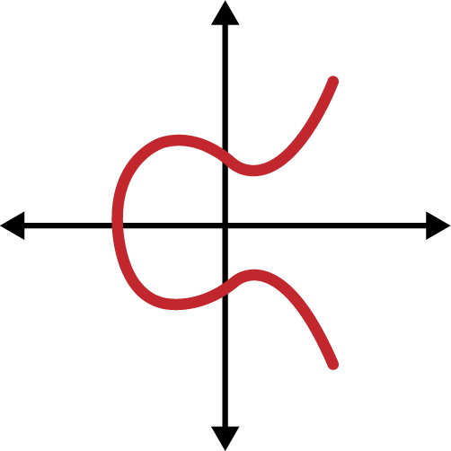

図4-1 楕円曲線

　イーサリアムは、米国国立標準技術研究所（NIST）が確立した`secp256k1`という標準で定義された特定の楕円曲線と数学定数のセットを使用します。`secp256k1`曲線は、以下の関数で定義されます。

```
y^2 = (x^3 + 7) over (Fp)
```

または：

```
y^2 mod p = (x^3 + 7) mod p
```

　`mod p`（素数pを法とする）は、この曲線がFpとも書かれる素数位数pの*有限体*上に定義されていることを示します。ここでp = 2^256 – 2^32 – 2^9 – 2^8 – 2^7 – 2^6 – 2^4 – 1であり、非常に大きな素数です。

　この曲線は実数上ではなく素数位数の有限体上に定義されているため、2次元に散らばった点のパターンのように見え、視覚化が困難です。しかし数学は実数上の楕円曲線と同一です。例として図4-2は、同じ楕円曲線をはるかに小さな素数位数17の有限体上で示したもので、グリッド上の点のパターンを表しています。`secp256k1`のイーサリアム楕円曲線は、想像を絶するほど大きなグリッド上のはるかに複雑な点のパターンと考えられます。

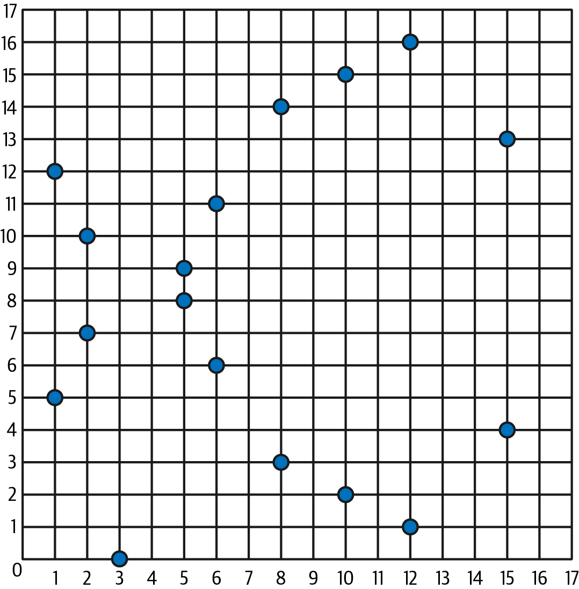

図4-2 楕円曲線暗号：F(p)上の楕円曲線の可視化（p=17）

　たとえば、以下は座標(x, y)を持つ点Qで、`secp256k1`曲線上の点です。

```
Q = (49790390825249384486033144355916864607616083520101638681403973749255924539515, 59574132161899900045862086493921015780032175291755807399284007721050341297360)
```

　例4-1は、Pythonを使ってこれを自分で確認する方法を示しています。変数`x`と`y`は前述の例の点Qの座標です。変数`p`は楕円曲線の素数位数（すべての剰余演算に使われる素数）です。Pythonの最後の行は楕円曲線方程式です（Pythonの`%`演算子は剰余演算子です）。`x`と`y`が確かに楕円曲線上の点の座標であれば、方程式を満たし、結果はゼロになります。コマンドラインで`python`（または`python3`）と入力し、リストの各行（プロンプト`>>>`の後）をコピーして試してみてください。

**例4-1 Pythonを使ってこの点が楕円曲線上にあることを確認する**

```python
Python 3.12.4 (main, Jun  6 2024, 18:26:44) [Clang 15.0.0 (clang-1500.3.9.4)] on darwin
Type "help", "copyright", "credits" or "license" for more information.
>>> p = 115792089237316195423570985008687907853269984665640564039457584007908834671663
>>> x = 49790390825249384486033144355916864607616083520101638681403973749255924539515
>>> y = 59574132161899900045862086493921015780032175291755807399284007721050341297360
>>> (x ** 3 + 7 - y**2) % p
0
```

### 楕円曲線の算術演算

　楕円曲線の数学の多くは、学校で習う整数算術と表記も振る舞いもよく似ています。具体的には、数直線上をジャンプする代わりに曲線上の他の点にジャンプする加算演算子を定義できます。加算演算子を定義すれば、点と整数の乗算も定義でき、これは加算の繰り返しに相当します。

　楕円曲線の加算は、楕円曲線上の2点P1とP2が与えられたとき、同じく楕円曲線上にある第3の点P3 = P1 + P2が存在するように定義されます。

　幾何学的には、第3の点P3はP1とP2を通る直線を引くことで求められます。驚くべきことに、この直線は楕円曲線と別の1点でちょうど交わります。この点をP3′ = (x, y)と呼び、x軸に関して反転させてP3 = (x, –y)を得ます。図4-3に示す通りです。

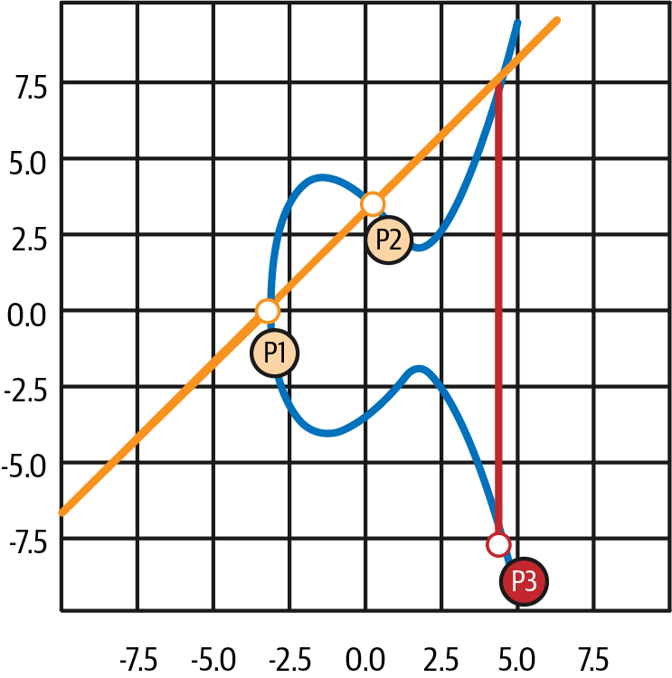

図4-3 楕円曲線の加算：楕円曲線上の2点を加算する

　P1とP2が同じ点の場合は、P1とP2の「間」の直線の代わりに、P1における接線を引きます。この接線は、図4-4に示すように曲線と別の1点でちょうど交わります。微積分のテクニックを使えば接線の傾きを求められます。興味深いことに、曲線上の整数座標を持つ点のみに関心を限定しても、このテクニックは機能します。

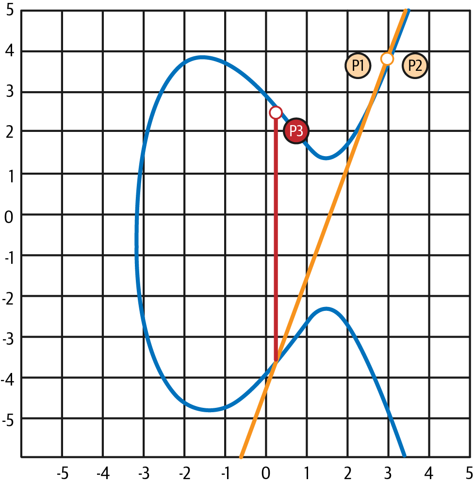

図4-4 楕円曲線の加算：点をそれ自体に加算する

　楕円曲線の数学には、加算における数値0の役割にほぼ対応する*無限遠点*と呼ばれる点も存在します。コンピュータ上では`x = y = 0`で表されることがあります（これは楕円曲線方程式を満たしませんが、容易にチェックできる別のケースです）。無限遠点が必要となる特殊なケースがいくつかあります。

　場合によっては（たとえば図4-5のようにP1とP2が同じx値で異なるy値を持つ場合）、直線は完全に垂直になり、P3 = 無限遠点となります。

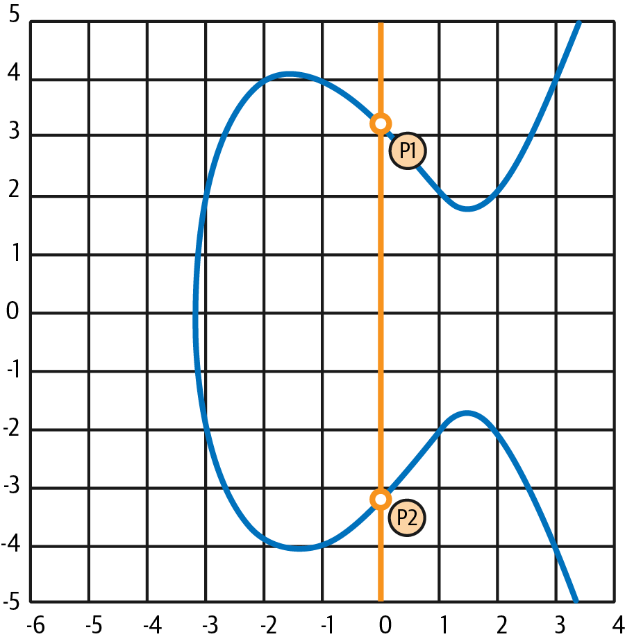

図4-5 楕円曲線の加算：無限遠点が結果となる特殊なケース

　P1が無限遠点の場合、P1 + P2 = P2となります。同様に、P2が無限遠点の場合、P1 + P2 = P1となります。これは、無限遠点が「通常の」算術でゼロが果たす役割を担うことを示しています。

　`+`は結合法則を満たすことがわかっています。つまり`(A + B) + C = A + (B + C)`です。これは`A + B + C`と（括弧なしで）曖昧さなく書けることを意味します。

　加算を定義したので、加算の拡張としての標準的な方法で乗算を定義できます。楕円曲線上の点Pに対して、kが整数であれば`k * P = P + P + P + … + P`（k回）です。この場合、kは（紛らわしいかもしれませんが）指数と呼ばれることがあります。

### 公開鍵の生成

　ランダムに生成された数値`k`を秘密鍵とします。これに、曲線上の所定の点である生成点`G`を乗算すると、曲線上の別の点が得られます。これが対応する公開鍵`K`です。

```
K = k * G
```

　生成点は`secp256k1`標準の一部として指定されており、すべての実装で同じです。この曲線から導出されるすべての鍵は同じ点`G`を使います。生成点はすべてのイーサリアムユーザーで常に同じであるため、秘密鍵`k`に`G`を乗算すると常に同じ公開鍵`K`になります。`k`と`K`の関係は固定されていますが、`k`から`K`への一方向にしか計算できません。そのためイーサリアムアドレス（`K`から導出される）は誰とでも共有でき、ユーザーの秘密鍵（`k`）が明かされることはありません。

　前のセクションで説明したように、`k * G`の乗算は加算の繰り返しに相当するため、`G + G + G + … + G`をk回繰り返すことになります。要約すると、秘密鍵`k`から公開鍵`K`を生成するには、生成点`G`をk回自分自身に加算します。

> **ヒント**
>
> 秘密鍵は公開鍵に変換できるが、公開鍵を秘密鍵に逆変換することはできない。数学が一方向にしか機能しないからである。

　この計算を「秘密鍵」のセクションで示した特定の秘密鍵に適用して公開鍵を求めてみましょう。

```
K = f8f8a2f43c8376ccb0871305060d7b27b0554d2cc72bccf41b2705608452f315 * G
```

　暗号ライブラリを使えば、楕円曲線乗算で`K`を計算できます。結果の公開鍵`K`は次の点として定義されます。

```
K = (x, y)
```

ここで：

```
x = 6e145ccef1033dea239875dd00dfb4fee6e3348b84985c92f103444683bae07b
y = 83b5c38e5e2b0c8529d7fa3f64d46daa1ece2d9ac14cab9477d042c84c32ccd0
```
　イーサリアムでは、公開鍵が130文字の16進数（65バイト）のシリアライゼーションとして表されることがあります。これは業界コンソーシアムであるStandards for Efficient Cryptography Group（SECG）が提案した標準シリアライゼーション形式に基づき、[Standards for Efficient Cryptography (SEC1)](https://oreil.ly/Y_cOQ)に文書化されています。この標準では、楕円曲線上の点を識別するための4つのプレフィックスが定義されています（表4-1）。

**表4-1 シリアライズされた楕円曲線公開鍵のプレフィックス**

| プレフィックス | 意味 | 長さ（プレフィックスを含むバイト数） |
|--------|---------|----------------------------------|
| 0x00 | 無限遠点 | 1 |
| 0x04 | 非圧縮の点 | 65 |
| 0x02 | 偶数yの圧縮された点 | 33 |
| 0x03 | 奇数yの圧縮された点 | 33 |

　イーサリアムは非圧縮の公開鍵のみを使用するため、関連するプレフィックスは（16進数の）`04`のみです。公開鍵のx座標とy座標を連結してシリアライズします。

```
04 + x座標（32バイト / 64桁の16進数） + y座標（32バイト / 64桁の16進数）
```

　したがって、先ほど計算した公開鍵は次のようにシリアライズされます。

```
046e145ccef1033dea239875dd00dfb4fee6e3348b84985c92f103444683bae07b83b5c38e5e2b0c8529d7fa3f64d46daa1ece2d9ac14cab9477d042c84c32ccd0
```

### 楕円曲線ライブラリ

　暗号通貨関連のプロジェクトで使われている`secp256k1`楕円曲線の実装がいくつかあります。

[**OpenSSL**](https://www.openssl.org)

　OpenSSLライブラリは`secp256k1`の完全な実装を含む包括的な暗号プリミティブのセットを提供します。たとえば公開鍵の導出には`EC_POINT_mul`関数を使用できます。

[**libsecp256k1**](https://oreil.ly/lv84W)

　Bitcoin Coreの`libsecp256k1`は、`secp256k1`楕円曲線およびその他の暗号プリミティブのC言語実装です。Bitcoin CoreソフトウェアのOpenSSLを置き換えるためにゼロから書かれたもので、パフォーマンスとセキュリティの両面で優れていると見なされています。
## 暗号学的ハッシュ関数

　暗号学的ハッシュ関数はイーサリアム全体で使われています。実際、ほぼすべての暗号システムで広く使われています。暗号技術者のブルース・シュナイアーは「暗号化アルゴリズムよりもはるかに、一方向ハッシュ関数が現代の暗号技術の主力である」と述べています。

　このセクションではハッシュ関数について説明し、その基本的な性質を探り、現代の暗号技術の多くの分野でいかに有用であるかを見ていきます。ハッシュ関数はイーサリアムの公開鍵からアドレスへの変換の一部であるため、ここで取り上げます。また、データの検証を助けるデジタルフィンガープリントの作成にも使えます。

　簡単に言えば、*ハッシュ関数*は任意のサイズのデータを固定サイズのデータにマッピングする関数です。入力は*プリイメージ*、*メッセージ*、または単に入力データと呼ばれ、出力は*ハッシュ*と呼ばれます。暗号学的ハッシュ関数は、イーサリアムのような安全なプラットフォームに有用な特定の性質を持つ特別なサブカテゴリーです。

　暗号学的ハッシュ関数は、任意のサイズのデータを固定サイズのビット列にマッピングする*一方向ハッシュ関数*です。「一方向」とは、出力ハッシュだけを知っていても入力データを再現することが計算上不可能であることを意味します。可能な入力を決定する唯一の方法は総当たり探索であり、出力が一致する各候補を確認していくことになります。探索空間が事実上無限であることを考えると、このタスクが実質的に不可能であることは容易に理解できます。仮にハッシュが一致する入力データを見つけられたとしても、それが元の入力データと同じとは限りません。ハッシュ関数は複数の入力を同じ出力に写す「多対一」の関数だからです。同じ出力にハッシュされる2つの異なる入力データセットを見つけることは*ハッシュ衝突*の発見と呼ばれます。大まかに言えば、ハッシュ関数が優れているほどハッシュ衝突は稀になります。イーサリアムにおいてハッシュ衝突は事実上不可能です。

　暗号学的ハッシュ関数の主な性質を詳しく見てみましょう。

**決定性**

　与えられた入力メッセージは常に同じハッシュ出力を生成する。

**検証可能性**

　メッセージのハッシュ計算は効率的である（線形の計算量）。

**無相関性**

　メッセージへの小さな変更（たとえば1ビットの変更）は、元のメッセージのハッシュとは相関できないほどハッシュ出力を大幅に変えるべきである。

**不可逆性**

　ハッシュからメッセージを計算することは不可能であり、すべての可能なメッセージの総当たり探索に相当する。

**衝突耐性**

　同じハッシュ出力を生成する2つの異なるメッセージを計算することは不可能であるべきである。

　ハッシュ衝突への耐性は、イーサリアムにおけるデジタル署名の偽造を避けるために特に重要です。

　これらの性質の組み合わせにより、暗号学的ハッシュ関数は幅広いセキュリティアプリケーションに有用なものとなっています。

- データのフィンガープリンティング
- メッセージの完全性（エラー検出）
- プルーフ・オブ・ワーク
- 認証（パスワードのハッシュ化と鍵ストレッチング）
- 疑似乱数生成器
- メッセージコミットメント（コミット・リビールメカニズム）
- 一意の識別子

　システムのさまざまなレイヤーを進むにつれて、イーサリアムでこれらの多くを見ることになります。

### イーサリアムの暗号学的ハッシュ関数：Keccak-256

　イーサリアムは多くの場所でKeccak-256暗号学的ハッシュ関数を使用しています。Keccak-256は、2007年にNISTが開催したSHA-3暗号学的ハッシュ関数コンペティションの候補として設計されました。Keccakが優勝アルゴリズムとなり、2015年に連邦情報処理標準（FIPS）202として標準化されました。

　しかしイーサリアムが開発されていた時期には、NISTの標準化はまだ最終決定されていませんでした。NISTは標準化プロセスの完了後、効率向上のためとしてKeccakのパラメーターを調整しました。同時期に、内部告発者エドワード・スノーデンが示唆的な文書を公開しました。その内容は、NISTが国家安全保障局（NSA）から不正に影響を受け、Dual_EC_DRBG RNG標準を意図的に弱体化させて標準RNGにバックドアを仕込んだ可能性があるというものでした。この論争の結果、提案された変更への反発とSHA-3の標準化の大幅な遅延が生じました。当時、イーサリアム財団はNISTが修正したSHA-3標準ではなく、発明者が提案したオリジナルのKeccakアルゴリズムを実装することを決定しました。

> **警告**
>
> イーサリアムのドキュメントやコードで「SHA-3」という表記を見かけるかもしれないが、それらの多く——すべてではないにしても——は実際にはKeccak-256を指しており、最終版のFIPS-202 SHA-3標準ではない。実装の違いはパディングパラメーターに関する軽微なものだが、Keccak-256は同じ入力に対してFIPS-202 SHA-3とは異なるハッシュ出力を生成するため、その違いは重要である。

### どのハッシュ関数を使っているのか

　使用しているソフトウェアライブラリがFIPS-202 SHA-3とKeccak-256のどちらを実装しているのか、両方が「SHA-3」と呼ばれている可能性がある場合、どう判別できるでしょうか。

　簡単な方法は*テストベクトル*を使うことです。テストベクトルとは、与えられた入力に対する期待される出力のことです。ハッシュ関数で最もよく使われるテストは空の入力です。空の文字列を入力としてハッシュ関数を実行すると、以下の結果が得られるはずです。

```
Keccak256("") = c5d2460186f7233c927e7db2dcc703c0e500b653ca82273b7bfad8045d85a470
SHA3("") = a7ffc6f8bf1ed76651c14756a061d662f580ff4de43b49fa82d80a4b80f8434a
```

　関数の名称に関係なく、このシンプルなテストを実行することで、オリジナルのKeccak-256なのか最終的なNIST標準FIPS-202 SHA-3なのかを確認できます。イーサリアムはKeccak-256を使用していることを忘れないでください。コードでSHA-3と呼ばれていても同様です。

> **注記**
>
> イーサリアムで使用されるハッシュ関数（Keccak-256）と最終標準（FIP-202 SHA-3）の違いによる混乱のため、すべてのコード、オペコード、ライブラリにおける`sha3`のすべてのインスタンスは`keccak256`に改名された。詳細は[ERC-59](https://oreil.ly/rTHDv)を参照。

　次に、イーサリアムにおけるKeccak-256の最初の応用として、公開鍵からイーサリアムアドレスを生成する方法を見てみましょう。

## イーサリアムアドレス

　イーサリアムアドレスは、Keccak-256一方向ハッシュ関数を使って公開鍵またはコントラクトから導出される一意の識別子です。

　前の例では、秘密鍵から始めて楕円曲線乗算を使って公開鍵を導出しました。

**秘密鍵 k：**

```
k = f8f8a2f43c8376ccb0871305060d7b27b0554d2cc72bccf41b2705608452f315
```

**公開鍵 K（x座標とy座標を連結し、16進数で表示）：**

```
K = 6e145ccef1033dea239875dd00dfb4fee6e3348b84985c92f103444683bae07b83b5c38e5e...
```

> **注記**
>
> アドレスの計算時には、公開鍵にプレフィックス（16進数の）`04`が付与されないことに注意する価値がある。

　Keccak-256を使ってこの公開鍵のハッシュを計算します。

```
Keccak256(K) = 2a5bc342ed616b5ba5732269001d3f1ef827552ae1114027bd3ecf1f086ba0f9
```

　次に、最後の20バイト（最下位バイト）のみを保持します。これがイーサリアムアドレスです。

```
001d3f1ef827552ae1114027bd3ecf1f086ba0f9
```

　イーサリアムアドレスは通常、16進数エンコードであることを示す`0x`プレフィックス付きで表示されます。

```
0x001d3f1ef827552ae1114027bd3ecf1f086ba0f9
```

### イーサリアムアドレスの形式

　イーサリアムアドレスは16進数であり、公開鍵のKeccak-256ハッシュの最後の20バイトから導出される識別子です。

　ビットコインのアドレスは、どのクライアントのユーザーインターフェースでもチェックサム付きでエンコードされ、入力ミスを検出できるようになっています。一方、イーサリアムアドレスはチェックサムなしの生の16進数として表示されます。この設計判断の根拠は、イーサリアムアドレスは最終的にシステムの上位レイヤーの抽象化（ネームサービスなど）の背後に隠され、必要であればチェックサムは上位レイヤーで追加すべきだということでした。

　実際には上位レイヤーの開発は非常にゆっくりとしか進みませんでした。そのためこの設計上の選択はエコシステムの初期にいくつかの問題を引き起こし、誤入力されたアドレスや入力検証エラーによって資金が失われる事例も発生しました。さらにイーサリアムネームサービスの開発も当初の予想より遅かったため、ウォレット開発者による代替エンコーディングの採用も大きく遅れました。次にいくつかのエンコーディングオプションを見てみましょう。

> **注記**
>
> 2017年にアレックス・ヴァン・デ・サンデとニック・ジョンソンによって導入されたイーサリアムネームサービス（ENS）について触れておく価値がある。ENSは、`masteringethereum.eth`のような人間が読める名前をイーサリアムアドレスに変換するオンチェーンソリューションを提供する。

### 大文字小文字によるチェックサムを持つ16進数エンコーディング（ERC-55）

　ネームサービスの展開が遅かったため、[ERC-55](https://oreil.ly/JfgWs)によって標準が提案されました。ERC-55は16進数アドレスの大文字小文字を変更することで、イーサリアムアドレスに後方互換性のあるチェックサムを提供します。イーサリアムアドレスは大文字小文字を区別せず、すべてのウォレットは大文字でも小文字でも表されたイーサリアムアドレスを解釈の違いなく受け入れるべきです。アドレス中のアルファベット文字の大文字小文字を変更することで、タイプミスや読み間違いからアドレスの完全性を保護するチェックサムを伝達できます。ERC-55チェックサムに未対応のウォレットは、大文字小文字の混在を無視するだけです。対応済みのウォレットはアドレスを検証し、99.986%の精度でエラーを検出できます。

　大文字小文字混在のエンコーディングは微妙であり、最初は気づかないかもしれません。この例のアドレスは：

```
0x001d3f1ef827552ae1114027bd3ecf1f086ba0f9
```

　ERC-55の大文字小文字混在チェックサムを適用すると：

```
0x001d3F1ef827552Ae1114027BD3ECF1f086bA0F9
```

　違いがわかりますか。16進数エンコーディングのアルファベット（A～F）の一部が大文字になり、残りは小文字のままです。

　ERC-55の実装は非常にシンプルです。小文字の16進数アドレスのKeccak-256ハッシュを取得します。このハッシュはアドレスのデジタルフィンガープリントとして機能し、便利なチェックサムを提供します。入力（アドレス）への小さな変更が結果のハッシュ（チェックサム）に大きな変化をもたらすため、効果的にエラーを検出できます。アドレスのハッシュはアドレス自体の大文字小文字にエンコードされます。ステップごとに分解してみましょう。

1. `0x`プレフィックスなしの小文字アドレスをハッシュ化する：

    ```
    Keccak256("001d3f1ef827552ae1114027bd3ecf1f086ba0f9") = 23a69c1653e4ebbb619b0b2cb8a9bad49892a8b9695d9a19d8f673ca991deae1
    ```

2. ハッシュの対応する16進数の桁が`0x8`以上の場合、アドレスの各アルファベット文字を大文字にする。アドレスとハッシュを並べると分かりやすくなる：

    ```
    Address: 001d3f1ef827552ae1114027bd3ecf1f086ba0f9
    Hash   : 23a69c1653e4ebbb619b0b2cb8a9bad49892a8b9...
    ```

　アドレスの4番目の位置にアルファベット文字`d`があります。ハッシュの4番目の文字は`6`で、8より小さいです。したがって、`d`は小文字のままにします。アドレスの次のアルファベット文字は6番目の位置の`f`です。16進数ハッシュの6番目の文字は`c`で、8より大きいです。したがって、アドレスの`F`を大文字にします。同様に続けます。ご覧の通り、チェックサムとしてハッシュの最初の20バイト（40桁の16進数文字）のみを使用します。アドレスの20バイト（40桁の16進数文字）を適切に大文字化するために使います。

　結果の大文字小文字混在アドレスを自分で確認し、どの文字が大文字化され、アドレスハッシュのどの文字に対応しているか見てみてください。

```
Address: 001d3F1ef827552Ae1114027BD3ECF1f086bA0F9
Hash   : 23a69c1653e4ebbb619b0b2cb8a9bad49892a8b9...
```

### ERC-55エンコードアドレスのエラー検出

　ここで、ERC-55アドレスがエラーの発見にどう役立つかを見てみましょう。ERC-55でエンコードされたイーサリアムアドレスを印刷したとします。

```
0x001d3F1ef827552Ae1114027BD3ECF1f086bA0F9
```

　このアドレスを読み取る際に基本的なミスを犯したとしましょう。最後から2番目の文字は大文字のFです。この例では、大文字のEと読み間違えて、以下の（間違った）アドレスをウォレットに入力したとします。

```
0x001d3F1ef827552Ae1114027BD3ECF1f086bA0E9
```

　幸いなことに、ウォレットはEIP-55に準拠しています。大文字小文字の混在に気づき、アドレスの検証を試みます。小文字に変換してチェックサムハッシュを計算します。

```
Keccak256("001d3f1ef827552ae1114027bd3ecf1f086ba0e9") = 5429b5d9460122fb4b11af9cb88b7bb76d8928862e0a57d46dd18dd8e08a6927
```

　ご覧の通り、アドレスが1文字しか変わっていなくても（実際には1ビットだけ、`e`と`f`は1ビット違い）、アドレスのハッシュは劇的に変化しています。これがハッシュ関数をチェックサムに非常に有用にする性質です。

　2つを並べて大文字小文字を確認してみましょう。

```
001d3F1ef827552Ae1114027BD3ECF1f086bA0E9
5429b5d9460122fb4b11af9cb88b7bb76d892886...
```

　すべてが間違っています。いくつかのアルファベット文字の大文字小文字が正しくありません。大文字小文字は正しいチェックサムのエンコーディングであることを思い出してください。

　入力したアドレスの大文字小文字は計算されたばかりのチェックサムと一致しないため、アドレスに何かが変更され、エラーが導入されたことがわかります。
## バリデータの暗号技術

　このセクションでは、新しいPoSベースのコンセンサスプロトコルでバリデータが使う暗号技術を探ります。デジタル署名を作成しメッセージを検証するという核心的なアイデアは常に同じですが、いくつかの興味深い要件があります。その結果、トランザクションやアドレスに使われる暗号技術とは設計上の選択も最終的な実装も異なります。

### はじめに

　イーサリアムが*Ethash*（PoWコンセンサスアルゴリズム）を使っていた時代には、ブロック提案者（当時はマイナー）が生成するブロックに署名すべき理由はありませんでした。PoWベースのコンセンサスアルゴリズムは、正しく機能するために誰がブロックを作成しているかを知る必要がないからです。ブロック提案者が不正を行った場合、プロトコルは電気エネルギーと時間、つまりお金を無駄にさせることで暗黙的に罰します。

　二重支払いを試みるためにマイナーが同時に2つのブロックを作成する例を考えてみましょう。この「悪用」の核心的なアイデアをよりよく理解するために、マイナーが車を購入するにあたり、ディーラーにETHで支払うことで合意したとします（10 ETHとしましょう）。マイナーは同時に2つのブロックを作成します。両方が有効だとして、最初のブロックにはマイナーがカーディーラーに10 ETHを送る支払いトランザクションを追加し、もう一方には追加しません。マイナーはチェーンを2つに分割しようとしています。

　（ほぼ）ランダムな要因により、カーディーラーはマイナーが10 ETHを支払ったブロックを先に受信する可能性があります。そのためカーディーラーは支払いが完了したと想定できます。しかしまだ車をマイナーに渡しません。カーディーラーはPoWシステムの仕組みを知っており、トランザクションが確実に決済されたとみなすまでに通常いくつかのブロックを待つ必要があるためです。

　約12秒後、別のマイナーが10 ETHの支払いを含まないブロックの上に新しいブロックを生成します。次のマイナーがどのブロックを先に受信するかに通常左右されるため、これは十分にあり得ます。こうしてより長いブロックチェーンが存在するようになり、*最重チェーンルール*（少し不正確ですが*最長チェーンルール*とも呼ばれる）のおかげで、そのチェーンがすべてのノードに唯一の有効なものと見なされます。

　カーディーラーは、有効なブロックチェーンに以前受信した10 ETHの支払いを含むブロックが含まれていないことを確認し、支払いが完了していないと見なして、マイナーに車を渡しません。

　PoWシステムでは、マイナーはPoWチェックをパスする有効なブロック（つまりブロックハッシュが動的な閾値より低いブロック）を生成するために実際のエネルギーと時間を費やさなければなりません。エネルギーと時間をかけて作ったブロックをネットワーク全体から拒否されること自体が、マイナーへの暗黙の罰となります。有効なブロックのみを作成してすべてのルールを遵守し、不正を試みないことに使えたはずの貴重なエネルギーと時間を失ったのです。

　PoSシステムには、不正を行うブロック生成者（つまりバリデータ）に対する同じ暗黙的な罰がありません。代わりに、明示的な方法である*スラッシング*を使用します。

　*スラッシング*とは、ルールに従わなかったバリデータに対し、ステークしたETHの一部（またはすべて）を差し引く形で罰を与える行為です。バリデータがアクティブなバリデータになるために最低限のETHをステークしなければならないのはこのためです。ステークされたETHがなければ、悪意ある行動を始めたバリデータをプロトコルは罰せません。

　ルールに従わないバリデータを明示的に罰するには、すべてのバリデータが何をしているかを正確に知る必要があります。そのためバリデータが送信するすべてのメッセージ（ブロックを含む）はデジタル署名で認証されなければなりません。

　先ほどマイナーで使った例を再現してみましょう。今度は同時に2つのブロックを提案するバリデータがいます。PoWではマイナーが同時に2つの有効なブロックを生成するために2倍のエネルギーと時間を費やす必要がありましたが、PoSでは（ほぼ）完全に無料です。

　しかしここでスラッシングが登場します。*二重署名*（同時に2つのブロックを提案すること）はスラッシング対象のイベントであり、バリデータは（この具体例では）ステークしたETHのすべてを破壊されることで即座に罰せられます。

　バリデータがすべてのメッセージを認証しなければならない理由がわかったので、そのために使われる暗号技術——BLS署名——について深く掘り下げることができます。次のセクションでは、BLS暗号技術を使用する最終的な決定につながった要件を見ていきます。

### 要件

　この問題（つまりバリデータが互いに送信するすべてのメッセージを認証する必要性）に対する最初のソリューションとして考えられるのは、イーサリアムがすべてのトランザクションへのデジタル署名に既に使っている*楕円曲線デジタル署名アルゴリズム*（ECDSA）を適用することです。

　しかし、100万以上のバリデータを抱えるイーサリアムの規模では、ECDSAは現実的な選択肢ではありません。署名アルゴリズムには満たすべき基本要件があるからです。具体的には、ブロック内で署名が占めるスペースを削減し、ノードがすべてのバリデータの署名を検証する時間を短縮するために、署名を集約できる必要があります。

　現在、すべてのバリデータは*エポック*ごと（つまり32*スロット*ごと）に1回投票できます。この投票こそ認証が必要なメッセージです（詳しくは第15章で説明します）。これらのメッセージはP2Pゴシップレイヤーを通じて他のバリデータやノードに到達し、すべてのノードが署名の有効性を検証してブロックに挿入する必要があります。

　ここでボトルネックを見つけるのは容易です。ネットワークに参加するバリデータが増えるほど、ノードが処理すべきメッセージは増え、バリデータ全体の署名が占めるスペースも大きくなり、結果としてブロックも大きくなります。

> **注記**
>
> アクティブなバリデータの数に基づいて、ノードが処理する必要があるメッセージ数を簡単に計算できる：
> ```
> N = アクティブなバリデータの数
> 1 msg / 1 epoch × N =
> = 1 msg / 32 slots × N = ← 1エポックは32スロットで構成される
> = 1 msg / 32 × 12 seconds × N = ← 各スロットは12秒かかる
> = 1 msg / 384 seconds × N =
> = 0.0026041667 msg / second × N
> ```
>
> したがって、毎秒約0.0026メッセージにN（ネットワーク内のアクティブなバリデータ数）を乗じることになる：
>
> ```
> N = 1,000 → 毎秒約2.6メッセージ
> N = 10,000 → 毎秒約26メッセージ
> N = 100,000 → 毎秒260メッセージ
> N = 1,000,000 → 毎秒2,600メッセージ
> ```

　現在、イーサリアムのPoSプロトコルは毎秒約2,600メッセージを処理しています。

　こうした理由から、ほとんどのPoSブロックチェーンのバリデータセットは非常に小さく、最大でも数十から数百です。イーサリアムの当初の提案（[EIP-1011](https://oreil.ly/pQSCp)参照）でさえ最大900バリデータをターゲットとし、アクティブなバリデータセットに選出されるための最低預入額は1,500 ETHでした。

　この仕様がイーサリアムのPoSプロトコルの最終形になっていたでしょう——イーサリアム財団の研究者ジャスティン・ドレイクが2018年5月に[ethresearchウェブサイトで公開した長い記事](https://oreil.ly/EbBib)で、BLS署名の集約というアイデアを提案していなければ。

### BLSデジタル署名

　BLS署名はその考案者の名前にちなんで名付けられています。BLSはボネ・リン・シャチャム（Boneh–Lynn–Shacham）の略で、2001年に論文["Short Signatures from the Weil Pairing"](https://oreil.ly/cJn6v)でこの署名方式を発表した3人の暗号技術者、ダン・ボネ、ベン・リン、ホヴァヴ・シャチャムを指します。

　ECDSA（第6章でさらに詳しく説明します）と同様に、BLS署名も楕円曲線暗号に基づいています。イーサリアムはショーン・ボウが2017年にZcashプロトコルのために設計した曲線*BLS12-381*を使用しています。BLS12-381は以下の関数で定義されます。

```
y^2 = x^3 + 4
```

　qを法とする整数上で定義されます。ここでqは115桁の10進数です：`0x1a0111ea397fe69a4b1ba7b6434bacd764774b84f38512bf6730d2a0f6b0f6241eabfffeb153ffffb9feffffffffaaab`。

#### 仕組み

　核心的なアイデアはECDSAの仕組みとよく似ています。秘密鍵があり、そこから公開鍵が導出されます。すべてのメッセージは秘密鍵で署名され、他の人は対応する公開鍵を使って完全性を検証できます。

　秘密鍵（`sk`）は1からr – 1の間の整数です。ここでrはこの巨大な数：`0x73eda753299d7d483339d80809a1d80553bda402fffe5bfeffffffff00000001`です。77桁の10進数です。

　公開鍵（`pk`）は`sk * g1`（楕円曲線点のスカラー乗算）によって得られます。ここで`g1`はG1と呼ばれる群の生成元です。`pk`は圧縮・シリアライズされた形式で表現され、48バイトの文字列となります。

　署名されるメッセージ（`m`）は常に楕円曲線の点にマッピングされます。この点はG2と呼ばれる別の群のメンバーです。このマッピングは、メッセージ`m`——つまり実際のバリデータのアテステーション——を受け取り、G2の点`H(m)`を出力する一種のハッシュ関数と考えることができます。圧縮・シリアライズされた形式では96バイトの文字列として表現されます。

　最後に、メッセージ`m`の署名（σ）は`sk * H(m)`（G2における新しい楕円曲線の点）によって得られます。

　ECDSAとBLSの主な違いは、2つのプロトコルの低レベルの詳細（つまり署名の正しさを検証する数学的テクニック）にあります。ECDSAは楕円曲線上のスカラー乗算や加算などの線形計算を伴いますが、BLS署名はより複雑な*楕円曲線の双線形ペアリング*の算術に依存しています。

　実際、署名σが有効であるのは、以下の等式が成り立つ場合に限ります。

```
e(g1,σ) = e(pk, H(m))
```

　ここで`e`は楕円曲線の双線形ペアリングです。

#### 楕円曲線の性質を探る

　前の等式を完全に理解するには、楕円曲線、ペアリング、およびそれらの広大な深淵に関する深い知識が必要です。しかし、ここでの手順を追うだけでも理解の助けになります。ペアリングがその性質を持つ理由と仕組みのすべての詳細は把握できませんが、親しみを持つ助けにはなるでしょう。

```
e(pk, H(m)) = e(sk * g1,H(m)) = ← pk = sk * g1
= e(g1, H(m))^sk = ← ペアリングの性質による
= e(g1, sk * H(m)) = ← 同じ性質による
= e(g1,σ) ← σ = sk * H(m)
```

　ヴィタリック・ブテリンが[Mediumの記事](https://oreil.ly/v578s)で指摘したように：

> 楕円曲線の点を一方向に暗号化された数値と見なすと——`encrypt(p) = p * G = P`（ここでGは生成点）——従来の楕円曲線の数学では数値の線形制約を検証できる（例：`P = G * p`、`Q = G * q`、`R = G * r`の場合、`5 * P + 7 * Q = 11 * R`の検証は実際には`5 * p + 7 * q = 11 * r`の検証である）。一方、ペアリングでは二次制約を検証できる（例：`e(P, Q) * e(G, G * 5) = 1`の検証は実際には`p * q + 1 * 5 = 0`の検証である）。

　想像できるように、より複雑な算術は署名の生成と検証により多くの時間がかかることを意味します。イーサリアムがバリデータにBLS署名を使っている唯一の理由は、*署名の集約*という極めて重要な性質です。

　実際、2つのECDSA署名を足し合わせても、意味のある結果は得られません。その結果を使って最初に署名されたメッセージの完全性を証明しようとしても、テストにはパスしません。

　一方、2つのBLS署名を足し合わせると、単純に楕円曲線の加算を行っていることになります。結果はG2の新しい楕円曲線の点であり、2つの対応する公開鍵の和——G1の楕円曲線の点のまま——に対して使用することで、最初に署名されたメッセージの完全性を正しく検証できます。

> **注記**
>
> 集約された署名と集約された公開鍵は、単一の署名と単一の公開鍵と区別がつかないため、集約された署名の正しさを検証するためにまったく同じアルゴリズムを使用できる。
>
> **集約された署名と公開鍵：**
> ```
> σagg = σ1 + σ2 + σ3 + … + σn
> pkagg = pk1 + pk2 + pk3 + … + pkn
> ```
>
> **集約された署名の検証：**
>
> ```
> e(pkagg,H(m)) =
> = e(pk1 + pk2 + pk3 + ... + pkn,H(M)) =
> = e((sk1 + sk2 + sk3 + ... + skn) * g1,H(m)) =
> = e(g1,H(m))^(sk1 + sk2 + sk3 + ... + skn) =
> = e(g1,(sk1 + sk2 + sk3 + ... + skn) * H(m)) =
> = e(g1,σ1 + σ2 + σ3 + ... + σn) =
> = e(g1,σagg)
>```

#### まとめ

　暗号技術は本当に難しく、深い数学的背景が必要です。この本は暗号技術者向けではないので、前のセクションで簡単に触れた内容を要約しましょう。BLS署名の仕組みと、バリデータが新しいPoSベースのコンセンサスプロトコルで使うデジタル署名アルゴリズムとして選ばれた理由を説明しました。集約の性質により、複数のデジタル署名をひとつにまとめられ、保存に必要なスペースと検証にかかる時間を削減しつつセキュリティを犠牲にしません。

　バリデータが「実際の運用」でBLSアルゴリズムをどう使い、署名の集約がどう機能するかを示す簡単な例を見てみましょう。図4-6は、3人のバリデータがブロックAに対して投票を表明したいシナリオを示しています。投票を行い、署名し、互いに共有します。

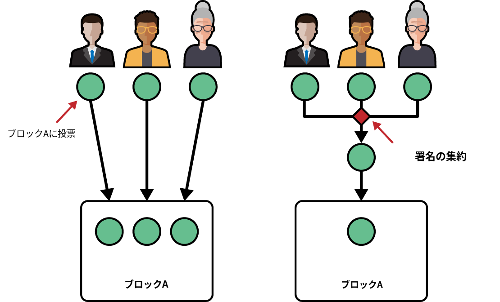

図4-6 BLS署名の集約：3人のバリデータが投票し署名する

　BLSがなければ、3つの署名付き投票すべてをブロックに保存して永続化する必要があります。BLSを使えば、3つの署名付き投票すべてをひとつの新しい集約投票に集約し、それだけをブロックに保存できます。

　これはスペースを節約するだけでなく、すべてのイーサリアムノードが署名付き投票を検証する際に必要な時間と計算量を劇的に削減します。個々の署名付き投票ごとに検証する代わりに、集約された投票を直接検証できるからです。BLS暗号技術のマジックは、集約された結果が通常の署名と変わらないことです。つまり集約された署名の有効性を検証することは、単一の署名の有効性を検証するのと同じ難しさです。検証すべき署名付き投票の数は大幅に減りますが、各検証に必要な計算量は同じです。そのため、フルノードが実行すべき計算量と時間の合計は、BLS集約署名を使わない場合よりはるかに少なくなります（図4-7参照）。

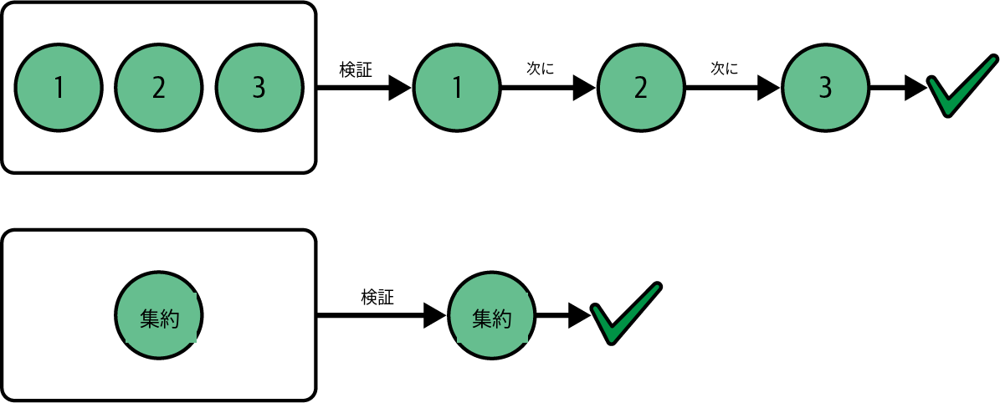

図4-7 BLS署名の集約による検証時間の削減

　バリデータがルールに従わなかったらどうなるでしょうか。バリデータが悪意を持って行動した場合（たとえば二重署名、つまり同時に2つの異なるブロックに投票した場合）、プロトコルはこの行動を検出し、図4-8に示すようにバリデータを適切に罰せます。

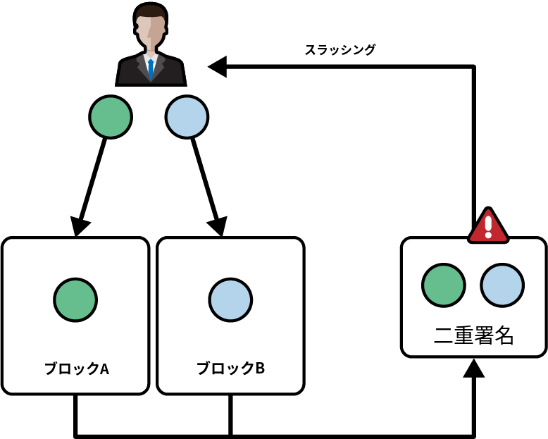

図4-8 BLS署名により悪意あるバリデータの検出が可能になる

　すべての投票がBLS署名方式でデジタル署名されているため、不正行為の原因となったバリデータを特定し、適切にスラッシングすることは容易です。
## KZG暗号技術

　2024年3月13日、イーサリアムはCancun-Deneb（Dencun）ハードフォークにアップグレードしました。このアップグレードには多くの変更が含まれていましたが、最も重要なものは間違いなく新しいタイプのトランザクション、EIP-4844 blobトランザクションの導入でした。

　blobトランザクションがイーサリアムのロードマップにとってなぜ重要なのかは第16章ではるかに詳しく説明するため、ここでは深入りしません。代わりに次のセクションでは、この新しいタイプのトランザクションの基盤となる暗号技術（*多項式コミットメントスキーム*、より具体的には*KZGコミットメントスキーム*）を探ります。

### はじめに

　多項式コミットメントスキームを見る前に、直面している問題と達成したい最終目標を理解することが重要です。

> **注記**
>
> このセクションでは、レイヤー2（L2）という用語に簡単に触れる。L2については第16章で適切に説明・展開するが、ここでは簡単な紹介をしておくと役立つだろう。L2はイーサリアムの新しいスケーリングソリューションである。独自の履歴と状態を持つ実際のブロックチェーンであり、定期的にすべての更新とデータをイーサリアムのメインネットに投稿する。その考え方は、イーサリアムのメインネットのみを見ることで、L2ブロックチェーン全体を導出できなければならない、というものである。

　詳細は省きますが、L2は毎日大量のデータをイーサリアムのメインチェーンに投稿します。このデータはネットワーク内のすべてのノードがダウンロードして検証しなければなりません。この状況は通常ガス代の急上昇につながり、深刻なシナリオでは単一のETH送金だけで10～20ドルに達することがあります。

　最終的には、すべてのデータを直接オンチェーンに投稿する代わりに、データへのコミットメント（つまり暗号学的ハッシュ）のみを保存し、完全なデータはイーサリアムチェーンの外に残したいと考えています。しかしハッシュのみを投稿すると新たな問題が生じます。ネットワーク内のすべてのノードが、コミットメントの指すデータがどこかに存在することを確認しなければなりません。そうでなければ重要なデータが失われている可能性があります。

　最初の（明白な）ソリューションは、すべてのノードに完全なデータの一時的なダウンロードを義務付けることです。これによりコミットメントが有効であること（つまり自分が持っている完全なデータを指し示していること）を容易に検証できます。本章の執筆時点（2025年6月）ではこれが現在の状況です。

　長期的なソリューションは、すべてのノードに完全なデータのダウンロードを要求するのではなく、ごく一部のみをダウンロードさせる方式です。このときノードは、データが完全に利用可能であることを保証する暗号学的証明を利用できます。ただしこの証明は、サイズが小さく迅速に検証できるものでなければなりません。基本的な考え方は、データが利用可能であることを証明・検証するほうが、データ全体をダウンロードして直接検証するよりもはるかに高速かつ軽量だというものです。この戦略は*データ可用性サンプリング*（DAS）と呼ばれ、イーサリアムコミュニティにおける最も重要な研究分野のひとつです。

　DASの最終目標を達成するために、すべてのノードが以下のことを可能にする暗号システムが必要です。

- あるデータ（存在し、完全に利用可能であることを証明したいデータ）へのコミットメントを作成する
- 以前作成したコミットメントに関連するデータの小さな証明を生成する
- これらの証明を容易に検証する

　この暗号システムは、参照するデータに関する情報をあまり明かさないことが（任意ですが）理想的です。

　次のセクションでは、そのような暗号システム——多項式コミットメントスキーム、より具体的にはKZGコミットメントスキーム——を探ります。

> **注記**
>
> なぜデータコミットメントスキームではなく多項式コミットメントスキームの話をしているのか、と疑問に思うかもしれない。それはとても良い質問である。目標はデータにコミットすることであり、多項式にコミットすることではない。しかし、ここにトリックがある。データは多項式として表現できる。したがって、多項式コミットメントスキームを作成できれば、それで十分である。

### 多項式コミットメントスキーム

　*多項式コミットメントスキーム*は、証明者が多項式へのコミットメントを計算できるようにするものです。このコミットメントは後で任意の位置で「開く」（評価する）ことができる性質を持ちます。証明者はある位置における多項式の値が主張された値と等しいことを示し、その主張に対する証明を生成できます。検証者はコミットメントと証明の両方を持ち、証明者が不正をしていない場合にのみ（つまりコミットされた多項式が選択された位置で実際に主張された値に評価される場合にのみ）証明が有効であることを検証できます。

#### 多項式入門

　このセクションでは多項式について多く語ることになるため、多項式が何であるかを全員が理解していることが重要です。学校で学んでから時間が経っているかもしれません。

　多項式は次のような数学的な式です。

```
x^3 + 3x^2 – 9
```

　ここで`x`は変数であり、すべての数値（1, 3, 0, –9）は係数です。3番目の係数を0としたのは、この多項式が実際には以下のものだからです。

```
x^3 + 3x^2 + 0x – 9
```

　このセクションを通じて、多項式を`p(x)`と表記します。

```
p(x) = x^3 + 3x^2 + 0x – 9
```

　多項式の*次数*`n`も必要です。次数は多項式における最高次の冪の数です。この例の多項式の次数は3です。したがって`n = 3`です。

　多項式を記述する一般的な公式は以下の通りです。

```
p(x) = p₀ + p₁x + p₂x² + ... + pₙxⁿ
```

　またはより形式的に：

```
p(x) = Σ pᵢxⁱ  (for i = 0 to n)
```

　ここで`n`は多項式の次数、`pi`はすべての係数です。

### マークルツリーの使用

　古典的なマークルツリーデータ構造を使った多項式コミットメントスキームを見てみましょう。マークルツリーの詳細については、第14章で詳しく説明します。

　マークルツリーの深さ`d`に対して次数`n = 2^d – 1`の多項式にコミットできます。ツリーのすべてのリーフ要素を、コミットしたい多項式のすべての係数`pi`に等しく設定します。

　以下の例を見てみましょう。

```
p(x) = x^7 + 5x^5 – 2x^4 + 3
n = 7 ← p(x)の次数
d = 3 ← 必要なマークル木の深さ
```

　図4-9は、マークルルートを核となる暗号プリミティブとして使い、この例に多項式コミットメントスキームを適用した様子を示しています。

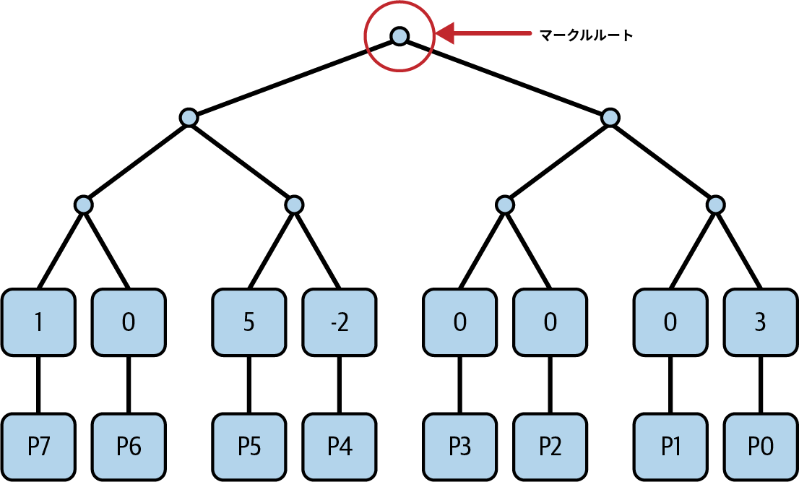

図4-9 マークルツリーを使った多項式コミットメント

　最終的なコミットメントは、完全なマークルツリーを構築して得られるマークルルートです。
　ここで、`p(1) = 7`であることを（検証者に）証明したいとしましょう。この主張は正しいです。なぜなら、`p(x)`に`x = 1`を代入すると、多項式がその位置で7に評価されることを容易に計算できるからです。

　`p(1) = 7`という主張を証明するには、検証者に以下を送信する必要があります。

- 証明したい主張：`p(1) = 7`
- マークルルート——つまり多項式`p(x)`へのコミットメント
- 多項式のすべての係数`pi`

　こうすることで、検証者はすべての係数`pi`を取得し、`x = 1`のときの多項式の値を計算できます。これにより、主張が実際に正しいことを検証します。次に、すべての係数`pi`からマークルツリーを計算し、自分のマークルルートと提供されたものを比較します。こうして検証者は、最初にコミットした多項式が実際に送信されたものと同じであることを検証します。

　マークルツリーを使った多項式コミットメントの性質をまとめると、以下の通りです。

**コミットメントのサイズ**

　コミットメントはマークルルートであり、単一のハッシュで通常32バイトの長さである。

**証明のサイズ**

　評価を証明するには、多項式のすべての係数`pi`を送信する必要がある。つまり、証明のサイズは多項式の次数`n`に対して線形である。

**検証者の計算量**

　検証者は（多項式の次数に対して）線形の作業を行う必要がある。実際、検証者はすべての係数`pi`を持ち、マークルツリーの計算と主張された点での多項式の評価の両方を計算しなければならない。

**スキームのプライバシー**

　証明者がすべての係数`pi`を送信するため、スキームは多項式に関する情報を何も隠さない。

　これらの性質は理想的ではありません。実際のイーサリアムプロトコルでは多項式の次数`n`が非常に大きくなる可能性があり、すべての係数をネットワーク上で送信するために必要な帯域幅が過大になります。また、証明者がコミットした多項式に関する情報をできるだけ少なく明かすプロトコルが望ましいです。

　幸いなことに、すべての要件を満たすスキームが存在します。ここでKZGが登場します。

### KZGコミットメント

　KZGはケイト、ザヴェルチャ、ゴールドバーグの頭文字で、3人の著者の名前です。この3人の暗号技術者は、2010年の論文["Constant-Size Commitments to Polynomials and Their Applications"](https://oreil.ly/JnEc0)でこのコミットメントスキームを発表しました。

#### トラステッドセットアップ

　KZGコミットメントスキームには*トラステッドセットアップ*が必要です。トラステッドセットアップは、暗号プロトコルのすべての参加者（証明者と検証者の両方）が共有する共通の知識ベースと見なせます。「トラステッド」と呼ばれる理由は次の手順にあります。まず一部の参加者がランダムな数値（秘密）を生成し、それを暗号化して最終的な共通知識ベースを作成します。その後、プロトコルの安全性を確保するために、参加者は生成した秘密を破棄しなければなりません。各参加者が本当に秘密を破棄したと信頼する必要があるため、このセレモニー全体がトラステッドセットアップと呼ばれます。

　現代のセットアップは通常、1-of-Nの信頼モデルを持つ[*Powers-of-Tau*](https://oreil.ly/uaS5x)セットアップを使用します。つまり、トラステッドセットアップ全体が安全と見なされるために必要な正直な参加者は1人だけです。

　イーサリアムのKZGトラステッドセットアップセレモニーには、図4-10に示すように、14万人以上の参加者が関与しました。

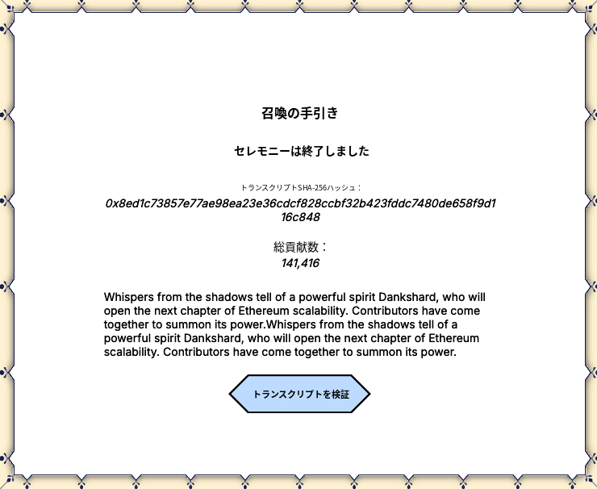

図4-10 イーサリアムのKZGトラステッドセットアップセレモニーの参加者

　より具体的には、トラステッドセットアップは`i = 0, 1, … , n – 1`に対して要素`[s^i]₁`と`[s^i]₂`を生成します。ここで：

- `s`は誰も知らないトラステッドセットアップの秘密（各参加者が生成した秘密の合計で構成される）
- `[s^i]₁`と`[s^i]₂`は実際には楕円曲線の点（それぞれ曲線G1とG2上）
- `n`は多項式の次数

> **ヒント**
>
> 角括弧の中にあるものは楕円曲線の点を表す。

#### コミットメント

　ご覧の通り、KZGコミットメントスキームは（再び）楕円曲線とペアリングを伴います。BLSデジタル署名で既に見たものです。

　楕円曲線では、秘密の数値`a`がある場合、楕円曲線乗算によって楕円曲線の点`[a]`を得ることができることを思い出してください。

```
[a]₁ = aG₁
```

　逆方向の計算は計算上不可能です。したがって、`[a]`のみを持っている場合、秘密`a`を得ることはできません。

　証明者も検証者もトラステッドセットアップの秘密`s`を知りませんが、それに対して特定の演算を行うことはできます。

```
c[s^i]₁ = cs^iG₁ = [cs^i]₁  ← 楕円曲線乗算；cは整数
c[s^i]₁ + d[s^i]₁ = (cs^i + ds^i)G₁ = [cs^i + ds^i]₁  ← 楕円曲線の点の加算
```

　したがって、`p(x) = p₀ + p₁x + p₂x² + ... + pₙxⁿ`が多項式である場合、証明者は以下を計算できます。

```
[p(s)]₁ = [p₀ + p₁s₁ + p₂s²₁ + ... + pₙsⁿ₁] = p₀ + p₁[s]₁ + p₂[s²]₁ + ... + pₙ[sⁿ]₁
```

　`[s^i]₁`はトラステッドセットアップの一部であり共通の知識であるため、証明者は誰も知らない秘密の点`s`で多項式を評価できます。魔法のように聞こえるでしょう。ただし重要な点があります。前の演算の出力は整数ではなく楕円曲線の点です。楕円曲線の点`[p(s)]₁`が、多項式`p(x)`に対するKZGコミットメントです。

#### KZGの健全性：証明者がコミットメントを偽造できない理由

　証明者は秘密`s`を知らずに、同じKZGコミットメントを持つ異なる多項式`q(x) != p(x)`を見つけられるでしょうか。`[q(s)]₁ = [p(s)]₁`のように。もしそうなら、証明者は多項式`p`を知っていると検証者に信じさせられます。

　できると仮定しましょう。すると次数`n`の定数でない多項式`r(x) = p(x) – q(x)`が存在します。`q(x) != p(x)`であるため、`r(x)`は最大`n`個のゼロ（つまり`r(x) = 0`となる位置）を持ちます。これは代数の基本的な性質です。学校で学んだすべての基本的な幾何学的形状について正しいことを容易に確認できます。直線（1次の多項式）はひとつのゼロを持ち、放物線（2次の多項式）は最大2つ持つ、といった具合です。

　証明者が`q(s) = p(s)`を達成する唯一の方法は、`r(x) = p(x) + q(x) = 0`をできるだけ多くの場所で成り立たせることです。しかし、前述のように最大`n`個のゼロしか選べません。

　証明者は`s`を知らないため、推測できる可能性は極めて低いです。実際、`n`（多項式の次数）<< `p`（楕円曲線の位数）です。

　`n = 228`で`p = 2^256`の場合、`s`が選択されたゼロのひとつである確率は`2 × 10^-69`です。

　したがって、同じコミットメント`C = [p(s)]₁`を持つ多項式は多数存在するものの、それを計算することは不可能と言えます。これは*計算的束縛*です。

　ここまでで秘密の点`s`で多項式`p(x)`を評価してコミットできるようになりましたが、検証者にすべての係数`pi`を送信せずに証明者の主張`p(z) = y`が正しいことを証明する方法がまだ欠けています。ここでも楕円曲線のペアリングが役立ちます。

### KZG証明

　最終的なKZG証明を理解するには、多項式のいくつかの重要な性質を思い出す必要があります。

　多項式`p(x)`が`z`でゼロを持つ場合、`(x – z)`で割り切れます。これは非常に理解しやすいです。多項式`p(x) = x² – 4`を取り上げましょう。`p(x) = (x + 2)(x – 2)`とも表現できます。`p(2) = 4 – 4 = 0`であるため、`p(x)`は`(x – 2)`で割り切れます。

　逆も成り立ちます。多項式`p(x)`が`(x – z)`で割り切れる場合、`p(x)`は`z`でゼロを持ちます。先ほどと同じ例を使えば容易に示せます。

　（証明者として）`p(z) = y`を証明したいことを思い出してください。ここで多項式`p(x) – y`を取り上げます。この多項式は`x = z`でゼロに評価されるため、先ほど説明した性質——特に、`p(x) – y`が`z`でゼロを持つので`(x – z)`で割り切れるという事実——を使用できます。

　したがって、商多項式`q(x)`を計算できます。

```
q(x) = [p(x) – y] / (x – z)
```

　これは以下の等価な形式で書くこともできます。

```
q(x)(x – z) = p(x) – y
```

> **注記**
>
> ここで非常に重要な点は、商多項式`q(x)`は`p(x) – y`が`x – z`で割り切れるからこそ計算可能であるということである。そうでなければ、常に余りが生じるため不可能である。
>
> これをよりよく理解するために、例を見てみよう。再び多項式`p(x) = (x + 2)(x – 2)`を取り上げる。この多項式は`(x + 2)`で割り切れるため、商多項式を計算できる：
>
> ```
> q(x) = p(x) / (x + 2) = [(x + 2)(x – 2)] / (x + 2) = x – 2
> ```
> `(x – 3)`で割ろうとすると、商多項式を得ることはできない。前の例を使って試してみてほしい…

　これで証明を生成する準備が完全に整いました。KZG証明は主張`p(z) = y`に対して`π = [q(s)]₁`です。基本的に、秘密の点`s`で評価された（楕円曲線の点の）商多項式です。

　検証者は以下の等式を計算してこの証明の有効性を確認します。

```
e(π, [s – z]₂) = e(C – [y]₁, H)
```

ここで：

- `π = [q(s)]₁`はKZG証明
- `C = [p(s)]₁`は多項式`p(x)`へのコミットメント
- `H`はG2群の生成元であり、証明者と検証者の両方に既知

　この暗号スキームが以下の両方であることを証明しましょう。

**正当性**

　証明者がすべてのルールに従えば、検証者が正しく検証できる有効な証明を生成できなければならない。

**健全性**

　証明者は偽の証明を計算することで検証者を騙すことができない——つまり、証明者は`y′ != y`となる`p(z) = y′`であると検証者に信じさせることができない。

#### 正当性

　検証者の等式をペアリング群に書き下す——基本的にペアリング演算を計算する——と、以下が得られます。

```
[q(s)(s – z)]ₜ = [p(s) – y]ₜ
```

　ここで`T`は有限体拡大の乗法部分群です。

　この等式は、先ほど計算した等式とまったく同じであることがわかります。

```
q(x)(x – z) = p(x) – y
```

　秘密の点`s`で評価されたものです。唯一の違いは、数値の代わりに楕円曲線の点があることです。

　この等式は構成上常に成り立ちます。正当性の部分はこれで完了です。

#### 健全性

　証明者は偽造できるでしょうか。つまり、証明者は`p(z) = y′`が真でないにもかかわらずそう主張し、検証者のチェックをパスできるでしょうか。

　それを試みるために、検証者には2つの選択肢があります〔訳注：以下（項目1・2）に登場する「検証者」は、原文では "the verifier" だが、文脈上おそらく「証明者（prover）」が正しいと思われる〕。

1. 検証者は通常の手順に従い、主張する値`y′`を変更するだけでよい。そのため、`p(x) – y′`を`(x – z)`で割って商多項式を計算する必要がある。しかし、`p(z) – y′ != 0`であるため不可能である——多項式の除算はここでは実行できない。証明者が`p(x) – y′ = 0`となるような`y′ != y`を選べるのではないかと思うかもしれない。実際、前の注で既に回答を示しており、確率はほぼゼロである。証明者はそのような`y′`を計算することができない。この最初のソリューションは現実的な選択肢にならない。

2. 検証者は証明を構築する際に楕円曲線上で直接作業できる。実際、以下の証明を生成できれば：

   ```
   π′ = [C – y′] / [s – z]₂
   ```

   何でも証明できる：

   ```
   e(π′, [s – z]₂) = e(C – [y′]₁, H) →
   → e(π′, [s – z]₂) = e(C – [y′]₁, H) →
   → (C - y`)/(s - z)*(s - z) = C - y` →
   → C - y` = C - y`  ← これは常に真。
   ```

   しかし、この証明の計算は証明者にとって計算上不可能である。なぜなら`s`の知識が必要であり、`s`はトラステッドセットアップの秘密で誰もその値を知らないからである。

### KZGの性質

　KZG証明システムを使った多項式コミットメントの性質をまとめると、以下の通りです。

**コミットメントのサイズ**

　コミットメントはペアリングを許容する楕円曲線の単一の群要素である。たとえば、曲線BLS12_381では、圧縮形式で48バイトの長さである。

**証明のサイズ**

　証明のサイズはコミットする多項式`p(x)`のサイズに依存しない。常に楕円曲線のひとつの群要素である。

**検証者の計算量**

　検証も多項式のサイズに依存せず、2つの（楕円曲線の）群乗算と2つのペアリングのみが必要である。

**スキームのプライバシー**

　スキームは、証明者がコミットする多項式`p(x)`をほぼ隠すことができる。実際、マークルツリーでは証明者がすべての係数を送信する必要があったが、KZGでは秘密の点`s`で評価された商多項式のみを送信すればよい。ただし、それは整数ではなく楕円曲線の点である。

### マルチプルーフ

　多項式`p(x)`の単一の評価を証明できましたが、さらに多くのことが可能です。多項式を任意の数の点で評価し、同じ証明サイズで証明できます。

　その仕組みを見てみましょう。すべての`zᵢ`に対して`p(x)`が`yᵢ`に評価されることを証明したいとします。

```
(z₀, y₀), (z₁, y₁), …, (zₖ₋₁, yₖ₋₁)
```

　これらのすべての点を通る`k`未満の次数の多項式を常に見つけることができます。これは代数的性質であり、その多項式を生成する数学的公式も存在します。*補間多項式*`I(x)`と呼ばれます。

```
I(x) = Σ yᵢ · ∏ (x – zⱼ)/(zᵢ – zⱼ)  (for i,j = 0 to k-1, j ≠ i)
```

　難しく聞こえるかもしれませんが、実際にはかなり理解しやすいです。2つの異なる点があるとします（図4-11参照）。

```
A = (1, 0)
B = (2, 1)
```

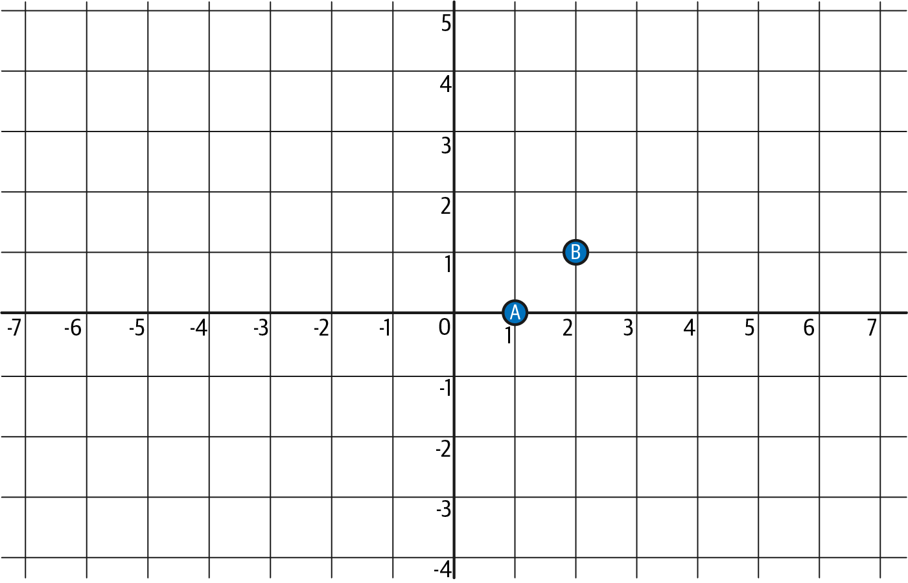

図4-11 2つの異なる点AとB

　AとBの両方を通る直線——1次の多項式（次数が点の数 2 より小さい）——が存在することは容易に理解できます。

　その直線は：

```
I(x) = x – 1
```

　図4-12はこれをよりよく示しています。

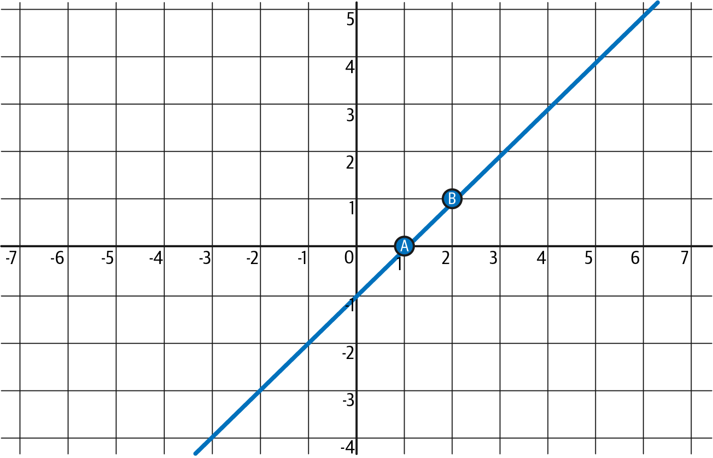

図4-12 点AとBを通る補間多項式（直線）

　ここでは直感を使いましたが、公式を使って同じ結果を証明できます。`k = 2`であることを思い出してください。

```
I(x) = y₀ · (x – z₁)/(z₀ – z₁) + y₁ · (x – z₀)/(z₁ – z₀)
     = 0 · (x – 2)/(1 – 2) + 1 · (x – 1)/(2 – 1)
     = 0 + (x – 1) = x – 1
```

　証明者は`p(x)`がこのセクションの冒頭で述べたすべての点を通ることを証明しようとしています。この主張が正しい（つまり証明者が信頼できる）と仮定すると、`p(x) – I(x)`は各`z₀, z₁, …, zₖ₋₁`の点でゼロになります。

　つまり、`(x – z₀)(x – z₁)...(x – zₖ₋₁)`で割り切れます。この多項式を*ゼロファイア*`Z(x)`と呼びます。

　通常の方法で進めます。証明者は商多項式`q(x)`を計算します。

```
q(x) = [p(x) – I(x)] / Z(x)
```

　そして証明`π = [q(s)]₁`を生成します。この証明は通常の（単一の楕円曲線の点の）KZG証明であることに注意してください。

　この証明の有効性を確認するために、検証者は以下を行う必要があります。

1. 先ほど説明した公式を適用して`I(x)`を計算し、次に`[I(s)]₁`を計算する。
2. `Z(x)`を計算し、次に`[Z(s)]₂`を計算する。なお検証者は、証明者が証明したいと主張するすべての点（と値）を知っているため、`Z(x)`を計算できる。
3. そして通常の等価性チェックを適用する：

```
e(π, [Z(s)]₂) = e(C – [I(s)]₁, H)
```

　この等式をペアリング群に書き下すと：

```
q(s)Z(s) = p(s) – I(s)
```

　これは、証明者が以前に商多項式を計算したときと同じ等式であり、唯一の違いは秘密の点`s`で評価されていることです。

### まとめ

　KZGコミットメントスキームにおける証明者↔検証者のフロー全体をまとめましょう。

　まず証明者から始めます。証明者はあるデータの知識を持っています。証明者はこのデータを多項式にエンコードします（図4-13参照）。

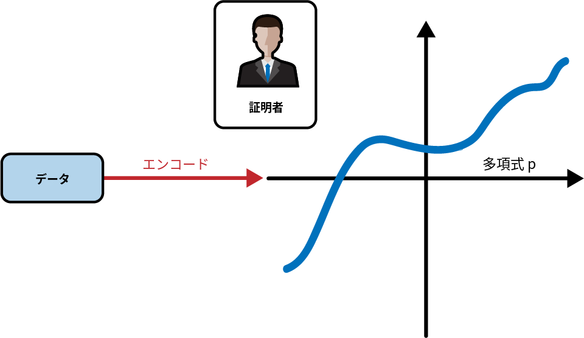

図4-13 証明者がデータを多項式pにエンコードする

　証明者の目標は、ある特定のデータ（現在は多項式としてエンコードされている）を知っていることを検証者に納得させることです。しかし証明者はデータセット全体を明かしたくありません。代わりに、検証者がデータに関する特定の主張を検証できるようにしたいと考えています。特に、多項式が特定の点で期待される値をとることを検証者に確認してもらいたいと考えています（図4-14参照）。

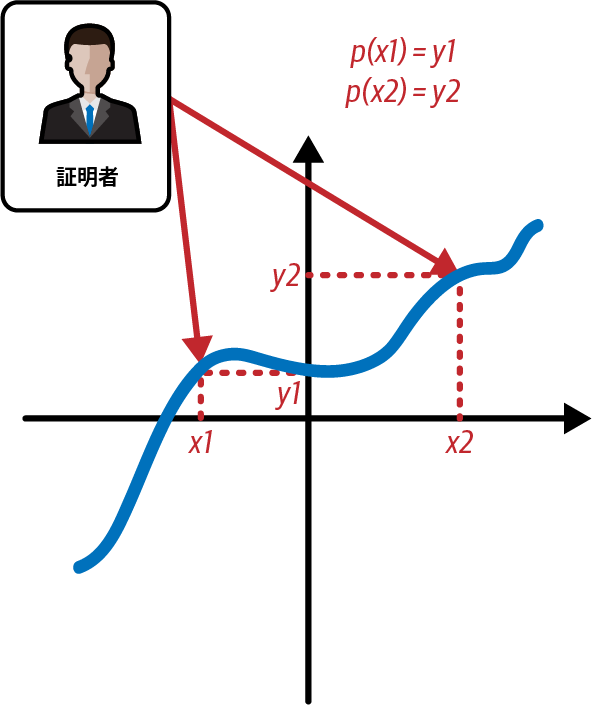

図4-14 証明者が特定の点での多項式の評価を証明したい

　この目標を達成するために、証明者は多項式のKZGコミットメントを計算し、検証者に送信します（図4-15参照）。

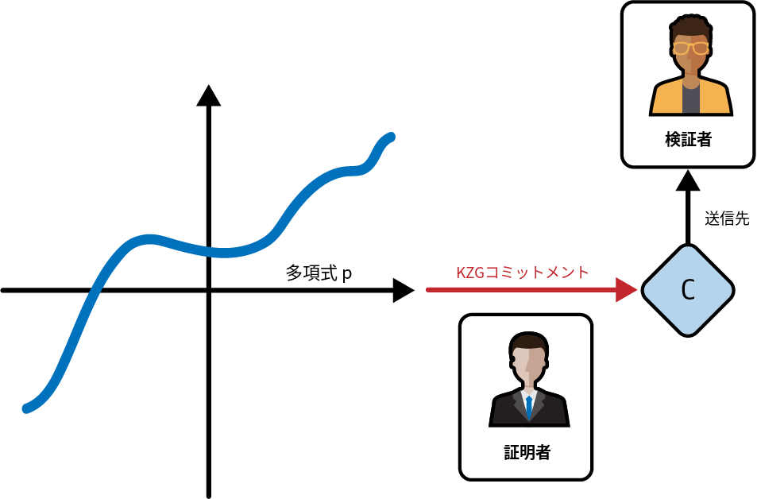

図4-15 証明者がKZGコミットメントCを計算し、検証者に送信する

　次に、証明者は検証者に証明したいすべての評価に対するKZG証明を計算する必要があります（図4-16参照）。

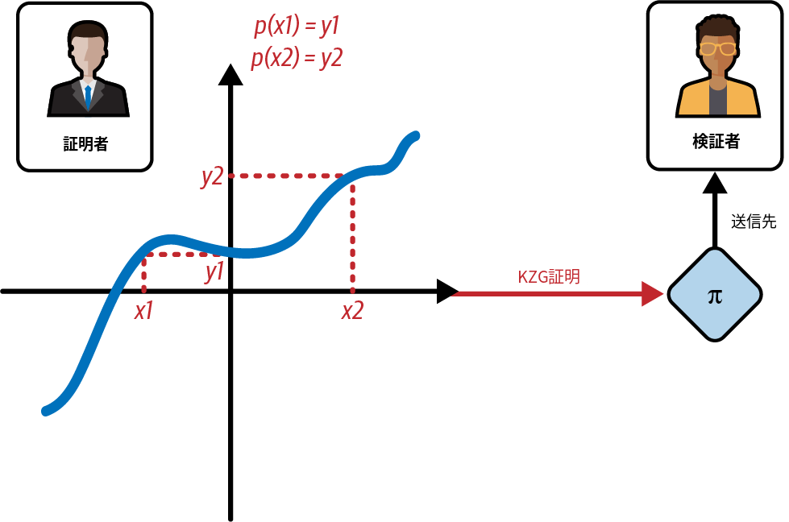

図4-16 証明者が多項式のさまざまな評価のKZG証明を計算し、検証者に送信する

　ここで検証者の番です。証明者が正直であることを確認するために、検証者は楕円曲線のペアリングチェックを計算する必要があります。このとき、証明者が以前に送信した情報とトラステッドセットアップを使います（図4-17参照）。

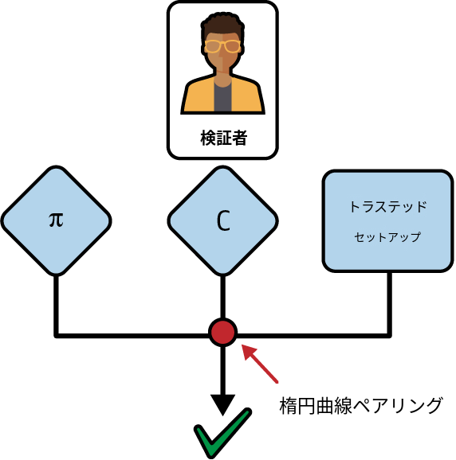

図4-17 検証者が楕円曲線のペアリング演算を通じて評価の有効性を確認する

## 結論

　PKCの概要を紹介し、イーサリアムにおける公開鍵と秘密鍵の使用、そしてイーサリアムアドレスの作成と検証で用いられるハッシュ関数などの暗号ツールに焦点を当てました。また、デジタル署名が秘密鍵を明かさずにその所有を示す方法についても見ました。第5章ではこれらの考えを総合し、ウォレットを使って複数の鍵をまとめて管理する方法を見ていきます。
