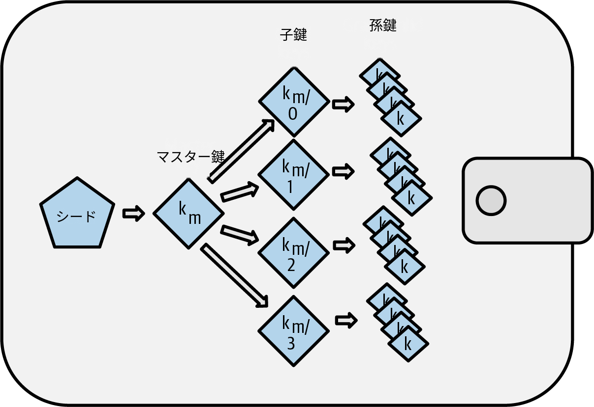
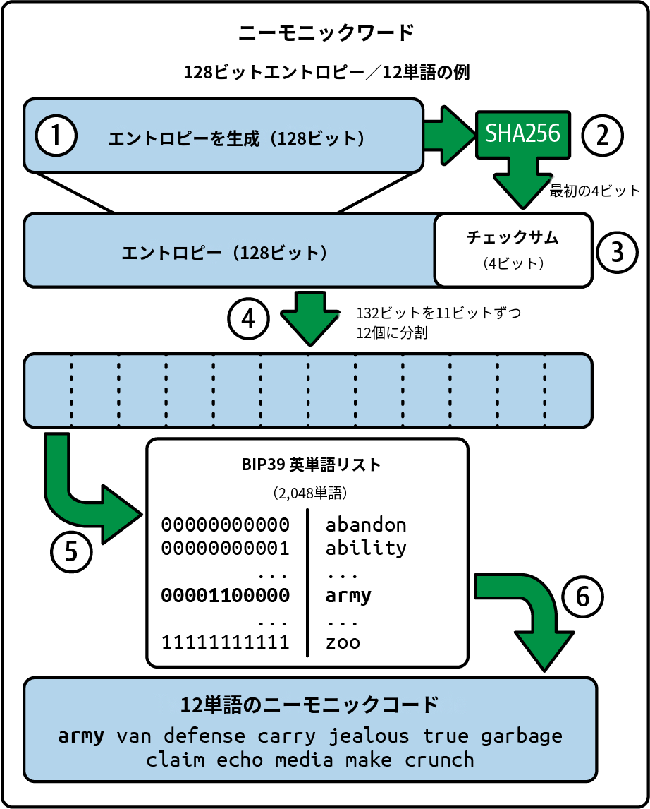
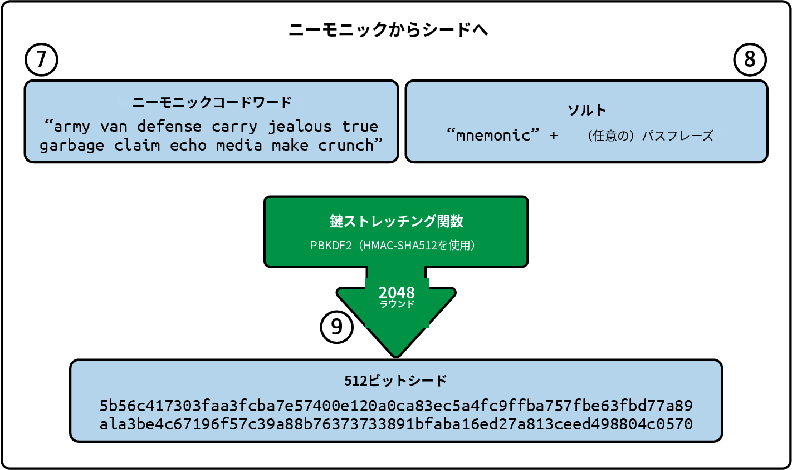
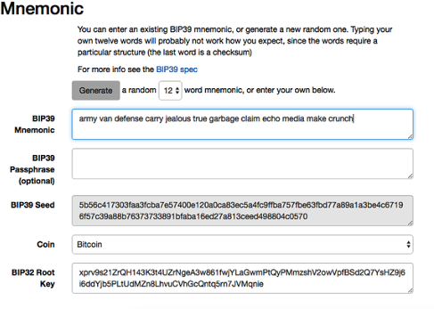
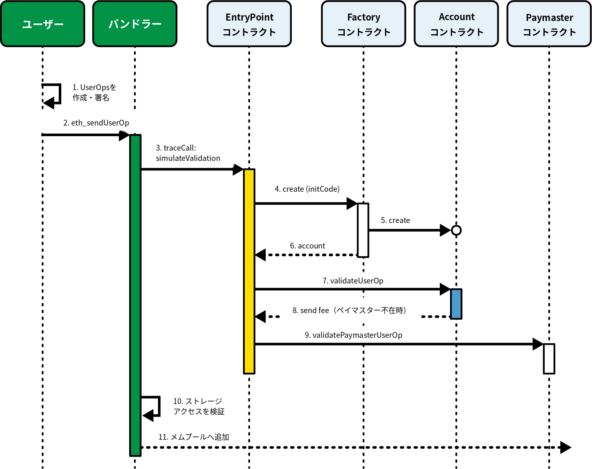
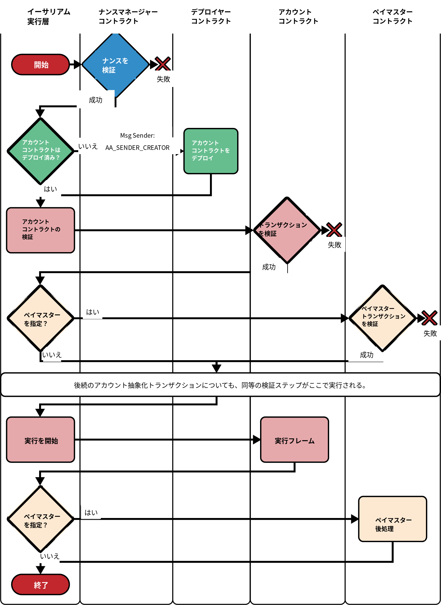
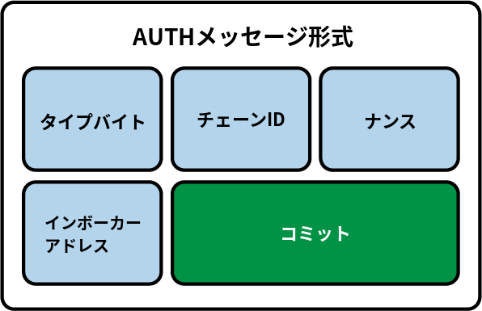
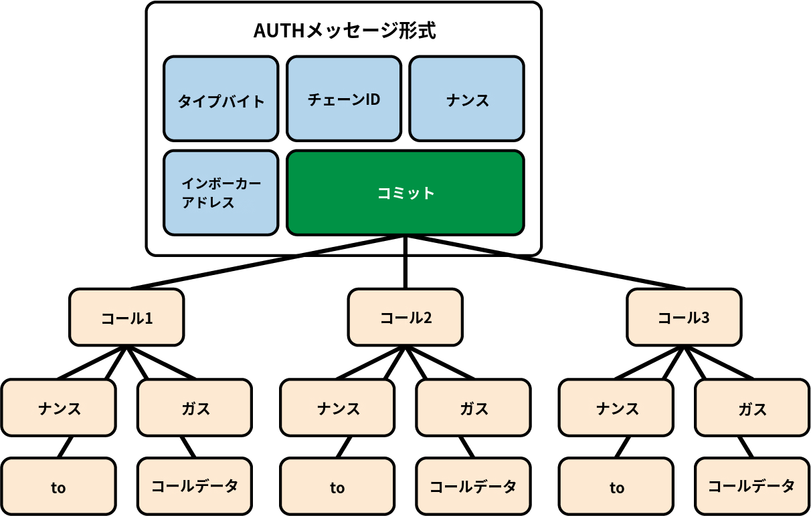
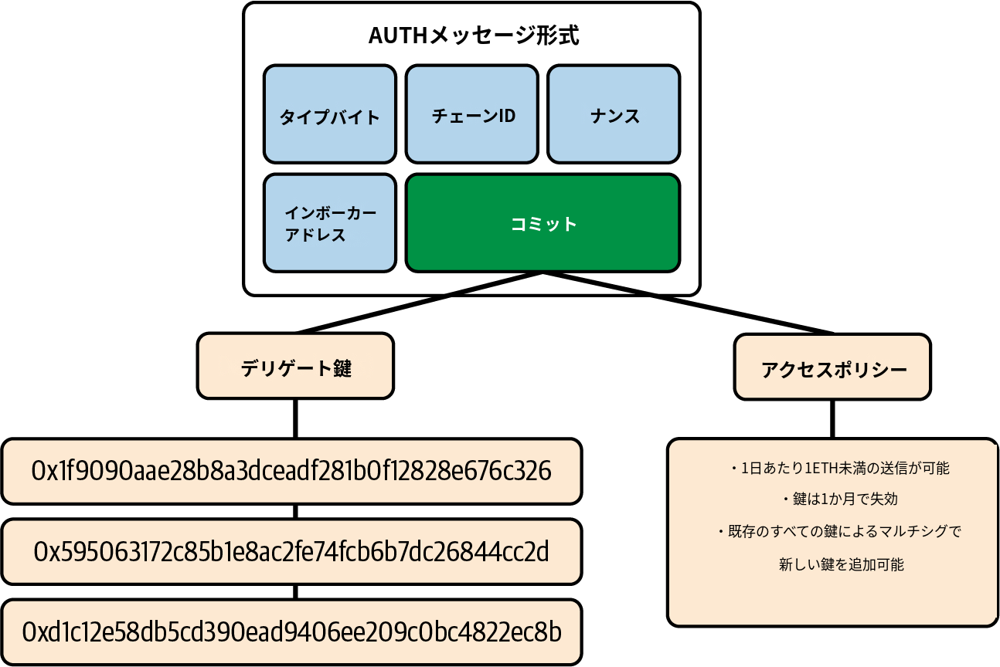
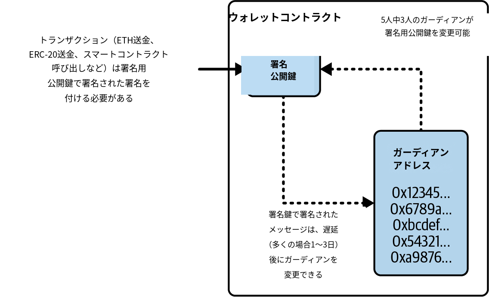

# 第5章：ウォレット

　「ウォレット」という用語は、イーサリアムにおいていくつかの異なるものを表すために使われます。広義には、ウォレットとはイーサリアムへの主要なユーザーインターフェイスとして機能するソフトウェアアプリケーションのことです。ウォレットはユーザーの資金へのアクセスを制御し、鍵とアドレスの管理、残高の追跡、トランザクションの作成と署名を行います。さらに、一部のイーサリアムウォレットはERC-20トークンなどのコントラクトとやり取りすることもできます。

　プログラマーの観点からより狭い意味で言えば、「ウォレット」という用語はユーザーの鍵を保管・管理するためのシステムを指します。すべてのウォレットは鍵を管理する機能を備えていますが、中には鍵の管理機能しか持たないウォレットもあります。他のウォレットは*ブラウザ*というはるかに広いカテゴリーに属しています。ブラウザとはイーサリアムベースのDAppへのインターフェイスのことで、第12章で詳しく解説します。「ウォレット」という用語でまとめられているさまざまなカテゴリーの間には、明確な線引きはありません。

　この章では、秘密鍵を保存するコンテナとして、また鍵を管理するシステムとして、ウォレットを解説します。

## ウォレット技術の概要

　この節では、利便性、安全性、柔軟性を兼ね備えたイーサリアムウォレットを実現するために使われているさまざまな技術の概要を説明します。

　ウォレット設計における重要な検討事項の1つは、利便性とプライバシーのバランスをとることです。最も使いやすいイーサリアムウォレットとは、常に1つの秘密鍵とアドレスを再利用するものでしょう。残念ながら、そのような設計はプライバシーの面では悪夢のようなものです。誰もがトランザクションを簡単に追跡し、関連付けられるからです。すべてのトランザクションに対して新しい鍵を使うことがプライバシーの観点からは最も望ましいのですが、管理は非常に難しくなります。適切なバランスをとることは困難な課題であり、だからこそ優れたウォレット設計が重要になります。

　イーサリアムに関するよくある誤解は、「イーサリアムのウォレットはイーサやトークンを保管している」というものです。非常に厳密に言えば、ウォレットは鍵しか保管していません。イーサや他のトークンはイーサリアムブロックチェーンに記録されています。ユーザーは自身のウォレットにある鍵でトランザクションに署名することで、ネットワーク上のトークンを制御します。ある意味、イーサリアムのウォレットは*キーチェーン*なのです。とはいえ、ウォレットに保管されている鍵はほかの人にイーサやトークンを転送するために必要な唯一のものであるため、実際にはこの区別はほとんど意味がありません。

　この違いが重要になるのは、考え方を従来の銀行の中央集権システムからブロックチェーンプラットフォームの分散型システムへ転換するときです。従来の銀行では、本人と銀行だけが口座の資金を確認でき、取引のために資金を移動するには銀行を説得するだけでよいものでした。一方、ブロックチェーンの分散型システムでは、誰もがアカウントのイーサ残高を見られますが、アカウントの所有者はおそらくわからず、トランザクションを実行するには所有者が資金の移動を望んでいることを全員が納得する必要があります。実際にはこれは、ウォレットを必要とせずにアカウントの残高を確認する独立した方法があることを意味します。さらに、最初に使い始めたウォレットアプリが気に入らない場合は、現在のウォレットから別のウォレットにアカウント管理を移行することもできます。

> **注記**
>
> イーサリアムのウォレットには、イーサやトークンではなく、鍵が保管されています。ウォレットは秘密鍵と公開鍵のペアを含むキーチェーンのようなものです。ユーザーは秘密鍵を使ってトランザクションに署名し、それによってイーサを所有していることを証明します。イーサはブロックチェーン上に保管されています。

　ウォレットには、主に2つの種類があります。両者の区別は、ウォレットが保持している複数の鍵が互いに関連しているかどうかによります。

1つ目のタイプは*非決定性ウォレット*であり、それぞれの鍵は異なる乱数から独立に生成されます。鍵は互いに関連していません。このタイプのウォレットは「just a bunch of keys（鍵の束）」というフレーズから*JBOKウォレット*とも呼ばれています。

2つ目のタイプは*決定性ウォレット*です。すべての鍵は*シード*と呼ばれる1つのマスター鍵から導出されます。決定性ウォレット内のすべての鍵は互いに関連しており、元のシードがあれば再び生成することができます。決定性ウォレットではいくつかの異なる鍵導出方法が使用されています。最も一般的な導出方法は、「階層的決定性ウォレット（BIP-32/BIP-44）」で説明しているように、ツリー状の構造を用いたものです。

　携帯電話の盗難や水没などのデータ消失に備えて、決定性ウォレットの安全性を少しでも高めるために、シードを単語リスト（英語など）にエンコードして書き留めておくことがよくあります。この単語のリストはウォレットの*ニーモニックコードワード*として知られています。もちろん、第三者がニーモニックコードワードを入手した場合、ウォレットを再生成してイーサやスマートコントラクトにアクセスすることもできます。したがって、リカバリー用の単語リストの取り扱いには細心の注意を払ってください！電子的に保存してはいけません。コンピュータや携帯電話のファイルに保管してはいけません。紙に書き留め、安全で確実な場所に保管してください。

　次項以降では、それぞれのウォレット技術について概説します。

### 非決定性（ランダム）ウォレット

　最初のイーサリアムウォレットはイーサリアムの先行販売のために作られ、それぞれのウォレットファイルにはランダムに生成された単一の秘密鍵が格納されていました。このような「古いスタイル」の非決定性ウォレットは多くの点で不備や欠点があり、決定性ウォレットで置き換えられつつあります。たとえば、イーサリアムを使用する際は、プライバシーを最大限に保護するためにも、イーサリアムアドレスの再利用は避けたほうがよいでしょう。資金を受け取る場合は、都度新しいアドレス（新しい秘密鍵が必要）を使うようにしてください。あるいは、各トランザクションに対して新しいアドレスを使用することもできますが、トークンを大量に取り扱う場合にはコストが高くなります。この方法を採用する場合、非決定性ウォレットは定期的に鍵のリストを増やす必要があります。つまり、定期的にバックアップを取る必要があります。ウォレットのバックアップを取る前にデータを失った場合（ディスクの故障、飲み物をこぼす、携帯電話の盗難）、資金とスマートコントラクトにアクセスできなくなります。

　「Type-0」の非決定性ウォレットは、「使い捨て」のような方法で新しいアドレスごとに新しいウォレットファイルを作成するため、取り扱いがかなり面倒になります。

　それにもかかわらず、多くのイーサリアムクライアント（Gethを含む）は*キーストアファイル*を使用しています。キーストアファイルはJSONエンコードされたファイルであり、ランダムに生成された秘密鍵が1つ含まれ、セキュリティを強化するためにパスフレーズで暗号化されています。JSONファイルの内容は次のようになります：

```json
{
    "address": "001d3f1ef827552ae1114027bd3ecf1f086ba0f9",
    "crypto": {
        "cipher": "aes-128-ctr",
        "ciphertext":
            "233a9f4d236ed0c13394b504b6da5df02587c8bf1ad8946f6f2b58f055507ece",
        "cipherparams": {
            "iv": "d10c6ec5bae81b6cb9144de81037fa15"
        },
        "kdf": "scrypt",
        "kdfparams": {
            "dklen": 32,
            "n": 262144,
            "p": 1,
            "r": 8,
            "salt":
                "99d37a47c7c9429c66976f643f386a61b78b97f3246adca89abe4245d2788407"
        },
        "mac": "594c8df1c8ee0ded8255a50caf07e8c12061fd859f4b7c76ab704b17c957e842"
    },
    "id": "4fcb2ba4-ccdb-424f-89d5-26cce304bf9c",
    "version": 3
}
```

　キーストア形式では、*パスワードストレッチングアルゴリズム*とも呼ばれる*鍵導出関数*（KDF）を使用しており、ブルートフォース（総当たり）攻撃、辞書攻撃、レインボーテーブル攻撃から保護します。簡単に言えば、秘密鍵はパスフレーズで直接暗号化はされません。その代わり、パスフレーズに対して繰り返しハッシュ関数を実行するストレッチングが行われます。ハッシュ関数は262,144ラウンド繰り返されており、キーストアJSONでは`crypto.kdfparams.n`として確認できます。パスフレーズをブルートフォース攻撃しようとする攻撃者は、試行するパスフレーズごとに262,144回のハッシュを適用しなければなりません。この仕組みにより攻撃は十分に遅くなります。結果として、十分な複雑さと長さを持つパスフレーズは実質的に破られなくなります。

> **ヒント**
>
> 非決定性ウォレットの使用は、単純なテスト以外の用途では推奨されません。ごく基本的な状況以外では、バックアップして使うには扱いにくすぎます。代わりに、バックアップのためにニーモニックシードを用いる業界標準ベースの階層的決定性ウォレットを使用してください。

### 決定性（シード）ウォレット

　決定性ウォレット、または「シード（seeded）」ウォレットは、すべて1つのマスター鍵もしくはシードから導出された秘密鍵が入ったウォレットです。シードとは、ランダムに生成された数値で、インデックス番号または「チェーンコード」（「拡張公開鍵と拡張秘密鍵」を参照）といった他のデータと組み合わせて複数の秘密鍵を生成します。決定性ウォレットでは、シードがあれば生成したすべての鍵を復元できます。そのため、シードの生成時にバックアップを1回取るだけで、ウォレット内のすべての資金とスマートコントラクトを保護できます。このシードはウォレットのエクスポートとインポートに適しており、異なる実装のウォレット間において鍵の移行を容易にしてくれます。

　この設計では、シードのセキュリティが最も重要になります。シードだけあればウォレット全体へのアクセスを得ることができるからです。一方で、セキュリティ対策を1つのデータに集中できるという点は利点とも言えます。

### 階層的決定性ウォレット（BIP-32/BIP-44）

　決定性ウォレットは、1つのシードから多くの鍵を生成しやすくするために開発されました。現在、決定性ウォレットの最も進んだ形式は、ビットコインのBIP-32標準で定義されている階層的決定性（HD）ウォレットです。HDウォレットには、ツリー構造から導出された鍵が含まれています。この構造においては、親鍵が子鍵群を生成し、子鍵がさらに孫鍵群を生成する、という連鎖が続きます。このツリー構造を図5-1に示します。



図5-1. HDウォレット：1つのシードから生成された鍵ツリー

　HDウォレットには、単純な決定性ウォレットに比べて、いくつかの大きな利点があります。1つ目の利点は、ツリー構造を用いることで用途を使い分けられることです。たとえば、ある特定の鍵の「ブランチ」を支払いの受け取りとして利用したり、他の「ブランチ」を支払いのお釣りの受け取りとして使ったりできます。他にも、会社内での使い分けとして、部や課などの部署ごと、特定の機能ごと、口座の種別ごとにブランチを割り当てることもできます。

　HDウォレットのもう1つの利点は、対応する秘密鍵にアクセスすることなく公開鍵群を生成できることです。これにより、秘密鍵を持たないサーバー（安全でないサーバーや閲覧・受信専用サーバー）でもHDウォレットを利用できます。

### シードとニーモニックコード（BIP-39）

　安全なバックアップと復元のために秘密鍵をエンコードする方法はたくさんあります。現在推奨されている方法は、正しい順序でまとめると秘密鍵を一意に再生成できる一連の単語を使用することです。これは*ニーモニック*と呼ばれることがあり、BIP-39で標準化されています。今日では、多くのイーサリアムウォレット（および他の暗号通貨ウォレット）がこの標準を使用しており、相互運用可能なニーモニックを用いてバックアップおよびリカバリー用のシードをインポート・エクスポートすることができます。

このアプローチが普及した理由を理解するために、以下の例を見てみましょう：

```
FCCF1AB3329FD5DA3DA9577511F8F137 ← 16進数表記のシード
wolf juice proud gown wool unfair
wall cliff insect more detail hub ← BIP-39表記のシード
```

　実際の問題として、16進数の文字列を書き留める際に転記ミスが発生する確率は容認できないほど高くなります。その一方で、既知の単語のリストは扱いがとても簡単です。主な理由は、単語（特に英語の単語）の書き取りには高い冗長性があるためです。もし誤って*inzect*が記録された場合、ウォレットのリカバリーの際に*inzect*は正しい英単語ではなく、代わりに*insect*が使用されるべきだとすぐに判断できます。HDウォレット管理時にはシードを書き留めることが推奨されています。データ消失（事故や盗難）時のリカバリーに必要だからです。バックアップを取っておくことは非常に賢明です。ただし、シードは極めて秘密に保たなければならないため、デジタルバックアップは慎重に避けるべきです。ペンと紙でバックアップすることをおすすめします。

　要約すると、HDウォレットのシードをエンコードしたリカバリーワードリストを使用することが、秘密鍵のセットを安全にエクスポートし、転記し、紙に記録し、エラーなく読み取り、別のウォレットにインポートするための最も簡単な方法です。

## ウォレットのベストプラクティス

　暗号通貨ウォレットの技術が成熟するにつれて、共通の業界標準が現れました。これらの標準により、幅広い相互運用性と使いやすさ、安全性、柔軟性を備えたウォレットを設計できるようになりました。これらの標準により、ウォレットは、1つのニーモニックから複数の異なる暗号通貨の鍵を生成することもできます。共通標準として次のものがあります。

- ニーモニックコードワード（BIP-39準拠）
- HDウォレット（BIP-32準拠）
- 多目的HDウォレット構造（BIP-43準拠）
- 多通貨、複数アカウントウォレット（BIP-44準拠）

　これらの標準は将来の開発によって変わるかもしれませんし、また時代遅れになるかもしれません。しかし、今のところこれらの標準は、それぞれに連動した技術を形成しており、ほとんどのブロックチェーンプラットフォームとそれらの暗号通貨のデファクトスタンダードになっています。

　幅広いソフトウェアウォレットおよびハードウェアウォレットがこれらの標準を採用しており、すべて相互運用が可能です。ユーザーは、これらのウォレットの1つで生成されたニーモニックをエクスポートし、別のウォレットにインポートすることで、すべての鍵とアドレスをリカバリーできます。

　これらの標準をサポートするソフトウェアウォレットの例としては、Rabby Wallet、MetaMask、Phantomがあります。ハードウェアウォレットの例としては、LedgerおよびTrezorの各種モデルがあります。

　以下では、これらの技術のそれぞれの詳細について説明します。

> **ヒント**
>
> もしイーサリアムウォレットを実装する場合は、以下で説明するBIP-32、BIP-39、BIP-43、BIP-44の標準に従い、バックアップのニーモニックコードとしてエンコードされたシードを持つHDウォレットとして構築する必要があります。

### ニーモニックコードワード（BIP-39）

　ニーモニックコードワードとは、決定性ウォレットを生成する際にシードとして使用される乱数をエンコードした単語のリストです。この単語のリストがあればシードを再生成できます。そして、再生成したシードを用いて、ウォレットとすべての鍵を再生成できます。ニーモニックワード方式の決定性ウォレットを実装するアプリケーションは、初期設定時に12〜24個の単語リストをユーザーに表示します。この単語のリストはウォレットのバックアップであり、同一もしくは互換性のあるウォレットにおいて、すべての鍵を復元・再生成するために使うことができます。前節で説明したように、ニーモニックワードのリストは、可読性が高く、正確に転記できます。そのためユーザーは簡単にウォレットをバックアップすることができます。

> **注記**
>
> ニーモニックワードはよく*ブレインウォレット*と混同されるが、両者は同じものではない。主な違いは、ブレインウォレットがユーザーの選んだ単語で構成されるのに対し、ニーモニックワードはウォレットによってランダムに生成されてユーザーに提示される点である。この違いにより、ニーモニックワードははるかに安全である。人間はランダム性の生成源として非常に乏しいためである。さらに重要な点として、*ブレインウォレット*という用語は単語を暗記すべきであることを示唆している。これは悪い考えであり、必要なときにバックアップが手元にないという事態を招く。

　ニーモニックコードはBIP-39で定義されています。ただし、BIP-39はニーモニック標準の実装方式の1つでしかないことに注意してください。ビットコインウォレットのElectrumは、BIP-39に先行して、別の単語群を持った標準を採用しています。BIP-39は、Trezorハードウェアウォレットを製造している会社によって提案されたもので、Electrumとの実装には互換性はありません。しかしながらBIP-39は、現在、数多くの相互運用可能な実装によって幅広い業界のサポートを得ており、デファクトスタンダードとみなせます。さらに、BIP-39はイーサリアム対応の多通貨ウォレット実装に使えます。一方でElectrumのシードは使えません。

　BIP-39は、ニーモニックコードとシードの生成手順を定義しています。ここでは9ステップで説明します。理解しやすくするために、生成手順を2つの部分に分けています。ステップ1〜6は「ニーモニックワードの生成」に、ステップ7〜9は「ニーモニックからシードへ」に記載しています。

#### ニーモニックワードの生成

　ウォレットはBIP-39で定義された標準化されたプロセスを使用して、ニーモニックワードを自動的に生成します。ウォレットはエントロピー源から開始し、チェックサムを追加した後、以下のステップに従ってエントロピーを単語リストにマッピングします：

1. 128〜256ビットの暗号論的にランダムなシーケンス*S*を生成する

2. *S*のSHA-256ハッシュの先頭（*S*のビット長÷32）ビットを取り、*S*のチェックサムを生成する

3. チェックサムをランダムなシーケンス*S*の末尾に追加する

4. シーケンスとチェックサムの連結を11ビットずつのセクションに分割する

5. 各11ビットの値を、あらかじめ定義された2,048語を持つ辞書の中の単語にマッピングする

6. 順序を維持しながら、一連の単語からニーモニックコードを生成する

図5-2は、エントロピーを使用してニーモニックワードを生成する方法を示しています。



図5-2. ニーモニックワードの生成

　表5-1は、エントロピーデータのサイズとニーモニックコードの長さ（単語数）の関係を示しています。

**表5-1 ニーモニックコード：エントロピーと単語長**

| エントロピー（ビット） | チェックサム（ビット） | エントロピー＋チェックサム（ビット） | ニーモニックの長さ（単語数） |
|---|---|---|---|
| 128 | 4 | 132 | 12 |
| 160 | 5 | 165 | 15 |
| 192 | 6 | 198 | 18 |
| 224 | 7 | 231 | 21 |
| 256 | 8 | 264 | 24 |

#### ニーモニックからシードへ

　ニーモニックワードは、128〜256ビットの長さを持つエントロピーを表しています。このエントロピーは、鍵ストレッチ関数PBKDF2を用いてより長い（512ビット）シードを導出するために使われます。生成されたシードは、決定性ウォレットを構築し、そのウォレットの鍵を生成するために使われます。

　鍵ストレッチ関数には2つの引数があります。ニーモニックとソルトです。鍵ストレッチ関数におけるソルトの目的は、ブルートフォース攻撃を可能にするルックアップテーブルの構築を困難にすることです。BIP-39標準では、ソルトにはもう1つの目的があります。それは、シードを保護する追加のセキュリティ要素として機能するパスフレーズの導入を可能にすることで、次のセクションで詳しく説明します。

プロセスは前のセクションから続き、以下のステップで進みます：

7. 鍵ストレッチ関数PBKDF2の最初の引数は、ステップ6で生成したニーモニックである

8. 鍵ストレッチ関数PBKDF2の2つ目の引数は*ソルト*である。このソルトは、文字列定数`"mnemonic"`とユーザーが提供するオプションのパスフレーズの連結で構成される

9. PBKDF2は、HMAC-SHA512アルゴリズムで2,048ラウンドのハッシュ化を行い、ニーモニックとソルトのパラメータを拡張し、最終出力として512ビットの値を生成する。その512ビットの値がシードとなる

図5-3にニーモニックを使ってシードを生成する方法を示します。



図5-3. ニーモニックからシードへ

> **注記**
>
> 2,048ラウンドのハッシュ化を行う鍵ストレッチ関数は、ニーモニックやパスフレーズへのブルートフォース攻撃に対していくらか効果的な保護手段です。数千ものパスフレーズやニーモニックの組み合わせを試すのにはかなりの計算量となりコストがかかります。一方で、取り得るシードの数は膨大です（2^512^、すなわち約10^154^）。これは可視宇宙に存在する原子の数（約10^80^）よりもはるかに多いのです。

　表5-2から表5-4にニーモニックコードとそれらが生成するシードの例を示します。

**表5-2 128ビットエントロピーのニーモニックコード（パスフレーズなし）と生成されるシード**

| | |
|---|---|
| **エントロピー** | 0c1e24e5917779d297e14d45f14e1a1a |
| **ニーモニック** | army van defense carry jealous true garbage claim echo media make crunch |
| **パスフレーズ** | （なし） |
| **シード** | 5b56c417303faa3fcba7e57400e120a0ca83ec5a4fc9ffba757fbe63fbd77a89a1a3be4c67196f57c39... |

**表5-3 128ビットエントロピーのニーモニックコード（パスフレーズあり）と生成されるシード**

| | |
|---|---|
| **エントロピー** | 0c1e24e5917779d297e14d45f14e1a1a |
| **ニーモニック** | army van defense carry jealous true garbage claim echo media make crunch |
| **パスフレーズ** | SuperDuperSecret |
| **シード** | 3b5df16df2157104cfdd22830162a5e170c0161653e3afe6c88defeefb0818c793dbb28ab3ab091897d0... |

**表5-4 256ビットエントロピーのニーモニックコード（パスフレーズなし）と生成されるシード**

| | |
|---|---|
| **エントロピー** | 2041546864449caff939d32d574753fe684d3c947c3346713dd8423e74abcf8c |
| **ニーモニック** | cake apple borrow silk endorse fitness top denial coil riot stay wolf luggage oxygen faint major edit measure invite love trap field dilemma oblige |
| **パスフレーズ** | （なし） |
| **シード** | 3269bce2674acbd188d4f120072b13b088a0ecf87c6e4cae41657a0bb78f5315b33b3a04356e53d062e5... |

#### BIP-39のオプションのパスフレーズ

　BIP-39標準では、シードの導出にオプションのパスフレーズを使用できます。パスフレーズが使用されない場合、ニーモニックワードは定数文字列「mnemonic」からなるソルトでストレッチ（引き伸ばし）され、任意のニーモニックワードから特定の512ビットのシードが生成されます。パスフレーズが使用されている場合、ストレッチ関数は同じニーモニックから別のシードを生成します。実際には、1つのニーモニックがあれば、ありとあらゆるパスフレーズから異なるシードが生成されます。基本的に「間違った」パスフレーズというものは存在しません。すべてのパスフレーズは有効であり、それらはすべて異なるシードを生成します。そして、膨大な数の未初期化ウォレットを作り出すことができます。生成可能なウォレットの数は2^512^と膨大です。パスフレーズの複雑さと長さが十分であれば、ブルートフォース攻撃で破られたり偶然推測されたりすることは事実上ありません。

> **ヒント**
>
> BIP-39には「間違った」パスフレーズはありません。あらゆるパスフレーズはウォレットを生成することができます。つまり以前に使用されていない限り、新しいウォレットを生成できます。

　オプションのパスフレーズは、2つの重要な機能があります。

- 第2の要素（暗記したもの）、つまりオプションのパスフレーズによって、ニーモニックを単独では使えないようにできる。これで、泥棒による情報漏洩からニーモニックのバックアップを保護できるようになる
- 一見もっともらしい形態を取ったウォレット、または「脅迫ウォレット（duress wallet）」を作ることができる。オプションのパスフレーズを使用することで、少額の資産しか入っていないウォレットも作れる。これは大半の資産が入っている「本物」のウォレットを攻撃からそらすために使える

　しかしながら、パスフレーズを使うことには紛失の危険性があることに注意しなければなりません。

- もしウォレットの所有者が、活動することができないか死亡しており、誰もパスフレーズを知らない場合、そのシードは役に立たない。ウォレットに保存されているすべての資産は永遠に失われる
- 逆に、所有者がシードと同じ場所にパスフレーズをバックアップすると、シード生成のための第2の要素としての役割を果たさない

　パスフレーズは非常に便利ですが、一方で、相続人が暗号通貨資産をリカバリーできるようにしておくなど、バックアップとリカバリーのために慎重に計画したプロセスと組み合わせてパスフレーズを使用する必要があります。

#### ニーモニックコードの活用

BIP-39は数多くのプログラミング言語でライブラリとして実装されています。以下に例を示します。

**python-mnemonic**

BIP-39を提案したSatoshiLabsチームによるリファレンス実装（Python）

**ConsenSys/eth-lightwallet**

ノードとブラウザ向けの軽量JavaScriptイーサリアムウォレット（BIP-39対応）

**npm/bip39**

ビットコインBIP-39のJavaScript実装

　スタンドアロンのウェブページとして実装されたBIP-39ジェネレーターもあり（図5-4）、テストや実験に非常に便利です。[Mnemonic Code Converter](https://iancoleman.io/bip39/)はニーモニック、シード、拡張秘密鍵を生成します。ブラウザでオフラインで使用することも、オンラインでアクセスすることもできます。

> **注記**
>
> この章を通じて繰り返し強調されますが、シードのセキュリティにおいて最も重要なルールです：いかなる状況においても、シードフレーズをデジタル形式で保存してはいけません。



図5-4. BIP-39ジェネレーターのウェブページ

### シードからのHDウォレットの生成

　HDウォレットは、128ビットあるいは256ビット、512ビットの乱数である単一のルートシードから生成されます。通常、このシードは、前節で説明したニーモニックから生成されます。

　HDウォレットにあるすべての鍵は、ルートシードから決定論的に導出されます。この仕組みにより、互換性のあるHDウォレットであればシードからウォレット全体を再生成できます。ルートシードを生成したニーモニックを転送するだけで、HDウォレット（数千から数百万の鍵を含むもの）のバックアップ・復元・エクスポート・インポートを容易に行えます。

### HDウォレット（BIP-32）

　ほとんどのHDウォレットはBIP-32標準に準拠しており、決定論的な鍵生成のデファクトスタンダードとなっています。ここではBIP-32のすべての詳細を議論するのではなく、ウォレットでの使われ方を理解するために必要なコンポーネントのみを説明します。最も重要な点は、図5-1で見られるように、導出された鍵がツリー状の階層的な関係を持てることです。拡張鍵と強化鍵の概念を理解することも重要であり、これらは以降の節で説明します。

　多くのソフトウェアライブラリで、相互運用可能なBIP-32の実装が数多く提供されています。これらの多くはビットコインウォレット向けに設計されており、アドレスの実装方法は異なりますが、イーサリアムのBIP-32互換ウォレットと同じ鍵導出の実装を共有しています。イーサリアム向けに設計されたものを使用するか、ビットコイン向けのものにイーサリアムアドレスのエンコーディングライブラリを追加して適用してください。

　スタンドアロンのウェブページとして実装されたBIP-32生成器もあり、BIP-32のテストや実験に非常に便利です。

> **警告**
>
> スタンドアロンのBIP-32生成器はHTTPSサイトではありません。ここでHTTPSサイトでないことを強調しているのは、このツールの使用の安全性が保証されていないことを知ってもらうためです。あくまでもこのツールはテスト専用です。このサイトで生成した鍵は、本物の資金の運用で使うべきではありません。

#### 拡張公開鍵と拡張秘密鍵

　BIP-32の用語では、鍵は「拡張」することができます。適切な数学的演算を用いることで、これらの拡張された「親」鍵から「子」鍵を導出し、前述した鍵とアドレスの階層構造を生成できます。親鍵はツリーの最上位にある必要はなく、ツリー階層のどこからでも選択できます。鍵を拡張するとは、鍵自体に特別な*チェーンコード*を付加することです。チェーンコードは256ビットのバイナリ文字列で、各鍵と混合されて子鍵を生成します。

鍵が秘密鍵である場合、プレフィックス`xprv`で識別される*拡張秘密鍵*になります：

    xprv9s21ZrQH143K2JF8RafpqtKiTbsbaxEeUaMnNHsm5o6wCW3z8ySyH4UxFVSfZ8n7ESu7fgir8i...

拡張公開鍵は、プレフィックス`xpub`によって識別されます：

    xpub661MyMwAqRbcEnKbXcCqD2GT1di5zQxVqoHPAgHNe8dv5JP8gWmDproS6kFHJnLZd23tWevhdn...

　HDウォレットには、秘密鍵を使わずに親の公開鍵から子の公開鍵を生成できるという、とても有用な特徴があります。このことから、子の公開鍵を生成する方法が2種類あることがわかります。子の秘密鍵から直接生成するか、または親の公開鍵から生成するかです。したがって、拡張公開鍵を用いることで、HDウォレットの持つブランチにあるすべての公開鍵（公開鍵のみ）を取得できます。

　この仕組みにより、拡張公開鍵のコピーを持っているものの秘密鍵は一切持たないサーバーやアプリケーションにおいて、非常に安全に公開鍵のみがデプロイできます。このようなデプロイにおいては、制限なく公開鍵とイーサリアムアドレスが生成できますが、それらのアドレスに送金された資産を使うことはできません。一方、より安全な別のサーバーにおいて、拡張秘密鍵から対応するすべての秘密鍵を生成し、トランザクションに署名して資産を使うことができます。

　この方法の応用として一般的なのは、eコマースを提供するウェブサーバーに拡張公開鍵をインストールすることです。このウェブサーバーは、公開鍵の導出関数を使って、すべてのトランザクションのために新しいイーサリアムアドレスを生成することができます（たとえば顧客のショッピングカートごとに）。このウェブサーバーには盗難に脆弱な秘密鍵は保管されません。HDウォレットを使わない場合、別の安全なサーバーで何千ものイーサリアムアドレスを事前生成し、eコマースサーバーに読み込んでおく必要があります。このアプローチは煩雑であり、eコマースサーバーが鍵を使い果たさないようにするためには、定期的なメンテナンスが必要になります。そのためHDウォレットの拡張公開鍵を使用することが好ましいでしょう。

　もう1つの一般的な応用としては、コールドストレージもしくはハードウェアウォレットを用いることです。この場合は、拡張秘密鍵はハードウェアウォレットに保管されますが、拡張公開鍵はオンラインで保管することができます。ユーザーは自由に「受信」アドレスを作成できますが、一方で秘密鍵は安全にオフラインで保存されます。資産を使うには、ユーザーは拡張秘密鍵をイーサリアムのオフライン署名クライアントで使用するか、ハードウェアウォレットデバイス上でトランザクションに署名する必要があります。

#### 強化子鍵導出

　拡張公開鍵もしくは`xpub`から公開鍵のブランチを生成する機能は非常に便利ですが、これには潜在的なリスクが伴います。`xpub`へアクセスできても、子秘密鍵へのアクセスはできません。しかしながら、`xpub`にはチェーンコード（親公開鍵から子公開鍵の導出に使用）が含まれています。そのため、子秘密鍵が1つでも漏洩すると、チェーンコードを用いて他のすべての子秘密鍵を生成できてしまいます。親チェーンコードとともに、1つの子秘密鍵が漏洩してしまえば、すべての子の秘密鍵が明らかになってしまいます。さらに悪いことに、親チェーンコードとともに子秘密鍵を使うことで、親秘密鍵を推測することもできてしまいます。

　このリスクに対処するため、HDウォレットは、親の公開鍵と子のチェーンコードの関係を「破壊」する*強化導出*（hardened derivation）と呼ばれる鍵導出関数を代わりに使用します。この強化鍵導出関数は、親公開鍵ではなく、親秘密鍵を用いて子チェーンコードを導出します。親または兄弟秘密鍵を危険にさらすことのないチェーンコードを使って、親と子の間に「ファイアウォール」が作られるのです。

　チェーンコードの漏洩リスクにさらされることなく、`xpub`の利便性を利用して公開鍵のブランチを導出したいのであれば、通常の親（親公開鍵）ではなく、強化された親（親秘密鍵）から導出する必要があります。マスター鍵の第1レベルの子は、マスター鍵への不正アクセスを防ぐために常に強化導出を通じて生成するというのがベストプラクティスになります。

#### 通常導出と強化導出のインデックス番号

　与えられた親鍵から複数の子鍵を導出できることは明らかに望ましいことです。これを管理するために、インデックス番号が使用されます。各インデックス番号は、特別な子鍵導出関数を使って親鍵と組み合わされると、異なる子鍵を生成します。BIP-32の親から子への導出関数で使用されるインデックス番号は32ビット整数です。このインデックス番号は2つの範囲に分割されています。通常（非強化）の鍵導出関数で導出された鍵と、強化導出関数で導出された鍵を簡単に区別するためです。0から2^31^-1（0x0から0x7FFFFFFF）のインデックス番号は、通常の導出にのみ使用されます。2^31^から2^32^-1（0x80000000から0xFFFFFFFF）のインデックス番号は強化導出にのみ使用されます。したがって、インデックス番号が2^31^未満であれば子は通常の鍵導出関数によって導出されており、2^31^以上であれば子は強化導出によって導出されています。

　インデックス番号を読みやすく表示するために、強化導出によって導出された子のインデックス番号はゼロから始まり、プライム記号（'）付きで表示されます。したがって、最初の通常導出による子鍵は0として表示され、最初の強化導出による子鍵（インデックス0x80000000）は0'として表示されます。2番目の強化導出鍵はインデックス0x80000001を持ち、1'として表示されます。HDウォレットのインデックス番号*i*'は、2^31^ + *i*を意味します。

#### HDウォレットの鍵識別子（パス）

　HDウォレット内の鍵は「パス」の命名規則を使用して識別され、ツリーの各レベルはスラッシュ（`/`）文字で区切られます（表5-5参照）。マスター秘密鍵から得られた秘密鍵は`m`で始まります。マスター公開鍵から得られた公開鍵は`M`で始まります。したがって、マスター秘密鍵の最初の子秘密鍵は`m/0`です。最初の子公開鍵は`M/0`です。最初の子の2番目の孫は`m/0/1`であり、以下同様に続いていきます。

　右から左に進むほど「祖先」に近づき、最終的にはマスター鍵にたどり着きます。たとえば、識別子`m/x/y/z`は、鍵`m/x/y`の*z*番目の子である鍵を示します。また鍵`m/x/y`は鍵`m/x`の*y*番目の子です。さらに`m/x`は`m`の*x*番目の子です。

**表5-5. HDウォレットのパスの例**

| HDパス | 鍵の説明 |
|---|---|
| m/0 | マスター秘密鍵（m）の最初（0）の子秘密鍵 |
| m/0/0 | 最初の子秘密鍵（m/0）の最初（0）の孫秘密鍵 |
| m/0'/0 | 最初の強化された子秘密鍵（m/0'）の最初（0）の通常の孫秘密鍵 |
| m/1/0 | 2番目の子秘密鍵（m/1）の最初（0）の孫秘密鍵 |
| M/23/17/0/0 | 24番目の子公開鍵の、18番目の孫公開鍵の、最初（0）の曽孫公開鍵の、最初（0）の玄孫公開鍵 |

### HDウォレットのツリー構造をたどる

　HDウォレットのツリー構造はとても柔軟性があります。しかし、その柔軟性の裏返しとして、際限のない複雑さが挙げられます。それぞれの親拡張鍵は40億個の子鍵を持つことができます。そのうちの20億個は普通の子鍵で、そのほかの20億個は強化導出された子鍵です。そして、子鍵のそれぞれが、さらに40億の子鍵を持つことができます。ユーザーの要望に応じてツリーの階層を深くすることができ、無限の世代の鍵を作ることができます。ただし、際限なく続くツリーのパスをたどるのは非常に困難です。

　このためBIP-43とBIP-44という2つのBIPは、HDウォレットのツリー構造に関する標準を作ることで、この複雑さを解消しようとしています。BIP-43では、ツリー構造の「目的」を示す特別な識別子として、最初に強化子鍵のインデックス番号を使用することを提案しています。BIP-43によると、BIP-32で定義されているHDウォレットの階層（パス）構造の1階層目を「目的」として使うことにしています。ウォレットの目的を定義するインデックス番号が1階層目に示されており、その目的に応じて2階層目以下の構造と名前空間が決定されることになります。より具体的には、階層`m/i'/...`のブランチのみを使用するHDウォレットは、特定の目的に沿った使用を想定されており、その目的はインデックス番号*i*によって識別されます。

　その仕様を拡張して、BIP-44は「目的」番号を`44'`に設定することで示されるマルチ通貨、マルチアカウント構造を提案しています。BIP-44の構造に従うすべてのHDウォレットは、ツリーの1つのブランチ`m/44'/*`のみを使用することで識別されます。BIP-44は、5つの事前定義されたツリーレベルで構成される構造を規定しています：

    m / purpose′ / coin_type′ / account′ / change / address_index

　第1レベルの`purpose'`は常に`44'`に設定されます。第2レベルの`coin_type'`は暗号通貨の種類を指定し、各通貨が第2レベルの下に独自のサブツリーを持つマルチ通貨HDウォレットを可能にします。標準文書SLIP-0044にはいくつかの通貨が定義されています。例えば、イーサリアムは`m/44'/60'`、イーサリアムクラシックは`m/44'/61'`、ビットコインは`m/44'/0'`、すべての通貨のテストネットは`m/44'/1'`です。

　ツリーの第3レベルは`account'`で、ユーザーが会計や組織の目的に合わせてウォレットを独立した論理的なサブアカウントに細分化できるようにします。例えば、HDウォレットには2つのイーサリアムアカウントが含まれることがあります：`m/44'/60'/0'`と`m/44'/60'/1'`。各アカウントはそれぞれのサブツリーのルートとなります。

　BIP-44はもともとビットコイン用に作成されたため、イーサリアムの世界では関係のない「癖」が含まれています。パスの第4レベルの`change`では、HDウォレットは2つのサブツリーを持ちます。1つは受信アドレスの作成用、もう1つはお釣りアドレスの作成用です。イーサリアムではビットコインのようなお釣りアドレスの必要がないため、「受信」パスのみが使用されます。前のレベルが強化導出を使用していたのに対し、このレベルでは通常導出が使用されることに注意してください。これは、安全でない環境で使うためにアカウントレベルの拡張公開鍵をエクスポートできるようにする目的です。

　利用可能なアドレスは、HDウォレットによって第4レベルの子として導出され、ツリーの第5レベルが`address_index`になります。例えば、プライマリアカウントでのイーサリアム支払い用の3番目の受信アドレスは`M/44'/60'/0'/0/2`となります。表5-6にさらにいくつかの例を示します。

**表5-6. BIP-44 HDウォレット構造の例**

| HDパス | 説明 |
|---|---|
| M/44'/60'/0'/0/2 | 最初（0'）のイーサリアムアカウントの3番目の受信用公開鍵 |
| M/44'/0'/3'/1/14 | 4番目のビットコインアカウントの15番目のお釣り用公開鍵 |
| m/44'/2'/0'/0/1 | トランザクションに署名するためのLitecoinメインアカウントの2番目の秘密鍵 |

## セキュリティ

　セキュリティとリカバリーのしやすさはトレードオフの関係にあります。極端な話、最も安全なシードとは何でしょうか？それは誰もリカバリーできないシード、自分自身でさえもリカバリーできないシードです。つまり、シードが作成され、すべてのコピー（物理的・デジタル的）が破壊されたなら、それは世界で最も安全なシードです。リカバリーできないので実用的ではありませんが、技術的には最も安全です。

　逆に、リカバリーのしやすさについて言えば、最もリカバリーしやすいシードとは何でしょうか？シードフレーズがあらゆるところに書かれている、例えば体に刺青として見える場所に入れてあるようなものです。そのシードはリカバリーが非常に簡単ですが、まったく安全ではありません。

　セルフカストディにおいてOpSec（運用セキュリティ）のために行う選択は、シードフレーズのセキュリティ強化とリカバリーのしやすさ、どちらかを向上させる方向に働きます。セキュリティを高めると通常はリカバリーのしやすさが低下し、その逆も同様です。場合によっては両方が低下してしまうこともあり、これは避けるべきです。

　高セキュリティのシステムであっても、100%安全な設定は存在しません。完璧なシステムを作るためにできる限りのことをしても、脆弱性は依然として存在します。中でも興味深い脆弱性として秘密鍵の衝突があります。これは本質的には、すでに使われているシードと同じものを偶然生成してしまうことによって発生します。ハードウェアウォレットのシードはオフラインで生成され、生成済みシードのデータベースは存在しないため、技術的には同じウォレットを2回生成することが可能です。これが起こる確率は天文学的に小さいですが（宝くじに2回連続で当たる確率よりも低い）、可能性としては存在します。

> **警告**
>
> シードのセキュリティについては、多くの場合、急いで対処する必要はありません。シードが盗まれていればすでに手遅れですし、盗まれていなければ何も問題はないからです。これは特にビットコインウォレットに当てはまります。イーサリアムでも基本的には同様ですが、危険なスマートコントラクトへの承認を取り消すなど、迅速に行動すれば資金を守れるケースもあります。シードについて緊急の対応を求めるメッセージを受け取った場合、それはおそらく詐欺です。

　シードを隠すための複雑なセキュリティメカニズムはベストプラクティスではありません。一見完璧に見えるかもしれませんが、その分野の専門家は適切なツールを使えばこの種のシードをリカバリーできることが多いです。そして、専門家でもリカバリーできないほど複雑であれば、必要なときに自分自身でもリカバリーできない可能性が高いです。

　もう1つの避けるべきプラクティスは、セキュリティを隠蔽に頼ることです。システムには「秘密」のコンポーネントをできるだけ少なくし、秘密にすべきものはシード自体に限定すべきです。システムの一部を公開するとシステムが崩壊するのであれば、それは安全ではありません。

　ベストプラクティスは、他の多くの人がやっていることに従うことです。新しいシステムを発明しようとしたり、さらに悪いことにすべてをゼロから作ろうとするのは間違いです。安全ではありませんし、ほとんどの人にはそれを行う技術的スキルがありません。シンプルに保ちましょう。シンプルさは間違いなくベストプラクティスです。

　シードのバックアップを作成することは、おそらく最も重要なベストプラクティスです。ハードウェアウォレットであれブラウザウォレットであれ、バックアップは不可欠です。バックアップの保管場所は、(a) 自然災害に耐えられること、(b) ハードウェアウォレットとは地理的に離れていること、(c) 安全な場所であること、(d) 改ざんの痕跡が分かるパッケージであること、が求められます。シードを複数の紙に分割することはベストプラクティスではありません。誤った安心感を与えるだけです。

> **ヒント**
>
> シードを保管する安全な場所がない場合は、パスフレーズの使用を検討してください。パスフレーズは鍵生成プロセス中にシードと組み合わされることで、追加の保護層を提供します。パスフレーズはシードなしでは無意味なので、デジタルで保存することもできます。誰かがシードを入手してもパスフレーズを入手しなければ、一定期間は資金にアクセスできません。ただし、攻撃者がシードを持っていればパスフレーズは時間をかけてブルートフォースで解読される可能性があります。

　人によってニーズは異なり、セキュリティ要件もそれに応じて変わります。しかし、常にベストプラクティスに従うべきです。ニーズは時間とともに変化する可能性があるため、常に注意を払い、必要に応じてOpSecを調整してください。

　ハードウェアウォレットをセットアップした後、シードをリカバリーする能力をテストしてください。少なくとも12か月に1回はこれを行い、バックアップが機能し、アクセス可能であることを確認してください。

　安全なシステムとはどのようなものでしょうか？信頼できるハードウェアウォレット（Trezorなど）、少なくとも1つの安全なバックアップ（デジタルで保存しないこと）、そしてあなたに何かあった場合の相続計画です。

> **注記**
>
> 相続は非常に複雑なトピックです。パメラ・モーガン著『*Cryptoasset Inheritance Planning: A Simple Guide for Owners*』（Merkle Bloom）を読むことをお勧めします。

## ユーザーエクスペリエンスの改善

　前述のように、広義にはウォレットとはイーサリアムへの主要なユーザーインターフェイスとして機能するソフトウェアアプリケーションです。そのため、イーサリアムのユーザーの大部分にとって、ウォレットがユーザーエクスペリエンスのほぼすべてです。しかし、長年にわたりウォレットのUXはほとんど改善されてきませんでした。例えば、執筆時点で最も人気のあるブラウザウォレットはMetaMaskですが、誕生以来それほど進化していません。僅差の2番手としてRabbyが最近登場しました。ここでは、ユーザーエクスペリエンスを劇的に改善しうるウォレットのアップデートについて検討します。

### アカウントアブストラクション

　イーサリアムにおけるアカウントアブストラクション（AA）は、ユーザーアカウントをより柔軟で使いやすくするための仕組みです。通常、第2章で説明したように、イーサリアムにはEOAとスマートコントラクトアカウントの2種類のアカウントがあります。AAはこの両方の利点を組み合わせたものです。通常のアカウント（EOA）がスマートコントラクトのように振る舞えるようになり、セキュリティ機能の追加や複数人によるトランザクション署名の許可など、アカウントの動作にカスタムルールを設定できます。

　AAにより、イーサリアムはより使いやすく柔軟になります。例えば、秘密鍵だけに頼らずに紛失したアカウントをリカバリーしたり、イーサだけでなく任意のトークンでトランザクション手数料を支払ったりできるようになります。

　AAを実装するための提案は複数あります。主な違いとして、一方の提案グループはイーサリアムプロトコルを変更せずにAAを実装しようとしたのに対し、もう一方の提案グループはイーサリアムプロトコル自体を変更するもので、Pectraアップグレードで実装される予定です。

　AAに関する主なEIPとEthereum Requests for Comments（ERC）を見ていきましょう。これらの提案は急速に進化しており、本書が出版される頃にはAAの状況は大きく変わっている可能性があることに留意してください。それでも、何が実装され、近い将来何が計画されているかを把握しておくことは有益です。

> **ヒント**
>
> ERC、EIP、およびRollup Improvement Proposal（RIP）の違いを理解することが重要です。基本的に、EIPとRIPはイーサリアムネットワークの変更を中心とした改善であるのに対し、ERCはコアネットワークの機能に影響を与えないアプリケーション関連の変更です。

#### ERC-4337

　ERC-4337は、ユーザーアカウントをより多機能で安全かつ使いやすくすることを目的としたイーサリアムの技術的進歩です。イーサリアムプロトコルを変更する一般的なアップグレードとは異なり、ERC-4337はスマートコントラクトとオフチェーンコンポーネントを通じて新しい機能を導入します。2024年9月時点で、AAの主要なオンチェーン実装はERC-4337です。

　第2章で述べたように、従来のイーサリアムアカウントは2種類に分けられます。秘密鍵のみで制御されるEOAと、スマートコントラクトを通じて動作するコントラクトアカウントです。

　EOAはシンプルで経済的であるため現在ユーザーウォレットの主流ですが、機能が限定的でセキュリティリスクにもさらされやすいという問題があります。秘密鍵を紛失すると資金を永久に失う可能性があり、マルチシグ設定やアカウントリカバリーオプションなどのセキュリティ機能をカスタマイズすることもできません。

　一方、コントラクトアカウントはこれらのセキュリティ対策を組み込めますが、その複雑さとトランザクション手数料の高さから一般ユーザーへの普及が進んでいませんでした。ERC-4337は、EOAにスマートコントラクトの機能を持たせることで、EOAのシンプルさとコントラクトアカウントのセキュリティ・柔軟性を融合させます。

　ERC-4337の実装では、図5-5に示すように、トランザクションを異なる方法で処理する*UserOperation*が導入されます。各トランザクションを直接ブロックチェーンにブロードキャストするのではなく、ユーザーはUserOperationを高レベルのメムプールに送信し、そこでトランザクションが一時的に保存されます。*バンドラー*と呼ばれる特別な参加者がこれらのUserOperationを収集・処理し、1つのイーサリアムトランザクションにまとめます。これによりネットワークの輻輳が軽減され、複数のオペレーションをより効率的に処理できるようになります。

　また、ERC-4337では*ペイマスター*という新しい役割も導入されます。通常、イーサリアムのトランザクションではETHでガス代を支払う必要がありますが、ペイマスターにより代替トークンでのガス代支払いや、第三者によるガス代の代理支払いが可能になります。これにより、ETHを保有していない新規ユーザーにとっての大きな障壁が取り除かれ、イーサリアムネットワークがより利用しやすくなります。



図5-5. ERC-4337の実装図

　従来のパブリックメムプールではEOAの保留中のトランザクションを扱いますが、UserOperationはこれらのオペレーション専用に設計された*UserOperationメムプール*に送信されます。バンドラーはこのUserOperationメムプールを監視し、複数のUserOperationを収集して1つの「従来型」トランザクションにまとめます。まずEntryPointメソッドを通じて各UserOperationの有効性を検証し、検証後、バンドルしたトランザクションを通常のメムプールをバイパスして次の提案ブロックに直接送信します。バンドラーは自らブロックビルダーとして機能することも、ブロックビルダーと連携してトランザクションをブロックチェーンに追加することもできます。

#### EIP-2938

　ERC-4337がイーサリアムのコアを変更せずにスマートコントラクトを通じてAAを実現するのに対し、EIP-2938はさらに一歩進んで、AAをプロトコル層自体に組み込むことを提案しています。このアプローチは、EVMがアカウントを扱う方法を根本的に変更することで、ユーザー、スマートコントラクト、アプリケーション間のより直接的で柔軟なやり取りを可能にします。EIP-2938により、ユーザーは従来のEOAなしでオペレーションを処理でき、秘密鍵ベースのアカウントへの依存を排除し、マルチシグアカウントやソーシャルリカバリーアカウントなど、より多様なアカウント管理システムをイーサリアムのプロトコルレベルで直接実現できます。

　EIP-2938と既存のAA提案の主な違いは、アブストラクションをプロトコルの上にレイヤーとして載せるのではなく、プロトコルに直接統合する点にあります。EIP-2938では、イーサリアムは「トランザクション」ではなく「オペレーション」をサポートし、各オペレーションはより多機能でカスタマイズ可能なトランザクションタイプとなります。EIP-2938はイーサリアムのトランザクションをプログラム可能なオブジェクトとして再定義し、より広範なユースケースに対応します。アカウントとトランザクションを本質的にプログラム可能なものとして扱うことで、標準的な支払いやコントラクトとのやり取りを超えてイーサリアムの有用性を拡張し、ネットワーク上で構築される高度なアプリケーションにも対応できます。

#### RIP-7560

　RIP-7560提案は、EIP-2938とERC-4337をネイティブAAのための統一的なアプローチに統合し、イーサリアムのトランザクションスコープを検証、実行、トランザクション後のステップに分割します。トランザクションの検証を認可とガス代の支払いに分離することで、あるコントラクトが別のアカウントのトランザクションのガス代をスポンサーすることが可能になります。このアプローチは、完全なネイティブAAの実現を目指しつつ、ERC-4337のエコシステムとの互換性を維持します。

　ERC-4337はアプリケーションレベルでAAを導入していますが、プロトコル外の設計であるため制限があります。具体的には、追加のガスコスト、限定的な検閲耐性、非標準RPCメソッドへの依存、既存コントラクトとの互換性の制約などです。EIP-2938で提案されたネイティブAAは、これらの機能をプロトコルに直接組み込むことでより堅牢な代替手段を提示しますが、プロトコル変更なしで広くテスト・実装されてきたERC-4337の構造と完全には一致しません。

　EIP-2938の組み込みプロトコルレベル機能とERC-4337から得られた実践的な知見を組み合わせることで、この提案は両方のアプローチの長所を統合します。このハイブリッドアプローチは、ガスコストの削減、検閲耐性の向上によるトランザクションの信頼性改善、現在および将来のイーサリアムコントラクトとの互換性確保を目指しています。EOAからスマートコントラクトアカウントへの段階的な移行により秘密鍵に関連するリスクも軽減され、イーサリアムがより安全で使いやすくなります。また、すでにERC-4337を使用しているユーザーがこれらの新機能をスムーズに採用できることも重要な点です。

図5-6は、RIP-7560で概説されたAAのトランザクションフローを表しています。このプロセスは、検証、デプロイメント、実行を処理する主要なコントラクトを組み込み、イーサリアムブロックチェーン上でユーザーアカウントとトランザクションを効率的かつモジュラーに管理します。



図5-6. RIP-7560のトランザクションフロー

　フローは、Nonce Managerコントラクトによるナンスチェックから始まり、トランザクションが一意でありリプレイされていないことを確認します。これは二重支払いや偶発的な繰り返しを防ぐための重要なステップです。ナンスが有効であればシステムは先に進み、そうでなければトランザクションは停止されます。

　次に、ユーザーのAccountコントラクト（スマートウォレット）がすでに存在するかどうかをチェックします。存在しない場合、Deployerコントラクトがウォレットを作成し、ユーザーがトランザクションに参加できるようにします。デプロイ済み、またはすでに存在する場合は、Accountコントラクト自体が検証チェックを実行し、トランザクションが正当でコントラクトのロジックに整合していることを確認します。これにより、承認されたアクションのみが実行され、各ユーザーのウォレットにセキュリティとカスタマイズの層が加わります。

　このフローの特徴的な点は、Paymasterコントラクトをオプションで関与させられることです。指定された場合、このコントラクトはトランザクションのガス代を負担したり、代替の支払い方法を提供したりできます。ペイマスターが関与する場合は、トランザクションコストを正当に負担できることを確認するための独自の検証プロセスを経ます。この柔軟性によりスポンサーシップモデルが可能になり、ユーザーのトランザクション手数料の負担を軽減できる可能性があります。

　すべての検証が完了すると、イーサリアム実行層がトランザクションの処理を開始します。実行中は、Execution Frameがトランザクションの詳細処理と進行の監視に使用されます。実行後、ペイマスターが関与していた場合は、トランザクションのスポンサーシップを完了するために必要な後処理を実行します。

#### EIP-5806

　EIP-5806は新しいトランザクションタイプを導入し、「デリゲートコール」メカニズムを通じてEOAがカスタムコードを実行できるようにします。

　現在、EOAはコントラクトのデプロイまたは「コール」トランザクションの送信しかできず、ブロックチェーンとのやり取りが制限されています。複数のアクションを1つのトランザクションにまとめたり、複雑なオペレーションを実行したりできないため、ユーザビリティに影響があります。AAがこれらの問題を解決できる可能性はありますが、採用への道筋はまだ定まっておらず、コストや譲渡不可能な資産のカストディの問題からすべてのユーザーが移行できるわけではありません。

　この提案は、最小限のEVM変更と既存のセキュリティ標準を用いて、EOAがカスタムコードを実行するためのシンプルな方法を提供します。EOAが特定のコントラクトにコールをデリゲートできるようにすることで、マルチコールバッチングや安全なトークン転送などの複雑なオペレーションが可能になります。他のAA提案とは異なり、既存のアブストラクション手法を置き換えずにEOAのユーザーエクスペリエンスを改善することを目指しており、近い将来のEOA機能強化に向けた現実的な選択肢です。

#### EIP-3074

　EIP-3074は、EOAが「インボーカー」（代理実行コントラクト）にトランザクションの制御をデリゲートできるようにする`AUTH`と`AUTHCALL`の2つのオペコードを導入します。ユーザーはインボーカーのアドレスとコミット（トランザクション値のハッシュ）を含むメッセージに署名することで、インボーカーが承認されたトランザクションのみを処理するよう保証します。リプレイ保護はインボーカーが担当し、ユーザーは悪意のある動作を避けるためにこのコントラクトを信頼する必要があります。この提案はトランザクションのバッチ処理を改善し、柔軟なアカウントデリゲーションを可能にします。

　`AUTH`は、ユーザーがスマートコントラクトに自分の代わりに行動する許可を与えるためのオペコードです。デジタル署名（ECDSA）で認可を検証し、将来のトランザクションのためにユーザーのアドレスを保存します。`AUTHCALL`は、認可されたスマートコントラクトがトークンの送信や他のコントラクトとのやり取りなどのトランザクションを実行できるようにします。例えば、10 DAIをETHにスワップしたい場合、1つの署名でインボーカーを認可（`AUTH`を使用）できます。インボーカーは`AUTHCALL`を使用してUniswapにDAIの使用を承認し、スワップを実行します。

　当初、リプレイ保護やvalue、gas、その他の`AUTHCALL`引数などのフィールドも署名対象でした。設計が進化し、これらのタスクはインボーカーコントラクトにデリゲートされるようになったため、ユーザーがインボーカーを信頼することがより重要になりました。ユーザーは特定のコールプロパティをハッシュ化することで「コミット」できます。図5-7に示すように、インボーカーはリプレイ保護用のナンスなどコミットされた値がユーザーのコミットメントと一致する場合のみ検証を行います。これにより、インボーカーはユーザーが認可した内容だけを正確に処理します。



図5-7. EIP-3074のコミットメント検証

　コミットハッシュにより、インボーカーは並列ナンスの許可や1つの署名での複数コールのバンドルなど、さまざまなルールを適用できます。これにより、図5-8に示すように、ERC-20のapprove-transferを1つのトランザクションに統合するなどのマルチコールフローが可能になります。



図5-8. EIP-3074のマルチコールフロー

　さらに、デリゲートのアドレスとアクセスポリシーを含むコミットメッセージに署名することで、EOAの制御を他の鍵にデリゲートすることもサポートしています。図5-9に示すように、インボーカーはEOAの代わりにコールを中継する前にこれを検証します。



図5-9. EIP-3074のデリゲーションフロー

#### EIP-5003

　EIP-5003は`AUTHUSURP`オペコードを導入します。これにより、EIP-3074を通じて認可されたアドレスにコードをデプロイし、（EIP-3607と併用した場合に）元のEOAの署名鍵を実質的に無効化できます。従来のEOAはイーサリアム上で多くの価値を管理していますが、鍵のローテーション、トランザクションのバッチ処理、ETHを保持せずにガス代の代理支払いを利用するといったことが容易にはできません。コントラクトアカウントとAAはこれらの問題に対処し、セキュリティ機能、認証方法、支出制限、鍵のローテーション、ソーシャルリカバリーなどのカスタマイズを可能にします。しかし、これらの利点はERC-4337のようなスマートコントラクトウォレットやアプリケーション層のソリューションを積極的に採用するユーザーに限られており、イーサリアムの誕生以来EOAに依存してきた多くの既存ユーザーにとっては、セキュリティとユーザビリティの改善が限定的なままです。

　EIP-3074によりEOAからコントラクトアカウントへ署名権限をデリゲートできるようになりましたが、元の署名鍵を完全に取り消すことまではできません。このギャップがセキュリティリスクを生みます。デリゲーションされた権限があっても、元の秘密鍵は潜在的な脆弱性として残り、漏洩した秘密鍵を取り消す手段が存在しないため、アカウント全体がリスクにさらされ続けます。秘密鍵が偶発的または悪意ある攻撃によって漏洩した場合、唯一の手段は新しいウォレットを作成して資産を個別に移行することですが、既存のスマートコントラクト内の一部の資産は移動できないため、コストがかかり不完全なプロセスになりがちです。

　このEIPにより、`AUTHUSURP`はEOA保有者に安全な移行手段を提供します。EOAがスマートコントラクトに完全に制御を移譲し、元の鍵の権限を削除することで、セキュリティ上の脅威を排除できます。

#### EIP-7702

　EIP-7702は、2025年初頭のPectraアップグレードで実装が予定されている、AAに関する最も重要なEIPです。（注：この章は2024年9月から10月に執筆されたため、未来形を使用しています。）EIP-7702はEIP-2718の下で「セットコードトランザクション」を導入し、EOAが認可されたアドレスに特定のコードの実行をデリゲートできるようにします。

> **注記**
>
> EIP-2718はイーサリアムに「型付きトランザクションエンベロープ（外枠）」フォーマットを導入し、プロトコル内で複数のトランザクションタイプをサポートします。この標準化されたフォーマットにより、既存の構造を維持しながら後方互換性のあるトランザクションのアップグレードが可能になります。詳細は第6章で説明します。このEIPはEIP-3607の制限も調整し、デリゲーション指定のフラグが付いたEOAからのトランザクションを許可します。これによりEOAの安全なデリゲーションが可能になり、イーサリアムのアカウント管理機能が強化されます。
>
> ユーザーがアカウントで実行するコードをどのように指定すべきかという疑問が生じます。主なオプションは、トランザクションにバイトコードを直接含めるか、コードへのポインターを参照するかです。最もシンプルなポインターは、オンチェーンにデプロイされたコードのアドレスです。一方、直接コード指定の場合は、EOAがトランザクションのcalldata内で任意のコードを実行できます。コードポインターに署名する際の考慮事項として、そのアドレスが別のチェーン上の意図したコードを指しているかどうかがあります。ウォレットのメンテナーは単一のEIP-7702認可メッセージをハードコードすることで、クロスチェーンでのコードの一貫性を確保できます。

　重要なセキュリティ上の考慮事項があります。コードがEOAに組み込まれると、EIP-7702トランザクションでは`msg.sender == tx.origin`が成立する可能性があります。つまり、EOAコードがコールを発行するたびに、トランザクションの作成者がブロードキャストアドレスでもある状態になります。EIP-7702がなければ、このシナリオはトランザクションの最上位実行層でのみ発生します。しかしEIP-7702がトランザクションスポンサーリングを可能にするため、他の実行層でもこれが起こりえます。その結果、このEIPは従来の不変条件を破り、`require(msg.sender == tx.origin)`チェックを含むスマートコントラクトに影響を与えます。このチェックには以下の3つの目的があります：

1. `msg.sender`がEOAであることの検証（`tx.origin`は常にEOAであるため）。この不変条件は実行層の深さに影響されず、コールの深さが1であれば`tx.origin`が`msg.sender`であることを確認できます。

2. フラッシュローンなどのアトミックサンドイッチ攻撃の防止。同じアトミックトランザクション内でターゲットコントラクトの実行前後にステートを変更する攻撃です。この保護はこのEIPにより損なわれます。ただし、この目的で`tx.origin`を使用することは一般的に悪いプラクティスとされており、マイナーがトランザクションを選択的に含めることですでに回避可能です。

3. リエントランシーに対する防御。

　上記のうち、1番目と2番目についてはメインネットのコントラクトに実例があります。1番目がより一般的で、このEIPの影響も受けません。一方、3番目はこのEIPにより脆弱性が増しますが、提案の作成者による初期レビューでは、`tx.origin`に依存するリエントランシー保護の事例は確認されていません。

> **ヒント**
>
> このEIPの先行バージョンや類似の提案とは異なり、デリゲーション指定はいつでも取り消せます。取り消すには、アカウントの現在のナンスを使用して新しいアドレスを対象とするEIP-7702認可に署名し送信します。取り消さない限り、デリゲーションは有効なままです。

　EOAの機能を改善することへの関心は高く、ユーザビリティや場合によってはセキュリティの向上が期待されています。主要なユースケースの1つはトランザクションスポンサーシップで、ガス代を賄うためのETHを保持せずにトランザクションを実行可能にします。従来のイーサリアムトランザクションではガス代はETHで支払われますが、他のトークンのみを保持しているユーザーやエコシステムの初心者にとっては不便です。EIP-7702は、トランザクション手数料を第三者が一時的または恒久的に負担できるモデルを導入し、ETHなしでトランザクションを完了できるようにします。これによりオンボーディングが簡素化され、ETH管理を必要とせずに特定のDAppやトークンを利用したい新規ユーザーにとってイーサリアムがより利用しやすくなります。

　従来のイーサリアムアカウントは単一の秘密鍵にのみ依存しているため、紛失するとアカウントと資産へのアクセスを失います。EIP-7702の構造はさまざまなリカバリーメカニズムをサポートし、秘密鍵を紛失した場合でもアクセスを回復できるようにします。リカバリーメカニズムは、セキュリティを重視するユーザーや、鍵管理を困難に感じるブロックチェーン初心者にとって特に価値があります。リカバリーオプションとしてはマルチシグやソーシャルリカバリーがあり、選択した信頼できる相手にアカウントの復元を支援してもらうことができます。これはイーサリアムアカウントのセキュリティとユーザーフレンドリーさにおける大きな前進です。

　EIP-7702はバッチ処理と権限の降格も導入します。バッチ処理により、単一のアトミックトランザクション内で複数のアクションを処理でき、ERC-20の承認に続くトークンの使用など、複雑なワークフローを2ステップではなく1ステップで完了できます。権限の降格は、特定の金額の使用や特定のアプリケーションとのやり取りのみを認可する制限付きサブキーを提供し、鍵の漏洩時の被害を最小限に抑えます。

　このEIPは、従来アカウント残高とナンスの動作を支配してきた不変条件も変更します。EOAアカウントの残高はそのアカウントからのトランザクションによってのみ減少するという前提、およびトランザクションの実行中にEOAのナンスはインクリメントされないという前提を破ります。これらの変更はメムプールの設計や他のEIPに影響します。ただし、デリゲーション対象のアカウントはトランザクション内に明示的に列挙されているため、競合するトランザクションの転送を防ぐようにトランザクション伝播ルールを調整できます。ERC-4337およびRIP-7560との前方互換性も備えており、EOAが既存のEntryPointメカニズムを通じてERC-4337バンドルと互換性のあるコントラクトとして振る舞うことも可能です。

> **注記**
>
> 状態遷移の変更における一般的な設計目標は、EIP内の特殊ケースを最小限に抑えることです。このEIPの初期バージョンでは、アカウントのデリゲーション指定をクリアするための特殊ケースの追加を避けていました。0x0にデリゲートされたアカウントは基本的に通常のEOAと同様に動作しますが、そのアカウントとのやり取りには余計なコストがかかります。この余計なコストがEIP全体の採用に影響を与える可能性があるため、ユーザーがEOAを完全に元の状態に戻せるようにしました。

　このEIPには複数のセキュリティ上の考慮事項があり、実装時に慎重に評価する必要があります。前述の`tx.origin`の問題に加えて、3つの主要な考慮事項があります：

- EOAがスマートコントラクトのように動作できるようになることで、トランザクション伝播に課題が生じます。従来、EOAはトランザクションを通じてのみ資金を送信できました。このEIPにより、EOAのデリゲートされたコードは誰でもいつでも呼び出せるようになり、ノードによる静的な残高検証を妨げます。つまり、ノードがアドレスの残高を検証することがより困難になります。

- スマートコントラクトウォレットの開発者は、実行なしでアカウントにコードを設定することの影響を考慮する必要があります。通常、コントラクトはinitcodeでデプロイされ、ストレージスロットが決定論的に初期化されます。このEIPはデリゲーションでのinitcode実行を省略するため、開発者は観察者によるセットアップのフロントランニングを防ぐために初期calldataを検証する必要があります。

- リプレイ保護（例：ナンスの処理）はデリゲートによって実装・署名される必要があります。これがなければ、悪意のある行為者が署名を再利用し、署名者のEOAに対するほぼ完全な制御を得る可能性があります。

#### アカウントアブストラクションの将来

　イーサリアムにおけるAAは複雑ですが有望なアイデアであり、実現に向けた道筋も多数あります。各提案はユーザーのやり取りをよりシンプルで安全にするための異なるアプローチを提供しています。EIP-3074を基盤とするEIP-5003のように先行する提案を改善するものもあれば、EIP-5806のように単独で成立するものや後方互換性を欠くものもあります。この多様性は最適な解決策の模索を反映しており、最終的な方向性はユーザーが最も使いやすく効果的だと感じる選択肢によって決まる可能性が高いです。将来の正確な姿はまだ見えませんが、AAはイーサリアムの利用体験を改善する大きな可能性を秘めています。

### ソーシャルリカバリー

　ソーシャルリカバリーに関連する主要なEIPはEIP-2429です。「Secret Multisig Recovery」と題されたEIP-2429は、信頼できる個人や組織を「ガーディアン」として指定することで、ユーザーがウォレットへのアクセスを回復できる仕組みを導入します。ユーザーが秘密鍵を紛失した場合、ガーディアンの協力によりウォレットの制御を取り戻せます。図5-10に示すように、ガーディアンはリカバリープロセス中のみ関与し、その権限は限定されています。



図5-10. ソーシャルリカバリーのフロー

> **注記**
>
> Vitalik Buterinは2021年に公開した記事で、「これが私のウォレットを保護するための好ましい方法、つまりソーシャルリカバリーにたどり着く」と述べています。現在も状況が同じかは不明ですが、ソーシャルリカバリーが依然としてButerinの推奨する方法である可能性があります。

　通常の使用では、ソーシャルリカバリーウォレットは一般的なウォレットと同様に機能し、ユーザーは署名鍵でトランザクションに署名できます。鍵を紛失した場合はソーシャルリカバリーが起動し、ユーザーがガーディアンに連絡すると、ガーディアンがウォレットの署名鍵を更新するトランザクションに署名します。ガーディアンには信頼できる個人、デバイス、または機関を指定できます。攻撃を防ぐためにガーディアンの身元はオンチェーンに保存されず、匿名性を保てます。ユーザーが死亡した場合は、ガーディアンが連携して資金をリカバリーすることも可能です。

### ENS

　Ethereum Name Service（ENS）は従来のドメイン名のWeb3バージョンのようなものですが、ウェブサイトにリンクする代わりに、人間が読める名前をイーサリアムアドレスに紐づけます。これにより、長く複雑なブロックチェーンアドレスの扱いがはるかに簡単になります。例えば、`0xd8dA6BF...`のようなアドレスに暗号通貨を送信する代わりに、`vitalik.eth`のような名前に送信するだけで済みます。これによりトランザクションが簡素化され、特に暗号通貨の初心者にとって取り組みやすくなります。

　ENSをWeb2の世界と比較すると、DNSの仕組みに似ています。DNSは覚えにくいIPアドレスを`google.com`のようなURLに紐づけるため、ウェブサイトを訪れるのに数字の文字列を覚える必要がありません。しかし、ENSとDNSには重要な違いがあります。ENSは分散型であり、一度`.eth`名を所有すれば、中央の管理者がそれを制御することはありません。Web2ではドメイン名はレジストラによって管理され、検閲、停止、制限される可能性があります。ENSではイーサリアムウォレットを通じて名前を完全に制御できるため、`.eth`名はそれを保持するウォレットと同じレベルの安全性を持ちます。

　暗号通貨を送受信するとき、長く複雑なイーサリアムアドレスの代わりに`andreas.eth`のような名前を使用すると、よりスムーズで安全になります。アドレスの入力ミスの可能性が減り、トランザクションにおけるリスクを軽減できます。

　ENSのもう1つの特徴は、デジタルアイデンティティを提供できる点です。ウェブサイトのドメイン名を所有するのと同じように、ユニークな`.eth`名はブロックチェーン上の公開アイデンティティとして機能します。

## まとめ

　ウォレットは、ユーザー向けのあらゆるブロックチェーンアプリケーションの基盤です。ウォレットにより、ユーザーは鍵とアドレスのコレクションを管理できます。また、第6章で説明するように、ウォレットはデジタル署名を用いてイーサの所有権を証明し、トランザクションを承認する手段でもあります。
