# 6章 トランザクション

　*トランザクション*は、外部所有アカウントから発信された署名付きのメッセージです。これはイーサリアムネットワークに送信され、イーサリアムブロックチェーンに記録されます。この基本的な定義には、多くの驚くべき魅力的な詳細が隠されています。別の観点からトランザクションを見てみると、トランザクションは状態の変更を引き起こしたり、またはEVM（イーサリアム仮想マシン）でコントラクトを実行できる唯一の存在だとも言えます。イーサリアムはグローバルなシングルトン状態マシンであり、トランザクションは状態マシンを作動させ、状態を変更します。コントラクトは単独では実行されません。そして、イーサリアムは自律的に実行されません。すべてはトランザクションから始まるのです。

　この章では、トランザクションを分析し、どのように動作するかを示し、詳細について考察します。この章の内容のほとんどの部分は、すでにウォレットアプリケーションを開発しており、独自のトランザクションを低レベルで管理することに関心がある人を対象としています。既存のウォレットアプリケーションを使用しており問題がないのであれば、トランザクションの仕組みについて懸念を持つ必要はありませんが、この章で触れるトランザクションの詳細は興味深い内容のはずです。

## トランザクションの構造

　最初に、イーサリアムネットワーク上でシリアライズされて送信されるトランザクションの基本的な構造を見てみましょう。シリアライズされたトランザクションを受け取る各クライアントは、ネットワーク内のシリアライズされたトランザクション自体には存在しないメタデータが追加された、独自の内部データ構造を用いて、トランザクションをメモリに格納します。ネットワークのシリアライゼーションはトランザクション唯一の標準形式です。

　イーサリアム初期にはトランザクションの種類は1つだけでしたが、[*EIP-2718*](https://oreil.ly/6Ku5V)によって、異なるトランザクションタイプを扱い、それぞれ異なる方法で処理する仕組みが導入されました。具体的には、すべてのトランザクションはトランザクションタイプを指定する1バイトで始まります。

```
transaction = tx_type || tx_payload
```

　執筆時点（2025年6月）では、表6-1に示す5つのトランザクションタイプが存在します。

**表6-1 EIP-2718トランザクションタイプ**

| タイプ識別子 | 名称 |
|-----------------|------|
| `0x00` | レガシートランザクション |
| `0x01` | EIP-2930トランザクション |
| `0x02` | EIP-1559トランザクション |
| `0x03` | EIP-4844トランザクション |
| `0x04` | EIP-7702トランザクション |

　それぞれについて詳しく見ていきましょう。

### レガシートランザクション

　*レガシートランザクション*は、以下のデータを含むシリアライズされたバイナリメッセージです。

**チェーンID**

トランザクションの送信先ネットワークのチェーンID。リプレイ攻撃防止の簡易的な仕組みとしてEIP-155で追加された

**ナンス**

メッセージの再利用を防ぐために使用されるシーケンス番号。発信元EOAから発行される

**ガス価格**

トランザクション発行者が支払ってもよいと考えるガスの価格（単位はwei）

**ガスリミット**

トランザクション発行者がこのトランザクションのために購入してもよいと考えるガスの最大量。支払うのはトランザクションで実際に使用されたガス量のみである。ガスリミットは支払ってもよいと考えるガスの最大量を表すにすぎない

**受信者**

宛先となるイーサリアムアドレス

**バリュー**

宛先に送信するイーサの量

**データ**

可変長バイナリデータのペイロード

**v、r、s**

発信元EOAのECDSAデジタル署名の3つの要素

　トランザクションメッセージの構造は、RLP（Recursive Length Prefix）エンコーディングスキームを使用してシリアライズされます。このRLPエンコーディングスキームは、イーサリアムのシンプルで完全なデータのシリアライズのために特別に作成されました。イーサリアムのすべての数値は、8ビットの倍数の長さのビッグエンディアン整数としてエンコードされます。

　なお、ここで示しているフィールドラベル（`to`、`gasLimit`など）は、RLPエンコードされたフィールド値を含む、シリアライズされたトランザクションデータの一部ではありません。一般的には、RLPにはフィールド区切り文字やラベルは含まれていません。RLPは、各フィールドの長さを識別するために使用されます。定義された長さを超えるものは構造内の次のフィールドに属します。

　これが実際に送信されるトランザクション構造ですが、ほとんどの内部表現やユーザーインターフェイスの視覚化では、トランザクションやブロックチェーンから得られる追加情報でこの構造が補われます。たとえば、発信元のEOAを識別するアドレスには「from」データがありません。EOAの公開鍵はECDSA署名の`v`、`r`、`s`要素から導出でき、アドレスは公開鍵から導出できるためです。トランザクションに「from」フィールドが表示されている場合、それはトランザクションを視覚化するためのソフトウェアによって追加されたものです。クライアントソフトウェアによってトランザクションに頻繁に追加されるその他のメタデータには、ブロック番号（ブロックチェーンに公開され含まれた際のもの）とトランザクションID（計算されたハッシュ値）が含まれます。このデータもトランザクションから得られるものであり、トランザクションメッセージ自体の一部を構成するものではありません。

### EIP-2930トランザクション

　[EIP-2930](https://oreil.ly/1dSza)トランザクションは、EIP-2718のタイプ付きトランザクションエンベロープを最初に使用するもので、トランザクションタイプは`0x01`です。基本的にはレガシートランザクションと同じですが、*アクセスリスト*という新しいフィールドが追加されています。アクセスリストは（アドレス、ストレージスロット）の配列で、トランザクションがアクセスするアドレスとストレージスロットのアクセスコストをユーザーが事前に支払えるようにします。これにより、EVMでの実行時にユーザーが課されるガス代が低くなります。

> **注記**
>
> より正確に言うと、アクセスリストに含まれるアドレスとそのストレージスロットは、それぞれ`accessed_addresses`と`accessed_storage_keys`に含まれる。EVMはこれらを使用して、ウォーム（warm）アクセスとコールド（cold）アクセスを区別する。コールドアクセスはウォームアクセスよりもはるかに多くのガスを消費する。たとえば、`SLOAD`オペコードはストレージスロットがウォームの場合100ガス、それ以外の場合は2,100ガスを課す。

　この新しいトランザクションタイプは、主に[EIP-2929](https://oreil.ly/_9kTv)に起因する問題に対処するために導入されました。EIP-2929は状態アクセスオペコードのガスコストを増加させましたが、一部のスマートコントラクトがガス不足エラーによりトランザクションを正しく処理できなくなる問題が生じました。アクセスリストを導入することで、ユーザーはトランザクションがアクセスするアドレスとストレージスロットを事前に支払い、このような障害を防止できるようになりました。

### EIP-1559トランザクション

　[EIP-1559](https://oreil.ly/ZBON6)トランザクションは、2021年8月5日のLondonハードフォークで導入され、トランザクションタイプは`0x02`です。このトランザクションは、新しいプロトコルパラメータである*ベースフィー*（基本手数料）を導入し、イーサリアムの手数料市場の構造を根本的に変えました。

　ベースフィーは、イーサリアムネットワーク上でトランザクションを送信するために支払う必要のある最低手数料を表します。ブロックガスリミットは1,500万から3,000万ガスに倍増され、*ブロックガスターゲット*がブロックガスリミットの半分である1,500万ガスとして導入されました。イーサリアムネットワークの平均的な負荷を従来と同じ水準に維持しつつ、必要に応じてブロックサイズを大幅に拡大（最大2倍）できるようにするという考え方です。

　ブロックの平均ガス使用量を1,500万ガスに維持するため、ベースフィーは固定値ではなく、ブロックの利用率に基づいて変動します。ブロックの使用ガスがブロックガスターゲットを上回ればベースフィーは増加し、下回れば減少します。

　ブロックガスリミットは、図6-1に示すように、特定のブロックで切りのよい値に増加されてきました。1,000万、1,250万、1,500万、3,000万といった具合です。実際にはバリデーター（および旧PoWコンセンサスプロトコルのマイナー）は各ブロックでガスターゲットを微調整でき、その結果がガスリミットに直接反映されますが、ブロックガスリミットは非常に重要な値であり、通常はコア開発者の推奨に従います。

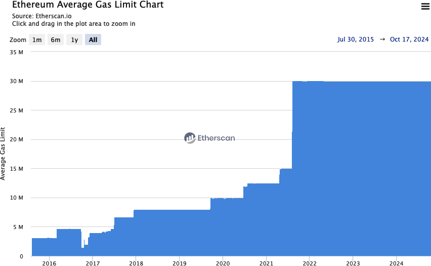

**図6-1** ブロックガスリミットの推移

　ベースフィーはブロックを作成するバリデーター（またはマイナー）には渡されず、直ちにバーン（焼却）され、ETHの総供給量が減少します。新たに*プライオリティフィー*（優先手数料）が導入されました。プライオリティフィーは、バリデーター（またはマイナー）がトランザクションを次のブロックに含めるよう動機付けるためのチップと考えることができます。

> **ヒント**
>
> 理論上は、必須であるベースフィーのみを支払い、プライオリティフィーをゼロにしたトランザクションを作成することもできる。プロトコルはバリデーターへのチップの支払いを義務付けていない。しかし実際には、妥当な時間内にトランザクションが承認されるよう、常にプライオリティフィーを含めるべきである。なお、通常ウォレットはベースフィーとプライオリティフィーを自動的に処理し、適切な値に設定する。

　EIP-1559トランザクションは、以下のデータを含むシリアライズされたバイナリメッセージです。

**チェーンID**

レガシートランザクションと同じ

**ナンス**

レガシートランザクションと同じ

**ガス当たりの最大プライオリティフィー**

トランザクションをブロックに含めるためのチップとして、発行者がバリデーターに直接支払ってもよいと考えるガスの価格（単位はwei）

**ガス当たりの最大フィー**

ベースフィーとプライオリティフィーを含む、発行者が合計で支払ってもよいと考えるガスの価格（単位はwei）

**ガスリミット**

レガシートランザクションと同じ

**受信者**

レガシートランザクションと同じ

**アクセスリスト**

EIP-2930トランザクションと同じ

**バリュー**

レガシートランザクションと同じ

**データ**

レガシートランザクションと同じ

**v、r、s**

レガシートランザクションと同じ

　すべてのトランザクションタイプと同様に、メッセージ構造はRLPエンコーディングスキームを使用してシリアライズされます。

### EIP-4844トランザクション

　[EIP-4844](https://oreil.ly/JMJmB)トランザクションは、2024年3月13日のCancunハードフォークで導入され、トランザクションタイプは`0x03`です。4章の「KZGコミットメント」のセクションですでに触れており、16章でさらに詳しく説明します。このトランザクションは*blobキャリングトランザクション*とも呼ばれます。サイドカーとして*blob*を伴い、EVMからはアクセスできないものの、コミットメントにはアクセス可能な大量のデータ（各約131,000バイト）が含まれるためです。

　blobには*blobガス*という新しい種類のガスが使用されます。blobガスは通常のガスとは完全に分離され独立しています。EIP-1559に強く触発されたものですが、独自のターゲットルールに従います。使用されたblobガスがターゲットblobガス使用量を上回ればblobガス価格は増加し、下回れば減少するという仕組みです。

　シリアライズされたバイナリメッセージはEIP-1559と同じ形式を共有しますが、2つの新しいフィールドが追加されています。

**blobガス当たりの最大フィー**

blobに対して発行者が支払ってもよいと考えるblobガスの価格（単位はwei）

**blobバージョン付きハッシュ**

blobに関連する各KZGコミットメントのバージョン付きハッシュを表す32バイト値のリスト

> **注記**
>
> CancunハードフォークとEIP-4844トランザクションの導入に伴い、ブロックヘッダーに2つの新しい要素が追加された。
>
> **blobガス使用量**
>
> ブロック内のすべてのEIP-4844トランザクションが使用したblobガスの合計量
>
> **超過blobガス**
>
> 当該ブロック以前に、ターゲットを超えて消費されたblobガスの累計

### EIP-7702トランザクション

　[EIP-7702](https://oreil.ly/W_28X)トランザクションは、2025年5月7日のPectraハードフォークで導入され、トランザクションタイプは`0x04`です。EOAが自身のアカウントにコードを設定できるようにするものです。従来、EOAのコードは空であり、トランザクションを開始することはできても、スマートコントラクトとやり取りしない限り複雑な操作を実行することはできませんでした。EIP-7702はこの状況を変え、EOAが以下のような操作を行えるようにします。

**バッチ処理**

同一ユーザーからの複数の操作を1つのアトミックなトランザクションにまとめられる。たとえば、ERC-20の承認とその承認の使用を一度に行う操作は、多くの分散型取引所で非常に一般的なワークフローである

**スポンサーシップ**

アカウントXがアカウントYに代わってトランザクションの手数料を支払う

**権限の縮小委譲**

ユーザーがサブキーに署名し、アカウントへのグローバルアクセスよりもはるかに弱い特定の権限を付与できる。たとえば、1日の残高の最大1%までの支出権限や、特定のアプリケーションとのみやり取りする権限などである

　内部実装の詳細はかなり複雑であり、興味がある場合は[EIPの公式ウェブサイト](https://oreil.ly/W_28X)を読むことを推奨します。ただし、概要はシンプルでありながら非常に強力です。EIP-7702により、EOAは自身に*デリゲーションデジグネーター*（委譲指定子）を割り当てることができます。デリゲーションデジグネーターはスマートコントラクト（イーサリアムメインネット上に存在するもの）を指し、EOAにトランザクションが送信されると、図6-2に示すように、指定されたアドレスのコードがEOA自身のコードであるかのように実行されます。

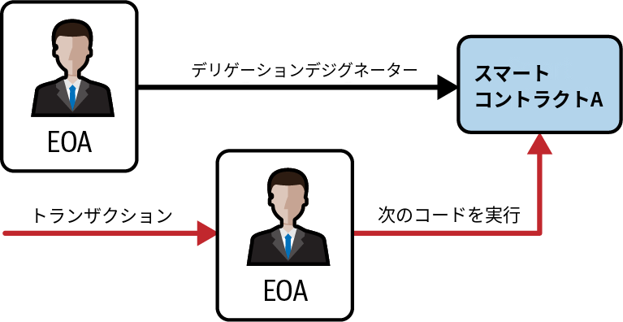

**図6-2** EIP-7702のデリゲーションメカニズム

## トランザクションナンス

　*ナンス*は、トランザクションにおいて最も重要で、最も理解されていない要素の1つです。イーサリアムの「イエローペーパー」での定義は次のとおりです。

> ナンス：アドレスから送信されたトランザクションの数に等しいスカラー値。または、コードを持つアカウントの場合は、そのアカウントがコントラクトを作成した回数。

　厳密に言えば、ナンスは送信元アドレスの属性です。つまり、送信元アドレスの文脈でのみ意味があります。しかし、ナンスはブロックチェーンのアカウントの状態の一部として明示的に保存されていません。アドレスから発信された承認済みトランザクションの数をカウントすることによって、動的に計算されます。

> **翻訳者注釈**
>
> 原著では「明示的に保存されていない」「動的に計算される」と記述されているが、これは不正確である。実際にはナンスはアカウントステートの一部としてワールドステートトライに保存されている。go-ethereumの実装では`StateAccount`構造体に`Nonce`フィールドが含まれており（[core/types/state_account.go](https://github.com/ethereum/go-ethereum/blob/master/core/types/state_account.go)）、`eth_getTransactionCount`もステートから直接読み取る。

　トランザクションをカウントするナンスの存在が重要となるシナリオが2つあります。トランザクションが作成順に含まれるという利便性の機能と、トランザクションの重複保護という重要な機能です。それぞれのシナリオの例を見てみましょう。

**シナリオ1**

　2つのトランザクションを作るとしましょう。6 etherの重要な支払いと、8 etherの支払いです。6 etherのトランザクションのほうが重要なので、最初に署名してブロードキャストし、次に8 etherのトランザクションに署名してブロードキャストします。残念なことに、アカウントには10 etherしかないので、ネットワークは両方のトランザクションを受け入れることができず、片方は失敗します。より重要な6 etherのトランザクションを最初に送ったので、そちらが通過し、8 etherのトランザクションが拒否されると思うかもしれません。しかし、イーサリアムのような分散システムでは、ノードがどちらの順序でトランザクションを受け取るかは決まっていません。特定のノードに一方のトランザクションがもう一方より先に届くという保証はないのです。そのため、一部のノードが先に6 etherのトランザクションを受信し、他のノードが先に8 etherのトランザクションを受信するケースがほぼ確実に起こります。ナンスがなければ、どちらが受け入れられ、どちらが拒否されるかはランダムです。しかしナンスが含まれていれば、最初に送ったトランザクションはたとえば3のナンスを持ち、8 etherのトランザクションは次のナンス値（つまり4）を持つことになります。したがって、8 etherのトランザクションが最初に受け取られたとしても、ナンス0から3までのトランザクションが処理されるまでは無視されます。

**シナリオ2**

　100 etherのアカウントを持っているとします。本当に購入したい商品があり、その支払いをイーサで受け付けてくれる人をオンライン上で見つけました。2 etherを送り、相手は商品を送ってくれます。その2 etherの支払いのために、自分のアカウントから相手のアカウントへ2 etherを送信するトランザクションに署名し、イーサリアムネットワークにブロードキャストして検証とブロックチェーンへの取り込みを待ちます。ここで、トランザクションにナンス値がなければ、同じアドレスに2 etherを再度送信した場合、そのトランザクションは最初のものとまったく同じに見えます。つまり、イーサリアムネットワーク上のトランザクションを見ている人は誰でも（受信者や悪意のある者を含むすべての人が）、元のトランザクションをコピーしてネットワークに再送信することで、すべてのイーサがなくなるまで何度でもトランザクションを「リプレイ」できてしまいます。しかし、トランザクションにナンス値があれば、同一の受信者アドレスに同じ量のイーサを複数回送信する場合であっても、毎回のトランザクションは一意になります。したがって、インクリメントされるナンスがトランザクションの一部として含まれることで、支払いの「複製」は不可能になります。

　要約すると、ビットコインプロトコルの*UTXO（Unspent Transaction Output）*メカニズムとは対照的に、ナンスの使用はアカウントベースのプロトコルにとってまさに必要不可欠であることを強調しておきます。

### ナンスの追跡

　このセクション以降では、Foundryスイート、特に`cast`ツールを使用します。`cast`はブロックチェーンとの対話を非常に簡単にしてくれるツールです。以降の例を再現したい場合は、事前にインストールしておいてください。

　まず、この章を通じて使用するウォレットをセットアップする必要があります。ターミナルウィンドウを開き、次のように入力します。

```bash
$ cast wallet new
Successfully created new keypair.
Address:     0x7e41354AfE84800680ceB104c5Fc99eCB98A25f0
Private key: 0xd6d2672c6b4489e6bcd4e93b9af620fa0204b639b7d7f93765479c0846be0b58
```

> **警告**
>
> ここに記載されているアドレスに資金を送信すると、秘密鍵が公開されているため、誰でもその資金を自分自身に送金できてしまい、資金を失うことになる。

　次に、秘密鍵をコンピュータのキーストアにインポートして、後から簡単に利用できるようにします。

```bash
$ cast wallet import example \
    --private-key 0xd6d2672c6b4489e6bcd4e93b9af620fa0204b639b7d7f93765479c0846be0b58
Enter password:
`example` keystore was saved successfully. Address: 0x7e41354afe84800680ceb104c5fc99ecb98a25f0
```

　任意でパスワードを設定することもできます（推奨）。パスワードは、そのアカウントでトランザクションを作成する際に要求されます。これでセットアップは完了ですが、まだETHを保有していません。

　残高はいつでも確認できます。まず、アカウントに関連付けられたアドレスを取得します。

```bash
$ cast wallet address --account example
Enter keystore password:
0x7e41354AfE84800680ceB104c5Fc99eCB98A25f0
```

　次に、ブロックチェーンに残高を問い合わせます。この章のすべての例では、テストネットブロックチェーンであるEthereum Sepoliaを使用します。

```bash
$ cast balance 0x7e41354AfE84800680ceB104c5Fc99eCB98A25f0 --rpc-url https://ethereum-sepolia-rpc.publicnode.com
0
```

> **注記**
>
> 最後の`cast`コマンドにある`--rpc-url`フラグに注目してほしい。対象のブロックチェーンのRPCエンドポイントを指定する必要がある。信頼性の高いRPCエンドポイントは有料の場合が多いが、実験するだけであれば（この章で行うように）、以下のような無料の選択肢が多数ある。
>
> - [Public Node](https://www.publicnode.com)
> - [LlamaNodes](https://llamarpc.com/eth)
> - [ChainList](https://chainlist.org)

　無料のSepolia ETHトークンを入手するには、オンラインのフォーセットを利用できます。ここでは、図6-3に示すGoogle Cloud Web3フォーセットを使用します。0.05 ETHが提供されます。[Ethereum Sepolia Faucet](https://cloud.google.com/application/web3/faucet/ethereum/sepolia)にアクセスし、アドレスを貼り付けて「Receive 0.05 Sepolia ETH」ボタンをクリックしてください。すぐに0.05 ETHを受け取れるはずです。

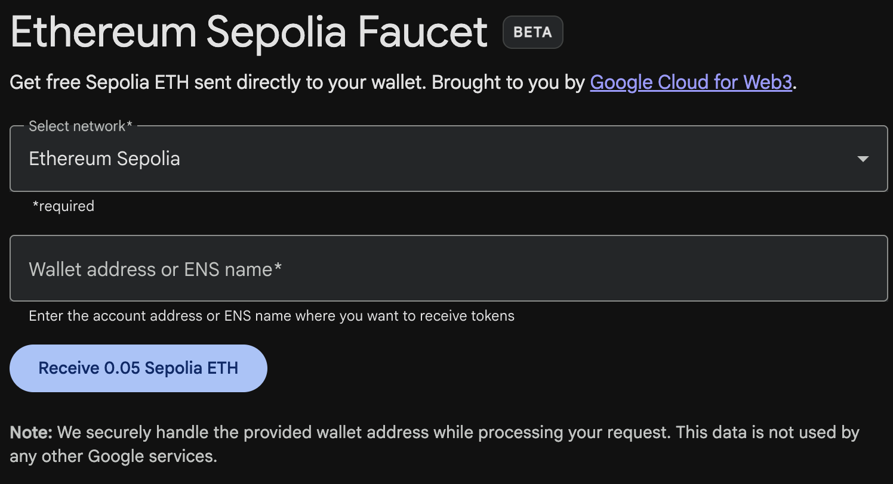

**図6-3** Google Cloud Web3フォーセット

　残高が変更され、0ではなくなっていることを確認できます。

```bash
$ cast balance 0x7e41354AfE84800680ceB104c5Fc99eCB98A25f0 --rpc-url https://ethereum-sepolia-rpc.publicnode.com
50000000000000000
```

　これでセットアップは完了です。トランザクションナンスの実験に戻りましょう。

　実際には、ナンスはアカウントから発信された承認済み（つまりオンチェーン）トランザクションの最新のカウント数です。ナンスの値を確認するには、`cast`を使用してブロックチェーンに問い合わせます。新しいターミナルウィンドウを開き、次のように入力します。

```bash
$ cast nonce 0x7e41354AfE84800680ceB104c5Fc99eCB98A25f0 --rpc-url https://ethereum-sepolia-rpc.publicnode.com
0
```

> **ヒント**
>
> ナンスはゼロベースのカウンタであり、最初のトランザクションはナンス0を持つ。実際、この例ではまだトランザクションを送信していない。また、RPCのレスポンスは常に次に利用可能なナンスを返す。たとえば、あるアドレスがすでに10件のトランザクションを送信し、ナンス0から9を使用している場合、ナンスクエリに対するRPCレスポンスは10となる。

　ETHを送信してみましょう。イーサリアムの共同創設者であるヴィタリック・ブテリンのENSアドレスである`vitalik.eth`に0.001 etherを送信します。

```bash
$ cast send --account example vitalik.eth --value 0.001ether --rpc-url https://ethereum-sepolia-rpc.publicnode.com
blockHash               0xa1171309fd406e44e86be9695a597d2bf5c728738d140b9958cfb50276c32b1b
blockNumber             6989355
contractAddress
cumulativeGasUsed       18009816
effectiveGasPrice       11163498011
from                    0x7e41354AfE84800680ceB104c5Fc99eCB98A25f0
gasUsed                 21000
logs                    []
logsBloom               0x00000000000000000000000000000000000000000000000000000000000000000000000000000000000000000000000000000000000000000000000000000000000000000000000000000000000000000000000000000000000000000000000000000000000000000000000000000000000000000000000000000000000000000000000000000000000000000000000000000000000000000000000000000000000000000000000000000000000000000000000000000000000000000000000000000000000000000000000000000000000000000000000000000000000000000000000000000000000000000000000000000000000000000000000000000000
root
status                  1 (success)
transactionHash         0xeb7bb0322858a4e1ed85271a60d2f8353075dc0bcd0c80448ee1d5ca0bb85def
transactionIndex        60
type                    2
blobGasPrice
blobGasUsed
authorizationList
to                      0xd8dA6BF26964aF9D7eEd9e03E53415D37aA96045
```

　ウォレットは管理している各アドレスのナンスを追跡します。1つのアドレスからのみトランザクションを生成しているのであれば、追跡はとても簡単です。自分のウォレットソフトウェアやトランザクションを生成するアプリケーションを書いているとしましょう。ナンスをどのように追跡すればよいでしょうか。

　新しいトランザクションを作成するときに、シーケンス内の次のナンスを割り当てます。しかし、トランザクションが承認されるまで、ナンスの合計にはカウントされません。以下のコマンドを素早く連続して送信する例を見てみましょう。

```bash
$ cast nonce 0x7e41354AfE84800680ceB104c5Fc99eCB98A25f0 --rpc-url https://ethereum-sepolia-rpc.publicnode.com
10
$ cast send --account example vitalik.eth --value 0.001ether --async --rpc-url https://ethereum-sepolia-rpc.publicnode.com
0x85f5b0db44407a6e9252590dc809087a2e232e00a951c9cb8853a109da5ddad4
$ cast nonce 0x7e41354AfE84800680ceB104c5Fc99eCB98A25f0 --rpc-url https://ethereum-sepolia-rpc.publicnode.com
10
$ cast nonce 0x7e41354AfE84800680ceB104c5Fc99eCB98A25f0 --rpc-url https://ethereum-sepolia-rpc.publicnode.com
11
```

　このとおり、送信したトランザクションはナンスカウントを直ちに増加させませんでした。トランザクション送信後もナンスは10のままです。ネットワーク通信が落ち着き、トランザクションがブロックに含まれるまで数秒待つと、ナンスの呼び出しは期待どおりの数値11を返します。

> **注記**
>
> `cast send`コマンドで使用されている`--async`フラグに注目してほしい。このフラグを使用しない場合、`cast`はトランザクションがブロック内で承認されるまでターミナルをブロックする。このフラグを使用すると、トランザクションをネットワークに送信して直ちにトランザクションハッシュを返し、ブロックへの取り込みを待たない。

　次に、別の例を見てみましょう。

```bash
$ cast nonce 0x7e41354AfE84800680ceB104c5Fc99eCB98A25f0 --rpc-url https://ethereum-sepolia-rpc.publicnode.com
11
$ cast send --account example vitalik.eth --value 0.001ether --async --rpc-url https://ethereum-sepolia-rpc.publicnode.com
0x63188aa73247ffe06388a9adf399fa715e42fbc37ca53f77642a7860c80feb9d
$ cast nonce 0x7e41354AfE84800680ceB104c5Fc99eCB98A25f0 --rpc-url https://ethereum-sepolia-rpc.publicnode.com
11
$ cast rpc eth_getTransactionCount 0x7e41354AfE84800680ceB104c5Fc99eCB98A25f0 pending --rpc-url https://ethereum-sepolia-rpc.publicnode.com
"0xc"
$ cast nonce 0x7e41354AfE84800680ceB104c5Fc99eCB98A25f0 --rpc-url https://ethereum-sepolia-rpc.publicnode.com
12
```

　トランザクション送信前のナンスカウントは11です。トランザクションを送信し、直ちに新しいナンスを問い合わせます。前の例から予想されるとおり、トランザクションはまだメムプール内で保留中でブロックに含まれていないため、ナンスはまだ更新されていません。しかし、トランザクションがまだ承認されていなくても実際のナンス値を取得できる新しいクエリを使用しています（`0xc`は16進数で12です）。数秒後にトランザクションがブロックに追加されると、`cast nonce`の呼び出しは新しい正しい値を返します。

　`cast nonce`と`eth_getTransactionCount pending`の違いは、前者が承認済み（ブロックに含まれた）トランザクションのみを考慮するのに対し、後者はメムプール内でまだ保留中のトランザクションも含めようとする点です。

> **警告**
>
> 保留中のトランザクションをカウントするために`eth_getTransactionCount pending`を使用する場合は注意が必要である。このクエリはあるアドレスの実際のナンス値を返そうとするが、メムプール内で承認待ちの他の保留中トランザクションが存在しないことを完全に保証する方法はない。
>
> パブリックなメムプールは普遍的なものではない。各ノードは独自のメムプールを持っている。メムプールとは保留中のトランザクションを一時的に保持する動的なリポジトリであり、ブロックチェーンで承認されるまでトランザクションを保管する。新しいトランザクションの受け入れや拒否に関するルールをカスタマイズすることも可能である。RPCプロバイダーは大規模なノードネットワークを持ち、すべての保留中トランザクションの（ほぼ）完全なビューを持っているはずだが、その値を100%正確なものとして扱うことには慎重であるべきである。

### ナンスの欠落、複製したナンスと承認

　トランザクションをプログラムで作成している場合、特に複数の独立したプロセスから同時に実行している場合、ナンスを把握することが重要です。

　イーサリアムネットワークは、ナンスに基づいてトランザクションを順次処理します。ナンス0のトランザクションを送信してから、ナンス2のトランザクションを送信すると、2番目のトランザクションはどのブロックにも含まれません。2番目のトランザクションはメムプールに保存され、イーサリアムネットワークは欠落したナンスを持つトランザクションが現れるのを待ちます。すべてのノードは、欠落したナンスが単に遅延しており、ナンス2のトランザクションが順序どおりに受信されなかっただけだと想定します。

　欠落しているナンス1を含むトランザクションを送信すると、両方のトランザクション（ナンス1とナンス2）が処理されブロックに含まれます（もちろん両方が有効である場合）。欠落を埋めると、ネットワークはメムプールで保持していた順序外のトランザクションをマイニングすることができます。

　つまり、複数のトランザクションを順番に作成し、そのうちの1つが正式にどのブロックにも含まれなかった場合、以降のトランザクションはすべて「スタック」し、欠落しているナンスを持つトランザクションを待つことになります。トランザクションが無効であったりガスが不足していたりすると、ナンスシーケンスに意図しない「欠落」が発生する可能性があります。再び動かすには、欠落しているナンスを持つ有効なトランザクションを送信する必要があります。「欠落した」ナンスを持つトランザクションがネットワークによって検証されると、以降のナンスを含むすべてのブロードキャスト済みトランザクションが順次有効になることにも留意してください。トランザクションを「リコール（呼び戻し）」することはできません。

　一方で、同じナンスで受信者や値が異なる2つのトランザクションを送信するなど、誤ってナンスを重複させた場合、1つが承認され、もう1つが拒否されます。どちらが承認されるかは、トランザクションを受け取った最初の検証ノードに到着する順番によって決まります。つまり、かなりランダムです。

　ここまで見てきたように、ナンスの追跡は不可欠です。アプリケーションがナンスのプロセスを正しく管理しなければ、問題が発生します。残念ながら、並行処理を行おうとすると事態はさらに困難になります。次のセクションで詳しく見ていきましょう。

### 並行処理、トランザクションの生成とナンス

　*並行処理*はコンピュータサイエンスにおける難問であり、特にイーサリアムのような分散型のリアルタイムシステムでは、時に予期せぬ問題が生じます。

　簡単に言うと、並行処理とは複数の独立したシステムで同時に演算を行うことです。同じプログラム（たとえばマルチスレッド）、同じCPU（たとえばマルチプロセッシング）、または異なるコンピュータ（たとえば分散システム）上で実行できます。イーサリアムは定義上、操作（ノード、クライアント、DApp）の並行性を許容しつつ、コンセンサスを通じてシングルトン状態を強制するシステムです。

　ここで、同じアドレスまたは複数のアドレスからトランザクションを生成している、複数の独立したウォレットアプリケーションがあるとします。このような状況の一例は、取引所が*ホットウォレット*（鍵がオンラインで保管されているウォレット。鍵がオンラインにならない*コールドウォレット*とは対照的）から引き出しを処理する場合です。理想的には、ボトルネックや単一障害点にならないよう複数のコンピュータで引き出しを処理すべきです。しかし、複数のコンピュータから引き出しを行うと、厄介な並行処理の問題が急速に顕在化します。特にナンスの選択が重大な問題です。同じホットウォレットアカウントから、複数のコンピュータでトランザクションの生成、署名、ブロードキャストをどう調整すればよいのでしょうか。

　1台のコンピュータを使用して、先着順にトランザクションに署名するコンピュータにナンスを割り当てるやり方が考えられます。しかし、このコンピュータ自体が単一障害点になります。さらに悪いことに、複数のナンスが割り当てられ、そのうち1つが使用されなかった場合（そのナンスでトランザクションを処理するコンピュータの障害のため）、以降のすべてのトランザクションがスタックします。

　もう1つのアプローチは、トランザクションを生成するがナンスを割り当てないことです（したがってトランザクションは未署名のままとなります。ナンスはトランザクションデータの不可欠な部分であり、トランザクションを認証するデジタル署名に含める必要があることを思い出してください）。その後、署名を行いナンスを追跡する単一ノードにキューイングします。しかし、このアプローチもプロセス上のボトルネックになります。署名とナンスの追跡は、負荷がかかると混雑する可能性が高い操作であり、一方で未署名トランザクションの生成は並列化の必要性が低い部分です。いくらかの並行処理は実現できますが、プロセスの重要な部分で不十分なままです。

　結局、これらの並行処理の問題と、独立したプロセスでアカウント残高やトランザクションの承認を追跡することの困難さが重なり、ほとんどの実装では並行処理を避けてボトルネックを作ることを余儀なくされます。たとえば、取引所のすべての引き出し処理を単一プロセスで実行するか、引き出しに対して完全に独立して機能し、断続的にリバランスするだけでよい複数のホットウォレットを設定するといった対応です。

## トランザクションガス

　ガスについては前の章で少し説明しましたが、14章でより詳細に取り上げます。ここでは、トランザクションの`gasPrice`と`gasLimit`の役割に関する基本事項を説明します。

　ガスはイーサリアムの燃料です。ガスはイーサではありません。イーサに対する独自の為替レートを持つ、別の仮想通貨です。イーサリアムは、世界中の何千ものコンピュータで処理されるトランザクションが使用できるリソース量を制御するためにガスを使用します。オープンエンド（チューリング完全）な計算モデルでは、DoS攻撃や不用意にリソースを浪費するトランザクションを回避するために、なんらかの計測方式が必要です。

　ガスがイーサから分離されているのは、イーサの価値の急激な変動からシステムを保護するためであり、また計算、メモリ、ストレージといった重要資源のコスト比率を管理するためです。

　トランザクションの`gasPrice`フィールドでは、トランザクション発行者がガスと引き換えに支払う価格を設定できます。価格はガス単位あたりのweiで測定されます。

> **ヒント**
>
> 人気サイトの[Etherscan](https://oreil.ly/ZIqcq)では、イーサリアムメインネットワークのガス価格や、その他の関連するガス指標に関する情報を提供しています。

　ウォレットは、トランザクションの承認を迅速化するために、発行したトランザクションの`gasPrice`を調整できます。`gasPrice`が高いほど、トランザクションはより早く承認される可能性が高くなります。逆に、優先順位の低いトランザクションは価格を下げることで、承認が遅くなります。`gasPrice`に設定できる最小値は、トランザクションが含まれるブロックのベースフィー（EIP-1559トランザクションで導入された概念）と等しくなります。

> **注記**
>
> Londonハードフォーク以前およびEIP-1559以前は、許容される`gasPrice`の最小値はゼロであった。つまり、ウォレットは完全に無料のトランザクションを生成できた。容量によっては承認されない場合もあったが、プロトコルに無料トランザクションを禁止する仕組みはなかった。イーサリアムの初期数カ月間に、ブロックチェーンに正常に含まれた無料トランザクションの例がいくつか確認できる。

### EIP-1559：ベースフィーとプライオリティフィー

　すでに簡単に説明したとおり、EIP-1559はプロトコルの新しいパラメータであるベースフィーを導入することで、イーサリアムの手数料市場の構造を根本的に変更しました。ベースフィーは、トランザクションが有効と見なされブロックに含まれるために支払う必要のある最小ガス価格を表します。

　ベースフィーとトランザクションが実際に支払うガス手数料との差額は、*プライオリティフィー*と呼ばれます。プライオリティフィーは、トランザクションを含むブロックを作成したバリデーターに直接渡されます。

### 適切なガス価格の調べ方

　Castは、複数のブロックにわたるガス価格の中央値を計算することで、ガス価格を提案します。

```bash
$ cast gas-price --rpc-url https://ethereum-sepolia-rpc.publicnode.com
4845187414
```

　ガスに関連する2番目の重要なフィールドは`gasLimit`です。簡単に言えば、`gasLimit`はトランザクション発行者がトランザクションを完了するために購入する意思のあるガスの最大単位数を示します。単純な支払い、つまりあるEOA（外部所有アカウント）から別のEOAにイーサを送金するトランザクションでは、必要なガス量は21,000ガス単位に固定されています。イーサでの手数料を計算するには、21,000に支払う意思のある`gasPrice`（EIP-1559トランザクションの場合は`maxFeePerGas`）を掛けます。

　トランザクションの宛先アドレスがコントラクトである場合、必要なガスの量を見積もることはできますが、正確に決定することはできません。コントラクトは異なる実行パスにつながる異なる条件を評価でき、実行パスによって総ガスコストが異なるためです。制御できず予測もできない条件に応じて、コントラクトは単純な計算だけを行うかもしれませんし、より複雑な計算を実行するかもしれません。例を見てみましょう。呼び出されるたびにカウンタを増やし、呼び出し回数に等しい回数だけ特定のループを実行するスマートコントラクトを書いたとします。100回目の呼び出しで宝くじのような特別な賞を出すとすると、賞を計算するために追加の計算が必要です。コントラクトを99回呼び出すまでは単一の処理が行われますが、100回目の呼び出しではまったく異なる処理が発生します。そのために支払うガスの量は、トランザクションがブロックに含まれる前に他のいくつのトランザクションがその関数を呼び出したかに依存します。見積もりとしては99回目のトランザクションに基づいていたとしても、トランザクションが承認される直前に他の誰かが99回目にコントラクトを呼び出したとします。すると、あなたのトランザクションは100回目の呼び出しとなり、計算量（およびガスコスト）は想定よりもずっと高くなります。

　イーサリアムでよく使われるたとえですが、`gasLimit`は車（トランザクション）の燃料タンクの容量と見立てることができます。旅に必要となる量のガソリン（トランザクションを検証するために必要な計算）をタンクに入れます。金額はある程度見積もることができますが、燃料消費を増加させる迂回（より複雑な実行パス）のような予期しない変更が発生する可能性があります。

　しかし、この燃料タンクのたとえはやや誤解を招きます。実際には、旅行から帰ったあとに使用したガスの量に応じて支払う、ガソリンスタンド会社のクレジットアカウントのようなものです。トランザクションを送信する際、最初の検証ステップの1つとして、発行元アカウントに`maxFeePerGas × gasLimit`（レガシートランザクションの場合は`gasPrice × gasLimit`）を支払うのに十分なイーサがあることを確認します。しかし、トランザクションの実行が完了するまで、実際にはアカウントから金額が差し引かれることはありません。トランザクションで実際に消費されたガスについてのみ請求されますが、トランザクションを送信する前に、支払い可能な最大額に応じた十分な残高を持っていなければなりません。

## トランザクション受信者

　トランザクションの受信者は`to`フィールドで指定されます。このフィールドには20バイトのイーサリアムアドレスが格納されます。アドレスはEOA（外部所有アカウント）またはコントラクトのアドレスにすることができます。

　イーサリアムは`to`フィールドに対してこれ以上の検証を行いません。20バイトの値はすべて有効と見なされます。対応する秘密鍵のないアドレスや、対応するコントラクトがないアドレスであっても、トランザクションは有効です。アドレスが存在する公開鍵から（したがって秘密鍵から）正しく導出されたかどうかを、イーサリアムは知る方法がありません。

> **警告**
>
> イーサリアムプロトコルは、トランザクション内の受信者アドレスを検証しない。対応する秘密鍵やコントラクトが存在しないアドレスに送信すると、イーサは「バーン（焼却）」され、永遠に使用できなくなる。検証はユーザーインターフェイスレベルで行う必要がある。

　トランザクションを誤ったアドレスに送信した場合、送信されたイーサは焼却され、永遠にアクセスできなく（使用不可に）なります。ほとんどのアドレスは既知の秘密鍵を持っていないため、署名を生成して使用することができないためです。アドレスの検証はユーザーインターフェイスレベルで行われるものと想定されています（「大文字を使用するチェックサム付き16進数エンコーディング（ERC-55）」を参照）。実際にイーサを焼却する正当な理由はいくつかあります。たとえば、ペイメントチャネルや他のスマートコントラクトでの不正行為に対する抑止策として使われます。イーサの量は有限であるため、イーサを焼却することで、焼却された分の価値がすべてのイーサ保有者に（保有するイーサの量に比例して）効果的に分配されます。

## トランザクションのバリューとデータ

　トランザクションの主な「ペイロード」は`value`と`data`という2つのフィールドに格納されています。トランザクションはバリューとデータの両方、バリューのみ、データのみ、またはバリューとデータの両方を持たないこともできます。この4つの組み合わせはすべて有効です。

　バリューのみのトランザクションは支払いです。データのみのトランザクションは呼び出しです。バリューとデータの両方を持つトランザクションは、支払いと呼び出しの両方です。バリューもデータもないトランザクションは、おそらくガスの無駄でしかありませんが、それでも可能です。

　これらの組み合わせをすべて試してみましょう。以前と同様に`cast`を使用して、Sepoliaテストネットでトランザクションを送信します。

　最初のトランザクションにはバリュー（支払い）のみが含まれ、データペイロードはありません。

```bash
$ cast send --account example vitalik.eth --value 0.001ether --rpc-url https://ethereum-sepolia-rpc.publicnode.com
```

　図6-4に示すように、送信されたバリューは0.001 etherであり、データペイロード（Etherscan上のinput data）は空（`0x00`）です。

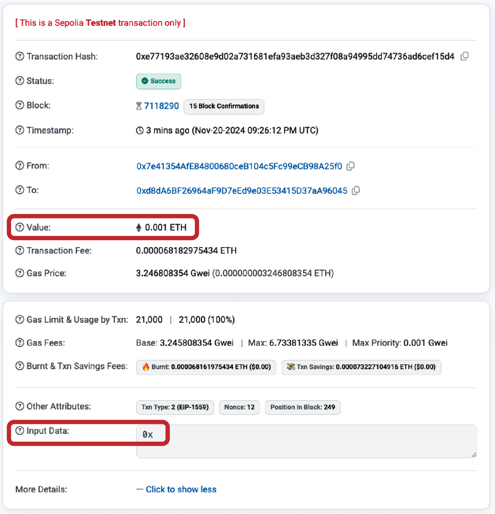

**図6-4.** バリューのみのトランザクション（支払い）

　次の例では、バリューとデータペイロードの両方を指定しています（EOA宛に送信するため、このペイロードは無視されます）。

```bash
$ cast send --account example vitalik.eth 0x0001 --value 0.001ether --rpc-url https://ethereum-sepolia-rpc.publicnode.com
```

　図6-5に示すように、input dataには値が含まれており、具体的には`0x0001`です。

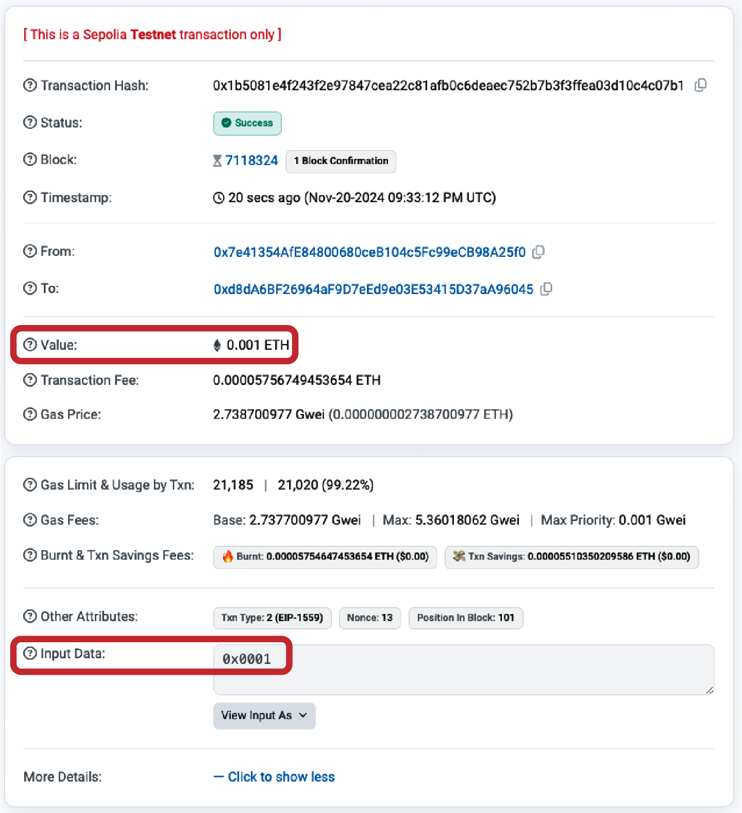

**図6-5.** バリューとデータの両方を含むトランザクション

　次のトランザクションにはデータペイロードが含まれますが、バリューはゼロを指定しています。

```bash
$ cast send --account example vitalik.eth 0x0001 --rpc-url https://ethereum-sepolia-rpc.publicnode.com
```

　図6-6に示す確認画面では、トランザクションで送信されたバリューは0 etherで、データペイロードは`0x0001`です。

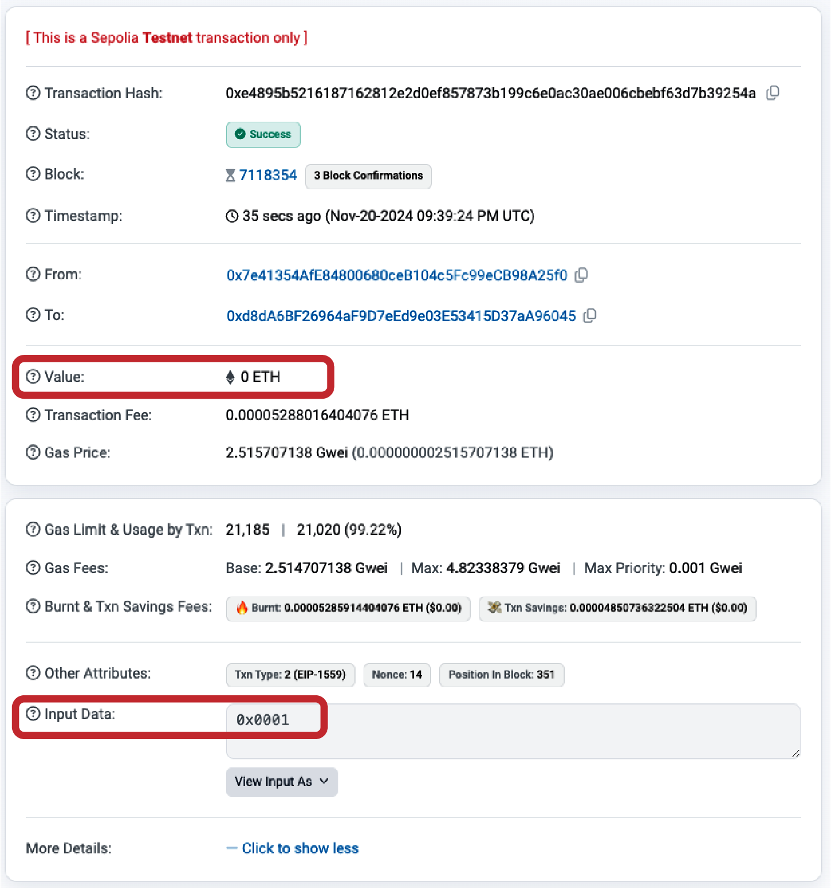

**図6-6.** データのみのトランザクション（呼び出し）

　最後のトランザクションは、送信するバリューもデータペイロードも含んでいません。

```bash
$ cast send --account example vitalik.eth --rpc-url https://ethereum-sepolia-rpc.publicnode.com
```

　図6-7に示すトランザクションは、0 etherを送信し、空のペイロードを含んでいます。

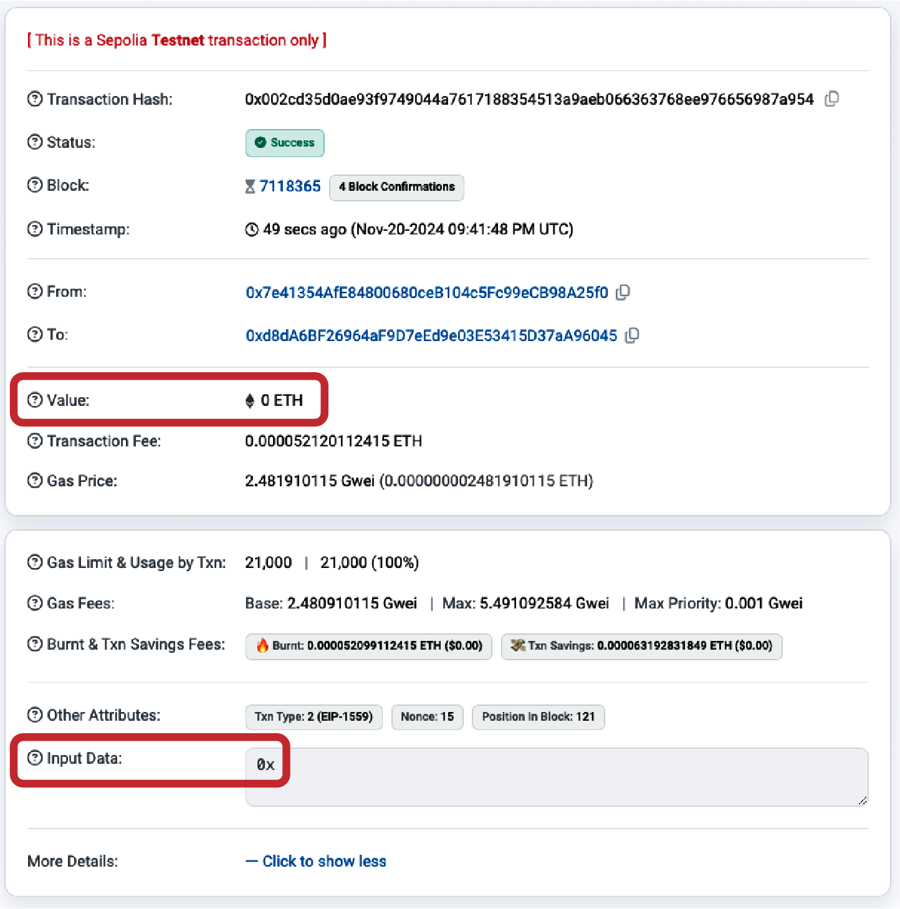

**図6-7.** バリューもデータもないトランザクション

## EOAとコントラクトへのバリューの送信

　バリューを含むイーサリアムトランザクションを構築した場合、それは支払いに相当します。宛先アドレスがコントラクトであるかどうかによって、トランザクションの動作は異なります。

　EOA（外部所有アカウント）アドレス、つまりブロックチェーン上でコントラクトとしてフラグが立てられていないアドレスの場合、イーサリアムは状態の変更を記録し、送信されたバリューをアドレスの残高に追加します。以前に確認されていないアドレスの場合は、クライアントの状態の内部表現に追加され、残高は支払い額で初期化されます。

　宛先アドレス（`to`）がコントラクト（またはEIP-7702トランザクションを通じてコントラクトを委任済みのEOA）の場合、EVMはコントラクトを実行し、トランザクションのデータペイロードに指定された関数の呼び出しを試みます。トランザクションにデータがない場合、EVMは*フォールバック関数*を呼び出し、その関数がpayable（支払い可能）であれば、フォールバック関数を実行して次の処理を決定します。フォールバック関数がない場合、トランザクションの効果はウォレットへの支払いとまったく同様に、コントラクトの残高を増加させることになります。

　コントラクトは、関数が呼び出された時点で、または関数にコーディングされた条件に基づいて、即座に例外をスローすることで入金を拒否できます。関数が正常に（例外なく）終了すると、コントラクトの状態はコントラクトのイーサ残高の増加を反映するように更新されます。

## EOAやコントラクトへのデータペイロードの送信

　トランザクションにデータが含まれている場合、そのほとんどはコントラクトアドレス宛です。ただし、EOAにデータペイロードを送信することもイーサリアムプロトコルでは問題ありません。その場合、データの解釈はEOAにアクセスするために使用するウォレット次第です。イーサリアムプロトコルではデータは無視されます。また、ほとんどのウォレットは、自分が管理するEOAへのトランザクションで受信したデータを無視します。将来的には、ウォレットがコントラクトのようにデータを解釈できるようにする標準規約が生まれるかもしれません。そうなれば、トランザクションがユーザーのウォレット内で実行されている機能を呼び出せるようになります。重要な違いは、EOAによるデータペイロードの解釈は、コントラクトの実行とは異なり、イーサリアムのコンセンサスルールの対象にならないことです。

　ここでは、トランザクションがコントラクトアドレスにデータを送信していると仮定します。その場合、データはEVM（イーサリアム仮想マシン）によってコントラクトの呼び出しとして解釈されます。ほとんどのコントラクトは、このデータをより具体的に関数の呼び出しとして使用し、名前付き関数を呼び出してエンコードされた引数を渡します。

　*アプリケーションバイナリインターフェイス（ABI）*に準拠したコントラクト（すべてのコントラクトがそうであると想定できます）に送信されるデータペイロードは、以下の16進シリアライズエンコーディングです。

**関数セレクタ**

関数のプロトタイプのKeccak-256ハッシュの最初の4バイト。これにより、コントラクトはどの関数を呼び出したいのかを明確に識別できる。

**関数の引数**

ABI仕様で定義されたさまざまな基本型の規則に従ってエンコードされた関数の引数。

　例2-1では、引き出しのための関数を定義しました。

```solidity
function withdraw(uint256 _withdrawAmount, address payable _to) public {
```

　関数のプロトタイプは、関数名を含む文字列として定義され、関数名のあとに各引数のデータ型が括弧で囲まれ、コンマで区切られます。ここでの関数名は`withdraw`であり、2つの引数を取ります。

- `_withdrawAmount`は`uint256`型である
- `_to`は`address`型である

　したがって`withdraw`のプロトタイプは次のようになります。

```
withdraw(uint256,address)
```

> **注記**
>
> `payable`キーワードはSolidityでアドレスがイーサを受け取れることを示すために使用されるが、関数セレクタの計算には含まれない。プロトタイプには基本型の`address`のみが含まれる。

　この文字列のKeccak-256ハッシュを計算しましょう。

```bash
$ cast keccak256 "withdraw(uint256,address)"
0x00f714ce93c4a188ecc0c802ca78036f638c1c4b3ee9b98f3ed75364b45f50b1
```

　ハッシュの最初の4バイトは`0x00f714ce`です。これが関数セレクタの値であり、どの関数を呼び出したいのかをコントラクトに伝えます。

　次に、引数`withdraw_amount`と`_to`として渡す2つの値を計算しましょう。0.000001 etherを`vitalik.eth`（`0xd8dA6BF26964aF9D7eEd9e03E53415D37aA96045`）のアドレスに引き出します。前のステップで計算した関数セレクタと組み合わせてエンコードし、最終的なデータペイロード（*calldata*とも呼ばれます）を生成します。

```bash
$ cast calldata "withdraw(uint256,address)" 0.000001ether 0xd8dA6BF26964aF9D7eEd9e03E53415D37aA96045
0x00f714ce000000000000000000000000000000000000000000000000000000e8d4a51000000000000000000000000000d8da6bf26964af9d7eed9e03e53415d37aa96045
```

　これがトランザクションのデータペイロードです。`withdraw`関数を呼び出し、`withdraw_amount`として0.000001 ether、`_to`アドレスとして`vitalik.eth`を要求しています。

## 特別なトランザクション：コントラクト作成

　ここで触れておくべき特殊なケースとして、ブロックチェーン上に新しいコントラクトを作成し、今後使用できるようにデプロイするトランザクションがあります。*コントラクト作成トランザクション*は、空の`to`フィールド（null）によって識別されます。`to`フィールドが空の場合、イーサリアムプロトコルは新しいコントラクトのデプロイ要求として解釈し、`data`フィールドに含まれるバイトコードを使用します。

　*ゼロアドレス*（`0x0000000000000000000000000000000000000000`）はこれとは異なる概念です。ゼロアドレスはイーサを受け取ることができる有効な20バイトのアドレスです。ゼロアドレスにトランザクションを送信しても、コントラクトは作成されず、他のトランザクションと同様にイーサがそのアドレスに送金されるだけです。ゼロアドレスはさまざまなアドレスから支払いを受け取ることがあります。理由は2つ考えられます。偶然によるもの（イーサの損失）か、意図的な*イーサ焼却*（使用できないアドレスにイーサを送ることで意図的に破壊すること）です。ただし、意図的にイーサ焼却を行いたい場合は、ネットワークに対して意図を明確にし、代わりに特別に指定された焼却アドレスを使用すべきです。

```
0x000000000000000000000000000000000000dEaD
```

> **警告**
>
> 指定された焼却アドレスに送信されたすべてのイーサは使用不可能になり、永遠に失われる。

　コントラクト作成トランザクションに含める必要があるのは、コントラクトを作成するコンパイル済みバイトコードを含むデータペイロードだけです。このトランザクションの唯一の効果は、コントラクトを作成することです。新規コントラクトに初期残高を持たせたい場合は、`value`フィールドにイーサ量を含めることもできますが、これは完全に任意です。データペイロードなし（コントラクトなし）でコントラクト作成アドレスにバリュー（イーサ）を送信すると、焼却アドレスに送信した場合と同じ効果になります。入金先のコントラクトが存在しないため、イーサは失われます。

　例として、空の`to`フィールドとコントラクトバイトコードを含むデータペイロードを持つトランザクションを手動で作成することで、2章で使用した`Faucet.sol`コントラクトをデプロイできます。コントラクトはバイトコード表現にコンパイルする必要があります。これはSolidityコンパイラで行うことができます。

```bash
$ solc --bin Faucet.sol
Binary:
6080604052348015600e575f5ffd5…0033
```

　Remixオンラインコンパイラからも同じ情報を得ることができます。

　バイナリ出力を使用してトランザクションを作成できます。

```bash
$ cast send --account example --rpc-url https://ethereum-sepolia-rpc.publicnode.com --create 6080604052348015600e575f5ffd5…0033
```

　コントラクトが公開されると、図6-8に示すようにEtherscanブロックエクスプローラで確認できます。

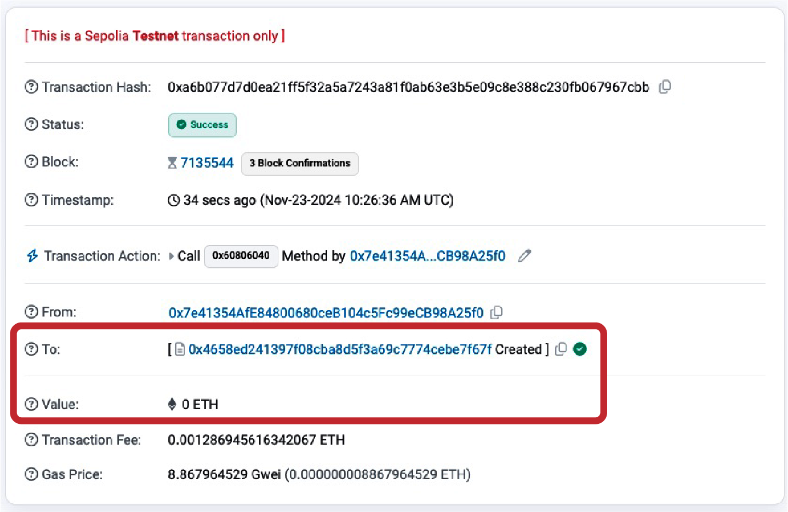

**図6-8.** Etherscan上のコントラクト作成トランザクション

　トランザクションのレシートを確認して（トランザクションハッシュを使用して参照）、コントラクトに関する情報を取得できます。

```bash
$ cast receipt 0xa6b077d7d0ea21ff5f32a5a7243a81f0ab63e3b5e09c8e388c230fb067967cbb \
    --rpc-url https://ethereum-sepolia-rpc.publicnode.com
blockHash               0x6eb071eac79a84793321b086af96b32c1d861f04b0efc7354d0f6b8d5a8fa36a
blockNumber             7135544
contractAddress         0x4658eD241397F08cba8d5F3a69c7774cebE7f67F
cumulativeGasUsed       28390874
effectiveGasPrice       8867964529
from                    0x7e41354AfE84800680ceB104c5Fc99eCB98A25f0
gasUsed                 145123
logs                    []
logsBloom               0x00000000000000000000000000000000000000000000000000000000000000000000000000000000000000000000000000000000000000000000000000000000000000000000000000000000000000000000000000000000000000000000000000000000000000000000000000000000000000000000000000000000000000000000000000000000000000000000000000000000000000000000000000000000000000000000000000000000000000000000000000000000000000000000000000000000000000000000000000000000000000000000000000000000000000000000000000000000000000000000000000000000000000000000000000000000
root
status                  1 (success)
transactionHash         0xa6b077d7d0ea21ff5f32a5a7243a81f0ab63e3b5e09c8e388c230fb067967cbb
transactionIndex        136
type                    2
blobGasPrice
blobGasUsed            
authorizationList
```

　レシートにはコントラクトのアドレス（`contractAddress`を参照）が含まれており、前のセクションで示したように、コントラクトへの送金やコントラクトからの受領に使用できます。

　まず、新しく作成されたコントラクトアドレスを変数に保存します。

```bash
$ CONTRACT_ADDRESS=0x4658eD241397F08cba8d5F3a69c7774cebE7f67F
```

　次に、イーサを送金してコントラクトに資金を入れます。

```bash
$ cast send --account example $CONTRACT_ADDRESS --value 0.02ether --rpc-url https://ethereum-sepolia-rpc.publicnode.com
```

　最後に、先ほど計算したデータペイロードを使用して`withdraw`関数を呼び出し、0.000001 etherを`vitalik.eth`のアドレスに引き出します。

```bash
$ cast send --account example $CONTRACT_ADDRESS \
0x00f714ce000000000000000000000000000000000000000000000000000000e8d4a51000000000000000000000000000d8da6bf26964af9d7eed9e03e53415d37aa96045 \
  --rpc-url https://ethereum-sepolia-rpc.publicnode.com
```

　しばらくすると、両方のトランザクションが図6-9に示すようにEtherscanで表示されます。

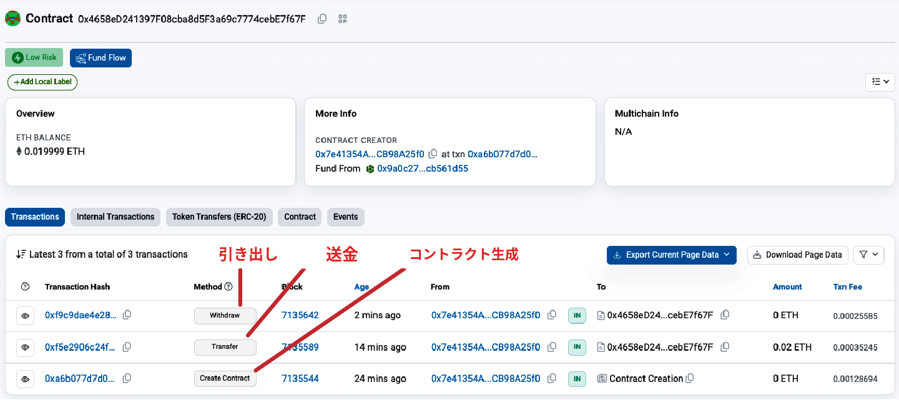

**図6-9.** コントラクトへの送金と引き出しのトランザクション

## デジタル署名

　ここまで、デジタル署名の詳細については触れてきませんでした。このセクションでは、デジタル署名がどのように機能するか、そして秘密鍵を明かすことなく秘密鍵の所有権証明を提示するためにどのように使用できるかを説明します。

### ECDSA

　イーサリアムで使用されるデジタル署名アルゴリズムは、*楕円曲線デジタル署名アルゴリズム（ECDSA）*です。「楕円曲線暗号の解説」で説明しているように、楕円曲線の秘密鍵と公開鍵のペアに基づいています。

　デジタル署名はイーサリアムで3つの目的を果たします（以下のサイドバーを参照）。第1に、署名は秘密鍵の所有者（つまりイーサリアムアカウントの所有者）が、イーサの支払いまたはコントラクトの実行を承認したことを証明します。第2に、*否認不可*を保証します。つまり、承認の証拠を否定することはできません。第3に、署名はトランザクションデータが署名後に誰にも変更されていないこと、そして変更できないことを証明します。

#### デジタル署名の定義

　[Wikipedia](https://oreil.ly/kRnY2)によれば、デジタル署名は、デジタルメッセージやデジタルドキュメントの信頼性を提示するための数学的手法です。有効なデジタル署名は、既知の送信者によってメッセージが作成されたこと（認証）、送信者がメッセージの送信を否認できないこと（否認防止）、そしてメッセージが送信中に変更されなかったこと（完全性）を受信者が信じる根拠を示します。

### デジタル署名の仕組み

　デジタル署名は2つの部分からなる数学的手法です。1つ目は、秘密鍵（署名鍵）を使用してメッセージ（ここではトランザクション）から署名を作成するアルゴリズムです。2つ目は、メッセージと公開鍵だけを使って誰でも署名を検証できるようにするアルゴリズムです。

#### デジタル署名の作成

　イーサリアムのECDSA実装では、署名される「メッセージ」はトランザクション、より正確にはトランザクションのRLPエンコードされたデータのKeccak-256ハッシュです。署名鍵はEOA（外部所有アカウント）の秘密鍵であり、結果は署名です。

```
Sig = Fsig (Fkeccak256 (m), k)
```

ここでの各変数の意味は以下のとおりです。

- `k`は署名する秘密鍵
- `m`はRLPエンコードされたトランザクション
- `Fkeccak256`はKeccak-256ハッシュ関数
- `Fsig`は署名アルゴリズム
- `Sig`は結果の署名

　関数`Fsig`は、一般に`r`および`s`と呼ばれる2つの値で構成される署名`Sig`を生成します。

```
Sig = (r, s)
```

#### 署名の検証

　署名を検証するには、署名（`r`と`s`）、シリアライズされたトランザクション、および署名の作成に使用された秘密鍵に対応する公開鍵が必要です。本質的に、署名の検証とは、「この公開鍵を生成した秘密鍵の所有者だけが、このトランザクションでこの署名を生成できた」ということを意味します。

　署名検証アルゴリズムは、メッセージ（ここではトランザクションのハッシュ）、署名者の公開鍵、および署名（`r`と`s`の値）を受け取り、署名がこのメッセージおよび公開鍵に対して有効である場合にtrueを返します。

### ECDSAの数学

　前述のように、署名は2つの値`r`と`s`で構成され、数学的関数`Fsig`によって作成されます。このセクションでは、関数`Fsig`をより詳細に見ていきます。

　署名アルゴリズムは、まず暗号学的に安全な方法で*一時的な*（エフェメラルな）秘密鍵を生成します。この一時的な鍵は`r`と`s`の値の計算に使用され、イーサリアムネットワーク上で署名されたトランザクションを監視している攻撃者が送信者の実際の秘密鍵を計算できないようにします。

　4章で説明したように、一時的な秘密鍵は対応する（一時的な）公開鍵を導出するために使用されます。

- 暗号学的に安全な乱数`q`は、一時的な秘密鍵として使用される
- 対応する一時公開鍵`Q`は、`q`と楕円曲線生成元`G`から生成される

　デジタル署名の`r`値は、一時公開鍵`Q`のx座標です。

　そこから、アルゴリズムは署名の`s`値を以下のように計算します。

```
s ≡ q-1 (Keccak256(m) + r * k) (mod p)
```

ここでの各変数の意味は以下のとおりです。

- `q`は一時的な秘密鍵
- `r`は一時公開鍵のx座標
- `k`は署名（EOA（外部所有アカウント）の所有者）の秘密鍵
- `m`はトランザクションデータ
- `p`は楕円曲線の素数位数

　検証は署名生成関数の逆で、`r`と`s`の値および送信者の公開鍵を使用して、楕円曲線上の点である値`Q`（署名作成時に使用された一時公開鍵）を計算します。手順は以下のとおりです。

1. すべての入力が正しく構成されていることを確認する
2. `w = s-1 mod p`を計算する
3. `u1 = Keccak256(m) * w mod p`を計算する
4. `u2 = r * w mod p`を計算する
5. 楕円曲線上の点`Q ≡ u1 * G + u2 * K (mod p)`を計算する

ここでの各変数の意味は以下のとおりです。

- `r`と`s`は署名値
- `K`は署名者（EOA（外部所有アカウント）の所有者）の公開鍵
- `m`は署名されたトランザクションデータ
- `G`は楕円曲線生成元
- `p`は楕円曲線の素数位数

　計算された点`Q`のx座標が`r`に等しい場合、検証者は署名が有効であると結論づけることができます。署名の検証では、秘密鍵は知られることも公開されることもないことに注意してください。

> **ヒント**
>
> ECDSAを説明するにはどうしても複雑な数学を扱わなければならず、完全に説明するのは本書の範囲を超えています。多数のガイドがオンラインで順を追って説明してくれます。「ECDSA explained」で検索するか、[こちら](https://oreil.ly/KUv9P)にアクセスしてみてください。

## トランザクション署名の実践

　有効なトランザクションを生成するには、発行者がECDSAを使用してメッセージにデジタル署名する必要があります。「トランザクションに署名する」とは、実際には「RLPシリアライズされたトランザクションデータのKeccak-256ハッシュに署名する」ことを意味します。署名はトランザクションそのものではなく、トランザクションデータのハッシュに対して適用されます。

　イーサリアムでトランザクションに署名するには、発行者が以下の手順を実行しなければなりません。

1. 特定のトランザクションタイプに必要なすべてのフィールドを含むトランザクションデータ構造を作成する
2. トランザクションデータ構造のRLPエンコードされたシリアライズメッセージを生成する
3. シリアライズされたメッセージのKeccak-256ハッシュを計算する
4. 発行元EOA（外部所有アカウント）の秘密鍵でハッシュに対するECDSA署名を計算する
5. ECDSA署名の計算結果である`v`、`r`、`s`の値をトランザクションに追加する

　特別な署名変数`v`は、チェーンIDとリカバリ識別子の2つを示します。リカバリ識別子は、ECDSArecover関数が署名を検証する際に使用されます。非レガシートランザクションでは、チェーンIDがトランザクション自体の項目として直接含まれるため、`v`変数にはチェーンIDがエンコードされません。チェーンIDの詳細については、「EIP-155による生トランザクションの作成」を参照してください。リカバリ識別子は、公開鍵のy成分のパリティを示すために使用されます（詳細は「署名プレフィックス値（v）と公開鍵リカバリ」を参照してください）。

> **注記**
>
> ブロック番号2,675,000で、イーサリアムはSpurious Dragonハードフォークを実装しました。この変更により、トランザクションリプレイ保護（あるネットワーク向けのトランザクションが別のネットワークでリプレイされることを防止する機能）を含む新しい署名方式が導入されました。この新しい署名方式はEIP-155で規定されています。トランザクションの形式と署名に影響を与えるため、2つの形式のいずれかをとる3つの署名変数の最初のもの（すなわち`v`）に注意が必要です。`v`の値は、ハッシュ化されるトランザクションメッセージに含まれるデータフィールドを示します。

### 生トランザクションの作成と署名

　この節では、`ethers.js`ライブラリを使用して生トランザクションを作成し、署名します。例6-1は、ウォレットの内部やユーザーに代わってトランザクションに署名するアプリケーションで通常使用される関数を示しています。

**例6-1. 生のイーサリアムトランザクションの作成と署名**

```javascript
// Load requirements first:
//
// npm install ethers
//
// Run with: node eip1559_tx.js
import { ethers } from "ethers";

// Create provider with your RPC endpoint
const provider = new ethers.JsonRpcProvider("https://ethereum-sepolia-rpc.publicnode.com");

// Private key
const privKey = "0xd6d2672c6b4489e6bcd4e93b9af620fa0204b639b7d7f93765479c0846be0b58";

// Create a wallet instance
const wallet = new ethers.Wallet(privKey);

// Get nonce and create transaction data
const txData = {
  nonce: await provider.getTransactionCount(wallet.address), // Get nonce from provider
  to: "0xb0920c523d582040f2bcb1bd7fb1c7c1ecebdb34", // Receiver address
  value: ethers.parseEther("0.0001"), // Amount to send (0.0001 ETH here)
  gasLimit: ethers.toBeHex(0x30000), // Gas limit
  maxFeePerGas: ethers.parseUnits("100", "gwei"), // Max fee per gas
  maxPriorityFeePerGas: ethers.parseUnits("2", "gwei"), // Max priority fee
  data: "0x", // Optional data
  chainId: 11155111, // Sepolia chain ID
};

// Calculate RLP-encoded transaction hash (pre-signed)
const unsignedTx = ethers.Transaction.from(txData).unsignedSerialized;
console.log("RLP-Encoded Tx (Unsigned): " + unsignedTx);
const txHash = ethers.keccak256(unsignedTx);
console.log("Tx Hash (Unsigned): " + txHash);

// Sign the transaction
async function signAndSend() {
  // Sign the transaction with the wallet
  const signedTx = await wallet.signTransaction(txData);
  console.log("Signed Raw Transaction: " + signedTx);

  // Send the signed transaction to the Ethereum network
  const txResponse = await provider.broadcastTransaction(signedTx);
  console.log("Transaction Hash: " + txResponse.hash);

  // Wait for the transaction to be mined
  const receipt = await txResponse.wait();
  console.log("Transaction Receipt: ", receipt);
}

signAndSend().catch(console.error);
```

　サンプルコードを実行すると、以下の結果が得られます。

```bash
$ node eip1559_tx.js 
RLP-Encoded Tx (Unsigned): 0x02f283aa36a714847735940085174876e8008303000094b0920c523d582040f2bcb1bd7fb1c7c1ecebdb34865af3107a400080c0
Tx Hash (Unsigned): 0x31d43a580534a77c71324a8434df6f2df993b3d551b29d4b70d8a889768a53f7
Signed Raw Transaction: 0x02f87583aa36a714847735940085174876e8008303000094b0920c523d582040f2bcb1bd7fb1c7c1ecebdb34865af3107a400080c001a03f8ed18cb03ee0fe3fbc3f0a7477a2f68db6ec84450e77e702b82a3f2c873aa4a0205c4f6a16ea8ad13a148cc3105814cd4a6860cd26a771651199c85ccb7c7f0f
Transaction Hash: 0x07bfbeb337e19763a1f74d989dae2953807dcb06822354cfefb16405a11beb93
Transaction Receipt:  TransactionReceipt {
  provider: JsonRpcProvider {},
  to: '0xB0920c523d582040f2BCB1bD7FB1c7C1ECEbdB34',
  from: '0x7e41354AfE84800680ceB104c5Fc99eCB98A25f0',
  contractAddress: null,
  hash: '0x07bfbeb337e19763a1f74d989dae2953807dcb06822354cfefb16405a11beb93',
  index: 1,
  blockHash: '0x0ac051e8f615805c69eec6e193e39637adeb7cf314a0098d455e7d9ac395a7ee',
  blockNumber: 7135937,
  logsBloom: '0x00000000000000000000000000000000000000000000000000000000000000000000000000000000000000000000000000000000000000000000000000000000000000000000000000000000000000000000000000000000000000000000000000000000000000000000000000000000000000000000000000000000000000000000000000000000000000000000000000000000000000000000000000000000000000000000000000000000000000000000000000000000000000000000000000000000000000000000000000000000000000000000000000000000000000000000000000000000000000000000000000000000000000000000000000000000',
  gasUsed: 21000n,
  blobGasUsed: null,
  cumulativeGasUsed: 42000n,
  gasPrice: 3096751769n,
  blobGasPrice: null,
  type: 2,
  status: 1,
  root: undefined
}
```

### EIP-1559生トランザクションの低レベル手動構築

　以下の例は、EIP-1559（タイプ0x02）トランザクションを作成・署名するための完全な低レベルプロセスを示しています。フィールドリストを手動で構築し、RLPエンコードし、型付きペイロードに署名します。この手法により、`wallet.signTransaction`の内部で何が行われているかを正確に確認できます。

```javascript
// npm install ethers@6
import { ethers } from "ethers";
const RLP = require('@ethereumjs/rlp');

// Replace with your own RPC and private key
const rpcUrl = "https://ethereum-sepolia-rpc.publicnode.com"; // or mainnet, etc.
const provider = new ethers.JsonRpcProvider(rpcUrl);
const privateKey = "0xYOUR_PRIVATE_KEY_HERE";
const wallet = new ethers.Wallet(privateKey, provider);

const recipient = "0xRECIPENT_ADDRESS"; // example address

async function createAndSendRawEip1559Tx() {
  const chainId = await provider.getChainId(); // This is a RPC call
  const nonce = await provider.getTransactionCount(wallet.address); // This is a RPC call

  // Example parameters — adjust as needed (or use provider.estimateGas + getFeeData)
  const maxPriorityFeePerGas = ethers.parseUnits("2", "gwei");   // tip
  const maxFeePerGas = ethers.parseUnits("30", "gwei");         // fee cap (base fee + tip)
  const gasLimit = 21000n;
  const value = ethers.parseEther("0.01"); // 0.01 ETH
  const data = "0x"; // or contract calldata
  const accessList = []; // [] or proper access list for EIP-2930 style savings

  // Unsigned fields in strict order for Transaction Type 2
  const unsignedFields = [
    ethers.toBeHex(chainId),              // chainId
    ethers.toBeHex(nonce),                // nonce
    ethers.toBeHex(gasLimit),             // gasLimit
    ethers.toBeHex(maxPriorityFeePerGas), // maxPriorityFeePerGas
    ethers.toBeHex(maxFeePerGas),         // maxFeePerGas
    recipient,                            // to
    ethers.toBeHex(value),                // value
    data,                                 // data
    accessList                            // accessList
  ];

  // RLP-encode the unsigned fields
  const encodedUnsigned = RLP.encode(unsignedFields);

  // Prepend the transaction type byte (0x02)
  const txType = Buffer.from('02', 'hex');
  const fullTx = Buffer.concat([txType, encodedUnsigned]);

  // This is the signing hash
  const signingHash = ethers.keccak256(fullTx);

  // Sign the hash
  const signingKey = new ethers.SigningKey(wallet.privateKey);
  const signature = signingKey.sign(ethers.getBytes(signingHash));

  // For typed transactions we use yParity (0 or 1) instead of legacy v
  const signedFields = [
    ...unsignedFields,
    sig.v - 27, // yParity (0 or 1)
    sig.r,
    sig.s
  ];

  const encodedSigned = RLP.encode(signedFields);

  const rawTransaction = '0x02' + Buffer.from(encodedSigned).toString('hex');

  console.log("Raw transaction hex:\n", rawTransaction);

  // Send the raw transaction
  const txHash = await provider.send("eth_sendRawTransaction", [rawTransaction]);
  console.log("Transaction sent! Hash:", txHash);

  const receipt = await provider.waitForTransaction(txHash);
  console.log("Mined in block", receipt.blockNumber);
}

createAndSendRawEip1559Tx().catch(console.error);
```

## Deserializing the Transaction

## トランザクションの逆シリアライズ

Now that we have created and sent a transaction to the Ethereum network from scratch, we can follow the inverse process and try to rebuild each field of the transaction, starting with the signed raw transaction we get from the previous example. This will help you understand how each field of the transaction is actually included in the transaction itself—you just need to extract it in the correct way.

　ここまでで、イーサリアムネットワークへのトランザクションをゼロから作成して送信しました。次に、逆のプロセスをたどり、前の例で得られた署名済み生トランザクションから各フィールドを復元してみましょう。この作業により、トランザクションの各フィールドが実際にどのようにトランザクションに含まれているかを理解できます。正しい方法で抽出するだけでよいのです。

Let's start with the entire signed raw transaction:

　署名済み生トランザクション全体から始めましょう。

```
0x02f87583aa36a714847735940085174876e8008303000094b0920c523d582040f2bcb1bd7fb1c7c1ecebdb34865af3107a400080c001a03f8ed18cb03ee0fe3fbc3f0a7477a2f68db6ec84450e77e702b82a3f2c873aa4a0205c4f6a16ea8ad13a148cc3105814cd4a6860cd26a771651199c85ccb7c7f0f
```

Recalling EIP-2718, all Ethereum transactions are made by:

　EIP-2718を思い出すと、すべてのイーサリアムトランザクションは以下の要素で構成されます。

- The first byte that specifies the transaction type
- The transaction type payload

- トランザクションタイプを指定する最初の1バイト
- トランザクションタイプのペイロード

This almost always translates in the RLP encoding of all the fields of that specific transaction type.

　この構造は、ほぼ常にその特定のトランザクションタイプの全フィールドのRLPエンコーディングに対応します。

Our transaction starts with a `0x02`. This represents the transaction type, and `0x02` means it's an EIP-1559 transaction. The next part is the RLP encoding of all the transaction fields that make up the EIP-1559 transaction.

　このトランザクションは`0x02`で始まっています。これはトランザクションタイプを表し、`0x02`はEIP-1559トランザクションであることを意味します。次の部分は、EIP-1559トランザクションを構成するすべてのトランザクションフィールドのRLPエンコーディングです。

To quickly decode them, we can use `cast` and the `from-rlp` command, providing the rest of the transaction as input:

　フィールドを素早くデコードするには、`cast`の`from-rlp`コマンドを使用し、トランザクションの残りの部分を入力として渡します。

```bash
$ cast from-rlp f87583aa36a714847735940085174876e8008303000094b0920c523d582040f2bcb1bd7fb1c7c1ecebdb34865af3107a400080c001a03f8ed18cb03ee0fe3fbc3f0a7477a2f68db6ec84450e77e702b82a3f2c873aa4a0205c4f6a16ea8ad13a148cc3105814cd4a6860cd26a771651199c85ccb7c7f0f
["0xaa36a7","0x14","0x77359400","0x174876e800","0x030000","0xb0920c523d582040f2bcb1bd7fb1c7c1ecebdb34","0x5af3107a4000","0x",[],"0x01","0x3f8ed18cb03ee0fe3fbc3f0a7477a2f68db6ec84450e77e702b82a3f2c873aa4","0x205c4f6a16ea8ad13a148cc3105814cd4a6860cd26a771651199c85ccb7c7f0f"]
```

You can see that the output of the last `cast` command contains a list of hexadecimal items: they are the fields of the EIP-1559 transaction. Let's analyze them one by one and reconstruct the transaction:

　最後の`cast`コマンドの出力には、16進数の項目リストが含まれています。これらはEIP-1559トランザクションのフィールドです。1つずつ分析してトランザクションを再構成しましょう。

**`0xaa36a7`**

**`0xaa36a7`**

The Sepolia chain ID: 11155111 in decimal.

　SepoliaのチェーンID。10進数では11155111です。

**`0x14`**

**`0x14`**

The nonce used in the transaction: 20. You can go to the block explorer and see that it's actually correct.

　トランザクションで使用されたナンス。10進数では20です。ブロックエクスプローラで確認すると、実際に正しいことがわかります。

**`0x77359400`**

**`0x77359400`**

The max priority fee per gas: 2000000000 in decimal. It translates to 2 gwei per gas.

　ガスあたりの最大優先手数料。10進数では2000000000で、ガスあたり2 gweiに相当します。

**`0x174876e800`**

**`0x174876e800`**

The max fee per gas: 100000000000 in decimal. It translates to 100 gwei per gas.

　ガスあたりの最大手数料。10進数では100000000000で、ガスあたり100 gweiに相当します。

**`0x030000`**

**`0x030000`**

The gas limit: 196608 in decimal.

　ガスリミット。10進数では196608です。

**`0xb0920c523d582040f2bcb1bd7fb1c7c1ecebdb34`**

**`0xb0920c523d582040f2bcb1bd7fb1c7c1ecebdb34`**

The recipient address.

　受信者のアドレスです。

**`0x5af3107a4000`**

**`0x5af3107a4000`**

The value in wei sent from the sender to the recipient: 1014 in decimal. It translates to 0.0001 ether.

　送信者から受信者に送られたweiでの値。10進数では10^14で、0.0001 etherに相当します。

**`0x`**

**`0x`**

The empty data payload.

　空のデータペイロードです。

**`[]`**

**`[]`**

The empty access list.

　空のアクセスリストです。

**`0x01`**

**`0x01`**

The `v` value of the signature; `0x01` means an odd y coordinate of the elliptic curve (`0x00` means an even y coordinate).

　署名の`v`値。`0x01`は楕円曲線のy座標が奇数であることを意味します（`0x00`はy座標が偶数であることを意味します）。

**`0x3f8ed18cb03ee0fe3fbc3f0a7477a2f68db6ec84450e77e702b82a3f2c873aa4`**

**`0x3f8ed18cb03ee0fe3fbc3f0a7477a2f68db6ec84450e77e702b82a3f2c873aa4`**

The `r` value of the signature.

　署名の`r`値です。

**`0x205c4f6a16ea8ad13a148cc3105814cd4a6860cd26a771651199c85ccb7c7f0f`**

**`0x205c4f6a16ea8ad13a148cc3105814cd4a6860cd26a771651199c85ccb7c7f0f`**

The `s` value of the signature.

　署名の`s`値です。

## Raw Transaction Creation with EIP-155

## EIP-155による生トランザクションの作成

The EIP-155 "Simple Replay Attack Protection" standard specifies a replay-attack-protected transaction encoding, which includes a chain ID inside the transaction data prior to signing. This ensures that transactions created for one blockchain (e.g., the Ethereum main network) are invalid on another blockchain (e.g., Ethereum Classic or the Sepolia test network). Therefore, transactions broadcast on one network cannot be replayed on another, hence the name of the standard.

　EIP-155「シンプルリプレイアタックプロテクション」規格は、署名前にトランザクションデータ内にチェーンIDを含むリプレイ攻撃防御トランザクションエンコーディングを指定しています。この仕組みにより、あるブロックチェーン（例：イーサリアムメインネットワーク）向けに作成されたトランザクションが、別のブロックチェーン（例：イーサリアムクラシックやSepoliaテストネットワーク）上では無効となることが保証されます。したがって、あるネットワーク上でブロードキャストされたトランザクションを別のネットワーク上で再生することはできません。規格名はこの特性に由来しています。

By including the chain ID in the data being signed, the transaction signature prevents any changes since the signature is invalidated if the chain ID is modified. Therefore, EIP-155 makes it impossible for a transaction to be replayed on another chain because the signature's validity depends on the chain ID.

　署名対象のデータにチェーンIDを含めることで、チェーンIDが変更されると署名が無効になるため、トランザクション署名が改変を防止します。EIP-155によって、署名の有効性がチェーンIDに依存するため、別のチェーンでトランザクションを再生することが不可能になります。

The chain ID field takes a value according to the network the transaction is meant for, as outlined in Table 6-2.

　チェーンIDフィールドは、トランザクションが対象とするネットワークに応じた値を持ちます（表6-2参照）。

**Table 6-2. Chain identifiers**

**表6-2. チェーン識別子**

| チェーン | チェーンID |
|-------|----------|
| Ethereum mainnet | 1 |
| Ethereum Sepolia | 11155111 |
| Ethereum Holesky | 17000 |

For an exhaustive list of chain identifiers, see [ChainList](https://chainlist.org).

　チェーン識別子の網羅的なリストについては、[ChainList](https://chainlist.org)を参照してください。

The resulting transaction structure is RLP encoded, hashed, and signed. For more details, see the EIP-155 specification.

　結果として生じるトランザクション構造はRLPエンコードおよびハッシュ化され、署名されます。詳細についてはEIP-155仕様を参照してください。

## The Signature Prefix Value (v) and Public Key Recovery

## 署名プレフィックス値（v）と公開鍵リカバリ

As mentioned in "The Structure of a Transaction", the transaction message doesn't include a "from" field. That's because the originator's public key can be computed directly from the ECDSA signature. Once you have the public key, you can compute the address easily. The process of recovering the signer's public key is called *public key recovery*.

　「トランザクションの構造」で説明したように、トランザクションメッセージにはfromフィールドが含まれていません。発行者の公開鍵はECDSA署名から直接計算できるためです。公開鍵を取得できれば、アドレスを簡単に計算できます。署名者の公開鍵を復元するプロセスは*公開鍵リカバリ*と呼ばれます。

Given the values `r` and `s` that were computed in "ECDSA Math", we can compute two possible public keys.

　「ECDSAの数学」で計算した値`r`と`s`から、2つの公開鍵候補を計算できます。

First, we compute two elliptic curve points, `R` and `R′`, from the x coordinate `r` value that is in the signature. There are two points because the elliptic curve is symmetric across the x-axis, so for any value x, there are two possible values that fit the curve, one on each side of the x-axis.

　まず、署名内にあるx座標の`r`値から2つの楕円曲線上の点`R`と`R'`を計算します。楕円曲線はx軸に対して対称であるため、任意の値xに対して、曲線上にはx軸の両側にそれぞれ1つずつ、合計2つの点が存在します。

From `r` we also calculate `r–1`, which is the multiplicative inverse of `r`.

　`r`から、`r`の乗法逆数である`r⁻¹`も計算します。

Finally, we calculate `z`, which is the n lowest bits of the message hash, where n is the order of the elliptic curve.

　最後に、メッセージハッシュのn個の最下位ビットである`z`を計算します。ここでnは楕円曲線の位数です。

The two possible public keys are then:

　2つの公開鍵候補は以下のとおりです。

```
K1 = r–1 (sR – zG)
```

and:

および

```
K2 = r–1 (sR′ – zG)
```

where:

各変数の意味は以下のとおりです。

- `K1` and `K2` are the two possibilities for the signer's public key
- `r-1` is the multiplicative inverse of the signature's `r` value
- `s` is the signature's `s` value
- `R` and `R′` are the two possibilities for the ephemeral public key `Q`
- `z` is the n-lowest bits of the message hash
- `G` is the elliptic curve generator point

- `K1`と`K2`は署名者の公開鍵の2つの候補
- `r⁻¹`は署名の`r`値の乗法逆数
- `s`は署名の`s`値
- `R`および`R'`は一時的な公開鍵`Q`の2つの候補
- `z`はメッセージハッシュのn個の最下位ビット
- `G`は楕円曲線の生成元

To make things more efficient, the transaction signature includes a prefix value `v`, which tells us which of the two possible R values is the ephemeral public key. If `v` is even, then `R` is the correct value. If `v` is odd, then it is `R′`. That way, we need to calculate only one value for R and only one value for K.

　より効率的にするために、トランザクション署名にはプレフィックス値`v`が含まれています。`v`は、2つのR値候補のうちどちらが一時的な公開鍵であるかを示します。`v`が偶数の場合は`R`が正しい値で、`v`が奇数の場合は`R'`が正しい値です。これにより、Rに対して1つの値、Kに対して1つの値だけを計算すれば済みます。

## Separating Signing and Transmission (Offline Signing)

## 署名と送信の分離（オフライン署名）

Once a transaction is signed, it is ready to transmit to the Ethereum network. The three steps of creating, signing, and broadcasting a transaction normally happen as a single operation—for example, using the `cast send` command. However, as you saw in "Raw Transaction Creation and Signing", you can create and sign the transaction in two separate steps. Once you have a signed transaction, you can then transmit it using `ethers.JsonRpcProvider("..."").broadcastTransaction`, which takes a hex-encoded and signed transaction and transmits it on the Ethereum network.

　トランザクションが署名されると、イーサリアムネットワークに送信する準備が整います。トランザクションの作成、署名、ブロードキャストの3つのステップは、通常は単一の操作として実行されます。たとえば`cast send`コマンドを使用する場合がその例です。しかし、「生トランザクションの作成と署名」で見たように、トランザクションの作成と署名を2つの別々のステップで行うことも可能です。署名済みトランザクションを取得したら、`ethers.JsonRpcProvider("...").broadcastTransaction`を使用して送信できます。この関数は16進数でエンコードされた署名済みトランザクションを受け取り、イーサリアムネットワーク上に送信します。

Why would you want to separate the signing and transmission of transactions? The most common reason is security. The computer that signs a transaction must have unlocked private keys loaded in memory. The computer that does the transmitting must be connected to the internet (and be running an Ethereum client). If these two functions are on one computer, then you have private keys on an online system, which is quite dangerous.

　なぜ署名と送信を分離するのでしょうか。最も一般的な理由はセキュリティです。トランザクションに署名するコンピュータには、ロック解除された秘密鍵がメモリにロードされている必要があります。一方、送信を行うコンピュータはインターネットに接続されていなければなりません（かつイーサリアムクライアントを実行している必要があります）。この2つの機能が1台のコンピュータ上にあると、オンラインシステム上に秘密鍵が存在することになり、非常に危険です。

> **警告**
>
> If you keep your private keys online, you're exposed to several forms of attacks, such as malware and remote hacking, and you're much more susceptible to phishing attacks, too.

> **警告**
>
> 秘密鍵をオンラインで保管すると、マルウェアやリモートハッキングなど複数の攻撃にさらされ、フィッシング攻撃の被害も受けやすくなる。

Separating the functions of signing and transmitting and performing them on different machines (on an offline and an online device, respectively) is called *offline signing* and is a common security practice.

　署名と送信の機能を分離し、それぞれ別々のマシン（オフラインデバイスとオンラインデバイス）で実行することを*オフライン署名*と呼び、一般的なセキュリティ手法です。

Figure 6-10 shows the process, which follows these steps:

　図6-10にその処理の流れを示します。

1. Create an unsigned transaction on the online computer where the current state of the account—notably, the current nonce and funds available—can be retrieved.
2. Transfer the unsigned transaction to an "air-gapped" offline device for transaction signing (e.g., via a QR code or USB flash drive).
3. Transmit the signed transaction (back) to an online device for broadcast on the Ethereum blockchain (e.g., via a QR code or USB flash drive).

1. アカウントの現在の状態（特に現在のナンスと利用可能な資金）を取得できるオンラインコンピュータ上で、未署名トランザクションを作成する
2. 未署名トランザクションを、QRコードやUSBフラッシュドライブなどを介して、「エアギャップ」のあるオフラインデバイスに転送し、トランザクションに署名する
3. 署名済みトランザクションを、QRコードやUSBフラッシュドライブなどを介して、オンラインデバイスに送り返し、イーサリアムブロックチェーン上にブロードキャストする

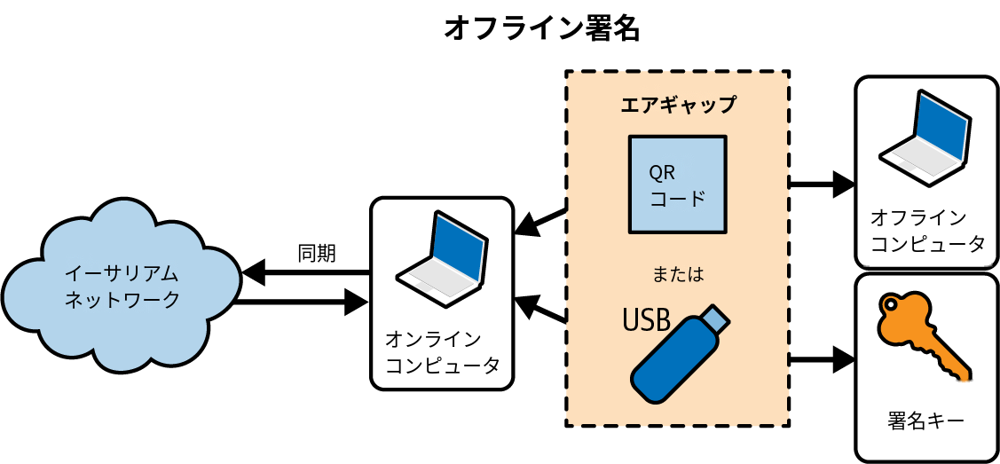

**Figure 6-10.** Offline signing process

**図6-10.** オフライン署名のプロセス

Depending on the level of security you need, your "offline signing" computer can have varying degrees of separation from the online computer, ranging from an isolated and firewalled subnet (online but segregated) to a completely offline system known as an *air-gapped system*. In an air-gapped system, there is no network connectivity at all—the computer is separated from the online environment by a gap of "air." To sign transactions, you transfer them to and from the air-gapped computer using data storage media or (better) a webcam and QR code. Of course, this means you must manually transfer every transaction you want signed, and this doesn't scale.

　必要なセキュリティレベルに応じて、「オフライン署名」コンピュータとオンラインコンピュータの隔離度は様々に設定できます。隔離されたファイアウォール付きサブネット（オンラインだが分離されている環境）から、*エアギャップシステム*と呼ばれる完全にオフラインのシステムまで幅広い選択肢があります。エアギャップシステムにはネットワーク接続が一切ありません。コンピュータはオンライン環境から「空気の壁」によって物理的に隔離されています。トランザクションに署名するには、データ記憶媒体またはウェブカメラとQRコードを使用して、エアギャップのあるコンピュータとの間でトランザクションを転送します。もちろん、署名するすべてのトランザクションを手動で転送しなければならないため、拡張性には限界があります。

While not many environments can utilize a fully air-gapped system, even a small degree of isolation has significant security benefits. For example, an isolated subnet with a firewall that allows through only a message-queue protocol can offer a much reduced attack surface and much higher security than signing on the online system. Many companies use a protocol such as ZeroMQ (0MQ) for this purpose. With a setup like that, transactions are serialized and queued for signing. The queuing protocol transmits the serialized message, in a way similar to a TCP socket, to the signing computer. The signing computer reads the serialized transactions from the queue (carefully), applies a signature with the appropriate key, and places them on an outgoing queue. The outgoing queue transmits the signed transactions to a computer with an Ethereum client that dequeues them and transmits them.

　完全なエアギャップシステムを利用できる環境は多くありませんが、わずかな隔離でも大きなセキュリティ上の利点があります。たとえば、メッセージキュープロトコルのみを通過させるファイアウォールを備えた隔離サブネットは、オンラインシステム上で署名する場合と比較して、攻撃対象を大幅に縮小し、はるかに高いセキュリティを提供できます。多くの企業がこの目的でZeroMQ（0MQ）などのプロトコルを使用しています。このような構成では、トランザクションはシリアライズされ、署名のためにキューに入れられます。キューイングプロトコルは、TCPソケットに類似した方法でシリアライズされたメッセージを署名コンピュータに送信します。署名コンピュータはキューからシリアライズされたトランザクションを慎重に読み込み、適切な鍵で署名を適用して発信キューに配置します。発信キューは署名済みトランザクションをイーサリアムクライアントを持つコンピュータに送信し、デキューして送信を実行します。

## Transaction Life Cycle

## トランザクションのライフサイクル

In this section, we'll explore the full life cycle of a transaction, starting from the moment it's signed to when it's included in a block and the block gets finalized.

　この節では、トランザクションが署名された時点からブロックに取り込まれ、そのブロックがファイナライズされるまでの完全なライフサイクルを説明します。

### Creating and Signing the Transaction

### トランザクションの作成と署名

The first step is to create the transaction, choosing the transaction type and filling all the fields required for it. For example, in the section "Raw Transaction Creation and Signing", we created an EIP-1559 transaction.

　最初のステップは、トランザクションタイプを選択し、必要なすべてのフィールドを入力してトランザクションを作成することです。たとえば、「生トランザクションの作成と署名」の節ではEIP-1559トランザクションを作成しました。

Once we have the transaction, we need to sign it with the correct private key (or the transaction will be invalid due to the invalid signature) in order to obtain the final and definitive signed transaction. This is the actual piece of data that we need to send to the network and wait for it to be included in a block.

　トランザクションを作成したら、正しい秘密鍵で署名する必要があります（署名が無効だとトランザクションも無効になります）。署名によって最終的かつ確定的な署名済みトランザクションが得られます。このデータをネットワークに送信し、ブロックへの取り込みを待つことになります。

### Sending the Transaction to the Network

### トランザクションのネットワークへの送信

The transaction needs to be included in a block to be considered confirmed by the Ethereum protocol; otherwise, it's just a signed transaction that only we know about.

　トランザクションがイーサリアムプロトコルによって確認済みとみなされるには、ブロックに取り込まれなければなりません。ブロックに取り込まれなければ、自分だけが知っている署名済みトランザクションにすぎません。

> **ヒント**
>
> It's very important to understand that the Ethereum protocol considers valid only transactions that are included into blocks that are part of the valid chain. To update its state, you need to send your signed transaction to the network and wait for it to include your transaction into a block. Your signed transaction alone doesn't do anything if it's not included into a block.

> **ヒント**
>
> イーサリアムプロトコルが有効とみなすのは、有効なチェーンの一部であるブロックに取り込まれたトランザクションのみであることを理解することが非常に重要である。状態を更新するには、署名済みトランザクションをネットワークに送信し、ブロックへの取り込みを待つ必要がある。署名済みトランザクション単体では、ブロックに取り込まれない限り何の効果も持たない。

So we need to send our signed transaction to the network. To do that, we just need to send our transaction to an Ethereum node: this can be our own node or a third-party one, such as Alchemy, Infura, or Public Node (which is the one we used in our previous example).

　署名済みトランザクションをネットワークに送信するには、イーサリアムノードにトランザクションを送る必要があります。自分自身のノードを使うこともできますし、Alchemy、Infura、Public Node（前の例で使用したもの）などのサードパーティノードを使うこともできます。

> **注記**
>
> By default, all wallets use a third-party node so that a user doesn't need to install anything to start using the Ethereum network. Nevertheless, if you want to maximize your privacy and really don't want to depend on anyone, you should use your own client. You can refer to Chapter 3 for a detailed guide on how to install your first Ethereum node.

> **注記**
>
> デフォルトでは、すべてのウォレットがサードパーティノードを使用しており、ユーザーはイーサリアムネットワークを利用開始するために何もインストールする必要がない。ただし、プライバシーを最大化し、誰にも依存したくない場合は、自分自身のクライアントを使用するべきである。イーサリアムノードの初回インストールに関する詳細なガイドは、3章を参照のこと。

When our signed transaction reaches the first node, the node performs some validation in order to immediately remove spam invalid transactions. If the validation succeeds, then the node adds the transaction to its *mempool* and propagates it to a subsection of all its peers. Each of them validates it, adds it to its own mempool, and propagates it further.

　署名済みトランザクションが最初のノードに到達すると、そのノードはスパムや無効なトランザクションを即座に排除するためにいくつかの検証を行います。検証に成功すると、ノードはトランザクションを自身の*メムプール*（mempool）に追加し、接続しているピアの一部に伝播します。ピアの各々がトランザクションを検証し、自身のメムプールに追加し、さらに別のピアに伝播します。

This process is part of the Ethereum P2P gossip protocol, and the result is that within just a few seconds, an Ethereum transaction propagates to all the Ethereum nodes around the globe. From the perspective of each node, it is not possible to discern the origin of the transaction. The neighbor that sent it to the node may be the originator of the transaction or may have received it from one of its neighbors. To be able to track the origins of transactions or interfere with propagation, an attacker would have to control a significant percentage of all nodes. This is part of the security and privacy design of P2P networks, especially as applied to blockchain networks.

　このプロセスはイーサリアムのP2Pゴシッププロトコルの一部であり、その結果、イーサリアムトランザクションはわずか数秒で世界中のすべてのイーサリアムノードに伝播します。各ノードの観点からは、トランザクションの発信元を識別することはできません。トランザクションを送ってきた隣接ノードがトランザクションの発行者である場合もあれば、別の隣接ノードから受信しただけの場合もあります。トランザクションの発信元を追跡したり、伝播を妨害したりするには、攻撃者が全ノードのかなりの割合を支配する必要があります。これがP2Pネットワーク、特にブロックチェーンネットワークに適用されるセキュリティとプライバシー設計の一部です。

> **注記**
>
> You may wonder why nodes don't flood transactions to all their neighbors and instead send them to just a subsection of neighbors. The answer is efficiency and bandwidth preservation. In fact, it would be highly inefficient to send all transactions to all nodes: there would be lots of duplicate messages, network traffic would be huge, and scalability would be poor as network traffic would grow exponentially with the number of transactions.

> **注記**
>
> ノードがすべての隣接ノードにトランザクションをフラッディングせず、隣接ノードの一部にのみ送信するのはなぜか疑問に思うかもしれない。その理由は効率性と帯域幅の節約である。すべてのトランザクションをすべてのノードに送信すると、重複メッセージが大量に発生し、ネットワークトラフィックが膨大になり、トランザクション数の増加に伴ってネットワークトラフィックが指数関数的に増大するため、スケーラビリティが低下する。

### Building the Block

### ブロックの構築

Right now, our transaction has reached almost all the Ethereum nodes, but it's still not confirmed because it's not included into a block—until a validator that is selected to propose the next block finally takes all the transactions from its own mempool, adds them to the block, and publishes the block to the network.

　この時点で、トランザクションはほぼすべてのイーサリアムノードに到達していますが、ブロックに取り込まれていないため、まだ確認済みではありません。次のブロックの提案を担当するバリデーターが自身のメムプールからトランザクションを取り出し、ブロックに追加してネットワークに公開するまで待つ必要があります。

Once transactions are included into a block, they modify the Ethereum state, either by modifying the balance of an account (in the case of a simple payment) or by invoking contracts that change their internal state. These changes are recorded alongside the transaction, in the form of a *transaction receipt*, which may also include events. In the example in "Raw Transaction Creation and Signing", you can find the final receipt of our transaction.

　トランザクションがブロックに取り込まれると、イーサリアムの状態が変更されます。単純な支払いの場合はアカウントの残高が変更され、コントラクトを呼び出す場合はコントラクトの内部状態が変更されます。これらの変更はトランザクションとともに*トランザクションレシート*の形式で記録され、レシートにはイベントも含まれます。「生トランザクションの作成と署名」の例で、トランザクションの最終レシートを確認できます。

### Finalizing the Transaction

### トランザクションのファイナライゼーション

Our transaction is now included into a block and has already modified the Ethereum state. Nevertheless, the block that contains it could still be reverted and substituted with another one that doesn't include our transaction, even though that's highly unlikely to happen. This is called *block reorganization*, or *block reorgs* for short.

　トランザクションはブロックに取り込まれ、イーサリアムの状態を変更しました。しかし、トランザクションを含むブロックは、可能性としては極めて低いものの、トランザクションを含まない別のブロックに差し替えられる可能性が残っています。これを*ブロック再編成*（*ブロックリオーグ*）と呼びます。

To be completely sure that our transaction cannot be reverted, we need to wait for the block that includes it to be finalized by the Ethereum consensus protocol (we'll explore that in much more detail in Chapter 15). This usually takes around 12 minutes.

　トランザクションが取り消し不可能であることを完全に確認するには、トランザクションを含むブロックがイーサリアムのコンセンサスプロトコルによってファイナライズされるのを待つ必要があります（詳細は15章で説明します）。通常、ファイナライゼーションには約12分かかります。

> **注記**
>
> Even though it's true that you should wait for the finalization to be completely sure that your transaction is confirmed on the blockchain, you can usually wait for only a couple of blocks. Wallets usually show your transaction as confirmed immediately after it has been included into a block.

> **注記**
>
> ファイナライゼーションを待つことでトランザクションの確定をブロックチェーン上で完全に保証できるのは事実であるが、通常は数ブロック待てば十分である。ウォレットの多くは、トランザクションがブロックに取り込まれた直後に確認済みとして表示する。

## An Alternative Life Cycle

## もう1つのライフサイクル

The life cycle we explored in the previous section is the old standard flow that a transaction follows, from its start to its end inside a finalized block. Over the past three to four years, and even more nowadays, a new life cycle has been established for transactions. To explain it, we need to introduce a concept called *proposer and builder separation*.

　前節で説明したライフサイクルは、トランザクションが開始からファイナライズされたブロック内に到達するまでの従来の標準的な流れです。しかし、過去3〜4年の間に、そして現在ではさらに広く、トランザクションの新しいライフサイクルが確立されています。この新しいライフサイクルを説明するには、*提案者とビルダーの分離*（Proposer and Builder Separation）という概念を導入する必要があります。

### MEV and Proposer and Builder Separation

### MEVと提案者・ビルダーの分離

As we'll explore further in Chapter 15, every 12 seconds a validator is required to propose a new block to advance the Ethereum chain. The validator collects transactions from its mempool, organizes them to fill the block, and publishes the block to the network so that all other nodes can validate and propagate the block.

　15章で詳しく説明しますが、12秒ごとにバリデーターがイーサリアムチェーンを進めるための新しいブロックを提案する必要があります。バリデーターはメムプールからトランザクションを収集し、ブロックを埋めるように整理して、すべてのノードが検証・伝播できるようにブロックをネットワークに公開します。

Traditionally, Ethereum nodes have prioritized transactions based on the transaction fees paid to the validator (specifically, the priority fee for EIP-1559 transactions) in order to maximize profit. This approach was the standard method for optimizing miner and validator earnings for many years.

　従来、イーサリアムノードはバリデーターへの報酬（具体的にはEIP-1559トランザクションの優先手数料）を最大化するために、トランザクション手数料に基づいてトランザクションの優先順位を決めていました。この手法は、マイナーやバリデーターの収益を最適化する標準的な方法として長年使用されてきました。

However, with the rising popularity of Ethereum during the 2020 "DeFi Summer," and even more so during the 2021 bull run, a new phenomenon emerged: *maximal extractable value* (*MEV*, previously called miner extractable value). This concept has significantly altered how Ethereum miners and validators create blocks.

　しかし、2020年の「DeFi Summer」におけるイーサリアムの人気の高まり、そしてさらに2021年の強気相場において、新たな現象が出現しました。*最大抽出可能価値*（*MEV*、旧称マイナー抽出可能価値）です。この概念は、イーサリアムのマイナーやバリデーターがブロックを作成する方法を大きく変えました。

MEV refers to the maximum value that block producers can extract from a block by making strategic decisions about:

　MEVとは、ブロック生産者が以下の戦略的判断によってブロックから抽出できる最大の価値を指します。

- Which transactions to include in the block
- The order of transactions within the block
- Which transactions to exclude from the block

- ブロックにどのトランザクションを含めるか
- ブロック内のトランザクションの順序
- ブロックからどのトランザクションを除外するか

While this may sound innocuous, it had and still has a huge impact on block-production dynamics. For example, think about a transaction that is going to buy a big quantity of a certain token X on a decentralized exchange such as Uniswap. The validator can see this transaction and know in advance that it'll make the price go up by a lot. That means the validator could add two transactions to profit from this situation:

　一見無害に思えますが、ブロック生産のダイナミクスに非常に大きな影響を及ぼしてきました。たとえば、Uniswapのような分散型取引所で特定のトークンXを大量に購入するトランザクションを考えてみましょう。バリデーターはこのトランザクションを事前に確認でき、価格が大幅に上昇することがわかります。バリデーターはこの状況を利用して利益を得るために、2つのトランザクションを追加できます。

1. The first is a transaction that buys some tokens X, and it's ordered to happen before the big buy transaction.
2. The second sells the tokens X bought in the previous transaction, and it's ordered to happen after the big buy transaction.

1. 1つ目はトークンXを購入するトランザクションで、大量購入トランザクションの前に実行されるよう配置する
2. 2つ目は前のトランザクションで購入したトークンXを売却するトランザクションで、大量購入トランザクションの後に実行されるよう配置する

This is called a *sandwich attack*: the validator profits from the slippage created by the big buy transaction. Let's demonstrate this concept with a toy (and simplified) example.

　これを*サンドイッチ攻撃*と呼びます。バリデーターは大量購入トランザクションが生み出すスリッページから利益を得ます。この概念を簡略化した例で説明しましょう。

A user submits a transaction (tx1) buying one thousand tokens xyz, as shown in Figure 6-11. Suppose the price of the token xyz is $1,000, so this user is going to buy $1 million worth of tokens. This buy pressure will raise the price of the token to $1,010.

　あるユーザーがトークンxyzを1,000枚購入するトランザクション（tx1）を送信したとします（図6-11参照）。トークンxyzの価格が1,000ドルだとすると、100万ドル相当のトークンを購入することになります。この買い圧力によりトークン価格は1,010ドルに上昇します。

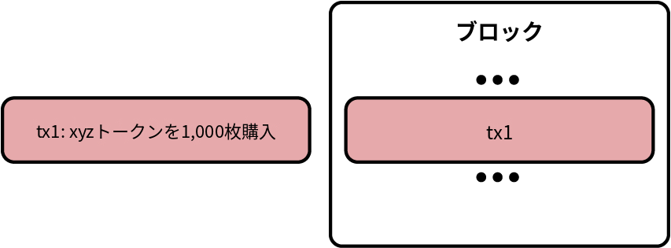

**Figure 6-11.** User transaction before MEV intervention

**図6-11.** MEV介入前のユーザートランザクション

But the validator sees an opportunity to make money by front-running tx1. They create two transactions: tx0 and tx2, where tx0 contains a buy order of 10 xyz tokens and tx2 a sell order of the same amount. The validator places these transactions exactly before and after the user's tx1, as you can see in Figure 6-12. Remember that the validator can do this because they are the actor who is actually creating the block, so they can freely choose the ordering of transactions in it.

　しかし、バリデーターはtx1をフロントランニングして利益を得る機会を見出します。バリデーターは2つのトランザクションを作成します。tx0にはxyzトークン10枚の買い注文、tx2には同量の売り注文を含めます。図6-12のように、バリデーターはユーザーのtx1の直前と直後にトランザクションを配置します。バリデーターが実際にブロックを作成するアクターであるため、ブロック内のトランザクションの順序を自由に決定できるのです。

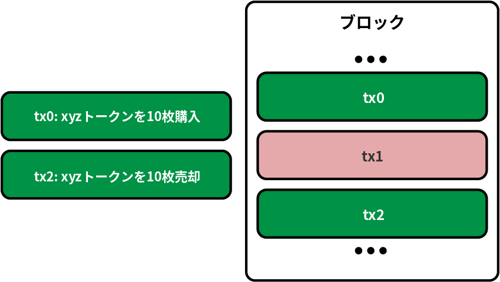

**Figure 6-12.** Sandwich attack by validator

**図6-12.** バリデーターによるサンドイッチ攻撃

The outcome is that the validator is able to buy 10 tokens xyz at $1,000 and sell them at $1,010, making a profit of $10 × 10 = $100.

　その結果、バリデーターはxyzトークン10枚を1,000ドルで購入し1,010ドルで売却することで、10ドル × 10 = 100ドルの利益を得ます。

This is a very simple strategy used by validators to maximize their profits. There are lots of other, more complex strategies. Competition is so high that a new actor has emerged: *builders*.

　これはバリデーターが利益を最大化するために使用する非常にシンプルな戦略の1つです。他にもはるかに複雑な戦略が数多く存在します。競争が非常に激しいため、*ビルダー*という新しいアクターが出現しました。

In fact, running all these strategies requires a lot of processing power, much more than the average validator has (remember, you can run a validator node with just 16 GB of ram). That means MEV was also threatening the decentralization of the validators, favoring big entities that could afford to spend millions of dollars on infrastructure and on people working hard on discovering new profitable strategies to build "better" blocks.

　実際のところ、これらの戦略を実行するには膨大な処理能力が必要であり、平均的なバリデーターが持つ能力をはるかに超えています（バリデーターノードはわずか16 GBのRAMで運用できることを思い出してください）。つまり、MEVはバリデーターの分散性をも脅かし、インフラに数百万ドルを費やし、より利益の高い「より良い」ブロックを構築するための新しい戦略の発見に尽力できる大規模な組織を優遇していたのです。

The solution to this problem came in January 2021 with the release of Flashbots v0.1. It enables block proposers (miners first, validators now) to trustlessly outsource the task of finding the optimal block construction to these new entities called builders. Thanks to this separation of duties—builders filling the block with transactions and creating the block with the highest amount of fee paid to validators (builders take a portion of this fee, too) and validators proposing the block to the network—validators can still run on average vendor machines.

　この問題の解決策は、2021年1月のFlashbots v0.1のリリースとともに登場しました。Flashbotsにより、ブロック提案者（かつてはマイナー、現在はバリデーター）は、最適なブロック構築を見つけるタスクをビルダーと呼ばれる新しいエンティティにトラストレスに委託できるようになりました。ビルダーがトランザクションでブロックを埋め、バリデーターに支払われる手数料が最大となるブロックを作成し（ビルダーも手数料の一部を受け取ります）、バリデーターがブロックをネットワークに提案するという役割分担のおかげで、バリデーターは引き続き平均的なハードウェアで運用を続けることができます。

### Private Mempools

### プライベートメムプール

The MEV ecosystem has grown so much that right now, builders compete not only to find the best strategy to maximize profits but also on the transactions they can use to fill the block. The more transactions they have, the better they can apply their strategies.

　MEVのエコシステムは大きく成長し、現在ではビルダー同士が利益最大化のための最適な戦略を見つけるだけでなく、ブロックを埋めるために利用できるトランザクションの獲得でも競争しています。より多くのトランザクションを持つほど、戦略をより効果的に適用できるからです。

That has led to the creation of *private mempools*. These mempools allow users or entities to submit transactions directly to block producers without exposing them to the general network. They play a significant role in mitigating risks like front-running and enabling privacy-focused workflows.

　この状況が*プライベートメムプール*の誕生につながりました。プライベートメムプールでは、ユーザーやエンティティが一般のネットワークに公開することなく、ブロック生産者に直接トランザクションを送信できます。フロントランニングなどのリスクを軽減し、プライバシー重視のワークフローを実現する上で重要な役割を果たしています。

Flashbots developed its own solution called [Flashbots Protect](https://oreil.ly/Jq4rT). MetaMask, the most popular wallet, has started to use private mempools by default for its users (called [smart transactions](https://oreil.ly/nnZVR)).

　Flashbotsは[Flashbots Protect](https://oreil.ly/Jq4rT)という独自のソリューションを開発しました。最も人気のあるウォレットであるMetaMaskも、ユーザー向けにデフォルトでプライベートメムプールの使用を開始しています（[スマートトランザクション](https://oreil.ly/nnZVR)と呼ばれています）。

### New Transaction Life Cycle

### 新しいトランザクションのライフサイクル

MEV, proposer and builder separation, and private mempools have drastically changed the environment of block production. Nowadays, lots of transactions don't follow the usual life cycle we explained in the previous section; after they are created and signed, they are sent directly to a builder through a private mempool. The builder will take care of them, trying to include them in an optimal block and finally sending the whole block to the validator who is going to propose the next block. The transactions skip the public mempool propagation and directly appear in a built block.

　MEV、提案者とビルダーの分離、プライベートメムプールは、ブロック生産の環境を劇的に変化させました。現在、多くのトランザクションは前節で説明した従来のライフサイクルをたどりません。トランザクションは作成・署名された後、プライベートメムプールを通じてビルダーに直接送信されます。ビルダーがトランザクションを受け取り、最適なブロックに取り込もうと試み、最終的に次のブロックを提案するバリデーターにブロック全体を送信します。トランザクションはパブリックメムプールでの伝播をスキップし、構築済みブロックの中に直接出現するのです。

## Multiple-Signature Transactions

## マルチシグネチャトランザクション

If you are familiar with Bitcoin's scripting capabilities, you know it is possible to create a Bitcoin *multisig* account that can only spend funds when multiple parties sign the transaction (e.g., two of two or three of four signatures). Ethereum's basic EOA value transactions have no provisions for multiple signatures; however, arbitrary signing restrictions can be enforced by smart contracts with any conditions you can think of to handle the transfer of ether and tokens alike.

　ビットコインのスクリプティング機能に精通しているならば、複数の当事者がトランザクションに署名する場合にのみ資金を使用できるビットコインの*マルチシグ*アカウントを作成できることをご存知でしょう（例：2-of-2や3-of-4の署名）。イーサリアムの基本的なEOA（外部所有アカウント）のバリュートランザクションには複数署名の規定がありません。しかし、イーサやトークンの転送を処理するために、あらゆる条件を備えたスマートコントラクトによって任意の署名制限を強制できます。

To take advantage of this capability, ether has to be transferred to a wallet contract that is programmed with the desired spending rules, such as multisignature requirements or spending limits (or combinations of the two). The wallet contract then sends the funds when prompted by an authorized EOA once the spending conditions have been satisfied. For example, to protect your ether under a multisig condition, transfer the ether to a multisig contract. Whenever you want to send funds to another account, all the required users will need to send transactions to the contract using a regular wallet app, effectively authorizing the contract to perform the final transaction.

　この機能を利用するには、マルチシグネチャ要件や支出制限（またはその組み合わせ）など、目的の支出ルールでプログラムされたウォレットコントラクトにイーサを転送する必要があります。支出条件が満たされた後、許可されたEOA（外部所有アカウント）によってリクエストされると、ウォレットコントラクトが資金を送信します。たとえば、マルチシグ条件でイーサを保護するには、マルチシグコントラクトにイーサを転送します。別のアカウントに資金を送りたい場合は、必要なすべてのユーザーが通常のウォレットアプリを使用してコントラクトにトランザクションを送信し、コントラクトに最終的なトランザクションの実行を承認する必要があります。

These contracts can also be designed to require multiple signatures before executing local code or to trigger other contracts. The security of the scheme is ultimately determined by the multisig contract code.

　これらのコントラクトは、ローカルコードを実行する前に複数の署名を要求したり、他のコントラクトをトリガーしたりするようにも設計できます。セキュリティの強度は、最終的にはマルチシグコントラクトのコードによって決まります。

The ability to implement multisignature transactions as a smart contract demonstrates the flexibility of Ethereum. Currently, Gnosis Safe has become the de facto standard for creating multisignature accounts. This suite of battle-tested smart contracts is widely used by major protocols and DAOs, securing more than $6 billion in ETH and more than $74 billion worth of ERC-20 tokens as of November 2024, as illustrated in Figure 6-13.

　マルチシグネチャトランザクションをスマートコントラクトとして実装できることは、イーサリアムの柔軟性を示しています。現在、Gnosis Safeがマルチシグネチャアカウントを作成するためのデファクトスタンダードとなっています。この実戦で検証済みのスマートコントラクトスイートは、主要なプロトコルやDAOで広く使用されており、2024年11月時点で60億ドル以上のETHと740億ドル以上のERC-20トークンを保護しています（図6-13参照）。

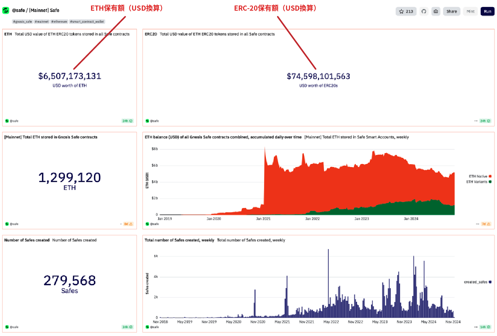

**Figure 6-13.** Gnosis Safe securing billions in value

**図6-13.** 数十億ドル規模の価値を保護するGnosis Safe

> **注記**
>
> With Gnosis Safe, the usual workflow to execute a transaction is as follows:
>
> 1. One of the signers of the Safe proposes a transaction that they want to sign and send to the Ethereum network.
> 2. Other signers see the transaction and sign it if they agree with its purpose.
> 3. When a quorum is reached, the transaction is finally sent to the network, where it gets processed and executed.

> **注記**
>
> Gnosis Safeでトランザクションを実行する一般的なワークフローは以下のとおりである。
>
> 1. Safeの署名者の1人が、署名してイーサリアムネットワークに送信したいトランザクションを提案する
> 2. 他の署名者がトランザクションを確認し、その目的に同意すれば署名する
> 3. 定足数に達すると、トランザクションが最終的にネットワークに送信され、処理・実行される

## Conclusion

## まとめ

Transactions are the starting point of every activity in the Ethereum system. Transactions are the "inputs" that cause the EVM to evaluate contracts, update balances, and more generally modify the state of the Ethereum blockchain. Next, we will work with smart contracts in a lot more detail and learn how to program in the Solidity contract-oriented language.

　トランザクションは、イーサリアムシステム内のすべての活動の出発点です。トランザクションは、EVM（イーサリアム仮想マシン）がコントラクトを評価し、残高を更新し、より一般的にはイーサリアムブロックチェーンの状態を変更するための「インプット」です。次章では、スマートコントラクトの詳細を取り上げ、Solidityというコントラクト指向言語を用いたプログラミングを学びます。
