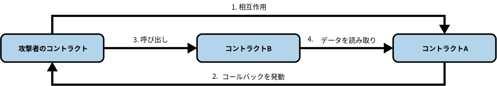

# 第9章 スマートコントラクトのセキュリティ

　セキュリティは、スマートコントラクトを書く際に最も重要な考慮事項の一つです。スマートコントラクトプログラミングの分野では、ミスのコストが高く、容易に悪用されます。この章では、セキュリティのベストプラクティスとデザインパターン、および*セキュリティアンチパターン*（スマートコントラクトに脆弱性をもたらしうる慣行やパターン）について見ていきます。

　他のプログラムと同様に、スマートコントラクトは書かれた通りに正確に実行されます。しかし、実行結果が必ずしもプログラマーの意図通りとは限りません。さらに、すべてのスマートコントラクトはパブリックであり、どのユーザーもトランザクションを作成するだけでやり取りできます。あらゆる脆弱性が悪用される可能性があり、損失はほぼ常に回復不能です。したがって、ベストプラクティスに従い、十分にテストされたデザインパターンを使用することが極めて重要です。

　堅牢な開発を、セキュリティの「スイスチーズモデル」における最初のレイヤーと考えてください。各保護レイヤーはスイスチーズのスライスのように機能します。単独では完璧ではありませんが、組み合わせることでより強力な防御を生み出します。最初のレイヤーは堅実な開発慣行に従うことです。具体的には、信頼性の高いデザインパターンの使用、明確で意図的なコードの記述、既知の落とし穴の積極的な回避が含まれます。この基盤となるレイヤーが、脆弱性からコントラクトを保護するための最良のスタートを提供します。その先には、テスト、コードレビュー、バグバウンティなどの追加レイヤーが保護を加えますが、すべては開発慣行から始まります。

## セキュリティのベストプラクティス

　*防御的プログラミング*は、スマートコントラクトに特に適したプログラミングスタイルです。以下の点を重視しており、すべてがベストプラクティスです。

**ミニマリズム / シンプルさ**

　コードを書く前であっても、すべてのコンポーネントが本当に必要かどうか一歩引いて問いかける価値があります。設計をもっとシンプルにできないか、特定のデータ構造が不必要な攻撃対象面を導入していないかを検討すべきです。アーキテクチャが決まった後も、行数を減らし、エッジケースを排除し、本質的でない機能を削除する機会を探して、批判的な目でコードを見直すべきです。シンプルなコントラクトは推論、テスト、監査がより容易です。一部のDeFiプロトコルは正当に数千行に成長しますが、コードベースの大きさを自慢する人がいる場合は懐疑的であるべきです。より多くのコードは多くの場合、より多くの価値ではなく、より多くのバグを意味します。

**コードの再利用**

　車輪の再発明をしないようにしましょう。必要な機能のほとんどを提供するライブラリやコントラクトがすでに存在する場合は、それを再利用してください。例えば、[OpenZeppelin](https://www.openzeppelin.com)は広く採用され、徹底的にテストされ、コミュニティによって継続的にレビューされているコントラクトスイートを提供しています。自身のコード内では、DRY原則（Don’t Repeat Yourself）に従ってください。コードスニペットが複数回繰り返されている場合、それを関数やライブラリとして書き直して再利用できないか検討してください。多くのデプロイメントで実戦テストされたコードは、どれほど自信があっても、書いたばかりのコードよりもほぼ常に安全です。「ここでは発明されていない」症候群に注意してください。機能やコンポーネントをゼロから構築して「改善」しようとする誘惑です。セキュリティリスクは改善の価値よりも大きいことが多いです。再利用は怠惰ではなく、賢明で防御的なエンジニアリングです。

**コード品質**

　スマートコントラクトのコードは容赦がありません。すべてのバグが金銭的損失につながる可能性があります。スマートコントラクトのプログラミングを汎用プログラミングと同じように扱うべきではありません。SolidityでDAppを書くことは、JavaScriptでWebウィジェットを作成することとは異なります。むしろ、航空宇宙工学やそれに類する容赦のない分野と同様に、厳密なエンジニアリングとソフトウェア開発方法論を適用すべきです。コードを「ローンチ」した後は、問題を修正するためにできることはほとんどありません。コードがアップグレード可能であっても、何か問題が発生した場合に対応する時間は非常に限られることが多いです。プロジェクトのバグを自分より先に誰かが発見した場合、攻撃は1つまたは数個のトランザクションで展開され、介入できるはるか前の数秒以内に被害が完了していることを意味します。

**可読性 / 監査可能性**

　コードは明確で理解しやすくあるべきです。読みやすいほど、監査も容易になります。スマートコントラクトはパブリックです。誰でもバイトコードを読むことができ、十分なスキルを持つ人はリバースエンジニアリングできます。したがって、開発者コミュニティの集合知を活用し、オープンソース開発の最高水準の恩恵を受けるために、協調的でオープンソースの方法論を使用して公開で開発することが有益です。イーサリアムコミュニティの一部であるスタイルと命名規約に従って、十分に文書化され読みやすいコードを書くべきです。

**テストカバレッジ**

　可能な限りすべてをテストしてください。スマートコントラクトはパブリックな実行環境で動作し、誰でも好きな入力で実行できます。関数の引数などの入力が適切な形式であるか、適切な範囲内であるか、善意の目的であるかを決して仮定すべきではありません。コードの実行を続行させる前に、すべての引数が期待される範囲内にあり適切にフォーマットされていることを確認するためにテストしてください。

## セキュリティリスクとアンチパターン

　スマートコントラクトのプログラマーとして、最も一般的なセキュリティリスクに精通しておくべきです。そうすることで、コントラクトをこれらのリスクにさらすプログラミングパターンを検出し回避できます。以降のセクションでは、さまざまなセキュリティリスク、脆弱性がどのように発生しうるかの例、およびそれらに対処するために使用できる対策や予防的ソリューションを見ていきます。

　以下のアンチパターンはWeb2セキュリティと同様に、攻撃を実行するためにしばしば組み合わされます。実世界の攻撃は通常、この章の例よりも複雑です。

### リエントランシー

　イーサリアムのスマートコントラクトの特徴の一つは、外部コントラクトのコードを呼び出して利用できることです。また、コントラクトは通常Etherを扱うため、さまざまな外部ユーザーアドレスにEtherを送信することも多くあります。これらの操作ではコントラクトが外部呼び出しを行う必要があります。攻撃者はこの外部呼び出しを乗っ取り、コールバック（フォールバック関数やフックなど、通常は`transfer`）を通じてコントラクトにさらなるコードを実行させることができます。コントラクト自身への再帰的な呼び出しも可能です。この種の攻撃は、2016年に発生した悪名高いDAOハッキングで使用されました。発見が比較的容易であり修正コストも低いにもかかわらず、あれから何年も経った今でも[この脆弱性を悪用した攻撃が多数確認されています](https://oreil.ly/87VUR)。

#### 脆弱性

　この種の攻撃は、コントラクトが状態の更新を完了する前に、攻撃者が実行中のコントラクトの制御を奪うことで発生します。コントラクトは処理の途中にあるため、まだ状態（例えば重要な変数）を更新していません。攻撃者はこの脆弱なタイミングでコントラクトに「再入」し、不整合な状態を利用して意図されていない動作を引き起こすことができます。コントラクトがまだ安全で整合性のある状態に落ち着いていないため、攻撃者はセーフガードを回避し、データを操作し、資金を流出させることが可能になります。

　リエントランシーは、実際の例がなければ理解が難しい概念です。例9-1のシンプルな脆弱性のあるコントラクトを見てみましょう。このコントラクトはイーサリアムの金庫として機能し、預金者が1週間に1 Etherのみ引き出せるようになっています。

**例9-1. EtherStore: リエントランシーに対して脆弱なコントラクト**

```solidity
1 contract EtherStore {
2      uint256 public withdrawalLimit = 1 ether;
3      mapping(address => uint256) public lastWithdrawTime;
4    mapping(address => uint256) balances;
5
6    function depositFunds() public payable{
7      balances[msg.sender] += msg.value;
8    }
9
10    function withdrawFunds() public {
11        require(block.timestamp >= lastWithdrawTime[msg.sender] + 1 weeks);
12        uint256 _amt = balances[msg.sender];
13        if(_amt > withdrawalLimit){
14            _amt = withdrawalLimit;
15        }
16      (bool res, ) = address(msg.sender).call{value: _amt}("");
17        require(res, "Transfer failed");
18      balances[msg.sender] = 0;
19        lastWithdrawTime[msg.sender] = block.timestamp;
20    }
21 }
```

　このコントラクトには`depositFunds`と`withdrawFunds`の2つのパブリック関数があります。`depositFunds`関数は単純に送信者の残高を増加させます。`withdrawFunds`関数は送信者が残高を引き出すことを可能にします。この関数は、直近1週間に引き出しが行われていない場合にのみ成功するように設計されています。

　脆弱性は17行目にあります。コントラクトがユーザーに要求された量のEtherを送信する箇所です。例9-2のコントラクトを作成した攻撃者を考えてみましょう。

**例9-2. Attack.sol: EtherStoreコントラクトのリエントランシー脆弱性を悪用するコントラクト**

```solidity
1 contract Attack {
2  EtherStore public etherStore;
3
4  // etherStore変数をコントラクトアドレスで初期化
5  constructor(address _etherStoreAddress) {
6      etherStore = EtherStore(_etherStoreAddress);
7  }
8
9  function attackEtherStore() public payable {
10      // 最も近いether単位で攻撃
11      require(msg.value >= 1 ether, "no bal");
12      // depositFunds()関数にethを送信
13      etherStore.depositFunds{value: 1 ether}();
14      // 攻撃開始
15      etherStore.withdrawFunds();
16  }
17
18  function collectEther() public {
19      payable(msg.sender).transfer(address(this).balance);
20  }
21
22  // receive関数 - fallback()関数でも同様に動作する
23  receive() external payable {
24      if (address(etherStore).balance >= 1 ether) {
25          // 被害者コントラクトへのリエントラント呼び出し
26          etherStore.withdrawFunds();
27      }
28  }
29 }
```

　この攻撃はどのように行われるのでしょうか。まず、攻撃者は`EtherStore`のコントラクトアドレスを唯一のコンストラクターパラメーターとして、悪意あるコントラクト（アドレスを`0x0...123`とします）を作成します。これにより、パブリック変数`etherStore`が攻撃対象のコントラクトを指すように初期化されます。

　次に、攻撃者は1以上のEtherを指定して`attackEtherStore`関数を呼び出します。ここでは1 Etherと仮定します。この例では、他の複数のユーザーがこのコントラクトにEtherを預け入れており、現在の残高が10 Etherであると仮定します。以下の手順で攻撃が進行します。

- *Attack.sol*、13行目: `EtherStore`コントラクトの`depositFunds`関数が`msg.value`として`1 ether`で呼び出される（大量のガスとともに）。送信者（`msg.sender`）は悪意あるコントラクト（`0x0...123`）である。したがって、`balances[0x0..123] = 1 ether`となる。
- *Attack.sol*、15行目: 悪意あるコントラクトが`EtherStore`コントラクトの`withdrawFunds`関数を呼び出す。過去に引き出しが行われていないため、要件チェック（`EtherStore`コントラクトの11行目）を通過する。
- *EtherStore.sol*、16行目: コントラクトが悪意あるコントラクトに`1 ether`を送り返す。
- *Attack.sol*、23行目: 悪意あるコントラクトへの送金により`receive`関数が実行される。
- *Attack.sol*、24行目: `EtherStore`コントラクトの残高は10 Etherから9 Etherになっているため、この`if`文は条件を満たす。
- *Attack.sol*、26行目: フォールバック関数が`EtherStore`の`withdrawFunds`関数を再度呼び出し、`EtherStore`コントラクトに*再入*する。
- *EtherStore.sol*、10行目: `withdrawFunds`への2回目の呼び出しにおいて、18行目がまだ実行されていないため、攻撃コントラクトの残高は依然として1 Etherである。つまり、`balances[0x0..123] = 1 ether`のままである。`lastWithdrawTime`変数も同様である。再び要件チェックを通過する。
- *EtherStore.sol*、16行目: 攻撃コントラクトがさらに`1 ether`を引き出す。
- *Attack.sol*の24行目で指定されているように、`EtherStore.balance >= 1`でなくなるまで`EtherStore`コントラクトへの再入が繰り返される。
- *Attack.sol*、24行目: `EtherStore`コントラクトに1 Ether未満しか残っていない場合、この`if`文は条件を満たさなくなる。これにより、`EtherStore`コントラクトの17-19行目が（`withdrawFunds`関数の各呼び出しに対して）実行される。
- *EtherStore.sol*、18行目と19行目: `balances`マッピングと`lastWithdrawTime`マッピングが設定され、実行が終了する。

　最終的に、攻撃者は1回のトランザクションで`EtherStore`コントラクトからすべてのEtherを引き出すことに成功します。

　フォールバック関数で傍受されるネイティブEther送金はリエントランシー攻撃の一般的なベクトルですが、リスクの原因となる仕組みはこれだけではありません。ERC-721やERC-777などの複数のトークン標準には、リエントランシー攻撃を可能にするコールバックメカニズムが含まれています。例えば、ERC-721の`safeTransfer`関数は、コントラクトへのトークン転送時に受信者の`onERC721Received`関数を呼び出すことを保証します。同様に、ERC-777トークンでは転送時に`tokensReceived`関数を通じてフックを起動できます。

#### 古典的なリエントランシーパターンを超えて

　リエントランシー攻撃は、単一の関数やコントラクトに限定されません。古典的なリエントランシーは、同じ関数が完了する前に再入するものですが、検出しにくいバリエーションも存在します。クロスファンクションリエントランシー、クロスコントラクトリエントランシー、そして中でも最も発見が困難なリードオンリーリエントランシーなどです。

　リードオンリーリエントランシーは、他のコントラクトのview関数に依存するコントラクトを悪用します。view関数は状態を変更しませんが、他のコントラクトが依存するデータを返します。多くの場合、リエントランシー保護は適用されていません。リエントラント呼び出しによって攻撃者がターゲットコントラクトを一時的に不整合な状態にし、別のコントラクト（被害者）がview関数を通じてこの不安定な状態を問い合わせることで問題が発生します。

　具体的な流れを見てみましょう。

1. 攻撃者のコントラクトが、再入可能な脆弱なコントラクト（コントラクトAと呼びます）と対話する。このコントラクトは、他のプロトコルが依存するデータを保持している。
2. コントラクトAが攻撃者のコントラクトへのコールバックをトリガーし、攻撃者のコントラクトロジックが実行される。
3. フォールバック内にいる間に、攻撃者のコントラクトが別のプロトコル、コントラクトBを呼び出す。コントラクトBはコントラクトAに接続されており、コントラクトAが提供するデータに依存している。
4. コントラクトBは問題を認識せずにコントラクトAからデータを読み取る。しかし、コントラクトAの状態はまだ更新が完了していないため古いままである。

　このサイクルが終了する時点で、攻撃者はすでにコントラクトAの古いデータを利用してコントラクトBを悪用しています。その後、コントラクトAのコールバックと元の呼び出しは通常通り完了します。このプロセスを図9-1に示します。



図9-1 リードオンリーリエントランシー

　ここでの要点は、コントラクトBがコントラクトAのデータを信頼しているにもかかわらず、コントラクトAの状態がまだ追いついていないということです。攻撃者はこのタイムラグを悪用します。この種の攻撃に対する防御は困難です。開発者はview関数が状態を変更しないため安全だと考え、リエントランシーロックで保護しないことが多いためです。

　リードオンリーリエントランシーが教えてくれるのは、リードオンリー関数であっても、外部コントラクトから依存されている場合には危険になりうるということです。

#### 予防テクニック

　リエントランシーの問題を防ぐための最初のベストプラクティスは、スマートコントラクトの記述時にcheck-effect-interactionパターンに従うことです。このパターンは、外部コントラクトとの対話の前にすべての状態変数の変更を行うことを保証します。例えば、*EtherStore.sol*コントラクトでは、状態変数を変更する行は外部呼び出しの前に配置されるべきです。外部アドレスと対話するコードが関数内で最後に実行されるようにすることが目標です。必要な更新がすでに完了しているため、再入時に外部コントラクトが内部状態に干渉することを防止できます。

　もう一つの有用なテクニックは、リエントランシーロックの適用です。*リエントランシーロック*は、関数の実行中にコントラクトを「ロック」するシンプルな状態変数であり、他の外部呼び出しによる割り込みを防ぎます。以下のようなmodifierで実装できます。

```solidity
contract EtherStore {
    bool lock;
      uint256 public withdrawalLimit = 1 ether;
      mapping(address => uint256) public lastWithdrawTime;
    mapping(address => uint256) balances;

      modifier nonReentrant {
      require(!lock, "Can't reenter");
      lock = true;
      _;
      lock = false;
    }

    function withdrawFunds() public nonReentrant{
        [...]
    }
}
```

　この例では、`nonReentrant` modifierがlock変数を使用して、`withdrawFunds`関数の実行中に再入されることを防いでいます。`nonReentrant` modifierは開始時にコントラクトをロックし、関数の完了後にアンロックします。しかし、車輪の再発明をすべきではありません。独自のリエントランシーロックを作成する代わりに、OpenZeppelinのReentrancyGuardのようなよくテストされたライブラリを利用する方が望ましいです。これらのライブラリは安全でガス効率の良いソリューションを提供しています。

> **注記**
>
> Solidity 0.8.24でイーサリアムにトランジエントストレージが導入されたことに伴い、OpenZeppelinはReentrancyGuardTransientを導入しました。これはReentrancyGuardの新しいバリアントであり、トランジエントストレージを活用して大幅に低いガスコストを実現しています。[EIP-1153](https://oreil.ly/fRvKl)によって有効化されたトランジエントストレージは、単一のトランザクション期間中にのみ必要なデータをより安価に保存する方法を提供し、リエントランシーガードや類似の一時的なロジックに最適です。ただし、ReentrancyGuardTransientはEIP-1153が利用可能なチェーンでのみ使用できるため、実装前にターゲットチェーンがこの機能をサポートしていることを確認してください。

　もう一つのアプローチは、Solidityの組み込み関数である`transfer`および`send`を使用してEtherを送信することです。これらの関数は限られた量のガス（2,300ユニット）のみを転送するため、通常は受信コントラクトがリエントラント呼び出しを実行するには不十分です。そのため、リエントランシーに対するシンプルな防御策となります。しかし、注目すべき欠点があります。受信者が、フォールバック関数やreceive関数に悪意のないロジックを持つスマートコントラクトの場合、送金が失敗し資金がロックされる可能性があります。EIP-7702の導入により、このリスクはさらに高まっています。EIP-7702はEOAにフォールバックロジックを含むコードを付与することを可能にします。より多くのEOAがこの機能を採用するにつれ、`transfer`や`send`を使用するトランザクションは、ガス不足によりトランザクションの通常の実行中にリバートする可能性が高くなります。セキュリティの観点からも、このアプローチは将来にわたって安全とは言えません。将来のハードフォークで特定の操作のガスコストが削減された場合、2,300ユニットでも再入に十分となり、それまで安全だった前提が崩れる可能性があります。したがって、`transfer`や`send`は限定的なケースでは依然として有用ですが、慎重に使用し、主要な防御策として依存すべきではありません。

　リードオンリーおよびクロスコントラクトリエントランシーには特別な注意が必要です。これらの攻撃は2つの異なるプロトコルが関与する可能性があるため、協調的な予防が課題となります。プロジェクトがデータのために外部プロトコルに依存している場合、統合されたロジックがどのように機能するかを深く調査する必要があります。各プロジェクトが単独では安全であっても、統合時に脆弱性が現れる可能性があります。

#### 実例: DAO攻撃

　リエントランシーは、2016年に発生したDAO攻撃において主要な役割を果たしました。この攻撃はイーサリアムの初期開発段階における最大のハッキングの一つでした。当時、コントラクトには1億5,000万ドル以上が保有されており、これはEtherの流通供給量の15%に相当しました。ハッキングの影響を元に戻すために、イーサリアムコミュニティは最終的にイーサリアムブロックチェーンを分割するハードフォークを選択しました。その結果、Ethereum Classic（ETC）がオリジナルのチェーンとして存続し、ハッキングの影響を元に戻すためのルール更新が適用されたフォーク版が、現在知られているイーサリアムとなりました。

#### 実例: Libertify

　リエントランシーが唯一の攻撃ベクトルであった最近の事例として、2023年7月に発生したLibertifyの事件があります。DeFiプロトコルであるLibertifyは40万ドルの被害を受けました。悪用された関数のコードを確認し、どのように攻撃が行われたかを見てみましょう。

```solidity
function _deposit(
    uint256 assets,
    address receiver,
    bytes calldata data,
    uint256 nav
) private returns (uint256 shares) {
        /*
        バリデーション
    */
    uint256 returnAmount = 0;
    uint256 swapAmount = 0;
    if (BASIS_POINT_MAX > invariant) {
        swapAmount = assetsToToken1(assets);
        returnAmount = userSwap( // 外部呼び出し
            data,
            address(this),
            swapAmount,
            address(asset),
            address(other)
        );
    }
    uint256 supply = totalSupply(); // 状態の更新
    if (0 < supply) {
        uint256 valueToken0 = getValueInNumeraire(
            asset,
            assets - swapAmount,
            MathUpgradeable.Rounding.Down
        );
        uint256 valueToken1 = getValueInNumeraire(
            other,
            returnAmount,
            MathUpgradeable.Rounding.Down
        );
        shares = supply.mulDiv(
            valueToken0 + valueToken1,
            nav,
            MathUpgradeable.Rounding.Down
        );
    } else {
        shares = INITIAL_SHARE;
    }
    uint256 feeAmount = shares.mulDiv(
        entryFee, BASIS_POINT_MAX, MathUpgradeable.Rounding.Down
    );
    _mint(receiver, shares - feeAmount);
    _mint(owner(), feeAmount);
}
```

　これはリエントランシーの問題の典型的な例です。これほど分かりやすいものは最近ではなかなか見られません。根本的な問題はリエントランシー保護の欠如でした。`userSwap()`関数により、攻撃者は元の呼び出しが`totalSupply`を更新する前に`deposit()`関数に再入することができました。これにより、攻撃者は実際に受け取るべき量よりも多くのシェアをミントし、コントラクトから利益を搾取しました。

### DELEGATECALL

　`CALL`および`DELEGATECALL`オペコードは、イーサリアムの開発者がコードをモジュール化するために有用です。コントラクトへの標準的な外部メッセージ呼び出しは`CALL`オペコードによって処理され、*呼び出された*コントラクトのコンテクストでコードを実行します。一方、`DELEGATECALL`は別のコントラクトのコードを*呼び出し元の*コントラクトのコンテクストで実行します。つまり、ストレージ、`msg.sender`、`msg.value`はすべて変更されません。`DELEGATECALL`を理解するための分かりやすい考え方は、呼び出し元のコントラクトが呼び出し先のコントラクトのバイトコードを一時的に借用し、自身のコードであるかのように実行するというものです。これにより、再利用可能なロジックを一度デプロイして多くのコントラクトで利用するプロキシコントラクトやライブラリのような強力なパターンが可能になります。これら2つのオペコードの違いはシンプルで直感的ですが、`DELEGATECALL`の使用は、特にストレージレイアウトに関して、微妙で予期しない動作を引き起こす可能性があります。詳細については、ロイ・ルーの[このトピックに関するEthereum Stack Exchangeの質問](https://oreil.ly/GJOUl)と[Solidityのドキュメント](https://oreil.ly/gA7vg)を参照してください。

#### 脆弱性

　`DELEGATECALL`のコンテクスト保持特性により、脆弱性のないカスタムライブラリを構築することは想像以上に容易ではありません。ライブラリ自体のコードは安全で脆弱性がなくても、別のアプリケーションのコンテクストで実行された場合に新たな脆弱性が発生する可能性があります。フィボナッチ数を使ったやや複雑な例を見てみましょう。例9-3のライブラリは、フィボナッチ数列および類似の形式の数列を生成できます。（注: このコードは[*https://oreil.ly/EHjOb*](https://oreil.ly/EHjOb)を元に変更されています。）

**例9-3. FibonacciLib: カスタムライブラリの欠陥のある実装**

```solidity
1 // ライブラリ コントラクト - フィボナッチ風の数値を計算
2 contract FibonacciLib {
3     // 標準フィボナッチ数列の初期化
4     uint256 public start;
5     uint256 public calculatedFibNumber;
6
7     // 数列の0番目の数を変更
8     function setStart(uint256 _start) public {
9         start = _start;
10     }
11
12     function setFibonacci(uint256 n) public {
13         calculatedFibNumber = fibonacci(n);
14     }
15
16     function fibonacci(uint256 n) internal view returns (uint) {
17         if (n == 0) return start;
18         else if (n == 1) return start + 1;
19         else return fibonacci(n - 1) + fibonacci(n - 2);
20     }
21 }
```

　このライブラリは、数列の*n*番目のフィボナッチ数を生成する関数を提供します。ユーザーが数列の開始数（`start`）を変更し、新しい数列の*n*番目のフィボナッチ風の数を計算できるようにしています。

　次に、このライブラリを利用するコントラクトを見てみましょう。

```solidity
contract FibonacciBalance {
    address public fibonacciLibrary;
    // 引き出す現在のフィボナッチ数
    uint256 public calculatedFibNumber;
    // フィボナッチ数列の開始番号
    uint256 public start = 3;
    uint256 public withdrawalCounter;
    // フィボナッチ関数セレクター
    bytes4 constant fibSig = bytes4(keccak256("setFibonacci(uint256)"));
    // コンストラクター - コントラクトにEtherをロード
    constructor(address _fibonacciLibrary) payable {
        fibonacciLibrary = _fibonacciLibrary;
    }
    function withdraw() public {
        withdrawalCounter += 1;
        // 現在の引き出しユーザーのフィボナッチ数を計算
        // calculatedFibNumberを設定する
        (bool success, ) = fibonacciLibrary.delegatecall(
            abi.encodeWithSelector(fibSig, withdrawalCounter)
        );
        require(success, "Delegatecall failed");
        payable(msg.sender).transfer(calculatedFibNumber * 1 ether);
    }
    // ユーザーがフィボナッチ ライブラリ関数を呼び出せるようにする
    fallback() external {
        (bool success, ) = fibonacciLibrary.delegatecall(msg.data);
        require(success, "Delegatecall failed");
    }
}
```

　このコントラクトは、参加者がコントラクトからEtherを引き出すことを可能にします。引き出し量は参加者の引き出し順に対応するフィボナッチ数と等しくなります。つまり、最初の参加者は1 Ether、2番目も1 Ether、3番目は2 Ether、4番目は3 Ether、5番目は5 Etherという具合です（コントラクトの残高が引き出そうとしているフィボナッチ数より少なくなるまで続きます）。

　このコントラクトにはいくつか説明が必要な要素があります。まず、興味深い変数`fibSig`があります。これは文字列`"setFibonacci(uint256)"`のKeccak-256ハッシュの最初の4バイトを保持しています。これは[*関数セレクター*](https://oreil.ly/u9uaH)として知られ、スマートコントラクトのどの関数を呼び出すかを指定するためにcalldataに配置されます。21行目の`delegatecall`関数で、`fibonacci(uint256)`関数を実行したいことを指定するために使用されます。`delegatecall`の2番目の引数は関数に渡すパラメーターです。次に、FibonacciLibライブラリのアドレスがコンストラクターで正しく参照されていると仮定します。

　このコントラクトにエラーを見つけられますか？このコントラクトをデプロイし、Etherを入金して`withdraw`を呼び出すと、おそらくリバートするでしょう。

　状態変数`start`がライブラリとメインの呼び出し元コントラクトの両方で使用されていることに気づいたかもしれません。ライブラリコントラクトでは、`start`はフィボナッチ数列の開始を指定するために使用され`0`に設定されていますが、呼び出し元コントラクトでは`3`に設定されています。また、`FibonacciBalance`コントラクトのフォールバック関数がすべての呼び出しをライブラリコントラクトに渡すことにも気づいたかもしれません。これにより、ライブラリコントラクトの`setStart`関数を呼び出すことが可能になります。コントラクトの状態が保持されることを思い出すと、この関数がローカルの`FibonacciBalance`コントラクトの`start`変数の状態を変更できるように思えるかもしれません。もしそうであれば、`calculatedFibNumber`が`start`変数に依存しているため（ライブラリコントラクトで確認できる通り）、より多くのEtherを引き出すことが可能になります。しかし実際には、`setStart`関数は`FibonacciBalance`コントラクトの`start`変数を変更しません（変更できません）。このコントラクトの根本的な脆弱性は、`start`変数の変更よりもはるかに深刻です。

　実際の問題を議論する前に、状態変数がコントラクト内でどのように保存されるかを理解するために少し寄り道しましょう。*状態変数*または*ストレージ変数*（個々のトランザクションを超えて永続する変数）は、コントラクト内で導入された順に*スロット*に配置されます。（ここにはいくつかの複雑な点があります。より詳しい理解については[Solidityのドキュメント](https://oreil.ly/LzV7L)を参照してください。）

　例として、ライブラリコントラクトを見てみましょう。このコントラクトには`start`と`calculatedFibNumber`の2つの状態変数があります。最初の変数`start`は、コントラクトのストレージの`slot[0]`（最初のスロット）に保存されます。2番目の変数`calculatedFibNumber`は、次に利用可能なストレージスロットである`slot[1]`に配置されます。`setStart`関数は入力を受け取り、`start`をその入力値に設定します。したがって、この関数は`setStart`関数に提供した入力値で`slot[0]`を設定します。同様に、`setFibonacci`関数は`calculatedFibNumber`を`fibonacci(n)`の結果に設定します。これも単にストレージの`slot[1]`を`fibonacci(n)`の値に設定しているだけです。

　次に、`FibonacciBalance`コントラクトを見てみましょう。ストレージの`slot[0]`は`fibonacciLibrary`アドレスに対応し、`slot[1]`は`calculatedFibNumber`に対応します。この不正確なマッピングに脆弱性が存在します。`delegatecall`は*コントラクトのコンテクストを保持*します。つまり、`delegatecall`を介して実行されるコードは、呼び出し元コントラクトの状態（すなわちストレージ）に対して作用します。

　`withdraw`の21行目で`fibonacciLibrary.delegatecall(fibSig,withdrawalCounter)`を実行していることに注目してください。これは`setFibonacci`関数を呼び出し、先ほど説明した通りストレージの`slot[1]`を変更します。現在のコンテクストでは`calculatedFibNumber`に相当します。これは期待通りの動作です（実行後、`calculatedFibNumber`が変更されます）。しかし、`FibonacciLib`コントラクトの`start`変数がストレージの`slot[0]`に位置していることを思い出してください。現在のコントラクトでは`fibonacciLibrary`アドレスに相当します。つまり、`fibonacci`関数は予期しない結果を返します。`start`（`slot[0]`）を参照しますが、現在の呼び出しコンテクストではそれは`fibonacciLibrary`アドレスであり、`uint`として解釈するとかなり大きな値になります。したがって、`withdraw`関数はリバートする可能性が高いです。`calculatedFibNumber`が返す`uint(fibonacciLibrary)`の量のEtherをコントラクトが保持していないためです。

　さらに悪いことに、`FibonacciBalance`コントラクトでは、ユーザーが27行目のフォールバック関数を通じてすべての`fibonacciLibrary`関数を呼び出すことができます。先ほど説明した通り、これには`setStart`関数も含まれます。この関数が誰でもストレージの`slot[0]`を変更または設定できることを説明しました。この場合、ストレージの`slot[0]`は`fibonacciLibrary`アドレスです。したがって、攻撃者は悪意あるコントラクトを作成し、そのアドレスを`uint256`に変換して（Pythonで`int(‘<address>’,16)`を使えば簡単にできます）、`setStart(<attack_contract_address_as_uint>)`を呼び出すことができます。これにより`fibonacciLibrary`が攻撃コントラクトのアドレスに変更されます。その後、ユーザーが`withdraw`やフォールバック関数を呼び出すたびに、悪意あるコントラクトが実行されます（コントラクトの全残高を盗むことができます）。`fibonacciLibrary`の実際のアドレスが変更されたためです。このような攻撃コントラクトの例は以下の通りです。

```solidity
contract Attack {
    uint256 private storageSlot0; // fibonacciLibraryに対応
    uint256 private storageSlot1; // calculatedFibNumberに対応
    // フォールバック - 指定された関数が見つからない場合に実行される
    fallback() external {
        storageSlot1 = 0; // calculatedFibNumberを0に設定し、withdrawが
        // 呼ばれてもEtherを送信しないようにする
        payable(<attacker_address>).transfer(this.balance); // すべてのEtherを奪取
    }
}
```

　この攻撃コントラクトはストレージの`slot[1]`を変更することで`calculatedFibNumber`を変更しています。原理的には、攻撃者は任意のストレージスロットを変更して、このコントラクトに対してあらゆる種類の攻撃を実行できます。これらのコントラクトを[Remix](https://remix.ethereum.org)に入力し、さまざまな攻撃コントラクトや`delegatecall`関数を通じた状態変更を試してみることをお勧めします。

　`delegatecall`が状態を保持するといった場合、コントラクトの変数名ではなく、変数名が指し示す実際のストレージスロットについて述べていることに注意することも重要です。この例からわかるように、単純なミスが攻撃者によるコントラクト全体とそのEtherの乗っ取りにつながる可能性があります。

#### 予防テクニック

　Solidityはライブラリコントラクトを実装するための`library`キーワードを提供しています（詳細は[ドキュメント](https://oreil.ly/K7kF1)を参照）。これにより、ライブラリコントラクトがステートレスで自己破壊不可能であることが保証されます。ライブラリをステートレスに強制することで、このセクションで示したストレージコンテクストの複雑さが軽減されます。ステートレスなライブラリは、攻撃者がライブラリの状態を直接変更してそのコードに依存するコントラクトに影響を与える攻撃も防ぎます。一般的な経験則として、`DELEGATECALL`を使用する場合は、ライブラリコントラクトと呼び出し元コントラクトの両方の呼び出しコンテクストに細心の注意を払い、可能な限りステートレスなライブラリを構築してください。

#### 実例: Parityマルチシグウォレット（2回目のハッキング）

　2回目のParityマルチシグウォレットのハッキングは、よく書かれたライブラリコードであっても、意図されたコンテクスト外で実行された場合にどのように悪用されうるかを示す例です。このハッキングについては、[「Parity Multisig Hacked. Again」](https://oreil.ly/OLt5Q)など、多くの優れた解説があります。これらの参考資料に加えて、悪用されたコントラクトを見てみましょう。

　この攻撃は7年前のものであるため、以下のコードスニペットは最新のSolidityバージョンの構文に更新されており、より読みやすく理解しやすくなっています。

　ライブラリコントラクトは以下の通りです。

```solidity
1 contract WalletLibrary is WalletEvents {
2
3   ...
4
5   // コントラクトがまだ初期化されていない場合にのみ通過
6   modifier only_uninitialized { if (m_numOwners > 0) revert(); _; }
7
8   // コンストラクター - オーナー配列をmultiownedに、
9   // 制限をdaylimitに渡す
10   function initWallet(address[] memory _owners, uint256 _required, uint256
11        _daylimit) public only_uninitialized {
12     initDaylimit(_daylimit);
13     initMultiowned(_owners, _required);
14   }
15
16   // コントラクトを破壊し、すべてを`_to`に送信
17   function kill(address _to) onlymanyowners(keccak256(msg.data)) external {
18     selfdestruct(_to);
19   }
20
21   ...
22
23 }
```

　ウォレットコントラクトは以下の通りです。

```solidity
1 contract Wallet is WalletEvents {
2
3   ...
4
5   // メソッド
6
7   // 他の関数がマッチしない場合に呼び出される
8   fallback() external payable {
9     // 単にキャッシュが送られただけか？
10     if (msg.value > 0)
11       Deposit(msg.sender, msg.value);
12     else if (msg.data.length > 0)
13       _walletLibrary.delegatecall(msg.data);
14   }
15
16   ...
17
18   // フィールド
19   address constant _walletLibrary =
20     0xcafecafecafecafecafecafecafecafecafecafe;
21 }
```

　`Wallet`コントラクトは基本的にすべての呼び出しをデリゲートコールを介して`WalletLibrary`コントラクトに渡していることに注目してください。このコードスニペットの定数`_walletLibrary`アドレスは、実際にデプロイされた`WalletLibrary`コントラクト（`0x863DF6BFa4469f3ead0bE8f9F2AAE51c91A907b4`にあったもの）のプレースホルダーとして機能しています。

　これらのコントラクトの意図された動作は、コードベースと主要機能が`WalletLibrary`コントラクトにある、シンプルで低コストのデプロイ可能な`Wallet`コントラクトを持つことでした。残念ながら、`WalletLibrary`コントラクト自体がコントラクトであり、独自の状態を保持しています。なぜこれが問題になりうるか分かりますか？

　`WalletLibrary`コントラクト自体に呼び出しを送信することが可能でした。具体的には、`WalletLibrary`コントラクトを初期化し、オーナーになることができました。実際に、あるユーザーが`WalletLibrary`コントラクトの`initWallet`関数を呼び出し、ライブラリコントラクトのオーナーになりました。同じユーザーがその後`kill`関数を呼び出しました。ユーザーがライブラリコントラクトのオーナーであったためmodifierを通過し、ライブラリコントラクトは自己破壊しました。現存するすべての`Wallet`コントラクトがこのライブラリコントラクトを参照しており、この参照を変更する方法を持たないため、Etherの引き出し機能を含むすべての機能が`WalletLibrary`コントラクトとともに失われました。その結果、このタイプのすべてのParityマルチシグウォレットのすべてのEtherが即座に失われるか、永久に回復不能となりました。

> **注記**
>
> 攻撃者はその後[GitHubに現れ](https://oreil.ly/VVgnm)、「うっかり壊してしまいました」という印象的なコメントを残しました。彼はイーサリアムの初心者で、スマートコントラクトを試していただけだと主張しました。

### エントロピーの幻想

　イーサリアムブロックチェーン上のすべてのトランザクションは*決定論的状態遷移*操作です。つまり、すべてのトランザクションは不確実性なしに計算可能な方法でイーサリアムエコシステムのグローバル状態を変更します。この性質は、イーサリアムにはエントロピーやランダム性の源泉が存在しないという根本的な含意を持ちます。初期の頃、分散化された方法でランダム性を生成することは大きな課題でした。しかし年月を経て、この問題を解決するためのいくつかの確実なソリューションが開発されてきました。

#### 脆弱性

　開発者がイーサリアム上でスマートコントラクトを構築する際、ゲーム、宝くじ、その他の予測不可能性を必要とする機能のために、ランダム性の源泉がしばしば必要になります。課題は、イーサリアムがブロックチェーンとして本質的に決定論的であり、コンセンサスを維持するためにすべてのノードが同じ結果に到達しなければならないことです。そのため、真のランダム性を導入するにはある程度の創意工夫が必要になります。

　多くの開発者が頼ってきたアプローチの一つは、ブロック変数（ブロックハッシュ、タイムスタンプ、ブロック番号など）をシードとして乱数を生成することです。これらの値はランダムに見えるかもしれませんが、実際には現在のブロックを提案するバリデータによって制御されています。例えば、ゲームの結果が次のブロックハッシュの末尾が偶数かどうかに基づくDAppを想像してください。バリデータはこのプロセスを操作できます。ブロックを提案しようとしている際にハッシュが望む結果に合わない場合、例えばトランザクションの順序を変更して、有利な方向にブロックハッシュを変えることが可能です。

　ブロック変数からランダム性を導出する場合、バリデータの操作だけがリスクではありません。他のスマートコントラクトもこれらのブロック変数の値を知ることができるため、結果が有利な場合にのみ脆弱なコントラクトと対話することが可能です。

#### 予防テクニック

　過去と比較して、イーサリアムの開発者はランダム性を生成するための信頼性の高い方法を持つようになりました。`PREVRANDAO`と*検証可能なランダム関数*（VRF）です。

　VRFはランダム性が公正で偏りがないことを保証する暗号学的証明です。VRFはChainlinkなど複数のプロバイダーによってサポートされています。VRFは乱数とともにその公正性を検証する証明を生成します。この証明は誰でも検証可能であり、ランダム性が安全であることを保証します。VRFはスマートコントラクトでランダム性を安全に取得するための標準的な分散型ソリューションとなっています。

　もう一つの確実な選択肢は、PoSへの移行とともにイーサリアムに導入された`PREVRANDAO`オペコードです。このオペコードは`PREVRANDAO`値を取得するために使用され、PoSブロック生成の不可欠な要素であるRandaoプロセスに由来します。本質的に、Randaoはバリデータがそれぞれデータの一部を提供することでランダム性を生成する共同作業です。`PREVRANDAO`は前のブロックからのこのプロセスの結果であり、信頼性の高いランダム性の源泉として機能します。`PREVRANDAO`値を操作するには相当数のバリデータを侵害する必要があるため信頼性が高く、そのような悪用は非現実的で経済的に不可能です。開発者はコントラクトでこの値を使用できますが、`PREVRANDAO`は前のブロックの値を表し、すでに既知であることに留意する必要があります。コミットメント時にこの値が予測可能にならないようにするため、スマートコントラクトは将来のブロックの`PREVRANDAO`値にコミットすべきです。こうすることで、コミットメント時には値が不明となります。

> **警告**
>
> 攻撃者がエポックの最終スロットに割り当てられたプロポーザーの制御権を得た場合、Randaoは操作される可能性があります。スマートコントラクトでランダム性を生成するために`PREVRANDAO`が信頼できる選択かどうかを判断するには、操作のコストと利益を慎重に比較検討する必要があります。Randaoの改ざんは高コストになりえますが、コントラクトが高価値の資産を扱う場合は、代わりに分散型オラクルソリューションを使用する方が安全です。

　`PREVRANDAO`やVRFのようなソリューションが広く文書化されアクセス可能になったことで、開発者が安全でないブロック変数をランダム性の源泉として使用することは最近では珍しくなっています。しかし、近道が選ばれたり、開発者がこれらのツールを知らない場合には、依然としてミスが発生します。

#### 実例: Fomo3D

　Fomo3Dはイーサリアムの宝くじゲームで、プレイヤーが「キー」を購入してタイマーを延長し、タイマーがゼロになった時点で最後の購入者となって賞金プールを獲得することを競いました。以下のコードに示すように、ランダム性の低いエアドロップ機能が含まれていました。

```solidity
function airdrop()
        private
        view
        returns(bool)
    {
        uint256 seed = uint256(keccak256(abi.encodePacked(

            (block.timestamp).add
            (block.difficulty).add
            ((uint256(keccak256(abi.encodePacked
            (block.coinbase)))) / (block.timestamp)).add
            (block.gaslimit).add
            ((uint256(keccak256(abi.encodePacked
            (msg.sender)))) / (block.timestamp)).add
            (block.number)
        )));
        if((seed - ((seed / 1000) * 1000)) < airDropTracker_) {
            return(true);
        } else {
            return(false);
        }
    }
```

　悪意あるコントラクトは、シードの計算に使用される値を事前に知ることができるため、勝利につながる場合にのみ`airdrop`関数をトリガーすることが可能でした。このコントラクトが悪用されたのは当然のことです。

### 未チェックのCALL戻り値

　Solidityで外部呼び出しを行う方法はいくつかあります。外部アカウントへのEther送信は一般的に`transfer`メソッドを介して実行されます。しかし、`send`関数も使用でき、より汎用的な外部呼び出しには`CALL`オペコードをSolidityで直接使用することもできます。`call`と`send`関数は、呼び出しが成功したか失敗したかを示すBooleanを返します。つまり、これらの関数には単純ですが重要な注意点があります。外部呼び出し（`call`または`send`で初期化されたもの）が失敗しても、トランザクション自体はリバートしません。関数は単に`false`を返すだけです。開発者が外部呼び出しの失敗時にリバートが発生すると思い込み、戻り値をチェックしないことがよくあるミスです。

#### 脆弱性

　例9-4のコントラクトを考えてみましょう。

**例9-4. 脆弱なLottoコントラクト**

```solidity
1 contract Lotto {
2
3     bool public payedOut;
4     address public winner;
5     uint256 public winAmount;
6
7     // ... ここに追加機能
8
9     function sendToWinner() public {
10         require(!payedOut);
11         payable(winner).send(winAmount);
12         payedOut = true;
13     }
14
15     function withdrawLeftOver() public {
16         require(payedOut);
17         payable(msg.sender).send(address(this).balance);
18     }
19 }
```

　これはLotto風のコントラクトで、`winner`が`winAmount`のEtherを受け取り、通常は誰でも引き出せるわずかな残高が残ります。脆弱性は11行目に存在し、レスポンスをチェックせずに`send`が使用されています。この簡単な例では、トランザクションが失敗する`winner`（ガス不足やフォールバック関数で意図的にスローするコントラクトなど）の場合、Etherが送信されたかどうかに関係なく`payedOut`が`true`に設定されます。この場合、誰でも`withdrawLeftOver`関数を通じて`winner`の賞金を引き出すことができます。

#### 予防テクニック

　最初の防御線は、例外なく`send`関数と低レベル呼び出しの戻り値を常にチェックすることです。現在では、どの静的解析ツールもこの問題をフラグ付けするため、見落としにくくなっています。

　Etherを送信する際、どの方法を使用するか慎重に検討する必要があります。失敗時にトランザクションを自動的にリバートさせたい場合、`transfer`はデフォルトで失敗を処理するため魅力的に見えるかもしれません。しかし、`send`と`transfer`はどちらも2,300ガスユニットしか転送しないため、受信者（コントラクト、またはEIP-7702によりEOAでも）にフォールバックロジックがある場合、容易に失敗する可能性があります。この進化するコンテクストを踏まえると、より安全で柔軟なアプローチは代わりに`call`を使用し、戻り値を明示的にチェックし、エラーを適切に管理することです。これにより、ガス転送を完全に制御でき、より幅広い受信者とコントラクトの互換性を保つことができます。

#### 実例: EtherpotとKing of the Ether

　[Etherpot](https://oreil.ly/_-iC-)は例9-4のコントラクトとさほど変わらないスマートコントラクトの宝くじでした。このコントラクトの失敗の主な原因は、ブロックハッシュの不正な使用でした（直近256ブロックのハッシュのみ使用可能。「定義済みグローバル変数と関数」を参照）。しかし、このコントラクトは未チェックの`call`値の問題も抱えていました。

　例9-5の`cash`関数を見てみましょう。ここでも以下のコードスニペットは最新のSolidityバージョンの構文に更新されています。

**例9-5. Lotto.sol: コードスニペット**

```solidity
1 function cash(uint256 roundIndex, uint256 subpotIndex) public {
2    uint256 subpotsCount = getSubpotsCount(roundIndex);
3    if(subpotIndex>=subpotsCount)
4        return;
5    uint256 decisionBlockNumber = getDecisionBlockNumber(roundIndex,subpotIndex);
6    if(decisionBlockNumber>block.number)
7        return;
8    if(rounds[roundIndex].isCashed[subpotIndex])
9        return;
10    //サブポットは一度しか換金できない。二重支払いを防ぐため
11    address winner = calculateWinner(roundIndex,subpotIndex);
12    uint256 subpot = getSubpot(roundIndex);
13    payable(winner).send(subpot);
14    rounds[roundIndex].isCashed[subpotIndex] = true;
15    //ラウンドを換金済みとしてマーク
16 }
```

　13行目で`send`関数の戻り値がチェックされておらず、次の行で当選者に資金が送信されたことを示すBooleanが設定されていることに注目してください。このバグにより、当選者がEtherを受け取っていないにもかかわらず、コントラクトの状態では当選者がすでに支払い済みであることを示す状況が発生しえます。

　このバグのより深刻なバージョンが[King of the Ether](https://oreil.ly/4zLMH)コントラクトで発生しました。未チェックの失敗した`send`がどのようにコントラクトを攻撃するために使用されうるかを詳述した優れた[事後分析](https://oreil.ly/U8ckx)が書かれています。

#### ERC-20のケース

　SolidityでERC-20トークンを扱う場合、トークン転送の戻り値を単にチェックするだけでは安全なやり取りを保証するには不十分です。すべてのERC-20トークンがERC-20標準に厳密に従っているわけではなく、特に古いトークンではその傾向が強いためです。一部のトークンは、操作が失敗した際に直接リバートや例外をスローするのではなく、転送の完了時にBoolean値を返します。また、値を一切返さないトークンもあり、標準的なメソッドでやり取りする際に曖昧な動作が生じます。Tether（USDT）は、ERC-20標準に完全には準拠していない広く普及したトークンの代表例です。

　これを軽減するために、OpenZeppelinのSafeERC20のようなライブラリを使用します。このライブラリは標準的なERC-20操作（`transfer`、`transferFrom`、`approve`など）をラップし、これらのバリエーションを適切に処理します。トークンが`false`を返した場合、ライブラリはトランザクションを確実にリバートします。トークンが値を返さない場合、リバートが発生しなければ操作が成功したとみなします。

### レースコンディションとフロントランニング

　この脆弱性を本当に理解するために、イーサリアムでトランザクションがどのように機能するかを簡単に振り返りましょう。トランザクションを送信すると、それはノードのネットワークにブロードキャストされ、保留中のトランザクションの待機場所であるmempoolに配置されます。バリデータはmempoolからこれらのトランザクションを取り出してブロックを構築します。ブロック内のトランザクションは特定の順序で順次実行され、各トランザクションがブロックチェーンのグローバル状態を変更するため、トランザクションの結果はブロック内の位置によって変わりえます。このトランザクションの順序付けは、トランザクション実行の結果に大きく影響しうるため重要です。

> **注記**
>
> 実際には、ブロック内のトランザクションの位置を制御することは、主に支払いに帰着します。当初は、より高いガス価格を提示するだけで順序に影響を与えることができました。現在では、ビルダー-プロポーザー分離を実装するFlashbotsインフラストラクチャのおかげで（まだイーサリアムにネイティブには組み込まれていませんが）、ユーザーは特定の順序でトランザクションのバンドルを送信し、オフチェーンリレーシステムを通じてその組み込みに入札できます。これらのプロセス（レガシーのmempoolベースのシステムと新しいビルダーベースのシステムの両方）については、第6章でより詳しく説明しています。

#### 脆弱性

　*フロントランニング*とは、この順次実行を悪用して、フロントランナーに有利な形でブロックに他のトランザクションを挿入する行為です。具体的には、市場や特定のコントラクトに影響を与える可能性のある保留中のトランザクションを監視し、元のトランザクションの前に処理されるように自分自身のトランザクションを送信します。保留中のトランザクションの情報を利用して利益を得ることができ、多くの場合、元の送信者に不利益をもたらします。コードがこのダイナミクスを考慮し、ブロック内のトランザクション順序の変更に対して耐性を持つように設計されていることが重要です。

　シンプルな例でこれがどのように機能するかを見てみましょう。例9-6のコントラクトを考えてみましょう。

**例9-6. FindThisHash: フロントランニングに対して脆弱なコントラクト**

```solidity
contract FindThisHash {
    bytes32 constant public hash =
      0xb5b5b97fafd9855eec9b41f74dfb6c38f5951141f9a3ecd7f44d5479b630ee0a;
    constructor() payable {} // Etherをロード
    function solve(string memory solution) public {
        // ハッシュの原像を見つけることができれば、1000 Etherを受け取る
        require(hash == keccak256(abi.encodePacked(solution)));
        payable(msg.sender).transfer(1000 ether);
    }
}
```

　このコントラクトが1,000 Etherを持っているとしましょう。SHA-3ハッシュ`0xb5b5b97fafd9855eec9b41f74dfb6c38f5951141f9a3ecd7f44d5479b630ee0a`の原像を見つけたユーザーは、解答を送信して1,000 Etherを取得できます。あるユーザーが解答が`Ethereum!`であることを突き止めたとしましょう。パラメーターとして`Ethereum!`を指定して`solve`を呼び出します。残念ながら、攻撃者がmempool内のトランザクションを発見し、その有効性を確認した上で、ブロック内でより高い優先度を持つ同等のトランザクションを送信しました。攻撃者のトランザクションが先に処理されるため、元のトランザクションはリバートします。

#### 予防テクニック

　フロントランニングの脆弱性はさまざまな形で現れ、スマートコントラクトやプロトコルの特定のロジックに依存することが多いです。トランザクションの順序付けによって操作が悪用される可能性がある場合、フロントランニングの脆弱性が存在します。したがって、ソリューションは通常、特定の問題に合わせて調整されます。例えば、自動マーケットメーカー（AMM）プロトコルは、スワップ中に受け取るトークンの最小数をユーザーが設定できるようにすることでこの問題に対処しています。これはフロントランニングを完全に防ぐものではありませんが、攻撃者が抽出できる潜在的な利益を大幅に制限し、被害を軽減してユーザーを極端なスリッページから保護します。

　もう一つの一般的なテクニックは、コミット-リビールスキームの使用です。このアプローチでは、ユーザーはまず隠された情報を含むトランザクションを送信します。通常はハッシュとして表現されます（コミットフェーズ）。このトランザクションがブロックに含まれた後、ユーザーは実際のデータを公開する2番目のトランザクションを送信します（リビールフェーズ）。攻撃者は最初のトランザクションの詳細を手遅れになるまで見ることができないため、この方法はフロントランニングを効果的に防ぎます。ただし、トレードオフとして2つの別々のトランザクションが必要となり、より高いコストと追加の遅延が発生します。ユーザーエクスペリエンスの低下に加えて、トランザクション間の必要な遅延は、時間に敏感なアプリケーションにおいて実用上の制約となりえます。

#### 実例: AMMとminAmountOut

　一般的な実世界のフロントランニング脆弱性を見てみましょう。AMMプロトコルを統合したスマートコントラクトが、受け取るトークンの最小数を設定せずにスワップを実行する場合に発生し、そのスワップをフロントランニング攻撃に対して脆弱にします。受け取るトークンの最小数が適切に設定されていない場合（または低すぎる場合）、スワップトランザクションはサンドイッチ攻撃（フロントランニングの特定のタイプ）に対して脆弱になります。

　サンドイッチ攻撃の展開は以下の通りです。フロントランナーがmempool内の保留中のトランザクションを監視し、最小出力量を強制していないスワップトランザクションを発見します。攻撃者はスワップの直前に買いトランザクションを送信し、トークン価格を人為的に引き上げます。スワップトランザクションはこの膨らんだ価格で処理され、期待よりも少ないトークンしか受け取れません。さらに、スワップトランザクション自体が価格をさらに引き上げます。その直後に、攻撃者はこの高い価格でトークンを売却し、価格を元に戻して、スワップトランザクションが生み出した価格差から利益を得ます。この戦略はスワップトランザクションを2つの取引で「挟む」ため、*サンドイッチ攻撃*と呼ばれています。この問題を修正するには、AMMを統合するスマートコントラクトがオラクルのような信頼できるソースから実際の資産価格を取得し（時間加重平均価格ベースでも可）、スワップ実行時に正確な最小出力量を計算して強制する必要があります。

### サービス拒否

　このカテゴリーは非常に広範ですが、根本的には、コントラクトまたはコントラクトの一部を一定期間、場合によっては永続的に使用不能にする攻撃で構成されます。「実例: Parityマルチシグウォレット（2回目のハッキング）」で説明したケースのように、コントラクト内の資金が永久にロックされる可能性もあります。

#### 脆弱性

　コントラクトが使用不能になる方法はさまざまです。ここでは、DoS脆弱性につながるあまり明白ではないSolidityのコーディングパターンをいくつか紹介します。

#### 外部から操作可能なマッピングまたは配列のループ処理

　このパターンは通常、オーナーが例9-7のコントラクトのように`distribute`のような関数で投資家にトークンを分配したい場合に現れます。

**例9-7. DistributeTokensコントラクト**

```solidity
1 contract DistributeTokens {
2     address public owner; // どこかで設定される
3     address[] investors; // 投資家の配列
4     uint[] investorTokens; // 各投資家が受け取るトークン量
5
6     // ... transfertoken()を含む追加機能
7
8     function invest() public payable {
9         investors.push(msg.sender);
10         investorTokens.push(msg.value * 5); // 送信されたweiの5倍
11         }
12
13     function distribute() public {
14         require(msg.sender == owner); // オーナーのみ
15         for(uint256 i = 0; i < investors.length; i++) {
16             // ここでtransferToken(to,amount)は"amount"分の
17             // トークンをアドレス"to"に転送する
18             transferToken(investors[i],investorTokens[i]);
19         }
20     }
21 }
```

　このコントラクトのループは人為的に膨張させることができる配列を反復処理していることに注目してください。攻撃者は多数のユーザーアカウントを作成し、`investors`配列を非常に大きくすることができます。リスクはループ自体だけでなく、`transferToken`やその他のロジックなど、ループ内の操作の累積ガスコストにもあります。追加のイテレーションごとに使用される総ガスが増加し、配列が十分に大きくなると、ループを完了するために必要なガスがブロックガスリミットを超える可能性があります。その時点で、`distribute`関数は事実上使用不能になります。

> **注記**
>
> この種のDoSは状態を変更する関数に限定されません。読み取り専用のview関数でさえ、大きな配列をループ処理する場合はアクセス不能になる可能性があります。オンチェーンではガスを消費しませんが、RPCエンドポイントは`eth_call`の実行に対して独自の任意のガス上限を適用します。そのため、view関数がこれらの制限を超えるほどのロジックを実行する場合、RPC呼び出しは失敗します。

#### 外部呼び出しに基づく状態の進行

　コントラクトは、新しい状態に進むためにアドレスへのEther送信や外部ソースからの入力待ちが必要なように書かれることがあります。これらのパターンは、外部呼び出しが失敗したり外部の理由で阻止されたりした場合にDoSにつながる可能性があります。Ether送信の例では、ユーザーがEtherを受け付けないコントラクトを作成することができます。コントラクトが新しい状態に進むためにEtherの送信を必要とする場合、Etherを受け付けないユーザーのコントラクトにはEtherを送信できないため、コントラクトは新しい状態を達成できません。

#### 予期しない問題

　DoSの問題は予期しない形で発生する可能性があり、常に悪意ある攻撃が関与するとは限りません。時として、予期せぬ出来事だけでコントラクトの機能が中断されることがあります。例えば、スマートコントラクトがオーナーの秘密鍵に依存して特定の特権関数を呼び出す場合、その鍵が紛失または侵害されると問題が生じます。その鍵がなければ、重要な関数は永久にアクセス不能となり、コントラクト全体の運用が停止する可能性があります。オーナーがセールを最終化する関数を呼び出す必要があるICO（イニシャルコインオファリング）コントラクトを想像してください。鍵が紛失した場合、誰もそれを呼び出すことができず、トークンは永久にロックされたままになります。

　予期しない中断のもう一つの例は、コントラクトが認識も意図もしないままEtherが送信される場合です。`selfdestruct`（現在は非推奨）と呼ばれるメソッドを使用するか、コントラクトがデプロイされる前にあらかじめ決まったアドレスにEtherを送信することで、Etherをコントラクトに「強制的に」送り込むことができます。コントラクトが自身の関数を通じて受け取るすべてのEtherの会計を制御していると想定している場合、これらの招かれざる資金にどう対処すべきかわからず、意図しない動作が生じる可能性があります。銀行口座に予期しないお金が入っているようなものです。嬉しい場合もありますが、口座残高がずれることも意味し、その正確な数値に依存するシステムが誤作動し始める可能性があります。

#### 予防テクニック

　DoSの問題はさまざまな形で現れるため、ソリューションも通常は状況に応じたものとなります。

　ブロックガスリミットに達するリスクのある長いリストはかなり一般的な状況であるため、対処法をいくつか提案できます。最初の例では、コントラクトは外部ユーザーによって人為的に操作可能なデータ構造をループ処理すべきではありません。各投資家が`withdraw`関数を呼び出して独立してトークンを請求する引き出しパターン（プルオーバープッシュパターン）が推奨されます。長いリストを反復処理する関数には、ページネーション機能の実装が良いソリューションです。

　DoSに対する一般的なソリューションは、何が問題になりうるかをできる限り調査し、セーフガードを実装することです。

#### 実例: ZKsync Era Gemholicの資金ロック

　先ほど述べた通り、最も予期しないエラーがスマートコントラクトのDoS問題につながる可能性があります。最近の例として、イーサリアムのL2ソリューションであるZKsync Era上にスマートコントラクトをデプロイしたプロジェクトGemholicがあります。Gemholicはトークンセールで調達した921 ETH（約170万ドル）にアクセスできないという重大な問題に直面しました。根本原因は、スマートコントラクトがZKsync Eraではサポートされていない`transfer()`関数に依存していたことです。ZKsync EraはEVM機能の多くと互換性がありますが、完全なEVM等価ではないため、`transfer()`のような一部の機能はイーサリアムメインネットと同じようには動作しません。この非互換性により、スマートコントラクトが意図通りにEtherを引き出すことができず、Gemholicの資金がロックされました。幸いにも、ZKsyncのチームが介入し、資金のロックを解除する「エレガントなソリューション」を開発し、Gemholicが再びアクセスできるようにしました。残念ながら、この「エレガントなソリューション」の詳細は公開されていません。

### 浮動小数点と精度

　本書執筆時点で、Solidity v0.8.29は固定小数点数と浮動小数点数を完全にはサポートしていません。この設計上の選択は、ブロックチェーンの決定論性に対する根本的な要件に由来しています。ネットワーク内のすべてのノードが同じ入力から同一の結果に到達し、コンセンサスを維持する必要があるためです。残念ながら、浮動小数点演算は異なるハードウェアアーキテクチャ間で本質的に非決定論的であり、同一の計算からわずかに異なる結果を生じる可能性があります。

　ブロックチェーンアプリケーションはネットワークのフォークを防ぎセキュリティを維持するために絶対的な決定論性を必要とするため、Solidityは開発者に整数型を使用した浮動小数点表現の実装を求めています。正しく実装しないとより煩雑でエラーが発生しやすくなりますが、金融計算とスマートコントラクトロジックがネットワーク内のすべてのノードで同一の結果を生成することを保証できます。

#### 脆弱性

　固定小数点数はまだSolidityによって完全にはサポートされていません。宣言はできますが、代入の対象や代入元にはできません。つまり、開発者は標準的な整数データ型を使用して独自に実装する必要があります。このプロセスで開発者が陥りうる落とし穴がいくつかあります。このセクションではそのいくつかを紹介します。コード例（例9-8）から始めましょう。

**例9-8. FunWithNumbers**

```solidity
1 contract FunWithNumbers {
2    uint256 constant public tokensPerEth = 10;
3    uint256 constant public weiPerEth = 1e18;
4    mapping(address => uint) public balances;
5
6    function buyTokens() public payable {
7        // weiをethに変換し、トークン レートを掛ける
8        uint256 tokens = msg.value/weiPerEth*tokensPerEth;
9        balances[msg.sender] += tokens;
10    }
11
12    function sellTokens(uint256 tokens) public {
13        require(balances[msg.sender] >= tokens);
14        uint256 eth = tokens/tokensPerEth;
15        balances[msg.sender] -= tokens;
16        payable(msg.sender).transfer(eth*weiPerEth);
17    }
18 }
```

　このシンプルなトークンの売買コントラクトにはいくつかの明白な問題があります。トークンの売買に関する数学的計算は正しいものの、浮動小数点数の欠如により誤った結果が生じます。例えば、8行目でトークンを購入する際、値が1 Ether未満の場合、最初の除算の結果は0となり、最終的な乗算の結果も`0`になります（例: 200 weiを`1e18` `weiPerEth`で割ると0になります）。同様に、トークンを売却する際、10未満のトークン数は0 Etherとなります。実際、ここでの丸めは常に切り捨てであるため、29トークンの売却は2 Etherとなります（29トークン / 10 `tokensPerEth` = 2.9、切り捨てると2になります）。

　このコントラクトの問題は、精度が最も近いEther（すなわち1e18 wei）単位でしかないことです。より高い精度が必要な場合、[ERC-20](https://oreil.ly/YzzyU)トークンのデシマルを扱う際にこれが厄介になります。実際のケースでは、精度の損失は小さく見えるかもしれませんが、容易に増幅され悪用される可能性があります。フラッシュローンは、例えば、攻撃者が前払いコストなしで大量の資本を借り入れることを可能にし、わずかな不整合さえも悪用可能にします。

#### 予防テクニック

　スマートコントラクトで適切な精度を保つことは非常に重要であり、特に経済的な意思決定を反映する比率やレートを扱う場合はなおさらです。使用する比率やレートが分数の大きな分子を許容するようにすべきです。例えば、この例では`tokensPerEth`というレートを使用しました。大きな数値となる`weiPerTokens`を使用する方が良かったでしょう。対応するトークン数を計算するには、`msg.value/weiPerTokens`とすればよく、より精度の高い結果が得られます。

　もう一つの戦術は、演算の順序に注意することです。この例では、トークン購入の計算は`msg.value/weiPerEth*tokenPerEth`でした。除算が乗算の前に行われていることに注目してください。Solidityは一部の言語とは異なり、記述された順序で演算を実行することを保証しています。乗算を先に、除算を後に行うことで、この例はより高い精度を達成できたでしょう。`msg.value*tokenPerEth/weiPerEth`とすればよいのです。

　最後に、数値の任意精度を定義する場合、値をより高い精度に変換し、すべての数学的演算を実行してから、出力に必要な精度に戻すことが良いアイデアです。通常、`uint256`はガス使用量に最適であるため使用されます。これらは範囲内で約60桁の精度を提供し、その一部を数学的演算の精度に充てることができます。Solidityではすべての変数を高精度で保持し、外部アプリで低精度に変換する方が良いです。これは本質的にERC-20トークンコントラクトで`decimals`変数が機能する仕組みです。MetaMaskで1,000 USDTを送信する場合、実際には1,000,000,000単位のUSDTを送信しており、これはUSDTのデシマル（1e6）を掛けた1,000です。

　精度を高めた数学演算の処理例を見るために、WadとRayの数学を紹介しましょう。*Wad*は18桁の精度を持つ小数を表し、EtherのようなERC-20トークンに一般的な18デシマルと完全に一致します。これによりトークン残高の表現に最適で、計算中に十分な精度を確保できます。一方、*Ray*は27桁の精度を持ち、ゼロに非常に近い比率の計算に有用です。DS-Mathとして知られる最初のSolidity固定小数点数学ライブラリが、これらの高精度な数値を扱うための構造を提供しました。

　MakerDAOの開発者がWadとRayを自身のプロジェクトのニーズに合わせて当初作成しました。Etherの18デシマル標準を考えると（ほとんどのERC-20トークンもこの規約に従っていますが、例外も多数あります）、Wadは主要な金融単位に最適であり、Rayは精密な端数調整が必要なケースに予約されました。DS-Mathがこのアプローチを開拓しましたが、現在では精密なSolidity数学演算のためのライブラリがさらに多数利用可能です。AaveのWadRayMath、SolmateのFixedPointMathLib、OpenZeppelinのMathライブラリは、今日利用可能な選択肢のほんの一部です。

#### 実例: ERC-4626インフレーション攻撃

　ここでは、OpenZeppelinのERC-4626実装の簡略版を使用して、実際に一般的に悪用される精度損失の脆弱性を見てみましょう。ERC-4626はトークン化されたボールト標準であり、ユーザーが資産（USDTなど）をボールトに預け入れ、ボールトの資産に対する持ち分を表すシェアを受け取ることができます。例9-9は、使用するコントラクトの簡略版です。

**例9-9. オリジナルのERC4626 OpenZeppelin実装の簡略版**

```solidity
1 abstract contract ERC4626 is ERC20, IERC4626 {
2    using Math for uint256;
3    IERC20 private immutable _asset;
4
5    constructor(IERC20 asset_) {
6        _asset = asset_;
7    }
8
9    function totalAssets() public view returns (uint256) {
10        return _asset.balanceOf(address(this));
11    }
12    function deposit(address receiver, uint256 assets) public {
13        SafeERC20.safeTransferFrom(_asset, msg.sender, address(this), assets);
14        uint256 shares = _convertToShares(assets, Math.Rounding.Down);
15        _mint(receiver, shares);
16        emit Deposit(msg.sender, receiver, assets, shares);
17    }
18    function _withdraw(address receiver, uint256 assets) public {
19        uint256 shares = _convertToShares(assets, Math.Rounding.Up);
20        _burn(msg.sender, shares);
21        SafeERC20.safeTransfer(_asset, receiver, assets);
22        emit Withdraw(msg.sender, receiver, msg.sender, assets, shares);
23    }
24    function _convertToShares(uint256 assets, Math.Rounding rounding) internal view
      returns (uint256) {
25        uint256 supply = totalSupply();
26        return
27            (assets == 0 || supply == 0)
28                ? assets
29                : assets.mulDiv(supply, totalAssets(), rounding); // (assets * supply) /
                  totalAssets()
30    }
31    function _convertToAssets(uint256 shares, Math.Rounding rounding) public view returns
      (uint256) {
32        uint256 supply = totalSupply();
33        return
34            (supply == 0)
35                ? shares
36                : shares.mulDiv(totalAssets(), supply, rounding); // (shares * totalAssets())
                  / supply
37    }
38 }
```

　では、攻撃がどのように展開するかを見てみましょう。

　攻撃者は新しく作成されたERC-4626ボールトを注視しており、一つが現れるのを見つけます。すぐにボールトの資産のわずか1単位だけを預け入れ、自分用のシェアをミントします。この時点で、ボールト内の総資産は1（攻撃者が預け入れた分のみ）であり、シェアの総供給量も1（攻撃者が1シェアをミントしたため）です。

　ここからが巧妙になります。攻撃者は別のユーザーが大きな金額を預け入れるのを待ちます。1,000 USDTとしましょう。しかし正規のトランザクションが処理される前に、攻撃者が先手を打ち、1,000 USDTをボールトコントラクトに直接転送してフロントランニングします。重要なのは、攻撃者はボールトの`deposit`関数を使用せず、`USDT.transfer()`を呼び出すだけだということです。この1,000 USDTの「寄付」によりボールトの`totalAssets()`は1000e6 + 1に膨張しますが、シェアの`totalSupply()`は1のままです。1,000 USDTは実際には1,000e6として計上されることに留意してください。これはUSDTのデシマル（1e6）を掛けた1,000です。

　被害者の預け入れがようやく処理されると、スマートコントラクトはユーザーに何シェアをミントすべきかを計算しようとします。シェアを計算する式を思い出してください。

（assets × supply）/ `totalAssets()`

　今回のケースでは、被害者は1,000e6 USDTを預け入れており、式は以下のようになります。

1,000e6 × 1 /（1,000e6 + 1）= 0.999

　切り捨ての丸めメカニズムにより、結果はゼロシェアとなります。被害者は1,000 USDTの預け入れに対して何も受け取れません。

　一方、攻撃者は依然として1シェアを保持しており、そのシェアをバーンしてボールトの総残高である2,000 USDTを引き出すことができます。攻撃者はすべての資金を持ち去り、被害者は何も手にできません。

> **注記**
>
> OpenZeppelinはその後、仮想オフセットとデシマルオフセットの両方を導入することで、この攻撃を防ぐようERC-4626の実装を更新しました。デシマルオフセットはボールトシェアに使用される小数点以下の桁数を増加させ、丸め誤差を最小化し精度損失攻撃の収益性を低下させます。仮想オフセットは為替レート計算に仮想資産とシェアを追加し、攻撃者が初期変換レートを操作する能力を制限し、デッドシェアの作成からボールトを保護します。

### 価格操作

　DeFiプロトコルが円滑に運用されるためには、正確な資産価格設定が不可欠です。DeFiプロトコルは、現在の資産価値を提供するプライスオラクルに依存しています。*オラクル*とは、スマートコントラクトに現実世界の情報を供給するデータフィードのことです。価格操作攻撃はこれらのオラクルを標的にします。つまり、スマートコントラクトのコード自体ではなく、コントラクトが依存するデータを狙います。この操作はDeFiプロトコルの動作を大きく変え、通常は存在しないアービトラージの機会を生み出す可能性があります。結果は、攻撃者がシステムを悪用して多額の利益を得ることです。

#### 脆弱性

　このシンプルなシナリオを想像してください。攻撃者が価格設定のために安全でないオラクルに依存するレンディングプロトコルを見つけます。資産の価格を操作して実際よりも低く見せかけることで、攻撃者は本来借りられるよりも多くの資産を借り入れることができます。その後、借り入れた資産を実際の市場価格で売却して利益を得ます。この脆弱性の根本は、資産価格の決定に操作可能なオンチェーン価格指標に依存していることにあります。操作は*フラッシュローン*（同一トランザクションブロック内で返済しなければならない即時かつ無担保のローン）を使用して増幅されることが多いです。

#### 予防テクニック

　価格を決定する必要がある場合、最善の選択はChainlink、RedStone、Pythなどの分散型オラクルを使用することです。これらのオラクルは分散化されているため、攻撃者がネットワーク内のノードの50%以上を制御する必要があり、侵害がはるかに困難になります。ただし、制限もあります。例えば、すべての資産に対して利用可能とは限りません。そのような場合は、時間加重平均価格（TWAP）オラクルを利用できます。

　TWAPオラクルは、追加のセキュリティを備えたオンチェーンデータから資産価格を導出します。過去5分間などの定義された時間枠にわたる資産の平均価格を計算することで機能します。計算から現在のブロックを除外することで、TWAPオラクルはフラッシュローン攻撃に対して効果的に保護します。しかし、TWAPオラクルは十分な資金を持つ攻撃者による操作に完全に免疫があるわけではありません。ここでの鍵は期間の長さを調整することです。期間が長いほど、攻撃者が価格を操作するために必要な資本が増えます。しかし、期間が長いほどTWAP価格が実際の市場価格からより乖離する可能性もあります。したがって、プロジェクトの具体的なニーズとリスクプロファイルに基づいてTWAPを微調整することが重要です。

　使用するオラクルに関係なく、提供されるデータを盲目的に信頼すべきではありません。オラクルデータを他のソースに対して定期的に検証することが良い慣行です。例えば、オラクル価格を他のソースの価格と比較し、重大な差異がある場合にフラグを立てるスクリプトを書くことができます。そのような差異が発見された場合、さらなる問題を防ぐためにプロトコルを一時停止できます。

#### プロトタイプ例: AMMオンチェーンデータへの依存

　この例で見るように、脆弱なオラクルモジュールはプロトコル自体の一部であることが多いです。一般的な攻撃シナリオは、スマートコントラクトがUniswapのようなオンチェーンAMMプロトコルから直接資産価格を導出する場合に発生します。4,000 USDCと1 ETHのリザーブを持つUniswap V2プールを想像してください。スマートコントラクトは1 ETHが4,000 USDCの価値があると想定するかもしれません。しかし、推定価格がさらなる状態変更操作に使用される場合、この想定は非常にリスクが高くなります。そのような場合、攻撃者はフラッシュローンを使用して大きなスワップを実行し、プールの残高を変更することでETHの推定価格を変えることができます。この操作された価格に依存する脆弱なプロトコルは、攻撃者によって悪用されます。

　幸い、この特定の攻撃ベクトルはよく知られています。かつてほど頻繁には悪用されなくなりましたが、注目度の高いインシデントでは依然として登場します。例えば、2025年5月にMobius Tokenが210万ドルの被害を受けました。直接的なトリガーは`mint`関数内での1018の誤った乗算でしたが、コントラクトにはそれとは別の同様に重大な脆弱性も含まれていました。BNB/USDT価格の計算にオンチェーン指標に依存していたため、操作にさらされていたのです。数学的なバグがなくても、コントラクトは短期間で悪用されていたでしょう。このようなコードがどのようにして本番環境に到達し、これほど多くのTVL（ロックされた総価値）を保護することになったのか疑問に思うかもしれません。チームはコントラクトのソースコードを公開しないことを選択し、コードを隠すことが安全性を提供すると考えていました。隠蔽によるセキュリティは機能しないことを改めて示す事例です。特にこれほど大きなリスクがある場合はなおさらです。

> **注記**
>
> オンチェーンデータから推定された価格の使用は、それらの価格が状態変更操作に適用される場合にのみリスクがあります。価格がフロントエンドがデータを取得するために使用するview関数のように情報提供目的のみである場合、攻撃は実行不可能です。しかし、外部コントラクトがそのようなview関数から価格を取得し、状態変更操作に使用する場合は、操作に対して脆弱になります。

#### 実例: Mango Markets

　Mango Marketsの攻撃では、トレーダーがプラットフォームの価格操作の脆弱性を利用して1億1,600万ドル以上を搾取しました。攻撃者は2つのウォレットにまたがる1,000万ドルを使用して、1個あたり3.8セントの価格で4億8,300万枚のMango無期限先物（MNGO-PERP）をオープンしました。その後、3つの異なる取引所で400万ドル相当のMNGOを購入し、オラクルが報告する価格を2,300%引き上げました。この膨張したパーペチュアルポジションを担保として使用し、攻撃者はMango Marketsから1億1,600万ドルを借り入れ、大きな不良債権を残して資金を持ち逃げしました。価格操作攻撃でよくあるように、これはハッキングではなくシステムの仕組みの操作であり、基盤となるコードを破ることなくMangoの流動性を悪用したものでした。

#### 攻撃者との交渉

　攻撃者とプロトコルは、盗まれた資金のうちどれだけを返却するかをオンチェーンで直接交渉することが多く、プロトコル側はすべての告訴を取り下げることに同意します。これらの取引は一般的ですが、法的にはほとんど効力を持たない可能性が高いです。通常、プロトコルは攻撃者に約10%のバウンティを提供します。つまり、攻撃者が盗んだ資金の90%を返却すれば、プロトコルは追及を停止することに同意します。このような交渉は一般的ですが、この事例で起こったことは特に注目に値するものでした。

　攻撃後、攻撃者はMango MarketsのDAOに取引を提案しました。コミュニティが別のSolanaプロジェクトであるSolendを救済するために以前引き受けた不良債権をカバーすることに同意すれば、盗まれた資金の大部分を返却するというものです。これに対して、Mangoチームは2番目の提案を提示しました。攻撃者が最大6,700万ドルを返却し、4,700万ドルをバグバウンティとして保持するという内容です。合意には不良債権に関するすべての請求の放棄、およびトークンが返却された後は刑事告訴や攻撃者の資金凍結を行わないという約束が含まれていました。最初の提案は否決され、2番目の提案が可決されました。これにより、Mango Marketsは10月15日に6,700万ドルの資産が実際に返却されたとツイートしました。

　攻撃者の一人がTwitterで自身の正体を明かし、この攻撃を「非常に収益性の高い取引戦略」と呼び、すべてがプロトコルの意図された設計の範囲内で行われたと主張したことで、事態は法的な展開を見せました。しかし、米国当局は異なる見方をし、市場操作の容疑で彼を逮捕しました。Mango Marketsはその後民事訴訟を起こし、合意は脅迫下で行われたため無効であるべきだと主張し、4,700万ドルの損害賠償を求めました。DAOは法的に比較的新しい概念であるため、この訴訟は多くの注目を集めており、分散型組織が法的紛争をどのように処理するかの前例を作る可能性があります。

　暗号資産の奇異な法的情勢を完璧に捉えた展開として、攻撃者は実際に2025年5月の詐欺事件で勝訴しました。裁判官は、利用規約のないパーミッションレスなプロトコルに対して詐欺を行うことはできないと判断しました。しかし、ここからが重要です。当局がMango Marketsの当初の捜査中に彼のデバイスを調べたところ、1,200枚以上の児童性的虐待の画像と動画が発見され、現在それにより4年以上の刑に服しています。優れたDeFi攻撃であっても、基本的な人間の品位への違反からは逃れられないことを証明しています。

### 不適切な入力検証

　見落とされがちな主要な脆弱性の一つが、不適切な入力検証です。ユーザーや外部ソースからの入力が適切に検証されない場合、スマートコントラクトへの影響は軽微な問題から大規模な資金損失まで多岐にわたります。適切な入力検証は、コントラクトの動作を操作しようとする悪意あるアクターと、資金損失につながりうるユーザーや管理者による純粋なミスの両方から保護するのに役立ちます。適切な予防策を講じなければ、一見無害な見落としがコントラクトの実行に重大な問題をもたらす可能性があります。

#### 脆弱性

　本質的に、不適切な入力検証は、スマートコントラクトが受け取るデータやパラメーターを処理前に十分にチェックしない場合に発生します。特定の値が特定の条件を満たすことを確認しなければ、純粋なユーザーの誤りと潜在的な攻撃の両方に道を開くことになります。ユーザーは誤って不正なデータを入力するかもしれませんし、攻撃者は意図的にコントラクトに予期しないデータを送り込む可能性があります。これにより意図されたロジックがバイパスされ、予期しない状態変更が発生し、コントラクトが予測不能な動作をする原因となります。

　この脆弱性のシンプルな例は、セッター関数がアドレスをゼロアドレスでないことを検証せずに資金の受取先として設定する場合に発生します。誤ってゼロアドレスを受取先に設定すると、ゼロアドレスに送信された資金は永久にロックされ、取り戻すことができなくなります。

　スマートコントラクト開発における一般的で危険な誤解は、ソースコードをプライベートに保つことで何らかの形で悪用から保護できるという考えです。この章で以前、隠蔽によるセキュリティがなぜ機能しないかを議論しましたが、この原則は入力検証にも当てはまります。開発者はコードが公開されなければ発見されないと想定して、関数を保護しないままにすることがあります。しかし、攻撃者はコントラクトのバイトコードをリバースエンジニアリングして、機密性の高い保護されていない関数を特定できますし、実際にそうしています。例えば、いくつかのクローズドソースMEVボットが保護されていないフラッシュローンコールバックを通じて悪用され、数百万ドルの損失が発生しています。コードを隠してもリスクは隠せません。

#### 予防テクニック

　では、不適切な入力検証に対してどのように防御すればよいでしょうか。最初のステップはシンプルです。受け取る入力が有効であると決して仮定しないことです。入力がEOAから、別のコントラクトから、あるいは時には同じコントラクトからであっても、厳密にチェックする必要があります。入力の長さだけでなく、エッジケースや最小値・最大値のような境界条件も検証する必要があります。見落としてはならない典型的なエッジケースはゼロ値です。

　再利用可能な検証ロジックは、安全で保守しやすいスマートコントラクトを書くための重要な部分です。これらの検証ブロックは、最も適した方法に応じてmodifierまたは内部関数のいずれかを使用して実装できます。modifierは、一貫した宣言的な方法で複数の関数に事前条件や事後条件を付与するのに特に有用です。例えば、関数の入力がゼロアドレスでないことを確認したり、機密性の高い操作を実行する前に呼び出し元が適切な権限を持っているかチェックしたりするためにmodifierを使用できます。内部関数も同じ目的を達成でき、特に検証が複雑なロジックに依存する場合や値を返す必要がある場合には、より柔軟性を提供することがあります。

#### アクセス制御

　権限について言えば、堅牢なアクセス制御を実装することが重要です。`msg.sender`はパラメーターであり、そのように扱うべきです。カスタムロジックも選択肢ですが、OpenZeppelinのような信頼できるライブラリを使用することで、複雑さを最小限に抑えながら安全にアクセスを管理できます。

　1つのエンティティが完全な制御を必要とするシンプルなプロジェクトでは、開発者はOpenZeppelinのOwnableコントラクトを使用できます。これは、重要な関数に対する権限を持つ単一の「オーナー」を指定します。セキュリティを強化するために、Ownable2Stepの使用を推奨します。このバージョンには2段階のオーナーシップ移転プロセスが含まれており、オーナーシップの偶発的な喪失を防ぐのに役立ちます。

　より複雑なニーズには、OpenZeppelinのAccessControlを使用して、それぞれ異なる権限を持つ複数のロールを作成できます。ロールベースのアクセス制御により、異なるユーザーに特定のタスクを割り当てることができ、大規模なプロジェクトに最適です。

　適切なアクセス制御を実装する前に、externalおよびpublic関数を誰が呼び出す可能性があるかについてのすべての想定を検証する必要があります。スマートコントラクトはパブリックでトラストレスな環境で動作するため、意図したエンティティのみがコントラクトとやり取りすると仮定することはできません。実際、攻撃者がこれらの関数を呼び出して意図しない動作をトリガーしようとすると常に想定すべきです。

#### プロトタイプ例: 任意の呼び出し

　最も一般的な攻撃は任意の呼び出しを伴います。ここでは、脆弱なスマートコントラクトが攻撃者に呼び出し先のアドレスを提供することを許可します。このような状況では、コントラクトは事実上、攻撃者が望む任意の呼び出しを実行します。これを悪用する方法の一つは、操作された値を返すことで、コントラクトを騙して本来転送すべきでないトークンを転送させることです。

　以下は脆弱なイールドアグリゲータープロトコルのサンプルコードです。

```solidity
contract Aggregator {
    function stake( ... ) external {
        ...
    }
    function claimMultipleStakingRewards(address[] calldata _claimContracts) external {
        uint256 totalRewards;
        for (uint256 i = 0; i < _claimContracts.length; i++) {
            totalRewards += IClaimContract(_claimContracts[i]).claimStakingRewards(
            msg.sender
            );
        }
        IERC20(stakingToken).transfer(msg.sender, totalRewards);
    }
}
```

　目的はシンプルです。`claimMultipleStakingRewards`関数はユーザーが提供したステーキングコントラクトアドレスの配列をループし、各アドレスで`claimStakingRewards`関数を呼び出し、総報酬を集計します。最後に、蓄積された報酬をユーザーのアドレスに送信します。問題は、コントラクトが`_claimContracts`内のアドレスが実際に信頼されたステーキングコントラクトを指しているかどうかを確認していないことです。これにより任意の外部呼び出しへの道が開かれます。

　例えば、攻撃者は以下のようなコントラクトをデプロイできます。

```solidity
contract Attack {
    function claimStakingRewards(address ) external pure returns (uint256) {
        return 1_000_000 ether; // 捏造された報酬
    }
}
```

　この悪意あるコントラクトはステーキングコントラクトのふりをして、単に膨張した報酬値を返します。`Aggregator`がこれに対して`claimStakingRewards`を呼び出すと、呼び出し元が大量のトークンを受け取る権利があると騙されます。追加のチェックがなければ、`Aggregator`はそれを盲目的に合計に加算し、実際のトークンを攻撃者に転送します。`claimMultipleStakingRewards`で信頼されたコントラクトのみを許可する基本的な許可リストがあれば、これは回避できたでしょう。

### 署名リプレイ攻撃

　イーサリアム上の署名は非常に有用であり、オフチェーンでアクションを承認し、コストのかかるオンチェーントランザクションの必要性を減らすことができます。例えば、トークンの転送やスマートコントラクトの特定の機能へのアクセスなど、特定のアクションを誰かに代わって実行することを承認する場合、許可を与えるオフチェーンメッセージに署名できます。コントラクトはその署名を検証し、オンチェーンで直接やり取りすることなくアクションを実行します。これにより、ガスレストランザクションも可能になります。オフチェーンで署名し、リレイヤーがオンチェーンで送信してガス代を支払います。スマートコントラクトはこれらの署名を検証して、常にオンチェーンでのやり取りを必要とせずにアクションが安全に承認されていることを保証できます。

　しかし、データが署名されたら、論理的には一度だけ使用されるべきです。署名されたトランザクションが再利用できる場合、リプレイ攻撃への道が開かれます。リプレイ攻撃とは、攻撃者が署名を再利用して、資金の転送やコントラクト状態の変更など、同じアクションを許可なく複数回実行するものです。スマートコントラクトは、各署名済みメッセージが一意でありリプレイできないことを保証することで、リプレイ攻撃を防ぐように設計されなければなりません。

#### 脆弱性

　リプレイ攻撃に対して脆弱な例のコントラクト（例9-10）を見てみましょう。

**例9-10. Token: 署名リプレイ攻撃に対して脆弱なコントラクト**

```solidity
1 contract Token {
2    mapping(address => uint256) public balances;
3    struct Signature {
4        bytes32 r;
5        bytes32 s;
6        uint8 v;
7    }
8    event Transfer(address indexed from, address indexed to, uint256 amount);
9    function transfer(uint256[] memory _amount, address[] memory _from, address[]
     memory _to,  Signature memory _signature) public {
10        bytes32 messageHash = keccak256(abi.encodePacked(_from, _to, _amount));
11        address signer = ecrecover(messageHash, _signature.v, _signature.r, _signature.s);
12        for(uint256 i = 0; i < _from.length; i++){
13            address __from = _from[i];
14            address __to = _to[i];
15            uint256 __amount = _amount[i];
16            require(balances[__from] >= _amount[i], "Insufficient balance");
17            require(signer == _from[i], "Invalid signature");
18            balances[__from] -= __amount;
19            balances[__to] += __amount;
20            emit Transfer(__from, __to, __amount);
21        }
22    }
23 }
```

　一見すると、これは便利なコントラクト関数に見えます。有効な署名を持つ誰もが、署名者がガスを支払う必要なく複数の転送を実行できます。管理者がオフチェーンでデータに署名し、他の誰か（おそらくサービス）がオンチェーンでトランザクションを送信できます。しかし、署名の処理は簡単ではなく、この非常に短いコードには相当数の問題が含まれています。

　最も明白な問題は、同じ署名を何度も再利用することを防ぐメカニズムがないことです。署名が使用済みかどうかを追跡する方法がなければ、攻撃者は被害者の残高が枯渇するまでトランザクションを単純に繰り返すことができます。修正はかなりシンプルです。署名されるデータに*ノンス*（一度だけ使用される値、通常は各トランザクションでインクリメントされるカウンター）を追加する必要があります。署名を検証するコントラクトは、提供されたノンスが以前に使用されていないことを確認する責任があります。これにより各署名も一意になり、リプレイを防止します。イーサリアムのトランザクションはこの理由からすでにノンスを使用しています。

　もう一つの重大な問題は署名の可鍛性です。これは暗号学的署名が改変されて、同じ元のメッセージに対して異なるが依然として有効な署名を生成できる場合に発生します。コントラクトで使用されている組み込みの`ecrecover`関数はこの問題に対して脆弱です。攻撃者は有効な署名を微調整して、元の署名済みメッセージは同じでありながら機能する別の署名を作成できます。これを回避するために、開発者はOpenZeppellin ECDSAライブラリが提供するような、より安全な署名検証方法を使用すべきです。可鍛な署名は、署名をリプレイ攻撃防止のための一意な識別子として使用すべきでない理由です。ノンスを使用してください。

　潜在的な署名の操作に対処しましたが、署名されるデータ自体も操作可能な場合はどうでしょうか。このコントラクトでは可能です。問題は`abi.encodePacked`の使用にあります。コンパクトなエンコーディングでメモリ使用量が少ないため選ばれることが多いですが、その効率性にはトレードオフがあります。具体的には、`abi.encodePacked`は長さ情報や境界を追加せずに生のバイトを連結するため、異なる入力セットが同じ出力を生成する可能性があります。これがどのように作用するか見てみましょう。

　簡略化のため、金額は8ビット（16進2桁）、アドレスは12ビット（16進3桁）と仮定しましょう。パラメーターが以下の通りだとします。

```solidity
_amount = [0x64, 0x64]
_from = [0x001, 0x002]
_to = [0x003, 0x003]
```

　`abi.encodePacked`を使用すると、これらの値は`0x6464001002003003`に結合されます。しかしここからが厄介になります。`0x002`を`_from`から`_to`に移動しても、`abi.encodePacked`からは以前とまったく同じ出力が得られます。

```solidity
_amount = [0x64, 0x64]
_from = [0x001]
_to = [0x002, 0x003, 0x003]
```

　この新しい値のセットに対しても、`abi.encodePacked`は同じ出力`0x6464001002003003`を返します。これは、ユーザー`0x002`が有効な署名を使用しつつ入力パラメーター`_from`と`_to`を変更でき、実行される転送が`0x001`から`0x002`へのものだけであるとコントラクトを騙せることを意味します。この例で使用されているコードは入力の検証が非常に不十分であり、この問題のある状況を許しています。いずれにしても、配列のような動的データ型に対して署名を生成する際に`encodePacked`を避けるべきであることを示しています。これらの場合は`abi.encode`を使用すべきであり、動的データを連結する場合でも曖昧さのない出力を生成し、この種の攻撃を効果的に防ぎます。

　しかし、もう一つの問題があります。このコントラクトが複数のチェーンにデプロイされた場合はどうなるでしょうか。同じ署名がすべてのチェーンで有効となり、クロスチェーンリプレイ攻撃の機会が生まれます。攻撃者は1つのチェーンでユーザーのアクティビティを監視し、他のチェーンで署名を再利用できます。これを防ぐために、署名されたメッセージにコンテクストデータを含める必要があります。最低限`chainId`を含めるべきです。ユースケースによっては、コントラクトアドレスやバージョンも含める必要があるかもしれません。幸い、ゼロから新しいソリューションを考え出す必要はありません。EIP-712はコンテクスト対応の署名を可能にすることでこれを解決する標準です。また、混乱するバイト文字列の代わりに、署名する内容についての読みやすい情報をユーザーに表示することで、ユーザーエクスペリエンスも向上させます。

#### 予防テクニック

　リプレイ攻撃やその他の脆弱性を防ぐためには、各署名が一意で安全であり、一度しか使用できないことを保証する必要があります。ノンス、安全な署名処理、コンテクスト対応の署名を通じて、これを簡単に達成できます。

　ノンスは一意性を保証するために使用されます。各署名済みメッセージにノンスを追加することで、攻撃者が署名を再利用することを防ぎます。署名を検証するコントラクトは、使用されたノンスが一意であることを確認します。署名が使用されると、そのノンスは無効になり、リプレイの試みを阻止します。

　署名を検証する際には、プレーンな組み込み`ecrecover`関数の使用を避け、署名の可鍛性に対して免疫のあるOpenZeppelinのECDSAライブラリを利用すべきです。また、署名は操作可能なため、一意な識別子として使用してはなりません。

　動的データに署名する場合、`abi.encodePacked`の代わりに`abi.encode`を使用することで、入力を適切に分離して操作を防ぎ、改ざんや誤解釈ができないようにします。

　最後に、署名を扱う場合は常にEIP-712を実装すべきです。クロスチェーンリプレイを防ぐための`chainId`などのコンテクスト対応性の追加に加えて、EIP-712は不透明なバイト文字列の代わりに署名する内容の明確で意味のある可視化をユーザーに提供することでユーザーエクスペリエンスを向上させます。これによりトランザクションの理解が容易になるだけでなく、ユーザーが不審なリクエストをより認識しやすくなるため、フィッシング攻撃がより困難になり、ユーザーの安全性も向上します。

#### 実例: TCHトークン

　2024年5月、TCHトークンは一般的な署名可鍛性の脆弱性により悪用されました。問題はコントラクトの`burnToken`関数にあり、トークンのバーンを承認するために署名を検証していました。署名リプレイ攻撃を防ぐために、コントラクトは使用済みの署名をマッピングに保存していました。しかし、署名が改ざんされた場合、この防御を回避することができました。

　攻撃者は以前に送信された署名を収集し、署名の一部である`v`と`s`の値を変更することでこれを悪用しました。署名は改変されましたが、`ecrecover`を使用した検証は依然として通過しました。変更された署名は元の署名とは異なるため、すでに使用済みとは認識されず、新しいバージョンがマッピングに保存されました。このトリックにより、攻撃者はPancakeSwap流動性ペアが所有する大量のTCHトークンを繰り返しバーンすることができました。これにより攻撃者はプール内のトークン価格を操作し、自らが引き起こした価格変動から利益を得ることができました。

### スマートコントラクトの設定ミス

　設定ミスは、技術的には脆弱性ではないものの、スマートコントラクトに深刻な影響を与えうる厄介な問題の一つです。スマートコントラクトは書いて監査を受けたら終わりではなく、デプロイ、保守、そして時にはアップグレードも必要です。設定ミスはこれらの段階でしばしば発生します。例えば、DeFiプロトコルには多数のパラメーターが付随しており、これらのいずれかが誤って設定された場合、大きな損失につながる可能性があります。残念ながら、この種の問題は監査でも発見が困難です。監査人がデプロイメントやアップグレードスクリプトを見落とすことが多いためです。設定ミス自体は脆弱性ではありませんが、脆弱性への入り口を作る可能性があるため、デプロイメントと管理の段階で特に慎重であることが重要です。

　設定ミスの問題は多岐にわたるためカテゴリー分けが難しく、すべてをリストアップしようとする代わりに、何が問題になりうるかを理解するためにいくつかの実例に直接取り組みましょう。

#### 実例: yUSDT

　最もシンプルな設定ミスのケースを見てみましょう。Yearn FinanceのyUSDTトークンにおけるストレージ変数の設定ミスで、2023年4月の攻撃につながりました。yUSDTトークンはUSDTベースのデリバティブに投資することで利回りを生成するはずでしたが、設定ミスにより、実際には異なるトークン（IUSDC）を原資産として使用していました。驚くべきことに、これは1,000日以上気づかれずにいました。この設定ミスにより、攻撃者がシステムを操作し、プールから価値を引き出し、実質的に無料でyUSDTをミントすることが可能になりました。その結果、yUSDTの価値はゼロに下落し、攻撃者は1,160万ドルの利益を持ち逃げしました。

#### 実例: Ronin Bridge

　2024年8月、Ronin Bridgeはコントラクトのアップグレードからわずか1時間後にハッキングされました。根本原因はアップグレードプロセスでのミスでした。重要な変数`_totalOperatorWeight`が初期化されていなかったのです。この変数は`initializeV3`関数で設定されるはずでしたが、アップグレード中に`initializeV4`のみが呼び出され、前のバージョンからの必要なセットアップがスキップされました。この見落としによりコントラクトが露出されました。この事例では、ホワイトハットMEVボットが攻撃をフロントランニングし、盗まれた4,000 ETHを返却することができましたが、アップグレード手順の徹底的なレビューとテストの重要性を強調しています。

> **注記**
>
> コントラクトのアップグレード直後にハッキングが発生するのは単なる偶然だと思うなら、それは間違いです。ブラックハットもホワイトハットもコントラクトのアップグレードを注意深く監視しています。ブラックハットは悪用するための弱点を探し、ホワイトハットは攻撃を防ごうとします。チームは小さなコード変更のセキュリティリスクを過小評価し、監査プロセスを省略することがよくあります。残念ながら、コントラクトを破壊するのにそれほど多くは必要ありません。この事例が示すように、脆弱性は常にスマートコントラクト自体にあるとは限らず、アップグレードの実行方法にある場合もあります。

#### 実例: Sonne Finance

　2024年5月のSonne Financeハッキングの根本原因は、典型的なプロトコルのバグではなく、マーケットアクティベーションプロセスの欠陥でした。多くのプロトコルと同様に、SonneはCompound v2で見つかった「空のマーケット」バグを認識していました。オープンだが資金が入っていないマーケットが悪用されて、プロトコル全体が枯渇する可能性があるというものです。このバグの標準的な修正は、マーケットがアクティベートされる際にアトミックに資金を預け入れることで、マーケットがいかなる時点でも空にならないようにすることです。

　Sonneにはこれを処理するための計画がありました。マーケットの追加、資金の預け入れ、そしてマーケットの使用開始の3つのアクションすべてをタイムロックを通じて行う予定でした。正しい順序で実行されていれば、プロセスは機能していたでしょう。問題は、Sonneがこれらの各ステップをガバナンスタイムロックコントローラーで別々のトランザクションとしてスケジュールしたために、実行順序が強制されなかったことです。Sonneチームはガバナンスの`EXECUTOR_ROLE`をすべての人にアクセス可能にし、タイムロックが期限切れになった後は誰でもガバナンストランザクションを実行できるようにしていました。この設定は異例ですが、本質的に問題があるわけではありませんでした。しかし、この特定の状況では壊滅的であることが判明しました。タイムロックが期限切れになった後、誰でもアクションを順不同で実行できる状態になっていたのです。

　攻撃者は資金の預け入れを待たずにキューに入っているすべてのタイムロックアクションを単純に実行し、空で脆弱なマーケットを開いたままにしました。この資金のないマーケットを悪用することで、プロトコルから2,000万ドルを引き出しました。

　ここでの重要な教訓は、ガバナンスアクションがセキュリティを確保するために特定の順序で実行される必要がある場合、アトミックにすべきだということです。例えば、OpenZeppelin Timelockを使用している場合は、`schedule()`ではなく`scheduleBatch()`でスケジュールすべきです。Sonneの間違いはこれらのアクションを個別にキューに入れることを許可したことで、それが露出につながりました。

#### 予防テクニック

　設定ミスの問題やこれまで議論してきたようなコストのかかるミスを避けるために、スマートコントラクトのライフサイクル全体を通じて、特にデプロイメント、アップグレード、および重要なガバナンスアクションに関しては、事前対応的なアプローチを取る必要があります。デプロイメントとアップグレードのスクリプトが徹底的にテストされ監査されていることを常に確認すべきです。コード自体の監査を超えて、メインネットに関わるスクリプトに細心の注意を払い、プロセスのあらゆる側面が本番に近い環境でテストされていることを確認する必要があります。

## コントラクトライブラリ

　再利用可能な既存のコードは多数存在し、オンチェーンにデプロイされた呼び出し可能なライブラリとしても、オフチェーンのコードテンプレートライブラリとしても利用可能です。イーサリアムで最も広く使用されているリソースは[OpenZeppelinスイート](https://oreil.ly/OSSoV)で、さまざまなトークンの実装から異なるプロキシアーキテクチャ、`Ownable`、`Pausable`、`ReentrancyGuard`のようなコントラクトでよく見られるシンプルな動作まで、豊富なコントラクトライブラリです。このリポジトリのコントラクトは広範にテストされており、場合によっては事実上の標準実装として機能しています。これらは無料で使用でき、[OpenZeppelin](https://www.openzeppelin.com)と増え続ける外部コントリビューターのリストによって構築・保守されています。

　その他の注目すべきコントラクトライブラリには、Paradigmの[Solmate](https://oreil.ly/yTuU9)とVectorizedの[Solady](https://oreil.ly/zqpib)があります。Solmateは設計においてより独自の方針を持ち、Soladyは主にガスの最適化に焦点を当てています。

## 追加リソース

　スマートコントラクトのセキュリティは非常に奥深くニュアンスに富むため、この高度な主題についてさらに学びたい読者のためにリソースのリストを以下に示します。

**Cyfrin Updraft Smart Contract Security and Auditing**

270以上のレッスンを含む包括的な24時間コース

**Secureum Bootcamp**

イーサリアムスマートコントラクトセキュリティ監査に焦点を当てた3か月の集中ブートキャンプ

**Ethernaut**

OpenZeppelinによるSolidityベースのウォーゲームで、プレイヤーがスマートコントラクトのレベルをハッキングして一般的な脆弱性を学ぶ

**Damn Vulnerable DeFi**

フラッシュローン、プライスオラクル、ガバナンス、NFTなどをカバーする18のチャレンジを特徴とするCTF（Capture the Flag）プラットフォーム

**Capture the Ether**

クラシックなCTFスタイルのイーサリアムセキュリティゲーム

**QuillCTF**

QuillAuditsによるイーサリアムセキュリティパズルのコレクション

**Paradigm CTF**

Paradigmが主催する、経験豊富なスマートコントラクトハッカー向けの年次オンラインCTFコンペティション。チャレンジは非常に高度で最先端の攻撃を反映しており、公式ソリューションとライトアップが公開されることも多く、学習リソースとしても機能する

## 結論

　Solidityコンパイラはアップデートにより、整数オーバーフローやデフォルトの可視性の問題などのリスクを軽減するようになりました。そのため、本書の初版で言及されていた古い落とし穴のいくつかを削除し、より現在的で関連性の高い脆弱性に焦点を当てることができました。いずれにしても、スマートコントラクトの領域で活動する開発者が知り理解すべきことはまだ多くあります。スマートコントラクトの設計とコード記述においてベストプラクティスに従うことで、多くの深刻な落とし穴と罠を回避できるでしょう。

　おそらく最も基本的なソフトウェアセキュリティの原則は、信頼できるコードの再利用を最大化することです。暗号学では、この原則は非常に重要であるため、「独自の暗号を作るな」という格言に凝縮されています。スマートコントラクトの場合、コミュニティによって徹底的に精査された自由に利用可能なライブラリからできる限り多くを活用することに相当します。
